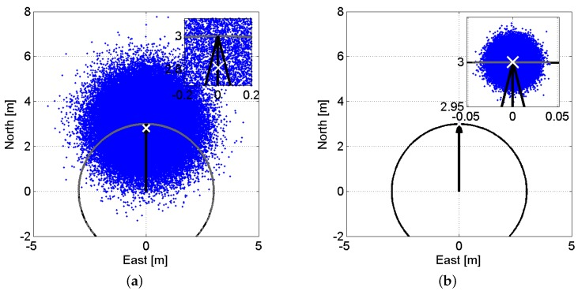
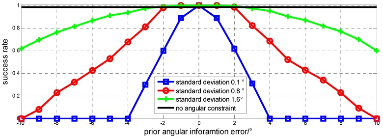
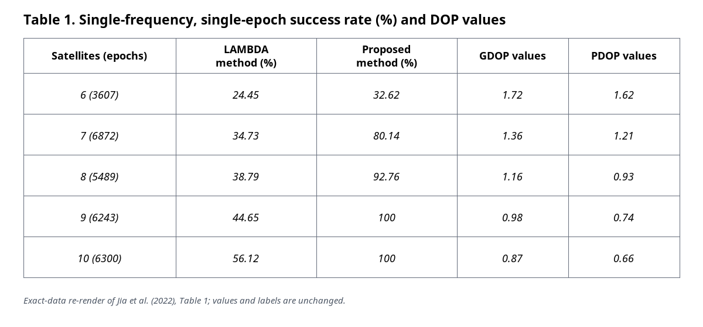

# 2026-10-12 GNSS 每日研究简报

## 今日快报

### 快报 1：惯导前馈能让环路熬过高动态，但实车自适应协方差没有额外精度收益

- 主题：`ins-doppler-feedforward-carrier-tracking`
- 来源 ID：`ion:gnss2026-16785`
- 来源链接：https://www.ion.org/gnss/abstracts.cfm?paperID=16785
- 发表日期：2026-09-16
- 来源类型：ION GNSS+ 2026 官方扩展摘要、软件接收机仿真与实车实验
- 获取范围：官方扩展摘要全文；惯导多普勒/码率前馈、标量环残差结构、三档协方差缩放及火箭仿真和实车结果已核对，未取得正式论文中的轨迹长度、失锁时刻、前端参数和逐星环路统计

**内容：** 方法用 INS 预测逐星载波多普勒与码率并送入 NCO，DLL/FLL/PLL 只跟踪剩余误差；导航端仍是松耦合 EKF。一个轻量 MLP 只把 GNSS 位置/速度解的测量协方差按正常、退化、不可靠三档乘以 1、10、100，并不改变过程噪声。

**结论：** 官方摘要报告，理想火箭仿真的三维位置/速度 RMSE 为 395.72 m 和 1.89 m/s；实车失锁前，固定协方差与自适应协方差的 INS 辅助接收机结果同为 142.14 m 和 1.53 m/s，而融合解为 27.48 m 和 0.98 m/s。作者明确把实车主要收益定为“接收机连续性”，不是自适应协方差的额外精度改善；仿真和实车也不是等价动态条件。

**关注理由：** 环路前馈、导航融合和学习型协方差是三个不同环节。工程复验必须分别报告跟踪连续性、独立 GNSS 解与融合解，避免把 INS 传播收益误记为载波环本身的定位精度。

### 快报 2：盲估反射环境能救回一个坏 RTK 基站，却不等于方向定权普遍有效

- 主题：`blind-laser-validated-cors-environment-map`
- 来源 ID：`ion:gnss2026-16787`
- 来源链接：https://www.ion.org/gnss/abstracts.cfm?paperID=16787
- 发表日期：2026-09-16
- 来源类型：ION GNSS+ 2026 官方扩展摘要、三洲低成本参考站与激光独立测量
- 获取范围：官方扩展摘要全文；双频 SNR/码减载波反演、21 站评估、激光验证和 SPP/RTK 消融结论已核对，未取得正式论文中的设备清单、墙体逐项距离或完整错误固定统计

**内容：** 研究不依赖三维地图或现场勘测，只用基站自己的双频 SNR 与码减载波观测反演遮挡半球、近场墙体/热水器距离和天线离地高度，再比较方向方差膨胀、剔星/部分定整、经验相位修正三类用法。

**结论：** 激光独立测量显示关键距离可恢复到数厘米量级；但在 21 个站的 SPP 中，加入环境先验后的变化都小于 1 cm，因为后验稳健估计已吸收其作用。唯一严重遮挡的 RTK 基站上，方向地图也不优于逐历元残差门控；真正有效的是自关闭的双观测门控先识别坏站，再用物理尺度残差门把米级错误固定救回厘米级。样本里只有一个严重遮挡 RTK 基站，不能外推普遍成功率。

**关注理由：** 这是少见的负结果与正结果同时公开：静态环境地图更适合站点质控和算法激活，不应被包装成任意观测的万能权重。

### 快报 3：局部梯度陷波在双扫频干扰下多恢复 4 dB，上界和实机收益必须分开

- 主题：`local-gradient-adaptive-notch-multiple-jammers`
- 来源 ID：`ion:gnss2026-16847`
- 来源链接：https://www.ion.org/gnss/abstracts.cfm?paperID=16847
- 发表日期：2026-09-16
- 来源类型：ION GNSS+ 2026 官方扩展摘要、解析分析、仿真扫参和硬件实验
- 获取范围：官方扩展摘要全文；局部梯度构造、基线算法、仿真抑制度和实机保锁时间已核对，未取得正式论文中的干扰功率、扫频率、射频带宽与定位门限

**内容：** 传统级联 NLMS 自适应陷波遇到两个功率相近的扫频干扰时，全带梯度会相互抵消，使陷波中心落到两干扰之间。LG-ANF 先把当前频率附近搬到基带、低通局部化梯度、再搬回原频率，只新增局部带宽一个参数。

**结论：** 摘要称，在逐条件优化局部带宽时，病态幅比附近的带内抑制度最多恢复约 4 dB；特定边缘参数组合最多 13 dB，但作者把这些优化结果明确称为可达增益上界。固定 $`\alpha_{lp}=0.5`$ 的硬件实验中，位置锁定比标准 ANF 多维持 24 s。没有完整干扰条件与重复次数，24 s 不是通用抗干扰保证。

**关注理由：** 该工作把“平均滤波更强”改写为“避免竞争梯度把陷波拉错位置”，适合低复杂度接收机；验收时应固定参数并报告 C/N₀、环路失锁和位置失效三个层次。

### 快报 4：单贴片天线借车辆运动形成合成孔径，转发欺骗 ROC AUC 达 0.989

- 主题：`single-antenna-supercorrelation-meaconing-authentication`
- 来源 ID：`ion:gnss2026-16906`
- 来源链接：https://www.ion.org/gnss/abstracts.cfm?paperID=16906
- 发表日期：2026-09-16
- 来源类型：ION GNSS+ 2026 官方扩展摘要、Jammertest 2025 挪威户外转发欺骗数据
- 获取范围：官方扩展摘要全文；Supercorrelation/Skyscan、双频实测、锥角判据、ROC 与等错误率已核对，未取得正式论文中的数据时长、车辆速度分布、攻击功率和跨路线验证

**内容：** Supercorrelation 用跟踪输出重构信号，在补偿车辆运动、卫星动态和接收机钟后做长相干积分，让单贴片天线随运动形成合成孔径。短直线路段只能把到达方向约束在车辆速度轴周围的圆锥上，转向则增加空间多样性；锥角误差随后用于真假信号分类。

**结论：** 对分析中的 Galileo E1C 转发信号与 E5Q 真实信号总体，ROC AUC 为 0.989；等错误率点的误警和漏检都约 3.0%，对应约 97.0% 检出率。结果来自一次公开户外演示和特定信号总体，尚不能证明对静止接收机、同向移动转发源或不同功率比同样成立。

**关注理由：** 它用运动几何补足单天线缺少阵列孔径的问题，可作为导航电文认证的物理层补充；失效边界正是运动方向不可观或攻击源与卫星锥角混叠。

### 快报 5：开源 RTCM 链路加贴附式重辐射器让手机步行 RTK 接近全固定，但硬件改变了问题

- 主题：`open-smartphone-booster-realtime-rtk`
- 来源 ID：`ion:gnss2026-17016`
- 来源链接：https://www.ion.org/gnss/abstracts.cfm?paperID=17016
- 发表日期：2026-09-18
- 来源类型：ION GNSS+ 2026 官方扩展摘要、开源软件与开放硬件实测
- 获取范围：官方扩展摘要全文；Android RTCM 转换/流传输、云端 RTK、贴附式 GNSS 重辐射器和开放天空步行结果已核对，未取得正式论文中的手机型号、基线、路线长度、精确固定率和尾部误差

**内容：** 软件端把 Android Raw GNSS Measurement API 的时刻与载波观测转为 RTCM 并送往云端 RTK；硬件端用可贴在手机上的信号重辐射装置绕过内置线极化天线的高噪声和频繁周跳。两部分共同提高模糊度连续性。

**结论：** 官方摘要只称开放天空步行试验的固定率“接近 100%”并达到厘米级，没有给精确百分比、误差分位数、未增强手机基线或复杂环境结果。因此它证明的是该硬件增强链路在一次场景可行，不是“手机内置 GNSS 单独达到厘米级”。

**关注理由：** 开源 RTCM 工具值得复用，但重辐射器改变了射频入口。比较时必须把“手机软件能力”和“外加天线/重辐射硬件能力”分开记账。

## 深度研读

### 深读 1｜接收机工程｜先把一条已知基线放上球面：为什么几何约束能救单历元定整

- 类别：`receiver-engineering`
- 学习层级：`foundation`
- 选题定位：`经典基础：从双差相位到基线长度约束`
- 来源 ID：`doi:10.3390/s17020274`
- 来源链接：https://doi.org/10.3390/s17020274
- 发表日期：2017-01-30
- 来源类型：Sensors 同行评审开放论文
- 获取范围：CC BY 4.0 开放全文；24 h IRNSS/NavIC L5 实测、线阵/平面阵、LAMBDA/MC-LAMBDA、Figures 1–6 与 Tables 1–2 已核对
- 价值评分：96/100（相关性 20，经典价值 20，证据 19，教学价值 20，工程价值 17）

#### 为什么先学这个

双天线定向不是先“算出两个绝对坐标再相减”。短基线让两端大气与轨道误差近似共模，双差载波把问题压缩成视线几何、基线向量和整数模糊度；再加入已知基线长度，就能看清约束为什么缩小搜索空间，也能看清非线性约束为什么会把低精度浮点解映射出偏差。

#### 先修知识

需要理解载波相位与伪距、天线间与星间双差、短基线共模消除、整数模糊度、加权最小二乘、LAMBDA、旋转矩阵、航向/俯仰角和标准差。IRNSS 后更名 NavIC，论文使用 L5 1176.45 MHz 信号。

#### 一句话逻辑

先用码与相位形成单历元双差浮点解，再强制 NED 基线 $`X`$ 与机体系已知基线 $`B`$ 满足同一刚体旋转 $`X=RB`$；MC-LAMBDA 把整数性和 $`R^TR=I`$ 一起放进搜索，使相位在定整后主导姿态精度。

#### 研究问题与约束

数据来自澳大利亚珀斯 Curtin University 三站，2016 年 DOY 166、1 s 采样、10° 截止角、连续 24 h；使用广播星历，只处理 IRNSS L5。线阵约 6 m，平面阵由三天线组成。LS-VCE 在另外两天数据上估得天顶相位/码标准差 2 mm/26 cm。结论依赖无遮挡屋顶、短基线与区域星座几何，不代表车载多路径或全球覆盖。

#### 核心方法论

未约束模型把双差码/相位堆成观测向量，估计基线与整数。已知天线阵列在机体系的坐标 $`B`$ 后，以旋转矩阵 $`R`$ 映射到导航系；线阵退化为 $`\|x\|=l`$ 的球面约束，平面阵还提供基线夹角。标准 LAMBDA 只利用整数性，MC-LAMBDA 同时最小化整数残差和候选姿态偏离正交流形的距离。

#### 关键公式逐步推导

短基线双差观测可概括为：

```math
y=M\,\operatorname{vec}(X^T)+A a+\varepsilon,
\qquad a\in\mathbb Z^{(m-1)(n-1)}.
```

刚体几何给出：

```math
X=RB,\qquad R^TR=I_3,\qquad \det(R)=1.
```

于是整数候选不再只按 $`\|\hat a-a\|_{Q_{\hat a}}^2`$ 排序，还要加上候选基线投影到约束集合的代价：

```math
\check a=\arg\min_{a\in\mathbb Z^k}
\left(\|\hat a-a\|_{Q_{\hat a}}^2+
\|\operatorname{vec}(\hat X(a)-\check X(a))\|_{Q_{\hat X(a)}}^2\right),
```

其中 $`\check X(a)`$ 满足 $`X^TX=B^TB`$；单基线时就是长度为 $`l`$ 的球面。

#### 经典价值与创新边界

经典价值在于把“已知安装几何”写成统计约束，而不是定整后的人工验算。论文的重要边界同样经典：低精度码解投到曲面会产生非线性偏差，线性化协方差会低估这种曲率；只有定整正确后，毫米级相位才把解拉回真值附近。

#### 整体逻辑链

估计 L5 码/相位噪声；构造单历元双差；先看无约束浮点解；再投到基线球面；区分正确与错误整数簇；比较 LAMBDA 与 MC-LAMBDA；从线阵扩展到平面阵；最后把固定解转换为航向、俯仰和横滚并统计 24 h 精度。

#### 原文图表与结果分析



> 图表源：Zaminpardaz、Teunissen 与 Nadarajah《IRNSS/NavIC L5 Attitude Determination》Figure 4，[CC BY 4.0 开放全文](https://doi.org/10.3390/s17020274)。直接保存 PMC/AWS 发布的原始 JPEG，未裁剪、重绘或改变坐标、散点和标注。

两幅图横轴 East（m）、纵轴 North（m），黑色圆半径 3 m，黑箭头是真值 $`[3,0]^T`$。左图浮点样本方差大，蓝点投到圆后覆盖长弧并使均值偏离真值；右图样本精度高，投影后的灰点只占局部小弧。图证明曲面约束的线性近似只在局部成立，不能单独证明任何实际定整成功率。

#### 原文结果论述

线阵中，标准 LAMBDA 到 MC-LAMBDA 的单历元成功率由 14.6% 升到 89.2%；平面阵由 4.8% 升到 99.8%。固定后，约 6 m 南北基线的航向/俯仰经验标准差约 0.04°/0.09°，论文总结为约 0.05°/0.10°。Table 2 也显示固定后精度相对浮点约改善 120 倍；这些数字来自屋顶、固定安装与区域星座几何。

#### 常见误区与适用边界

第一，基线长度约束不会自动保证整数正确。第二，球面投影后的均值不一定无偏。第三，标准 LAMBDA 成功率随增加天线而必然提高是错误的；整数维数也在增加。第四，固定后的小标准差不是完整性保证。第五，区域星座的方位分布会让航向与俯仰精度不同。第六，安装长度、相位中心和结构形变都必须进入误差预算。

#### 工程实现步骤

1. 标定天线相位中心间基线长度及其温度稳定性。
2. 对同历元、同星、同频观测做天线间与星间双差。
3. 用仰角模型建立码/相位权阵并输出浮点模糊度协方差。
4. 先跑标准 LAMBDA，再把候选基线投影到长度或阵列几何约束集。
5. 对最优与次优候选做接受检验，并保留浮点回退。
6. 固定后计算 NED 基线与姿态，持续监控长度残差、周跳和候选跳变。

#### 复现实验设计

搭建 2 天线 1 m/3 m/6 m 三档基线和 3 天线平面阵，开放天空连续采集 24 h、1 Hz；人为加入 2 cm/10 cm 长度误差和 0.5°/2° 安装角误差。比较无约束 LAMBDA、长度后验筛选和 MC-LAMBDA。指标包括整数真值成功率、错误固定率、航向/俯仰 50/95/99% 误差、拒绝率、计算时间与长度残差。失败用例包含 4–6 星弱几何、低仰角多路径、热胀冷缩和重捕获。

#### 与定位及低成本实现的联系

短基线消掉大气与轨道共模，使消费级双频板卡也能把载波相位用于定向；但低成本天线的相位中心变化会直接投影成基线误差。本节先说明“长度”这一最小几何先验，下一节再把粗航向和俯仰也纳入整数目标函数。

#### 本节小结

基线约束不是装饰性的合理性检查，而是改变整数搜索的可行集合。它能显著提高单历元成功率，也会在观测很噪时引入曲率偏差，所以必须与正确固定检验成对使用。

### 深读 2｜接收机工程｜不只知道边有多长：粗航向与俯仰怎样压缩整数候选

- 类别：`receiver-engineering`
- 学习层级：`intermediate`
- 选题定位：`基础进阶：三维基线先验进入约束整数最小二乘`
- 来源 ID：`doi:10.3390/s151229774`
- 来源链接：https://doi.org/10.3390/s151229774
- 发表日期：2015-12-02
- 来源类型：Sensors 同行评审开放论文
- 获取范围：CC BY 4.0 开放全文；两组静态基线、先验误差仿真、动态车辆实验、Figures 1–5 与 Table 1 已核对
- 价值评分：94/100（相关性 19，经典价值 18，证据 19，教学价值 20，工程价值 18）

#### 为什么先学这个

只知道基线长度时，候选仍可落在整个球面；若粗姿态传感器还能给出航向和俯仰及其不确定度，搜索应优先检查球面上的小片区域。本节把这些先验写入目标函数，并展示“先验越准约束越强、先验有偏时越危险”的定量折衷。

#### 先修知识

需要掌握上一节的双差、LAMBDA 与球面约束，以及高斯先验、马氏距离、条件最小二乘、分支定界、航向 $`\theta`$、俯仰 $`\beta`$、基线长度 $`l`$ 和先验方差的含义。

#### 一句话逻辑

对每个整数候选，不仅计算它离浮点模糊度有多远，还寻找与该候选相容、同时最贴近长度/航向/俯仰先验的基线；这个附加代价把不合理候选更早排除。

#### 研究问题与约束

两次静态实验的基线为 3.145 m 和 8.343 m，各记录 2156 和 2013 个历元；L1 载波与 C/A 码来自两副 GPS-702-GG 天线，粗角度由 NovAtel SPAN-CPT 惯导给出。动态基线 2.353 m，车辆约一圈半。论文把多历元解当作整数真值，环境为良好观测条件；没有城市遮挡、天线形变或独立光学姿态真值。

#### 核心方法论

标准整数最小二乘只最小化浮点模糊度残差。新方法对每个整数候选先计算条件基线 $`\hat b(a)`$，再联合最小化基线马氏距离与航向、俯仰、长度先验的标准化残差；搜索仍借助 LAMBDA 的椭球下界加速，而非暴力遍历全部非椭球空间。

#### 关键公式逐步推导

线性化双差模型为：

```math
y=Aa+Bb+e,
```

其中 $`a\in\mathbb Z^n`$ 是整数模糊度，$`b=[b_1,b_2,b_3]^T`$ 是基线。姿态与长度为：

```math
\theta=\arctan\frac{b_2}{b_1},\qquad
\beta=\arctan\frac{b_3}{\sqrt{b_1^2+b_2^2}},\qquad
l=\|b\|.
```

约束整数目标写成：

```math
\check a=\arg\min_{a\in\mathbb Z^n}
\left[\|\hat a-a\|_{Q_{\hat a}}^2+
\min_b\left(
\|\hat b(a)-b\|_{Q_{\hat b(a)}}^2+
\frac{(\theta-\bar\theta)^2}{\sigma_\theta^2}+
\frac{(\beta-\bar\beta)^2}{\sigma_\beta^2}+
\frac{(l-\bar l)^2}{\sigma_l^2}
\right)\right].
```

先验方差控制约束强度：方差太小会把偏差当真值，太大会退化为只有长度或无角度约束。

#### 经典价值与创新边界

价值在于把粗姿态信息以概率权重进入整数目标，而不是硬门限；这也为后来的 GNSS/IMU 紧耦合定姿提供了清晰原型。边界是论文先验来自高等级惯导，且实验几何良好；“不敏感”只覆盖其设定的角误差与方差，不等于能抵御未知系统偏差。

#### 整体逻辑链

求无约束浮点模糊度与条件基线；把球坐标先验加入目标；用椭球下界分支搜索；两组静态数据与长度约束方法对比；改变角度先验偏差和标准差做灵敏度试验；最后在车辆动态数据上连续求基线和姿态。

#### 原文图表与结果分析



> 图表源：Gong 等《GNSS Single Frequency, Single Epoch Reliable Attitude Determination Method with Baseline Vector Constraint》Figure 3，[CC BY 4.0 开放全文](https://doi.org/10.3390/s151229774)。直接保存 PMC/AWS 发布的原始 JPEG，未裁剪、重绘或改变曲线、图例、坐标与数值。

横轴是航向先验误差（°），纵轴是固定成功率；蓝、红、绿分别对应先验标准差 0.1°、0.8°、1.6°，黑线是不使用角度约束。小标准差在零偏差附近最强，却在约 3° 外迅速失效；大标准差的峰值较钝、容错范围更宽。图展示的是模型试验，不是实车全场景统计，也不能给出错误固定风险的尾部上界。

#### 原文结果论述

Table 1 显示，新方法在 3.14 m/2156 历元和 8.34 m/2013 历元上均为 100% 固定，平均每历元 0.079 s/0.116 s；两种只用长度的对照分别为 98.6%/96.7% 和 99.4%/99.3%。第一组静态固定解的航向/俯仰最大误差约 0.1°/0.2°，标准差约 0.05°/0.08°。这些成功率以多历元解作真值，并且角先验由高等级惯导提供。

#### 常见误区与适用边界

第一，把先验标准差设得越小越好。第二，只看固定率，不统计错误固定。第三，用同一传感器生成先验和真值。第四，忽略 $`\arctan`$ 的象限与角度环绕。第五，基线长度精确不代表航向先验无偏。第六，把良好环境的 100% 外推到遮挡路线。第七，搜索加速不等于概率上已经安全。

#### 工程实现步骤

1. 从安装标定得到 $`\bar l`$ 与方差，从磁罗盘/IMU/上一历元得到 $`\bar\theta,\bar\beta`$。
2. 对所有角度先验做时间同步、杆臂和坐标系转换。
3. 生成浮点模糊度与条件基线协方差。
4. 用标准 LAMBDA 给出初始候选集合和下界。
5. 对候选求内层基线最小化，叠加三项先验代价并排序。
6. 用残差、比值、长度和角度创新联合验收；验收失败保留浮点或上一可信姿态。

#### 复现实验设计

用双天线低成本双频板卡和独立光学转台，设置 0.5/1/3 m 基线；在 6–12 星、开阔/树荫/建筑反射三类环境各做 5000 个单历元重启。向先验注入 0–10° 常偏和 0.1/0.5/1/2/5° 随机误差。比较无约束 LAMBDA、仅长度、三维先验三种方法。指标含正确固定、错误固定、拒绝率、姿态 95/99% 误差和 P95 计算时间；重点失败用例是先验突跳、时间延迟和坐标轴符号错误。

#### 与定位及低成本实现的联系

低成本 IMU 的短期粗姿态即使达不到载波定向精度，也能压缩整数搜索；反过来，GNSS 固定姿态可校正 IMU 漂移。系统收益来自“低精度先验帮助高精度离散决策”，而不是直接把 IMU 当真值。下一节把双基线整体写成正交姿态矩阵，进一步避免逐条基线再拼姿态的两步误差。

#### 本节小结

三维基线先验可以明显提高单历元固定率，但收益受先验偏差—方差匹配支配。强而错的先验比弱先验危险，工程实现必须允许拒绝和回退。

### 深读 3｜纯 GNSS 定位｜两条边不能各算各的：正交姿态矩阵怎样直接约束单历元定向

- 类别：`positioning`
- 学习层级：`advanced`
- 选题定位：`定位深入：多天线单频单历元纯 GNSS 三维姿态`
- 来源 ID：`doi:10.1155/2022/4426987`
- 来源链接：https://doi.org/10.1155/2022/4426987
- 发表日期：2022-03-01
- 来源类型：Mathematical Problems in Engineering 同行评审开放论文
- 获取范围：CC BY 4.0 开放全文；三天线双基线模型、LAMBDA–Lagrange 搜索、静态卫星数分组、1 h 动态试验、Figures 1–7 与 Tables 1–2 已核对
- 价值评分：93/100（相关性 20，经典价值 17，证据 18，教学价值 19，工程价值 19）

#### 为什么先学这个

上一节仍围绕一条基线的球坐标先验。三天线形成两条固定基线后，它们共享同一个刚体旋转；若逐条解基线再拼航向/俯仰/横滚，会重复传播误差，甚至得到不正交的“姿态矩阵”。直接把整数矩阵与正交姿态矩阵联合求解，才完整利用阵列几何。

#### 先修知识

需要理解多天线双差、矩阵向量化、Kronecker 积、姿态矩阵 $`R`$、约束 $`R^TR=I`$、LAMBDA 搜索椭球、Lagrange 乘子、Taylor 线性化、GDOP/PDOP，以及固定率不等于可靠性。

#### 一句话逻辑

用机体系已知的双基线矩阵 $`F`$ 把导航系基线写成 $`B=RF`$，在同一个加权目标中联合搜索整数矩阵 $`Z`$ 与正交姿态 $`R`$；LAMBDA 先给椭球候选，Lagrange 约束解再筛掉不能形成刚体旋转的候选。

#### 研究问题与约束

论文要求至少三天线、两条不退化基线、单频单历元。静态分析按同时可见 6–10 星分组，总历元数分别为 3607、6872、5489、6243、6300；动态试验用 u-blox 单频接收机，2022-01-15 采集 1 h、1 Hz、10° 截止角。没有公开独立动态姿态真值，动态曲线主要证明可连续解算，不能量化绝对动态精度。

#### 核心方法论

载波与伪距双差组成 $`Y`$，卫星几何矩阵映射导航系基线，整数矩阵 $`Z`$ 进入相位项。已知机体系基线 $`F`$ 后以 $`B=RF`$ 消去中间基线坐标。先求无约束浮点 $`\hat R,\hat Z`$，LAMBDA 枚举整数候选；对每个候选，用 Lagrange 乘子和 Taylor 正交约束求最近的 $`R`$，再比较完整加权残差。

#### 关键公式逐步推导

多天线双差模型写为：

```math
Y=GB+MZ+\varepsilon,
\qquad Z\in\mathbb Z^{n\times 2}.
```

把 $`B=RF`$ 代入并向量化，可得：

```math
Y=HR+MZ+\varepsilon,
\qquad R^TR=I.
```

联合问题是：

```math
(\check Z,\check R)=
\arg\min_{Z\in\mathbb Z^{n\times2},\,R^TR=I}
\|Y-MZ-HR\|_{Q_Y}^{2}.
```

实际算法先用无约束 ILS 产生 $`Z`$ 候选，再在 $`R^TR-I=0`$ 的一阶 Taylor 约束下用 Lagrange 乘子求 $`R(Z)`$；候选的整数残差与正交姿态残差之和决定最终排序。

#### 经典价值与创新边界

价值在于用一个正交矩阵统一两条基线，保证结果属于刚体旋转并避免“先基线、后姿态”的两步误差。创新边界是正交约束靠局部 Taylor 展开，候选排序仍依赖码噪声模型与 LAMBDA 初始椭球；当天线近共线、伪距重尾或候选集漏掉真值时，正交性不能挽救错误整数。

#### 整体逻辑链

构造双基线双差矩阵；以已知 $`F`$ 代入姿态模型；求浮点整数/姿态及协方差；用 LAMBDA 把非椭球搜索包进椭球候选；对候选做 Lagrange 正交求解；按完整目标选最优；静态按星数统计成功率和 DOP；动态展示三角天线轨迹及三轴姿态连续性。

#### 原文图表与结果分析



> 图表源：Jia 等《GNSS Single-Frequency, Single-Epoch Attitude Determination Method with Orthogonal Constraints》Table 1，[CC BY 4.0 开放全文](https://doi.org/10.1155/2022/4426987)。按原表逐项等值复排后转存为 PNG；列名、历元数、成功率与 DOP 数值未改动，无插值或再计算。

第一列同时给可见星数与样本历元；两组百分比是标准 LAMBDA 和正交约束方法，后两列是 GDOP/PDOP。7 星时成功率从 34.73% 提到 80.14%，8 星从 38.79% 提到 92.76%，说明阵列正交信息在中等几何条件下最有区分力；表只给成功率，没有错误固定风险、拒绝率或置信区间。

#### 原文结果论述

6 星时两法为 24.45% 与 32.62%；7 星为 34.73% 与 80.14%；8 星为 38.79% 与 92.76%；9 星为 44.65% 与 100%；10 星为 56.12% 与 100%。在正确固定且 10 星条件下，Table 2 的航向/俯仰/横滚标准差为 0.236°/0.539°/0.499°。动态部分展示 1 h 曲线，但没有独立真值，因此不能从“曲线连续”推出动态绝对精度。

#### 常见误区与适用边界

第一，正交矩阵只保证几何合法，不保证整数正确。第二，三天线近共线会让姿态秩退化。第三，把静态多历元整数真值当绝对外部真值。第四，用固定率替代完整性风险。第五，忽略两条基线共享主天线造成的相关性。第六，认为星数比星座几何更重要。第七，把动态姿态曲线的平滑当作准确。

#### 工程实现步骤

1. 在机体系标定三天线相位中心坐标矩阵 $`F`$，检查两基线夹角和温度形变。
2. 构造共享主天线的双基线码/相位双差，并保留交叉协方差。
3. 联合求 $`\hat R,\hat Z`$ 及协方差，检查法方程秩和 DOP。
4. 用 LAMBDA 产生有限整数候选，设置最大候选数和超时预算。
5. 对每个候选迭代正交约束 Lagrange 解，拒绝不收敛或残差异常候选。
6. 输出姿态前做候选比值、码/相位后验、基线长度、$`\|R^TR-I\|`$ 和历元连续性联合验收。

#### 复现实验设计

搭建边长 0.5–1.0 m 的非共线三天线阵列，使用转台/光学全站仪给三轴真值；单频与双频各采 24 h 静态和 30 min 动态，1/10 Hz。通过遮挡板控制 6–12 星，通过射频重放注入周跳和码多路径。比较逐基线 LAMBDA、两条独立 C-LAMBDA、联合正交方法。指标含正确/错误固定率、拒绝率、三轴 50/95/99% 误差、$`R`$ 正交残差、P95 时延和重捕获时间；失败用例为近共线阵列、主天线周跳、共享多路径和机架弹性形变。

#### 与定位及低成本实现的联系

多天线纯 GNSS 姿态无积分漂移，可直接给车辆航向、平台三轴姿态和杆臂旋转；同时需要三路同步观测与稳定机架，硬件成本高于双天线。低成本实现可先做双天线航向，再在需要横滚/俯仰完整性的场景升级三天线，并把正交残差作为运行时自检量。

#### 本节小结

把两条基线塞进同一个正交姿态矩阵，会比逐条解算更充分地利用刚体几何，并在 7–8 星场景显著提高单历元固定率；但正交性是几何约束，不是错误固定的安全证明。
