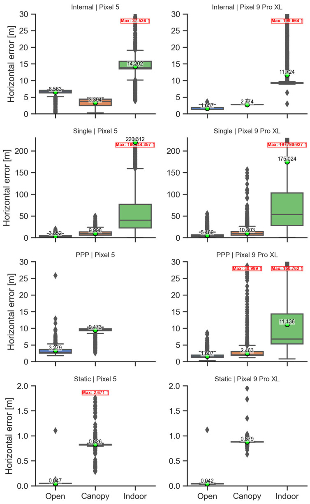
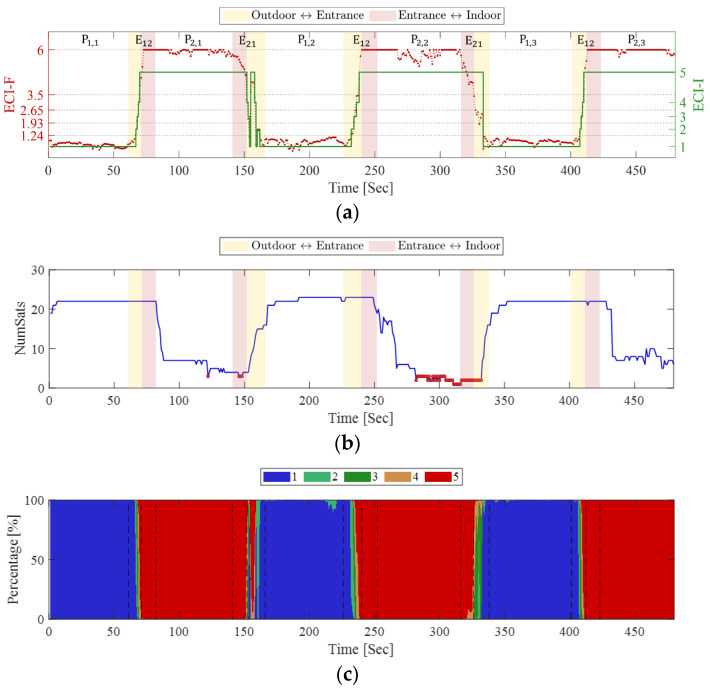
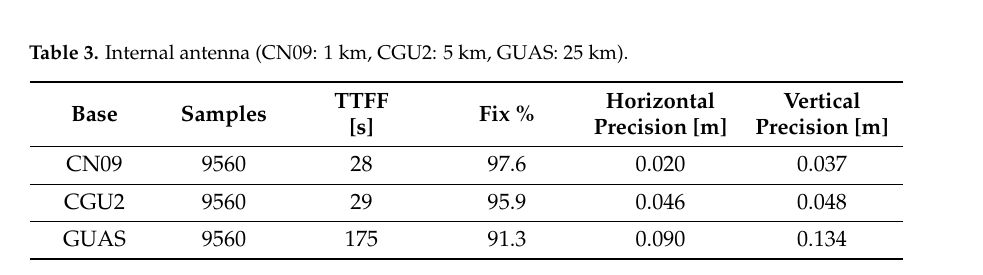

# 2026-10-13 GNSS 每日研究简报

## 今日快报

### 快报 1：月面 GNSS 切边观测补上 800–8000 km 等离子体盲区，但摘要只给模型结构差异

- 主题：`lunar-gnss-limb-sounding-plasmasphere`
- 来源 ID：`ion:gnss2026-16893`
- 来源链接：https://www.ion.org/gnss/abstracts.cfm?paperID=16893
- 发表日期：2026-09-16
- 来源类型：ION GNSS+ 2026 官方扩展摘要、LuGRE 月面接收机 GPS/Galileo 载波相位实测
- 获取范围：官方扩展摘要全文；月面切边观测几何、TEC 反演、四种经验模型比较与主要结构性结论已核对，未取得正式论文中的逐星弧段、周跳处理、绝对 TEC 数值表和误差条带

**内容：** LuGRE 从月面跟踪 GPS 与 Galileo 载波相位，让信号路径以切线方向穿过地球边缘，再把反演的总电子含量与 IRI-2020、标准 GCPM、更新 IRI 基线的 Gallagher 变体等四套经验框架比较。这个“从外向内”的观测几何针对的是地面和低轨资料难以连续覆盖的 800–8000 km 电离层—等离子层过渡区。

**结论：** 官方摘要称，各模型能复现宏观形态，却在局部结构上与 LuGRE 明显分离，而且不同数据段的最佳模型会变化；包含磁层描述的模型总体更好。摘要没有公开样本数、TEC RMSE 或置信区间，因此能成立的是“现有气候模型存在局部结构失配”，不能把它量化成某一模型的全球精度排名，也不能从一次任务直接推出永久月面台站的四维层析能力。

**关注理由：** GNSS 不只是定位源，也能成为跨地月空间的介质探针。对 StarEdge 更直接的工程启示是：延迟模型的误差不仅来自参数大小，也来自观测几何没有照到的空间层次。

### 快报 2：手机电离层集成模型把一次 2001.73 m 异常压到 0.53 m，但目标本身是 GIM

- 主题：`smartphone-ionosphere-gated-ensemble`
- 来源 ID：`ion:gnss2026-16916`
- 来源链接：https://www.ion.org/gnss/abstracts.cfm?paperID=16916
- 发表日期：2026-09-16
- 来源类型：ION GNSS+ 2026 官方扩展摘要、22 组手机车载数据与机器学习实验
- 获取范围：官方扩展摘要全文；数据拆分、特征、四级模型、三组示例 RMSE 与运行时间已核对，未取得正式论文中的全数据汇总、逐折交叉验证和位置域收益

**内容：** 研究先用 York University PPP 引擎和 IGS 快速产品，从双频手机观测生成电离层穿刺点处的垂直延迟，再串联随机森林去硬件偏差、旋转森林/PCA 去噪、岭回归抓短时近线性趋势，最后用带门控的梯度提升元模型按模型一致性融合。22 组车载数据覆盖 10 天、6 款手机、单段约 20–60 min；12 组用于训练流程，另 10 组用于跨日期、跨设备或跨时段检验。

**结论：** 作者报告，Pixel 4 的一个跨日期测试集由 2001.73 m 原始 RMSE 降到 0.53 m；Pixel 5 训练样本由 1814.86 m 降到元模型 0.05 m，作者自己提示存在轻微过拟合；另一组跨设备 Samsung S21+ 仅由 3.68 m 降到 1.77 m。全部 22 组推理少于 5 min。这里的真值是 IGS GIM 插值，不是独立斜向电离层测量，更不是位置误差；极大的初始 RMSE 也受整周、硬件偏差和异常值共同支配。

**关注理由：** 这项结果最有价值的不是“千米变亚米”的标题，而是把偏差、噪声、趋势交给不同模型再门控融合。复验必须同时报告未清洗基线、按数据集分层的误差和最终位置域影响。

### 快报 3：15 年 RTX 历史数据训练映射函数，20 站平均收敛时间改善约 25%

- 主题：`ml-vtec-stec-mapping-rtx`
- 来源 ID：`ion:gnss2026-16894`
- 来源链接：https://www.ion.org/gnss/abstracts.cfm?paperID=16894
- 发表日期：2026-09-17
- 来源类型：ION GNSS+ 2026 官方扩展摘要、商业 PPP 服务历史观测与全球站验证
- 获取范围：官方扩展摘要全文；单层映射问题、训练档案、输入特征、20 站平均结果与地理适用边界已核对，未取得正式论文中的网络结构、训练/验证时段、逐站分位数和保护机制参数

**内容：** 传统全球电离层模型把电子集中在约 300–500 km 薄壳，再用只依赖仰角的各向同性映射函数把 VTEC 转为 STEC。Trimble 用 15 年、数百个全球参考站的 1 Hz 档案训练神经网络，把视线方向、穿刺点位置、模型 VTEC、时刻等加入映射，目标是减少低纬和强梯度条件下的映射失配。

**结论：** 官方摘要称，在 20 个全球测试站上，采用学习映射后，水平和垂直位置达到 1σ 门限的收敛时间平均改善约 25%，最大收益多见于南北纬 20°–50°。这是厂商摘要中的平均收敛指标，不是电离层延迟全局 RMSE，也没有逐站尾部统计；训练资料稀疏区、太阳活动变化和网络外推需要独立的 guard rail。

**关注理由：** 它把“单层高度调参”推进为数据驱动的方向映射，但仍保留 VTEC 主模型。工程上应把神经网络当作受约束修正量，而不是允许它在无训练覆盖处接管物理模型。

### 快报 4：北斗机载多路径随平滑从强仰角相关变平，600 s 模型不能照搬 100 s 上界

- 主题：`bds-dfmc-gbas-airborne-multipath-bounds`
- 来源 ID：`ion:gnss2026-17028`
- 来源链接：https://www.ion.org/gnss/abstracts.cfm?paperID=17028
- 发表日期：2026-09-18
- 来源类型：ION GNSS+ 2026 同行评审会议论文的官方扩展摘要与出版元数据、C909 飞行试验
- 获取范围：官方扩展摘要、出版摘要、页码与 DOI 元数据；B1C/B2b/无电离层组合、方向分箱、100/600 s 平滑结论已核对，正式全文需 ION 下载权限，未取得各仰角箱数值上界

**内容：** 研究以中国陕西 C909 飞行数据形成码减载波残差，检测周跳、分连续弧并去弧段常数偏差，再做消电离层发散的时变载波平滑。作者先在机体系方位—仰角网格观察机体反射图样，随后因为小网格独立样本不足，回到本地坐标系仰角分箱，并对长平滑引起的有效样本减少做保守膨胀。

**结论：** 出版摘要报告，B1C 残差最低且有一定方向性，B2b 残差更高、方向性较弱，无电离层组合因码噪声与多路径放大而最大；未平滑残差强依赖仰角，100 s 结果接近现有 DUFMAN，600 s 时幅值下降且仰角依赖变弱。没有公开各箱数值与多机型重复，当前证据只支持 C909 数据上的初步建模，不足以直接成为跨机型认证上界。

**关注理由：** 完整性模型关心的不是平均残差最小，而是有限独立样本下仍能保守包络。平滑时间常数改变统计相关性，不能只把旧模型按比例缩小。

### 快报 5：四天线 COTS 节点在 Jammertest 实时识别干扰，但双站定位精度只到“中等”

- 主题：`cots-multinode-rfi-detection-localization`
- 来源 ID：`ion:gnss2026-16822`
- 来源链接：https://www.ion.org/gnss/abstracts.cfm?paperID=16822
- 发表日期：2026-09-17
- 来源类型：ION GNSS+ 2026 官方扩展摘要、ESA NAVISP SILENT/VAULT 原型与 Jammertest 2025 实测
- 获取范围：官方扩展摘要全文；节点构成、检测层、到达角/PDOA 融合、SVM/VAE 与现场定性结果已核对，未取得正式论文中的误警率、定位误差、时延、攻击功率和真值轨迹

**内容：** 每个 SILENT 节点用四副商用天线，在 L1/E1 与 L5/E5 上由天线对伪距、载波相位和双差聚类估计欺骗到达角，并用 AGC、C/N₀ 与宽带频谱补充检测。服务器端 VAULT 融合多个节点的功率差到达与角度观测定位干扰源，再结合数字高程模型估算受影响服务区；分类器包括可重训的 SVM 与 VAE。

**结论：** 两个固定节点在 Jammertest 2025 的压制、相干及非相干欺骗中，各检测层都实时识别到攻击，到达角按预期工作；作者称使用旧训练数据的 SVM/VAE 仍表现良好。但摘要只把双站源定位称为“moderate accuracy”，没有米级误差、误警/漏警或场景数，因此不能把“全部检测到”解释成已量化的安全完整性。

**关注理由：** 这套架构把单机检测、网络定位与传播影响区分开，适合做分层告警。下一步真正关键的是公开事件级混淆矩阵、定位置信域和节点几何退化条件。

## 深度研读

### 深读 1｜低成本与移动端｜先别把新机等同于好解：观测完整度、信号质量与定位误差要分账

- 类别：`low-cost-mobile`
- 学习层级：`foundation`
- 选题定位：`经典基础：从 Android 原始观测质量到位置误差的分层评估`
- 来源 ID：`doi:10.3390/s25144452`
- 来源链接：https://doi.org/10.3390/s25144452
- 发表日期：2025-07-17
- 来源类型：Sensors 同行评审开放论文
- 获取范围：CC BY 4.0 开放全文与原始图；Pixel 5/Pixel 9 Pro XL、三种环境、五小时原始数据、Figures 1–16 与 Tables 1–6 已核对
- 价值评分：94/100（相关性 20，经典价值 17，证据 19，教学价值 20，工程价值 18）

#### 为什么先学这个

手机 GNSS 常把“能看到更多卫星”“C/N₀ 更高”“固定率更高”和“位置更准”混成一句话。这篇论文用同一布设、同一时段长度和同一处理链比较两代 Pixel，最适合先建立三层账本：观测是否存在、观测质量如何、定位解最终怎样。后两节的环境指标和 RTK 定权，都依赖这层分账。

#### 先修知识

需要知道 Android 原始 GNSS 中码、载波相位与 Accumulated Delta Range 的关系，C/N₀、周跳、码多路径、SPP、PPP、相对静态解、固定/浮点模糊度、水平误差 HE、平均位置误差 AP，以及天线相位中心未知为什么会污染绝对偏差。

#### 一句话逻辑

把 Pixel 5 与 Pixel 9 Pro XL 在开放、树冠和近窗室内各记录 5 h，再用相同 QC 与定位流程比较“观测完整度—C/N₀/周跳/多路径—内部解/SPP/PPP/静态相对解”，从而检验新硬件的信号收益是否真的传到位置域。

#### 研究问题与约束

两机都放在高 1.4 m 的白色钢制地板上，长轴对准南北；设备中心相对参考点东西向偏移分别被修正，但天线相位中心没有标定。开放、树冠和室内近窗三个点各测约 5 h、约 08:00–14:00 UTC；日期分别为 2024-10-15、2024-10-29 和 2024-10-10。RINEX 用 GEO++ logger，内部 NMEA 用 GnssLogger；QC 用 G-Nut/Anubis，定位用 RTKLIB Demo5、CSRS-PPP 与相对静态模式。结论属于两台具体设备的静态样本，不是代际总体抽样。

#### 核心方法论

第一层统计实际/期望码相观测比和周跳率；第二层按信号比较 C/N₀ 与码多路径；第三层分别计算黑盒内部解、仅码 SPP、精密产品 PPP 和码相相对静态解。相同数据被不同方法处理，使“前端更好但算法没利用好”和“算法更稳但原始信号没变好”可以区分。

#### 关键公式逐步推导

用于串联论文流程的标准码观测模型为：

```math
P_i=\rho_i+c(\delta t_r-\delta t_i)+I_i+T_i+b_i+M_i+\varepsilon_{P,i}.
```

线性化后，SPP 解可写成加权最小二乘：

```math
\Delta\hat x=(G^T W G)^{-1}G^T W\Delta P,
\qquad Q_{\hat x}=(G^T W G)^{-1}.
```

增加卫星通常改善几何矩阵 $`G`$，较高 C/N₀ 通常允许增大权 $`W`$；但若多路径 $`M_i`$ 有偏、权模型与手机天线方向图不匹配，或内部解带平滑/冻结逻辑，更多观测不保证 $`\Delta\hat x`$ 更接近真值。载波相位再加入 $`\lambda N_i`$，只有连续跟踪与正确定整时才把精度推到厘米级。

#### 经典价值与创新边界

价值在于同场景跨代比较且公开 RINEX、参考坐标和处理配置，避免只展示最好路线。创新边界是样本只有 Pixel 5 与一台 Pixel 9 Pro XL，三种环境也不是随机重复；钢板改善天线接收，五小时静态平均与日常手持动态不同，设备中心代替天线相位中心也限制绝对准确度解释。

#### 整体逻辑链

固定设备和参考坐标；记录三环境原始数据；先看观测完整度；再统计周跳、C/N₀ 与码多路径；分别跑内部解、SPP、PPP 和静态相对解；用 HE、AP、垂向误差、离散度和固定率比较；最后回到“新机信号提升是否稳定转化为位置提升”。

#### 原文图表与结果分析



> 图表源：Tomaštík 等《Pixel 5 Versus Pixel 9 Pro XL—Are Android Devices Evolving Towards Better GNSS Performance?》Figure 16，[CC BY 4.0 开放全文](https://doi.org/10.3390/s25144452)。从 PMC Cloud Service 保存出版方原始 JPEG，未裁剪、重绘或改变坐标、箱线、标注与数值。

纵轴均为水平误差（m），左右列分别是 Pixel 5 与 Pixel 9 Pro XL，四行依次为内部解、SPP、PPP 与静态相对解，横轴是开放、树冠、室内。绿色圆点和数字是均值，箱体给出中位数与四分位区间，红框标最大离群值。图中开放环境静态解均值为 0.047 m 与 0.042 m；树冠则为 0.826 m 与 0.879 m。相反，开放环境 SPP 的均值 Pixel 5 为 3.852 m、Pixel 9 为 5.469 m。图直接说明“新机信号更好”不等于每种算法都更准；它不能证明年龄是因果变量，因为只有各一台设备且处理参数固定。

#### 原文结果论述

Pixel 9 Pro XL 在开放环境 L5 C/N₀ 相比 Pixel 5 高 7.72 dB-Hz（GPS L5）和 6.63 dB-Hz（Galileo E5a），开放条件平均周跳率约 0.35%。但 PPP 仍只有米级：开放环境平均水平误差 Pixel 5/Pixel 9 为 3.28/1.61 m。相对静态开放环境两机都到亚分米，Pixel 9 固定/浮点比 82.1/17.9%，Pixel 5 为 37.5/62.5%；树冠下固定率反而降到 13.4% 与 24.8%。这些是五小时静态、钢板和特定服务条件下的统计。

#### 常见误区与适用边界

第一，C/N₀ 高不代表码多路径或位置偏差必然小。第二，内部解、SPP、PPP 和静态相对解不可共用一个“精度”标签。第三，室内 SPP 的均值会被公里级离群值主导，必须同时看中位数和可用率。第四，固定状态不是绝对真值。第五，钢板布设和静态五小时不能外推手持动态。第六，设备中心误差与未知天线相位中心会混在厘米结果里。

#### 工程实现步骤

1. 固定设备姿态、记录中心到参考点的几何偏移，并尽可能标定天线相位中心。
2. 同时导出原始观测、NMEA 和系统/硬件版本。
3. 分信号统计 have/expected、周跳、C/N₀ 与码多路径，不先汇总成单分数。
4. 用相同星历、截止角和权模型跑内部解、SPP、PPP、浮点/固定相对解。
5. 同时报均值、中位数、95% 分位、最大值、可用率与固定率。
6. 把设备、环境、方法三因素分别做消融，避免用单一最好结果选机型。

#### 复现实验设计

选 Pixel 5、Pixel 9 Pro XL 及另一品牌双频机各 3 台；开放、树冠、城市峡谷三环境，每台固定姿态采 3 个 2 h 重复、1 Hz，并增加一次手持步行。统一 10° 截止角，比较仰角权与 C/N₀ 权。指标为观测完整度、周跳/千历元、L1/L5 C/N₀、码多路径 RMS、SPP/PPP/RTK 的 50/95/99% HE、可用率、固定率与错误固定率。失败用例包括 duty cycling 重启、热漂移、遮挡方向改变和参考坐标/相位中心偏差。

#### 与定位及低成本实现的联系

低成本定位的瓶颈常不是“少一个高级滤波器”，而是输入观测在不同方向、频点和环境中不服从同一噪声模型。本节给出可观测的体检项；下一节把 C/N₀ 与几何质量压成连续环境指标，为动态定权提供状态量。

#### 本节小结

硬件代际、信号质量和位置精度是三个问题。只有按观测、模型和解算分层核算，才能知道改进应该落在天线、质控、随机模型还是定整器。

### 深读 2｜低成本与移动端｜把环境写成连续数：C/N₀ 与 PDOP 如何合成 ECI

- 类别：`low-cost-mobile`
- 学习层级：`intermediate`
- 选题定位：`基础进阶：从原始质量量到可解释环境上下文指标`
- 来源 ID：`doi:10.3390/s25206452`
- 来源链接：https://doi.org/10.3390/s25206452
- 发表日期：2025-10-18
- 来源类型：Sensors 同行评审开放论文
- 获取范围：CC BY 4.0 开放全文与原始图；Samsung Galaxy S21+、ECI-F/ECI-I/ECI-R、Figures 1–14 与 Tables 1–7 已核对
- 价值评分：95/100（相关性 20，经典价值 17，证据 19，教学价值 20，工程价值 19）

#### 为什么先学这个

上一节证明单一 C/N₀ 或卫星数不能替代位置性能。工程系统又不可能每次都等真值出现后才调权，因此需要一个只靠接收机当下可得量、可实时计算、还能解释“信号变弱还是几何变差”的环境状态。本节把这个状态构造成 ECI。

#### 先修知识

需要掌握 C/N₀、可见星数、PDOP、Z 分数、自然对数、sigmoid、概率密度、时间差分和分类边界。还要区分连续量 ECI-F、环境类别 ECI-I 与类别可信比例 ECI-R；三者不是同一个统计意义。

#### 一句话逻辑

先把每颗星的 C/N₀ 相对开放环境标准化，再对 PDOP 取对数；哪一个指标在当前历元变化更快就给它更大 sigmoid 权重，得到 0–6 的 ECI-F，再用经验分布映射成 1–5 类 ECI-I，并用密度占比输出 ECI-R。

#### 研究问题与约束

设备为 Samsung Galaxy S21+、Android 14、1 Hz，自研 logger 关闭 duty cycling；信号含 GPS L1/L5、Galileo E1/E5 和 BeiDou B1。作者定义开放 OA、半城市 SU、城市峡谷 UC、半室内 SI、深室内 DI 五类。开放参考约 470,000 条 C/N₀ 测量，UC 与 DI 各约 300,000 条；验证含 480 s 室内—室外往返、480 s 城市—半室内行走及开放—城市路线。数据来自单一机型与研究者定义的环境，未直接优化位置误差。

#### 核心方法论

若可见星少于具体定位方法需要的最小数 $`k`$，直接把 ECI-I 置为 5。否则以开放环境均值和标准差构造逐星 C/N₀ 偏离量并按星平均；PDOP 取对数压缩长尾。权重不是固定相加，而由两指标绝对变化量的差进入 sigmoid，使更敏感的指标占更大权重。最后用五类经验分布做类别与可信度表达。

#### 关键公式逐步推导

每历元的信号质量偏离为：

```math
I_{C/N_0}(t)=\frac{1}{N}\sum_{i=1}^{N}
\left|\frac{C/N_0^i(t)-\mu_{ref}}{\sigma_{ref}}\right|,
\qquad I_{PDOP}=\ln(PDOP).
```

用变化量决定权重：

```math
W_{PDOP}=\frac{1}{1+e^{-(|\Delta I_{PDOP}|-|\Delta I_{C/N_0}|)}},
\qquad W_{C/N_0}=1-W_{PDOP}.
```

论文取缩放因子 $`\alpha=2`$：

```math
ECI\!\text{-}F=\alpha\left(W_{PDOP}I_{PDOP}+W_{C/N_0}I_{C/N_0}\right).
```

若当前 ECI-F 为 $`x`$，属于第 $`n`$ 类的密度占比为：

```math
ECI\!\text{-}R_n(x)=
\frac{f_n(x)}{\sum_{j=1}^{5}f_j(x)}\times100\%.
```

ECI-I 取密度最大的类别。它是经验环境置信度，不是位置保护级或故障概率。

#### 经典价值与创新边界

经典价值是把信号强度与几何质量分开标准化后再自适应融合，并保留可解释的连续输出。边界在于开放参考分布、缩放因子与五类边界都是单机型经验标定；PDOP 本身依赖当前可用星集，ECI-R 只是类条件密度比例，没有校准为“分类正确概率”，也没有完整性风险保证。

#### 整体逻辑链

定义五种环境；采开放参考分布；计算 C/N₀ 偏离和 log-PDOP；按时间变化自适应加权；输出 ECI-F；用经验分布得到 ECI-I 与 ECI-R；在三条状态转换路线中检查时间响应、可见星数和类别切换是否一致；最后讨论机型迁移与定位算法接入。

#### 原文图表与结果分析



> 图表源：Park 等《Environmental Context Indicator for Evaluating Quality of GNSS Observation Environment Using Android Smartphone》Figure 10，[CC BY 4.0 开放全文](https://doi.org/10.3390/s25206452)。从 PMC Cloud Service 保存出版方原始 JPEG，未裁剪、重绘或改变坐标、颜色、分段和数值。

横轴是时间（s）。上图红虚线为左轴 ECI-F（0–6），绿线为右轴 ECI-I（1–5）；中图是可见星数，底图是五类 ECI-R 百分比。三次从开放点进入室内时，可见星由约 20 多颗降到个位数，ECI-F 同步由约 1 跳到接近 6，ECI-I 转为 5；返回开放环境则反向恢复。粉红与黄色背景标入口两侧过渡段。图证明指标能及时追踪这条路线的环境突变，不能证明它已经改善定位，因为本论文尚未把 ECI 接入权阵或滤波器。

#### 原文结果论述

在用于示例的 5000 s 片段中，开放、城市峡谷、深室内的 $`I_{C/N_0}`$ 均值约为 0.98、2.25、4.12，标准差约 0.10、0.20、0.28。室内—室外实验三个开放静态段 ECI-I=1 的平均占比均超过 93.30%，三个室内静态段 ECI-I=5 约为 98.85%–99.87%。这些比例反映定义好的五类与同一设备数据的一致性，不是跨城市、跨机型泛化率。

#### 常见误区与适用边界

第一，ECI-F 越大表示环境更差，不是精度更高。第二，ECI-I=5 不等于接收机完全无解。第三，ECI-R 不是保护级概率。第四，C/N₀ 的开放均值和方差需按机型、姿态甚至频点重标定。第五，PDOP 变差既可能由遮挡也可能由星座几何自然变化。第六，五类标签边界有主观性，近边界必然混合。第七，论文没有直接给位置收益。

#### 工程实现步骤

1. 对目标机型、姿态与频点采开放参考，估计 $`\mu_{ref},\sigma_{ref}`$。
2. 每历元筛除明显无效观测，统计可见星并计算 PDOP。
3. 计算 $`I_{C/N_0}`$、$`\ln(PDOP)`$ 及相邻历元变化量。
4. 用 sigmoid 权重合成 ECI-F，并对极短尖峰做独立标记而非静默平滑。
5. 由标定分布输出 ECI-I 与全部五类 ECI-R。
6. 记录环境切换延迟、类别抖动和与残差/位置误差的关系，再决定怎样映射到权阵。

#### 复现实验设计

用 3 款手机、每款 3 台，在 OA/SU/UC/SI/DI 各采 30 min 静态和 3 条重复行走路线，1 Hz、关闭 duty cycling。训练只用一座城市，测试加入另一城市和手机旋转 0°/90°/180°。比较固定阈值、只用 C/N₀、只用 PDOP、固定权融合与自适应 ECI。指标包括五类混淆矩阵、ECE/可靠性图、切换延迟、每分钟抖动次数，以及按 ECI 分箱的码残差与 SPP/RTK 95% HE。失败用例含星座自然几何突变、室内窗边强反射和手机贴近人体。

#### 与定位及低成本实现的联系

ECI 的意义不是替代定位，而是给随机模型一个“环境状态输入”。例如可让码/相方差膨胀、周跳门限、截止角或稳健估计尺度随 ECI 平滑变化。下一节的手机 RTK 论文仍靠人工为场景挑一组参数，恰好说明在线上下文指标能补哪里。

#### 本节小结

ECI 把接收机已经拥有的 C/N₀ 与 PDOP 变成连续、分类和可信度三层输出。它适合驱动自适应策略，但必须先跨机型标定并用位置域实验验证，不能直接当完整性量。

### 深读 3｜定位｜从手机内置天线到厘米 RTK：多频观测、定权与定整的闭环

- 类别：`positioning`
- 学习层级：`advanced`
- 选题定位：`定位深入：纯 GNSS 多频手机 RTK 的天线、权阵与整数固定`
- 来源 ID：`doi:10.3390/engproc2025088023`
- 来源链接：https://doi.org/10.3390/engproc2025088023
- 发表日期：2025-03-28
- 来源类型：Engineering Proceedings 同行评审开放会议论文
- 获取范围：CC BY 4.0 开放全文；Huawei P40 Mate、三类天线、1/5/25 km 基线、静态与车/拖拉机动态测试、Figures 1–9 与 Tables 1–4 已核对
- 价值评分：92/100（相关性 20，经典价值 16，证据 18，教学价值 19，工程价值 19）

#### 为什么先学这个

前两节已经知道手机观测的质量会随设备和环境改变，也知道怎样把退化写成状态量。最后要回答的是：在不借 IMU、视觉或地图的纯 GNSS 链路里，如何让内置天线的多频码相观测真正进入 RTK 定整，并诚实区分固定率、精度、准确度与首固定时间。

#### 先修知识

需要理解基准站—流动站单/双差、载波整周模糊度、浮点与固定解、基线长度、大气空间失相关、C/N₀ 定权、仰角截止、TTFF、固定率、准确度与精密度。还要知道“后处理得到 RTK 模式解”不等于已演示实时通信链路。

#### 一句话逻辑

用三频 Huawei P40 Mate 分别连接测量级天线、贴片天线和内置天线，在 1/5/25 km 基线上搜索适合手机噪声的 RTK 参数；再用同一引擎处理车内、车顶和拖拉机动态数据，观察 C/N₀ 权、截止角和噪声放大能否保住整数固定。

#### 研究问题与约束

静态开放环境比较 Topcon PG-F1、Taoglas patch 与手机内置天线；基站 CN09/CGU2/GUAS 距离约 1/5/25 km。外接天线静态约 8 h、1 Hz，内置天线约 2.5 h。动态包含手机贴车内前挡风玻璃、放车顶和贴拖拉机挡风玻璃，汽车路线有树木与建筑，基线低于 5 km；测量级接收机/天线作参考。RINEX 输入 Topcon RTK 引擎并后处理遍历参数，因此论文验证的是算法可行性，不是端到端实时服务。

#### 核心方法论

短基线先通过星间、站间双差消去接收机钟并削弱卫星钟、轨道和大气共模；码给米级绝对约束，载波给毫米级相对约束并带整数。手机观测噪声按普通接收机的 10 倍设定，截止角在 15°–20°之间选择，权重依赖各信号 C/N₀；搜索目标同时提高水平/垂直性能与固定率、降低 TTFF。

#### 关键公式逐步推导

对流动站 $`r`$、基站 $`b`$ 和卫星 $`i,j`$，双差载波可写为：

```math
\nabla\Delta\Phi_{rb}^{ij}
=\nabla\Delta\rho_{rb}^{ij}
+\lambda\nabla\Delta N_{rb}^{ij}
+\nabla\Delta T_{rb}^{ij}
-\nabla\Delta I_{rb}^{ij}
+\varepsilon_{\Phi}.
```

先忽略整数约束得到 $`\hat b,\hat N,Q_{\hat N}`$，再解整数最小二乘：

```math
\check N=\arg\min_{N\in\mathbb Z^m}
(\hat N-N)^TQ_{\hat N}^{-1}(\hat N-N),
```

通过接受检验后回代固定基线。论文的工程调参等价于改变观测协方差，例如可概括为：

```math
\sigma_s^2=a_s^2+b_s^2\,g(C/N_{0,s}),
\qquad W=\operatorname{diag}(\sigma_s^{-2}),
```

其中论文没有公开 $`g`$ 的具体函数或最终参数，只说明采用 C/N₀ 相关权、码相噪声放大 10 倍与 15°–20° 截止角；因此不可反推一个可直接复制的商业引擎配置。

#### 经典价值与创新边界

价值是把天线等级、基线长度和动态安装位置放进同一手机 RTK 评估，并公开 TTFF/固定率/精密度。边界是引擎专有且参数由同一试验搜索，存在数据集调参；静态内置天线的精确相位中心无法测定，所以只报精密度不报准确度；动态参考也不是纯手机真值，论文没有错误固定率、尾部位置误差或在线算力/链路时延。

#### 整体逻辑链

手机记录三频原始观测；三种天线先比较 C/N₀；三档基线评估静态 TTFF、固定率和位置统计；内置天线确认低成本上限；动态测试检验遮挡与安装位置；遍历噪声、截止角、C/N₀ 门限和权重；最后把固定率与参考轨迹对照并明确剩余失效点。

#### 原文图表与结果分析



> 图表源：Zanini 等《Real-Time Kinematic Positioning Using Multi-Frequency Smartphone Measurements》Table 3，[CC BY 4.0 开放全文](https://doi.org/10.3390/engproc2025088023)。用 Poppler 以 160 dpi 渲染原 PDF 第 6 页后，仅裁出 Table 3；未改动表题、列名、单位和任何数值。

三行分别是约 1、5、25 km 基线，样本数均 9560。随基线拉长，TTFF 从 28/29 s 增至 175 s，固定率从 97.6%/95.9% 降到 91.3%，水平精密度从 0.020/0.046 m 变为 0.090 m，垂向从 0.037/0.048 m 变为 0.134 m。表直接显示空间失相关和弱观测共同抬高初始化代价；因手机天线位置未准确测量，这些是精密度，不是对独立真值的绝对准确度，也没有暴露错误固定尾部。

#### 原文结果论述

外接测量级天线在三档基线的固定率均高于 99.7%，25 km TTFF 为 64 s；贴片天线 25 km 固定率 91.1%、TTFF 205 s。内置天线结果如表。动态测试中，车内、车顶、拖拉机的手机 TTFF 分别为 49、0、41 s，固定率 75.34%、78.5%、81.95%；对应测量级参考固定率为 97.76%、98.34%、99.9%。作者观察到路线转弯处仍有离群值。固定率高不表示每个固定历元都准确。

#### 常见误区与适用边界

第一，“99% 固定”只对应开放静态和调参后的样本。第二，固定状态不是错误固定率。第三，精密度不能替代相对独立真值的准确度。第四，25 km 基线的大气残差不能靠多频完全消失。第五，车顶优于车内既有遮挡差异也有姿态/天线方向图差异。第六，后处理 RTK 模式不等于实时链路已验证。第七，专有引擎参数未公开，论文不能直接复现到 RTKLIB。

#### 工程实现步骤

1. 从 Android 原始量重建一致的码、载波、时标与 RINEX，关闭 duty cycling。
2. 分频点检查周跳、半周标志、C/N₀ 和码相不一致。
3. 与近、中、远三档基站形成双差，估计残余大气和基线依赖。
4. 用手机专属码相噪声与 C/N₀ 权构造浮点解，保留仰角门限消融。
5. 运行 LAMBDA/部分固定与严格验证，记录拒绝与浮点回退。
6. 输出 TTFF、固定率、错误固定率、50/95/99% 误差、重捕获时间和算力。
7. 把上一节 ECI 作为外部状态，只在预先验证的范围内平滑调节方差和门限。

#### 复现实验设计

选择 Huawei P40 Mate、Pixel 9 Pro XL、Samsung S21+，内置天线与同一外接 patch 各测；1/5/25 km 基线，开放静态 3×2 h，半城市步行和车辆各 3 条 30 min 路线，1 Hz。比较默认 RTKLIB、论文式 10×噪声+15°/20°截止+C/N₀ 权、以及 ECI 驱动自适应权。指标包括 TTFF、固定/浮点/无解占比、错误固定率、水平/垂向 50/95/99% 误差、重启后恢复和 CPU。失败用例包含转弯、树冠、玻璃反射、20 min 改正中断、手机旋转与基站电离层梯度。

#### 与定位及低成本实现的联系

多频让电离层组合和宽巷定整成为可能，但真正决定手机 RTK 可用性的仍是天线、周跳、权阵与验证闭环。低成本实现不应追求一个全场景固定参数；更合理的是先用可解释环境量约束参数切换，再用错误固定监控守住输出。

#### 本节小结

手机内置天线确实能在开放静态中取得高固定率，动态也能维持 75% 以上固定，但这些结果依赖场景化调参、短基线和后处理。工程目标应从“更多固定”转为“可解释地固定、可拒绝地失败”。
