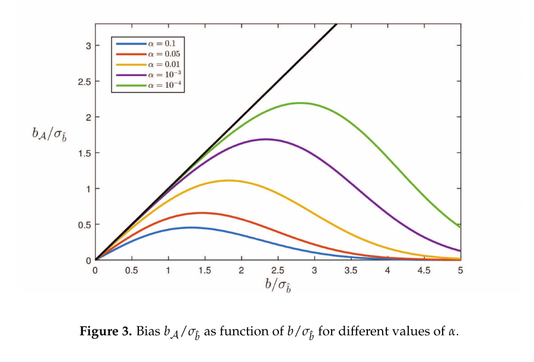
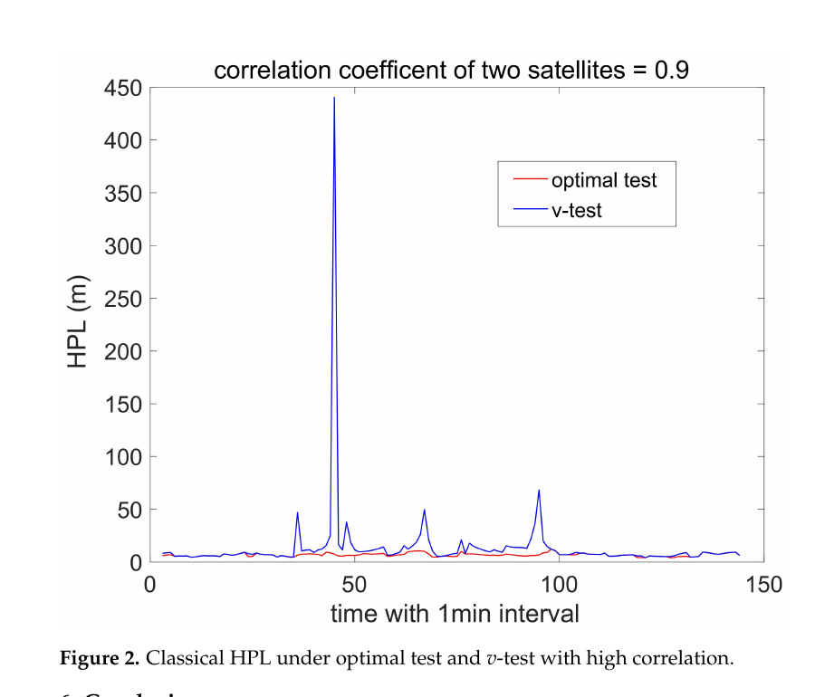
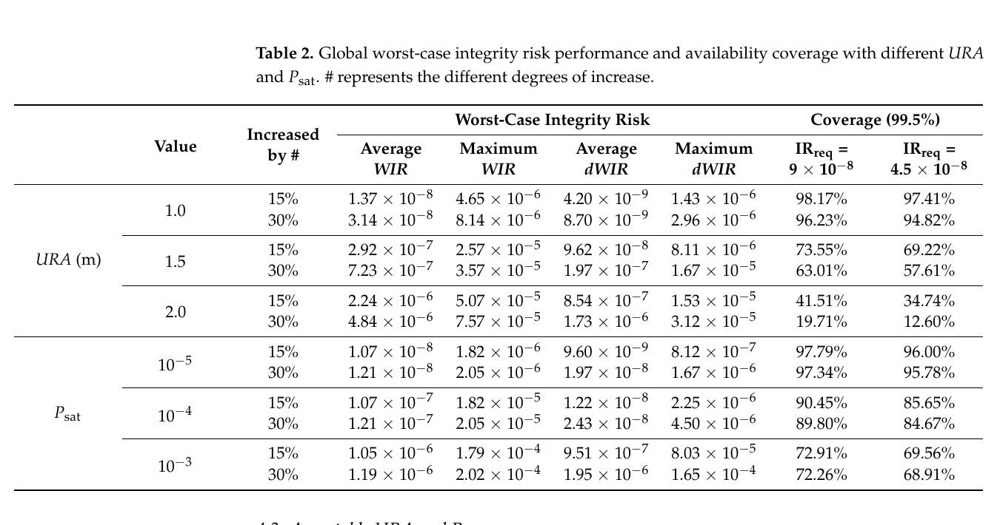

# 2026-10-14 GNSS 每日研究简报

## 今日快报

### 快报 1：7 km 外的区域基站能否服务机场，官方摘要仍只有试验设计没有答案

- 主题：`regional-gbas-ground-station-spacing-flight-test`
- 来源 ID：`ion:gnss2026-17047`
- 来源链接：https://www.ion.org/gnss/abstracts.cfm?paperID=17047
- 发表日期：2026-09-16
- 来源类型：ION GNSS+ 2026 官方扩展摘要、真实飞行与 GBAS UNESP 实验原型研究计划
- 获取范围：官方扩展摘要全文；两套四站网络、飞行日期、区域基站平均距离、处理原型与拟评估指标已核对，摘要未给任何精度、可用性、完整性或连续性结果

**内容：** 研究拟比较机场邻近的四个参考站与平均距机场约 7 km 的四站 INCT GNSS NavAer 区域网。两套网络都通过 Hatch 载波平滑生成 GBAS 差分改正，再处理 2025-11-26 在巴西 Presidente Prudente 采集的真实飞行数据；目标是判断较远地面站是否仍能满足精度、可用性和完整性要求，并讨论单套 GBAS 服务多个邻近机场的可能性。

**结论：** 官方摘要只陈述数据与比较方案，没有报告轨迹误差、保护级、告警限、平滑时间常数或任何合规判定。因此目前能确认的是“7 km 区域网正在被真实飞行评估”，不能回答标题中的最远距离，更不能把圣保罗两机场相距约 29 km、里约两机场相距 12.5 km 当成已验证覆盖半径。

**关注理由：** GBAS 参考站外移会同时改变电离层空间失相关、地面多路径和 VDB 基础设施设计。早期摘要最容易把“计划评价”误写成“已经可用”，这条快报保留这个证据边界。

### 快报 2：DFMC GBAS 天线群时延校准只改善同批次 L5/E5a，不能按型号通用

- 主题：`dfmc-gbas-mla-agdv-calibration-lot-environment`
- 来源 ID：`ion:gnss2026-17030`
- 来源链接：https://www.ion.org/gnss/abstracts.cfm?paperID=17030
- 发表日期：2026-09-16
- 来源类型：ION GNSS+ 2026 官方扩展摘要、消声室校准与机场十日 GNSS 实测
- 获取范围：官方扩展摘要全文；两副 MLA 校准、三处安装、频段差异、三项高斯—马尔可夫地面误差模型与主要结论已核对，未取得正式论文中的逐仰角残差、`sigma_pr_gnd` 数值和不确定度

**内容：** 研究把两副多路径抑制天线在消声室测得的天线群时延变化（AGDV）校准文件，应用到 Tenerife Norte Airport 连续 10 天数据的三套天线安装上，再观察地面多路径与噪声估计以及三项高斯—马尔可夫模型中的完整性参数 $`\sigma_{pr,gnd}`$ 是否收紧。

**结论：** L1/E1 上 AGDV 影响可忽略，校准没有可测改善；L5/E5a 上，只有与两副消声室样品属于同一生产批次的天线残差偏差下降，同型号但不同批次的另外两副没有复现。附近 ILS 构筑物还留下随仰角变化的现场多路径特征。证据说明收益依赖频段、生产批次和安装环境，不能把一份校准文件扩展到整个型号。

**关注理由：** 完整性预算不能只写“天线型号相同”。批次一致性与现场反射必须进入配置控制，否则实验室校准可能把硬件误差压低，却仍被场地误差主导。

### 快报 3：载波短时断续时传播码相整平项，能续上合成宽带伪距但摘要不给误差量

- 主题：`synthetic-meta-signal-carrier-outage-propagation`
- 来源 ID：`ion:gnss2026-16856`
- 来源链接：https://www.ion.org/gnss/abstracts.cfm?paperID=16856
- 发表日期：2026-09-16
- 来源类型：ION GNSS+ 2026 官方扩展摘要、量产芯片实时实现与开阔/城市动态实验
- 获取范围：官方扩展摘要全文；Alt-BOC/ACE-BOC 合成观测、断续传播、完整性标志、STA8600A 实时实现和定性结果已核对，未取得传播时限、偏差上界、水平误差分位数或重复次数

**内容：** 合成 meta-signal 不让射频前端直接处理完整宽带，而在观测域组合窄带边带伪距与载波整平项，近似获得宽带码测量。论文在短暂周跳或衰落导致载波不可用时，利用“重构伪距—原始边带伪距”之间载波贡献的短时稳定性，有限时长传播其滤波估计，并给传播观测显式打标后再送入导航滤波器。

**结论：** 作者称该算法已在 STMicroelectronics STA8600A 四频接收机上实时运行，在开阔与城市动态试验中提高合成观测可用性，并降低若干水平误差分位数；但官方摘要没有任何分位数、传播时长或偏差增长值。当前证据支持“硬件实时可行且有定性收益”，不能给出可认证的断续持续时间或完整性上界。

**关注理由：** 传播观测与真实载波观测必须在滤波器里区分。真正的工程门槛不是补上一个数，而是让方差随中断时间增长，并在模型失效前自动停止使用。

### 快报 4：低仰角 DFMC 闪烁监测增密 4.1 倍，5° 附近的多路径误警仍然严重

- 主题：`dfmc-gbas-low-elevation-scintillation-monitoring`
- 来源 ID：`ion:gnss2026-17162`
- 来源链接：https://www.ion.org/gnss/abstracts.cfm?paperID=17162
- 发表日期：2026-09-16
- 来源类型：ION GNSS+ 2026 同行评审在点播扩展摘要、赤道巴西双站 50 Hz I/Q 实测
- 获取范围：官方扩展摘要全文；2022 年 90 日数据、GPS/BDS/Galileo 双频组合、覆盖/密度倍数与低仰角误警结论已核对，未取得正式论文中的 S4 阈值、逐站样本数和事件混淆矩阵

**内容：** 两台 Septentrio PolaRx5S ISMR 在巴西 PRU2/PRU4 记录 50 Hz I/Q 相关器输出，把 GPS、BDS、Galileo 的 L1/B1C/E1 与 L5/B2a/E5a 同频组联合起来，专门评估 GBAS 需要覆盖到 5° 截止角时，真实电离层闪烁与多路径、遮挡、接收机噪声及近场天线环境如何混叠。

**结论：** 90 日数据的代表性比较中，DFMC 相对 GPS L1 C/A 单频提供约 1.8 倍低仰角天空覆盖和 4.1 倍观测密度；安静电离层时 L5 频段的 S4 误警率持续低于 L1，但接近 5° 时误警仍严重。跨频 S4 对比有辅助价值，却不足以单独判别闪烁。倍数证明的是可观测性增加，不是分类准确率同倍提升。

**关注理由：** 多星座能补空间盲区，却也把更多场地相关误差带进监测器。完整性设计需要按仰角、方位和站点共同建模，不能只靠统一 S4 阈值。

### 快报 5：四年 BDS-3 双频 SISRE 持续下降，但 ARAIM 先验仍受有限故障样本约束

- 主题：`bds3-sis-performance-araim-prior-characterization`
- 来源 ID：`ion:gnss2026-17166`
- 来源链接：https://www.ion.org/gnss/abstracts.cfm?paperID=17166
- 发表日期：2026-09-16
- 来源类型：ION GNSS+ 2026 同行评审在点播扩展摘要、四年广播/精密星历完整性统计
- 获取范围：官方扩展摘要全文；24 颗 MEO、3 颗 IGSO、2022–2025 双频无电离层 SISRE、URE/URA 与故障概率范围已核对，未取得正式论文中的故障判据、连续性处理和置信上界

**内容：** 研究把 BDS-3 B1C/B2a 广播星历的轨道与钟差同精密产品比较，先形成全球平均与最坏用户测距误差，再把最坏 SISRE 样本分为正常和故障集合，用于估计 ARAIM 完整性支持消息中的正常性能与单星/星座故障概率。

**结论：** 对 2022-01 至 2025-12 的 24 颗 MEO 和 3 颗 IGSO，作者报告全星座 URE 从 0.690 m、0.623 m、0.595 m 降到 0.571 m，四年约改善 17%；2025 年多数被评估卫星的包络 URA 小于 1.0 m。单星故障概率范围为 $`4.753\times10^{-6}`$ 至 $`6.322\times10^{-4}`$，星座故障概率为 $`1.465\times10^{-3}`$ 至 $`5.853\times10^{-3}`$。这些是有限四年样本和作者判据下的估计，不是航空认证值，也不能忽略罕见故障的置信上界。

**关注理由：** ARAIM 的可用性对 URA 与故障先验极敏感。把“逐年变好”写进系统前，必须同时保存估计方法、样本暴露量和保守包络，而不是只引用均值。

## 深度研读

### 深读 1｜接收机工程｜剔对了坏星也会留偏：检验选择怎样改变位置解的均值

- 类别：`receiver-engineering`
- 学习层级：`foundation`
- 选题定位：`经典基础：从最小二乘与假设检验到剔星后的条件偏差`
- 来源 ID：`doi:10.3390/s17071508`
- 来源链接：https://doi.org/10.3390/s17071508
- 发表日期：2017-06-26
- 来源类型：Sensors 同行评审开放论文
- 获取范围：CC BY 4.0 开放全文；线性模型、单/多备择假设、GPS/Galileo 伪距仿真、Figures 1–9 与 Tables 1–2 已核对
- 价值评分：97/100（相关性 20，经典价值 20，证据 19，教学价值 20，工程价值 18）

#### 为什么先学这个

RAIM 常被简化成“残差超门限就删掉坏星，再重算一个无偏最小二乘解”。问题在于，删不删由同一组带噪观测决定；最终输出是多个线性估计器经过随机选择后的分段非线性估计器。理解这层选择效应，才能避免把“识别正确”误当成“输出已经无偏”。

#### 先修知识

需要掌握线性高斯模型、加权最小二乘、BLUE、零假设与备择假设、卡方门限、显著性水平 $`\alpha`$、误检、漏检、正确检测、正确识别，以及伪距设计矩阵如何把单星测距偏差投影到接收机钟和 ENU 位置。

#### 一句话逻辑

零假设下输出 $`\hat x_0`$、拒绝后输出 $`\hat x_a`$ 本来各自在对应模型中无偏，但随机检验把两者拼成 $`\bar x`$；在存在故障的备择假设下，接受域截断了估计量分布，所以即使正确剔除坏星，条件位置解仍可能带偏。

#### 研究问题与约束

论文先解析推导一个或多个加性模型失配，再用单接收机、双频无电离层 GPS/Galileo 伪距仿真说明 RAIM 位置偏差。星空取荷兰 Delft 在 2001-01-03 02:00 的几何，噪声模型来自其引用的航空误差模型；GPS-only 与 GPS+Galileo 被比较。结果针对已知协方差、线性化、高斯观测和预先列出的备择假设，不含城市重尾多路径、时序滤波或真实飞行认证数据。

#### 核心方法论

零假设写作 $`E(y)=Ax`$，备择假设加入 $`Cb`$。检验用备择参数 BLUE $`\hat b`$ 是否落在卡方接受域决定采用零假设估计 $`\hat x_0`$ 还是备择估计 $`\hat x_a`$。作者不只分析两个估计器本身，而是对最终随机输出 $`\bar x`$ 的整体均值，以及漏检、正确检测、正确识别三个条件事件分别求均值。

#### 关键公式逐步推导

两套模型与最终输出为：

```math
H_0:E(y)=Ax,\qquad H_a:E(y)=Ax+Cb,\qquad D(y)=Q_{yy},
```

```math
\bar x=
\begin{cases}
\hat x_0,&\hat b\in\mathcal A,\\
\hat x_a,&\hat b\notin\mathcal A.
\end{cases}
```

虽然 $`E(\hat x_0|H_0)=x`$、$`E(\hat x_a|H_a)=x`$，但备择为真时：

```math
E(\bar x|H_a)=x+b_{\bar x},\qquad
b_{\bar x}=A^+C\,b_{\mathcal A},\qquad
b_{\mathcal A}=\int_{\mathcal A}\beta\,p_{\hat b}(\beta|H_a)\,d\beta.
```

也就是说，检验只把接受域外的偏差贡献拿走，接受域内的截断概率质量仍会传播到位置域。它通常小于完全不检验时的 $`A^+Cb`$，却不等于零。

#### 经典价值与创新边界

经典价值是把估计—检验联合作为一个完整统计映射，解释为什么“每个分支都无偏”不能推出“分支选择后的输出无偏”。创新边界也很清楚：论文研究一阶矩，不直接构造保护级；解析结论基于给定模型与接受域，未知故障类型、协方差失配和非高斯尾部还需另行包络。

#### 整体逻辑链

建立零/备择线性模型；推导两套 BLUE 与检验统计量；把最终输出写成分段估计器；计算无条件与条件均值；从一个备择扩展到多备择；区分漏检、正确检测和正确识别；最后用 GPS-only 与 GPS+Galileo 伪距仿真观察冗余如何改变剩余偏差。

#### 原文图表与结果分析



> 图表源：Teunissen、Imparato 与 Tiberius《Does RAIM with Correct Exclusion Produce Unbiased Positions?》Figure 3，[CC BY 4.0 开放全文](https://doi.org/10.3390/s17071508)。用 Poppler 以 180 dpi 渲染原 PDF 第 6 页后，仅裁出 Figure 3 及图题；未改动曲线、图例、坐标或数值。

横轴是输入偏差噪声比 $`b/\sigma_{\hat b}`$，纵轴是检验后保留在接受域内的偏差 $`b_{\mathcal A}/\sigma_{\hat b}`$；黑线代表完全不检验。彩色曲线先升后降：中等偏差最容易一部分被接受、一部分被拒绝，形成最大的选择偏差；偏差足够大时几乎总被检出，残余反而趋近零。更小的 $`\alpha`$ 对应更高拒绝门槛，绿色/紫色曲线留下更多偏差。图说明“较保守的低误警门限”会增加某些故障幅值下的剩余偏差，不能单独证明最终 PHMI 已满足要求。

#### 原文结果论述

GPS-only 仿真中，即使正确识别被加偏的 PRN 5，水平位置平均仍偏离超过 0.5 m；GPS+Galileo 的额外冗余明显收紧散点。作者还显示，剩余无条件偏差始终小于不做检验的原始偏差，但正确检测或正确识别条件下的偏差不受这个简单上界保证，某些区间甚至可大于输入偏差在对应坐标上的直接投影。

#### 常见误区与适用边界

第一，正确剔星不等于条件解无偏。第二，把剔除后的 LS 协方差直接当最终输出分布，会漏掉随机选择。第三，只报告正确识别率看不到条件位置偏差。第四，把 $`\alpha`$ 调小只降低误警，也会抬高检测门槛。第五，增加星座通常增强冗余，但若故障假设或跨系统偏差没建模，不能自动获得完整性。第六，均值偏差只是 PHMI 的一部分，不替代尾部风险计算。

#### 工程实现步骤

1. 明确列出零假设与每个单星/多星备择，并保存对应估计器。
2. 用同一协方差生成检验门限、解算权阵和偏差传播矩阵。
3. 除总体解外，分别统计接受、正确检测、正确识别和错误识别条件下的位置误差。
4. 对 $`b/\sigma`$ 从近零扫到明显可检出的区间，而不是只测一个大故障。
5. 把选择后的经验分布用于保护级或风险核查，不直接复用单一分支的高斯分布。
6. 比较 GPS-only、多星座和删星后弱几何，检查冗余收益是否被相关检验统计量抵消。

#### 复现实验设计

用开源星历选一处静态站，分别构造 GPS-only 和 GPS+Galileo，1 Hz、2 h、5°/10° 两档截止角；按航空模型生成高斯伪距并对每颗星注入 $`0–6\sigma`$ 偏差，$`\alpha`$ 取 0.1、0.05、0.01、$`10^{-3}`$、$`10^{-4}`$。比较无检验、理想知道坏星、实际残差检验三条基线。指标包括误警/漏检/正确识别率、无条件与各条件 ENU 均值、50/95/99.9% 误差和 PHMI 蒙特卡洛估计。失败用例加入未列出的双星故障、协方差缩放 0.5/2 倍和 Student-t 噪声。

#### 与定位及低成本实现的联系

低成本接收机的多路径和 C/N₀ 定权更易失配，检验选择偏差不会因为算法“成功剔除”而消失。工程输出应同时带上采用了哪个假设、条件误差模型和几何退化信息；下一节进一步处理城市观测之间出现空间相关时，检验统计量本身怎样改变。

#### 本节小结

RAIM 的输出不是一套固定最小二乘，而是由数据选择的混合估计器。剔对坏星仍可能留有条件偏差；完整性必须传播整个估计—检验过程，而不是只看最终那次重算。

### 深读 2｜接收机工程｜残差彼此相关时，为什么逐星 v-test 会把 HPL 拉到数百米

- 类别：`receiver-engineering`
- 学习层级：`intermediate`
- 选题定位：`基础进阶：在非对角观测协方差下重构最优奇偶检验`
- 来源 ID：`doi:10.3390/rs15010176`
- 来源链接：https://doi.org/10.3390/rs15010176
- 发表日期：2022-12-28
- 来源类型：Remote Sensing 同行评审开放技术论文
- 获取范围：CC BY 4.0 开放全文；奇偶空间解析推导、MDB/HPL 比较、24 h GPS 几何试验、Figures 1–2 已核对
- 价值评分：95/100（相关性 20，经典价值 18，证据 18，教学价值 20，工程价值 19）

#### 为什么先学这个

上一节假定协方差已知并强调选择效应。城市环境又多了一层问题：同一建筑或街谷可让多颗卫星的多路径误差相关，传统逐星残差统计量却常按独立观测设计。本节把相关性显式写进 $`Q_y`$，推导哪一个奇偶向量对指定单星故障最敏感。

#### 先修知识

需要掌握加权最小二乘残差、设计矩阵左零空间、奇偶向量、协方差白化、标准正态门限、误警概率 $`P_{FA}`$、漏检概率 $`P_{MD}`$、最小可检测偏差 MDB、水平保护级 HPL 与弱几何。

#### 一句话逻辑

若 $`Q_y`$ 有非零非对角项，就不能只把第 $`i`$ 个普通 LS 残差除以自身标准差；应在奇偶空间按 $`Q_y`$ 白化，并选择最大化第 $`i`$ 星故障信噪比的方向，这样相关噪声不会在弱几何处被 v-test 放大成过度保守 HPL。

#### 研究问题与约束

论文在理论上假设完整的 $`Q_y`$ 已给定，再以香港理工大学 $`22.3042^\circ N,114.1798^\circ E`$ 的静态用户做 24 h 数值试验。卫星几何来自 2022-11-27 的 32 星 GPS almanac，1 min 采样、5° 截止角；人为让两颗星的标准正态误差相关，相关系数取 0.2 和 0.9。它没有从真实城市残差估计非对角协方差，也没有实测定位误差或多故障结果。

#### 核心方法论

先构造满足 $`P_sA=0`$ 且行正交的标准奇偶基 $`P_s`$。对第 $`i`$ 星故障，任一奇偶检验方向都可写为 $`c_iP_s`$；通过 Cauchy–Schwarz 不等式，最大化标准化故障均值，得到含 $`Q_{ps}=P_sQ_yP_s^T`$ 逆矩阵的最优方向。再用 MDB 把统计域门限转回测距域，并进入每个故障假设的 HPL。

#### 关键公式逐步推导

基本模型与标准化奇偶统计量为：

```math
y=Ax+e,\qquad D(e)=Q_y,\qquad p_i=P_i y,
```

```math
t_i=\frac{P_i y}{\sqrt{P_iQ_yP_i^T}}.
```

令 $`Q_{ps}=P_sQ_yP_s^T`$，对第 $`i`$ 星的最优奇偶行向量为：

```math
P_i^\star=e_i^TP_s^TQ_{ps}^{-1}P_s,
```

因此：

```math
t_i^\star=
\frac{e_i^TP_s^TQ_{ps}^{-1}P_s y}
{\sqrt{e_i^TP_s^TQ_{ps}^{-1}P_s e_i}}.
```

相关观测下，普通 v-test 与 $`t_i^\star`$ 不再等价；论文证明 $`MDB_i^\star\le MDB_{i,v}`$，且只有 $`Q_y`$ 为对角矩阵时取等。HPL 把 MDB 的位置投影与剩余随机误差包络相加，再取各假设最大值。

#### 经典价值与创新边界

价值是给出非对角协方差下的解析最优检验，而不是用“相关会影响 RAIM”作定性提醒；同一式子在独立观测时自动退化为传统结果。边界是最优性以给定且正确的 $`Q_y`$、单星确定性故障和高斯误差为前提；真正困难的城市相关协方差如何保守估计，论文明确留作后续工作。

#### 整体逻辑链

定义含相关误差的观测模型；把残差搬到奇偶空间；按漏检风险定义最优检测/排除准则；推导白化后的逐星统计量；证明 MDB 不大于 v-test；将 MDB 投影成 HPL；最后在相同卫星几何下比较低/高相关两种情形。

#### 原文图表与结果分析



> 图表源：Jiang《RAIM Fault Detection and Exclusion with Spatial Correlation for Integrity Monitoring》Figure 2，[CC BY 4.0 开放全文](https://doi.org/10.3390/rs15010176)。用 Poppler 以 180 dpi 渲染原 PDF 第 7 页后，仅裁出 Figure 2 及图题；未改动曲线、图例、坐标或数值。

横轴是 1 min 间隔的时刻索引，纵轴是 HPL（m），设定的两星相关系数为 0.9。蓝色 v-test 在约第 45 个样本处直接读数接近 440 m，并在若干弱几何时刻出现 40–70 m 峰；红色最优检验大多维持在约 5–10 m。图显示传统统计量把相关性与弱几何共同放大；它是同一假设协方差上的数值试验，不证明真实城市数据一定达到 440 m，也不代表红线已被真实误差包络验证。

#### 原文结果论述

试验把总完整性风险设为 $`10^{-7}`$ 并均分到无故障与故障假设，单个故障先验为 $`10^{-4}`$，每假设 $`P_{FA}=3.33\times10^{-7}`$、$`P_{MD}=10^{-3}`$。相关系数 0.2 时两种方法差异较小；0.9 时 v-test 的 HPL 峰显著增大并损失可用性，而最优检验仍较低。作者的解析结果是：有相关时最优 MDB 总不大于 v-test MDB；无相关时两者等价。

#### 常见误区与适用边界

第一，把每颗星的方差估准不等于协方差矩阵估准。第二，样本相关系数不是可以直接塞进认证模型的保守上界。第三，较低 HPL 只有在风险仍被包络时才是改进。第四，弱几何峰不是统计量独立造成。第五，论文只处理单星故障。第六，用同一数据同时拟合相关性和验证完整性会产生乐观偏差。第七，真实多路径常重尾且随时间变化，不满足固定高斯 $`Q_y`$。

#### 工程实现步骤

1. 按环境、方位、仰角与时间窗估计残差协方差，并留出独立验证集。
2. 对 $`Q_y`$ 做正定性、条件数和保守膨胀检查，避免求逆放大噪声。
3. 计算 $`P_s`$ 与 $`Q_{ps}`$，为每颗星生成白化最优统计量。
4. 用分配的 $`P_{FA}`$、$`P_{MD}`$ 求门限与 MDB，再投影到 HPL。
5. 与 v-test 并行输出，记录 HPL、拒绝率、检出率和几何条件数。
6. 当相关模型超出训练域或矩阵病态时，回退到膨胀对角模型或不可用状态。

#### 复现实验设计

复现论文的 24 h、1 min、32 星 GPS 几何，相关系数扫 $`0,0.2,0.5,0.9`$；再用一段真实城市静态数据从训练半段估计 $`Q_y`$、测试半段验证。比较对角 v-test、使用真 $`Q_y`$ 的最优检验、估计 $`Q_y`$ 的最优检验及统一方差膨胀。注入单星 $`1–8\sigma`$ 阶跃/缓变故障。指标包括 MDB、HPL 50/95/最大值、误警、漏检、正确排除、实际误差越界率和可用率。失败用例含相关结构突变、三颗星共同反射、协方差奇异和重尾噪声。

#### 与定位及低成本实现的联系

手机与低成本天线常受同一车体、玻璃或街墙反射，多星误差独立性更可疑。把非对角项纳入检验能减少无谓的超大保护级，但前提是协方差本身可信；高级定位不能用更复杂的矩阵掩盖证据不足。下一节把单历元检测扩展到全球几何与卫星先验的最坏风险预算。

#### 本节小结

观测相关时，普通逐星残差不再是最优故障方向。先在奇偶空间对白化相关噪声，再做逐星检验，能避免弱几何下的过度保守；但协方差建模成为新的完整性关键件。

### 深读 3｜定位｜URA 还是故障概率更危险：用最坏偏差扫描星座现代化后的 RAIM 风险

- 类别：`positioning`
- 学习层级：`advanced`
- 选题定位：`定位深入：纯 GNSS GPS+BDS RAIM 的最坏完整性风险与全球可用性`
- 来源 ID：`doi:10.3390/rs15122979`
- 来源链接：https://doi.org/10.3390/rs15122979
- 发表日期：2023-06-07
- 来源类型：Remote Sensing 同行评审开放技术论文
- 获取范围：CC BY 4.0 开放全文；最坏风险公式、GPS+BDS 全球 MAAST 仿真、URA/单星故障概率灵敏度、Figures 1–4 与 Tables 1–4 已核对
- 价值评分：94/100（相关性 20，经典价值 17，证据 18，教学价值 19，工程价值 20）

#### 为什么先学这个

前两节分别处理“检验选择后的解分布”和“相关误差下检验方向”。高级完整性还必须回答：卫星测距精度 URA 与单星故障概率 $`P_{sat}`$ 同时变化时，哪一个参数更支配危险误导信息，全球几何最差区域能否仍满足风险要求。本节用偏差幅值扫描寻找每个几何的最坏风险。

#### 先修知识

需要掌握 RAIM 残差卡方检验、位置误差与检测统计量独立性、中心/非中心卡方分布、Gaussian Q 函数、告警限 VAL、$`P_{FA}`$、$`P_{MD}`$、URA、单星故障先验、完整性风险 PHMI、全球网格可用性和百分位。

#### 一句话逻辑

对每颗可能故障的卫星，不预设一个“代表性故障大小”，而是扫描测距偏差 $`b_i`$，最大化“位置越过 VAL 且残差仍未报警”的联合概率；再把这个最坏风险随 URA、$`P_{sat}`$ 和全球卫星几何传播，求可接受参数范围。

#### 研究问题与约束

仿真使用 Stanford MAAST，星座为 24 GPS MEO 加 24 BDS MEO 与 3 BDS IGSO；全球用户网格 5°×5°，连续 10 天、10 min 间隔、10° 截止角，每网格 1440 个样本，并取时间序列 99.5 分位描述最坏风险。主要 LPV-200 设置为 VAL 35 m、$`P_{FA}=10^{-5}`$、$`P_{MD}=10^{-3}`$；只把 LPV-200 垂向风险的一半 $`4.5\times10^{-8}`$ 分给单星故障。它是高斯、单历元、单星故障的全球仿真，不是飞行试验或完整认证算法。

#### 核心方法论

最小二乘把第 $`i`$ 星偏差投影成位置均值 $`b_iA_{q,i}`$，同时使残差统计量服从带非中心参数 $`\lambda_i`$ 的卡方分布。对每个故障假设，将位置误差越限概率、残差未检出概率和故障先验相乘并求和；再对未知偏差幅值取最大值，形成 worst-case integrity risk（WIR）。随后分别把 URA 或 $`P_{sat}`$ 增加 15%/30%，比较 WIR 变化和全球覆盖。

#### 关键公式逐步推导

RAIM 危险误导事件为：

```math
IR=P\left(|\delta|>l\ \cap\ t<T\right).
```

第 $`i`$ 星故障时：

```math
\delta_{q,i}\sim\mathcal N\!\left(b_iA_{q,i},\sigma_q^2\right),
\qquad
t_i\sim\chi^2(\lambda_i,n-m),
```

```math
\lambda_i=\left(\frac{b_i}{\sigma}\right)^2S_{ii}.
```

单星故障模型下，风险由所有互斥假设求和；工程上可概括为：

```math
IR(b)=\sum_i
P\left(|\delta_{q,i}|>l\mid H_i\right)
P\left(t_i<T\mid H_i\right)P(H_i),
\qquad
WIR=\max_b IR(b).
```

URA 进入测距标准差 $`\sigma`$，同时改变位置尾概率和非中心检测概率；$`P_{sat}`$ 主要缩放故障假设先验，所以两者对风险与可用性的作用并不对称。

#### 经典价值与创新边界

价值是直接在风险域比较参数敏感度，并用最坏偏差避免挑一个有利的故障幅值。边界是“最坏”只覆盖论文列出的单星加性故障与高斯误差；星座级故障、多星相关故障、电离层异常、非高斯用户误差和时间连续性没有进入主仿真。作者对 Galileo/GLONASS 的判断部分来自文献参数推断，不是本次星座仿真。

#### 整体逻辑链

定义位置越限且未报警的风险；推导每个故障假设的高斯/非中心卡方概率；扫描偏差求 WIR；建立 URA、$`P_{sat}`$、飞行阶段参数与卫星几何四组变量；在全球 GPS+BDS 网格仿真；比较 15%/30% 参数变化；最后由覆盖要求反求可接受 URA。

#### 原文图表与结果分析



> 图表源：Wang 等《Worst-Case Integrity Risk Sensitivity for RAIM with Constellation Modernization》Table 2，[CC BY 4.0 开放全文](https://doi.org/10.3390/rs15122979)。用 Poppler 以 180 dpi 渲染原 PDF 第 9 页后，仅裁出 Table 2；未改动表题、行列、单位或任何数值。

表上半部固定 $`P_{sat}=10^{-4}`$ 并改变 URA，下半部固定 URA=1.5 m 并改变 $`P_{sat}`$。以 $`IR_{req}=4.5\times10^{-8}`$ 的 99.5% 覆盖为例，URA=1.5 m 从 +15% 到 +30% 时覆盖由 69.22% 降到 57.61%，差 11.61 个百分点；$`P_{sat}=10^{-4}`$ 从 +15% 到 +30% 时由 85.65% 降到 84.67%，差 0.98 个百分点。直接读表说明全球平均可用性对 URA 更敏感；但 $`P_{sat}=10^{-3}`$ 的最大 WIR/dWIR 仍很大，局部弱几何不能由平均值掩盖。

#### 原文结果论述

论文总结，在 $`IR_{req}=4.5\times10^{-8}`$、基准 URA=1.5 m 时，URA 从 +15% 增至 +30% 使全球覆盖累计下降 22.14%，同样变化的 $`P_{sat}=10^{-4}`$ 只使覆盖下降 0.98%。对 24 GPS+27 BDS 的基准星座，要让超过 99.5% 全球区域满足分配给单星故障的 $`4.5\times10^{-8}`$，当 $`P_{sat}=10^{-4}`$ 与 $`10^{-5}`$ 时，URA 分别需优于 0.88 m 与 1.14 m。这里的“优于”来自仿真阈值，不是广播 URA 已获认证。

#### 常见误区与适用边界

第一，URA 越小不是无条件越安全，若包络不真实反而会低估风险。第二，全球平均不代表弱几何地点。第三，只算单星故障不能覆盖星座共因故障。第四，$`P_{sat}`$ 的历史频率估计必须带置信上界。第五，10 天星历与 5° 网格不足以表示所有长期几何。第六，高斯 WIR 不包住重尾多路径。第七，满足仿真风险不等于满足完整认证、连续性和可用性要求。

#### 工程实现步骤

1. 固定飞行阶段的 VAL、风险分配、$`P_{FA}`$ 与 $`P_{MD}`$。
2. 对每个用户位置与历元构造卫星几何、测距协方差和残差投影矩阵。
3. 为每个单星假设扫描 $`b_i/\sigma`$，数值最大化位置越限且未检出的联合概率。
4. 加总无故障与故障假设，输出 WIR 与是否满足 $`IR_{req}`$。
5. 对 URA、$`P_{sat}`$、删星和截止角做灵敏度扫描，保存局部最差点而非只有全球均值。
6. 在上线前加入多星/星座故障、非高斯误差与真实 SIS 监测数据，并将参数版本化。

#### 复现实验设计

用同版 MAAST/星历复现 5° 网格、10 天、10 min 和 10° 截止角；URA 扫 0.5–3.5 m，$`P_{sat}`$ 取 $`10^{-5},10^{-4},10^{-3}`$，同时跑基准 24 GPS+27 BDS 与各删一颗 MEO 的退化星座。比较固定代表偏差、逐星偏差扫描 WIR 和蒙特卡洛重要抽样。指标为 WIR 50/95/99.5% 分位、全球覆盖、最差网格、保护级、误警/漏检和计算量。失败用例加入双星共因故障、URA 低估 20%、Student-t 测距误差、IGSO 不可用和 20 m VAL。

#### 与定位及低成本实现的联系

低成本接收机通常拥有更大的用户噪声与多路径项，所以即使卫星 URA 改善，最终 $`\sigma`$ 也可能由接收机端主导；把广播精度直接等同于总测距包络会过于乐观。纯 GNSS 完整性要把 SIS、用户、对流层和环境误差分账，再在位置域做最坏风险闭环。

#### 本节小结

星座现代化同时改善精度与故障统计，但 RAIM 全球可用性对 URA 包络尤其敏感。真正可用的参数不是最小估计值，而是在最坏偏差、弱几何和完整风险分配下仍可信的保守上界。
