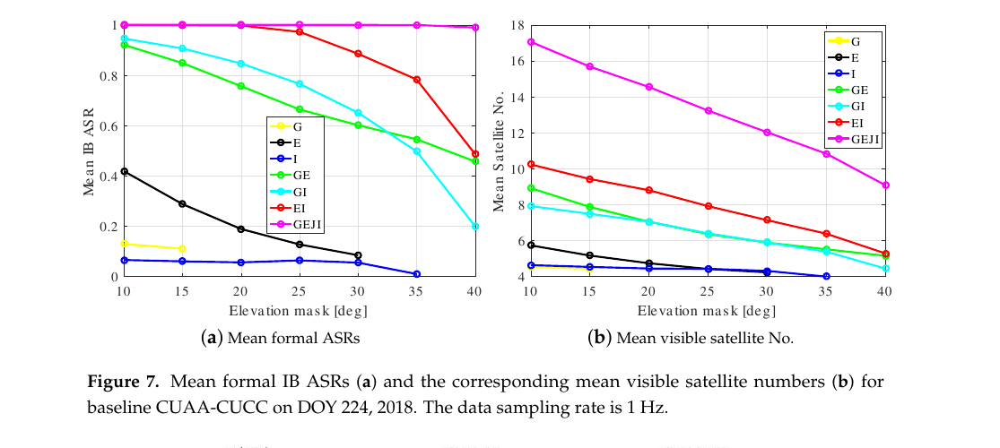
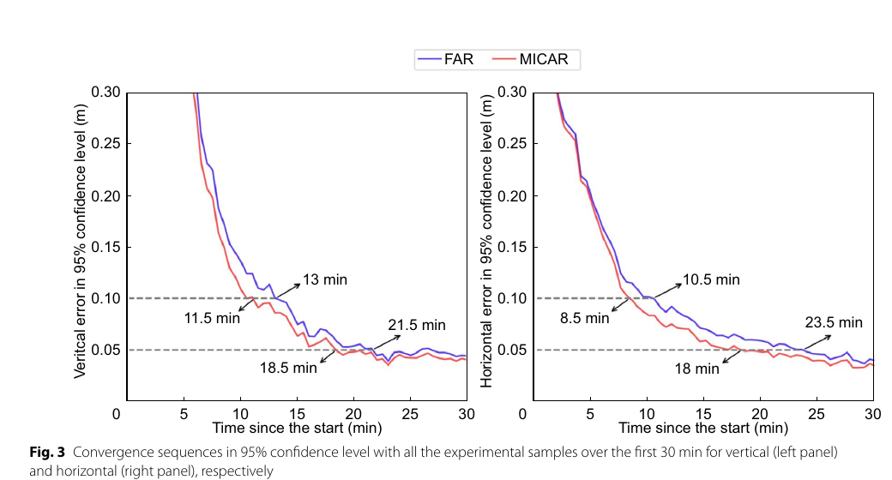
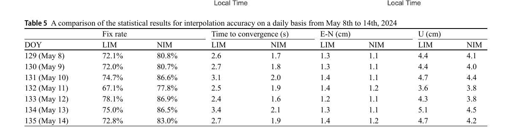

# 2026-10-15 GNSS 每日研究简报

## 今日快报

### 快报 1：星载双频载波相位 EKF 已到分米级，厘米级仍是调参与硬件在环目标

- 主题：`leo-onboard-gnss-pod-ekf-fde`
- 来源 ID：`ion:gnss2026-17056`
- 来源链接：https://www.ion.org/gnss/abstracts.cfm?paperID=17056
- 发表日期：2026-09-18
- 来源类型：ION GNSS+ 2026 官方扩展摘要、星载 GNSS 精密定轨仿真
- 获取范围：官方扩展摘要全文；双频伪距/载波 EKF、动力学模型、实时 FDE、GRACE-A 仿真与初步精度层级已核对，未取得逐轨弧参数、噪声表、收敛曲线或硬件在环结果

**内容：** 研究面向低轨卫星自主精密定轨，把双频 GNSS 伪距与载波相位送入含高保真动力学模型的扩展卡尔曼滤波器，并在观测预处理中加入实时故障检测与剔除。验证数据来自按 NASA GRACE-A 轨道生成的 RINEX 仿真观测，参考轨道采用公开的约化动力学产品，另用 IGS 精密轨道产品支持测量建模。

**结论：** 作者报告初步结果达到实时三维分米级轨道精度；“厘米级”被明确写成继续调优约化动力学滤波后的目标，而不是已经证明的结果。摘要没有给出平均误差、95% 分位数、收敛时间或计算负载，也尚未展示飞行数据与硬件在环，因此当前证据只支持“仿真架构可达到分米级”，不能写成在轨厘米级自主 POD 已完成。

**关注理由：** 星载接收机的工程闭环不只是把地面 PPP 搬上卫星。动力学误差、载波周跳、异常观测、计算时限与轨道产品依赖必须同时受控；这与地面 RTK 中“模型强度和质量控制共同决定能否定整”是同一类问题。

### 快报 2：在线改正 Starlink 星历把车载 3D RMSE 从 150 m 压到 8.41 m

- 主题：`starlink-doppler-online-ephemeris-correction-pnt`
- 来源 ID：`ion:gnss2026-17188`
- 来源链接：https://www.ion.org/gnss/abstracts.cfm?paperID=17188
- 发表日期：2026-09-16
- 来源类型：ION GNSS+ 2026 官方扩展摘要、四类移动平台实测演示
- 获取范围：官方扩展摘要全文；地面车、无人机、高空气球与北极船舶的星数、轨迹、遮断时段和 3D RMSE 已核对，未取得接收机实现、在线星历误差状态完整定义、独立重复次数与原始数据

**内容：** 团队用认知软件接收机跟踪 Starlink 专有下行中的载波/多普勒，把每颗 LEO 卫星相对钟漂与平台位置、速度、姿态、IMU 偏置一并放入 EKF。关键不是把 TLE+SGP4 当精密星历，而是在线估计轨道误差；车载试验在最后 90 s、2.25 km 基本失去 GNSS，使用 11 颗 Starlink 辅助 IMU。

**结论：** 车载 3D RMSE 由纯 IMU 的 258 m、未经改正 TLE 的 150 m 降到在线星历改正后的 8.41 m；无人机相应为 46.5 m、17.8 m 和 8.15 m。气球的开环 83.34 m 降到 LEO+高度计 12.28 m，船舶由高度计单独 846 m 降到 LEO+高度计 123 m。不同平台的传感器组合、初始化和轨迹不同，不能把四个 RMSE 当同一算法的横向排名；真值仍来自机载 GNSS，结果也不是 Starlink 官方 PNT 服务指标。

**关注理由：** 机会信号的首要误差源可能不是测量噪声，而是发射端轨道与时钟。对 GNSS 工程的映射很直接：更强信号并不自动等于更准位置，必须把星历误差作为状态估计或外部产品显式闭合。

### 快报 3：3D 场景先验把 5G 仿真 RMSE 降到 1.44 m，但尚未过真实街谷

- 主题：`5g-raytracing-prior-vbakf-urban-positioning`
- 来源 ID：`ion:gnss2026-17012`
- 来源链接：https://www.ion.org/gnss/abstracts.cfm?paperID=17012
- 发表日期：2026-09-16
- 来源类型：ION GNSS+ 2026 官方扩展摘要、5G 城市场景仿真
- 获取范围：官方扩展摘要全文；3D Gaussian Splatting、射线追踪、KDE 误差先验、VBAKF 组合与三组 RMSE 已核对，未取得真实 5G 采集、场景外测试、训练/验证划分或计算延迟

**内容：** 方法先用 3D Gaussian Splatting 重建城市几何，再用射线追踪生成参考往返时延；测得 RTT 与重建 RTT 的差值交给核密度估计，得到非高斯误差的均值与协方差，随后用于观测去偏和变分贝叶斯自适应卡尔曼滤波的协方差初始化。

**结论：** 在论文所述仿真中，方法 RMSE 为 1.44 m，对比普通 EKF 的 2.45 m 和标准 VBAKF 的 1.66 m，作者据此计算改善 41.2% 和 13.2%。这些数字证明的是同一仿真场景里更合适的先验有价值，不证明 3DGS 地图误差、基站同步误差、动态遮挡和场景迁移后仍保持同样收益。

**关注理由：** GNSS 城市定位同样会把 3D 地图或射线追踪用于 NLOS 预测。这个结果提醒我们：地图先验要连同不确定度进入滤波器，而不是作为确定真值硬减；复验必须留出不同街区，避免模型只记住建筑。

### 快报 4：Galileo 二代 HAS 正在权衡取数时间与复杂度，最终服务定义尚未定案

- 主题：`galileo-second-generation-has-concept-tradeoff`
- 来源 ID：`ion:gnss2026-16962`
- 来源链接：https://www.ion.org/gnss/abstracts.cfm?paperID=16962
- 发表日期：2026-09-17
- 来源类型：ION GNSS+ 2026 官方扩展摘要、ESA/EUSPA/欧委会服务概念评估
- 获取范围：官方扩展摘要全文；现役 HAS 能力、Phase 2 计划、两种 G2 播发概念、评估指标与 CNES 类 HAS 改正试验范围已核对，最终消息设计和完整性能表未公开

**内容：** 现役 Galileo HAS 通过 E6-B 与互联网免费广播 GPS/Galileo 轨道、钟差与码偏差，支持多频 PPP 浮点解；计划中的 Phase 2 将增加地面站、相位偏差和欧洲电离层消息。G2 研究则比较两种播发概念，重点权衡与现有导航电文兼容性、用户实现复杂度、信号带宽、精密数据获取时间 TTRPD 与首次精密固定时间 TTPF，并用 CNES 类改正测试多星座、多频、全码相偏差和电离层约束。

**结论：** 官方摘要把这些内容明确标为 work-in-progress，最终设计尚未固化且未来数月可能变化；因此不能把候选概念、Phase 2 计划或试验配置当成已经承诺的 G2 服务。摘要页也没有给出两种方案的完整量化比较，当前可以确认的是评估维度与能力方向，不是最终性能。

**关注理由：** 高精度服务的瓶颈不仅是改正精度，还包括从开机到收齐产品的时延、偏差定义一致性和接收机复杂度。任何 PPP-AR/RTK 终端设计都应把消息获取中断与版本演进纳入状态机。

### 快报 5：月面可扩展双向测距原型平均误差低于 2 m，时钟标定仍是核心

- 主题：`lunar-cdma-two-way-ranging-clock-characterization`
- 来源 ID：`ion:gnss2026-17145`
- 来源链接：https://www.ion.org/gnss/abstracts.cfm?paperID=17145
- 发表日期：2026-09-16
- 来源类型：ION GNSS+ 2026 官方扩展摘要、CDMA 双向测距地面原型试验
- 获取范围：官方扩展摘要全文；主/从节点架构、动态与静态测试、平均测距误差和时钟频率标定量级已核对，未取得月面链路预算、距离分布、误差分位数和重复次数

**内容：** 系统用软件无线电实现连续、可扩展的 CDMA 双向测距。主节点静止并配置高质量时钟；从节点可动或静止、允许使用较低质量时钟。双单向测距既用于距离，也用于刻画从节点时钟，目标是作为未来大型月面 PNT 网络之前的过渡能力。

**结论：** 作者称两组不同钟质测试中，动态与静态从节点的平均测距误差均低于 2 m；利用载波估计可把从节点频率刻画到约 0.1 ppb，利用码估计约 1 ppb，覆盖台架、空口静态和空口动态测试。它们是地面原型结果，不包含月面远距离链路、相对论项、天体历表误差或空间辐射环境，不能直接外推为月面 2 m 导航。

**关注理由：** 双向链路能把发射端与接收端时钟误差重新组合，但不能消灭时钟。GNSS/伪卫星系统复现实验应分别报告码、载波、钟漂与几何误差，避免用一个平均距离误差遮住可扩展性边界。

## 深度研读

### 深读 1｜接收机工程｜先问整数模型够不够强：ADOP 怎样把星数、几何与噪声压成一个尺度

- 类别：`receiver-engineering`
- 学习层级：`foundation`
- 选题定位：`经典基础：从双差协方差到单历元 RTK 模糊度成功率`
- 来源 ID：`doi:10.3390/s19051066`
- 来源链接：https://doi.org/10.3390/s19051066
- 发表日期：2019-03-02
- 来源类型：Sensors 同行评审开放论文
- 获取范围：CC BY 4.0 开放全文；短基线双差模型、LAMBDA 去相关后的整数自举成功率、ADOP、2018 年 Perth 两条基线实测与区域形式分析、Figures 1–15 和 Tables 1–5 已核对
- 价值评分：96/100（相关性 20，经典价值 20，证据 19，教学价值 20，工程价值 17）

#### 为什么先学这个

RTK 常被描述为“卫星够多就能固定”，但卫星数只是模型强度的一部分。载波与码噪声、卫星几何、差分相关性和待固定整数维数共同决定浮点模糊度协方差。本节用 ADOP 把这本账压成以周为单位的一个量，先判断整数模型有没有固定的统计条件，再讨论搜索算法。

#### 先修知识

需要掌握短基线单频伪距/载波双差、参考星、基线向量、加权最小二乘、浮点模糊度协方差、LAMBDA 去相关、条件标准差、整数自举 IB、整数最小二乘 ILS、PDOP，以及成功率是模型概率而不是 ratio test 的事后分数。

#### 一句话逻辑

把浮点模糊度去相关后，各条件整数的标准差越小，联合正确取整概率越高；ADOP 用协方差行列式的几何平均概括这组标准差，因此多星座若真正改善几何与冗余，就会同时压低 ADOP、抬高可实现的固定成功率。

#### 研究问题与约束

论文研究 GPS、Galileo、QZSS、IRNSS 共用 1176.45 MHz L5 信号时，单频、单历元、短基线 RTK 能否承受 10°–40° 高截止角。形式分析覆盖澳大利亚及亚洲—太平洋部分区域；实测基线位于 Perth，使用同型 JAVAD TRE_G3TH DELTA 接收机和 JAVRINGANT_DM 天线。短基线假设大气经站间差分大幅削弱，差分系统间偏差因同型设备被假定为零；区域图使用特定日期星座几何，不能直接代表今天的在轨星座。

#### 核心方法论

先由码和相位双差联合估计基线增量与浮点整数，再用 LS-VCE 从已知基线残差估计各系统 L5 相位/码噪声。把浮点整数送入 LAMBDA 去相关，计算整数自举成功率下界和 ADOP。随后按星座组合与截止角比较模型强度，最后用真实数据的正确固定比例和基线误差检查形式协方差是否大致可信。

#### 关键公式逐步推导

短基线单频双差模型可写为：

```math
E\!\left[
\begin{matrix}\Delta\phi\\\Delta p\end{matrix}
\right]
=
\begin{bmatrix}D^TA&\lambda I\\D^TA&0\end{bmatrix}
\begin{bmatrix}\Delta b\\a\end{bmatrix},
```

其中 $`\Delta b`$ 是基线增量，$`a\in\mathbb Z^{m-1}`$ 是双差整数。LAMBDA 去相关后的第 $`i`$ 个条件整数标准差记为 $`\sigma_{\hat z_i|K}`$，则 IB 成功率为：

```math
P_{ILS}\ge P_{IB}=\prod_{i=1}^{m-1}
\left[2\Phi\!\left(\frac{1}{2\sigma_{\hat z_i|K}}\right)-1\right].
```

ADOP 则由浮点模糊度协方差 $`Q_{\hat a\hat a}`$ 给出：

```math
ADOP=\left|Q_{\hat a\hat a}\right|^{\frac{1}{2(m-1)}}\quad[\text{cycle}].
```

它不是位置 DOP，而是整数搜索椭球每维平均尺度。论文采用的经验对应是 ADOP 约 0.12 cycle 时，形式 ILS 成功率约 99.9%；这个映射依赖高斯模型与协方差正确，不能替代真实固定验证。

#### 经典价值与创新边界

经典价值是把“更多星座”从口号变成可计算的整数模型强度，并把形式成功率与实测结果放在同一框架。创新点在于四系统共频 L5、高截止角、单历元组合的区域与实测评估。边界也很明确：IB 是 ILS 成功率下界，ADOP 是协方差摘要；二者不看未建模多路径、周跳、系统间偏差漂移和错误随机模型。

#### 整体逻辑链

建立单频双差模型；估计真实 L5 噪声；随截止角计算可见星数与 PDOP；由浮点整数协方差得到 ADOP；把 ADOP 转成形式成功率；比较单系统、双系统与四系统；再用 Perth 两条基线的经验固定率和位置误差核对。下一节将在模型不够强、首选整数不够可信时，不再强迫“全固定或全放弃”。

#### 原文图表与结果分析



> 图表源：Wang、Chen 与 Teunissen《Single-Epoch, Single-Frequency Multi-GNSS L5 RTK under High-Elevation Masking》Figure 7，[CC BY 4.0 开放全文](https://doi.org/10.3390/s19051066)。用 Poppler 以 160 dpi 渲染原 PDF 第 9 页后，仅裁出 Figure 7 及图题；未改动曲线、图例、坐标、标签或数值。

横轴为截止角 10°–40°；左图纵轴为平均形式 IB 成功率，右图为平均可见星数。紫色 GEJI（GPS/Galileo/QZSS/IRNSS）在截止角升到 40° 时仍接近 1，而平均可见星数从约 17 降到约 9；单系统曲线即使在低截止角也明显弱。直接可读的是：新增星座不只是增加观测条数，还使高截止角下整数模型保持可解。图不能证明所有单历元都正确固定，也不包含城市遮挡的方位选择性或今天的星座状态。

#### 原文结果论述

Perth 基线的实测统计中，单系统在 10° 截止角下平均成功率仍低于 50%；四系统组合在 40° 截止角下形式与经验 IB 成功率均超过 95%。论文还报告，40° 截止角时单系统在测试日有超过 8 h 不能给出有意义的位置解，而四系统组合可在几乎整天获得毫米至厘米级的正确固定标准差。这里的“整天”是指定日期、短基线、同型测地设备条件，不是城市低成本接收机可用率承诺。

#### 常见误区与适用边界

第一，可见星多不等于 ADOP 必然小，几何和噪声同样重要。第二，形式 99.9% 不是经验正确率，更不是完整性风险。第三，提高截止角会减少低仰角多路径，也可能让几何坍塌。第四，共频不等于无系统间偏差；论文的零 ISB 假设来自同型接收机。第五，短基线大气抵消不能外推到 NRTK。第六，ADOP 对协方差失配敏感，低成本码噪声若被低估会产生虚假乐观。

#### 工程实现步骤

1. 形成每个星座内的码/相位双差，保存参考星切换与完整协方差。
2. 用独立标定段或已知基线估计按系统、信号、仰角分层的码相噪声。
3. 求浮点基线与 $`Q_{\hat a\hat a}`$，做 LAMBDA 去相关并输出 ADOP、IB 下界与条件数。
4. 对 10°–40° 截止角和不同星座组合做敏感性扫描，不只采用一个默认值。
5. 将形式成功率与已知真值或闭合检验得到的经验正确率分开记录。
6. 当 ADOP 超限或协方差失配时保持浮点，不用降低 ratio 阈值伪造可用性。

#### 复现实验设计

选择两条 1–5 km 开阔短基线，测地接收机与低成本接收机各一组，GPS/Galileo/BDS/QZSS 的共频或近共频信号采 1 Hz、24 h。截止角取 10°、20°、30°、40°；比较单系统、双系统和全系统。基线包括浮点、全固定 ILS 与“已知整数”解。指标为可解时长、ADOP 分布、IB 下界、经验正确固定率、错误固定率、ENU 50/95% 与最大误差。失败用例加入接收机混型、参考星切换、单侧遮挡、码噪声放大 2/5 倍和 1–3 周期周跳。

#### 与定位及低成本实现的联系

低成本 RTK 最危险的做法是看到卫星数增加就放松验收门限。ADOP 可以在搜索之前提供模型强度门控，但必须使用贴近设备与环境的协方差。若模型强度仍不足，下一节的多候选方法提供介于浮点与单候选全固定之间的路径。

#### 本节小结

RTK 定整首先是统计模型问题，其次才是搜索问题。ADOP 把浮点整数协方差压成清晰尺度；多星座的真实价值在于压小搜索椭球，而不是简单堆星。

### 深读 2｜接收机工程｜第一名不够可信时别清空信息：多个整数候选怎样拆成可固定与可加权两部分

- 类别：`receiver-engineering`
- 学习层级：`intermediate`
- 选题定位：`基础进阶：用候选后验结构统一 FAR、PAR 与 BIE`
- 来源 ID：`doi:10.1186/s43020-024-00141-w`
- 来源链接：https://doi.org/10.1186/s43020-024-00141-w
- 发表日期：2024-07-08
- 来源类型：Satellite Navigation 同行评审开放论文
- 获取范围：CC BY 4.0 开放全文；高斯 BIE 协方差近似、最大线性无关集、MICAR、233 站三系统 PPP-AR 独立仿真/处理与 Figures 1–3、Tables 1–3 已核对
- 价值评分：94/100（相关性 19，经典价值 18，证据 17，教学价值 20，工程价值 20）

#### 为什么先学这个

上一节用 ADOP 判断模型是否足够强，但实际系统常落在灰区：最优整数候选尚不能安全全固定，却有一部分线性组合在多个近邻候选中完全一致。若 ratio test 一失败就退回全部浮点，会丢掉这部分确定信息；若硬取第一名，又会放大错误固定。

#### 先修知识

需要掌握混合整数线性模型、浮点与固定解、LAMBDA 候选搜索、加权平方距离、ratio test、全模糊度固定 FAR、部分固定 PAR、最优整数等变估计 BIE、条件后验概率、协方差传播、矩阵秩与零空间。

#### 一句话逻辑

不要只问“哪个整数向量第一”，而要看一组高概率候选共同拥有哪些线性关系：候选间完全一致的组合可以按 PAR 强固定，仍有分歧的组合按后验概率做 BIE 加权，于是 FAR、PAR 和软估计进入同一解算器。

#### 研究问题与约束

论文提出 MICAR 并在三系统 PPP-AR 仿真中与单候选 FAR 比较。233 个站、GPS+BDS+Galileo、30 s 采样，2020-09-01 的一天被模拟；每小时重启，形成 5000 余个收敛样本。PANDA 在 ECI 系生成数据，FUSING 在 ECEF 系处理，以减少同软件闭环，但所有观测仍是模拟且使用 IGSG 电离层，不含真实周跳、多路径和产品异常。它不是 RTK 实测，本文把它作为通用整数估计机制学习，不把 PPP 数字直接外推为 RTK 收敛。

#### 核心方法论

先由 LAMBDA 搜索得到一组不能被 ratio test 明确区分的近邻整数候选，并按浮点解到各候选的加权距离赋后验概率。候选加权均值给出 BIE；候选条件协方差再通过一阶传播得到 BIE 协方差近似。若候选集合存在共同线性关系，其协方差会降秩；MICAR 用最大线性无关集构造变换，把零方差部分识别为可强固定的 PAR 分量，剩余部分保留 BIE 权重。

#### 关键公式逐步推导

混合整数模型为：

```math
E(y)=H_a a+H_b b,\qquad a\in\mathbb Z^n,\ b\in\mathbb R^m.
```

对有限候选集 $`A=\{\check a_1,\ldots,\check a_M\}`$，候选后验权重为：

```math
P_i=\frac{\exp\!\left[-\frac12\|\hat a-\check a_i\|_{Q_{\hat a}}^2\right]}
{\sum_{j=1}^{M}\exp\!\left[-\frac12\|\hat a-\check a_j\|_{Q_{\hat a}}^2\right]},
\qquad
\bar a=\sum_{i=1}^{M}P_i\check a_i.
```

论文给出的高斯 BIE 一阶协方差近似为：

```math
Q_{\bar a}\approx Q_{a|\hat a}\,Q_{\hat a}^{-1}\,Q_{a|\hat a}^{T}.
```

若变换 $`T`$ 使候选条件协方差成为：

```math
TQ_{a|\hat a}T^T=
\begin{bmatrix}Q'&0\\0&0\end{bmatrix},
```

零块对应的 $`T_2a`$ 在所有候选中一致，可视作 PAR 强约束；非零块保留 BIE。候选只截取有限集合且协方差采用一阶近似，因此“零方差”是算法近似中的结构判断，不是物理上绝对无误差。

#### 经典价值与创新边界

价值在于把三类常被分开实现的估计器放入一个候选概率框架，并利用候选之间的线性共识而非只比较前两名。创新边界是：理论依赖高斯浮点解、合理候选截断和协方差准确；实验为 PPP-AR 仿真，且 MICAR 早期固定更多整数时，正确率并不总高于 FAR。

#### 整体逻辑链

由浮点解生成多个近邻整数；计算候选后验与 BIE 均值；推导 BIE 协方差近似；从协方差降秩寻找候选共同线性组合；把一致部分强固定、分歧部分软加权；最后用模拟 PPP-AR 比较收敛和稳态误差。下一节再把这套“不要过早押注”的思想带到真实 NRTK：先改善大气改正，令整数候选本身更容易分开。

#### 原文图表与结果分析



> 图表源：Gu、Fang 与 Jiang《Multiple integer candidates ambiguity resolution: a unification ambiguity resolution algorithm》Figure 3，[CC BY 4.0 开放全文](https://doi.org/10.1186/s43020-024-00141-w)。用 Poppler 以 160 dpi 渲染原 PDF 第 8 页后，仅裁出 Figure 3 及图题；未改动曲线、图例、坐标、虚线门限或标注数值。

横轴为重启后的分钟数，纵轴是所有模拟样本在 95% 置信水平下的垂直/水平误差。红色 MICAR 比蓝色 FAR 更早穿过 0.10 m 与 0.05 m 虚线；5 cm 门限下，垂直为 18.5 min 对 21.5 min，水平为 18.0 min 对 23.5 min。曲线显示多候选结构能提早利用部分整数信息，但只代表模拟集合的分位收敛，不等于单次真实运行的保证。

#### 原文结果论述

前 30 min 内，FAR 每历元平均固定 5.79 个窄巷组合，其中 5.11 个正确，正确率 88.2%；MICAR 平均强固定 9.31 个，其中 8.02 个正确，正确率 86.2%，另有 0.21 个由 BIE 软约束。MICAR 固定了更多正确组合，却也说明“固定更多”与“比例更高”并非同义。收敛后的后 30 min，MICAR 水平 RMS 2.68 cm、垂直 3.31 cm，对比 FAR 的 2.97 cm、3.43 cm；作者给出相对改善 9.8% 和 3.5%。这些数值全部来自模拟。

#### 常见误区与适用边界

第一，多候选不是把所有候选平均；权重依赖 $`Q_{\hat a}`$。第二，候选共同分量只在候选集覆盖充分时可信。第三，MICAR 较低的早期正确率不能被收敛更快掩盖。第四，BIE 输出通常不是整数，不能伪装成固定状态。第五，一阶协方差近似与有限候选会低估尾部。第六，PPP-AR 的 18 min 不能直接解释为短基线 RTK 时延。第七，真实重尾误差会同时破坏候选排序和概率标定。

#### 工程实现步骤

1. 保留 LAMBDA 搜索返回的前 $`M`$ 个候选及加权距离，不只保存前两名。
2. 用固定失败率门限或候选累计概率控制集合大小，并设最大算力预算。
3. 计算归一化 $`P_i`$、BIE 均值与候选条件协方差，监控数值下溢和候选截断质量。
4. 对候选差矩阵求秩与最大线性无关集，提取共同整数线性组合。
5. 对共同部分施加强约束，其余部分按 BIE 协方差回代实数状态。
6. 分开输出 float、partial-fixed、BIE-assisted、full-fixed 状态及各自风险指标。
7. 在真实数据上做可靠性校准，若错误固定率超限则缩小强固定子空间。

#### 复现实验设计

先复现论文的 233 站、30 s、每小时重启仿真，比较 FAR、传统 PAR、完整 BIE 与 MICAR；再用 1–20 km GPS/Galileo/BDS 真实短基线做迁移。候选数取 2、4、8、16、32，ratio 门限取 2、3、5；同时把观测噪声放大 1/2/5 倍并注入重尾码误差。指标包括候选覆盖率、强固定组合数、强固定正确率、错误固定位置尾部、到 10/5 cm 的时间、稳态 RMS 和每历元耗时。失败用例为候选真值被截断、协方差缩小一半、周跳未检出与参考星切换。

#### 与定位及低成本实现的联系

低成本 RTK 的浮点整数常被多路径拉到几个相近候选之间。多候选框架允许保留“大家都同意的组合”，而不必把整向量押在第一名上；但概率若未按设备和环境校准，软估计也会自信过头。更根本的办法仍是减少把浮点解推离整数的系统误差，下一节就处理网络 RTK 的电离层梯度。

#### 本节小结

整数信息不是全有或全无。候选之间的共同线性结构可以强固定，剩余分歧保留概率权重；真正的工程价值是更细的状态机，而不是更激进的 FIX 标签。

### 深读 3｜定位算法｜站间线性插值不够时：沿电离层穿刺点轨迹建模怎样稳住低纬 NRTK

- 类别：`positioning`
- 学习层级：`advanced`
- 选题定位：`定位深入：把星间非线性电离层梯度显式送入纯 GNSS 网络 RTK`
- 来源 ID：`doi:10.1007/s10291-025-01976-9`
- 来源链接：https://doi.org/10.1007/s10291-025-01976-9
- 发表日期：2025-10-18
- 来源类型：GPS Solutions 同行评审开放论文
- 获取范围：CC BY 4.0 开放全文；LIM/NIM 推导、IPP 梯度、墨尔本与香港三套 CORS 数据、2024 年 5 月地磁暴、RTKlib 定位和 Figures 1–16、Tables 1–5 已核对
- 价值评分：97/100（相关性 20，经典价值 18，证据 20，教学价值 19，工程价值 20）

#### 为什么先学这个

短基线 RTK 可以近似认为站间大气相消，网络 RTK 却必须把参考站处的大气误差插值到用户。传统线性模型只把双差电离层延迟写成站坐标函数；低纬日落和地磁暴时，同一颗卫星的电离层穿刺点沿不同方向移动，星间梯度不再由站间平面充分描述，浮点整数便被推离整数。

#### 先修知识

需要掌握网络 RTK、主站与辅站、虚拟观测、双差电离层延迟 DDI、电离层穿刺点 IPP、几何无关载波组合、LIM、赤道电离异常 EIA、ROTI/S4 闪烁指标、连续与单历元模糊度固定、ratio test 和 RTKlib 基本处理链。

#### 一句话逻辑

DDI 同时含站间差与星间 IPP 差；NIM 先用沿 IPP 运动的几何无关相位梯度去掉星间非线性项，再对剩余站间项做线性插值，使生成给用户的电离层改正更接近真实延迟，浮点模糊度也更靠近整数。

#### 研究问题与约束

研究用墨尔本中纬网络、香港 HK-1 低纬网络和精简 HK-2 网络比较 LIM 与 NIM。香港数据覆盖 2024-05-08 至 14 的强地磁暴，峰值 Dst 达 -413 nT；连续解每分钟重启，固定且水平/垂直误差连续 20 s 低于 5/10 cm 才计为收敛。定位用 GPS 双频、15° 截止角、10 s 采样和 RTKlib ratio test。NIM 仍依赖参考站间 DDI 已正确固定，严重闪烁时载波本身失效，方法不能凭插值恢复不存在的可靠观测。

#### 核心方法论

传统 LIM 只用参考站相对坐标拟合每颗星相对参考星的 DDI。NIM 增加内层星间函数：用相邻历元双频几何无关载波变化除以 IPP 移动距离，得到沿轨迹的电离层梯度 GAIM；按用户与参考站 IPP 差传播并从 DDI 中去趋势，再用站坐标对剩余线性项插值。于是“卫星/IPP 方向”和“接收机站网方向”由两层函数分别处理。

#### 关键公式逐步推导

站 $`m,n`$ 与卫星 $`i,j`$ 的 DDI 为：

```math
\Delta\nabla I=
[I_m^i-I_m^j]-[I_n^i-I_n^j].
```

它同时包含站间与星间 IPP 差。沿 IPP 运动的梯度由几何无关载波组合 $`\phi_4`$ 给出：

```math
GAIM=\frac{\phi_4(t)-\phi_4(t-t_0)}{(\gamma-1)d_{IPP}},
\qquad \gamma=\frac{f_1^2}{f_2^2}.
```

传统 LIM 近似 $`\Delta\nabla I=g_{rec}(v_{rec})`$；NIM 改为复合关系：

```math
\Delta\nabla I
=g_{rec}\!\left(v_{rec}\right)\cdot h^{sat}\!\left(v^{sat}\right),
```

其中 $`h^{sat}`$ 用 IPP 星间差与 GAIM 去除非线性项，$`g_{rec}`$ 再拟合站间线性空间项。乘法形式是论文的功能模型表达；实现时关键是两步去趋势与插值，不应把它误读为所有物理延迟简单相乘。

#### 经典价值与创新边界

价值在于指出 DDI 不只是站坐标函数，并用可观测的 IPP 轨迹梯度补上 LIM 遗漏的星间结构；数据同时覆盖中纬、低纬、平静与极端地磁暴。创新边界是模型只沿 IPP 轨迹方向处理梯度，纬向/经向仍等权；它不能处理严重闪烁导致的载波不可用，也没有独立于 RTKlib ratio test 解决错误固定风险。

#### 整体逻辑链

把 DDI 展开为站间与星间两次差；从真实数据观察日落后的非线性梯度；用时差几何无关相位估计 GAIM；构造 IPP 内层与站坐标外层函数；生成用户电离层改正；比较 LIM/NIM 的 DDI 插值误差；最后检验固定率、收敛时间和 ENU 位置。它把第一节的模型强度和第二节的候选可靠性落到真实 NRTK 误差源上。

#### 原文图表与结果分析



> 图表源：Liu 等《Ionospheric nonlinear interpolation model for Mid- and Low-latitude network RTK during solar maxima》Table 5，[CC BY 4.0 开放全文](https://doi.org/10.1007/s10291-025-01976-9)。用 Poppler 以 160 dpi 渲染原 PDF 第 14 页后，仅裁出 Table 5；未改动表头、行列、单位或数值。

表中 2024-05-08 至 14 每天，NIM 固定率均高于 LIM：例如 5 月 8 日 80.8% 对 72.1%，5 月 13 日 86.5% 对 75.0%；收敛时间分别从 2.6/3.4 s 降到 1.7/2.1 s。E-N 指标改善约 0.1–0.3 cm，U 多数改善 0.3–0.6 cm，但 5 月 11 日垂向反而由 3.6 cm 变为 3.8 cm。表直接支持“固定与收敛更稳定”，却不支持每天每个方向都更准。

#### 原文结果论述

香港 HK-1 的活跃时段，NIM 单历元固定率由 67.5% 提到 76.9%，连续固定率由 74.0% 提到 81.6%，收敛时间由 2.3 s 降到 1.8 s；平静时差异很小。地磁暴周平均收敛约从 2.7 s 降到 1.8 s，作者概括为约 33%；DDI RMS 在峰值活动期由 4.0 cm 降到 2.1 cm。闪烁时段两种方法固定率仍可能低于 60%，且 NIM 仍出现超过 20 cm 的垂向离群值。

#### 常见误区与适用边界

第一，NIM 修的是非线性梯度，不是电离层闪烁。第二，参考站 DDI 若先固定错，插值会传播错误。第三，固定率提高不等于错误固定率受控。第四，1.8 s 收敛来自 10 s 采样配置下论文的统计定义，不能简单理解成两个历元以内的普遍服务承诺。第五，香港短基线结果不能代表所有赤道站网。第六，表中位置量是收敛后统计，不是全时段误差。第七，横纵梯度等权仍可能留下垂向尾部。

#### 工程实现步骤

1. 在参考站网内完成双频载波质控、周跳修复与可靠双差整数固定。
2. 为每颗星构造几何无关相位，计算相邻历元 IPP 位置与 GAIM。
3. 监控 S4、ROTI、载波连续性与 GAIM 跳变；闪烁星不进入 DDI 建模。
4. 先按用户—参考站的 IPP 差去除星间非线性项，再按站坐标拟合剩余线性项。
5. 生成用户虚拟电离层观测及其方差，并与码、相位改正共同下发。
6. 用户端同时跑 LIM 与 NIM 影子解，比较残差、ratio、固定状态和 ENU 包络。
7. 当梯度超出站网覆盖或模型外推时，膨胀方差、部分固定或退回浮点。

#### 复现实验设计

选一个中纬 CORS 网和一个低纬 CORS 网，每网至少 4 个参考站加 1 个独立用户站，双频 GPS/Galileo/BDS，10 s、连续 7 天；包含平静日、日落后 EIA 活跃期与地磁扰动日。比较最近站、LIM、NIM、理想用用户真 DDI 四条基线。每分钟重启，ratio 取 2、3、5，并加入部分固定版本。指标为逐星 DDI MAE/RMS/95%、正确/错误固定率、到 5/10 cm 的时间、ENU 50/95/最大误差和不可用率。失败用例包括参考站错固定、IPP 外推、5–30 s 周跳、S4 闪烁、删一参考站与南北梯度不对称。

#### 与定位及低成本实现的联系

NRTK 用户即使是低成本接收机，也能从更贴近用户空间位置的大气改正中受益；但服务端改正方差必须随梯度和站网外推增长。把第一节的 ADOP、第二节的多候选状态和本节的 NIM 联合起来，可形成更保守的策略：先改善浮点模型，再评估整数强度，最后只固定候选共识充分的组合。

#### 本节小结

网络 RTK 的大气改正不能只看参考站坐标。低纬强梯度时，星间 IPP 轨迹携带传统 LIM 没有的结构；NIM 能提高固定率和收敛，但闪烁、错固定与垂向尾部仍必须单独防守。
