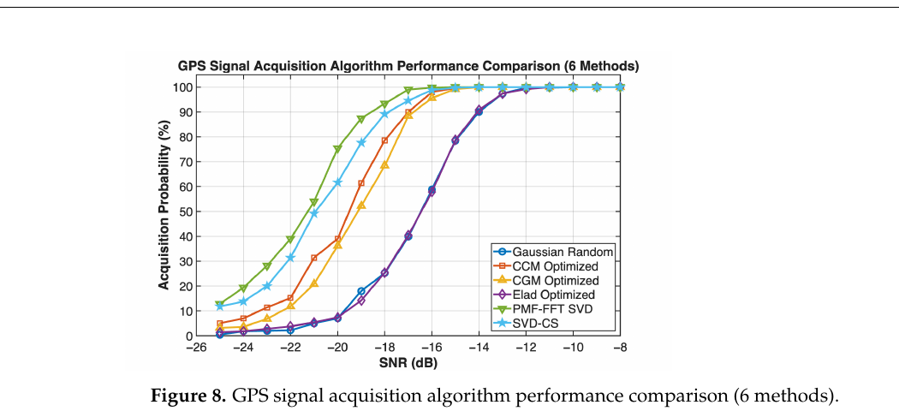
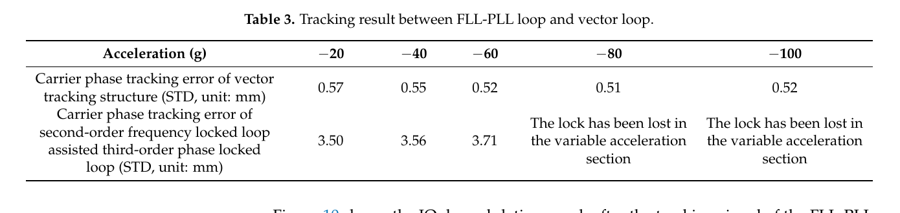
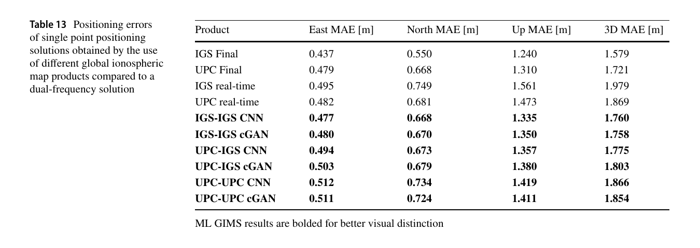

# 2026-10-16 GNSS 每日研究简报

## 今日快报

### 快报 1：PPP-AR 与 PPP-RTK 已能覆盖不同芯片路径，但厘米指标仍来自厂商试验

- 主题：`commercial-pppar-ppprtk-onchip-ssr2osr`
- 来源 ID：`ion:gnss2026-17063`
- 来源链接：https://www.ion.org/gnss/abstracts.cfm?paperID=17063
- 发表日期：2026-09-17
- 来源类型：ION GNSS+ 2026 官方扩展摘要、厂商产品与北美现场试验
- 获取范围：官方扩展摘要全文；全球 PPP-AR、区域 PPP-RTK、片上 SSR、服务端 SSR2OSR、覆盖范围和厂商报告的精度/收敛指标已核对，未取得逐路线原始误差、竞争服务配置、独立复验或完整 SLA 统计

**内容：** Rx Networks 把 TruePoint 分为全球 PPP-AR 的 REACH 与区域 PPP-RTK 的 FOCUS。前者将 SSR 直接送入支持片上定位引擎的商用多频接收机；后者既可让接收机原生处理 SSR，也可由服务端把 SSR 转成虚拟站 OSR，使普通 RTK 接收机无需专有 PPP-RTK 固件即可使用区域电离层改正。

**结论：** 摘要报告 REACH 水平精度优于 3 cm、全球收敛低于 15 min，FOCUS 在美国本土、加拿大南部、欧洲和中国报告 3–7 cm 水平精度与近瞬时收敛；证据来自厂商组织的静态、遮挡和运动试验，并含与 Galileo HAS 及商业服务的比较。没有公开样本量、95% 分位定义、错误固定率和公平配置细节，因此这些数字应写作“厂商报告”，不能当作跨硬件、跨区域的独立保证。

**关注理由：** 高精度服务的工程瓶颈已从“有没有改正”转向“改正在哪一侧变成观测”。片上 SSR 节省外部算力，SSR2OSR 扩大兼容性，却也把模型、隐私、完整性和故障定位责任放在不同边界上。

### 快报 2：双频欺骗偏差小到 0.05 chip 时，跨频一致性检出率只约一半

- 主题：`dual-frequency-coherent-spoofing-alignment-cfar`
- 来源 ID：`ion:gnss2026-17178`
- 来源链接：https://www.ion.org/gnss/abstracts.cfm?paperID=17178
- 发表日期：2026-09-16
- 来源类型：ION GNSS+ 2026 官方扩展摘要、GPS L1 C/A+L2C 可控软件无线电试验
- 获取范围：官方扩展摘要全文；双频确定性合成、分数延迟、GNSS-SDR、多抽头相关器、CFAR 门限、偏差扫描与检测概率已核对，尚未覆盖 L5/L1C、真实空口传播、相位一致性防御或商用硬件接管

**内容：** 研究在共享时频参考下合成 GPS L1 C/A 与 L2C 欺骗信号，用分数延迟把跨频码偏差从 1 chip 扫到 0.005 chip。接收端以双频伪距差构造一致性统计量，并用恒虚警率方法把 $`P_{FA}=10^{-3}`$ 对应门限标定到约 19 m；多抽头相关器则检查信号形状与接管是否正常。

**结论：** 作者报告完全对齐的相干攻击检出率为 0；偏差为 0.05 chip、约 15 m 时检出率约 50%，达到 0.2 chip 或更大时接近 1。这说明多频冗余只有在攻击者留下跨频不一致时才形成防线。实验仍是 L1 C/A+L2C 的受控软件环境，不能直接外推到 L1C/L5、高端接收机内部防护或真实射频链路。

**关注理由：** “支持多频”不是认证结论。接收机必须把跨频码、载波、多普勒、导航电文和硬件偏差联合检查，并用可复验的虚警率报告对齐容差，而不是只证明单频欺骗可检出。

### 快报 3：路口视觉事件把 5.515 km 失锁路线误差压到约 4–5 m，深度残差本身贡献很小

- 主题：`gnss-denied-route-progress-landmark-correction`
- 来源 ID：`ion:gnss2026-17053`
- 来源链接：https://www.ion.org/gnss/abstracts.cfm?paperID=17053
- 发表日期：2026-09-16
- 来源类型：ION GNSS+ 2026 官方扩展摘要、四次城市道路重复实测
- 获取范围：官方扩展摘要全文；100 Hz IMU、CAN 车速/转角、GIS 路线、11 个信号灯路口、两种在线策略、Run 4 留出结果已核对，未取得横向误差、事件误匹配率、路线外偏离或更多城市复验

**内容：** 系统在 GNSS 位置、速度、航向和多普勒都不可用时，把车辆状态压缩为固定 GIS 路线上的弧长。策略 A 用路线坐标下的误差状态 EKF 和显式惯导；策略 B 用标量路程传播叠加带异方差不确定度的因果时序卷积/注意力残差。相机识别的信号灯路口作为稀疏位置事件更新同一弧长状态。

**结论：** 5.515 km、11 个映射路口的四次重复中，Run 4 使用固定于 Runs 1–3 的标定与网络参数。视觉地标把策略 B 沿轨 RMSE 从 8.24 m 降至 4.01 m，把策略 A 从 10.74 m 降至 4.85 m。摘要同时说明不确定度门控让学习残差权重很低，最终效果主要来自标定后的 CAN 车速和路口重复性，而不是深度网络主导。

**关注理由：** 这条结果给 GNSS 失锁桥接一个诚实基线：先让物理里程和稀疏绝对事件闭环，再判断学习模型是否真的贡献信息。它不是纯 GNSS 定位，也不能处理离开既知道路的自由运动。

### 快报 4：三引擎一致才报固定可把林下可用率抬到 95–100%，但比较由厂商控制

- 主题：`triple-engine-rtk-consensus-degraded-field-test`
- 来源 ID：`ion:gnss2026-16826`
- 来源链接：https://www.ion.org/gnss/abstracts.cfm?paperID=16826
- 发表日期：2026-09-18
- 来源类型：ION GNSS+ 2026 官方扩展摘要、商业智能天线对比现场试验
- 获取范围：官方扩展摘要全文；双芯片三 RTK 引擎一致门控、林下停走、城市峡谷、四款竞品和报告指标已核对，未取得引擎独立性、真值系统、样本时长、竞品设置或错误固定计数

**内容：** Carlson Viking 用两颗 GNSS 芯片驱动三套性质不同的 RTK 引擎，只有三者都固定且解一致时才输出 “Triple-Fix”；另含 DSP 干扰抑制与免现场标定的 IMU 倾斜补偿。试验在松林停走和城市峡谷中与四款竞品比较。

**结论：** 厂商摘要称松林 RTK fixed 可用率为 95–100%，竞品平均为 62–75%；退化环境位置误差为 3–5 cm，相对竞品降低 25–70%。一致投票能降低单引擎误固定穿透的机会，但三引擎共享天线、射频、星历和环境误差，不能由“数量为三”推得统计独立；且原文把结果置于 Anticipated Results 段，未给独立真值和失败样本。

**关注理由：** 多引擎门控的价值在多样性，不在简单复制。工程验收应专门注入共享故障、同源多路径和跨引擎相关偏差，并报告拒绝可用解的代价。

### 快报 5：单颗月球中继配合着陆器差分多普勒，仿真 1.8 h 后进入 10 m 内

- 主题：`lunar-rover-single-relay-differential-doppler-ranging`
- 来源 ID：`ion:gnss2026-16945`
- 来源链接：https://www.ion.org/gnss/abstracts.cfm?paperID=16945
- 发表日期：2026-09-16
- 来源类型：ION GNSS+ 2026 官方扩展摘要、月面三节点导航仿真与 Fisher 信息分析
- 获取范围：官方扩展摘要全文；单中继多普勒、着陆器单向测距、差分多普勒、时钟/星历考虑状态、链路丢失/重捕和主要误差量已核对，无月面实测、硬件在环或真实地形遮挡

**内容：** 月球车只接收一颗通信中继的单向多普勒，着陆器向车提供单向伪距并可转发自身中继多普勒，从而形成着陆器辅助差分多普勒。各配置用 EKF 估计相应时钟状态；原始卫星多普勒方案把广播星历误差作为 Schmidt–Kalman 考虑状态。仿真还含随机钟、时相关星历误差、周期 ODTS 更新、链路热噪声和表面链路丢失/重捕。

**结论：** Fisher 信息表明，单星多普勒主要约束沿中继天空轨迹方向，着陆器伪距提供近一维表面约束，组合后消除卫星单独方案的公里级弱水平轴。恒可见性消融中，差分配置从各轴 100 m 初差出发，约 1.8 h 后达到三维 10 m 内并维持 24 h；重获着陆器让均值误差约降 60 m。结果完全来自仿真，不能写成月面已验证性能。

**关注理由：** 它展示了稀疏导航设施的核心：用差分观测消掉共模星历/钟误差，再用几何互补恢复可观性。相同思路也适用于地面机会信号，但收敛时长和链路可见性必须写进任务预算。

## 深度研读

### 深读 1｜信号捕获｜不必重建整段波形：低维投影怎样保住码相位—多普勒峰

- 类别：`acquisition`
- 学习层级：`foundation`
- 选题定位：`经典基础：从匹配相关峰到压缩观测下的直接反投影`
- 来源 ID：`doi:10.3390/electronics15010171`
- 来源链接：https://doi.org/10.3390/electronics15010171
- 发表日期：2025-12-30
- 来源类型：Electronics 同行评审开放论文
- 获取范围：CC BY 4.0 开放全文；低维时域测量、直接投影、Gram 矩阵流形优化、检测概率分析、GPS L1 仿真、Figures 1–9 与 Tables 1–2 已核对
- 价值评分：94/100（相关性 20，经典价值 17，证据 18，教学价值 20，工程价值 19）

#### 为什么先学这个

捕获并不要求恢复每一个采样点；它真正需要的是在二维码相位—多普勒栅格中，相关峰的位置和峰值足够可靠。把目标从“精确重建波形”收窄到“保住峰”，才能理解为什么压缩感知不一定要跑迭代稀疏恢复，以及为什么测量矩阵的列相关性会直接决定虚峰。

#### 先修知识

需要掌握 GPS L1 C/A 扩频、码相位和多普勒二维搜索、相干积分、FFT 循环相关、检测门限、信噪比、测量矩阵 $`\Phi`$、Gram 矩阵、列互相关、稀疏恢复与算法复杂度。这里的 SNR 是论文仿真定义，不能直接等同接收机常用的 $`C/N_0`$。

#### 一句话逻辑

先把 Nyquist 采样向量压成少量线性测量，再用 $`\Phi^H`$ 直接反投影；只要 $`\Phi^H\Phi`$ 的非对角项足够小，重建扰动不会盖过真正相关峰，随后一次 FFT 仍能找到正确码相位和多普勒。

#### 研究问题与约束

论文针对弱信号或高动态接收机的捕获计算量，比较迭代 OMP 压缩感知和直接投影。验证仅为 GPS L1 AWGN 仿真：码率 1.023 MHz，采样率 $`2R_c`$，$`N=1024`$、默认 $`M=768`$，多普勒范围 $`\pm12`$ kHz，代码相位设为 400，归一化检测门限为 3。没有真实射频前端、量化、数据位翻转、振荡器相噪、多路径或 FPGA 资源测试。

#### 核心方法论

接收信号先经低维矩阵 $`\Phi`$ 压缩，再以共轭转置直接反投影到原维度。作者不追求 $`\Phi^H\Phi=I`$——因为 $`M<N`$ 时秩上不可能——而是用对称正定流形上的 Gram 矩阵优化，压低列间最大相干与非对角能量，同时约束对角线和变换矩阵范数。在线阶段只做矩阵—向量乘法和 FFT 相关。

#### 关键公式逐步推导

压缩测量和直接反投影为：

```math
y=\Phi r+n,
\qquad
\hat r=\Phi^Hy=\underbrace{\Phi^H\Phi}_{G}r+\Phi^Hn.
```

在欠定条件下写成：

```math
G=I+E,
\qquad
\hat r=r+Er+\Phi^Hn.
```

捕获只要求扰动 $`Er`$ 和投影噪声小于主峰能量。反投影后的循环相关为：

```math
R_{rc}(\tau)=\operatorname{IFFT}\!\left(\operatorname{FFT}(\hat r)\odot\operatorname{FFT}(c)^*\right),
```

再在多普勒索引 $`d`$ 和码延迟 $`\tau`$ 上取 $`(d^*,\tau^*)=\arg\max|R(d,\tau)|`$。测量矩阵质量由最大列相干 $`\mu(\Phi)`$ 约束；非对角项越大，越容易把主峰能量泄到虚峰。

#### 经典价值与创新边界

经典价值是把“捕获是峰值判决而非完整重建”写成明确的工程目标。创新在于用 Gram 空间和 SPD 流形调整测量矩阵，再配合自适应阈值与直接投影。边界是优化矩阵离线生成、结果依赖指定字典和仿真噪声；论文没有证明矩阵在采样率、带宽、信号体制或前端统计变化后仍最优。

#### 整体逻辑链

建立二维捕获模型；将时域样本压缩；用 $`\Phi^H`$ 反投影；把误差分成 Gram 扰动和噪声；优化测量矩阵以压低相干；用 FFT 搜索峰；按 SNR、测量长度和六种算法比较检测率与复杂度。下一节将接过捕获给出的粗码相位和多普勒，讨论高动态下怎样持续跟踪。

#### 原文图表与结果分析



> 图表源：Zhou 等《Compressive-Sensing-Based Fast Acquisition Algorithm Using Gram-Matrix Optimization via Direct Projection》Figure 8，[CC BY 4.0 开放全文](https://doi.org/10.3390/electronics15010171)。用 Poppler 以 180 dpi 渲染原 PDF 第 20 页后，仅裁出 Figure 8 与原图题；未改动曲线、图例、坐标、标签或数值。

横轴为仿真 SNR（dB），纵轴为捕获概率（%）。PMF-FFT-SVD 绿色曲线最靠左，约在 −18 dB 达到 90%；CCM 约为 −17 dB；本文 CGM 直接投影约为 −16 dB；Gaussian Random 与 Elad 约为 −13 至 −12 dB。图直接说明 CGM 在低复杂度直接投影组里更灵敏，却没有超过所有迭代恢复算法。它也不能证明真实 $`C/N_0`$ 门限或首次定位时间。

#### 原文结果论述

在 $`N=1024`$、$`M/N=0.75`$ 的矩阵对比中，CGM 在 −20 dB 的检测率为 32.8%，Gaussian 与 Elad 分别为 8.2% 和 8.6%；−16 dB 时为 95.2%、60.2% 和 59.6%。六算法对比中，CGM 在 −16 dB 为 95.6%，在线复杂度为 $`O(MN+N\log N)`$，MATLAB 平均 CPU 时间 0.051094 s；几种 OMP 方案约 0.17–0.64 s。时间只代表同一台 Ryzen 9 9950X、MATLAB R2024b 和 500 次蒙特卡洛的实现，不是芯片实时预算。

#### 常见误区与适用边界

第一，压缩采样不等于可以无损重建全部信号。第二，SNR 增益不能直接写成 $`C/N_0`$ 增益。第三，3σ 门限没有给出完整多格搜索的全局虚警率。第四，离线优化成本没有消失，只是移出在线路径。第五，矩阵乘法仍为 $`O(MN)`$，低功耗实现要看存储、定点量化和数据搬运。第六，AWGN 曲线不包含数据位、二次码或高动态频率走动。

#### 工程实现步骤

1. 明确冷启动/热启动下的码相位、多普勒和卫星搜索空间。
2. 用目标采样率和字典生成初始 $`\Phi_0`$，离线优化 Gram 非对角能量并保存版本号。
3. 对定点量化后的 $`\Phi`$ 重新计算最大/平均列相干，避免浮点到硬件后退化。
4. 在线计算 $`y=\Phi r`$、$`\hat r=\Phi^Hy`$ 与逐多普勒 FFT 相关。
5. 从无峰单元估计噪声并用全局虚警率校准门限，而非机械使用 3σ。
6. 输出峰值、次峰、码相位、多普勒与置信信息给跟踪环，并保留传统 PCPS 回退路径。

#### 复现实验设计

先复现论文 GPS L1 设置：$`R_c=1.023`$ MHz、$`f_s=2R_c`$、$`N=1024`$、$`M/N=0.4–0.9`$、多普勒 $`\pm12`$ kHz，每点至少 1000 次蒙特卡洛。比较 PCPS、Gaussian 直接投影、CGM 直接投影、OMP-CS；指标为全局虚警率、90% 检测门限、码相位/多普勒错误率、CPU/内存和能耗。失败用例加入 1/2/4 bit 量化、50–500 Hz/s 频率斜率、数据位边界、1–3 路多路径、窄带干扰和矩阵定点化。

#### 与定位及低成本实现的联系

更快、更省电的捕获能缩短低成本终端失锁后的重捕时间，但任何 2–3 dB 仿真收益只有在不抬高虚警与粗估偏差时才会传到定位层。捕获还应输出不确定度，让跟踪环按峰形和信号强度选择带宽，而不是把所有成功声明当成同质量初值。

#### 本节小结

压缩捕获的目标是保住正确相关峰，而不是重建漂亮波形。Gram 非对角能量决定虚峰，CGM 在本文仿真中用低在线复杂度换到 2–3 dB 相对随机矩阵的灵敏度，但仍需真实射频和硬件闭环验证。

### 深读 2｜信号跟踪｜让预滤波器守住单通道：级联矢量环怎样跨过 100 g 动态

- 类别：`tracking`
- 学习层级：`intermediate`
- 选题定位：`基础进阶：从独立 FLL/PLL 到通道预滤波与导航主滤波闭环`
- 来源 ID：`doi:10.3390/rs13102000`
- 来源链接：https://doi.org/10.3390/rs13102000
- 发表日期：2021-05-20
- 来源类型：Remote Sensing 同行评审开放论文
- 获取范围：CC BY 4.0 开放全文；I/Q 重构、UKF 载波预滤波、导航主滤波、模拟高动态与 Spirent GSS8000 试验、Figures 1–12 和 Tables 1–3 已核对
- 价值评分：95/100（相关性 20，经典价值 18，证据 19，教学价值 19，工程价值 19）

#### 为什么先学这个

上一节只把信号送到跟踪入口。高动态时，独立通道必须各自吞下视线速度、加速度、钟漂和噪声，扩大环路带宽又会引入更多噪声。矢量跟踪把各星观测汇入共同导航状态，但坏通道也可能污染全部通道；级联结构的关键是用单通道预滤波器先做隔离。

#### 先修知识

需要掌握载波 NCO、相干积分后的 I/Q、FLL 辅助 PLL、DLL、环路带宽、载波相位/频率/频率导数、UKF、接收机位置速度加速度与钟差钟漂状态、卫星视线投影，以及标量环和矢量环的反馈差异。

#### 一句话逻辑

每个通道先用 UKF 预滤波器从重构 I/Q 中估计相位与多普勒动态并挡住异常，再把伪距、频率及频率导数送入共享导航滤波器；主滤波器用共同运动状态反馈各通道，使强星帮助弱星而不让极差通道直接扩散。

#### 研究问题与约束

论文比较级联矢量结构与二阶 FLL 辅助三阶 PLL。模拟信号使用 40 MHz 采样、4 MHz 中频、8 bit、$`C/N_0>40`$ dB-Hz；硬件试验用 Spirent GSS8000，先标量跟踪 7.5 s 再切矢量，初速 5000 m/s，沿单轴施加 −20 至 −100 g 加速度与 1 s 变加速度段。它是无遮挡、强信号、已知仿真真值的高动态试验，不是火箭飞行数据。

#### 核心方法论

导航数据位会让原始 I/Q 变号，作者先用平方与乘积重构 $`\cos2\theta`$、$`\sin2\theta`$ 型观测，使载波相位误差不依赖未知数据位。每个通道的预滤波器估计相位差、角频率及其高阶导数；主滤波器估计三轴位置、速度、加速度和钟状态。NCO 的相位差部分保留通道预滤波结果，频率和一阶变化则由主滤波器的接收机—卫星相对运动反馈。

#### 关键公式逐步推导

相干积分后的同相与正交分量近似为：

```math
I_p=\frac{N_k}{2}A_kD_kR(\tau)\cos\theta,
\qquad
Q_p=\frac{N_k}{2}A_kD_kR(\tau)\sin\theta.
```

通过平方消掉导航位符号：

```math
I_p^2-Q_p^2=(I_p^2+Q_p^2)\cos2\theta,
\qquad
2I_pQ_p=(I_p^2+Q_p^2)\sin2\theta.
```

若预滤波器状态包含相位差 $`\Delta\theta_k`$、角频率 $`\omega_k`$ 及导数，则一个积分周期 $`T`$ 的 NCO 频率反馈为：

```math
\omega_{nco,k}=\frac{\Delta\theta_k}{T}+\omega_k+\frac{T}{2}\omega'_k+\frac{T^2}{6}\omega''_k.
```

级联的意义不在某一个系数，而在反馈来源分工：相位残差由本通道保存，运动诱导的频率项由共享导航状态提供。

#### 经典价值与创新边界

经典价值是展示矢量环的“跨通道互助”和“误差传播”必须同时设计。创新是可独立闭环的 UKF 预滤波器与导航主滤波器级联，并用载波辅助码环。边界是结构参数和模拟器条件特定，作者用标量解初始化；冷启动、星历错误、主滤波发散、弱信号与遮挡并未在同一试验中同时施加。

#### 整体逻辑链

从标量环受动态应力出发；重构 I/Q 以去除数据位影响；建立单通道载波 UKF；汇集各通道伪距与频率到导航主滤波器；把位置速度加速度投影回 NCO；先仿真扫描 jerk，再用硬件信号模拟器扫描 −20 至 −100 g；比较相位误差、失锁和收敛时间。高级定位只有在这个观测链稳定后才有意义。

#### 原文图表与结果分析



> 图表源：Tu 等《Design and Validation of a Cascading Vector Tracking Loop in High Dynamic Environments》Table 3，[CC BY 4.0 开放全文](https://doi.org/10.3390/rs13102000)。用 Poppler 以 180 dpi 渲染原 PDF 第 12 页后，仅裁出 Table 3；未改动表头、单位、文字或数值。

列是 −20、−40、−60、−80、−100 g；第一行给级联矢量结构的载波相位跟踪标准差，依次为 0.57、0.55、0.52、0.51、0.52 mm。传统 FLL-PLL 在 −20、−40、−60 g 为 3.50、3.56、3.71 mm，在 −80 与 −100 g 的变加速度段失锁。表直接支持指定模拟器配置下的动态范围与相位噪声差异；它不包含真实天线振动、前端饱和、火箭振荡器或遮挡。

#### 原文结果论述

作者还报告 −100 g 下级联矢量结构从切换到稳定约需 100 ms，稳定载波相位误差低于 0.6 mm；FLL-PLL 在 −20 g 的切换收敛约 280 ms，在 −60 g 约 500 ms，动态继续上升后失锁。这些是强信号、无遮挡和已有标量初值条件下的模拟器结果；“100 g 可跟踪”不等于全接收机已通过火箭级飞行环境验证。

#### 常见误区与适用边界

第一，矢量跟踪不是把 DLL/PLL 输出简单送进 EKF。第二，共享状态会帮助弱星，也会传播坏星。第三，0.5 mm 是载波跟踪误差标准差，不是位置精度。第四，模拟加速度不覆盖振动、jerk 谱、时延和振荡器相噪。第五，标量初始化是隐含依赖，完全失锁后仍需重捕。第六，平方 I/Q 消除数据位的同时会改变噪声统计，UKF 协方差要实测标定。

#### 工程实现步骤

1. 保留现有标量通道，先建立可切换的预滤波器接口。
2. 从 I/Q 构造对数据位不敏感的相位观测，并按 $`C/N_0`$ 调整观测协方差。
3. 每通道估计相位差、多普勒和变化率，做创新门控，拒绝异常通道进入主滤波器。
4. 主滤波器估计位置、速度、加速度、钟差和钟漂，保存各星视线及时间戳。
5. 相位残差用通道结果反馈，频率动态用主状态反馈，严格补偿处理时延。
6. 设计矢量—标量回退、重捕和主滤波失配检测，避免共同状态把错误扩散。

#### 复现实验设计

用 SDR 或信号模拟器产生 GPS L1 C/A，采样 20–40 MHz、8 bit，$`C/N_0`$ 取 25/30/35/40/45 dB-Hz。加速度取 0–100 g，jerk 取 0–100 g/s，并注入 1/5/10 ms 处理时延。比较二阶 FLL+三阶 PLL、单通道 UKF、级联矢量环。指标为相位/频率 RMSE、失锁率、重捕时间、PVT 误差、CPU 负载和异常传播星数。失败用例加入单星强多路径、错误星历、钟漂突变、两星遮挡和主滤波初值偏差。

#### 与定位及低成本实现的联系

低成本终端常受振荡器和算力限制，级联结构允许预滤波高频运行、主滤波降频运行，但增加同步和协方差维护成本。它能给定位层更连续的多普勒与载波，却不能替代观测质量控制；下一节继续把可靠码观测送入单频 SPP，并处理仍然主导误差预算的电离层延迟。

#### 本节小结

级联矢量跟踪用通道预滤波守住局部相位、用导航主滤波共享运动信息。论文模拟器试验在 −100 g 仍保持约 0.52 mm 相位误差标准差，但结论受强信号、无遮挡和标量初始化约束。

### 深读 3｜定位算法｜实时电离层图还有几 TECU 误差：学习修图怎样改善单频 SPP

- 类别：`positioning`
- 学习层级：`advanced`
- 选题定位：`定位深入：从实时 VTEC 格网误差到单频 GPS+Galileo SPP`
- 来源 ID：`doi:10.1007/s10291-025-01858-0`
- 来源链接：https://doi.org/10.1007/s10291-025-01858-0
- 发表日期：2025-05-12
- 来源类型：GPS Solutions 同行评审开放论文
- 获取范围：CC BY 4.0 开放全文；IGS/UPC 实时与最终 GIM、CNN/cGAN、Jason-3 外部检验、19 站单频 SPP、Figures 1–11 与 Tables 1–14 已核对
- 价值评分：96/100（相关性 20，经典价值 18，证据 20，教学价值 19，工程价值 19）

#### 为什么先学这个

捕获和跟踪把码观测交给 SPP 后，单频电离层仍可能贡献米级误差。最终 GIM 最准却延迟数天，实时 GIM 只有几分钟延迟但与最终产品相差数个 TECU。本节学习怎样把实时格网当成待校正输入，而不是让网络直接从零预测定位结果。

#### 先修知识

需要掌握单频伪距观测、电离层一阶延迟与频率平方反比、垂直 TEC（VTEC）、薄壳映射函数、IONEX 全球电离层图、双线性/三次插值、SPP 加权最小二乘、MAE/RMSE、CNN、U-Net、cGAN、训练—测试分离与分布漂移。

#### 一句话逻辑

用 U-Net CNN 或 cGAN 学习“实时 GIM + 太阳活动/时间特征”到最终 GIM 的残差结构，再把修正后的 VTEC 按卫星穿刺点投影为斜向电离层延迟；若地图确实更接近真实电离层，单频 SPP 的上向和三维误差应随之下降。

#### 研究问题与约束

论文使用 IGS 组合与 UPC 的实时/最终 GIM，共构造超过 13 万对地图。IGS 模型训练约 2.5 年、UPC 约 3.5 年，测试期为 2023-07-01 至 2023-10-14，恰处较高太阳活动且与训练分布不同。SPP 只用 L1、GPS+Galileo、30 s、7° 截止角、广播轨道钟差，在 19 个全球 IGS 站按运动模式逐历元解算；参考是同站静态双频解，不是外部测量真值。

#### 核心方法论

输入包括实时 GIM、月均 F10.7、日内秒数和年内日序；时间特征缩放到 0–1。CNN 用带 ResNet18 编码器的 U-Net，输出端 ReLU 防止负 VTEC，以 L1 损失拟合最终 GIM。cGAN 复用同一生成器，另加卷积判别器，并以对抗损失加 L1 损失训练。每个数据集训练 5 个不同种子模型并平均输出。评估同时看对最终 GIM 的内部误差、Jason-3 海洋 VTEC 外部残差和 SPP 位置误差。

#### 关键公式逐步推导

第 $`f`$ 个载频的一阶电离层群延迟可写为：

```math
I_f=\frac{40.3}{f^2}\,STEC,
```

其中斜向电子总含量由穿刺点处 $`VTEC`$ 乘薄壳映射函数得到。网络并不直接最小化位置误差；CNN 的训练目标是地图的 L1 差：

```math
\mathcal L_{CNN}=\left\|y-G(x,z)\right\|_1,
```

cGAN 则在生成器—判别器目标外保留 L1 约束：

```math
G^*=\arg\min_G\max_D\frac{1}{\lambda}\mathcal L_{cGAN}(G,D)+\mathcal L_{L1}(G),
```

论文取 $`\lambda=2500`$。SPP 的三维误差为 $`\sqrt{\Delta E^2+\Delta N^2+\Delta U^2}`$，最终用各历元相对双频静态解的 MAE 比较不同 GIM。

#### 经典价值与创新边界

经典价值是把地图域改进闭合到观测域和位置域：格网 MAE 下降并不自动等于 SPP 改善。创新是用 CNN/cGAN 修正现有实时 GIM，并同时以最终 GIM、Jason-3 和全球 19 站 SPP 三条证据链检验。边界是最终 GIM 本身也是 GNSS 派生产品，双频参考与单频解共享轨道、钟差和环境误差；ML 还可能平滑掉真实小尺度结构。

#### 整体逻辑链

收集实时与最终 IONEX；对齐历元与格网；加入 F10.7、日内和年内特征；训练五模型集成的 CNN/cGAN；先比较地图 MAE/RMSE 和高 VTEC 区；再以 Jason-3 检查海洋外部一致性；最后把每种 GIM 转成 L1 斜向改正，运行 19 站 GPS+Galileo SPP 并比较 ENU/3D MAE。

#### 原文图表与结果分析



> 图表源：Iten 等《Enhanced Real-Time Global Ionospheric Maps Using Machine Learning》Table 13，[CC BY 4.0 开放全文](https://doi.org/10.1007/s10291-025-01858-0)。用 Poppler 以 180 dpi 渲染原 PDF 第 13 页后，仅裁出 Table 13；未改动行列、单位、粗体或数值。

列为东、北、上与三维 MAE，单位均为 m。IGS 实时 GIM 的 3D MAE 为 1.979 m；用 IGS 实时图训练、以 IGS 最终图为目标的 CNN/cGAN 分别为 1.760/1.758 m，改善主要来自上向 1.561 m 降到 1.335/1.350 m。UPC-UPC 从 1.869 m 到 1.866/1.854 m，几乎没有三维收益，且东西/北向还略差。表直接表明收益依赖输入产品，而非“用了 ML 就更准”。

#### 原文结果论述

以 IGS 最终 GIM 为目标时，ML 把实时图总体 MAE 从 3.60 TECU 降到 2.30 TECU，约改善 36%；VTEC 大于 80 TECU 时从 10.50 降到 5.30–5.47 TECU，约改善 47%。但 Jason-3 外部比较显示，部分 UPC 数据集的 ML 残差标准差反而略高，作者将其归因于平滑效应。单张 GIM 在 RTX 4070 上推理为毫秒量级；这是 GPU 推理，不含产品传输和接收机处理全链路。

#### 常见误区与适用边界

第一，最终 GIM 不是无误差真值。第二，地图域 MAE 改善不保证每站位置改善。第三，双频静态参考不是独立外部真值。第四，训练集未覆盖完整太阳周期，极端空间天气可能分布外。第五，L1 损失与卷积会平滑小尺度电离层结构。第六，0.21 m 是 19 站平均 3D MAE 差，不是每站、每历元或 95% 误差保证。

#### 工程实现步骤

1. 连续接收并解析实时 IONEX，保留产品时间戳、缺格与质量标志。
2. 将格网、F10.7、日内与年内特征按训练定义归一化，禁止用未来最终图在线泄漏。
3. 用五模型集成推理 VTEC，检查非负、空间梯度、全球积分和分布外指标。
4. 在卫星穿刺点插值 VTEC，用薄壳映射生成每颗 L1 的斜向改正和方差。
5. 运行 GPS+Galileo 单频加权 SPP，并同时保留原始实时 GIM 解作在线对照。
6. 当模型分歧、太阳活动或格网梯度超出训练范围时降权或回退原产品。

#### 复现实验设计

下载连续三年的 IGS/UPC 实时与最终 GIM，按时间块而非随机帧划分训练、验证、测试；保留至少一次磁暴整段只做测试。基线包括 Klobuchar、原实时 GIM、线性偏差校正、CNN、cGAN 和最终 GIM 上界。用 20 个以上全球站的 L1 GPS+Galileo、30 s、7° 截止角运行逐历元 SPP。指标为 GIM MAE/RMSE、高 VTEC 区误差、Jason-3 分纬度残差、ENU/3D MAE 与 95% 分位。失败用例加入缺图、15/30/60 min 延迟、格网断裂、磁暴、低纬梯度和新太阳周期。

#### 与定位及低成本实现的联系

单频低成本接收机无法形成电离层无关组合，因此最可能直接受益；不过手机码多路径往往大于 0.2 m 的地图收益，必须先分环境统计。工程上应把 ML GIM 当带不确定度的外部改正，不是确定真值，并把模型分歧、磁暴和产品龄期送进 SPP 权阵。

#### 本节小结

学习型 GIM 在 IGS 数据链上把 19 站单频 SPP 的 3D MAE 平均降低约 0.21 m，但 UPC-UPC 几乎无三维改善。真正可靠的闭环要同时检查地图、独立 TEC 与位置三层，并为平滑、小尺度结构和太阳活动分布外风险保留回退路径。
