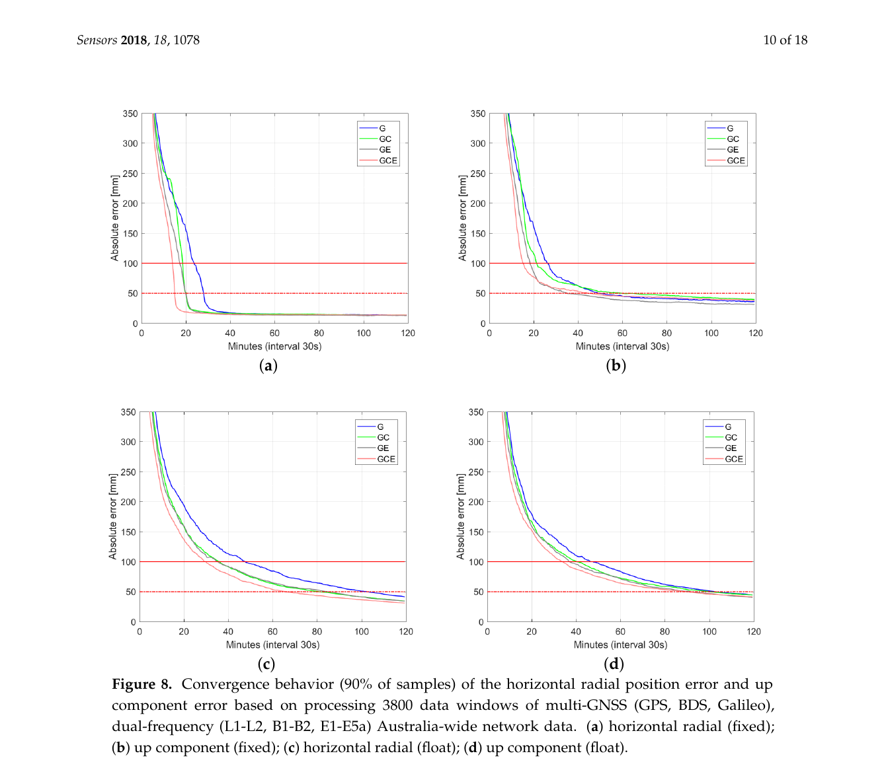
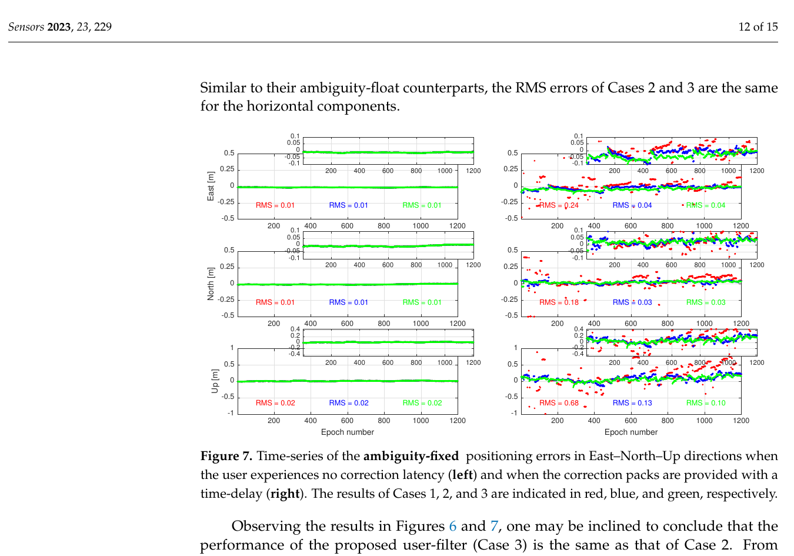
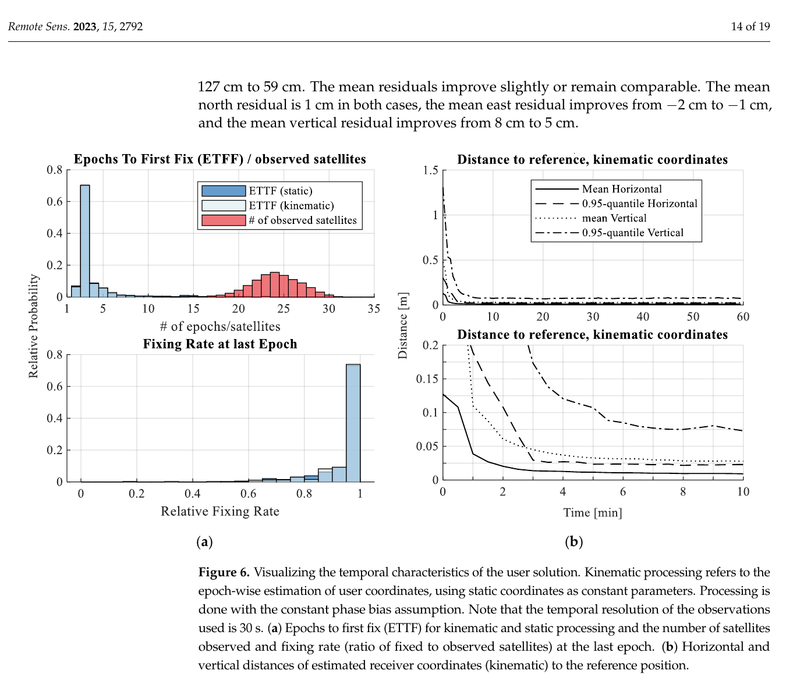

# 2026-10-17 GNSS 每日研究简报

## 今日快报

### 快报 1：高空气球在 143 km 外仍能跟踪 5G 基站，但四段 3D RMSE 相差四倍

- 主题：`high-altitude-multicell-5g-opportunistic-navigation`
- 来源 ID：`ion:gnss2026-17175`
- 来源链接：https://www.ion.org/gnss/abstracts.cfm?paperID=17175
- 发表日期：2026-09-18
- 来源类型：ION GNSS+ 2026 官方扩展摘要、高空气球 5G 机会信号实测
- 获取范围：官方扩展摘要全文；多小区顺序捕获、源消除、KF 跟踪、同步基站伪距模型、气压高度辅助和四段飞行结果已核对，未取得基站同步误差、逐段几何、真值系统精度或原始观测

**内容：** 软件接收机先捕获一个 5G gNB，再重构并消除该源以搜索同频弱基站，随后以 Kalman 跟踪环输出时延和多普勒。定位端假设相邻 gNB 已同步，将 5G 伪距与高度计送入 EKF。四段高度分别为海拔 2.6–4.1 km、5.0–7.3 km、10.6–12.2 km 和 13.6–15.1 km，每段能跟踪 3–6 个基站，最远基站距离达到 143 km。

**结论：** 四段轨迹长度为 2.24、4.03、8.09 和 8.02 km，对应 3D RMSE 为 19.85、66.58、16.62 和 63.57 m。结果证明高空仍能从地面蜂窝信号形成可定位观测，但误差并不随高度单调变化；摘要未给基站钟差、垂直/水平分解和几何强度，不能把 16.62 m 当成系统的普遍精度，也不能归因于单一传播因素。

**关注理由：** 这与多 GNSS 的共同 lesson 相同：多源可见只是可观测性的起点，源间同步、几何、测量相关性和高度约束才决定位置。机会信号若要进入 GNSS/INS 接收机，必须把基站钟差和同步失配作为状态或误差预算，而不是默认消失。

### 快报 2：厂商 NRTK 在美国实测 95% 水平误差约 24 cm，厘米结论不能只看中位数

- 主题：`commercial-hybrid-nrtk-ssr2osr-us-field-campaign`
- 来源 ID：`ion:gnss2026-17125`
- 来源链接：https://www.ion.org/gnss/abstracts.cfm?paperID=17125
- 发表日期：2026-09-17
- 来源类型：ION GNSS+ 2026 官方扩展摘要、厂商跨美国静态与车载试验
- 获取范围：官方扩展摘要全文；12,000 余 CORS、NRTK+SSR2OSR 架构、SLA、10,000 km/18 城市试验和分位数结果已核对，未取得逐城市样本、竞品配置、完整固定判据和独立第三方复验

**内容：** TruePoint.CM 以 NRTK 为主，在站网稀疏区域用 SSR2OSR 补覆盖，宣称由五大洲 12,000 余个 CORS 支撑并提供 99.9% SLA。美国试验覆盖 18 个城市和 10,000 km 以上路线，以主动贴片天线做静态与运动测试，并在相同条件下与两项商业改正服务比较。

**结论：** 七个开阔静态点的水平误差中位数为 2.3 cm、95% 分位为 4.8 cm，平均固定率 98.1%；全运动试验的水平中位数约 4.8 cm，但 95% 分位扩大到约 24 cm。数字来自服务商组织的试验，摘要没有公开路线分层、错误固定率、真值链和竞品参数；因此可支持“该试验中尾部明显大于中位数”，不能单凭厂商摘要证明跨市场持续厘米级。

**关注理由：** 高精度服务验收应把 95%/99% 尾部、重收敛和错误固定单独列出。一个漂亮的 4.8 cm 中位数可能同时伴随 24 cm 的 95% 误差；面向自动化设备时，后者往往更接近连续性风险。

### 快报 3：12 颗 Starlink DTC 差分多普勒把 124 km 初差收敛到 2.7 m 水平精度

- 主题：`starlink-direct-to-cell-differential-doppler-positioning`
- 来源 ID：`ion:gnss2026-17169`
- 来源链接：https://www.ion.org/gnss/abstracts.cfm?paperID=17169
- 发表日期：2026-09-16
- 来源类型：ION GNSS+ 2026 官方扩展摘要、Starlink DTC/宽带信号同步基准—流动站实测
- 获取范围：官方扩展摘要全文；5.55 km 基线、2.5/240 MHz 跟踪、12 星 10 min 差分多普勒、1000 次蒙特卡洛和水平结果已核对，未取得卫星星历真值、垂直误差、分位数或与 GNSS 基线的同场比较

**内容：** 研究针对 Starlink Direct-to-Cell 下行建立含星上多普勒/时延补偿的信号模型，并在俄亥俄州东南部以相距 5.55 km 的基准站和流动站同步采集 DTC 与宽带信号。软件接收机同时处理 2.5 MHz 窄带和 240 MHz 全信道 Ku 波段观测，提取两站共同可见卫星的多普勒差。

**结论：** 10 min 内同时跟踪 12 颗 DTC 卫星；1000 次蒙特卡洛初值平均偏离真值 124 km，经批处理非线性最小二乘融合差分多普勒后，作者报告水平定位精度 2.7 m。摘要未说明“精度”是 RMSE、标准差还是某分位数，也未给垂直结果与失败初始化比例；差分还能抵消哪些星历/钟差取决于 5.55 km 基线和同波束条件，不能直接外推到单站全球 PNT。

**关注理由：** 与载波差分 GNSS 类似，空间机会信号也可用共视差分压掉共模项。但多普勒只约束速度投影和轨迹几何，星上波束补偿、切换与未知星历仍必须建模；“强信号”并不会自动解决可追溯性。

### 快报 4：CRPA 场地—实验室复现显示照射区可抑制约 15 dB，阴影区反而接近 0 dB

- 主题：`field-to-lab-3d-interference-crpa-validation`
- 来源 ID：`ion:gnss2026-16814`
- 来源链接：https://www.ion.org/gnss/abstracts.cfm?paperID=16814
- 发表日期：2026-09-17
- 来源类型：ION GNSS+ 2026 官方扩展摘要、固定 L1 连续波干扰的场地与商业模拟器对照试验
- 获取范围：官方扩展摘要全文；1575.42 MHz/30 dBm EIRP 干扰源、单天线校准、四阵元 CRPA、四种传播模型、MVDR 抑制和误差边界已核对，未取得完整路线、阵元方向图、反射材料参数或重复试验统计

**内容：** 第一步以 Septentrio mosaic-X5 单天线接收机，用静态功率匹配校准实验室功率预算，再比较遮蔽、单刀刃绕射、Bullington 绕射和 Bullington+DSM 多路径四种 3D 传播配置对 C/N0、可见星与重捕时刻的复现。第二步以车载四阵元 CRPA 和 MVDR 波束形成，比较场地与实验室的主瓣—零陷方位关系。

**结论：** 在完全阴影区，场地和实验室的抑制都降到接近 0 dB；直接照射区升到约 15 dB，主要残差来自掠射绕射区。更复杂模型并非必然更真：若阵元方向图和地表反射材料没有同时验证，启用 DSM 多路径会降低复现一致性；平均 C/N0 偏差与跟踪星数也没有随模型复杂度单调改善。

**关注理由：** GNSS 抗干扰测试最容易把“几何更细”误当成“证据更强”。模型必须在接收机可观测量和阵列空间响应上逐层校准；否则实验室复现得到的是一个复杂但不可证伪的场景。

### 快报 5：三套 UTC(k) 把光纤证据送进 Galileo 监测链，但公开摘要仍缺量化告警性能

- 主题：`fiber-assisted-galileo-timing-service-monitoring`
- 来源 ID：`ion:gnss2026-17110`
- 来源链接：https://www.ion.org/gnss/abstracts.cfm?paperID=17110
- 发表日期：2026-09-18
- 来源类型：ION GNSS+ 2026 官方扩展摘要、ESA Galileo 二代系统试验床端到端验证
- 获取范围：官方扩展摘要全文；四 UTC(k) 基线、VSL—ESA 光纤链、冗余钟链仿真第三实验室、White Rabbit 本地链和 GST/UTC 状态输出流程已核对，摘要仅预告端到端结果，未给检出门限、误报率、相位噪声或告警时延

**内容：** Galileo Second Generation System Test Bed 原先用四个 UTC(k) 实验室的 GNSS 时间传递观测监视 GST/UTC。新方案把 UTC(VSL) 到 UTC(ESA) 的光纤相位比较接入监测算法，并在 ESA 以不同输入钟和频偏发生器构造冗余 UTC(k) 链，通过本地光纤和 White Rabbit 形成第三个可比 UTC(k) 实现；GNSS 观测保留为光纤故障时的备份。

**结论：** 摘要支持的是“端到端架构已被搭建并能把光纤证据传播到 GST/UTC 用户状态标志”；关于更稳定、更易解释的标志仍以将展示的示例描述，未公开相位残差、检出概率、虚警率或连续性增益。不能把较低短期噪声等同于已证明更高完整性，也不能将试验床结果写成 Galileo 已部署服务。

**关注理由：** 时间服务的最终产品不是一条低噪曲线，而是用户能理解的可信状态。多模态监测必须报告从实验室相位观测到广播标志的门限、延迟和故障覆盖，正如 PPP-RTK 必须把改正的不确定度传给用户滤波器。

## 深度研读

### 深读 1｜接收机工程｜先把不可估的账做平：未组合 PPP-RTK 怎样形成可用改正

- 类别：`receiver-engineering`
- 学习层级：`foundation`
- 选题定位：`经典基础：从未差未组合码相位方程到可估参数、网络改正与用户定整`
- 来源 ID：`doi:10.3390/s18041078`
- 来源链接：https://doi.org/10.3390/s18041078
- 发表日期：2018-04-03
- 来源类型：Sensors 同行评审开放论文
- 获取范围：CC BY 4.0 开放全文；未差未组合模型、S-system 可估性、澳大利亚广域/30 km 小网、低成本单频网、Figures 1–14 与 Tables 1–11 已核对
- 价值评分：97/100（相关性 20，经典价值 20，证据 19，教学价值 20，工程价值 18）

#### 为什么先学这个

PPP-RTK 常被简写成“网络发轨道、钟差、相位偏差，用户就能定整”，但原始观测里的接收机钟、卫星钟、码偏差、相位偏差和整数模糊度存在秩亏；不先说明哪些量真正可估，所谓“卫星钟”和“相位偏差”就可能只是命名相同、基准不同的组合量。本节先把函数模型和 datum 做清楚，再谈收敛速度。

#### 先修知识

需要掌握伪距与载波相位、几何距离线性化、接收机/卫星钟差、对流层湿延迟、首阶电离层的频率平方反比、码与相位硬件偏差、整数模糊度、最小二乘秩亏、随机游走，以及“未差未组合”不等于“参数天然可分”。

#### 一句话逻辑

网络把秩亏模型通过明确的 S-basis 变成一组可估组合量，再把与该基准一致的钟差、相位偏差和可选电离层信息交给用户；多星座增加几何与冗余，整数固定进一步把载波精度真正释放到位置域。

#### 研究问题与约束

论文处理 GPS、BDS、Galileo 的未差未组合数据。广域部分使用澳大利亚 22 个网络站、50 个用户站、跨三个月抽取十天、30 s 采样；小尺度网络站间距小于 30 km；低成本试验为相距约 7 km 的两台 u-blox M8 与贴片天线、连续三天。广域使用精密轨道，小尺度与低成本条件另有特定产品和已知坐标假设；结果不是今天所有星座、所有地区和实时链路的性能保证。

#### 核心方法论

网络端联合估计位置增量、湿对流层、斜电离层、钟和硬件偏差。由于原始设计矩阵秩亏，作者用 S-system 选择参考钟、参考偏差、部分整数与小网中的参考位置/对流层作为基准，得到带明确物理解释的可估组合量。用户端应用网络钟与相位偏差，可选用距离加权的电离层伪观测；随后比较 GPS 单系统、双系统、三系统及浮点/固定解。

#### 关键公式逐步推导

对接收机 $`r`$、卫星 $`s`$、频率 $`j`$ 的观测减计算值，论文模型可压缩为：

```math
\Delta\phi_{r,j}^{s}=\Delta\rho_r^s+g_r^s\tau_r-\mu_j\iota_r^s+dt_r-dt^s+\delta_{r,j}-\delta_j^s+\lambda_j a_{r,j}^{s},
```

```math
\Delta p_{r,j}^{s}=\Delta\rho_r^s+g_r^s\tau_r+\mu_j\iota_r^s+dt_r-dt^s+d_{r,j}-d_j^s.
```

相位和码中的电离层符号相反，$`\mu_j=(\lambda_j/\lambda_1)^2`$。把全部未知量写成 $`y=Ax+e`$ 时，$`A`$ 存在零空间；选择 S-basis 等价于施加足够的最小基准约束，使剩余参数成为可估组合 $`\tilde x`$。小网还可加入同星同历元的差分电离层伪观测：

```math
d\iota_r^s=\iota_r^s-\iota_1^s\approx 0,
\qquad
\sigma_{d\iota}\ \text{随站间距离增大而放宽}.
```

这不是宣称两站电离层完全相同，而是把空间相关性作为有方差的软约束。

#### 经典价值与创新边界

经典价值在于把 PPP-RTK 从产品名还原为可估性问题，并同时展示广域、多星座、小网和低成本接收机。创新是同一未组合框架对多类网络/用户条件的统一实现。边界是网络产品在用户端多被当作确定改正，相关协方差没有完整传播；这正是下一节“双重滤波”要修补的问题。

#### 整体逻辑链

写出码相位方程；识别秩亏；选择 S-basis；生成钟差、相位偏差和电离层可估改正；用户应用同一 datum；比较星座组合；执行整数固定；以收敛曲线验证。先保证“发出的是什么”和“用户减掉的是什么”一致，才能讨论延迟、相关性和多频加速。

#### 原文图表与结果分析



> 图表源：Nadarajah 等《Multi-GNSS PPP-RTK: From Large- to Small-Scale Networks》Figure 8，[CC BY 4.0 开放全文](https://doi.org/10.3390/s18041078)。用 Poppler 以 180 dpi 渲染原 PDF 第 10 页后，仅裁出 Figure 8 与原图题；未改动曲线、图例、坐标、标签或数值。

横轴为分钟（30 s 历元），纵轴为绝对位置误差（mm）；G、GC、GE、GCE 分别代表 GPS、GPS+BDS、GPS+Galileo 和三系统。上排是固定解水平/高程，下排是浮点解水平/高程，红实线和点划线分别是 100 mm 与 50 mm。直接可见：固定解的三系统曲线最早压过门限；浮点解尤其高程收敛慢得多。图是 3800 个窗口的 90% 曲线，不能解释单个失败窗口，也没有计入今天的星座更新和实时通信中断。

#### 原文结果论述

澳大利亚广域网络中，GPS 单系统浮点水平误差有 90% 降到 5 cm 需 103 min；三系统浮点缩短到 66 min，三系统固定为 15 min。对于低成本单频小网，论文总结 PPP-RTK 固定误差降到 1 dm 约需 14 min，而把用户直接放进网络联合估计的 in-the-loop 解约需 2 min。后一差异说明完整协方差信息有价值，不是“同一改正换个软件”就自然等价。

#### 常见误区与适用边界

第一，未差未组合不等于能分别估计所有物理偏差。第二，网络发布的“卫星钟”依赖 datum。第三，多星座收益同时来自几何、冗余和系统偏差建模。第四，电离层约束是随机软约束。第五，固定解的快收敛以正确整数为前提。第六，低成本结果来自静态短距屋顶试验，不能直接外推到城市车载。

#### 工程实现步骤

1. 统一 RINEX 信号、天线、轨道钟和偏差约定，写出未组合观测方程。
2. 对设计矩阵做秩与零空间检查，记录 S-basis 和版本号。
3. 网络滤波输出可估钟、相位偏差、电离层及其时间戳。
4. 用户端使用完全一致的基准、信号映射与偏差符号。
5. 分别输出浮点/固定、星座组合、改正龄期和可用卫星。
6. 用已知坐标窗口统计 50/75/90% 收敛，而非只给均值。

#### 复现实验设计

建立 15–25 个参考站和 10 个留出用户站，采 GPS/Galileo/BDS 双频 30 s、连续 3–7 d。比较 GPS、GPS+Galileo、三系统；电离层浮点与按 10/30/100 km 放宽的软约束；浮点、全固定和不固定。指标为 1 dm/5 cm 的 50/75/90% 首达时间、错误固定率、改正可用率和计算延迟。失败用例加入 datum 错配、系统间偏差跳变、卫星钟缺包、参考站坐标偏 2 cm 和网络外用户。

#### 与定位及低成本实现的联系

低成本用户最需要的不是更多不透明改正字段，而是能与自身信号集合对齐、带龄期和质量的可估产品。多星座可压收敛，但码噪声、贴片天线和网络协方差缺失会把收益吃掉。下一节因此不再把网络改正视为无误差常数。

#### 本节小结

PPP-RTK 的第一道门是可估性：网络和用户必须共享同一基准与偏差定义。三系统和整数固定在本文广域数据上显著加速，但 in-the-loop 的额外优势也暴露出“只传数值、不传随机信息”的损失。

### 深读 2｜接收机工程｜改正也有记忆：双重滤波为何会让 PPP-RTK 过度自信

- 类别：`receiver-engineering`
- 学习层级：`intermediate`
- 选题定位：`基础进阶：把延迟改正的方差与时间相关性联合送入用户滤波器`
- 来源 ID：`doi:10.3390/s23010229`
- 来源链接：https://doi.org/10.3390/s23010229
- 发表日期：2022-12-26
- 来源类型：Sensors 同行评审开放论文
- 获取范围：CC BY 4.0 开放全文；双重滤波推导、三种用户模型、1000 次模拟、CUT0/UWA0 双频 Galileo 实测、Figures 1–8 已核对
- 价值评分：98/100（相关性 20，经典价值 20，证据 19，教学价值 20，工程价值 19）

#### 为什么先学这个

上一节的网络改正由一个滤波器估计，用户又在自己的滤波器中连续使用它们。若只把每个历元的改正减掉，或只加一个逐历元方差，用户会把同一网络历史信息重复当成新信息。延迟越长，时间预测误差越大，错误的独立假设越危险。

#### 先修知识

需要掌握 Kalman 时间更新/量测更新、状态转移矩阵、协方差传播、白噪声与时间相关噪声、SSR 改正龄期、整数最小二乘，以及“无偏”与“最小方差”是两件事。

#### 一句话逻辑

不要把提供方滤波后的改正当成每历元独立常数；把改正状态连同它的动力学一起并入用户状态，让用户原始观测和改正观测共同更新，才能在延迟存在时接近最小方差。

#### 研究问题与约束

论文先用模拟分析三种方法，再用 2022-01-21 西澳 CUT0—UWA0 约 8 km 基线的 1 Hz Galileo E1/E5a 实测。提供方在运行 1 h 后开始发改正；钟包每 10 s、电离层每 30 s、相位偏差每 10 min；用户每次处理 20 min。高延迟是为放大差异，且实测只含一日、两站、Galileo 双频，不代表所有实时服务。

#### 核心方法论

Case 1 把改正当无误差常数；Case 2 纳入改正方差但忽略跨历元相关；Case 3 把用户状态 $`b`$ 与改正状态 $`c`$ 拼成增广状态，并把收到的改正解当成附加观测，使用提供方的改正动力学做时间传播。这样，相关性由状态转移显式承载，而不是被错误塞进白噪声。

#### 关键公式逐步推导

用户原始观测写成：

```math
u_i=B_i b_i+C_i c_i+n_i.
```

若用收到的预测改正 $`\hat c_{i|k_\tau}`$ 直接消去：

```math
\tilde u_i=u_i-C_i\hat c_{i|k_\tau}
=B_i b_i+C_i(c_i-\hat c_{i|k_\tau})+n_i,
```

括号内误差由同一提供方滤波历史传播而来，跨历元相关。增广法改写为：

```math
x_i=\begin{bmatrix}b_i\\c_i\end{bmatrix},\qquad
\begin{bmatrix}u_i\\\hat c_{i|k_\tau}\end{bmatrix}
=
\begin{bmatrix}B_i&C_i\\0&I\end{bmatrix}x_i+
\begin{bmatrix}n_i\\v_i^c\end{bmatrix}.
```

再以 $`c_i=\Phi_c c_{i-1}+w_i^c`$ 传播改正；因此“相关性”进入状态动力学，不再被每历元重复当作独立信息。

#### 经典价值与创新边界

经典价值是指出 SSR 的质量不仅是一个 sigma，还包括时间相关和生成滤波器的动力学。创新是可递归的增广用户滤波形式。边界是方法依赖 $`Q_{\hat c_{k_\tau}|k_\tau}\approx0`$ 的近似，并要求服务商披露改正动力学；论文也明确承认用户滤波仍非严格完美最优。

#### 整体逻辑链

网络滤波生成改正；延迟迫使用户外推；外推误差跨历元相关；普通用户滤波错当白噪声；协方差和整数置信度变得过度乐观；增广状态恢复记忆；模拟检查置信区间；实测比较浮点与固定位置。下一节再看多频能否在随机模型闭合后缩短固定历元。

#### 原文图表与结果分析



> 图表源：Khodabandeh、Teunissen 与 Psychas《On the Problem of Double-Filtering in PPP-RTK》Figure 7，[CC BY 4.0 开放全文](https://doi.org/10.3390/s23010229)。用 Poppler 以 180 dpi 渲染原 PDF 第 12 页后，仅裁出 Figure 7 与原图题；未改动散点、曲线、坐标、图例、单位或数值。

左列为零延迟，右列为有延迟；红、蓝、绿对应 Case 1/2/3。零延迟时三法 ENU RMS 均约 0.01/0.01/0.02 m。延迟后，忽略改正不确定度的红色 Case 1 出现大量错误固定，ENU RMS 变为 0.24/0.18/0.68 m；蓝色只纳入方差为 0.04/0.03/0.13 m；绿色同时建模方差和时间相关为 0.04/0.03/0.10 m。图直接显示指定数据集与高延迟设置下的差异，不证明所有服务都会出现同样倍数。

#### 原文结果论述

作者进一步把用户起始历元每 15 s 平移，形成 300 个实测实现；中位绝对误差仍显示 Case 3 平均小于 Case 2，并有更小的周期跳变。模拟中 1000 个样本还表明，只纳入方差但忽略时间相关会报告错误的 99.9% 置信区间。结论的核心不是某个 RMS，而是用户输出的协方差与实际误差是否一致。

#### 常见误区与适用边界

第一，改正延迟不只是“坐标晚几秒”，而是随机状态外推。第二，加一个 SSR URA 并不自动处理相关性。第三，RMS 接近不代表协方差一致。第四，固定解离群可能来自过度自信而非 LAMBDA 搜索本身。第五，本文 30 s/10 min 包间隔是压力条件。第六，增广滤波需要服务商公开动力学和质量定义。

#### 工程实现步骤

1. 为每类改正保存生成时刻、接收时刻、龄期和提供方状态模型。
2. 按钟、轨道、电离层、相位偏差分别建 $`\Phi_c,Q_c`$。
3. 将 $`[b^T,c^T]^T`$ 作为用户增广状态，改正解作为观测。
4. 在每个包到达时更新改正状态，包间只做时间传播。
5. 定整门控同时检查位置协方差、改正龄期与经验创新统计。
6. 用 NEES/NIS、覆盖率和错误固定率校准，而不只看 RMS。

#### 复现实验设计

选 5–20 km 已知短基线，GPS/Galileo/BDS 双频 1 Hz、24 h；由基站生成钟 1/5/10 s、电离层 5/30/60 s、相位偏差 60/600 s 三组流。比较非随机、仅方差、增广相关三法。指标为 ENU RMS/95%、NEES 覆盖、创新自相关、首次固定、正确/错误固定率和重收敛。失败用例包括 5–60 s 网络抖动、漏包、错误过程噪声、相位偏差跳变与卫星钟阶跃。

#### 与定位及低成本实现的联系

低成本接收机常靠低码率广域改正，恰好更容易遇到包间隔长与链路抖动。若不保留改正记忆，滤波器可能在观测最差时最自信。增广状态会增加算量，但比错误固定后的安全代价小，也可按改正类别稀疏实现。

#### 本节小结

PPP-RTK 是提供方滤波器与用户滤波器的串联。延迟改正天然带时间相关；忽略它会让固定解严重过度自信。把改正及其动力学纳入用户状态，是从“有改正”走向“可相信改正”的关键一步。

### 深读 3｜纯 GNSS 定位｜多频先固定容易的组合：PPP-RTK 怎样把 77% 解压到三历元内

- 类别：`positioning`
- 学习层级：`advanced`
- 选题定位：`定位深入：多系统多频产品、整数可估重参数化与纯 GNSS 用户快速固定`
- 来源 ID：`doi:10.3390/rs15112792`
- 来源链接：https://doi.org/10.3390/rs15112792
- 发表日期：2023-05-27
- 来源类型：Remote Sensing 同行评审开放论文
- 获取范围：CC BY 4.0 开放全文；32 站 EUREF 网络、GPS/Galileo/BDS-2/3 至五频、前向 Kalman、Z 变换、Ratio Test Integer Aperture、Figures 1–9 与 Tables 1–3 已核对
- 价值评分：97/100（相关性 20，经典价值 18，证据 19，教学价值 20，工程价值 20）

#### 为什么先学这个

前两节解决“改正是什么”和“改正怎样带不确定度”。最后才问用户为什么能快速定整。多频的价值不是简单多几列观测，而是整数协方差中常存在若干容易固定的组合；先固定它们可减少随机参数，再等待困难的窄巷组合。

#### 先修知识

需要掌握多频码相位、PPP-RTK 卫星钟/相位偏差、Kalman 前向滤波、整数最小二乘、LAMBDA/MLAMBDA、可容许整数 Z 变换、宽巷/窄巷、成功率、ratio test、静态与历元独立运动学坐标，以及 TTFF/ETTF。

#### 一句话逻辑

对每条接收机—卫星链路用整数可逆 Z 变换重新排列模糊度，先固定方差小且弱相关的 $`f-1`$ 个“宽巷型”组合，缩小状态空间；三系统多频和相位偏差产品共同把多数用户的首次可靠固定压到数个 30 s 历元。

#### 研究问题与约束

论文使用 2022 年 DOY 293 的 EUREF 数据，30 s 采样；32 站中 15 站生成产品、17 站作用户，处理 GPS、Galileo、BDS-2/3 至五频。卫星轨道固定为 CODE 最终产品，未使用区域电离层改正；前 1 h 因产品初始化被丢弃。结果是后处理条件下的前向滤波，不等同于真实低时延实时服务。

#### 核心方法论

网络与用户使用 Common Clocks receiver-pivot 形式消除秩亏，顺序估计卫星钟和相位偏差。每次量测更新后，对每条链路的浮点整数及协方差运行 MLAMBDA，寻找整数可逆 Z 变换；可快速固定的组合先按成功率和 ratio 条件固定，剩余难组合继续浮点。用户最终以 Ratio Test Integer Aperture 做整数接受，并比较多频与双频的 ETTF 和位置收敛。

#### 关键公式逐步推导

设一条链路的 $`f`$ 维浮点模糊度为 $`\hat a`$、协方差为 $`Q_{\hat a}`$。可容许整数变换满足：

```math
z=Za,\qquad Z\in\mathbb Z^{f\times f},\qquad |\det Z|=1,
```

因此整数格不变，而：

```math
\hat z=Z\hat a,\qquad Q_{\hat z}=ZQ_{\hat a}Z^T.
```

MLAMBDA 选择使新整数弱相关、条件方差更利于搜索的 $`Z`$。当其中 $`f-1`$ 个组合通过成功率与 ratio 门限，可写成约束 $`H_z z=\check z`$ 并回代滤波，降低状态协方差；剩余一个困难组合继续估计。论文把这些容易组合称为“宽巷”，但强调它们按协方差 Z 变换得到，不一定等于经典按波长构造的物理宽巷。

#### 经典价值与创新边界

经典价值是把多频收益落到整数格与协方差结构，而非只说“频率越多越好”。创新是灵活链路级重参数化、网络与用户两级定整及相位偏差时间稳定性比较。边界包括最终精密轨道、单日欧洲网、平均约 24 星、30 s 采样、无真实网络延迟，以及只剔除了一次明显错误固定实现。

#### 整体逻辑链

15 站生成前向钟/偏差；17 用户接收纯 GNSS 产品；逐链路 Z 变换；先固定易组合；减少状态维数；继续积累窄巷信息；整数孔径验收；比较多频/双频 ETTF；用 ENU 收敛检查固定是否传到位置域。它把前两节的模型闭合转化为实际快速定位。

#### 原文图表与结果分析



> 图表源：Platz《Sequential Generation of Multi-GNSS Multi-Frequency PPP-RTK Products and Their Performance Using the EUREF Permanent GNSS Network》Figure 6，[CC BY 4.0 开放全文](https://doi.org/10.3390/rs15112792)。用 Poppler 以 180 dpi 渲染原 PDF 第 14 页后，仅裁出 Figure 6 与原图题；未改动柱形、曲线、图例、坐标、单位或数值。

左上是静态/运动 ETTF 与可见星数分布，左下是最后历元的固定比例；右侧是运动解相对参考位置的水平/垂直均值及 95% 分位。ETTF 高峰集中在 2–3 个历元，可见星集中在约 20–27；位置曲线显示均值很快下降，但垂直 95% 尾部需更久。图直接支持“多数案例固定快”，不支持所有案例瞬时厘米级，也不含双频对照曲线。

#### 原文结果论述

多频时，静态和运动用户有 77% 在三历元或更少完成固定，91% 在五历元或更少，99% 在 20 历元或更少；最快为两历元，平均可见星约 24。运动解 1 min 后水平/垂直均值为 3.9/11.0 cm，2 min 后为 2.0/6.1 cm；水平 95% 分位约 3 min 收敛到 2.5 cm，垂直 95% 分位约 6.5 min 到 7.5 cm。双频时，71% 需七历元或更少，最快六历元。

#### 常见误区与适用边界

第一，三历元按 30 s 采样，不等于 3 s。第二，首次固定不等于所有卫星均固定。第三，Z 变换“宽巷”是协方差意义，不必对应经典波长组合。第四，最终轨道使结果偏后处理上限。第五，没有区域大气改正既是保守项，也限制外推。第六，单次明显错误固定被剔除，部署必须报告其概率。

#### 工程实现步骤

1. 网络前向滤波输出多系统卫星钟、逐信号相位偏差与协方差。
2. 用户按同一信号映射形成未组合多频状态。
3. 每条链路对 $`Q_{\hat a}`$ 做 MLAMBDA Z 变换并标记易/难组合。
4. 先用成功率和 ratio 门控易组合，再更新位置与协方差。
5. 对剩余组合运行整数孔径验收，记录错误固定保护逻辑。
6. 按首次固定、固定比例、ENU 95% 与重收敛联合验收。

#### 复现实验设计

选 15 个网络站、10 个留出用户，GPS L1/L2/L5、Galileo E1/E5a/E5b/E6、BDS B1/B2/B3，30 s 与 1 s 两档、至少 7 d。比较双频、三频、全频；原始整数与 Z 变换；浮点、易组合部分固定、完整整数孔径固定。指标为 ETTF 分布、正确/错误固定率、固定卫星占比、ENU 50/95% 和 CPU/带宽。失败用例加入实时轨道、10–60 s 延迟、周跳、低仰角遮挡、相位偏差漂移和太阳活动日。

#### 与定位及低成本实现的联系

多频低成本芯片可从“先固定容易组合”获得显著收益，但频点增加也带来更多硬件偏差、天线群延迟和功耗。实际产品应允许按频点质量动态降级到双频，并沿用上一节的改正相关模型；否则更多频率会把错误自信一起放大。

#### 本节小结

纯 GNSS PPP-RTK 的快速固定来自三件事共同成立：产品 datum 与偏差闭合、改正随机信息被正确处理、整数协方差经多频 Z 变换暴露出易固定组合。本文在理想化欧洲后处理条件下把 77% 案例压到三个 30 s 历元内，但实时延迟、轨道与大气仍需单独复验。
