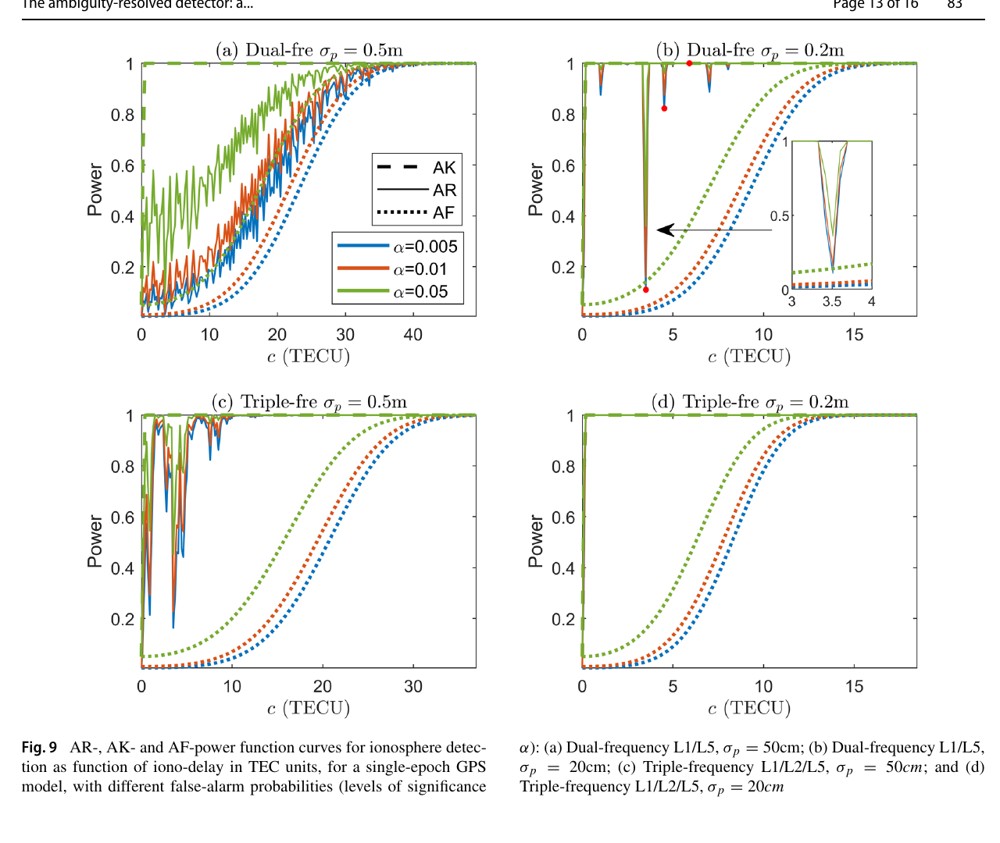
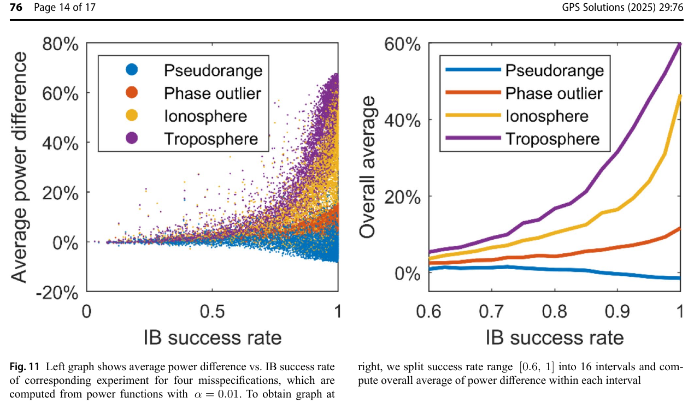
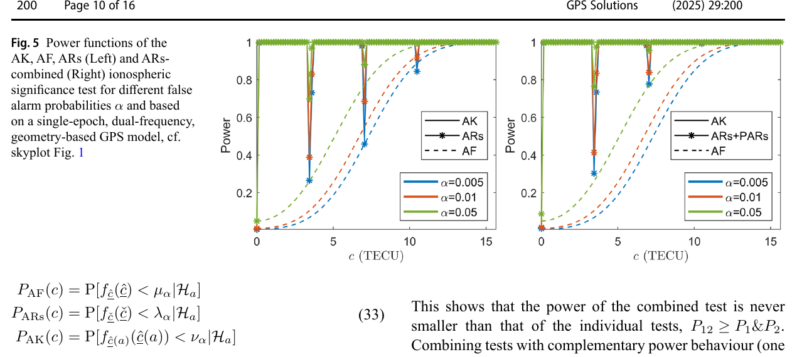

# 2026-10-18 GNSS 每日研究简报

## 今日快报

### 快报 1：510 km 低轨 Celeste 首次验证 L/S 双频测距，但公开摘要尚未给误差统计

- 主题：`celeste-leo-pnt-in-orbit-l-s-ranging`
- 来源 ID：`ion:gnss2026-16965`
- 来源链接：https://www.ion.org/gnss/abstracts.cfm?paperID=16965
- 发表日期：2026-09-16
- 来源类型：ION GNSS+ 2026 官方扩展摘要、ESA Celeste Pathfinder A 在轨信号初验
- 获取范围：官方扩展摘要全文；2026 年 3 月发射、约 510 km 轨道、L/S 双频、Septentrio LeoRx、仿真到在轨核验流程与 10–15 min 可见窗口已核对，未取得逐弧段 C/N0、测距残差、钟轨误差、捕获率或与 Galileo 的同场对照

**内容：** ESA 的两颗 Celeste Pathfinder A 是欧洲首个专用 LEO-PNT 试验。研究用改装的 Septentrio LeoRx 接收 L 波段与 S 波段测距信号，先以软件仿真熟悉约 510 km 轨道带来的大多普勒、高多普勒率和短可见弧，再将链路预算、跟踪噪声与多普勒动力学同在轨采样对照。S 波段的作用不是“替代 Galileo”，而是增加频率多样性，并在一阶电离层误差上天然弱于 L 波段。

**结论：** 摘要能支持“首批 L/S 测距信号已被专用接收机捕获并进入仿真—飞行核验链”，也给出单次过境通常只有 10–15 min；它没有公开 C/N0、伪距噪声或定位误差，因此不能据此宣称 LEO 已改善定位精度或抗干扰性能。作者把工作定位为早期运行能力验证和后续混合 LEO–MEO 接收机的数据基线。

**关注理由：** LEO-PNT 工程的第一关是接收机能否在短弧和强动态下稳定形成可用观测，而不是星座概念图。StarEdge 若评估 LEO 辅助，应先把多普勒搜索范围、捕获重访周期、L/S 射频链和钟轨产品分别纳入预算。

### 快报 2：LuGRE 月面解算有 65% 依赖真旁瓣，伪高度约束后的 RMS 仍约 8 km

- 主题：`lugre-sidelobe-lunar-surface-positioning-filtering`
- 来源 ID：`ion:gnss2026-16917`
- 来源链接：https://www.ion.org/gnss/abstracts.cfm?paperID=16917
- 发表日期：2026-09-17
- 来源类型：ION GNSS+ 2026 官方扩展摘要、LuGRE 真实任务数据再分析
- 获取范围：官方扩展摘要全文；GPS/Galileo 发射天线增益区分类、最小二乘可用性、GDOP、EKF/SREKF/WLS、冷暖启动和伪高度约束结果已核对，未取得各数据段完整样本量、月面真值误差、钟模型参数或尾部分布

**内容：** 研究把 LuGRE 接收方向投回每颗 GPS/Galileo 卫星的发射天线方向图，区分“主瓣侧边”与真正旁瓣，再比较 C/N0 加权最小二乘、EKF 和平方根 EKF 的月面伪距定位。这样可把“看到了地球 GNSS”拆成两件事：哪些信号让方程刚好可解，哪些信号真正改善几何。

**结论：** 跨全部测量集，65% 的最小二乘位置只能因旁瓣信号加入才成立，另有 10% 的解算因旁瓣使 GDOP 降低超过一个数量级；但 GDOP 仍远高于精密导航所需水平。伪距 EKF 的最佳最小误差约 500 m，在较大数据集加入伪高度约束后 RMS 约 8 km。数据来自真实任务，滤波性能却受 LuGRE 机载钟稳定度限制，不能把“可解”写成“可导航”。

**关注理由：** 月面 GNSS 可用性不能只数可见星。必须同时标记主瓣/旁瓣、C/N0、几何和钟状态；否则旁瓣带来的秩恢复会被误读成米级定位能力。

### 快报 3：单星月面多普勒仿真把最终 3D 均值误差降低约 19 m，相对论项漏建会放大 2.88 倍

- 主题：`lunar-rover-single-satellite-doppler-correlated-ephemeris-relativity`
- 来源 ID：`ion:gnss2026-16944`
- 来源链接：https://www.ion.org/gnss/abstracts.cfm?paperID=16944
- 发表日期：2026-09-16
- 来源类型：ION GNSS+ 2026 官方扩展摘要、单中继月球车导航蒙特卡洛仿真
- 获取范围：官方扩展摘要全文；Singer 星历误差、周期 ODTS 重置、钟偏/钟漂、光行时、固有时/坐标时、增广 EKF、RTS 平滑、100 次 24 h 仿真与消融结果已核对，无月面实测、硬件在环、真实链路中断或地形遮挡

**内容：** 月球车只用里程计与一颗中继卫星下行多普勒。估计器把星历误差写成一阶 Gauss–Markov 状态，以 Singer 过程传播，并在周期性轨道确定与授时更新时重置；测量同时处理光行时和相对论钟速。在线由增广 EKF 估计，离线再用 Rauch–Tung–Striebel 平滑器利用全弧信息。

**结论：** 100 次、每次 24 h 的参数化仿真中，完整滤波器相对纯里程计把最终平均 3D 误差减少约 19 m，即 36.7%；若滤波器漏掉相对论改正，位置误差增至完整模型的 2.88 倍。RTS 进一步压低时相关星历误差造成的增长。所有数字均是基于 ESA Lunar Pathfinder 与 NASA Endurance 参数的仿真，不是任务飞行性能。

**关注理由：** 单星多普勒的薄弱点不是“滤波器不够复杂”，而是可观性极弱时每个系统项都会长期积累。地面 GNSS 失锁桥接同样应把时相关轨道/钟误差和离线平滑收益与在线能力分开报告。

### 快报 4：Galileo SAS 已用五星实信号完成位置级认证演示，但还不是连续 PVT 认证

- 主题：`galileo-sas-live-e6c-range-position-authentication`
- 来源 ID：`ion:gnss2026-17112`
- 来源链接：https://www.ion.org/gnss/abstracts.cfm?paperID=17112
- 发表日期：2026-09-17
- 来源类型：ION GNSS+ 2026 官方扩展摘要、Galileo SAS Phase 0 直播信号端到端试验
- 获取范围：官方扩展摘要全文；RECS 解密、OSNMA TESLA 密钥、E6-C 片段检测、E1-B 相对码延迟、Jammertest 2026 五星位置级演示与开源 SASlib 已核对，未取得检出概率、虚警率、认证时延、攻击覆盖或连续服务统计

**内容：** Galileo Signal Authentication Service 预先分发再加密码序列，随后用 OSNMA 的 TESLA 密钥解密短 E6-C 加密码片段。开源 Python 工具 SASlib 串起 RECS 解密、片段检测、E6-C 相对 E1-B 的码延迟一致性检查以及位置级认证。

**结论：** Phase 0 直播试验在预测历元检出加密 E6-C 片段，E6-C—E1-B 码延迟差与预期偏差一致，并在 Jammertest 2026 的选择性 E6-C 加密期间用五颗卫星演示了位置级认证。摘要明确把连续 PVT 认证留给下一阶段；没有 ROC、时间到认证或攻击试验，故不能写成服务级完整性保证。

**关注理由：** 密钥和码片正确只是认证链的一半。接收机还需把“哪一历元、哪颗星、哪种测距量已认证”传播到定位和告警层，并说明认证尚未覆盖的观测如何降权或隔离。

### 快报 5：L1 闪烁仿真中抛物近似基本保住强度统计，VHF 相位却可偏数百弧度

- 主题：`ionospheric-scintillation-parabolic-full-propagation-validity`
- 来源 ID：`ion:gnss2026-16838`
- 来源链接：https://www.ion.org/gnss/abstracts.cfm?paperID=16838
- 发表日期：2026-09-18
- 来源类型：ION GNSS+ 2026 官方扩展摘要、电离层相位屏传播对照仿真
- 获取范围：官方扩展摘要全文；MEO/LEO、L1/VHF、相同相位屏、抛物与完整自由空间传播、S4、强度相关、深衰落比例和解缠相位差已核对，未取得相位屏全部参数、蒙特卡洛次数、真实闪烁记录或接收机跟踪输出

**内容：** 研究对同一组电离层相位屏，分别应用小角度抛物传播算子与完整自由空间传播算子。比较量不仅有常见的闪烁指数 S4，还包括两种传播结果的强度相关、深衰落时间比例和解缠载波相位差，并沿载频、MEO/LEO 高度与仰角扫描。

**结论：** 在 L1，摘要称两种算子对所有测试几何给出基本相同的 S4、强度图样和衰落比例，强闪烁低仰角处的相位差主要表现为整周跳变；在 VHF，S4 差异开始明显，强度相关显著下降，解缠相位可相差数百弧度。差异随约化传播距离和低仰角斜路径扰动增大，MEO 低仰角最大、LEO 近天顶最小。结论来自数值传播，不等于真实接收机失锁率。

**关注理由：** 只校准 S4 可能掩盖相位域模型错误。面向载波跟踪、周跳或 TEC 反演的仿真，应同时验收相位、深衰落和相关结构，而不能因强度统计相似就判定波形等价。

## 深度研读

### 深读 1｜接收机工程｜整数没有“已知”：怎样把固定结果的随机性带回总体故障检验

- 类别：`receiver-engineering`
- 学习层级：`foundation`
- 选题定位：`经典基础：从浮点残差与已知整数残差，到可运行的解模糊度后总体检验`
- 来源 ID：`doi:10.1007/s00190-024-01885-8`
- 来源链接：https://doi.org/10.1007/s00190-024-01885-8
- 发表日期：2024-09-12
- 来源类型：Journal of Geodesy 同行评审开放论文
- 获取范围：CC BY 4.0 开放全文；混合整数模型、AF/AK/AR 检验、接受域、非中心参数、码/相位/电离层/对流层偏差、ILS 概率质量、功效仿真、Figures 1–9 已核对
- 价值评分：98/100（相关性 20，经典价值 20，证据 19，教学价值 20，工程价值 19）

#### 为什么先学这个

载波相位定位有一个常见逻辑跳步：整数模糊度一旦“固定”，软件便把它当成没有不确定度的真值，再用 ambiguity-known（AK）卡方分布做故障检验。固定结果其实仍是随机整数估计；若把“估计成某个整数”误写成“整数已知”，虚警率和检出率都会被错误标定。先学总体检验，才能理解整数信息应如何进入完整性链，而不是只进入坐标解。

#### 先修知识

需要掌握线性化 GNSS 观测、伪距与载波相位、整数模糊度、加权最小二乘、残差投影、卡方总体检验、虚警概率 $`\alpha`$、检验功效、非中心卡方分布、整数最小二乘与 LAMBDA。这里的“功效”是给定偏差模型时拒绝错误零假设的概率，不是定位可用率。

#### 一句话逻辑

把浮点残差的能量与“浮点模糊度到实际固定整数”的归一化距离相加，并按整数估计器真正的概率质量重新标定门限，就得到介于 AF 与理想 AK 之间、能够实际运行的 ambiguity-resolved（AR）总体检验。

#### 研究问题与约束

论文研究线性高斯混合整数模型，给出理论分布与单历元 GPS 数值例；偏差类型包括码异常、相位异常、未建模电离层和对流层。图 9 是指定星座几何、L1/L5 或 L1/L2/L5、伪距标准差 0.5 m 或 0.2 m、相位标准差 2 mm 的仿真。它不是实测接收机告警认证，也不含重尾多路径、相关前端噪声或错误随机模型。

#### 核心方法论

零假设把观测写成未知整数 $`a`$ 与实参数 $`b`$ 的组合。AF 检验完全放弃 $`a`$ 的整数性，只看对 $`[A,B]`$ 正交的残差；AK 检验假定 $`a`$ 已知，能利用相位精度，但工程上通常不成立。AR 检验先用任一可接受整数映射得到 $`\check a`$，再把由 $`\check a`$ 产生的模糊度残差能量加入总体统计量，并通过蒙特卡洛得到其真实门限。

#### 关键公式逐步推导

混合整数零假设为：

```math
\mathcal H_0:\quad E(y)=Aa+Bb,\qquad a\in\mathbb Z^n,\; b\in\mathbb R^p.
```

AF 与整数真值已知时的 AK 残差满足勾股分解：

```math
\|\hat e(a)\|_{Q_{yy}}^2
=\|\hat e\|_{Q_{yy}}^2
+\|\hat a-a\|_{Q_{\hat a\hat a}}^2.
```

真实接收机不知道 $`a`$，只能以整数估计 $`\check a=\mathcal I(\hat a)`$ 代替，因此 AR 统计量写成：

```math
T_{AR}=\|\hat e\|_{Q_{yy}}^2
+\|\hat a-\check a\|_{Q_{\hat a\hat a}}^2.
```

它的累积分布是 AF 残差分布对整数残差概率质量的加权，而不是简单的 $`\chi^2`$。门限 $`k_\alpha`$ 必须满足 $`P(T_{AR}>k_\alpha\mid\mathcal H_0)=\alpha`$。

#### 经典价值与创新边界

经典价值是把“固定后的整数仍是随机估计量”转成可计算的检验统计量，堵住 AK 分布被误用的缺口。创新在 AR 分布、整数平移不变性和不同偏差类型的功效分析。边界是结论依赖 $`Q_{yy}`$ 正确和备择偏差 $`Cc`$ 的明确建模；协方差错配、未知重尾与多故障相关仍需另行保护。

#### 整体逻辑链

写出混合整数模型；比较 AF 与 AK 接受域；把两者残差分成正交能量；用整数估计器替代不可知的真整数；推导 AR 的离散—连续混合分布；按零假设仿真门限；再对码、相位和大气偏差绘制功效曲线。下一节将把这套理论扩展到多地点、多几何和多维故障的量化评估。

#### 原文图表与结果分析



> 图表源：Teunissen《The Ambiguity-Resolved Detector: A Detector for the Mixed-Integer GNSS Model》Figure 9，[CC BY 4.0 开放全文](https://doi.org/10.1007/s00190-024-01885-8)。用 Poppler 以 180 dpi 渲染原 PDF 第 13 页后，仅裁出 Figure 9 与原图题；未改动曲线、坐标、图例、标记或数值。

四个子图横轴为电离层偏差 $`c`$（TECU），纵轴为检验功效；虚线 AK、实线 AR、点线 AF，颜色对应 $`\alpha=0.005,0.01,0.05`$。直接可见 AR 大多处于 AF 与理想 AK 之间，但会在特定偏差处突然下陷。双频、伪距噪声 0.5 m 的最弱模型中，曲线振荡最密；增加第三频率或把伪距标准差降至 0.2 m 后，AR 更快靠近 1。图不能证明任意星座和真实多路径下都有同等收益。

#### 原文结果论述

作者对最弱的双频 0.5 m 模型报告整数成功率只有 88%；在 $`\alpha=0.05`$、$`c\approx20`$ TECU 时，AR 功效约 80%，AF 约 50%。这说明完整性检验可在达不到高精度固定解所需极高成功率时，仍从整数性获益。论文也解释下陷：当偏差映射后的浮点模糊度靠近另一整数格点，整数残差再次变小，检验功效会非单调下降。

#### 常见误区与适用边界

第一，整数固定不等于整数已知。第二，AR 功效不是单调函数，不能用一条最小可检偏差概括所有幅值。第三，AK 曲线是理想上界而非可直接部署算法。第四，成功率低不代表整数性对检验毫无价值。第五，门限必须匹配所用整数估计器与协方差。第六，图中 TECU、电离层偏差和高斯噪声不能直接外推到城市多路径。

#### 工程实现步骤

1. 明确零假设的码、相位、钟、大气和模糊度状态，并保存 $`Q_{yy}`$。
2. 计算浮点解 $`\hat a`$、总体浮点残差 $`\hat e`$ 与 $`Q_{\hat a\hat a}`$。
3. 用与定位链一致的 IR、IB 或 ILS 映射得到 $`\check a`$。
4. 计算 $`T_{AR}`$，不要套用 AK 的卡方门限。
5. 在 $`\mathcal H_0`$ 下蒙特卡洛标定 $`k_\alpha`$，并按卫星几何和噪声版本化。
6. 对候选码异常、周跳和大气偏差绘制功效曲线，把低功效区写进完整性预算。

#### 复现实验设计

复现 Figure 9：构造单历元 GPS 几何，比较 L1/L5 与 L1/L2/L5；伪距标准差取 0.5/0.2 m，相位取 0.002 m；$`\alpha`$ 取 0.005/0.01/0.05。每个偏差点至少 $`2\times10^5`$ 次样本，比较 AF、AR、理想 AK 的功效与门限不确定度。失败用例加入协方差缩放 0.5/2 倍、学生 t 噪声、两星相关多路径、错误频间相关和错误固定簇。

#### 与定位及低成本实现的联系

低成本接收机伪距更噪、整数成功率更低，正是最容易误用 AK 的场景。AR 允许在“不够资格把整数当真值”时仍使用整数格点信息，但计算成本转移到门限和功效仿真。工程上应离线按几何/噪声分箱生成表，在线只算统计量并保留 AF 回退。

#### 本节小结

AR 的核心不是更激进地相信固定解，而是更诚实地承认固定结果仍随机。只有把这份随机性送回检验分布，载波相位的整数性才能在不虚构 AK 条件的前提下提高故障可检性。

### 深读 2｜接收机工程｜功效不能只画一条曲线：怎样把模型强度、故障类型与门限不确定度一起扫完

- 类别：`receiver-engineering`
- 学习层级：`intermediate`
- 选题定位：`基础进阶：把 AR 理论实现成可复验的蒙特卡洛门限与跨几何功效评估`
- 来源 ID：`doi:10.1007/s10291-024-01806-4`
- 来源链接：https://doi.org/10.1007/s10291-024-01806-4
- 发表日期：2025-03-08
- 来源类型：GPS Solutions 同行评审开放论文
- 获取范围：CC BY 4.0 开放全文；AF/AK/AR 实现、门限和功效双层蒙特卡洛、25 地点×5 模型×72 几何、单/双频 GPS、SD 共钟模型、Figures 1–13 与 Tables 1–5 已核对
- 价值评分：99/100（相关性 20，经典价值 20，证据 20，教学价值 20，工程价值 19）

#### 为什么先学这个

上一节证明 AR 可以工作，却没有替工程师回答“要仿真多少样本”“成功率 80% 时还有没有收益”“哪类故障值得用 AR”。本节把理论变成一套门限与功效计算流程，并用跨地点、跨几何实验说明：整数信息对相位异常和大气失配很有价值，对伪距粗差却可能几乎没有收益。

#### 先修知识

需要掌握上一节的 AF/AK/AR 统计量、非中心卡方功效、蒙特卡洛分位数、整数 bootstrapping（IB）成功率、单差/双差、L1/L5 双频、虚警率、功效差，以及标准误差与重复仿真的区别。

#### 一句话逻辑

先在零假设下仿真 AR 门限，再在每个故障幅值下仿真功效，并把结果按整数成功率、故障类型和卫星几何分层；只有这样才能知道 AR 在什么地方胜过 AF、又在哪里应当回退。

#### 研究问题与约束

论文全部为解析与蒙特卡洛验证，没有真实观测。单频例使用 7 颗 GPS、L1、伪距/相位天顶标准差 0.2/0.002 m；双频例用 L1/L5。大规模扫描覆盖 25 个用户地点、每地每模型 72 个几何、5 种观测模型。噪声按仰角模型且相位标准差设为伪距的 1/100；结果依赖这些高斯、正确协方差和指定偏差模型。

#### 核心方法论

AR 统计量的闭式分布不可得。论文把门限和功效拆成两层：零假设下生成浮点模糊度、做整数解算并与 AF 卡方残差相加，取 $`1-\alpha`$ 分位作门限；备择下让浮点模糊度均值按 $`\bar A^+Cc`$ 偏移，重新生成整数残差与非中心 AF 残差，超过门限的比例就是功效。重复若干批次可估计门限和功效仿真的不确定度。

#### 关键公式逐步推导

备择偏差使浮点模糊度均值变为：

```math
E(\hat a\mid\mathcal H_a)=a+\bar A^+Cc.
```

第 $`i`$ 个样本的 AR 统计量为：

```math
T_{AR}^{(i)}=X^{(i)}+Y^{(i)},\quad
X^{(i)}\sim\chi^2(r,\lambda_{\hat e}),\quad
Y^{(i)}=\|\hat a^{(i)}-\check a^{(i)}\|_{Q_{\hat a\hat a}}^2.
```

若 $`n_p`$ 个样本超过零假设门限 $`\kappa_\alpha`$，功效估计为：

```math
\hat\gamma(c)=\frac{n_p}{N_p},
```

并以 $`N_r`$ 次独立重复的功效结果估计模拟标准差，而不是把一次大样本当作没有数值误差。

#### 经典价值与创新边界

经典价值是把完整性论证从“算法曲线”提升为可复现的统计实验设计。创新在跨模型、跨几何的大规模功效地图和多维故障评估。边界是所有偏差签名 $`Cc`$ 均预先指定，现实中未知结构故障、协方差漂移和相关重尾仍可能落在模型外。

#### 整体逻辑链

定义差分观测与四类故障；零假设仿真门限；备择仿真功效；用单频例解释 AR 分布；用双频例比较故障类型；扩展到 25 地点和 360 个几何/地点组合；最后扫描二维/四维偏差。这样既验证理论，也把“何时值得用 AR”转成工程查表问题。

#### 原文图表与结果分析



> 图表源：Yin、Teunissen 与 Tiberius《Performance of Ambiguity-Resolved Detector for GNSS Mixed-Integer Model》Figure 11，[CC BY 4.0 开放全文](https://doi.org/10.1007/s10291-024-01806-4)。用 Poppler 以 180 dpi 渲染原 PDF 第 14 页后，仅裁出 Figure 11 与原图题；未改动散点、曲线、坐标、图例或百分比。

左图横轴是 IB 成功率、纵轴是 $`\alpha=0.01`$ 时 AR 减 AF 的平均功效差，每点对应一种地点—几何—模型—故障组合；右图把成功率 0.6–1 分成 16 个区间取总体平均。直接可见对流层（紫）和电离层（黄）收益随成功率显著上升，相位异常（橙）缓慢增加，伪距粗差（蓝）接近零并在高成功率端略为负。图说明整数信息的价值取决于偏差如何投影到相位与模糊度空间，不能支持“AR 对所有故障都更强”。

#### 原文结果论述

单频例的单历元 DD 整数成功率只有 80.5%；1.5 m 的 G08 伪距粗差功效由 AF 59% 升至 AR 79%，3 cm 相位异常由 68% 升至 92%，0.27 TECU 电离层延迟由 5% 升至 26%，0.07 m 对流层延迟由 5% 升至 24%。在大规模扫描中，成功率区间 0.775–0.8 的电离层/对流层平均增益为 10%/17%；成功率超过 97.5% 时，相位异常、电离层和对流层平均增益分别为 12%、47% 和 60%，伪距粗差约 −1%。这些都是指定模型下的模拟功效差。

#### 常见误区与适用边界

第一，成功率高不保证所有故障功效提高。第二，平均功效差会掩盖左图中的负值和离群点。第三，AK 仍是理想比较，不是 AR 的门限替代品。第四，检测功效与正确固定率不是同一指标。第五，$`\sigma_\phi=\sigma_p/100`$ 是实验设定。第六，蒙特卡洛门限也有抽样不确定度，需重复或给置信区间。

#### 工程实现步骤

1. 为每种接收机模式冻结卫星选择、噪声模型、差分方式和整数估计器。
2. 在 $`\mathcal H_0`$ 下分批生成样本，估计 $`\kappa_\alpha`$ 与其标准误差。
3. 为码粗差、周跳、残余电离层、残余对流层建立偏差签名和幅值网格。
4. 在 $`\mathcal H_a`$ 下计算功效和批间标准差。
5. 按成功率、几何、星座和故障类型形成查表，保留负增益区域。
6. 在线按当前模型键选择门限；键缺失或协方差异常时回退 AF。

#### 复现实验设计

先复现 7 星 L1 场景：$`\sigma_p=0.2`$ m、$`\sigma_\phi=0.002`$ m、$`\alpha=0.05`$，零假设和每个故障点各 $`10^6`$ 样本核对 Table 1。再按论文大规模设置，选 25 个经纬度、每地 72 个历元、5 种模型，门限/功效各 $`2\times10^5`$ 样本并重复 50 次。比较平均功效差、5% 分位功效差、最坏负增益和运行时。失败用例加入几何突变、共同钟偏、差分相关未建模与复合周跳。

#### 与定位及低成本实现的联系

低成本 GNSS 最关心的不是一条“平均提高 47%”宣传线，而是当前几何和噪声是否落在训练过的门限表内。图 11 提醒：AR 对大气和相位域故障最有意义，对码粗差可能不如 AF。可部署方案应按故障族并行检验，避免用一种统计量包打天下。

#### 本节小结

AR 的收益由成功率、几何和故障签名共同决定。大规模功效地图把“整数有帮助”改写为可审计的条件句：对哪种故障、在哪段成功率、以多大虚警代价，平均和最坏能多检出多少。

### 深读 3｜定位完整性｜从“有故障”到“哪个偏差”：多峰分布怎样决定显著性检验的接受域

- 类别：`positioning`
- 学习层级：`advanced`
- 选题定位：`前沿深化：在纯 GNSS 混合整数模型中识别具体偏差，并用部分定整修补功效低谷`
- 来源 ID：`doi:10.1007/s10291-025-01952-3`
- 来源链接：https://doi.org/10.1007/s10291-025-01952-3
- 发表日期：2025-09-27
- 来源类型：GPS Solutions 同行评审开放论文
- 获取范围：CC BY 4.0 开放全文；AR 偏差估计器、多峰 PDF、最高密度接受域、ARs/ARn/PARn、单历元双频 GPS 电离层例、Figures 1–6 已核对
- 价值评分：99/100（相关性 20，经典价值 20，证据 19，教学价值 20，工程价值 20）

#### 为什么先学这个

总体检验只回答“当前模型可能错了”，完整性处置还要回答“是哪颗星、哪类偏差、需要排除还是扩状态”。若直接对固定后的偏差估计量套高斯椭球，就会忽略错误整数形成的多个概率峰。高级完整性设计必须让接受域跟着多峰 PDF 走，并处理功效在某些偏差幅值突然塌陷的问题。

#### 先修知识

需要掌握 AR 总体检验、偏差参数化备择假设、条件最小二乘、PDF/PMF、最高密度区域、广义似然比、部分模糊度固定、功效函数、联合检验的虚警合成，以及载波相位混合整数模型。

#### 一句话逻辑

把待检偏差 $`c`$ 与整数模糊度共同估计，按所有可能整数解的概率质量叠加偏差 PDF，再用最高密度水平集而非单一高斯椭球定义接受域；遇到多峰造成的功效凹口时，以部分定整或组合检验减少凹口。

#### 研究问题与约束

论文是理论与单历元、双频、几何型 GPS 数值例，重点为电离层偏差。它提出 ambiguity-resolved significance（ARs）、易算的 normed 版本（ARn）和部分固定版本，但没有真实故障注入、连续滤波或认证级误导信息风险。组合检验的简单功效公式只在统计量独立时成立，作者明确指出实际测试并非完全独立。

#### 核心方法论

在备择模型中加入明确偏差向量 $`c`$。浮点偏差估计 $`\hat c`$ 与浮点模糊度 $`\hat a`$ 相关；固定到 $`z`$ 后，条件偏差估计的均值会按 $`a-z`$ 平移。把所有整数 $`z`$ 的条件高斯 PDF 按 $`P(\check a=z)`$ 加权，就得到通常多峰的 $`f_{\check c}(x)`$。ARs 取该 PDF 的最高密度区域作为接受域，ARn 则使用归一化二次型；部分定整让保留子集达到高成功率，以降低多峰性。

#### 关键公式逐步推导

偏差估计器的混合 PDF 为：

```math
f_{\check c}(x)=\sum_{z\in\mathbb Z^n}
f_{\hat c(z)}(x)\,P(\check a=z).
```

其中每个条件峰的均值含整数错配平移：

```math
E[\hat c(z)]=c+\bar C^+A(a-z).
```

ARs 不再用 $`\|\check c\|^2`$ 的单椭球门限，而是：

```math
\text{若 }f_{\check c}(\check c\mid\mathcal H_0)<\lambda_\alpha,
\text{ 则拒绝 }\mathcal H_0,
```

并选 $`\lambda_\alpha`$ 使零假设落在接受域外的概率正好为 $`\alpha`$。这允许接受域由多个互不连通的高密度岛组成。

#### 经典价值与创新边界

经典价值是把“故障识别”与模糊度随机性放在同一个概率模型里。创新在最高密度水平集、ARs/ARn 的边界和部分定整检验。边界是高维整数求和与密度评估代价高，偏差签名仍需事先假定；组合检验还要重新标定相关条件下的总体虚警。

#### 整体逻辑链

从指定偏差的显著性检验出发；证明固定整数下偏差估计是离散加权的多峰分布；解释传统 p 值和单椭球为何失真；用最高密度区域定义 ARs；分析其在 AF 与 AK 间的极限；观察功效凹口；再用部分定整和组合检验补强。这样从“总体告警”走到“具体偏差判别”。

#### 原文图表与结果分析



> 图表源：Teunissen《A Significance Test for Mixed-Integer Models with Application to GNSS》Figure 5，[CC BY 4.0 开放全文](https://doi.org/10.1007/s10291-025-01952-3)。用 Poppler 以 180 dpi 渲染原 PDF 第 10 页后，仅裁出 Figure 5 与原图题；未改动曲线、坐标、图例、标记或数值。

横轴是电离层偏差 $`c`$（TECU），纵轴为功效，颜色为三种 $`\alpha`$。左图 ARs（星标实线）大部分紧贴理想 AK 并高于 AF，但在约 3、6.5、11 TECU 附近出现尖锐凹口；右图将 ARs 与部分定整检验组合后，凹口仍存在但底部抬高，示例中全域优于 AF。图直接展示多峰整数概率导致的非单调性，不能证明任意相关检验组合都保持同样总体虚警。

#### 原文结果论述

论文所用例子的零假设整数成功率为 0.6137，说明这是刻意选择的弱模型。若误把 $`\check a`$ 当真整数并沿用 AK 门限，目标虚警 $`\alpha=0.005/0.01/0.05`$ 时，实际虚警会变成 0.3894/0.3924/0.4170，量级上完全失控。ARs 通过真实混合 PDF 恢复门限含义；部分定整目标成功率设为 99.9%，其组合版本在该仿真中全幅值优于 AF，但仍属于模型内结果。

#### 常见误区与适用边界

第一，多峰 PDF 不能用一个对称 p 值替代。第二，低密度点不一定离零最远。第三，把 AK 门限用于随机固定整数会严重抬高实际虚警。第四，组合两个检验会同时增加功效和虚警。第五，部分定整的 99.9% 是本文设计选择，不是通用认证阈值。第六，显著性检验识别的是假定偏差签名，不自动给出故障根因。

#### 工程实现步骤

1. 为每颗星/频点定义码粗差、周跳、大气偏差等候选 $`C`$ 列。
2. 联合计算 $`\hat a`$、$`\hat c`$ 和交叉协方差。
3. 选取概率质量显著的整数候选，构造 $`f_{\check c}(x)`$。
4. 由零假设样本求最高密度阈值 $`\lambda_\alpha`$。
5. 并行计算 ARs 与按目标成功率选出的 PARs/PARn。
6. 对组合检验重新仿真总体虚警，输出偏差类别、功效下界和处置建议。

#### 复现实验设计

复现单历元双频 GPS 电离层例，先验证零假设成功率 0.6137 和三种错误 AK 实际虚警。用至少 $`10^6`$ 个零假设样本估计多峰 PDF/最高密度接受域，再在 0–15 TECU 扫描 ARs、AF、理想 AK、PARs 和组合功效。指标为实际虚警、功效最小值、凹口位置/宽度、整数候选数和 CPU/内存。失败用例加入双星电离层偏差、协方差错配、相关检验统计量与候选截断。

#### 与定位及低成本实现的联系

纯 GNSS 完整性不仅需要“有无异常”，还要为排星、重初始化或扩状态提供偏差定位。低成本设备的整数分布更分散，多峰性更强，最不能直接使用 AK 近似。可行架构是离线仿真密度/门限，在线限制候选整数与偏差族，并在算力不足时输出保守的总体告警而非伪精确诊断。

#### 本节小结

从总体 AR 到 ARs 的关键一步，是承认错误整数会把偏差估计拆成多个概率峰。最高密度接受域、部分定整和经重新标定的组合检验，才能把“整数带来的灵敏度”转成虚警受控的具体故障识别。
