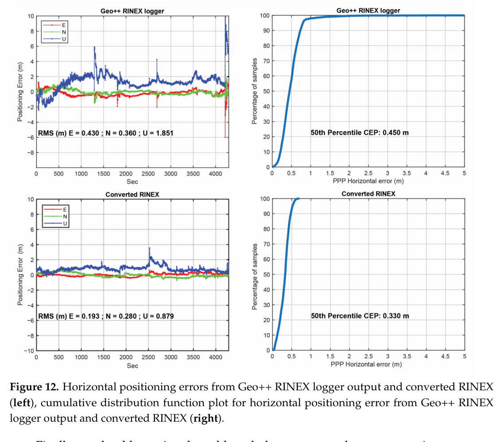
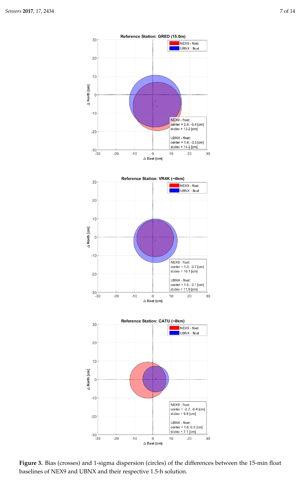
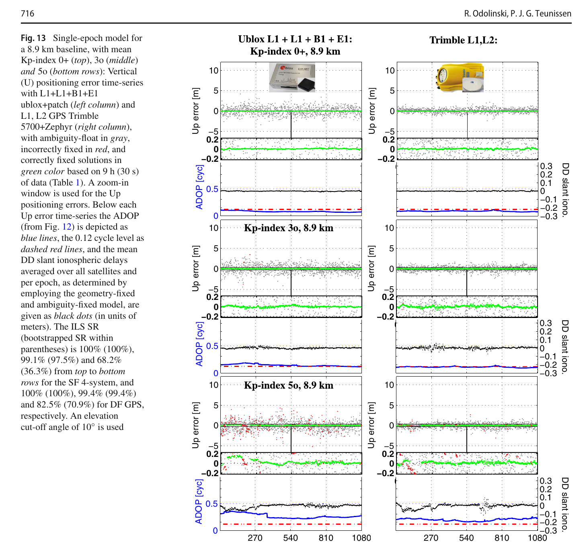

# 2026-10-19 GNSS 每日研究简报

## 今日快报

### 快报 1：按星、时、空细分 ISM，GRACE-FO 试验把 RT-PPP 保护级 99.9% 分位压到约 1 m

- 主题：`refined-rtppp-integrity-support-message`
- 来源 ID：`ion:gnss2026-16990`
- 来源链接：https://www.ion.org/gnss/abstracts.cfm?paperID=16990
- 发表日期：2026-09-17
- 来源类型：ION GNSS+ 2026 官方同行评审扩展摘要、星载 GNSS 历史数据试验
- 获取范围：官方扩展摘要全文；方法动机、GRACE-FO 2020—2021 数据范围、99.9% 保护级分位和安全包络表述已核对，未取得完整论文、逐星误差分布、告警限或可用率曲线

**内容：** 传统 RT-PPP 完整性支持消息常用所有卫星平均的 URE 或最坏 URE 统一包络，容易让保护级过宽。作者把卫星间差异、空间变化和时间变化纳入 ISM 参数确定，再将包络送入保护级计算；验证数据来自 GRACE-FO 星载 GNSS 在 2020—2021 年的观测。

**结论：** 官方摘要报告，在维持误差安全包络的条件下，细分模型相对 Average URE 与 Worst URE 缩小了 ISM 包络，并把保护级的 99.9% 分位降到约 1 m。摘要没有给出基准方法的对应分位、危险误导信息概率、样本独立性和外推验证，因而只能支持“这组星载历史数据上的包络更紧”，不能写成任意实时 PPP 用户都可获得 1 m 完整性界。

**关注理由：** 完整性服务不应只广播一个保守到失去可用性的全局 sigma。真正有价值的是把误差异质性转成可审计的分层参数，同时保留尾部覆盖；这与低成本接收机按星定权的原则相通，只是风险约束更严格。

### 快报 2：425 段各 150 s 的 GNSS 中断中，双雷达速度更新把最大水平误差从 484 m 限到 5 m

- 主题：`multi-radar-imu-gnss-outage-coasting`
- 来源 ID：`ion:gnss2026-17141`
- 来源链接：https://www.ion.org/gnss/abstracts.cfm?paperID=17141
- 发表日期：2026-09-17
- 来源类型：ION GNSS+ 2026 官方扩展摘要、双 FMCW 雷达/MEMS IMU 实验
- 获取范围：官方扩展摘要全文；15 状态 ESKF、IMU 辅助雷达外点拒绝、425 段中断和最大水平误差消融结果已核对，未取得路线、雷达型号、误差分位、计算负载或逐段失败率

**内容：** 系统先以 IMU 预测的径向速度检查雷达多普勒，把移动车辆和行人回波排除；再由 15 状态误差状态 Kalman 滤波器融合一套 MEMS IMU 与两部 FMCW 雷达，估计位置、速度、姿态和 IMU 零偏。试验假设车辆先在 GNSS 可用区初始化，随后进入意外中断并靠雷达速度约束滑行。

**结论：** 在 425 个、每段 150 s 的无 GNSS 序列上，官方摘要称自由惯导的最大水平位置误差为 484 m，加入外点拒绝后的雷达速度更新降为 5 m。这里比较的是最大值而非 RMSE 或 95% 分位；摘要也未说明 425 段是否等长同分布、真值链和 5 m 最差段的场景，不能把它外推为所有道路的 150 s 保证。

**关注理由：** GNSS 中断恢复的关键不只是“再加一个传感器”，而是先确认辅助观测来自静态环境。雷达若把移动目标当作地面速度，滤波器会以很高置信度漂向错误方向；观测准入应先于融合。

### 快报 3：低成本车载融合中，取消 GNSS 准入筛选会把同一批有效点评估 RMSE 从 3.11 m 推到 198.32 m

- 主题：`low-cost-vehicle-gnss-admissibility-screening`
- 来源 ID：`ion:gnss2026-16780`
- 来源链接：https://www.ion.org/gnss/abstracts.cfm?paperID=16780
- 发表日期：2026-09-17
- 来源类型：ION GNSS+ 2026 官方扩展摘要、自采与公开车载数据消融试验
- 获取范围：官方扩展摘要全文；二维 ENU EKF、跳变/隐含速度/陈旧位置筛选、非完整约束、三组自采数据与多公开集验证及消融数字已核对，未取得阈值、路线时长、真值误差或跨数据集统一统计

**内容：** 该二维车体坐标 EKF 不把“接收机仍输出坐标”当成“GNSS 仍可用”。位置更新先通过跳变、隐含速度和陈旧样本检查；中断时用非完整约束、零速更新和转弯条件下的速度伪观测限制 MEMS 漂移，并使用 Joseph 形式更新协方差以改善数值稳定性。

**结论：** 主长时自采记录中，取消 GNSS 筛选后，在原本由筛选器接纳的点评估，RMSE 从 3.11 m 增到 198.32 m，最大误差从 38.19 m 增到 1030.91 m；另一条对中断敏感的记录中，取消非完整约束使 RMSE 从 5.47 m 增到 86.56 m。这是特定消融与评估子集，不是筛选器对所有坏点的检出率；公开摘要也未给虚拒率。

**关注理由：** 工程链要把“观测是否可进入滤波器”和“进入后权多大”分开。低成本 GNSS 最危险的并非没有解，而是陈旧或跳变解仍带着看似合理的协方差进入融合。

### 快报 4：Set Transformer 把静态城市 3D 均值误差从 46.43 m 降到 16.72 m，但动态 95% 尾部没有改善

- 主题：`set-transformer-spp-position-correction`
- 来源 ID：`ion:gnss2026-16969`
- 来源链接：https://www.ion.org/gnss/abstracts.cfm?paperID=16969
- 发表日期：2026-09-16
- 来源类型：ION GNSS+ 2026 官方同行评审扩展摘要、仿真/静态/动态 GNSS-only 试验
- 获取范围：官方扩展摘要全文；残差—视线向量集合、SPP 引导的 NED 改正、三类试验和均值/MAE/尾部边界已核对，未取得训练测试划分、样本规模、真值系统或跨城市泛化

**内容：** 每历元先用广播星历和伪距得到 SPP，再为每颗可见卫星构造伪距残差与局部 LOS 向量。Set Transformer 将变长、无序的卫星集合映射为 NED 三维位置改正，并转回 ECEF；结构允许卫星数变化而不依赖固定槽位。

**结论：** 仿真平均 3D 误差由 14.44 m 降到 4.89 m，静态实测由 46.43 m 降到 16.72 m。动态车载中只使用垂向增益时，垂向 MAE 由 15.21 m 降到 14.29 m、平均 3D 误差由 17.49 m 降到 16.89 m，但 RMS 与 95% 误差未改善。均值的小幅下降不能掩盖尾部无收益；摘要也不足以证明模型在未见城市或不同接收机上泛化。

**关注理由：** 学习型定位若只优化均值，很可能把中间样本拉近、却保留危险长尾。GNSS 集合模型应把 95%/99% 误差、跨路线留出和物理残差一致性作为一等指标，而不是只报告一个平均改善百分比。

### 快报 5：0.895 m 阵面测 Ku 波段 LEO 到达角，乐观角度误差也对应约 157 m 的单次横向尺度

- 主题：`leo-sop-doa-accuracy-sanity-check`
- 来源 ID：`ion:gnss2026-17155`
- 来源链接：https://www.ion.org/gnss/abstracts.cfm?paperID=17155
- 发表日期：2026-09-18
- 来源类型：ION GNSS+ 2026 官方扩展摘要、到达角测量量级分析与未完成仿真计划
- 获取范围：官方扩展摘要全文；天线尺寸、波长、角误差量级、550 km/1200 km 几何放大和三天线可观测性论点已核对；作者明确说明完整蒙特卡洛与 CRLB 尚未完成

**内容：** 作者对 LEO 通信信号到达角定位做量级审计：0.895 m 方形阵面接收波长约 0.0256 m 的 Ku 波段信号，即使把角度精度乐观设为 $`0.01\lambda/D`$，也只有 0.000286 rad；单纯乘以 550 km 斜距就得到约 157 m 的横向测量尺度。若按被审计研究使用的 0.1°，同样换算约 960 m。

**结论：** 这两个数字是角误差经斜距放大的单次几何尺度，不是完整多星融合后的定位 CRLB；它们提示此前约 20 m 的结果很可能依赖已知姿态、时间平滑或其他未充分说明的先验。摘要提出同时测方位与俯仰至少需要三副高增益天线，但完整论文工作尚未完成，不能把“显著差于 20 m”写成已验证结论。

**关注理由：** 新型 LEO-PNT 最需要这种量纲审计。高信号功率不等于高角分辨率；在讨论滤波与多星融合之前，应先把波长、孔径、斜距和未知姿态造成的可观测性下界算清。

## 深度研读

### 深读 1｜接收机工程｜日志不是原始真值：怎样把 Android 时钟与 ADR 变成可检验的 GNSS 观测

- 类别：`receiver-engineering`
- 学习层级：`foundation`
- 选题定位：`经典基础：从 Android API 时间字段生成伪距、载波和多普勒，并用物理一致性检查 RINEX`
- 来源 ID：`doi:10.3390/s23020777`
- 来源链接：https://doi.org/10.3390/s23020777
- 发表日期：2023-01-11
- 来源类型：Sensors 同行评审开放论文
- 获取范围：CC BY 4.0 开放全文；Android 观测生成公式、三款手机/两款记录器静态检查、Xiaomi Mi8 一小时车载 UPPP、Figures 1–12 与 Tables 1–5 已核对
- 价值评分：98/100（相关性 20，经典价值 19，证据 19，教学价值 20，工程价值 20）

#### 为什么先学这个

Android API 给的是接收机时钟、卫星发射时间、Accumulated Delta Range（ADR）和伪距率等底层字段，而不是天然正确的 RINEX 观测。只要周内时间归一化、偏置符号、浮点精度或 ADR 状态处理出错，后端 PPP/RTK 会把日志器错误误认为周跳、钟跳或多路径。先校验观测生成，才有资格讨论高级定位算法。

#### 先修知识

需要理解 GNSS 接收时刻与发射时刻、GPS 周、光速、载波波长、ADR、伪距率、码减相位组合、周跳、RINEX 观测类型，以及码、相位和多普勒描述同一几何距离变化这一物理约束。

#### 一句话逻辑

用 Android 时钟字段恢复接收机 GNSS 时间，以发射时刻形成伪距，以 ADR 和伪距率形成相位与多普勒；然后检查码差分、相位差分和多普勒是否相互闭合，闭合失败的日志不能直接送入精密定位。

#### 研究问题与约束

论文比较 GnssLogger 3.0.5.6、Geo++ RINEX Logger 2.1.6 与作者的 UofC CSV2RINEX。静态数据来自 Xiaomi Mi8、Samsung S20、Google Pixel 5，于 2022-11-23 同场采集约 1.5 h、1 Hz；车载定位仅使用 Xiaomi Mi8 的约 1 h 数据。不同手机芯片、Android 版本和今日应用实现可能已变化，结论不能外推为某记录器所有版本都存在同样问题。

#### 核心方法论

先从 `TimeNanos`、`FullBiasNanos`、`BiasNanos` 与星座相关发射时刻恢复传播时间；ADR 除以波长得到以周计的载波观测，伪距率除以波长并取负得到多普勒。质量检查并不依赖定位真值：相邻历元码/相位变化应与多普勒同趋势，码减相位应主要留下电离层、模糊度、多路径和噪声；异常平台或冻结相位会在这些组合中暴露。

#### 关键公式逐步推导

将 Android 接收机硬件时钟换成 GNSS 接收时刻，可概括为：

```math
t_r=\mathrm{TimeNanos}-(\mathrm{FullBiasNanos}+\mathrm{BiasNanos}).
```

把 $`t_r`$ 按星座时间尺度与周内时间归一化，和卫星发射时刻 $`t_s`$ 相减：

```math
P=c\,(t_r-t_s).
```

ADR 已是积累距离，伪距率是距离变化率，因此：

```math
\Phi=\frac{\mathrm{ADR}}{\lambda},\qquad
D=-\frac{\dot P}{\lambda}.
```

若无周跳且符号约定一致，$`\Delta\Phi\,\lambda/\Delta t`$、$`\Delta P/\Delta t`$ 与 $`-D\lambda`$ 应在噪声和多路径允许范围内同向变化。

#### 经典价值与创新边界

经典价值是把“手机能导出 RINEX”拆回时间与物理量生成问题，并给出不依赖黑盒坐标的闭合检查。创新在三种生成链的同场比较和车载 UPPP 后果验证。边界是作者转换器也不是标准真值；它只在给定手机、记录器版本和数据上显示更一致，潜在根因仍需要应用开发者协作确认。

#### 整体逻辑链

读取 Android 原始字段；按星座恢复接收/发射时间；生成码、相位和多普勒；导出 RINEX；做差分与组合闭合；标记无效 ADR 和冻结相位；最后才进入 UPPP。下一节将说明，即便观测可用，手机相位仍不一定足以可靠固定整数。

#### 原文图表与结果分析



> 图表源：Zangenehnejad、Jiang 与 Gao《GNSS Observation Generation from Smartphone Android Location API: Performance of Existing Apps, Issues and Improvement》Figure 12，[CC BY 4.0 开放全文](https://doi.org/10.3390/s23020777)。用 Poppler 以 200 dpi 渲染原 PDF 第 21 页后，仅裁出 Figure 12 与原图题；未改动曲线、坐标、图例、标签或数值。

左列横轴为秒、纵轴为东/北/高定位误差（m），右列是水平误差 CDF。Geo++ 输出的 E/N/U RMS 为 0.430/0.360/1.851 m，作者转换输出为 0.193/0.280/0.879 m；水平 50% CEP 从 0.450 m 降到 0.330 m。图直接显示同一后端使用不同观测生成输出会改变坐标，但不能分离转换算法、观测筛选和输入格式细节各自贡献。

#### 原文结果论述

GnssLogger 输出在这批数据上出现码相不一致和部分低 C/N0、无效 ADR 状态历元的相位冻结；其车载 UPPP 因频繁检出周跳只达到 SPP 量级，故未放入 Figure 12。作者转换器把水平中位 CEP 相对 Geo++ 降低 0.12 m，同时高程 RMS 约减半。这是单台 Xiaomi Mi8、单次一小时路线的结果，不等于普遍的记录器排名。

#### 常见误区与适用边界

第一，API 字段不是可直接相减的双精度真值。第二，RINEX 能解析不等于观测物理一致。第三，ADR 有效标志必须参与筛选。第四，码相差出现台阶可能来自转换器而非卫星。第五，一个 PPP 结果变好不能单独证明全部公式正确。第六，手机型号、固件和记录器版本必须随数据归档。

#### 工程实现步骤

1. 原样保存 Android 原始 CSV、设备信息、系统版本和记录器版本。
2. 以 64 位以上精度处理纳秒时钟，显式记录周跳转与星座时间尺度。
3. 按频点载波频率生成波长，检查 ADR 状态后再形成相位。
4. 对每星每频计算码差分、相位差分、多普勒和 CMP 闭合残差。
5. 将冻结相位、时间回跳和异常平台转成质量标志，而不是静默修复。
6. 用已知轨迹做 SPP/UPPP A/B 测试，并保留每次拒绝的原因码。

#### 复现实验设计

选三款不同芯片手机，在屋顶静态 90 min、车载开阔/树荫/城市各 30 min，以 1 Hz 同时保存 GnssLogger、另一记录器和原始 CSV。分别用三条转换链生成 RINEX，比较码/相位一阶差分与多普勒闭合 RMS、冻结相位比例、周跳率、有效历元率和 UPPP 的 E/N/U RMS、50/95% 水平误差。失败用例加入 GPS 周边界、负 `FullBiasNanos`、无效 ADR、1 s 缺历元和星座时间误配。

#### 与定位及低成本实现的联系

手机定位最便宜的一步往往也是最容易被忽略的一步：日志转换。若转换链把连续相位打碎，后端再复杂的滤波、稳健估计或整数固定也只能处理伪造出来的故障。下一节以早期 Nexus 9 实验展示“相位可用但整数仍不可靠”的中间状态。

#### 本节小结

精密定位的第一条质量门不是坐标残差，而是观测闭合。Android 时间、ADR 与伪距率必须生成彼此一致的码、相位和多普勒；Figure 12 说明一个看似底层的转换差异足以把高程 RMS 改变近一倍。

### 深读 2｜低成本与手机｜能测相位不等于能固定：15 分钟浮点基线怎样给手机能力划边界

- 类别：`low-cost-mobile`
- 学习层级：`intermediate`
- 选题定位：`基础进阶：用单频双差与快速静态重复试验区分相位精度、整数可靠性和绝对准确度`
- 来源 ID：`doi:10.3390/s17102434`
- 来源链接：https://doi.org/10.3390/s17102434
- 发表日期：2017-10-24
- 来源类型：Sensors 同行评审开放论文
- 获取范围：CC BY 4.0 开放全文；Nexus 9/u-blox、五种物理或虚拟基站、13.7 m—8 km 基线、15 min/1.5 h 解、Figures 1–6 与 Tables 1–2 已核对
- 价值评分：97/100（相关性 20，经典价值 20，证据 18，教学价值 20，工程价值 19）

#### 为什么先学这个

上一节解决“日志生成是否可信”，但载波连续并不自动给出可靠整数。早期 Android 设备已经能输出相位，却可能因任意初相、占空比和天线噪声导致 LAMBDA 固定错误。本节用浮点解与固定解的反差，解释为什么工程上应先证明浮点模型与重复性，再谈厘米级标签。

#### 先修知识

需要掌握单差/双差、基线向量、载波模糊度、浮点与整数固定、LAMBDA、周跳检测、虚拟参考站、快速静态、仰角定权，以及“相对于 1.5 h 解的重复性”不等于相对于独立真值的准确度。

#### 一句话逻辑

对同一台 Nexus 9 和共址 u-blox，用五种基站分别做 1.5 h 参考解与六个独立 15 min 解；若手机整数固定不可靠，就保留浮点结果，用短时解对长时解的偏差与离散度刻画相位可用性的真实边界。

#### 研究问题与约束

实验只用 GPS L1，相位双差由 goGPS 批最小二乘处理；码与多普勒用于初始坐标和周跳检查。基站包括 13.7 m/15 m 物理站、同址与约 4 km VRS、约 8 km CORS。Nexus 9 的 LAMBDA 固定给出错误整数，因而手机结果主要是浮点重复性；1.5 h 解由同一观测模型生成，并非外部测量真值。

#### 核心方法论

接收机与基站的同星相位先做接收机间单差，再相对参考星做卫星间差，消去卫星钟、接收机钟和大部分短基线大气项。每条基线完整 1.5 h 解作内部参考，再把数据分成六段独立 15 min 会话。比较二维偏差中心和 1-sigma 离散圆；对 u-blox 另比较浮点与 LAMBDA 固定，验证正确整数能否把离散度压低一个数量级。

#### 关键公式逐步推导

接收机 $`r,b`$、卫星 $`s,q`$ 的 L1 相位双差可写为：

```math
\Delta\nabla\Phi_{rb}^{sq}
=\Delta\nabla\rho_{rb}^{sq}
+\lambda\,\Delta\nabla N_{rb}^{sq}
-\Delta\nabla I_{rb}^{sq}
+\Delta\nabla T_{rb}^{sq}
+\varepsilon_\Phi.
```

短基线时大气双差残差较小，线性化几何项得到：

```math
y=G\,\delta b+\lambda A a+\varepsilon,\qquad a\in\mathbb Z^n.
```

浮点解令 $`a\in\mathbb R^n`$；只有整数检验可靠时才用 $`\check a`$ 约束基线。本文 Nexus 9 的固定解反而更差，说明“求出整数”与“整数正确”必须分开。

#### 经典价值与创新边界

经典价值在于它处于 Android 原始相位开放后的早期阶段，清楚展示手机已经具有十厘米级快速静态重复性、但整数性尚未兑现。创新是同一场景下手机、低成本接收机、物理站和 VRS 的系统对比。边界是单天、静态、GPS L1 和内部参考，不能代表现代多频手机的动态 RTK。

#### 整体逻辑链

共址采集 Nexus 9 与 u-blox；构造五类基线；用码/多普勒预处理相位；求 1.5 h 参考；切成六段 15 min；比较浮点偏差与离散；尝试 LAMBDA；发现手机固定失败而 u-blox 固定成功。下一节把问题扩展到多星座、单历元和电离层活动。

#### 原文图表与结果分析



> 图表源：Realini 等《Precise GNSS Positioning Using Smart Devices》Figure 3 的 GRED、VR4K 与 CATU 面板，[CC BY 4.0 开放全文](https://doi.org/10.3390/s17102434)。用 Poppler 以 200 dpi 渲染原 PDF 第 7 页后，仅裁出 Figure 3 在该页的三个原始面板与原图题；Figure 3 跨页，未拼接前页两个面板，未改动圆、坐标、图例、标签或数值。

横纵轴分别为 15 min 解相对 1.5 h 解的东、北差（cm）；叉号是平均偏差，圆半径是一倍标准差，红/蓝对应 Nexus 9/u-blox。GRED 15 m 低成本基站下两者离散约 13.2/14.2 cm；约 4 km VRS 为 10.1/11.9 cm；约 8 km CORS 为 9.9/7.1 cm。离散度没有随距离单调恶化，说明基站类型、采样率、噪声和虚拟改正也参与结果；圆并非 95% 置信界。

#### 原文结果论述

最短 13.7 m 物理双频基站下，Nexus 9/u-blox 水平离散度为 7.4/4.7 cm；8 km 为 9.9/7.1 cm。Nexus 9 的错误固定使固定解劣于浮点，因此作者没有把手机写成厘米固定；u-blox 正确固定后偏差约降至 0.1 cm、标准差约 0.4–0.8 cm。关键差别来自整数可靠性，而非“手机相位完全不能用”。

#### 常见误区与适用边界

第一，十厘米标准差是相对长时内部解的重复性。第二，浮点解不等于 RTK FIX。第三，短基线并不保证手机整数正确。第四，VRS 与物理基站的采样率和误差链不同。第五，错误固定可能比保守浮点更坏。第六，静态 15 min 不能外推到手持动态城市环境。

#### 工程实现步骤

1. 手机与低成本接收机共址，保存相同时间窗和参考站数据。
2. 用码 SPP 给初值，以相位—多普勒和高阶差分联合检周跳。
3. 先跑浮点双差，检查残差、秩、协方差和基线重复性。
4. 将连续数据切成独立 5/15/30 min 会话，避免只展示最佳窗口。
5. 对整数候选报告正确固定、错误固定和拒绝三类，而非只有 fix rate。
6. 以独立测量基线补足内部 1.5 h 参考，报告绝对偏差。

#### 复现实验设计

使用两款现代双频手机、一台 u-blox 与一台测地接收机，在 20 m、2 km、8 km 基线各采 2 h、1 Hz。分别处理 L1-only 与 L1/L5，切成 5/15/30 min 窗口；比较浮点、全固定、部分固定和拒绝。指标为三维绝对误差、内部重复性、ILS 成功率、错误固定率、残差 RMS 与周跳率。失败用例加入占空比、手机旋转、VRS 断包、参考星切换和 5 cm 电离层双差偏差。

#### 与定位及低成本实现的联系

这项实验给低成本定位一个重要回退策略：当整数验证不充分时，可信的十厘米级浮点解优于错误厘米固定。现代多星座能增加冗余，却也把系统间偏差和电离层带进模型；下一节用真实电离层活动检验这种增益能走多远。

#### 本节小结

手机相位可支持快速静态十厘米级重复性，但整数固定是另一道门。Figure 3 的浮点圆与 Nexus 9 错误固定共同说明：先证明观测连续、随机模型合理和浮点解稳定，再允许整数把精度压到厘米。

### 深读 3｜手机与低成本定位｜多星座能补频率吗：单频 RTK 在 Kp 7− 风暴下为何必须积累历元

- 类别：`positioning`
- 学习层级：`advanced`
- 选题定位：`前沿深化：以纯 GNSS 单频多系统模型、整数成功率与电离层加权实现低成本 RTK 的可用性边界`
- 来源 ID：`doi:10.1007/s00190-018-1192-5`
- 来源链接：https://doi.org/10.1007/s00190-018-1192-5
- 发表日期：2018-08-28
- 来源类型：Journal of Geodesy 同行评审开放论文
- 获取范围：CC BY 4.0 开放全文；LS-VCE、D302 智能手机实现、670 m/8.9 km/21.8 km 基线、Kp 0+—7−、单/多历元 RTK、Figures 1–16 与 Tables 1–4 已核对
- 价值评分：99/100（相关性 20，经典价值 20，证据 20，教学价值 20，工程价值 19）

#### 为什么先学这个

上一节的 Nexus 9 只有 GPS L1，模型弱且固定失败。增加 GPS、QZSS、BDS、Galileo 可增加卫星数和几何，但单频不能像双频那样直接估计电离层。高级问题因此不是“星越多越好”，而是随机模型、电离层先验和时间积累能否让整数成功率在扰动下仍受控。

#### 先修知识

需要掌握多系统单差/双差、系统间偏差、ILS/LAMBDA、bootstrapped success rate、ADOP、LS-VCE、仰角定权、ionosphere-fixed 与 ionosphere-weighted 模型、Kp 指数、单历元与多历元模糊度，以及正确固定精度与错误固定风险。

#### 一句话逻辑

先用 LS-VCE 为每个低成本接收机/星座定噪，再以带方差的双差电离层状态放松短基线假设；平静时靠多星座单历元固定，强扰动时让整数跨历元积累，直到成功率门槛允许输出固定解。

#### 研究问题与约束

论文在新西兰达尼丁比较数百美元单频接收机/贴片天线与数千美元 Trimble 5700/L1-L2 Zephyr，并测试一个基于同类芯片的 D302 Android 智能手机实现。主扰动试验是 8.9 km 基线、三组各 9 h、30 s 数据，平均 Kp 为 0+、3o、5o，其中高扰动前 3 h 达到 7−；另有 670 m 与 21.8 km 数据。结果依赖同厂接收机、当地几何和当时未完全部署的星座。

#### 核心方法论

GPS 作为系统 A，QZSS/BDS/Galileo 组成系统 B；可重叠频率尽量共用参考星做跨系统双差，BDS B1 因频率不重叠使用系统内双差。LS-VCE 从几何固定、模糊度固定残差估计码相方差。短基线用 ionosphere-fixed；8.9/21.8 km 与扰动条件把双差斜电离层作为随机参数，方差随 Kp/基线设定。整数用 LAMBDA，报告形式与实测 ILS 成功率、ADOP 和 TTFF。

#### 关键公式逐步推导

把相位和码双差堆叠，单频单历元模型可写为：

```math
E\!\begin{bmatrix}D^T\phi\\D^Tp\end{bmatrix}
=
\begin{bmatrix}\lambda I&D^TG\\0&D^TG\end{bmatrix}
\begin{bmatrix}a\\b\end{bmatrix},\qquad a\in\mathbb Z^{m-1}.
```

$`D^T`$ 是参考星差分算子，$`a`$ 为跨系统/系统内双差整数，$`b`$ 为基线增量。电离层不可忽略时加入：

```math
\phi=\lambda a+Hb-\iota+\varepsilon_\phi,\qquad
p=Hb+\iota+\varepsilon_p,\qquad
\iota\sim\mathcal N(0,Q_{\iota\iota}).
```

相位与码的电离层符号相反；$`Q_{\iota\iota}`$ 越大，模型越少相信两站电离层相同，代价是整数精度下降，需要更多历元。

#### 经典价值与创新边界

经典价值是把低成本 RTK 的“便宜但能固定”写成模型强度、真实噪声、电离层与时间的条件式，而不是单一厘米演示。创新在四系统单频、智能手机实现和 Kp 分层实测的统一评估。边界是研究没有城市动态、多路径长尾、异厂系统间偏差或今天的完整星座；成功率也不是认证级完整性风险。

#### 整体逻辑链

用零/短基线做 LS-VCE；确认接收机内部平滑与时间相关；测试 670 m 多星座单历元；验证 D302 手机可正确固定；扩展到 8.9 km；按 Kp 设电离层随机模型；比较单频四系统与双频 GPS 的 ILS 成功率；强扰动时改用多历元并统计 TTFF；再以 21.8 km 平静期验证外推。

#### 原文图表与结果分析



> 图表源：Odolinski 与 Teunissen《An Assessment of Smartphone and Low-Cost Multi-GNSS Single-Frequency RTK Positioning for Low, Medium and High Ionospheric Disturbance Periods》Figure 13，[CC BY 4.0 开放全文](https://doi.org/10.1007/s00190-018-1192-5)。用 Poppler 以 200 dpi 渲染原 PDF 第 16 页后，仅裁出 Figure 13、原图题与原图内说明；未改动散点、曲线、颜色、坐标、标签或数值。

左列为 u-blox 单频 GPS+QZSS+BDS+Galileo，右列为 Trimble 双频 GPS；从上到下平均 Kp 0+、3o、5o。每组三层依次是高程误差（m，放大窗 ±0.2 m）、ADOP（cycle）和平均双差斜电离层（m）；灰/红/绿为浮点、错固定、正确固定。图题直接给出单频四系统 ILS 成功率 100%、99.1%、68.2%，双频 GPS 为 100%、99.4%、82.5%。高扰动时两者 ADOP 均高于 0.12 cycle 经验线，错固定明显增加；图不能证明多星座可消除电离层。

#### 原文结果论述

8.9 km 单历元模型在 Kp 0+ 时两类系统均 100% 正确固定，Kp 3o 时仍约 99%；平均 Kp 5o、且前三小时达 Kp 7− 时，单频四系统降到 68.2%，双频 GPS 为 82.5%。改用多历元并以 bootstrapped 成功率至少 99% 才固定，两者仍能得到厘米级，但强扰动 TTFF 需要几分钟；正确固定位置在 Kp 7− 段仍可带电离层偏差，说明“整数正确”不等于所有系统误差消失。

#### 常见误区与适用边界

第一，多星座补的是几何与冗余，不是第二频率的电离层可观测性。第二，Kp 是全球三小时指数，不是本地斜电离层真值。第三，100% 样本成功率不是零失败概率。第四，ADOP 0.12 cycle 是经验判据。第五，正确固定仍可能有位置偏差。第六，贴片天线的多路径与内部平滑会改变协方差和时间相关。

#### 工程实现步骤

1. 对每种接收机、天线、星座和频点以 LS-VCE 标定码相方差与相关性。
2. 校准异厂系统间偏差；无法证明稳定时使用系统内双差。
3. 按基线、电离层监测和本地残差设置 $`Q_{\iota\iota}`$，避免固定为零。
4. 在线计算 ADOP、形式成功率、实测残差和整数检验，决定单历元或多历元。
5. 只有达到目标成功率且后验检验通过才输出固定；否则保留浮点。
6. 独立记录 TTFF、错固定、正确但有偏、失锁恢复和卫星组合。

#### 复现实验设计

布设 0.7/9/22 km 三条基线，使用两台 F9P 贴片、一对测地双频接收机和一款原始观测手机，连续采 30 s 数据至少 14 d，覆盖 Kp 0—7。比较 GPS、GPS+Galileo、四系统单频、双频 GPS；ionosphere-fixed、固定 sigma 和残差自适应 $`Q_{\iota\iota}`$；单历元与 30/60/300 s 多历元。指标为 ILS/bootstrapped 成功率、错误固定率、ADOP、TTFF 50/95%、E/N/U 误差和本地斜电离层。失败用例加入异厂 ISB、参考星切换、低仰角 GEO、多路径和周跳。

#### 与定位及低成本实现的联系

这是一条纯 GNSS 低成本路线：不依赖 IMU、地图或相机，而是用更多星座、真实随机模型和时间积累换取单频可用性。对手机而言，前两节的日志闭合与相位连续是前提；一旦 ADR 被占空比打断，多历元积累会反复重启，理论上的几分钟 TTFF 就无法兑现。

#### 本节小结

多星座单频 RTK 在平静电离层下可与双频 GPS 竞争，但 Kp 7− 把单历元成功率显著拉低。正确工程答案不是强行固定，而是放宽电离层、积累历元、以成功率门控并保留浮点回退。
