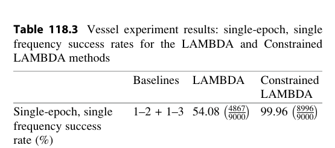
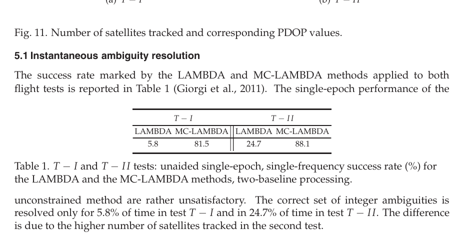
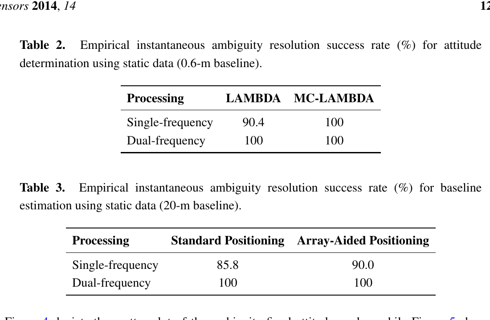

# 2026-10-20 GNSS 每日研究简报

## 今日快报

### 快报 1：MADOCA-PPP 八站运营评估把平均收敛从 485 s 压到 90 s，但结果依赖服务区与验收门限

- 主题：`madoca-ppp-operational-multi-frequency-performance`
- 来源 ID：`ion:gnss2026-16979`
- 来源链接：https://www.ion.org/gnss/abstracts.cfm?paperID=16979
- 发表日期：2026-09-18
- 来源类型：ION GNSS+ 2026 官方扩展摘要、QZSS MADOCA-PPP 运营数据评估
- 获取范围：官方扩展摘要全文；五系统、三/四频未组合模型、八个 IGS 站、月度精度、三档收敛标准、TTFF 与可用率已核对，未取得完整论文、站点逐日序列、误固定统计或用户端独立复算结果

**内容：** 日本 QZSS MADOCA-PPP 已从 GPS、QZSS、Galileo、GLONASS 扩展到 BeiDou，并由双频演进到三频、四频未组合处理与整数模糊度固定。作者用八个 IGS 站的实际运营数据检验水平/垂向精度、达到 30 cm/50 cm 的收敛时间、首次固定时间与增强卫星可用率。

**结论：** 官方摘要报告，各站最差月度水平和垂向数值分别为 6.6 cm、10.7 cm，低于 12 cm/16 cm 目标；收敛均值从 485 s 降到 90 s，增强卫星可用率均不低于 0.995。这里的 90 s 是指定多系统多频方案和指定阈值下的均值，不是任意用户、任意遮挡环境的 90 s 保证；TTFF 还随模糊度验收门限改变。

**关注理由：** PPP 服务验收不能只报最终厘米数。真正决定用户体验的是“精度阈值、首次固定、连续可用率”三者的联合分布；工程实现应保留逐站、逐月和重初始化统计，避免平均收敛掩盖长尾。

### 快报 2：三零陷模拟前端把完整双频相位卫星数从 28 降到 17，移动零陷的垂向 SPP RMS 升至 6.0 m

- 主题：`analog-crpa-nulling-measurement-positioning-impact`
- 来源 ID：`ion:gnss2026-17034`
- 来源链接：https://www.ion.org/gnss/abstracts.cfm?paperID=17034
- 发表日期：2026-09-17
- 来源类型：ION GNSS+ 2026 官方同行评审扩展摘要、低功耗双频模拟 CRPA 实测
- 获取范围：官方扩展摘要全文；静止/移动单、双、三零陷，四星座 1 Hz 观测、跟踪连续性、C/N0、码多路径、相位连续性与 SPP RMS 已核对，未取得干扰抑制度、天线标定误差、路线长度或误差分位

**内容：** 研究没有把 CRPA 只当作“压制干扰”的黑盒，而是同时审计它对有用 GNSS 观测的副作用。试验比较正常、单零陷、双零陷和三零陷模式，统计 GPS/GLONASS/Galileo/BDS 的跟踪、C/N0、码多路径、载波连续性，并以第一频点伪距独立做多系统 SPP。

**结论：** 摘要称，完整双频载波观测的平均卫星数由正常模式每历元 28 颗降到三零陷的 17 颗。静止零陷的水平/垂向 RMS 从正常 1.7/2.3 m 变到三零陷 3.9/4.6 m；移动零陷相应为 2.1/2.3 m 与 3.8/6.0 m，且退化不随零陷数严格单调。点位解始终可用，不等于相位定位或完整性始终可用。

**关注理由：** 抗干扰天线的验收指标必须穿透到观测域。若只看零陷深度，可能在“干扰被压住”的同时丢掉载波连续性和星座冗余；RTK/PPP-AR 尤其应单独统计周跳、可固定卫星数和重收敛时间。

### 快报 3：双天线自参照监测在 12 万个名义历元零虚警，但约 11 m 单天线偏差才触及检出底线

- 主题：`self-referenced-dual-antenna-geometric-consistency`
- 来源 ID：`ion:gnss2026-17158`
- 来源链接：https://www.ion.org/gnss/abstracts.cfm?paperID=17158
- 发表日期：2026-09-17
- 来源类型：ION GNSS+ 2026 官方扩展摘要、合成蒙特卡洛可行性研究
- 获取范围：官方扩展摘要全文；1000 次仿真、1.8 m 刚性基线、每轴 1.5 m 位置噪声、消费级 MEMS 姿态、12 万名义历元和偏差检出包络已核对，尚无硬件在环或飞行试验

**内容：** Self-Referenced Geometric Consistency（SRGC）不依赖某一导航源的卫星几何或载波模型，而是检查同一刚性机体上两副天线的独立位置估计是否仍满足已知基线。共享误差会在差分残差中部分抵消；因此它更像换源时的粗门，而不是绝对位置真值监测。

**结论：** 1000 次双天线固定翼 UAV 合成蒙特卡洛中，12 万个名义历元未触发虚警，单天线位置偏差的检出底线约为 11 m，并且对姿态激励不敏感。零虚警只是有限样本结果，不能推出虚警概率为零；约 11 m 的粗检出尺度也说明该方法不能替代米级/亚米级源内完整性监测。

**关注理由：** 当系统在 GNSS、LEO、地基网络和里程计之间切换时，统一残差很难设计。刚性阵列提供了跨源不变量，但两天线只能发现相对不一致，不能判断哪一路错、也看不到两路共同漂移；部署时应把它与源内保护级并联。

### 快报 4：两轮太阳活动峰值各取 72 天，L1 闪烁事件接近对半，L2C 的 59.5% 对 40.5% 主要受星座完备度影响

- 主题：`auroral-gnss-scintillation-solar-cycle-comparison`
- 来源 ID：`ion:gnss2026-17174`
- 来源链接：https://www.ion.org/gnss/abstracts.cfm?paperID=17174
- 发表日期：2026-09-18
- 来源类型：ION GNSS+ 2026 官方同行评审扩展摘要、极光区 GNSS 阵列长期观测
- 获取范围：官方扩展摘要全文；太阳周 24/25 峰值后相同跨度各 72 天、L1/L2C 相位闪烁事件占比与解释已核对，未取得事件阈值、站点地图、磁地方时分层或置信区间

**内容：** 研究用相近间距的高纬 GNSS 阵列，比较太阳周 24 与 25 在峰值后同一时间跨度内的 L 波段闪烁。指标包括幅度指数 $`S_4`$ 和相位标准差 $`\sigma_\phi`$，重点是避免用不同季节或不同峰值后时段做表面比较。

**结论：** L1 事件中太阳周 24/25 分别占 51.3%/48.7%，没有随第 25 周更高太阳活动而明显增加；L2C 则为 40.5%/59.5%。作者把 L2C 差异主要归因于两时期 GPS L2C 广播星座完备度不同，而非直接解释为电离层物理增强。摘要未给事件总数与不确定度，不能据百分比断言两轮完全等价。

**关注理由：** 长期 GNSS 环境比较最容易把“传感器/星座变了”误写成“空间天气变了”。接收机可用性模型应把信号代际、可见卫星数、固件和阈值变化作为协变量，而不是只按太阳周编号分组。

### 快报 5：同 EIRP 下 S 波段比 UHF 少 18–20 dB，穿墙还多损约 16 dB

- 主题：`leo-pnt-uhf-s-band-propagation-hardware-test`
- 来源 ID：`ion:gnss2026-16929`
- 来源链接：https://www.ion.org/gnss/abstracts.cfm?paperID=16929
- 发表日期：2026-09-16
- 来源类型：ION GNSS+ 2026 官方同行评审扩展摘要、UHF/S 波段导航载荷硬件传播试验
- 获取范围：官方扩展摘要全文；435 MHz 与 2425.1 MHz、同信号结构、同 EIRP/同接收功率两类对照、室外/走廊/室外到室内试验及 ITU-R P.2040-4 对照已核对，未取得天线方向图、带宽、建筑材料或重复次数

**内容：** 试验以同一导航信号结构和尽量一致的收发链，比较 435 MHz UHF 与 2425.1 MHz S 波段。作者分别固定 EIRP 和接收功率，以拆开自由空间传播、ISM 外部干扰与穿墙损耗；场景覆盖室外视距、室内走廊和室外到室内。

**结论：** 同 EIRP 室外条件下，S 波段接收功率比 UHF 低约 18–20 dB；即便调成同接收功率，S 波段 C/N0 仍低约 8 dB，作者归因于 ISM 带干扰。室外到室内稳定捕获需要约 14 dB 额外 S 波段发射增益，测得墙体穿透损耗差约 16 dB，与 ITU-R 模型相符。这些是给定硬件与场景的链路结果，不是所有建筑和频谱环境的常数。

**关注理由：** LEO-PNT 频段选择不能只比自由空间路径损耗；干扰底噪、墙体、天线尺寸和法规 EIRP 会共同决定捕获余量。接收机设计应把“同 EIRP”和“同接收功率”两种对照分开，否则容易把前端噪声误判为传播损耗。

## 深度研读

### 深读 1｜接收机工程｜刚性阵列不是验后尺子：怎样把已知边长与夹角直接写进整数估计

- 类别：`receiver-engineering`
- 学习层级：`foundation`
- 选题定位：`经典基础：从多基线双差观测建立整数矩阵—旋转矩阵联合模型，理解几何约束为何能提高整周成功率`
- 来源 ID：`doi:10.1007/978-3-642-20338-1_118`
- 来源链接：https://doi.org/10.1007/978-3-642-20338-1_118
- 发表日期：2012（论文源自 2009 年会议工作，书章版权页与 DOI 版本为 2012）
- 来源类型：IAG Symposium 同行评审会议书章、TU Delft 机构仓储作者稿
- 获取范围：8 页全文；多天线 Gauss–Markov 模型、MC-LAMBDA 搜索、$`10^5`$ 次仿真、9000 历元船载试验、Tables 118.1–118.3 与 Figures 118.1–118.3 已核对
- 价值评分：98/100（相关性 20，经典价值 20，证据 19，教学价值 20，工程价值 19）

#### 为什么先学这个

双天线航向常被讲成“先做 RTK，再把基线转成角度”。这会把天线间已知距离和多条基线的固定夹角降格为事后验算。本文把刚性机体几何送进模糊度目标函数：整数搜索尚未结束时，错误候选就要同时解释所有基线并满足同一个旋转矩阵，因此可以在弱单频、单历元模型中显著减少错误固定。

#### 先修知识

需要理解双差码与载波观测、整数最小二乘（ILS）、LAMBDA、浮点与固定模糊度、协方差加权范数、短基线大气项抵消、旋转矩阵正交约束、航向/俯仰/横滚，以及“成功率”是正确整数矩阵概率而非坐标精度。

#### 一句话逻辑

把所有基线观测堆成矩阵，以一个正交旋转矩阵把已知机体系阵列几何映射到导航系；整数候选只有在观测残差小且对应姿态仍是合法旋转时才可能胜出。

#### 研究问题与约束

模型假设各天线同时跟踪同一组卫星、基线足够短以忽略差分后大气误差、阵列刚性且机体系天线坐标已知、观测误差为高斯。仿真只用 GPS L1；船载试验用三套不同接收机/天线、两条 2 m 与 1.5 m 基线。结论不能直接外推到柔性机翼、显著线偏差、非同步接收机或城市重尾多路径。

#### 核心方法论

对 $`m`$ 条基线和 $`n`$ 个双差，把载波与码观测写成矩阵 $`Y`$，整数模糊度写成 $`Z`$，已知机体系阵列写成 $`F`$，姿态写成 $`R`$。无约束 LAMBDA 只要求 $`Z`$ 为整数；MC-LAMBDA 还要求 $`R^TR=I`$。算法先求忽略整数性和正交性的浮点解，再枚举整数候选，并对每个候选求最接近合法旋转的条件姿态，最后选择联合代价最小者。

#### 关键公式逐步推导

多基线短基线观测模型为：

```math
E(Y)=AZ+GRF,\qquad Z\in\mathbb Z^{n\times m},\;R\in O^{3\times q}.
```

$`A`$ 含载波波长，$`G`$ 含双差视线向量，$`F`$ 是已标定阵列。给定整数候选 $`Z`$ 后，先由浮点相关性得到条件姿态 $`\hat R(Z)`$；联合目标可概括为：

```math
C(Z)=\|\operatorname{vec}(\hat Z-Z)\|_{Q_{\hat Z\hat Z}}^2
+\min_{R^TR=I}\|\operatorname{vec}(\hat R(Z)-R)\|_{Q_{\hat R(Z)\hat R(Z)}}^2.
```

第一项衡量整数候选离浮点中心多远，第二项惩罚其对应姿态偏离正交群的程度。后者正是刚性阵列信息进入定整的通道。

#### 经典价值与创新边界

经典价值在于把“多条基线共享同一刚体姿态”转成一个可计算的混合整数约束模型，而不是逐基线定整后再拼角度。创新边界是严格非线性约束搜索计算较重，且成功率提升依赖 $`F`$、$`Q_Y`$ 和短基线假设正确；它不会自动消除天线相位中心变化或接收机间系统偏差。

#### 整体逻辑链

建立每条基线的双差码相观测；堆叠为 $`Y=AZ+GB`$；以 $`B=RF`$ 注入刚性几何；求浮点 $`\hat Z,\hat R`$；枚举整数候选；对候选投影到正交旋转；以联合代价排序；固定后输出同一个 $`R`$。下一节将看这套约束在真实高动态飞行中是否仍成立。

#### 原文图表与结果分析



> 图表源：Giorgi、Teunissen、Verhagen 与 Buist《Improving the GNSS Attitude Ambiguity Success Rate with the Multivariate Constrained LAMBDA Method》Table 118.3，[TU Delft 机构仓储全文](https://repository.tudelft.nl/record/uuid:f2c44a11-f9f9-4caf-9a71-5ee70637b6af)。原作未标示开放许可；本地资产仅以 Poppler 170 dpi 渲染 PDF 第 6 页并裁出该表，作为研究评论所需最小摘录，未改动表头、分数或百分比。

表中两条基线同时处理时，无约束 LAMBDA 在 9000 历元中正确 4867 次，即 54.08%；加入刚性阵列约束后正确 8996 次，即 99.96%。表只说明这条船载数据和既定判真方式下的整周成功率，不能单独证明所有正确固定的姿态角都无系统偏差，也没有给错误固定的角度尾部。

#### 原文结果论述

仿真覆盖 5–8 颗卫星、PDOP 约 4.2–1.8、码噪声 30/15/5 cm、相位噪声 3/1 mm，每组 $`10^5`$ 样本。最弱的 5 星、3 mm 相位与 30 cm 码噪声组合中，两基线无约束成功率仅 0.17%，受约束后为 99.60%；24 组两基线场景中有 20 组达到 100%。这属于正确高斯模型仿真；船载 99.96% 才是实测证据。

#### 常见误区与适用边界

第一，已知边长不是固定后才看的质量标志。第二，正交约束提高的是整数可辨识性，不会神奇降低载波噪声。第三，多基线必须共享可靠的机体系标定。第四，成功率不是完整性风险；四个错固定历元仍需被检测。第五，短基线大气抵消不等于无多路径。第六，逐条基线各自固定再平均，不能复现联合整数矩阵的约束收益。

#### 工程实现步骤

1. 在机体系标定每副天线相位中心与基线矩阵 $`F`$，记录温度与结构形变范围。
2. 形成同步的码/相位双差及完整协方差 $`Q_Y`$，不要把共享参考星相关性丢掉。
3. 求联合浮点 $`\hat Z,\hat R`$，检查秩、PDOP 与条件数。
4. 用普通 LAMBDA 生成候选，再计算正交约束代价或其上下界。
5. 对最优与次优候选做失败率或比值检验，并保留未固定状态。
6. 固定后由同一个旋转矩阵输出姿态，同时监控 $`R^TR-I`$、基线残差和跨历元跳变。

#### 复现实验设计

先复现论文仿真：GPS L1、两基线 1 m/2 m，卫星数 5–8，码标准差 30/15/5 cm、相位 3/1 mm，每格至少 $`10^5`$ 次；比较逐基线 LAMBDA、堆叠无约束 LAMBDA、MC-LAMBDA 的正确固定率、错误固定率和运行时。实测至少采 2 h、1 Hz、三天线刚性平台，基线由全站仪独立标定。失败用例加入 5 mm 基线标定偏差、1–10 ms 不同步、参考星切换、相关多路径与一副天线柔性位移。

#### 与定位及低成本实现的联系

低成本接收机码噪声大，普通浮点模糊度椭球更宽，刚性几何因而更有价值。但低成本天线相位中心不稳定也会破坏 $`F`$。工程上可用廉价多接收机换取几何冗余，却必须投入同步、线偏差和结构标定；否则“强约束”会把错误模型固定得更自信。

#### 本节小结

MC-LAMBDA 的关键不是多装一副天线，而是让所有天线共享同一个合法旋转。刚性几何在整数搜索阶段排除伪候选，才解释了船载成功率从 54.08% 到 99.96% 的跃迁。

### 深读 2｜接收机工程｜约束能否扛住飞行动态：从搜索上下界到单历元无辅助定姿

- 类别：`receiver-engineering`
- 学习层级：`intermediate`
- 选题定位：`基础进阶：理解 MC-LAMBDA 的扩张/收缩搜索，并用两次 Cessna 飞行检验单频单历元约束收益`
- 来源 ID：`doi:10.5772/38381`
- 来源链接：https://doi.org/10.5772/38381
- 发表日期：2012-02-24
- 来源类型：IntechOpen 同行评审开放书章
- 获取范围：CC BY 3.0 全文；双差随机模型、旋转参数化、LAMBDA 去相关、MC-LAMBDA 上下界搜索、两次 Cessna Citation 飞行与 INS 对照、Figures 1–14 和 Tables 1–2 已核对
- 价值评分：99/100（相关性 20，经典价值 20，证据 20，教学价值 20，工程价值 19）

#### 为什么先学这个

上一节说明刚性约束“有用”，但工程上还要回答两个问题：非线性正交约束怎样搜索而不爆算力，以及平台高动态、卫星数变化和零重力机动时能否保持单历元定姿。本章给出 Expansion 与 Search-and-Shrink 两种搜索流程，并把算法放到两次真实喷气机飞行中检验。

#### 先修知识

需要掌握上一节的整数矩阵—旋转矩阵模型、条件最小二乘、LAMBDA 去相关、LDL 分解、整数椭球枚举、正交 Procrustes/旋转投影、PDOP、单历元成功率，以及用 INS 作为比较基准时“差值标准差”不等于绝对真值误差。

#### 一句话逻辑

先用容易计算的下界和上界包围真正的正交约束代价，再通过扩大或收缩候选集合找到严格最小值；这样可以在不使用动态模型和先验姿态的情况下，让刚性几何逐历元帮助定整。

#### 研究问题与约束

两次试验都由同一 Septentrio PolaRx2 接三副天线，L1、1 Hz、零高度角截止；T-I 约 6000 历元，含激烈机动与抛物线零重力段，机身/机翼两基线约 5.45 m/7.60 m；T-II 约 15000 历元、动作平缓，基线约 4.90 m/7.60 m，并有 INS 输出。作者明确不使用动态模型、仰角随机模型、滤波或先验姿态，这使结果可检验但也低于可部署系统可利用的信息量。

#### 核心方法论

普通 LAMBDA 先通过整数可逆变换把细长浮点模糊度椭球去相关，再做高效枚举。MC-LAMBDA 的真实代价还包含“候选整数对应的条件姿态离正交群多远”。Expansion 从一个小的下界集合开始，若没有可行候选就扩大；Search-and-Shrink 先用上界快速找到候选并不断缩小，再在最终集合中核算真实代价。

#### 关键公式逐步推导

将真实约束代价写为：

```math
C(Z)=C_{\mathrm{amb}}(Z)+C_{\mathrm{att}}(Z),
```

其中 $`C_{\mathrm{amb}}`$ 是浮点整数距离，$`C_{\mathrm{att}}`$ 是 $`\hat R(Z)`$ 到 $`R^TR=I`$ 的最小加权距离。构造易算界：

```math
C_1(Z)\le C(Z)\le C_2(Z).
```

Expansion 枚举 $`\Omega_1(\chi^2)=\{Z:C_1(Z)\le\chi^2\}`$，直至包含真实可行解；Search-and-Shrink 先在 $`\Omega_2(\chi^2)=\{Z:C_2(Z)\le\chi^2\}`$ 中不断降低上界，再用最终 $`\chi^2`$ 枚举下界集合并比较真实 $`C(Z)`$。

#### 经典价值与创新边界

价值在于把非线性约束 ILS 从概念变成可运行搜索，并以最不利的“单频、单历元、无辅助”飞行场景检验。边界是章节报告成功率与 INS 差值标准差，却没有完整运行时分布、每次错误固定的风险后果和机体形变模型；今日实现还可利用多频、多星座和递推先验。

#### 整体逻辑链

由双差建立多基线模型；求浮点解并用 LAMBDA 去相关；为正交约束代价建立上下界；扩张或收缩候选集；逐候选求条件旋转；输出单历元姿态；以独立整数真值统计成功率；T-II 再与 INS 比较角度差。高级篇将把可靠阵列整数解继续传给平台相对定位。

#### 原文图表与结果分析



> 图表源：Giorgi 与 Teunissen《GNSS Carrier Phase-Based Attitude Determination》Table 1，[CC BY 3.0 开放章](https://doi.org/10.5772/38381)。用 Poppler 以 170 dpi 渲染原 PDF 第 23 页后裁出 Table 1 及其上下文；未改动表头、试验编号或百分比。

T-I 中无约束/受约束为 5.8%/81.5%，T-II 为 24.7%/88.1%。这张表直接说明几何约束在两条飞行轨迹都带来大幅收益，也同样说明它并未把弱模型变成 100% 可用：仍有约 12%–18.5% 历元没有得到正确整数，必须允许拒绝或借助多频/历元信息。

#### 原文结果论述

T-II 与 INS 对照的差值标准差为航向 0.07°、俯仰 0.20°、横滚 0.12°；作者把俯仰较差归因于 GNSS 基线垂向分量本来更弱，而较长的机翼基线改善横滚。这里的 INS 是精密比较基准但并非无误差真值，且统计只基于正确固定历元；不能把 0.07° 写成包含误固定和中断的端到端 95% 保证。

#### 常见误区与适用边界

第一，81.5% 与 88.1% 是正确整数比例，不是姿态连续可用率。第二，零高度角截止会纳入低仰角噪声，不能与常规 10°/15°截止直接比较。第三，单接收机多天线共享钟不同于独立低成本接收机。第四，INS 差值标准差受两套系统误差共同影响。第五，搜索上下界必须保持保守关系，否则可能漏掉全局最优。第六，动态大不等于必须用动态模型；但部署时不用动态信息也并不更优。

#### 工程实现步骤

1. 对浮点模糊度做整数去相关，保存变换前后协方差。
2. 为每个候选计算可证明的 $`C_1`$ 与 $`C_2`$，单元测试 $`C_1\le C\le C_2`$。
3. 选择 Expansion 作为稳健基线，实现 Search-and-Shrink 作为加速路径。
4. 用 SVD/极分解把条件姿态投影到 $`SO(3)`$，同时检查行列式为 +1。
5. 输出整数最优/次优代价、约束残差和未固定标志，不把每历元强制固定。
6. 在线记录卫星数、PDOP、候选数量、搜索耗时和重捕获事件，以解释失败簇。

#### 复现实验设计

搭建三天线刚性平台，基线约 5 m 与 7 m，GPS L1 先复现弱模型，再加入 Galileo E1 和双频作扩展。采集 1 Hz 静态、车辆转弯和可控转台数据各至少 2 h；每历元比较 LAMBDA、MC-LAMBDA Expansion、Search-and-Shrink。指标为正确固定率、拒绝率、错误固定率、航向/俯仰/横滚 RMSE、99% 尾部、候选数与 CPU 时间。失败用例包括 5°/15°截止、单星周跳、天线遮挡、1 cm 阵列形变和协方差缩放 0.5/2 倍。

#### 与定位及低成本实现的联系

短基线低成本平台往往航向精度受基线长度限制，码噪声又让单历元浮点解很弱。几何约束可显著提高定整，但两次飞行仍未达连续可用。实际产品应把多频、多星座、上一历元姿态和低成本陀螺作为“候选缩减信息”，同时用固定失败率门限防止辅助信息把错误候选推到首位。

#### 本节小结

飞行试验把 MC-LAMBDA 的价值和边界同时量化：刚性几何能把 5.8%/24.7% 提到 81.5%/88.1%，却仍需要拒绝机制。约束搜索解决的是可辨识性，不是完整性终点。

### 深读 3｜纯 GNSS 联合定姿定位｜姿态不是旁路产品：可靠阵列整数解怎样反过来增强相对定位

- 类别：`positioning`
- 学习层级：`advanced`
- 选题定位：`前沿深化：用纯 GNSS 多天线刚性几何同时提高姿态定整与平台中心相对定位，专题 dual-antenna-heading`
- 来源 ID：`doi:10.3390/s140712715`
- 来源链接：https://doi.org/10.3390/s140712715
- 发表日期：2014-07-17
- 来源类型：Sensors 同行评审开放论文
- 获取范围：CC BY 3.0 全文；阵列内姿态模型、阵列—参考站相关模型、解析方差收益、6 h 静态与 1 h 旋转平台试验、Figures 1–7 与 Tables 1–8 已核对
- 价值评分：99/100（相关性 20，经典价值 20，证据 20，教学价值 19，工程价值 20）

#### 为什么先学这个

前两节把阵列几何只用于提高姿态模糊度固定。本文再走一步：阵列内可靠固定的模糊度与参考站—阵列基线观测共享枢轴天线，因此两部分相关。若把这份相关性正确去相关，姿态子系统就能降低平台中心相对定位的方差和错误固定率，而不是作为定位完成后的旁路显示量。

#### 先修知识

需要掌握 MC-LAMBDA、旋转矩阵、双差相关性、Kronecker 积、条件协方差、阵列质心、相对定位 LAMBDA、误差传播、Kalman/递推最小二乘，以及短基线与 6 km 基线中残余电离层/对流层假设的差异。

#### 一句话逻辑

先用刚性阵列可靠固定平台内模糊度，再利用共享天线产生的观测相关性，把阵列信息投影到平台中心—参考站基线；同一套纯 GNSS 观测同时增强姿态与位置。

#### 研究问题与约束

原型由旋转激光扫描平台上的两副 GNSS 天线和外部参考站组成，阵列内基线约 0.6 m；近参考站约 20 m，另有约 6 km 参考站。静态试验 6 h、1 Hz；动态试验五次旋转、约 1 h、10 Hz。单/双频 GPS、10°截止。20 m 模型忽略大气差分，6 km 结果已显著受残余大气影响；平滑轨迹被用作部分动态误差参考，不是外部全站仪真值。

#### 核心方法论

平台内观测先写成 $`Y^1=AZ^1+GR_1B_0^1`$，以 MC-LAMBDA 解阵列模糊度与旋转。平台到参考站的普通模型为 $`y^{12}=Az^{12}+Gb^{12}`$。两者因共享枢轴天线而相关。作者对联合观测做线性去相关，使平台内子模型保持不变；一旦 $`Z^1`$ 可靠固定，平台间模型的协方差按阵列天线数缩小，再用普通 LAMBDA 求平台中心基线。

#### 关键公式逐步推导

把姿态与位置合并：

```math
E(Y)=AZ+GRB_0,
\qquad D(\operatorname{vec}Y)=P\otimes Q_{yy}.
```

$`P`$ 描述共享天线造成的块间相关。经去相关并固定阵列内整数后，平台间基线观测协方差缩放为：

```math
Q'_{yy}=\frac{1}{\eta}Q_{yy}.
```

对“旋转平台两副天线 + 参考站一副天线”，$`\eta=4/3`$，因此标准差理论缩放为：

```math
\frac{\sigma'}{\sigma}=\frac{1}{\sqrt{\eta}}=\sqrt{\frac{3}{4}}\approx0.866.
```

这不是多生成了一条独立观测，而是正确利用原本被分开处理的相关信息。

#### 经典价值与创新边界

经典价值是揭示阵列姿态与相对定位并非两个独立估计问题，并给出可验证的方差收益。创新在 array-aided positioning 与平台中心参数化。边界是收益依赖阵列内整数可靠、相关模型正确、平台刚性；若先固定错 $`Z^1`$，错误也会传给位置。论文只用 GPS 和近场/中等基线，未覆盖网络 RTK 或实时 SSR 延迟。

#### 整体逻辑链

标定旋转平台阵列；形成阵列内双差并以 MC-LAMBDA 定姿；形成参考站到枢轴天线的相对定位观测；写出共享观测相关矩阵 $`P`$；线性去相关；条件于正确阵列整数降低位置协方差；用 LAMBDA 固定平台间整数；输出质心位置；对静态与五次旋转比较普通/阵列辅助定位。

#### 原文图表与结果分析



> 图表源：Nadarajah、Paffenholz 与 Teunissen《Integrated GNSS Attitude Determination and Positioning for Direct Geo-Referencing》Tables 2–3，[CC BY 3.0 开放全文](https://doi.org/10.3390/s140712715)。用 Poppler 以 170 dpi 渲染原 PDF 第 13 页后裁出两表；未改动基线长度、处理模式或百分比。

0.6 m 阵列的单频姿态定整由普通 LAMBDA 90.4% 升到 MC-LAMBDA 100%；20 m 相对定位由标准处理 85.8% 升到阵列辅助 90.0%。双频四项都是 100%，说明几何约束的可见收益集中在弱模型；当频率冗余已把该数据集推到饱和，表中看不出额外成功率提升。

#### 原文结果论述

静态固定后，0.6 m 基线航向/俯仰标准差为 0.24°/0.38°；20 m 基线位置标准差由普通处理的北/东/上 3.4/2.1/5.1 mm 降为 2.8/1.6/4.4 mm。五次旋转中，提出方法的历元航向 RMSE 为 0.15°–0.23°，滤波后 0.11°–0.20°；20 m 基线 3D RMSE 约 3 mm，而 6 km 基线约 20 mm，作者归因于残余大气。后两者的参考包含平滑结果，不能当完全独立绝对真值。

#### 常见误区与适用边界

第一，阵列辅助不是把同一观测重复计权；必须显式处理相关性。第二，$`\sqrt{3/4}`$ 是该天线配置与模型下的理论标准差因子。第三，正确固定后姿态精度主要由相位和基线长度决定，约束主要改善可靠固定。第四，双频表中 100% 不证明任何环境都饱和。第五，6 km 残余大气说明短基线近似不可无限外推。第六，平滑解作参考会与待评估数据共享误差。

#### 工程实现步骤

1. 选定阵列枢轴天线和平台质心，统一机体系/导航系与杆臂定义。
2. 形成阵列内和参考站—阵列的原始双差，保留共享观测产生的交叉协方差。
3. 先对阵列内模型做 MC-LAMBDA，并以失败率受控门限验收。
4. 只有验收通过时才条件化平台间模型；否则回退标准相对定位。
5. 通过解析变换得到 $`Q'_{yy}`$，检查协方差对称、正定和缩放量。
6. 输出姿态、平台质心基线、整数状态与完整日志；长基线另估电离层/对流层。

#### 复现实验设计

复现原设置：两副平台天线相距约 0.6 m，参考站分别距 20 m 与 6 km；静态 6 h、1 Hz，转台五次旋转约 1 h、10 Hz；GPS 单频/双频、10°截止。比较普通 LAMBDA、仅 MC-LAMBDA 定姿、完整阵列辅助定位。指标包括姿态/位置正确固定率、航向 RMSE、NEU 标准差、3D RMSE、误固定条件下位置跳变及协方差一致性。失败用例加入阵列错误固定、交叉协方差置零、5 mm 杆臂偏差、6 km 大气梯度和单天线周跳。

#### 与定位及低成本实现的联系

低成本多天线平台可同时服务航向、姿态和平台中心定位，阵列几何因此能“一次标定，多处增益”。但低成本接收机不同钟、不同时和通道偏差会改变相关矩阵 $`P`$；若照搬共用观测模型，可能重复计权。工程上应先以原始时间戳和零基线试验确认相关结构，再启用阵列辅助条件化。

#### 本节小结

可靠姿态整数解不是定位链末端的显示量，而是可降低平台中心位置不确定度的条件信息。论文用单频成功率 85.8%→90.0% 和毫米级方差缩减证明了收益，同时用 6 km 结果提醒：阵列几何不能替代大气建模与独立真值。
