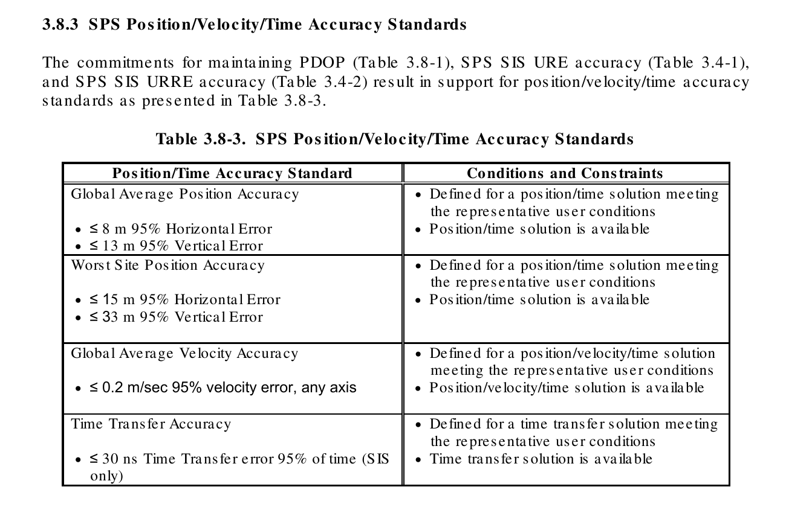
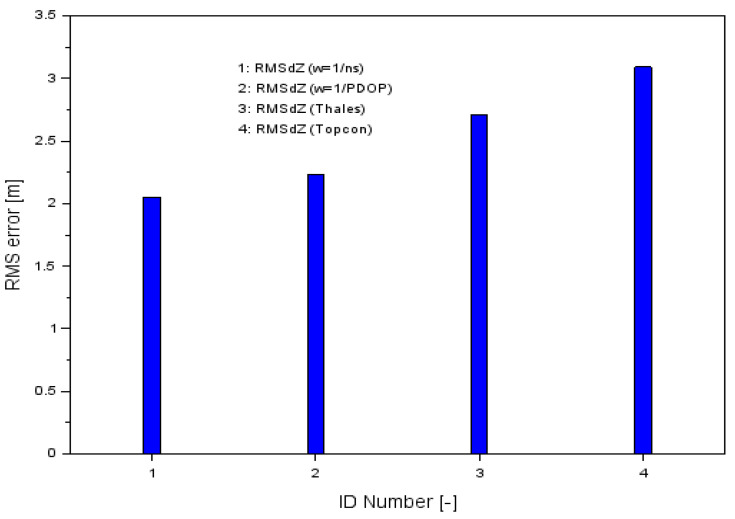
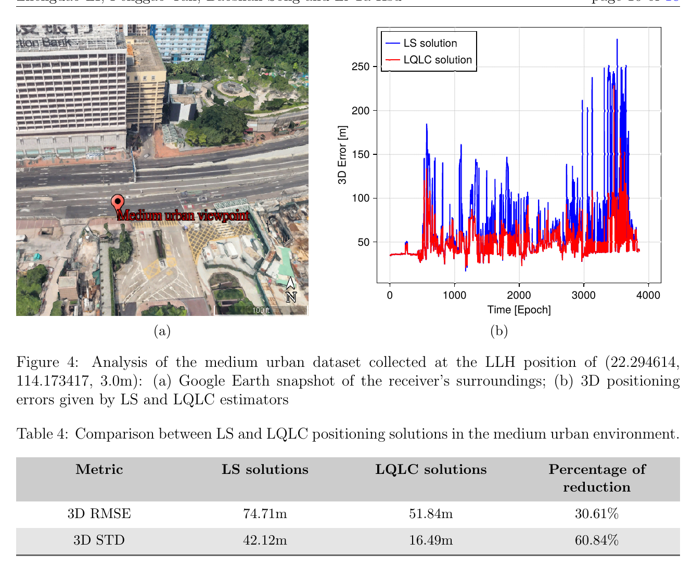

# 2026-10-21 GNSS 每日研究简报

## 今日快报

### 快报 1：LuGRE 从地月航程与月面识别出 229 条色散掩星弧，几何参照下分类一致率为 95.6%

- 主题：`lunar-gnss-dispersive-occultation-arc-catalog`
- 来源 ID：`ion:gnss2026-17119`
- 来源链接：https://www.ion.org/gnss/abstracts.cfm?paperID=17119
- 发表日期：2026-09-18
- 来源类型：ION GNSS+ 2026 官方同行评审扩展摘要、LuGRE 任务数据分析
- 获取范围：官方扩展摘要全文；GPS/Galileo 双频 STEC、ROT、ROTI 自动检弧、入掩/出掩/切触分类、几何掠射高度复核及总弧数已核对，未取得完整目录、逐弧阈值、误分类矩阵或独立电离层真值

**内容：** 作者处理 Blue Ghost Mission 1 搭载的 Lunar GNSS Receiver Experiment（LuGRE）科学数据，用双频 GPS 与 Galileo 观测构造斜向总电子含量（STEC）、TEC 变化率（ROT）和 ROT 指数（ROTI）。流水线先在观测域发现色散弧，再分为入掩、出掩与切触弧，最后用视线掠射高度做独立于观测指标的几何核对。

**结论：** 摘要报告共识别 229 条色散弧，与几何参照的分类一致率为 95.6%；多数弧来自月面观测，且不少视线探测到通常低轨掩星难以覆盖的顶部电离层和等离子层。95.6% 是相对几何规则的一致率，不是相对电子密度剖面真值的探测准确率；摘要也没有给阈值变化下的召回率。

**关注理由：** 超地球轨道 GNSS 不只是“还能定位”，也能成为遥感照射源。对接收机工程而言，任务数据的科学价值取决于双频时间同步、周跳控制与几何标注能否同时闭环；目录化结果比少量精选弧更适合后续统计检验。

### 快报 2：把空间天气信息接入 GBAS 后，GAST-E 名义检验统计量降低 20%，但适航认证仍未闭环

- 主题：`space-weather-informed-gbas-availability`
- 来源 ID：`ion:gnss2026-16993`
- 来源链接：https://www.ion.org/gnss/abstracts.cfm?paperID=16993
- 发表日期：2026-09-18
- 来源类型：ION GNSS+ 2026 官方同行评审扩展摘要、DLR In2Action 飞行数据概念验证
- 获取范围：官方扩展摘要全文；IMPC 的 ROTI、DIXSG、波前探测与近实时 $`\sigma_{vig}`$ 接口、GAST-C/GAST-E 用法及 20% 统计量变化已核对，未取得保护级全分布、漏检概率、异常梯度事件集或认证材料

**内容：** 方案把 DLR Ionosphere Monitoring and Prediction Center 的近实时空间天气产品送进 GBAS。对 GAST-C，它在确认安静条件后以近实时 $`\sigma_{vig}`$ 代替固定最坏情形膨胀；对 GAST-E，它调整机载双频监测器中异常梯度的先验概率，目标是减少安全模型过度保守造成的不可用。

**结论：** 德国飞行数据概念验证中，GAST-C 相对 CONUS 或 Brazil 区域威胁模型减少了不必要的保护级膨胀，而相对德国本地威胁模型差异较小；GAST-E 在名义条件下的电离层监测统计量下降 20%。该数字说明虚警裕量增加，不等于完整性风险已在真实强扰动中降低 20%，也不构成适航批准。

**关注理由：** 外部环境信息只有在“来源可信度—延迟—污染—失效模式”被写进完整性预算后才是安全增益。工程上不能把空间天气指数直接当作放松门限的理由，应并行保留保守回退模型与数据污染监测。

### 快报 3：外网格 STEC 用自适应 k-NN 与倾斜因子回归后，交叉验证 RMSE 从 0.53 m 降到 0.35 m

- 主题：`outer-grid-stec-adaptive-knn-obliquity-regression`
- 来源 ID：`ion:gnss2026-16919`
- 来源链接：https://www.ion.org/gnss/abstracts.cfm?paperID=16919
- 发表日期：2026-09-18
- 来源类型：ION GNSS+ 2026 官方同行评审扩展摘要、区域电离层改正交叉验证
- 获取范围：官方扩展摘要全文；前一日 VTEC 估接收机 DCB、当前日 EKF、逐格点自适应近邻与倾斜因子线性回归、0.35/0.53 m RMSE 已核对，未取得站网地图、误差分位、磁暴分层或最终 PPP 收敛结果

**内容：** 网络边缘、外网格和近海点缺少四周包围的参考站，普通空间插值容易把接收机差分码偏差（DCB）和局地残差外推到用户。该方法先用前一日区域 VTEC 建模估计接收机 DCB，并在当日 EKF 中作为已知改正；随后逐目标格点自适应选择 k 个邻站，用倾斜因子描述单层电离层假设下的斜路径关系。

**结论：** 交叉验证总 RMSE 为 0.35 m，传统线性插值基线为 0.53 m，绝对降低 0.18 m、相对约 34%。这是 STEC 改正域的交叉验证结果，不是用户坐标误差；单层假设、前一日 DCB 稳定性与站网外推在强梯度下仍可能失效。

**关注理由：** 区域 PPP-RTK 的服务边界往往不是“突然没改正”，而是几何由插值变成外推。把硬件偏差先拆开、再按斜路径物理量回归，比仅凭平面距离加权更可解释，也便于给外网格用户单独增大方差。

### 快报 4：48 次无人机地面初始化试验暴露了协方差乐观：既有多路径模型没有包住位置误差

- 主题：`uas-surface-navigation-experimental-integrity-gap`
- 来源 ID：`ion:gnss2026-16799`
- 来源链接：https://www.ion.org/gnss/abstracts.cfm?paperID=16799
- 发表日期：2026-09-18
- 来源类型：ION GNSS+ 2026 官方扩展摘要、最佳报告、机场实测完整性验证
- 获取范围：官方扩展摘要全文；GAST-E 启发的多频多星座差分架构、geometry-free divergence-free 滤波、Gordon K. Bush Airport 数据与 48 次初始化结论已核对，未取得逐次误差、保护级超限率、完整故障集或最终标准门限

**内容：** 研究面向无人机自主滑行，先前用协方差分析提出多频多星座差分 GNSS 架构，并加入 geometry-free divergence-free 滤波；本次工作转向实测，建立多路径误差模型并在机场数据上检验初始化阶段的预测包络。

**结论：** 48 次离场初始化试验中，所建多路径模型不足以包住实际位置误差，作者据此认为定位状态还需要额外误差状态。这里的负结果很重要：它否定的是当前模型充分性，不是证明架构永远不可用；摘要也没有给出加入新状态后的闭环结果。

**关注理由：** 完整性设计最危险的不是均值偏差略大，而是滤波器协方差系统性乐观。真实机场初始化比稳态轨迹更容易暴露未建模误差；验收应首先统计“误差是否被包住”，再讨论平均精度。

### 快报 5：一维 INS/里程计把 30 km 无 GNSS 线路的里程 RMSE 从 16.073 m 降到 1.335 m

- 主题：`railway-one-dimensional-ins-odometer-recursion`
- 来源 ID：`ion:gnss2026-16878`
- 来源链接：https://www.ion.org/gnss/abstracts.cfm?paperID=16878
- 发表日期：2026-09-18
- 来源类型：ION GNSS+ 2026 官方扩展摘要、青藏铁路 30 km 实车试验
- 获取范围：官方扩展摘要全文；15 状态到 6 状态降维、里程计速度与垂向加速度重力投影双观测、连续无 GNSS 与 30 s 里程计中断结果已核对，未取得线路坡度分布、传感器等级细表、参考轨迹构造或多趟重复试验

**内容：** 针对隧道等完全无 GNSS 场景，方法利用列车被轨道约束的一维运动，把常规 15 状态模型缩为沿轨里程、速度、俯仰、横滚、前向加速度计偏置和俯仰轴陀螺偏置 6 个状态。EKF 同时使用里程计速度与垂向加速度的重力投影约束，避免把里程计速度经不稳定姿态反复变换到导航系。

**结论：** 30 km 青藏铁路实测中，相对 15 状态松组合，里程 RMSE 从 16.073 m 降到 1.335 m，速度从 0.0758 m/s 降到 0.0132 m/s，俯仰从 4.3570° 降到 0.1095°。模拟 30 s 里程计中断时，全段里程 RMSE 相对纯里程计传播从 28.34 m 降到 2.85 m，但中断窗内仍为 14.61 m，不能解释为长期自主导航不漂移。

**关注理由：** 这是“物理约束换状态维数”的清晰案例。GNSS 恢复后，低维递推可提供更好的重捕获初值；但部署前必须检验换轨、打滑、坡度突变等破坏一维假设的场景。

## 深度研读

### 深读 1｜接收机工程｜先把责任边界画清：SIS 误差、卫星几何与用户 SPP 为什么不是同一个指标

- 类别：`receiver-engineering`
- 学习层级：`foundation`
- 选题定位：`经典基础：用现行 GPS SPS 性能标准区分 URE、PDOP 与用户位置误差，建立 SPP 误差预算的共同语言`
- 来源 ID：`gps-sps-performance-standard-2020`
- 来源链接：https://navcen.uscg.gov/sites/default/files/pdf/gps/geninfo/2020SPSPerformanceStandardFINAL.pdf
- 发表日期：2020-04
- 来源类型：美国政府 GPS Standard Positioning Service Performance Standard，第 5 版，公开发布技术标准
- 获取范围：196 页完整标准；SIS URE/URRE、PDOP 可用性、代表性用户条件、位置/速度/授时精度及附录误差预算已核对
- 价值评分：98/100（相关性 20，经典价值 20，证据 20，教学价值 20，工程价值 18）

#### 为什么先学这个

讨论 SPP 时，人们常把“卫星广播得准”“几何好”“接收机算得准”混成一个数字。标准把三层责任分开：空间段用用户测距误差（URE）描述广播轨道钟差投影；星座用 PDOP 描述几何放大；最终位置域承诺还需要代表性用户、可用解和一套明确条件。先拆清这三层，后面任何权重或稳健估计才知道在补哪一类误差。

#### 先修知识

需要理解伪距由几何距离、接收机钟差、卫星钟差、电离层、对流层、多路径与热噪声组成；知道线性化最小二乘、观测矩阵 $`H`$、协方差传播、95% 统计量、PDOP 与 URE/UERE 的区别，并能区分“信号在空间”（SIS）指标和用户设备端指标。

#### 一句话逻辑

卫星给每条测距线带来误差，几何矩阵把这些误差投影到三维位置；用户环境与设备又追加误差，因此空间段承诺只能约束位置误差的一部分。

#### 研究问题与约束

该标准规定 GPS SPS 的最低服务性能，而不是某款接收机的实测报告。第 5 版的正式位置标准面向满足“representative user conditions”的可用解；SIS URE 表明确忽略单频电离层模型误差，并不包含用户天线、多路径、遮挡、接收机噪声、地图或应用层错误。因此表内 8 m/13 m 不能直接当作手机城市定位保证。

#### 核心方法论

标准从可跟踪、健康的 SIS 分量出发，分别约束 URE、URE 变化率和可用性；再以星座构型保证 PDOP 可用性，最后给出位置、速度和授时域标准。Table 3.8-1 要求 PDOP 不大于 6 的全球可用率至少 98%、最差地点至少 88%；Table 3.8-3 则把这些条件与代表性用户假设合并成位置域上限。

#### 关键公式逐步推导

线性化伪距残差写成：

```math
z=H\,\Delta x+\varepsilon,
\qquad
\Delta x=[\Delta X,\Delta Y,\Delta Z,c\Delta t_r]^T.
```

若观测协方差为 $`R`$，加权最小二乘及其形式协方差为：

```math
\widehat{\Delta x}=(H^TR^{-1}H)^{-1}H^TR^{-1}z,
\qquad
Q_{\widehat{x}}=(H^TR^{-1}H)^{-1}.
```

在各测距误差独立同方差 $`\sigma_r^2`$ 的理想条件下，三维位置标准差可概括为 $`\sigma_{3D}\approx PDOP\,\sigma_r`$。实际 SPP 的 $`R`$ 并不只含 URE，故不能用 $`PDOP\times URE`$ 机械替代完整误差预算。

#### 经典价值与创新边界

经典价值是把服务供应方能承诺的 SIS/星座性能与用户端实现分开，并给出可审计的概率、时间窗和条件。它不是新算法，也不会告诉接收机怎样在楼群中检测 NLOS；其数字还是最低标准，实际性能可能更好。文中举例称 2018 年良好设计接收机约能在 95% 时间达到水平 3 m、垂向 5 m，但这只是当时实际表现说明，不替代正式最低承诺。

#### 整体逻辑链

广播轨道钟差形成 URE；健康星座与槽位配置形成几何；几何把测距误差投影到位置；代表性用户模型再加入规定的接收处理条件；最后才得到位置域 95% 指标。下一节将从单接收机误差预算转向两台接收机冗余，检验简单几何权能否改善飞行 SPP。

#### 原文图表与结果分析



> 图表源：美国国防部《Global Positioning System Standard Positioning Service Performance Standard》，5th Edition，Table 3.8-3，[美国海岸警卫队 Navigation Center 官方 PDF](https://navcen.uscg.gov/sites/default/files/pdf/gps/geninfo/2020SPSPerformanceStandardFINAL.pdf)。文件标注 Distribution Statement A、可公开发布；本地资产以 Poppler 180 dpi 渲染 PDF 第 68 页并裁出章节标题与完整表格，未改动行列、单位或数值。

表中全球平均 95% 水平/垂向误差上限为 8 m/13 m，最差地点为 15 m/33 m；速度任一轴为 0.2 m/s，SIS-only 授时为 30 ns。右列反复限定“满足代表性用户条件且解可用”，所以这不是对所有历元的绝对误差包络，更不是城市遮挡条件的保护级。

#### 原文结果论述

Table 3.4-1 对健康 SIS 在正常运行、所有 AOD 下给出 7.0 m 的 95% 全球 URE 标准，对全部星座槽位集合给出 2.0 m 的 95% 全球统计量；Table 3.8-1 同时要求 PDOP≤6 的可用性。把这些数字并列，正好说明“单星测距精度”“几何可用性”“最终坐标”必须分别验收。

#### 常见误区与适用边界

第一，URE 不是用户位置误差。第二，PDOP 小不代表多路径小。第三，95% 不是最大误差。第四，全球平均会掩盖最差地点。第五，标准明确排除的单频电离层误差不能偷偷算进 SIS 达标。第六，良好设计接收机的历史实绩不是对任意手机、天线姿态或地图软件的承诺。

#### 工程实现步骤

1. 将误差台账分为 SIS、传播、天线/前端、观测形成、估计器和应用层。
2. 每历元记录健康星、仰角方位、PDOP、使用/剔除原因与权重。
3. 单独计算广播轨道钟差投影、Klobuchar/Saastamoinen 改正和码残差。
4. 同时报位置误差、可用率和95/99分位，避免只报 RMS。
5. 用开阔地结果核对标准量级，再用遮挡场景量化用户端增量。
6. 若用于安全应用，以保护级覆盖率而非平均精度作为最终门槛。

#### 复现实验设计

在一个已知坐标站采集 24 h、1 Hz GPS L1 C/A RINEX，分别运行等权与仰角权 SPP，使用广播星历、Klobuchar 与 Saastamoinen。输出每历元卫星数、PDOP、水平/垂向误差、95/99分位和可用率；按 PDOP≤2、2–4、4–6、>6 分箱。基线为 RTKLIB 标准 SPP与不加大气改正版本。失败用例包括遮挡低仰角扇区、注入 10 m 单星码偏差、广播星历龄期增加和接收机初值偏离。

#### 与定位及低成本实现的联系

低成本接收机无法改变 GPS 的 SIS URE，却会因天线、C/N0、多路径和时钟增加 $`R`$ 中的用户项。合理策略不是拿服务标准替设备背书，而是把开阔地“接近 SIS+大气极限”的能力与城市环境增量分开测。这样才能判断后续改进应投向天线、权重、稳健估计还是地图约束。

#### 本节小结

SPP 的米级误差不是一个来源。SIS URE 给测距底座，PDOP给几何放大，用户设备与环境再叠加；Table 3.8-3 的条件栏比数字栏更重要。

### 深读 2｜接收机工程｜两台接收机怎样合一个坐标：简单 PDOP 权能改善，也可能把直觉写反

- 类别：`receiver-engineering`
- 学习层级：`intermediate`
- 选题定位：`基础进阶：在真实 Cessna 飞行中复现双接收机 SPP 加权，并审计经验权函数与相关误差的边界`
- 来源 ID：`doi:10.3390/s20174921`
- 来源链接：https://doi.org/10.3390/s20174921
- 发表日期：2020-08-31
- 来源类型：Sensors 同行评审开放论文
- 获取范围：CC BY 4.0 全文与原始 Figures 1–9；56 min Cessna 172 飞行、两接收机 SPP、RTK-OTF 参考、星数/PDOP 权和 RMS 已核对
- 价值评分：94/100（相关性 19，经典价值 17，证据 19，教学价值 20，工程价值 19）

#### 为什么先学这个

上一节说位置误差由测距和几何共同决定，本节把问题变成最小可运行系统：同一架飞机上的两台 GPS 接收机各自产生 SPP 坐标，怎样合成一个结果？论文给出两个极简单权函数，并用 RTK-OTF 轨迹逐轴验真。它适合教学，也暴露“有公式不等于权重有统计意义”。

#### 先修知识

需要理解 SPP、ECEF XYZ、PDOP、加权平均、RMS、广播星历、L1/L2、RTK-OTF 参考轨迹，以及两台共址接收机的电离层、卫星钟轨与部分多路径误差并不独立。

#### 一句话逻辑

把两台接收机的 XYZ 坐标按 $`1/n_s`$ 或 $`1/PDOP`$ 归一化加权，再以独立 RTK-OTF 轨迹比较；经验上能降 RMS，但权函数方向和相关性决定它能否推广。

#### 研究问题与约束

数据来自 Cessna 172 在 Dęblin 周边一次 09:39:03–10:35:03 GPST 飞行，速度范围 0–80 m/s、1 s 间隔。Thales Mobile Mapper 实时 GPS L1 SPP，Topcon HiPerPro 记录 GPS L1/L2 后由 RTKLIB 2.4.3 做 SPP；参考为 RTK-OTF。两接收机都在驾驶舱 Plexiglass 后方，误差共享且处理链不同，不能视为两个独立同分布传感器。

#### 核心方法论

对接收机 $`i=1,2`$ 的坐标 $`R_i=[X_i,Y_i,Z_i]^T`$，论文比较两种权：Case I 为 $`w_i=1/n_{s,i}`$，Case II 为 $`w_i=1/PDOP_i`$。合成坐标与 RTK-OTF 参考相减，计算各轴 RMS 和三维位移均值，再与每台单独 SPP 比较。

#### 关键公式逐步推导

双接收机加权结果为：

```math
R_m=\frac{w_1R_1+w_2R_2}{w_1+w_2}.
```

逐轴误差与 RMS 为：

```math
dR_k=R_{m,k}-R_{ref,k},
\qquad
RMS_k=\sqrt{\frac{1}{N}\sum_{j=1}^{N}dR_{k,j}^2}.
```

需特别审计 $`w_i=1/n_{s,i}`$：它会让可见星更少的接收机权重更大，与“星多通常更可靠”的直觉相反。若想表达星数越多越可信，通常应使用随 $`n_s`$ 增长的权或直接估计坐标协方差；论文结果只能证明这次数据的经验组合有效。

#### 经典价值与创新边界

价值在于用一套可完全复现的低复杂度融合，把 PDOP 从日志指标变成实时权重，并且有飞行 RTK 参考。边界也鲜明：只做一次飞行、两台处理链不同、没有完整坐标协方差、没有显式建模交叉相关；经验加权不是最优融合证明，也不具备完整性保证。

#### 整体逻辑链

两台接收机独立做 SPP；提取星数与 PDOP；归一化权重；逐历元融合 XYZ；对 RTK-OTF 求误差；比较三轴 RMS；发现不同轴的最优经验权不同。下一节将放弃“先合坐标”的思路，直接在伪距残差层用重尾似然自适应降权。

#### 原文图表与结果分析



> 图表源：Krasuski 等《New Strategy for Improving the Accuracy of Aircraft Positioning Based on GPS SPP Solution》Figure 9，[CC BY 4.0 开放全文](https://doi.org/10.3390/s20174921)。本地资产为 Europe PMC 开放包中的原始 JPG，未裁切、重绘或改动坐标轴、图例、柱高与数值含义。

横轴 1/2 分别是 $`1/n_s`$ 与 $`1/PDOP`$ 融合，3/4 是 Thales 与 Topcon 单机 SPP；纵轴是 Z 轴 RMS（m）。两种融合约为 2.05 m 与 2.23 m，低于 Thales 2.71 m、Topcon 3.09 m。图只证明垂向 RMS 下降，不显示尾部、连续性或错误相关结构。

#### 原文结果论述

相对 Thales，融合的 X/Y/Z RMS 改善分别为 2.5%–3.2%、17.8%–21.4%、17.7%–24.5%；相对 Topcon 为 1.2%–2.1%、11.5%–15.4%、27.8%–33.7%。三维位移均值为 4.99 m（$`1/n_s`$）和 4.80 m（$`1/PDOP`$），单机为 5.09 m 与 5.62 m。改善幅度依赖参照哪台接收机，不能只挑最大 33.7%。

#### 常见误区与适用边界

第一，两个坐标平均不等于两套原始观测联合解。第二，共址接收机不独立。第三，PDOP 只反映几何，不反映码噪声。第四，$`1/n_s`$ 的方向需先质疑再复用。第五，逐轴 RMS 改善不代表三维每个历元都改善。第六，RTK-OTF 自身也有误差，且一次飞行没有跨天气、姿态或天线安装复验。

#### 工程实现步骤

1. 同步两台接收机时标并统一 ECEF、星历和大气改正约定。
2. 保留各自星表、PDOP、C/N0、残差与解状态，而非只传坐标。
3. 先实现论文两种标量权作为基线。
4. 再以 $`Q_i^{-1}`$ 替标量权，构造协方差加权融合。
5. 对共享卫星误差加入交叉协方差或 covariance intersection 保守融合。
6. 用独立真值报告逐轴 RMS、95% 分位、最大误差与不可用率。

#### 复现实验设计

在同一车顶安装两台消费级接收机与一套测地真值，采 3 条各 30 min 路线、1 Hz，覆盖开阔、林荫和楼群。比较单机、算术平均、$`1/n_s`$、$`n_s`$、$`1/PDOP`$、协方差加权及 covariance intersection。指标为 2D/3D RMS、95/99分位、连续超 20 m 时长和 NIS。失败用例加入一台天线遮挡、共同卫星钟偏差、异步 0.5 s 与一台接收机冻结坐标。

#### 与定位及低成本实现的联系

多接收机是低成本硬件可实现的冗余，但价值不在“平均必然更准”，而在可交叉诊断和提供不同天线视角。若预算只允许一副好天线，盲加第二台可能不如改善天线；若使用两台，应尽量融合原始观测或完整协方差，而不是只融合厂商 PVT。

#### 本节小结

一次飞行证明简单融合可把部分 RMS 压低，尤其垂向最高 33.7%；同时 $`1/n_s`$ 的反直觉定义提醒我们，经验权重必须靠多场景与统计一致性验证。

### 深读 3｜单点定位｜高楼把高斯尾拉坏以后：Logistic 似然怎样把城市伪距变成可迭代的稳健权

- 类别：`positioning`
- 学习层级：`advanced`
- 选题定位：`前沿深化：从城市伪距分布拟合推导 LQLC/IRLS，在纯 GPS+BDS SPP 中量化重尾模型的收益与失效边界`
- 来源 ID：`arxiv:2603.16420`
- 来源链接：https://arxiv.org/abs/2603.16420
- 发表日期：2026-03-17
- 来源类型：arXiv 预印本，已投稿 NAVIGATION，尚未同行评审
- 获取范围：18 页 v1 全文；三类香港城市数据、误差分布拟合、LQLC 推导、GPS+BDS L1 SPP、计算时间与尺度失配蒙特卡洛已核对
- 价值评分：96/100（相关性 20，经典价值 17，证据 19，教学价值 20，工程价值 20）

#### 为什么先学这个

上一节在坐标端用固定经验权平均两台解；但城市误差首先发生在伪距。若 NLOS 让残差出现重尾，普通最小二乘的二次损失会让大残差产生无限增大的影响。本文先用数据问“误差像什么分布”，再从 Logistic 似然推导估计器，完成从统计假设到工程权重的闭环。

#### 先修知识

需要掌握伪距线性化、最大似然估计、Gaussian 与 Logistic 分布、M-estimator、影响函数、IRLS、RMSE/STD、NLOS 与多路径，并理解同一数据用于分布拟合和定位测试可能高估泛化性能。

#### 一句话逻辑

把城市伪距误差从高斯改为 Logistic，负对数似然变成平滑凸的 quasi-log-cosh 损失；其双曲正切影响函数会自动压低大残差权重，同时仍可用 IRLS 实时求解。

#### 研究问题与约束

实验用香港轻度、中度、深度城市三组 GPS+BDS L1 数据，接收机为 u-blox F9P，SPAN-CPT 提供参考。三组伪距误差样本分别为 51,837、57,682 和 50,517 个。作者把同一场景内各星样本合并拟合分布，再把拟合尺度用于该场景 SPP；因此结论是场景内验证，不是跨城市、跨设备或在线无真值标定证明。

#### 核心方法论

作者比较 Gaussian、Logistic、贝叶斯高斯混合与 Student's t 对误差尾部的描述，选择参数简单且便于优化的 Logistic。由零均值 Logistic 误差的 MLE 得到 LQLC 目标；每轮用当前残差计算权重，再解一次 WLS。大归一化残差的影响趋于有界，正常残差仍连续参与，不需要硬剔星。

#### 关键公式逐步推导

线性化模型为 $`y=Hx+\varepsilon`$。若 $`\varepsilon_i\sim L(0,s_i)`$，最大似然等价于：

```math
\hat x=\arg\min_x\sum_{i=1}^{n}
\ln\!\left[\cosh\!\left(\frac{y_i-H_i x}{s_i}\right)+1\right].
```

令归一化残差 $`r_i=(y_i-H_i x)/s_i`$，其影响函数与 IRLS 权为：

```math
\psi(r)=\tanh(r/2),
\qquad
w(r)=\frac{\tanh(r/2)}{r}.
```

于是每轮更新：

```math
\hat x^{(k+1)}=(H^TW^{(k)}H)^{-1}H^TW^{(k)}y.
```

当 $`|r|`$ 增大时 $`w`$ 下降；当残差很小时，用极限值避免 $`0/0`$ 数值问题。

#### 经典价值与创新边界

价值在于它不靠黑盒网络，而是让误差分布、损失、影响函数与实现一一对应；QLC 仍为凸函数，求解稳定。创新边界是 Logistic 只是比 Gaussian 更厚尾的单一对称分布，无法表达 NLOS 的方向性偏差、卫星相关性或多模态；预印本也尚未经过正式同行评审。

#### 整体逻辑链

从参考轨迹生成伪距误差；比较候选分布；发现高斯低估尾部；选择 Logistic；推导 LQLC；用 IRLS 实现；在三类城市 SPP 对比 LS；再用尺度失配仿真检查调参敏感性。学习链从第一节的服务边界，经过第二节的几何经验权，最终落到观测残差的概率模型。

#### 原文图表与结果分析



> 图表源：Li、Yan、Song 与 Hsu《Improved GNSS Positioning in Urban Environments Using a Logistic Error Model》Figure 4 与 Table 4，[arXiv:2603.16420 v1](https://arxiv.org/abs/2603.16420)。arXiv 页面采用 non-exclusive distribution license、版权仍归作者；本地资产仅以 Poppler 180 dpi 渲染 PDF 第 10 页并裁出原图与原表，作为研究评论所需最小摘录，未改动地图、曲线、坐标轴、图例或数值。

右图横轴为历元、纵轴为三维误差（m），蓝色 LS 在约 3000–3600 历元多次超过 200 m，红色 LQLC 多数尖峰较低。表中 3D RMSE 从 74.71 m 降到 51.84 m（30.61%），STD 从 42.12 m 降到 16.49 m（60.84%）。它证明的是该中度城市序列的误差收缩，不证明每个历元都优于 LS。

#### 原文结果论述

轻度城市 RMSE 34.82→30.96 m、STD 11.13→4.45 m；中度为 74.71→51.84 m、42.12→16.49 m；深度为 131.92→112.85 m、62.16→45.32 m。深度街谷仍常超过 200 m，说明稳健估计只能限幅，不能补回不可见 LOS 信息。两种算法单历元平均计算时间都低于 $`2.5\times10^{-4}`$ s；尺度失配仿真则显示严重低估 $`s`$ 比高估更危险。

#### 常见误区与适用边界

第一，厚尾模型不是 NLOS 改正模型。第二，RMSE 降 31% 后仍可能有 50 m 级误差。第三，同场景拟合尺度不等于在线可得。第四，合并各星样本会抹去卫星、仰角与方位差异。第五，对称 Logistic 不能表达 NLOS 常见的正偏。第六，IRLS 收敛到凸目标的唯一极小值，不代表模型本身正确。第七，预印本结论需等待复核。

#### 工程实现步骤

1. 先跑标准 WLS，保存每星预拟合和后拟合残差。
2. 用开阔/轻/中/深场景分别估 Logistic 尺度并做留段验证。
3. 实现稳定的 $`\tanh(r/2)/r`$，小 $`r`$ 用解析极限。
4. 给最大迭代数、状态增量与代价下降设置停止条件。
5. 与 Huber、Cauchy、Student's t 和硬剔星在同一数据上比较。
6. 输出最终权重、有效星数和条件数，避免稳健降权后几何失秩。

#### 复现实验设计

选用公开 Google Smartphone Decimeter Challenge 或自采 u-blox 数据，按街段划分训练/验证，严禁同一路段混入两侧。GPS+BDS L1、1 Hz；比较 LS、Huber-IRLS、Student's t 与 LQLC。指标为 2D/3D RMSE、中位数、95/99分位、>50 m 连续时长、每历元迭代数和运行时间。对 $`s`$ 做 0.1–10 倍扫描；失败用例注入同向多星偏差、仅 4–5 星、相关 NLOS 与正偏分布。

#### 与定位及低成本实现的联系

LQLC 只需伪距、星位与一个尺度参数，适合算力有限的低成本接收机；相比神经网络，它更易解释和部署。但低成本设备的尺度会随天线姿态、AGC、C/N0 与厂商观测形成变化。实际产品应把 Logistic 权与 C/N0/仰角先验、几何门控和完整性检验组合，而非独占决策。

#### 本节小结

城市 SPP 的关键不是把 LS 再迭代几次，而是承认误差尾部变了。Logistic 似然把这一假设转成有界影响的平滑权，在三组数据中都优于 LS；深街谷仍百米级，则清楚标出纯稳健估计的能力上限。
