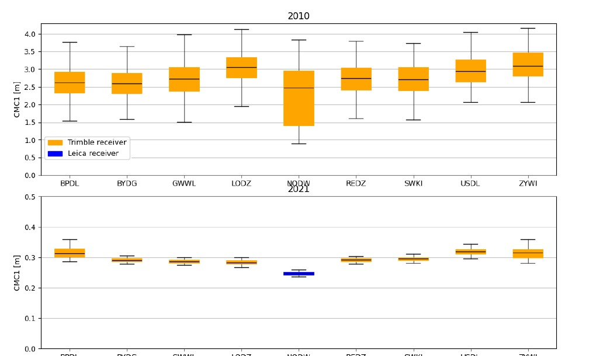
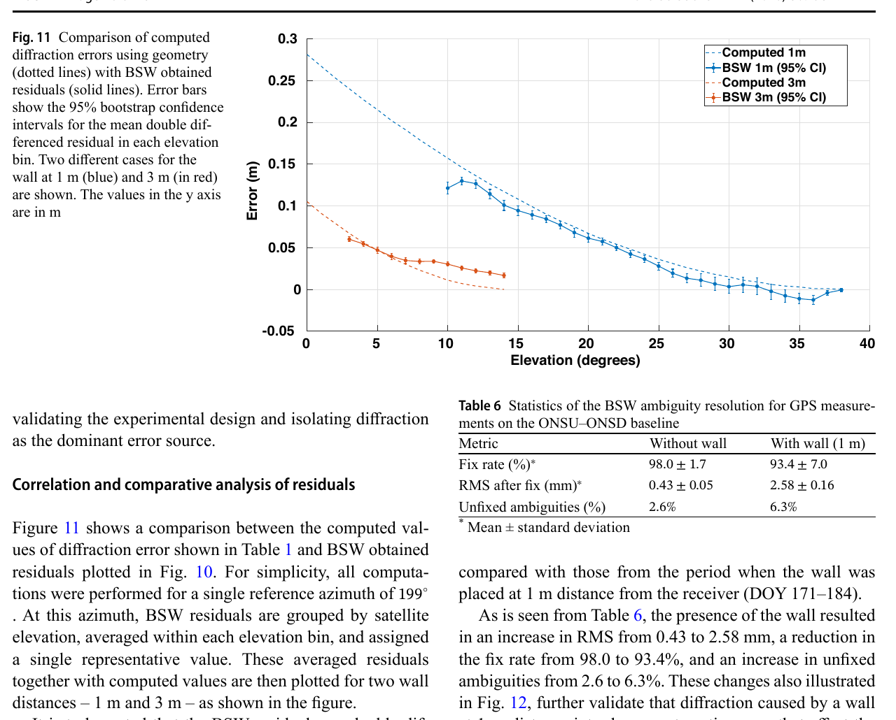
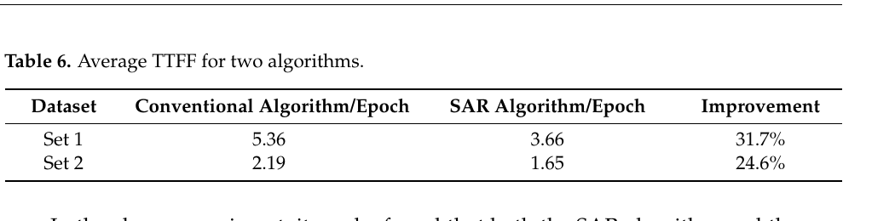

# 2026-10-22 GNSS 每日研究简报

## 今日快报

### 快报 1：三套低成本车载方案同场比较：城市段 NRTK 水平最好，PPP-RTK/IMU 连续性最好

- 主题：`low-cost-road-ppp-rtk-nrtk-comparison`
- 来源 ID：`doi:10.33012/2026.20765`
- 来源链接：https://doi.org/10.33012/2026.20765
- 发表日期：2026-10-07
- 来源类型：ION GNSS+ 2026 同行评审会议论文
- 获取范围：ION 官方摘要、完整书目信息与参考文献；核对三套低成本车载配置、两类道路场景、刚性杆双测地接收机参考轨迹工作流与定性排序，论文正文需 ION 下载权限，未取得逐段误差表、分位数或原始轨迹

**内容：** 研究把 F9P 纯 GNSS PPP-RTK、F9R GNSS/IMU PPP-RTK 与 F9P 纯 GNSS NRTK 放进城市和高速道路实测，并用两台测地接收机安装在已标定刚性杆上的后处理轨迹作为参考。参考候选按杆长一致性和垂向一致性加权，目的在于避免拿被测低成本接收机给自己当真值。

**结论：** 官方摘要报告，紧凑城市段达到分米级水平表现，F9P NRTK 的水平 2DRMS 最低，而 F9R PPP-RTK 的连续性最好；较长高速段退化更明显，尤其是 F9P PPP-RTK。摘要没有公开具体 2DRMS、长尾或误固定统计，因此这里只保留相对排序，不把“分米级”外推为任意道路保证；参考轨迹虽与被测解分离，两个测地锚点仍可能共享垂向误差。

**关注理由：** 低成本高精度评测的难点不只是选 PPP-RTK 还是 NRTK，而是建立独立、连续且可审计的车载真值。刚性杆几何可作为参考质量门，但人工确认区间仍需自动化，产品验收还应并报水平尾部、固定连续时长和重初始化次数。

### 快报 2：冻结 Kalman 阻断相位跳变污染：持续故障不再被创新衰减吞掉

- 主题：`frozen-kalman-dd-carrier-jump-detection`
- 来源 ID：`doi:10.33012/2026.20788`
- 来源链接：https://doi.org/10.33012/2026.20788
- 发表日期：2026-10-07
- 来源类型：ION GNSS+ 2026 同行评审会议论文
- 获取范围：ION 官方摘要、完整书目信息与参考文献；核对 STAP 引入的脉冲/阶跃双差相位跳变、冻结更新、Kalman 三差统计量与加权滑窗门限，论文正文需 ION 下载权限，未取得数据规模、门限值、漏警率或延迟分布

**内容：** 抗干扰阵列的波束切换和权值更新会给双差载波相位引入非物理跳变。普通三差在阶跃开始和结束各给一个峰，标准 Kalman 滤波又会把持续偏差吸收到状态里，使创新逐渐衰减。论文在告警后冻结状态更新，使故障数据不再污染预测；同时以 Kalman 三差定位跳变边界，并用加权滑窗适应不同基线的噪声。

**结论：** 作者在官方摘要中称，冻结机制能一直锁住阶跃区间，直到跳变消失或系统复位，并能实时隔离相位畸变而不中断导航解。该结论来自作者的高精度多接收机抗干扰阵列数据，但摘要没有给独立测试集上的概率指标；因此“持续覆盖”是本试验声明，不等于已证明任意阵列、任意跳变幅度下零漏警。

**关注理由：** 相位故障检测不能只看某一历元的创新是否越限。更关键的是报警后如何阻止状态被坏数据同化，以及恢复时怎样避免把真实机动误作相位跳变；这直接影响 RTK、着陆引导和阵列接收机的可用性—完整性折衷。

### 快报 3：TD-CMC 不是万能多路径探测器：门限与残差包络必须联合设计

- 主题：`td-cmc-screening-rtk-ambiguity-overbound`
- 来源 ID：`doi:10.33012/2026.20769`
- 来源链接：https://doi.org/10.33012/2026.20769
- 发表日期：2026-10-07
- 来源类型：ION GNSS+ 2026 同行评审会议论文
- 获取范围：ION 官方摘要、完整书目信息；核对时间差分码减载波门控、仰角相关高斯包络、校准/独立评估分离与 UAV 实测验证设计，论文正文需 ION 下载权限，未取得门限数值、固定率曲线或包络膨胀系数

**内容：** 论文把 TD-CMC 当作码—相快速不一致的时间门，而不是完整 NLOS/多路径分类器。通过门的观测仍可能含慢变偏差，所以作者再按仰角建立高斯包络协方差，并由归一化经验尾部决定膨胀量；门限和残差随机模型被视为一个成对设计。

**结论：** 官方摘要说明，门过严会损失卫星可用性与模糊度连续性，慢变误差又可能穿过 TD-CMC；单靠剔星或单靠高斯假设都不足。仿真明确分开校准与独立评估，实测则使用 GPS/Galileo UAV 段，但摘要没有给最终固定率或保护界覆盖率，因此不能据此宣称门控已经保证 RTK 完整性。

**关注理由：** 这项工作把“异常检测”和“通过后怎么定权”连在一起。对城市 RTK 而言，一个漂亮的检测 ROC 若把几何剪坏，或对残余慢变偏差仍给过小协方差，最终都会表现为更自信的错误固定。

### 快报 4：开环观测频繁衰落时，分段双向滤波避免坏区拖垮健康区

- 主题：`segmented-complex-waveform-open-loop-filter`
- 来源 ID：`doi:10.33012/2026.20827`
- 来源链接：https://doi.org/10.33012/2026.20827
- 发表日期：2026-10-07
- 来源类型：ION GNSS+ 2026 同行评审会议论文
- 获取范围：ION 官方摘要、完整书目信息与参考文献；核对 S-CWF 分段策略、健康区中心向两侧传播、段间最大似然连接、GPS L1 C/A/L2C 仿真与 Spire GNSS-R 个例，论文正文需 ION 下载权限，未取得滑移计数、码平滑误差值或运行时

**内容：** 开环跟踪适合 GNSS-R、掩星和快速相位变化场景，但没有反馈环兜底，频繁功率衰落会让联合估计码延迟和载波相位的复杂波形 UKF 发散。S-CWF 先按衰落把轨迹切段，在每段健康区中心初始化，再向前、向后传播，最后用最大似然把相邻段连接。

**结论：** 作者摘要报告，S-CWF 在 GPS L1 C/A、L2C 仿真中相对基本开环、SCANF 和未分段 CWF 减少周跳并降低伪距平滑误差，Spire GNSS-R 个例也支持这一趋势。摘要没有披露误差量级和多场景统计，因此证据边界是“仿真加单个真实个例”，不是对所有城市或掩星衰落的普适性能承诺。

**关注理由：** 分段的本质是隔离错误传播。这个思想不只适用于开环信号处理，也适用于周跳修复和载波平滑：当故障区间不可恢复时，应保住两侧健康信息，而不是让一个递推状态把污染带遍整条轨迹。

### 快报 5：L1C 的分裂频谱提醒：旧式双差相关器可能比窄相关器更差

- 主题：`gps-l1c-mboc-correlation-multipath-comparison`
- 来源 ID：`doi:10.33012/2026.20674`
- 来源链接：https://doi.org/10.33012/2026.20674
- 发表日期：2026-10-07
- 来源类型：ION GNSS+ 2026 同行评审会议论文
- 获取范围：ION 官方摘要、完整书目信息与参考文献；核对 L1C MBOC 频谱/自相关、静态单反射模型、窄 Early-Late 与 double-delta 类算法及不同前端带宽比较，论文正文需 ION 下载权限，未取得误差包络数值或最优参数表

**内容：** GPS L1C 的 MBOC 调制拥有更大的均方根带宽和更尖的自相关峰，理论上能改善码跟踪；但接收机算法若沿用为传统单峰谱设计的相关器，分裂频谱可能改变误差包络。论文用静态单反射模型，在多种前端带宽下比较窄 Early-Late 与 double-delta 类处理。

**结论：** 官方摘要的核心结果不是“新信号自动更抗多路径”，而是某些面向传统信号的多路径相关处理在 MBOC 上反而可能更差。摘要未提供反射延迟、幅度、相位和带宽组合的完整数值，因此只能确认算法—波形失配风险，不能判断某一商用实现的优劣。

**关注理由：** 波形改进只有与前端带宽、相关器抽头和鉴别器联合设计才会兑现。对多星座接收机，按信号族分别验证误差包络比复用一套“高级相关器”更重要；否则算法名更复杂，观测偏差却可能更大。

## 深度研读

### 深读 1｜接收机工程｜先别把 CMC 全叫多路径：码相组合怎样把固件故障也照出来

- 类别：`receiver-engineering`
- 学习层级：`foundation`
- 选题定位：`经典基础：从码与载波的符号差异推导 CMC/MP 组合，并理解它为何既能发现反射，也会放大电离层、周跳与接收机配置异常`
- 来源 ID：`doi:10.3390/rs16091617`
- 来源链接：https://doi.org/10.3390/rs16091617
- 发表日期：2024-04-30
- 来源类型：Remote Sensing 同行评审开放论文
- 获取范围：CC BY 4.0 全文；101 个 ASG-EUPOS 站、约 7.2 万个 30 s RINEX 日文件、2010/2021 CMC1 与 MP1/MP2、固件日志和 Figures 1–12 已核对
- 价值评分：96/100（相关性 19，经典价值 19，证据 20，教学价值 20，工程价值 18）

#### 为什么先学这个

进入 RTK 前，先要会判断“观测到底坏在哪里”。码减载波（CMC）常被直接叫作码多路径指标，但码和相位对电离层符号相反，相位还带整数模糊度；滑动去均值、周跳预处理和接收机固件都会改变结果。本文最有教学价值的地方，是九个站一度显示 2–4 m 级“多路径”，最后却由同一天的固件升级同时消失，说明指标异常不等于环境里突然没有反射体。

#### 先修知识

需要理解伪距与载波相位观测、几何距离、卫星/接收机钟差、对流层和电离层、整周模糊度、周跳、RINEX、移动平均、RMS，以及“线性组合消项”只会消掉符号和系数严格匹配的误差。

#### 一句话逻辑

用码与载波相减消去几何、钟差和对流层，再用局部均值压掉缓变电离层与常数模糊度；剩余量对快速码多路径敏感，但也对固件、周跳和滤波窗口敏感，所以它是质量监测量而不是纯多路径真值。

#### 研究问题与约束

作者比较波兰 ASG-EUPOS 网络中 2010 与 2021 年同时存在的 101 个站，使用全部可用日文件、30 s 采样和 15° 截止角。CMC1 用 GPS L1 载波与 C/A 码，MP1/MP2 用 L1/L2 码相组合。研究是固定参考站的长期质量审计，不直接给动态车载多路径或 RTK 坐标误差；数据因法律原因不公开，复现需另取公开 RINEX。

#### 核心方法论

CMC 先利用同一频点码与载波共有项相消，再在无周跳连续弧段内用以当前历元为中心的简单移动平均估计缓变偏置。双频 MP 组合进一步用两频载波消去一阶电离层。作者对每星每日残差求 RMS，按接收机/天线型号和年份比较，并对异常站画恒星日天空图，最后回查站点固件日志寻找共同变化点。

#### 关键公式逐步推导

同频码减载波为：

```math
CMC=P-\lambda\Phi=2I+(M_P-M_\Phi)+(\varepsilon_P-\varepsilon_\Phi)-\lambda N.
```

若载波噪声与载波多路径相对码项可忽略，则：

```math
CMC\approx 2I+M_P+\varepsilon_P-\lambda N.
```

在连续弧段内用 $`2k+1`$ 点局部均值 $`\overline{CMC}`$ 表示缓变 $`2I-\lambda N`$，得到：

```math
CMC_{res}=CMC-\overline{CMC}\approx M_P+\varepsilon_P+\varepsilon_{res}.
```

这里的 $`\varepsilon_{res}`$ 正是不能忽略的滤波残差：电离层变化太快、窗口跨周跳或固件改变观测形成时，它都可能被误认成多路径。

#### 经典价值与创新边界

CMC/MP 是接收机质检的经典工具；本文的贡献不是发明组合，而是用跨十一年的全网数据证明它能发现接收机运行异常。边界是作者把相位多路径近似为可忽略并以固定窗口去电离层，这对低仰角、闪烁或快速动态不一定成立；不同厂商的内部平滑也使绝对 RMS 不完全可比。

#### 整体逻辑链

写出码相观测；相减消共同项；限定连续弧段；局部去均值；按日求 RMS；按设备分组；定位异常站；做天空图；回查同时刻固件变更。下一节将把“环境误差”进一步拆开：即使吸掉反射，金属边缘仍会通过衍射扭曲载波。

#### 原文图表与结果分析



> 图表源：Rapiński、Tomaszewski 与 Pelc-Mieczkowska《Analysis of Multipath Changes in the Polish Permanent GNSS Stations Network》Figure 5，[CC BY 4.0 开放全文](https://doi.org/10.3390/rs16091617)。本地资产以 Poppler 180 dpi 渲染 PDF 第 10 页并裁出原图，未改动箱线、站名、颜色、坐标轴、单位或数值。

上图纵轴为 CMC1（m），九站 2010 年中位数多在约 2.5–3.1 m，须线延伸到约 4 m；下图 2021 年同站多落在约 0.25–0.32 m。两幅图纵轴刻度不同，不能只凭视觉高度比较；它直接显示观测组合的数量级变化，却不能单独证明变化来自物理多路径减少。

#### 原文结果论述

论文报告，九个异常站 2010 年平均 CMC RMS 约 2.25–3.00 m，峰值超过 4 m；所有站在 2011 年第 143 天附近同步恢复。日志显示这些站独有的 Nav 3.8/Boot 3.56 在当天升级为 Nav 4.41/Boot 4.18，因此作者把异常归因于接收机固件运行或配置，而不是全国不同地点同时改变反射环境。排除异常后，全网平均 CMC RMS 从 2010 年 0.30 m（标准差 0.01 m）到 2021 年 0.21 m（0.03 m）；这是设备与网络构成变化下的相关结果，不是技术进步的因果试验。

#### 常见误区与适用边界

第一，CMC 不等于纯码多路径。第二，局部去均值会滤掉慢变多路径，也可能留下快变电离层。第三，窗口跨周跳会制造阶跃。第四，不同固件的观测形成和内部平滑不可视为同一传感器。第五，RMS 下降不自动转化为坐标精度同比提高。第六，15° 截止会隐藏最低仰角的最坏误差。第七，年统计不提供短时完整性保证。

#### 工程实现步骤

1. 从 RINEX 按系统、频点和观测码建立连续弧段，先做周跳与数据缺口标记。
2. 形成 CMC/MP 前统一单位、码型和天线/接收机元数据。
3. 以 30 s 数据和 ±15 min 窗口为论文基线，同时扫描 5–30 min 观察灵敏度。
4. 每星输出中位数、RMS、95/99 分位和仰角—方位天空图。
5. 将异常时刻与固件、复位、天线、电缆、跟踪通道和环境施工日志对齐。
6. 只有在电离层、周跳与设备变化被排除后，才把残差解释为多路径代理量。

#### 复现实验设计

选择 3–5 个公开 IGS/MGEX 站各 30 天、30 s GPS 双频 RINEX，截止角 15°。比较 CMC1、MP1、MP2，窗口取 5/15/30 min；基线为不去均值和整日去均值。指标为逐星/逐日 RMS、95% 分位、天空格网重复率及已知设备变更前后效应量。失败用例包括人工注入一周跳、丢 10 min 数据、加线性电离层漂移和给码观测加常值/阶跃偏差，检查算法会把哪类故障误标成多路径。

#### 与定位及低成本实现的联系

低成本 RTK 最怕把坏码观测送进浮点模糊度和随机模型。CMC 能在不需要真值坐标时做前端体检，但手机和廉价芯片的 duty cycle、厂商平滑及频间偏差更复杂。部署时应把 CMC 当门控特征之一，并与 C/N0、锁定时间、AGC、周跳标志和固定后残差联合使用。

#### 本节小结

码相相减确实能把几何和钟差拿掉，却不会自动留下“纯多路径”。九站同时恢复的案例说明：质量指标先用于发现异常，再靠元数据辨因；否则固件错误也会被写成环境反射。

### 深读 2｜接收机工程｜墙不挡星也会弯相位：可控衍射怎样侵蚀模糊度固定

- 类别：`receiver-engineering`
- 学习层级：`intermediate`
- 选题定位：`基础进阶：在近似无多路径场地用吸波金属墙隔离刀刃衍射，连接 Fresnel 几何、双差残差与整周固定退化`
- 来源 ID：`doi:10.1007/s10291-026-02138-1`
- 来源链接：https://doi.org/10.1007/s10291-026-02138-1
- 发表日期：2026-10-06
- 来源类型：GPS Solutions 同行评审开放论文
- 获取范围：CC BY 4.0 全文；2025 年 3–8 月 1 Hz 数据、10 m 共址基线、1–3 m 可移动墙、吸波/裸金属对照、GipsyX PPP、Bernese 双差、KED/mKED、Tables 1–6 与 Figures 1–14 已核对
- 价值评分：99/100（相关性 20，经典价值 19，证据 20，教学价值 20，工程价值 20）

#### 为什么先学这个

上一节说明 CMC 的异常可能来自设备而非环境；环境误差内部也不能全叫“多路径”。衍射是直达波被障碍边缘弯入阴影区，反射则是另一条传播路径与直达波叠加。本文用吸波材料压制金属墙反射，只留下刀刃衍射，再用同硬件、共钟、10 m 基线把相位误差压到可测范围，是从信号传播走向模糊度固定的干净实验。

#### 先修知识

需要理解 Fresnel 区、刀刃衍射、C/N0、载波相位、双差、PPP、整数模糊度、固定率、PDOP、bootstrap 置信区间，以及“卫星仍可跟踪”不等于相位没有系统偏差。

#### 一句话逻辑

把一面已知几何的吸波金属墙逐步移近天线，用无墙—吸波墙—裸金属墙三组对照分开噪声、衍射和残余反射，再看双差相位残差与模糊度固定怎样随墙距恶化。

#### 研究问题与约束

ONSU/ONSD 两站相距 10 m，均用 Septentrio PolaRx5 与 Leica AR20，主从时钟、电缆匹配、天线高差小于 1 cm。墙为 1 m×1 m、厚 2.5 mm，顶边高于相位中心 80.6 cm、方位 199°，距离从 1 m 到 3 m；吸波材料覆盖面对天线一侧。场地接近无多路径，但接收机 APME+ 始终开启，且实验只代表这一墙体、L1 为主的静态几何。

#### 核心方法论

作者先用 56 天无墙数据定参考坐标与无损 SNR，再在不同墙距采连续数据。GipsyX 用 GPS/Galileo 双频 PPP 看参数吸收后的坐标影响；Bernese 固定坐标、不估大气，只解模糊度并保留 L1 双差残差。吸波与裸墙之差估残余反射，吸波墙与无墙之差估衍射；KED 用几何预测 SNR/路径误差，并以分块 bootstrap 给均值置信区间。

#### 关键公式逐步推导

刀刃相对直达路径的 Fresnel–Kirchhoff 参数可写成论文近场几何形式：

```math
\nu=h\sqrt{\frac{2}{\lambda R_0}},
```

其中 $`h`$ 是墙刃相对卫星—天线最短几何路径的有符号净空，$`R_0`$ 是墙刃到天线在传播平面内的距离，$`\lambda`$ 是波长。$`\nu>-1`$ 后开始出现不可忽略损失；临界净空为：

```math
h_c=-\sqrt{\frac{\lambda R_0}{2}}.
```

双差相位残差中，卫星钟、接收机钟和 10 m 共址大气近似相消；若一颗星受墙边衍射而参考星不受，则剩余路径增量进入残差并扰动整数估计。若两颗星同时在墙影内，双差还可能互相抵消一部分衍射，故单个残差不能直接当成单星绝对误差。

#### 经典价值与创新边界

价值在于用物理对照把常被混写的衍射与多路径分开，并把毫米级残差、固定率和场地净空建议串起来。创新边界是近场 1 m 时经典 KED 不能解释 $`0<\nu<1`$ 的 SNR 增强，作者以经验正指数 mKED 拟合；这不是新的普适电磁理论。实时 RTK/NRTK 影响仍是推论，论文实际定位处理为 PPP 与后处理双差。

#### 整体逻辑链

选近似无反射场地；建立同硬件共钟短基线；用无墙数据定噪声地板；布置吸波墙；逐级改变墙距；由 KED 预测；用 PPP 看参数吸收；用固定坐标双差保留局部误差；比较吸波/裸墙分离反射；统计固定率。下一节将把这类未建模局部偏差与大气建模残差一起放进 NRTK 初始化问题。

#### 原文图表与结果分析



> 图表源：Dutta 等《Experimental characterization of GNSS carrier phase diffraction errors in a controlled environment》Figure 11 与 Table 6，[CC BY 4.0 开放全文](https://doi.org/10.1007/s10291-026-02138-1)。本地资产以 Poppler 180 dpi 渲染 PDF 第 16 页并裁出原图与原表，未改动曲线、误差棒、坐标轴、图例、单位或数值。

Figure 11 横轴为卫星高度角（°）、纵轴为相位残差等效距离（m）。1 m 墙距的蓝色实测在约 10° 处约 0.12 m，并随高度角升高趋近零；3 m 的红色实测约从 0.06 m 降到 0.02 m。虚线几何模型给趋势，误差棒是均值的 95% bootstrap 区间。右下表把传播效应落到定整：有墙并非只让噪声略增，而是降低固定率并增加未固定模糊度。

#### 原文结果论述

墙影内 L1 双差残差 RMS 从无墙 3.9 mm 升到 1 m 吸波墙 36.8 mm，裸金属墙为 39.8 mm；作者据此分解出约 32.9 mm 衍射与 3.0 mm 残余多路径。GPS 模糊度固定率由 $`98.0\pm1.7`$% 降到 $`93.4\pm7.0`$%，固定后 RMS 由 $`0.43\pm0.05`$ mm 升至 $`2.58\pm0.16`$ mm，未固定比例由 2.6% 升至 6.3%。这些是后处理日统计的均值/标准差，不是实时每历元风险概率。

#### 常见误区与适用边界

第一，PDOP 接近 1 仍可能有大局部偏差。第二，可跟踪 NLOS 不等于可用于载波定整。第三，双差不会消掉只作用于一副天线的衍射。第四，吸波墙仍有衍射，裸墙才额外加入反射。第五，1 m 近场不满足理想无限薄刀刃。第六，作者建议的 4 m/11° 是给定 0.8 m 墙和 L1 几何的起点，不是规范常数。第七，APME+ 未关闭，接收机内部修正可能与衍射相互作用。

#### 工程实现步骤

1. 参考站勘址除天空图外，测量屋檐、女儿墙、金属柜等相对天线的高度、距离与方位。
2. 用 Fresnel 参数而不只是直线遮挡判断受影响卫星。
3. 记录逐星 C/N0、相位残差、锁定状态和固定参与标志，按方位—高度格网累计。
4. 把环境相关卫星权重与统一高度角权分开，避免 PDOP 好就放行。
5. 对参考站用短共址基线或移位天线做吸波/距离对照，识别可重复局部误差。
6. 将固定率、错误固定、固定后残差和保护级覆盖率一起验收。

#### 复现实验设计

在开阔场地架两套同型号双频接收机，基线 5–10 m、1 Hz，先采 24 h 无障碍基线。放置 1 m 级金属板于 1/1.5/2/3/4 m，分别做吸波与裸板，每档至少 8 h；同时测墙高和方位。比较无墙、KED 权重、统一截止角和方位—高度掩膜。指标为 L1/L2 双差残差 RMS、固定率、错误固定率、C/N0 损失、KED 预测 RMSE。失败用例加入两颗星同时入墙影、墙体振动、关闭/开启接收机多路径抑制和参考星切换。

#### 与定位及低成本实现的联系

低成本天线通常缺少强抑制地平反射的方向图，安装又更靠近车顶边缘和机壳，衍射风险不会因双差而自然消失。实际 RTK 可把三维模型或简化墙体几何转成逐星权重；若没有地图，C/N0 突降与稳定方位格网残差也可做软门控，但不能只靠硬剔星把几何剪到不可定整。

#### 本节小结

受控实验把 36.8 mm 残差中的主要部分归给衍射，而非反射；这足以让 GPS 固定率从 98.0% 降到 93.4%。墙边误差的关键不是“看得见几颗星”，而是哪颗星的传播路径仍符合整数模型。

### 深读 3｜网络 RTK｜大气偏差顶住窄巷时：EWL→WL→NL 序贯定整怎样加速 NRTK

- 类别：`positioning`
- 学习层级：`advanced`
- 选题定位：`前沿深化：利用多频组合的长波长逐级固定 EWL、WL、NL，在显著电离层建模残差下为纯 GNSS NRTK 提供更快初始化与可降级输出`
- 来源 ID：`doi:10.3390/rs16132320`
- 来源链接：https://doi.org/10.3390/rs16132320
- 发表日期：2024-06-25
- 来源类型：Remote Sensing 同行评审开放论文
- 获取范围：CC BY 4.0 全文；两套 CORS 数据、88–110 km 网络边长、VRS/零基线用户、EWL/WL/NL 组合、LAMBDA+PAR、单历元/5 min 重启/1 h 初始化/连续处理及 Tables 1–8、Figures 1–15 已核对
- 价值评分：98/100（相关性 20，经典价值 18，证据 20，教学价值 20，工程价值 20）

#### 为什么先学这个

前两节先学会发现码相异常，再看到局部相位偏差怎样破坏定整；NRTK 还要面对参考网插值不完美留下的大气残差。窄巷波长约 0.19 m，残差到一个周量级时整数搜索迅速恶化；额外宽巷和宽巷的米级波长更耐受同一米制偏差。本文把“先固定容易的，再条件化困难的”写进同一 Kalman/LAMBDA 流程。

#### 先修知识

需要掌握双差 RTK、VRS、网络电离层/对流层建模、线性组合、EWL/WL/NL、LAMBDA、部分模糊度固定（PAR）、条件协方差更新、ADOP、比值检验、TTFF，以及固定率高不等于错误固定率低。

#### 一句话逻辑

先用长波长 EWL 找到高可靠整数，把固定值及协方差相关性回灌到 WL 和位置；再固定 WL 并回灌 NL，最终固定 NL；任一级失败就输出上一层固定解，而不是退回完全未收敛的窄巷浮点解。

#### 研究问题与约束

数据集 1 来自中国西部 CORS，数据集 2 来自 AUSCORS，采样 30 s，参考网边长约 88–110 km；用户由 VRS 或已知站模拟成零基线 NRTK，以隔离大气改正残差。GPS、Galileo、BDS 使用可用多频公开信号，10° 截止，LAMBDA 比值门限 2.5，并按高度角做 PAR。零基线并不等于真实移动用户，论文也未给外部位置真值下的错误固定概率。

#### 核心方法论

对每个系统构造多频双差 EWL、WL、NL 与原始码观测，统一进入 Kalman 滤波。先选择 EWL 子状态用 LAMBDA 搜索和 PAR；固定成功后用条件均值/协方差更新其余状态。WL 重复同一过程，再约束 NL 与几何位置。卡方检验验证固定；若 NL 失败，保留 WL 固定或 EWL 固定解，从而在强大气期仍提供比普通 NL 浮点更紧的降级解。

#### 关键公式逐步推导

四频整数组合的双差相位为：

```math
\Delta\nabla\Phi_{(i,j,k,t)}=
i\Delta\nabla\Phi_1+j\Delta\nabla\Phi_2+k\Delta\nabla\Phi_3+t\Delta\nabla\Phi_4,
```

对应组合频率与波长为：

```math
f_{(i,j,k,t)}=if_1+jf_2+kf_3+tf_4,
\qquad
\lambda_{(i,j,k,t)}=\frac{c}{f_{(i,j,k,t)}}.
```

把已固定的较宽巷状态 $`a`$ 条件化到待解状态 $`b`$：

```math
\check x_b=\hat x_b-Q_{ba}Q_{aa}^{-1}(\hat a-\check a),
\qquad
Q_{bb|a}=Q_{bb}-Q_{ba}Q_{aa}^{-1}Q_{ab}.
```

固定信息不仅移动 WL/NL 浮点中心，还缩小其协方差；若相关模型正确，ADOP 下降、搜索空间收缩。若 EWL 错固定，条件化也会把错误更自信地传下去，所以每级检验不可省略。

#### 经典价值与创新边界

序贯宽巷定整源自多频 RTK/TCAR 的经典思想；本文的工程价值是把 EWL、WL、NL 与 Kalman、PAR、NRTK 大气改正和分级输出连成完整流程，并在两套网络数据上比较。边界是实验把网络站当用户、采样仅 30 s，且比值 2.5 与随机模型的完整性没有独立标定；“更快固定”不能直接当作安全应用的误固定保证。

#### 整体逻辑链

网络估计大气改正；用户形成多频双差；建立 EWL/WL/NL 状态；先固定 EWL；条件更新 WL/NL/位置；再固定 WL；再次条件更新；最后固定 NL；失败时保留上一级固定解；用单历元、周期重启和连续滤波分别检验可辨识性、初始化速度与常态性能。

#### 原文图表与结果分析



> 图表源：Liu 等《Fast and Reliable Network RTK Positioning Based on Multi-Frequency Sequential Ambiguity Resolution under Significant Atmospheric Biases》Table 6，[CC BY 4.0 开放全文](https://doi.org/10.3390/rs16132320)。本地资产以 Poppler 180 dpi 渲染 PDF 第 14 页并裁出完整原表，未改动表头、行列、单位或数值。

表中 TTFF 单位是“历元”，不是秒；采样间隔为 30 s。数据集 1 的常规/SAR 平均值为 5.36/3.66 历元，改善 31.7%，相当于约 161/110 s；数据集 2 为 2.19/1.65 历元，改善 24.6%，约 66/50 s。标题摘要所称“两套超过 30%”与 Table 6 的第二套 24.6% 不一致；本简报以原表为准并明确这一文本—表格差异。

#### 原文结果论述

5 min 周期重启实验中，数据集 1 的 NL 固定率由 49.7% 升到 66.1%，北/东/高误差由 0.191/0.142/0.478 m 降到 0.110/0.029/0.110 m；数据集 2 固定率由 72.0% 到 79.2%，误差由 0.132/0.089/0.386 m 到 0.033/0.032/0.097 m。连续处理时两算法精度接近，数据集 1 固定率 77.5%→97.3%，数据集 2 为 97.7%→99.2%；这说明主要收益在初始化和受扰阶段，而不是常态固定解无限变准。

#### 常见误区与适用边界

第一，EWL 波长长不代表噪声小，组合会放大码/相位噪声。第二，逐级固定会传播错整数。第三，TTFF 历元必须乘采样间隔。第四，零基线模拟用户消除了真实车载多路径与天线运动。第五，固定率不等于正确固定率。第六，连续滤波下 Kalman 已吸收部分大气影响，序贯增益会缩小。第七，论文摘要的“均超过 30%”与表中 24.6% 冲突，不能择优引用。第八，88–110 km 是网络几何尺度，不应误读成普通单基站短程 RTK。

#### 工程实现步骤

1. 按星座列出可用频点、组合系数、波长、电离层系数和噪声放大因子。
2. 用网络改正生成用户端双差，并保留大气改正协方差而非只减均值。
3. 在同一 Kalman 状态中维护 EWL/WL/NL 与完整交叉协方差。
4. 每级执行 LAMBDA、PAR、比值/卡方检验；失败卫星不得偷偷进入下一级。
5. 用条件均值和 Schur 补协方差更新剩余状态。
6. 输出 EWL/WL/NL 浮点或固定状态标签、参与卫星和连续固定时长。
7. 用外部真值统计正确固定、错误固定、未固定和恢复时间四类结果。

#### 复现实验设计

选两个公开多频 CORS 网络，各构造 50/100 km VRS 用户，30 s 与 1 s 两种采样。比较常规未组合 NRTK、仅 WL 辅助和完整 EWL→WL→NL SAR；每 5 min 重启并连续跑 24 h。指标为 TTFF 中位数/95% 分位、正确/错误固定率、三维 95% 误差、ADOP、降级解占比和运行时。失败用例加入 0.25/0.5/1.0 NL 周的空间电离层残差、单频周跳、EWL 假固定、相关改正被误设为独立及只剩单一星座。

#### 与定位及低成本实现的联系

多频低成本板卡已经能提供 GPS/Galileo/BDS 多频原始观测，SAR 的矩阵规模可控，适合实时实现；真正难点是码噪声、频间偏差和天线多路径会让 EWL 组合先天不稳。工程上应把前两节的 CMC/环境门控放在序贯定整之前，并把 EWL 错固定视为最危险故障，而不是只追求更短 TTFF。

#### 本节小结

序贯定整的收益来自信息条件化：先让长波长组合提供可靠整数，再把它压进短波长搜索。两套数据的平均 TTFF 表明收益真实但不均一，且摘要与表格存在一处数字冲突；最稳妥的结论是“初始化更快、受扰时降级解更好”，而非大气偏差已被消除。
