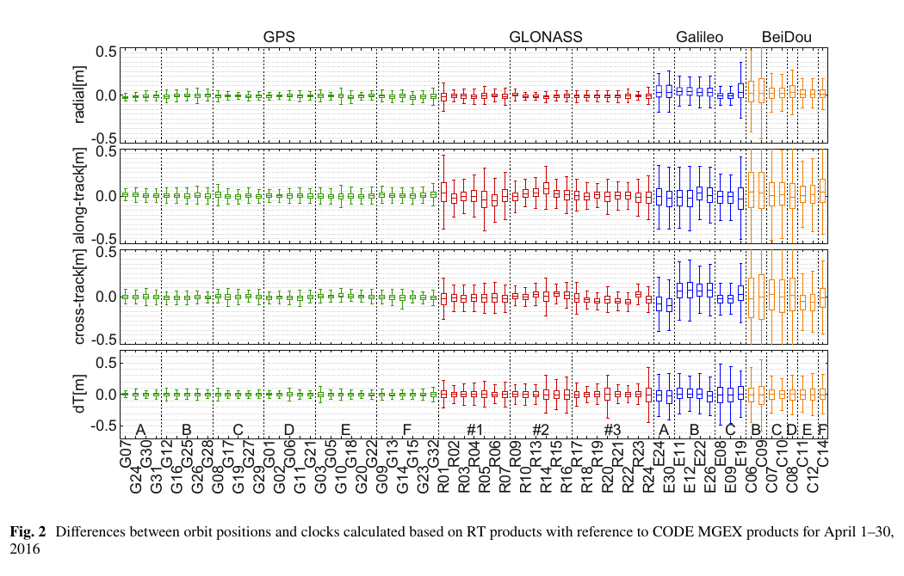
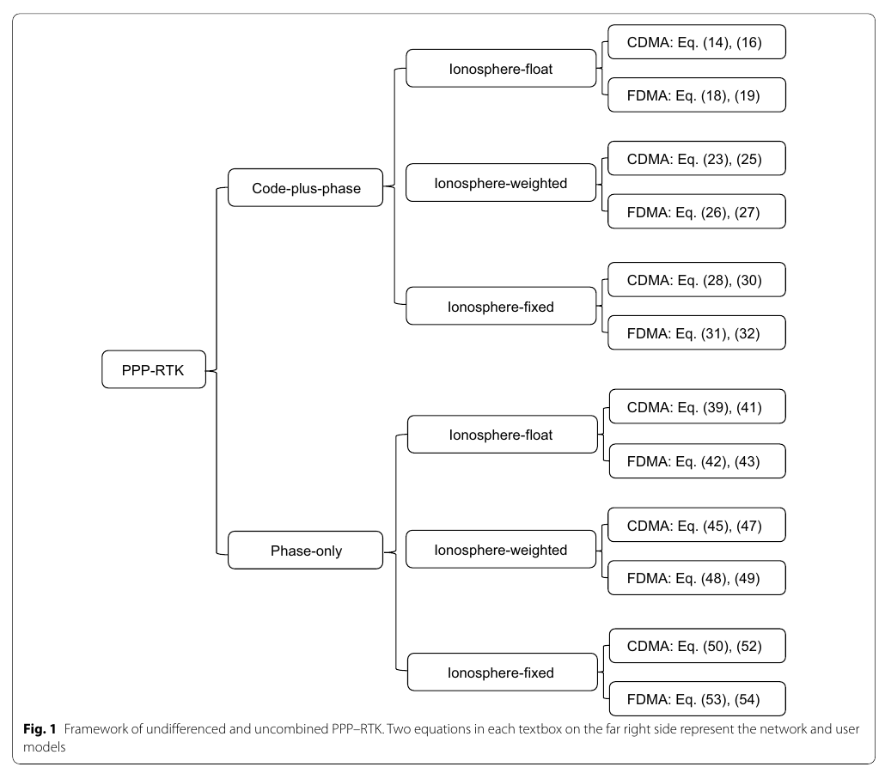
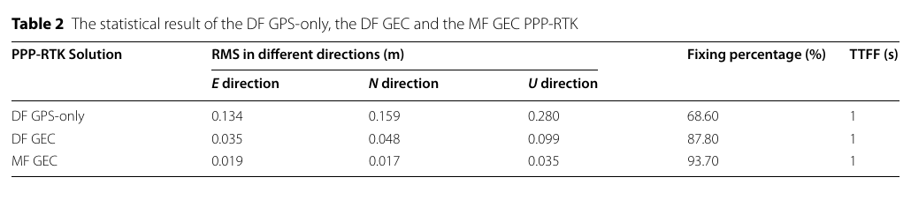

# 2026-10-23 GNSS 每日研究简报

## 今日快报

### 快报 1：Galileo HAS 落到紧凑接收机：公开改正可测，但厂商结果仍需独立复核

- 主题：`galileo-has-mosaic-g5-position-time-performance`
- 来源 ID：`ion:gnss2026-17020`
- 来源链接：https://www.ion.org/gnss/abstracts.cfm?paperID=17020
- 发表日期：2026-09-17
- 来源类型：ION GNSS+ 2026 厂商主导会议论文摘要
- 获取范围：ION 官方摘要；核对 mosaic-G5 固件、Galileo HAS 初始服务改正内容、静态与城市动态测试、RTK 重处理参考和强制重收敛设计，正文与逐项统计未公开

**内容：** Septentrio 团队把 Galileo HAS 的轨道、钟差与码偏差用于 mosaic-G5 双频 PPP，并以同一模块的单频 SPP 为对照。静态开阔地和城市/半城市动态段分别评估位置、授时、可用性与收敛；参考轨迹由 RTK 重处理后再从 ETRF2000 转到 ITRF2014，重启试验则反复强制 PPP 重新收敛。

**结论：** 摘要说明初始服务通常需要约 10 min 让浮点模糊度与方差收敛，并称论文会量化 HAS 带来的位置与授时改进；但摘要没有公布误差分位数、重启次数或城市长尾。2027 年预期加入相位偏差属于服务计划，不是本文已经验证的 PPP-AR 能力；结果又由接收机厂商给出，不能替代独立多设备复测。

**关注理由：** 免费 SSR 改正只有经过接收机观测模型、时间基准和中断恢复链路才会变成用户性能。工程验收应把“改正收到”“滤波收敛”“真实误差达标”和“授时连续”拆开记录，而不是只看 HAS 状态位。

### 快报 2：专用 LEO-PNT 怎样改变 PPP 收敛：几何更快变化不等于已有星座已达标

- 主题：`leo-pnt-constellation-ppp-convergence-evolution`
- 来源 ID：`ion:gnss2026-17033`
- 来源链接：https://www.ion.org/gnss/abstracts.cfm?paperID=17033
- 发表日期：2026-09-18
- 来源类型：ION GNSS+ 2026 企业主导会议论文摘要
- 获取范围：ION 官方摘要；核对 Xona Pulsar 四个部署阶段、GPS/LEO+GPS/LEO-only 三类比较、DOP/可用性与两组 PPP 收敛案例，未取得星座参数、误差模型、数值收敛表或实测数据

**内容：** 论文用专用 LEO 导航星座在四个部署阶段比较可见性与 DOP，并把 GPS、LEO 增强 GPS、独立 LEO 三种模式送入两类 PPP 收敛试验。重点不是简单增加卫星数，而是讨论 LEO 快速几何变化如何改变传统以 MEO 为背景的收敛评价方法。

**结论：** 官方摘要只称会展示 LEO 动力学对 PPP 收敛的影响，没有给出分钟数、误差门槛或置信区间。因此现阶段能确认的是评估框架与企业案例，不是对未来完整星座的独立实测证明；在轨信号、轨钟产品质量和用户噪声若尚未闭环，DOP 改善不能直接等同于厘米级可用。

**关注理由：** LEO 的价值可能来自更快的几何可观测性，但其轨道钟差、频繁切星和多普勒动态也会进入估计器。设计仿真时应同时报告真实产品误差、切换成本与位置门槛下的持续收敛，而非只报瞬时 DOP。

### 快报 3：无人机协作叠加 LEO-PNT：仿真能压住失锁，但父机本身仍是单点条件

- 主题：`leo-pnt-cooperative-uav-navigation-hil`
- 来源 ID：`ion:gnss2026-16980`
- 来源链接：https://www.ion.org/gnss/abstracts.cfm?paperID=16980
- 发表日期：2026-09-18
- 来源类型：ION GNSS+ 2026 学术会议论文摘要
- 获取范围：ION 官方摘要；核对父机—子机领导式协作、城市 NLOS 卫星剔除、GNSS+LEO-PNT 伪距、协作测量、EKF/GDOP 与硬件在环验证，未取得误差曲线、链路模型与绝对定位指标

**内容：** 受遮挡的“子机”把可见 GNSS/LEO-PNT 伪距与一架或多架“父机”的协作量测送入 EKF。作者先以城市几何预测剔除 NLOS 卫星，再用广义 DOP 为父机规划轨迹；验证由能复现专用 LEO-PNT 导航电文的硬件在环引擎完成。

**结论：** 摘要称协作能约束因可见卫星不足造成的定位中断，加入 LEO-PNT 在没有协作时也有帮助；但没有给出误差界、父子测距偏差或通信丢包条件。证据属于仿真与硬件在环，不是城市实飞；父机位置、时间同步或链路一旦共同失效，所谓几何增益可能同时消失。

**关注理由：** 协作定位不能只把父机当作“额外卫星”。应将父机状态协方差、链路时延和相关误差显式传入子机，否则 GDOP 看似改善，滤波器却会重复计算同一 GNSS 信息。

### 快报 4：气球在同频干扰下追踪 7 个 5G 基站：11.1 m 结果是混合 PNT，不是纯 5G

- 主题：`cognitive-5g-aerial-navigation-cochannel-interference`
- 来源 ID：`ion:gnss2026-17180`
- 来源链接：https://www.ion.org/gnss/abstracts.cfm?paperID=17180
- 发表日期：2026-09-16
- 来源类型：ION GNSS+ 2026 学术会议论文摘要
- 获取范围：ION 官方摘要；核对盲估周期信标、同频干扰约束优化、6,122–13,475 ft 气球试验、7/2 基站对照、1.343 km 航段与 EKF/高度计结果，正文未取得

**内容：** 接收机不只使用常开参考信号，而是在只知道帧长的条件下盲估所有周期序列，形成带宽和资源单元更大的“认知信标”；随后用约束优化抑制同频干扰。气球平台把 7 个 gNB 的伪距与高度计送入 EKF，和文献中的常规接收机以及高度计单独解比较。

**结论：** 摘要报告在 6,122–13,475 ft 高度追踪 7 个基站，而被引常规接收机为 2 个；1.343 km 航段的三维 RMSE 为 11.1 m，高度计单独解为 197.6 m。比较对象来自不同研究且最终解融合了高度计，所以数字不能被改写为“纯 5G 达到 11.1 m”，也没有证明对不同网络调度和基站时钟仍成立。

**关注理由：** 这项工作展示了从通信波形里扩大可测信标的接收机思路。与 GNSS 融合时，应特别保留 5G 基站时钟、NLOS 和高度计相关误差，避免把更多可跟踪源误当成更多独立信息。

### 快报 5：Galileo H-ARAIM 用 9.5 年监测更新先验：异常反应与广播 ISM 同样重要

- 主题：`galileo-haraim-long-term-performance-ism`
- 来源 ID：`ion:gnss2026-16820`
- 来源链接：https://www.ion.org/gnss/abstracts.cfm?paperID=16820
- 发表日期：2026-09-16
- 来源类型：ION GNSS+ 2026 ESA/EUSPA/EC/产业联合官方会议论文摘要
- 获取范围：ION 官方摘要；核对 9.5 年 URA/BGD 包络、Psat/Pconst 目标、2025 年 7 月 GSAT0101 异常反应、最终 ISM 设计及 E1B I/NAV 容量，未取得完整尾部分布与认证材料

**内容：** 联合团队延长 Galileo 面向 H-ARAIM 的性能观测期，重新审计 URA 与广播群延迟误差包络、卫星/星座故障先验以及系统对 SIS 异常的反应；另一部分给出已进入 OS SIS-ICD 的 ISM 最终消息类型，并说明 E1B I/NAV 每 30 s 一个 128 bit 字的流还能承载其他星座 ISM。

**结论：** 摘要称 9.5 年数据继续满足 Galileo SARPs 目标，且 2025 年 7 月 GSAT0101 异常被快速处置，使用户没有观察到实际 SIS 故障状态。这里的“未观察到”是系统反应结果，不是故障不存在；完整性参数仍需按定义、监测覆盖和认证流程使用，摘要也不足以重建极低概率尾部。

**关注理由：** ARAIM 的输入不只是一个静态故障概率表。长期实绩、告警反应时间与 ISM 新鲜度共同决定保护级是否可信；实现方应记录消息龄期与状态切换，而不能在 ISM 中断时继续沿用旧先验。

## 深度研读

### 深读 1｜接收机工程｜PPP 的地基会动：实时轨道钟产品怎样把星座差异带进用户解

- 类别：`receiver-engineering`
- 学习层级：`foundation`
- 选题定位：`经典基础：先把实时 SSR 轨道与钟差当成待验证观测源，而不是 PPP 法方程中的无误差常数`
- 来源 ID：`doi:10.1007/s10291-017-0678-6`
- 来源链接：https://doi.org/10.1007/s10291-017-0678-6
- 发表日期：2017-11-06
- 来源类型：GPS Solutions 同行评审开放论文
- 获取范围：CC BY 4.0 全文；2016 年 4 月 CNES 实时多 GNSS 改正、CODE 最终产品、连续轨道拟合、SLR、MDEV 与 11 站 PPP 验证已核对
- 价值评分：96/100（相关性 20，经典价值 19，证据 20，教学价值 19，工程价值 18）

#### 为什么先学这个

PPP 常把精密轨道和钟差作为已知输入，用户却会把它们的误差原样投影到测距。本文同时用最终产品、连续动力学轨道、卫星激光测距和钟稳定度四种尺子审计实时改正，再把产品送进静态/运动 PPP；它提醒我们，在讨论模糊度和大气之前，先要确认“卫星端真值”是否够稳、够连续且与广播星历 IOD 匹配。

#### 先修知识

需要理解广播星历、SSR 轨道/钟差改正、Issue of Data（IOD）、卫星径向/沿轨/横轨坐标系、伪距、PPP、CODE/MGEX 最终产品、SLR、标准差和修正 Allan 偏差。还应区分产品精度、产品可用性、形式协方差与用户坐标误差。

#### 一句话逻辑

把同一时刻的实时轨道钟与独立或更迟生成的参考产品对齐，分解误差、检查断点与频率稳定度，最后用一致 PPP 引擎验证这些差异如何进入用户解。

#### 研究问题与约束

作者评估 CNES 在 2016 年 4 月 1–30 日提供的 GPS、GLONASS、Galileo、BeiDou 实时改正。比较基准是 CODE MGEX 最终产品；BeiDou GEO 因参考产品质量限制未进入同类最终轨道比较。数据仅覆盖一个月、当时的新星座规模和旧版 BNC/产品生成链，不能直接代表 2026 服务；最终产品也不是绝对真值，因此另用 SLR 与连续轨道拟合交叉检查。

#### 核心方法论

先用 IOD 把实时改正与正确的广播星历配对，统计每星可用率。轨道每 15 min 转到径向、沿轨、横轨三分量，与 CODE 比较；钟差按星座逐历元去中位数以消除公共基准，再以 2.5 倍标准差剔除离群。第二条证据链用 ECOM2 把每日位置拟合为连续轨道，寻找预测段交界跳变；第三条用 SLR；第四条以 MDEV 看 30–43,800 s 时间尺度的钟稳定度。最后在 11 个 IGS 站运行五种星座组合 PPP。

#### 关键公式逐步推导

设实时产品相对参考的卫星位置误差在径向、沿轨、横轨基底中为：

```math
\delta r^s=\delta R\,e_R+\delta A\,e_A+\delta C\,e_C.
```

对用户—卫星视线单位向量 $`u`$ 线性化，轨道与钟差对单程测距的贡献近似为：

```math
\delta\rho^s\approx-u^T\delta r^s+c\,\delta t^s.
```

因此三维轨道 RMS 可写成：

```math
RMS_{3D}=\sqrt{RMS_R^2+RMS_A^2+RMS_C^2}.
```

这是本文分量统计到用户测距的工程化串联；实际坐标还会经卫星几何、权重与钟基准共同映射，不能把 $`RMS_{3D}`$ 直接当成位置 RMS。

#### 经典价值与创新边界

经典价值是把“实时产品质量”拆成可用性、外部一致性、动力学连续性、SLR 独立性、钟稳定度和用户定位六层，而不是只给一个轨道 RMS。创新边界是结果属于 2016 年 CNES 流与当时星座；2.5 倍标准差清洗会弱化尾部，CODE 与 CNES 之间的模型差异也不全等于实时产品错误。

#### 整体逻辑链

改正流先通过 IOD 找到广播星历；由广播轨道加 SSR 得到实时卫星状态；与最终产品比较分量误差；用连续轨道和 SLR判断差异是否源于断点或参考模型；用 MDEV看钟随时间尺度的稳定性；最后让同一 PPP 引擎比较星座组合。下一节再问：即使产品正确，哪些钟、硬件偏差、模糊度与大气量真正可估？

#### 原文图表与结果分析



> 图表源：Kazmierski、Sośnica 与 Hadas《Quality assessment of multi-GNSS orbits and clocks for real-time precise point positioning》Figure 2，[CC BY 4.0 开放全文](https://doi.org/10.1007/s10291-017-0678-6)。本地资产以 Poppler 150 dpi 渲染 PDF 第 4 页并最小裁出原图与图注，未改动箱线、星号、颜色、坐标轴、星号分组或数值。

四行依次是径向、沿轨、横轨与钟差 $`dT`$，单位均为 m；横轴按 GPS、GLONASS、Galileo、BeiDou 及其轨道面/类型排列。GPS 箱体最紧，Galileo 与 BeiDou 尤其沿轨/横轨更宽；图直接显示的是实时—CODE 差异分布，不等于任何一方相对绝对真值的误差，也不能从箱线图单独推出用户位置分位。

#### 原文结果论述

论文摘要给出的三维轨道 RMS 为 GPS 5 cm、GLONASS 10 cm、Galileo 18 cm、BeiDou MEO 18 cm、BeiDou IGSO 36 cm，BeiDou GEO 超过 1 m。正文按分量统计得到 GPS 约 2.3/3.2/2.8 cm，整体可用率中位数在排除 BeiDou 后约 90%。11 站 PPP 表明增加星座通常降低形式误差，但坐标偏差有时反而变大，说明“卫星更多”改善几何却不会自动消除产品系统差。

#### 常见误区与适用边界

第一，最终产品不是无误差真值。第二，钟差必须先统一基准，不能直接比较绝对常数。第三，IOD 错配会伪造巨大产品误差。第四，径向误差通常比沿轨更直接投影到测距，但取决于几何。第五，可用率 90% 不代表连续运行 90%。第六，形式误差下降不等于真实偏差下降。第七，一个月统计不能覆盖太阳活动、机动和软件升级尾部。

#### 工程实现步骤

1. 逐条记录改正流的星座、PRN、IOD、历元、龄期和接收时间。
2. 用相同广播星历分别形成“仅广播”和“广播+SSR”卫星状态。
3. 将产品差转入径向/沿轨/横轨，钟差按星座去公共基准。
4. 同时报连续缺口、跳变、RMS、95/99 分位和最大值，不只做均方统计。
5. 对有反射器卫星用 SLR 或第三方产品交叉检查。
6. 在统一 PPP 配置下比较单星座与多星座，并把真实偏差和形式协方差并报。

#### 复现实验设计

取 IGS RTS 中两个实时流与同分析中心最终产品连续 30 天，采样 15 min；至少覆盖 GPS/Galileo/BDS MEO。基线为广播星历和最终产品 PPP，测试为两个实时流。指标包括改正可用率、最大连续缺口、R/A/C 与钟差 RMS/95/99 分位、预测段边界跳变，以及 10 个 MGEX 站静态/仿运动 PPP 的 ENU RMS 和形式误差覆盖率。失败用例包括故意错配一次 IOD、延迟改正 5/30/120 s、删去某星座 20 min 和保留未清洗离群，检查监控器能否定位故障层级。

#### 与定位及低成本实现的联系

低成本接收机无法靠更复杂滤波修复错误的卫星状态。它应把改正龄期、IOD 一致性与星座级质量标志送入权重和降级逻辑；当某星座产品变差时，宁可回退到广播解或移除该星座，也不要因卫星数增加而继续给出过小协方差。

#### 本节小结

PPP 的“精密”首先来自可审计的轨道钟产品。本文证明不同星座、轨道类型和时间尺度的产品质量并不等价，而且几何改善与真实偏差改善可能分离；用户引擎必须把产品当作带状态与不确定度的输入。

### 深读 2｜接收机工程｜不是每个参数都能单独估：UDUC PPP-RTK 怎样用 S-basis 把秩亏写成可用改正

- 类别：`receiver-engineering`
- 学习层级：`intermediate`
- 选题定位：`基础进阶：从未差未组合码相观测的秩亏出发，统一代码+相位/纯相位、三类电离层约束和 CDMA/FDMA 网络—用户模型`
- 来源 ID：`doi:10.1186/s43020-022-00064-4`
- 来源链接：https://doi.org/10.1186/s43020-022-00064-4
- 发表日期：2022-02-14
- 来源类型：Satellite Navigation 同行评审开放理论论文
- 获取范围：CC BY 4.0 全文；码+相位/纯相位、ionosphere-float/weighted/fixed、CDMA/FDMA、S-basis 可估参数与网络—用户模型已核对
- 价值评分：98/100（相关性 20，经典价值 20，证据 19，教学价值 20，工程价值 19）

#### 为什么先学这个

上一节把轨道钟当成外部产品，但 PPP-RTK 还要从网络生成卫星钟、码/相位偏差和大气改正。原始参数彼此可吸收：换一个钟基准、把硬件偏差搬进模糊度，观测可能完全不变。本文用 S-basis 明确哪些组合可估，再从网络模型推出单用户模型，是避免“输出了一个变量名，就以为它有物理唯一性”的关键一步。

#### 先修知识

需要理解未差未组合码和载波相位、接收机/卫星钟、码偏差、相位偏差、整数模糊度、斜电离层、对流层、设计矩阵秩、零空间、基准选择、CDMA 与 GLONASS FDMA 的频间偏差。

#### 一句话逻辑

先写出保留所有频点的原始观测模型，找出使观测不变的参数方向，再选 S-basis 固定这些自由度；网络端发布的不是“原始真参数”，而是与同一基准一致、能让用户恢复整数性的可估组合。

#### 研究问题与约束

论文系统整理 PPP-RTK 函数模型，不做真实车辆精度竞赛。它覆盖代码+相位与纯相位两大类，各自再分电离层浮点、加权和固定，并兼顾 CDMA/FDMA。随机模型、动态模型、海量网络计算效率和单频模型不在主要范围；因此框架能判断可估性与相容性，却不会自动给出最优权重或实际收敛时间。

#### 核心方法论

对网络中每个接收机、卫星和频点写 OMC 码/相位期望，保留对流层、钟、电离层、接收机/卫星码偏差、相位偏差和整数模糊度。构建设计矩阵后，以 S-basis 消除秩亏并列出可估参数。随后根据网络尺度给电离层零约束、加权约束或自由估计，并分别推导 CDMA/FDMA；把网络端可估改正施加给单接收机，即得到用户模型。纯相位分支用于减弱严重码多路径和接收机异构码 IFB。

#### 关键公式逐步推导

简化的未差未组合码、相位 OMC 期望可写为：

```math
E[p_{r,j}^{s}]=m_r^s\tau_r+dt_r-dt^s+\mu_j\iota_r^s+d_{r,j}^s-d_j^s,
```

```math
E[\phi_{r,j}^{s}]=m_r^s\tau_r+dt_r-dt^s-\mu_j\iota_r^s+\delta_{r,j}^s-\delta_j^s+\lambda_j^s z_{r,j}^s.
```

堆叠后有 $`E[y]=Ax`$。若存在非零矩阵 $`D`$ 使 $`AD=0`$，则 $`x`$ 与 $`x+D\alpha`$ 对任意 $`\alpha`$ 给出同样观测，原参数不可唯一估计。S-basis 相当于选定一组基准参数，把其自由度吸收到剩余参数中，形成满秩模型：

```math
E[y]=\widetilde A\,\widetilde x,\qquad rank(\widetilde A)=dim(\widetilde x).
```

关键不在“把某个偏差设为零”的名字，而在网络与用户必须采用兼容基准，且可估模糊度保持整数可固定的结构。

#### 经典价值与创新边界

价值在于用一个框架串起许多看似不同的 PPP-RTK 模型，并明确网络规模、电离层约束和多址方式如何改变可估参数。边界是 S-basis 解决代数不可辨识，不解决模型遗漏、产品延迟、重尾噪声或错误固定；纯相位虽避开码误差，也会让电离层浮点模型增加额外秩亏、模型强度变弱。

#### 整体逻辑链

原始码相方程保留全部偏差；设计矩阵暴露零空间；S-basis 选基准形成可估参数；网络尺度决定电离层 float/weighted/fixed；信号体制决定 CDMA/FDMA 偏差结构；代码质量决定 code-plus-phase 或 phase-only；同一基准下把网络改正送到用户端恢复整数性。下一节将把这个函数模型落到多频多星座车辆，观察模型强度怎样转化为固定率。

#### 原文图表与结果分析



> 图表源：Zhang 等《PPP–RTK functional models formulated with undifferenced and uncombined GNSS observations》Figure 1，[CC BY 4.0 开放全文](https://doi.org/10.1186/s43020-022-00064-4)。本地资产以 Poppler 150 dpi 渲染 PDF 第 13 页并最小裁出原图与图注，未改动树形关系、方框、方程编号或标签。

图从 PPP-RTK 分为 code-plus-phase 与 phase-only，两支各含 ionosphere-float、weighted、fixed，再各自分 CDMA/FDMA；最右侧成对方程分别对应网络和用户模型。它展示分类与公式映射，不是性能排名；不能从树的位置推断 fixed 永远优于 weighted，也不能认为 phase-only 在所有场景更强。

#### 原文结果论述

作者总结：代码+相位模型通常比纯相位更强，但当未建模码误差严重时，纯相位可能更好；电离层加权强于浮点，固定最强，但只有小网且各站大气近似一致时固定模型才不偏。中型网更适合加权约束，大型网的约束效率下降而趋向浮点。FDMA 定整比 CDMA 更难，需要整数可估理论处理频间偏差，而不是直接套用双差整数。

#### 常见误区与适用边界

第一，卫星钟、相位偏差和模糊度的原始值通常不可分别估。第二，不同分析中心产品名字相同也未必同基准。第三，电离层 fixed 是物理假设，不是免费增强。第四，phase-only 会牺牲部分模型强度。第五，GLONASS FDMA 不能忽略接收机间 IFB。第六，满秩只说明可解，不说明无偏或可靠。第七，函数模型完整不等于随机模型正确。

#### 工程实现步骤

1. 按系统/频点列出每个钟、码偏差、相位偏差、电离层与模糊度的符号和单位。
2. 自动构建设计矩阵并数值/符号检查秩与零空间维数。
3. 明确 S-basis 选择，写入产品元数据而非隐藏在代码常量中。
4. 为小/中/大网分别配置电离层 fixed/weighted/float，并验证偏差。
5. CDMA 与 FDMA 分开建模接收机频间偏差。
6. 用同一基准生成网络改正和用户方程，做闭环零基线与异构接收机测试。

#### 复现实验设计

构造 6 星、3 频、4 站网络，分别模拟 20/80/300 km 尺度；码噪声 0.3 m、相位噪声 0.003 m，给中大网注入空间电离层梯度，并给一台接收机注入频率相关码 IFB。比较 code+phase 与 phase-only、float/weighted/fixed，以及 CDMA 与仿 FDMA。指标为设计矩阵秩、零空间维数、可估参数闭合误差、ADOP、正确固定率和坐标偏差；基线为不做 S-basis 的伪逆解。失败用例包括网络/用户基准不一致、把中网强制设为电离层 fixed、删除码观测及遗漏 IFB。

#### 与定位及低成本实现的联系

低成本多频芯片常有严重码多路径、频间偏差和不同固件平滑。统一框架允许在代码质量差时切到 phase-only 或降低码权，却必须接受初始模型变弱；服务端还应发布基准与信号定义，否则用户即便“收到 OSB”也可能恢复不了相同的整数模糊度。

#### 本节小结

PPP-RTK 产品本质上是可估组合，不是所有物理参数的独立真值。S-basis 把秩亏显式化，电离层约束与多址方式决定模型强度；只有网络和用户共享同一参数化，快速定整才有代数基础。

### 深读 3｜定位｜从 EWL 到 L1 逐级收口：多频多星座 PPP-RTK 怎样在车载遮挡后重新定整

- 类别：`positioning`
- 学习层级：`advanced`
- 选题定位：`工程前沿：把 UDUC 网络改正、区域大气约束和 EWL→WL→L1 级联部分固定送进纯 GNSS 车辆，审计郊区与隧道场景的收益和边界`
- 来源 ID：`doi:10.1186/s43020-022-00068-0`
- 来源链接：https://doi.org/10.1186/s43020-022-00068-0
- 发表日期：2022-04-11
- 来源类型：Satellite Navigation 同行评审开放实验论文
- 获取范围：CC BY 4.0 全文；29 站偏差网、10 站约 30 km 大气网、2021-03-18 车辆、GPS/Galileo/BDS 多频、Table 1–5 与 Figures 1–11 已核对
- 价值评分：99/100（相关性 20，经典价值 19，证据 20，教学价值 20，工程价值 20）

#### 为什么先学这个

前两节分别保证外部产品可用、函数模型可估，本节才谈“快固定”。多频信号提供长波长 EWL/WL，多星座改善几何，区域网提供电离层/对流层先验；级联固定把容易的长波长整数先作为强约束，逐步缩小 L1 搜索空间。车辆穿过路牌、楼群、高架和隧道，正好检验失锁后能否重新建立这一链条。

#### 先修知识

需要理解 UDUC PPP-RTK、UPD/相位偏差、区域电离层与对流层改正、EWL/WL/NL 线性组合、LAMBDA/部分模糊度固定、IFCB、仰角定权、TTFF、固定率以及 GNSS 与 PPK/INS 参考轨迹的非独立性边界。

#### 一句话逻辑

网络端连续估计 UPD 与大气改正，用户先固定长波长 EWL、再固定 WL、最后把约束送回原始模型固定 L1；多星座和多频同时增加几何与整数冗余，使遮挡后更快重建固定解。

#### 研究问题与约束

试验在 2021-03-18 01:32–05:14 GPST 进行，车辆装 NovAtel OEM729、Trimble AT1675-540TS 和战术 IMU；29 个华北站估 UPD，10 个约 30 km 间距站给大气改正。服务端 5 s、用户 1 s，截止角 7°、少于 4 星剔除。结果来自一条地区网络和一次车辆活动，参考是同车 PPK/INS，不能外推到手机天线、不同纬度电离层或独立道路总体。

#### 核心方法论

服务端按 GPS L1/L2/L5、Galileo E1/E5a/E5b/E5/E6、BDS B1I/B2I/B3I 处理原始观测，估计多频 UPD、IFCB、斜电离层和湿对流层；用户用 CODE 轨道钟、天线改正和区域大气约束做逐历元序贯最小二乘。模糊度按 EWL→WL→L1 级联部分固定，已经固定的组合以近零方差虚拟观测返回滤波。对照包括双频 GPS-only、双频 GPS+Galileo+BDS（GEC）和多频 GEC。

#### 关键公式逐步推导

对两个频点 $`i,j`$，宽巷型组合的有效波长为：

```math
\lambda_{ij}=\frac{c}{|f_i-f_j|},
```

频率越接近，$`\lambda_{ij}`$ 越长，整数判别更容易但组合噪声与偏差也会被放大。若某级整数估计 $`\widehat N_{ij}`$ 通过检验，就作为强约束加入：

```math
l_N=\lambda_{ij}\widehat N_{ij}=\lambda_{ij}N_{ij}+\varepsilon_N,
\qquad \sigma_N^2\rightarrow 0.
```

级联过程可概括为：

```math
EWL\ fixed\Rightarrow WL\ search\ space\downarrow
\Rightarrow WL\ fixed\Rightarrow L1\ search\ space\downarrow.
```

近零方差只适用于通过可靠验证的整数；一旦前级错固定，错误也会被当成强约束向后传播。

#### 经典价值与创新边界

价值在于把服务器改正、级联部分固定和真实车辆场景完整串联，并用 GPS-only/多星座/多频逐层消融。边界是方法依赖密集约 30 km 区域网、专业天线和 CODE 精密产品；固定率按该数据与门槛定义，且作者的 TTFF 要求连续 5 s 水平小于 5 cm、垂向小于 10 cm，不等于每次重启都在 1 s 内可靠固定。

#### 整体逻辑链

29 站估相位偏差；10 站生成区域大气；用户改正轨道钟、天线、IFCB；长波长 EWL 先固定；虚拟约束收紧 WL；WL 再收紧 L1；部分固定避免坏模糊度拖累全组；逐历元输出车辆坐标；以 PPK/INS 比较 ENU、固定率、TTFF 和遮挡后重收敛。三篇精读由此闭环：产品质量→可估参数→车载定整。

#### 原文图表与结果分析



> 图表源：Li 等《Principle and performance of multi-frequency and multi-GNSS PPP-RTK》Table 2，[CC BY 4.0 开放全文](https://doi.org/10.1186/s43020-022-00068-0)。本地资产以 Poppler 150 dpi 渲染 PDF 第 7 页并最小裁出完整原表，未改动行列、缩写、单位、百分数或数值。

表中 DF GPS-only 的 E/N/U RMS 为 0.134/0.159/0.280 m，固定率 68.60%；加入 Galileo+BDS 后 DF GEC 降为 0.035/0.048/0.099 m、87.80%；MF GEC 为 0.019/0.017/0.035 m、93.70%。三者 TTFF 均列为 1 s，但这受论文连续 5 s 达到 5/10 cm 门槛的定义和所选郊区时段约束；表不能证明隧道内有解，也不能分离多星座几何与额外频率的全部因果。

#### 原文结果论述

大气交叉验证中 GPS/Galileo/BDS 斜电离层差 RMS 分别为 0.010/0.008/0.006 m，天顶湿延迟差为 0.004 m。按 Table 2 数字计算，郊区 MF GEC 相对 DF GPS-only 的 E/N/U RMS 改善约 85.82%/89.31%/87.50%，固定率升至 93.70%。城市第二试验中 MF GEC 相对双频 GEC 把 E/N/U RMS 从 0.217/0.217/0.346 m 降到 0.040/0.052/0.134 m，固定率从 62.66% 升到 83.94%。这些是作者单次数据集结果，不是普适保证。

#### 常见误区与适用边界

第一，多频不是独立无相关观测，IFCB 必须处理。第二，EWL 易固定不代表窄巷一定正确。第三，固定率是状态比例，不是正确固定率。第四，隧道完全遮挡时纯 GNSS 没有位置更新。第五，30 km 网络的大气精度不能外推到稀疏网。第六，专业天线结果不能直接搬到手机。第七，PPK/INS 参考与被测 GNSS 可能共享卫星端误差。第八，TTFF 定义不同不能横向混比。

#### 工程实现步骤

1. 服务端以统一基准生成轨道钟、码/相位 OSB/UPD、IFCB 和大气改正及其方差。
2. 用户按改正龄期、星座、频点和仰角做完整性检查与定权。
3. 为 EWL、WL、L1 分别构造候选与成功率/ratio 门限，先部分固定高质量子集。
4. 每次把固定整数回灌前检查残差与独立验证，错固定立即解锁整条级联链。
5. 记录遮挡开始/结束、卫星数、PDOP、固定连续时长和每次重初始化。
6. 在完全失锁时显式输出 GNSS 不可用，若需连续导航再引入 IMU，但不要把融合结果写成纯 GNSS。

#### 复现实验设计

在 20–40 km CORS 网内选 60 min 郊区与 60 min 城市车辆数据，1 Hz 用户、5 s 改正、7° 截止；比较 DF GPS-only、DF GEC、MF GEC，并增加“无大气约束”和“只固定 EWL/WL”消融。指标为 E/N/U RMS、95/99 分位、正确/错误固定率、连续固定时长、TTFF、遮挡后重固定时间和改正带宽。参考用独立双天线 PPK/INS。失败用例包括删去相位偏差 30 s、给电离层改正加 2/5 cm 梯度、注入一频 IFCB、完全遮挡 45 s 和错误 EWL 候选，检查门控能否拒绝错误而非只提高固定率。

#### 与定位及低成本实现的联系

多频多星座最适合解决低成本接收机的频繁失锁与几何突变，但廉价天线会带来更强码多路径、频间群延迟与相位中心变化。落地时应先复现 DF→MF 的消融，并以错误固定率和尾部误差验收；若只看固定标志，级联算法可能把前级错误放大成更稳定的错误坐标。

#### 本节小结

级联定整的力量来自三件事同时成立：可用且同基准的服务端产品、匹配网络尺度的大气约束、通过验证的长波长整数。多频多星座在本文车辆上显著提高精度与固定率，但隧道、错改正和错误固定仍要求明确降级。
