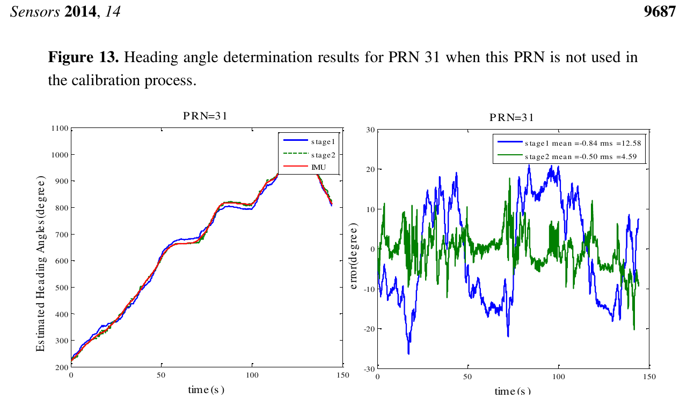
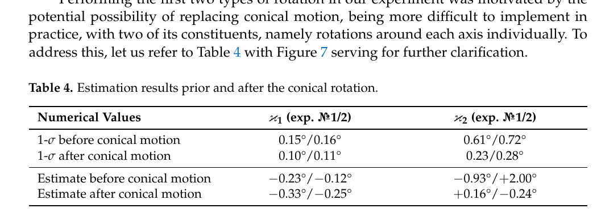
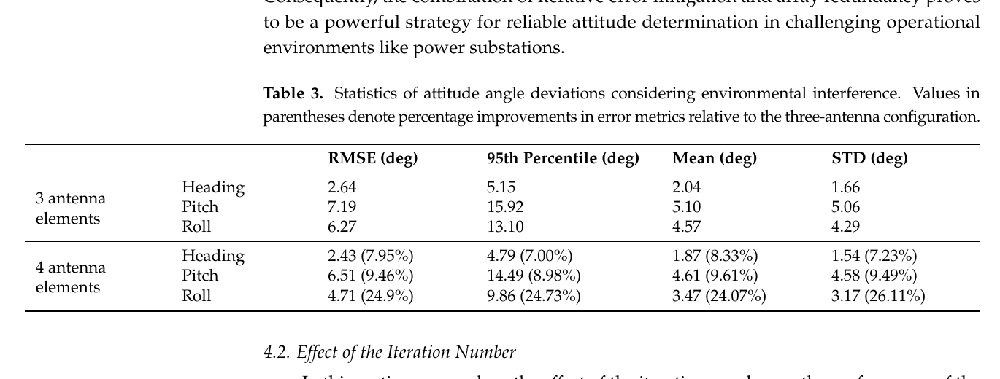

# 2026-10-24 GNSS 每日研究简报

## 今日快报

### 快报 1：把衍射从误差变成尺子：手机 C/N0 可给楼边位置与屋顶高度米级约束

- 主题：`gnss-diffraction-lod1-building-edge-renewal`
- 来源 ID：`doi:10.33012/2026.20712`
- 来源链接：https://doi.org/10.33012/2026.20712
- 发表日期：2026-10-07
- 来源类型：ION GNSS+ 2026 同行评审会议论文
- 获取范围：ION 官方摘要、完整书目信息与参考文献；核对几何约束候选边、Fermat 衍射点、UTD 前向 C/N0、仿真可分性与真实手机可行性结论，论文正文需 ION 下载权限，未取得候选格距、手机型号、样本规模或误差分布

**内容：** 既有 3DMA-GNSS 通常把三维楼模当已知先验，本文反过来问：若楼边位置或屋顶高度有误，衍射 C/N0 的方向性响应能否帮助更新 LOD1 模型。方法先用旧模型限定立面方向和候选搜索区，再按 Fermat 原理求各候选边的衍射点，用一致绕射理论（UTD）生成 C/N0 响应，最后把模拟与手机观测做候选级评分。

**结论：** 官方摘要报告，不同候选楼边在仿真中产生可区分的衍射 C/N0 模式，真实手机试验也支持对竖直边水平位置与水平屋顶边高度给出候选级、米级约束。这里的“米级”是作者摘要中的可行性描述，不是公开了 RMSE、置信区间或城市级成功率；方法依赖已有粗模、可识别的代表性衍射几何与 UTD 模型，不能据此宣称可从零重建整栋建筑。

**关注理由：** 城市 GNSS 的非视距信号不一定只能剔除。若传播特征能反约束地图，定位系统就可形成“地图帮助观测、观测修正地图”的闭环；工程上仍应把模型更新与独立测绘真值分开验收，防止把天线方向图、人体遮挡或多重反射误写成楼边移动。

### 快报 2：手表周跳先修再入图：2% 注入下比稳健降权少 4.3 cm 三维 RMSE

- 主题：`smartwatch-dia-cycle-slip-repair-fgo`
- 来源 ID：`doi:10.33012/2026.20778`
- 来源链接：https://doi.org/10.33012/2026.20778
- 发表日期：2026-10-07
- 来源类型：ION GNSS+ 2026 同行评审会议论文
- 获取范围：ION 官方摘要、完整书目信息与参考文献；核对 Samsung SM-R940 静态开阔数据、人工周跳注入、DIA 整数修复、TDCP 因子与 FGO 对照结果，论文正文需 ION 下载权限，未取得周跳幅度分布、门限、历元数或动态测试

**内容：** 手表载波相位常见半周模糊度、短弧和周跳。直接删掉坏 TDCP 因子会丢失约束，M 估计只降权又不恢复整数连续性；论文以检测—识别—自适应（DIA）先估计可信整数周跳并修复原始相位，再把修复后的 TDCP 送进因子图优化。

**结论：** 作者在 0.1%、0.2%、0.5%、1% 和 2% 的人工注入率下分别报告 100.00%、100.00%、96.93%、98.08% 和 98.95% 正确修复率。原始开阔数据三维 RMSE 为 1.764 m；在 2% 注入率下，修复法相对 M 估计最多降低 4.3 cm，相对删除受影响 TDCP 因子降低 4.5–6.4 cm。证据来自单款手表、静态开阔数据和人工故障，不能外推到步行动态、真实未知周跳或城市长时失锁。

**关注理由：** “异常处理”不仅是决定删不删观测，也包括能否恢复被破坏的整数结构。对可穿戴设备，正确修复可保留速度与历元间几何约束；但上线门槛应以错误修复率和尾部位置误差为主，而不是只看平均 RMSE 小幅下降。

### 快报 3：人体不是随机噪声：身体相对方位定权让手机 RTK 水平 RMSE 降 17.2%–39.7%

- 主题：`smartphone-body-proximity-transformer-stochastic-model`
- 来源 ID：`doi:10.33012/2026.20779`
- 来源链接：https://doi.org/10.33012/2026.20779
- 发表日期：2026-10-07
- 来源类型：ION GNSS+ 2026 同行评审会议论文
- 获取范围：ION 官方摘要、完整书目信息与参考文献；核对 Calgary 胸前持机步行、Xiaomi 14T Pro 与 Pixel 7 Pro、独立 RTK 参考、逐星逐频 token、Student-t 方差膨胀和留出测试结果，论文正文需 ION 下载权限，未取得路线长度、训练/测试划分数、绝对 RMSE 或跨城市结果

**内容：** 人体会吸收、遮蔽并扰动手机内置天线，后方与后斜方来波即使在开阔环境也可能呈现更低 C/N0 和更大伪距残差。论文把每条星—频码观测编码成 token，由 Transformer 根据身体相对几何、信号质量、跟踪稳定性、残差、历元上下文及信号嵌入预测 Student-t 方差膨胀因子，再用于 SPP、DGNSS 和 RTK 定权。

**结论：** 留出位置域测试中，相对经修订的手机基线模型，水平 RMSE 在 SPP 降低 12.0%–17.8%，DGNSS 降低 29.5%–40.0%，RTK 降低 17.2%–39.7%。这些百分比是两款手机、胸前持机与同城开阔步行条件下的作者结果；摘要没有给绝对误差和跨设备外部验证，因此不能把模型当作任意姿态、口袋或背包场景的通用权函数。

**关注理由：** 手机随机模型若只看仰角和 C/N0，会漏掉“卫星在人体哪一侧”这个可解释变量。相对方位可作为低成本定权特征，但工程部署应先验证身体朝向估计、不同握姿和天线布局的域迁移，否则学习模型可能把设备型号记忆成传播规律。

### 快报 4：载波短时中断不必杀死合成宽带码：有限传播 leveling 项并显式标记

- 主题：`synthetic-meta-signal-carrier-outage-bounded-propagation`
- 来源 ID：`doi:10.33012/2026.20745`
- 来源链接：https://doi.org/10.33012/2026.20745
- 发表日期：2026-10-07
- 来源类型：ION GNSS+ 2026 同行评审会议论文
- 获取范围：ION 官方摘要、完整书目信息与参考文献；核对 Alt-BOC/ACE-BOC 窄带旁瓣合成、载波 leveling 项有限时传播、传播观测标志、STA8600A 实时实现及开阔/城市动态验证，论文正文需 ION 下载权限，未取得传播时限、滤波参数、误差分位数或运行负载

**内容：** 合成 meta-signal 在观测域把多个窄带旁瓣重构为宽带等效伪距，绕开大众硬件的宽射频前端；但经典重构依赖瞬时载波相位，短周跳或衰减会让码仍在而合成观测消失。作者利用重构伪距与原始旁瓣伪距之间的载波 leveling 项短时稳定性，在载波中断期间有限传播滤波估计，并给传播观测显式打标。

**结论：** 官方摘要称，该算法已在 STMicroelectronics STA8600A 四频芯片上实时实现，并在开阔和城市动态数据中提高短时中断期间的合成观测可用性、降低水平误差分位并改善稳健性；摘要没有给具体时限、分位值或偏差增长率，因此不能量化安全传播窗口，也不能把“显式标记”误写成完整性已获保证。

**关注理由：** 这是“连续性与诚实度同时设计”的例子：可以短时保住高精度码，但必须让下游滤波知道观测来自传播而非当前载波。大众接收机落地时，传播时限应由振荡器、动态和历史残差共同约束，超限就降级回原始码而不是继续外推。

### 快报 5：三道零陷也会伤真星：完整双频相位星数从 28 降到 17

- 主题：`analog-crpa-null-measurement-positioning-side-effects`
- 来源 ID：`doi:10.33012/2026.20819`
- 来源链接：https://doi.org/10.33012/2026.20819
- 发表日期：2026-10-07
- 来源类型：ION GNSS+ 2026 同行评审会议论文
- 获取范围：ION 官方摘要、完整书目信息与参考文献；核对低功耗双频模拟 CRPA、静止/移动一至三零陷、1 Hz 四系统观测、码相连续性与单频多星座 SPP 统计，论文正文需 ION 下载权限，未取得干扰功率、零陷轨迹、天线标定或长尾误差

**内容：** CRPA 通过把空间零陷指向干扰源提升抗干扰能力，但阵列权值也会扭曲正常卫星的增益、相位和连续性。论文在无零陷、单零陷、双零陷与三零陷下检查 GPS/GLONASS/Galileo/BDS 的可跟踪性、C/N0、码多路径和载波连续性，并逐历元独立计算首频多星座 SPP。

**结论：** 完整双频相位卫星的历元均值从正常模式 28 颗降到三零陷 17 颗。静止零陷下，正常/一/二/三零陷的水平—垂直 RMS 分别为 1.7/2.3、1.7/2.1、1.5/2.3、3.9/4.6 m；移动零陷则为 2.1/2.3、2.5/3.1、4.0/5.8、3.8/6.0 m。退化并不随零陷数严格单调，且所有测试条件仍有 SPP 解；这不代表载波定整、完整性或未测试干扰方向也可用。

**关注理由：** 抗干扰验收不能只报压制深度。阵列在保护接收机的同时也可能削弱几何和相位连续性；高精度系统应把零陷角距、逐星相位弧、重捕获和位置尾部纳入同一性能账本。

## 深度研读

### 深读 1｜接收机工程｜阵列不先校准，方向就没有物理意义：把固定误差与来波相关误差分开

- 类别：`receiver-engineering`
- 学习层级：`foundation`
- 选题定位：`经典基础：从阵列导向矢量出发，理解线缆、通道、互耦、相位中心与平台散射怎样共同扭曲空间相位，并用两阶段标定恢复可用方向信息`
- 来源 ID：`doi:10.3390/s140609669`
- 来源链接：https://doi.org/10.3390/s140609669
- 发表日期：2014-05-30
- 来源类型：Sensors 同行评审开放论文
- 获取范围：CC BY 开放全文；三天线 GPS L1 共钟采集、战术级 GNSS/INS 参考、两阶段特征分解、方向查表、PRN 排除验证、Figures 1–15 已核对
- 价值评分：96/100（相关性 19，经典价值 19，证据 19，教学价值 20，工程价值 19）

#### 为什么先学这个

多天线定向看似只要比较各通道载波相位，实际相位差还混着线缆长度、RF 通道初相、互耦、阵元位置误差、相位中心变化和平台散射。若这些量没有标定，同一个卫星方向在不同阵元上不会形成理论导向矢量；后续的到达方向、波束形成和航向都只是“带硬件指纹的角度”。本文先把误差拆成一次启动内近似固定的矩阵与随来波方位/高度变化的补偿表，为后两节的坐标系对准和紧凑阵列定向打地基。

#### 先修知识

需要理解复基带 I/Q、载波相位、阵列导向矢量、到达方向（DOA）、天线相位中心、互耦、最小二乘、特征值分解、GNSS 方位/高度角、机体系—ENU 旋转和 C/N0。

#### 一句话逻辑

先用全方向观测估计固定通道矩阵，再按机体系方位—高度格网估计方向相关的幅相补偿；运行时从粗方向选表并迭代修正导向矢量，直到空间相位与卫星几何一致。

#### 研究问题与约束

作者在开阔停车场把三副 Antcom GPS L1 天线、三通道共钟 NI 前端与 NovAtel SPAN LCI 战术 IMU 固装在车辆上，以圆周运动覆盖方位角，并需要相隔足够久的多段采集覆盖不同卫星高度。参考站提供导航比特与差分定位，Inertial Explorer 生成位置、速度和姿态参考。研究只处理 GPS L1 与三阵元实车数据；噪声和载波多路径未显式进入标定模型，完整精度仍受 IMU、同一环境和查表覆盖约束。

#### 核心方法论

接收向量写成理想导向矢量经固定矩阵 $`C`$ 和方向相关对角矩阵 $`P(\Phi,\Lambda)`$ 扭曲后的结果。第一阶段把 $`P`$ 暂置为单位阵，用所有观测估 $`C`$；第二阶段固定 $`C`$，在每个方位—高度格网单元估对角幅相补偿。两步都转成最小特征值对应的特征向量问题。运行时先只用 $`C`$ 给粗导向矢量，从其相位反求机体系视线方向，选取相应 $`P`$ 后重算，循环数次。

#### 关键公式逐步推导

理想情况下，第 $`n`$ 个阵元相对参考阵元的相位由基线 $`r_n`$ 与机体系视线单位向量 $`e^B`$ 决定：

```math
a_n=\exp\left(j\frac{2\pi}{\lambda}(e^B)^Tr_n\right).
```

将硬件与平台误差合入模型：

```math
y_i=C\,P(\Phi_l,\Lambda_k)a_i e^{j\theta_i}+n_i.
```

第一阶段在所有方向上求固定项：

```math
\widehat C=\arg\min_{\|\mathrm{vec}(C)\|=1}\sum_i
\left\|y_i\delta_i^T-Ca_i\right\|^2.
```

第二阶段只使用落入格网 $`(\Phi_l,\Lambda_k)`$ 的观测求 $`P_{lk}`$。运行时以修正后的相位向量 $`\angle\widehat a`$ 反求视线：

```math
\widehat e^B=\frac{\lambda}{2\pi}(T^TT)^{\#}T^T\angle\widehat a,
```

再按 $`\widehat e^B`$ 更新查表单元。这里 $`T`$ 由已知阵元基线组成，$`\#`$ 是伪逆；若阵列几何退化或发生相位包裹，反演仍可能不唯一。

#### 经典价值与创新边界

经典价值是把“标定”从一个黑盒常矩阵拆成固定项与 DOA 相关项，既解释误差来源，也让运行时查表成为可能。创新边界是查表依赖格网分辨率与采样覆盖，且标定期用了高精度 IMU；作者明确没有给独立的按方位/高度标定精度模型，也没有把载波多路径和异方差写入目标函数。

#### 整体逻辑链

已知卫星方向与阵元几何；形成理想导向矢量；全局估固定通道矩阵；按 DOA 格网估幅相补偿；运行时粗估方向；查表迭代；输出校准导向矢量；用未参与标定的 PRN 检验航向；再把同一导向矢量送进波束形成。下一节进一步处理另一个常被忽略的误差：即使阵列内部相位已校准，天线基线坐标系也可能没有与 IMU 轴对齐。

#### 原文图表与结果分析



> 图表源：Daneshmand 等《Precise Calibration of a GNSS Antenna Array for Adaptive Beamforming Applications》Figure 13，[CC BY 开放全文](https://doi.org/10.3390/s140609669)。本地资产以 Poppler 180 dpi 渲染 PDF 第 19 页并最小裁出原图，未改动曲线、图例、坐标轴、单位或数值。

左图横轴为约 0–150 s、纵轴为估计航向角（°），红色 IMU 与绿色二阶段结果比蓝色一阶段更贴合；航向跨过 360° 多圈展开到约 200°–1100°，不能把纵轴当成单圈姿态范围。右图直接给误差：只校固定项时均值 −0.84°、RMS 12.58°，加入方向查表后均值 −0.50°、RMS 4.59°。PRN 31 没有参与标定，故比训练内一致性更强；但它仍来自同一平台、场地与采集流程，不能证明跨天或跨安装泛化。

#### 原文结果论述

作者对 PRN 16、30、31 的同次测试报告，精细标定相对只估固定矩阵使与 IMU 的 RMS 一致性改善约 3°–9°；三个卫星间航向一致性约 5°–7°。排除 PRN 31 后重做标定，Figure 13 的二阶段 RMS 为 4.59°，只比包含该 PRN 时的 3.38° 略差。高仰角卫星对水平转动不敏感，低仰角又更受多路径与噪声影响，所以“更多卫星”并不自动等于每颗都提供同样航向信息。

#### 常见误区与适用边界

第一，共钟只消除时钟漂移，不消除通道相位偏置。第二，阵元间距量得准不等于相位中心已知。第三，圆周运动主要覆盖方位角，完整高度覆盖需要卫星几何随时间变化。第四，查表可吸收特定场地多路径，未必能迁移。第五，单星航向对卫星方向敏感。第六，本文的航向指标是与 IMU 的一致性，不是绝对真值。第七，标定改善 DOA 不等于已经证明抗干扰零陷深度或定位完整性。

#### 工程实现步骤

1. 固装阵列并测量阵元基线，所有 RF 通道共享参考时钟。
2. 在低多路径场地采覆盖多方位、多高度的原始 I/Q，同时记录参考姿态与天线元数据。
3. 先估固定矩阵 $`C`$，检查不同启动和线缆重接后的稳定性。
4. 按方位—高度建幅相查表，设置每格最少样本数并对空格插值或标记不可用。
5. 运行时先做粗方向反演，再迭代更新查表，监控迭代次数和相位包裹。
6. 留出整颗卫星、另一时段与另一场地做外部验证，并把残差按 DOA 输出。
7. 只有在标定残差满足阈值后，才允许 DOA、波束形成或姿态模块使用该阵列。

#### 复现实验设计

搭建三阵元 L1 共钟阵列，阵元间距约 9 cm，原始数据 5–10 MHz，参考姿态不低于 100 Hz；在开阔场做 3 组 10 min 圆周运动，并隔 2–4 h 重复以改变卫星高度。比较仅固定矩阵、固定矩阵加 10°×5° 查表、加权查表三种方案。指标为留出 PRN 的航向均值/RMS/95 分位、导向矢量相位残差、迭代次数和波束主瓣角误差。失败用例包括重接一根线缆、阵元移动 2 mm、给低仰角加多路径、留空部分格网和引入一周相位包裹。

#### 与定位及低成本实现的联系

低成本阵列的线缆、前端和贴片天线一致性通常更差，不能直接套理想几何。二阶段方法允许把慢变硬件偏差与方向性误差分开维护，但标定成本可能超过接收机本体。实用系统可把出厂暗室/开阔标定作为先验，再用稳定卫星逐步更新固定项；任何在线更新都应设冻结与回退机制，避免把欺骗或临时反射学进标定表。

#### 本节小结

空间相位只有经过标定才对应物理方向。固定矩阵解决“这次启动的通道差”，方向查表解决“从这个方向来时的阵列差”；两者都不替代跨时段、跨场地验证。

### 深读 2｜接收机工程｜两副天线给的是基线，不是机体真轴：圆锥运动怎样让安装失准变得可估

- 类别：`receiver-engineering`
- 学习层级：`intermediate`
- 选题定位：`基础进阶：把双天线 GNSS 基线、MEMS IMU 轴、杠杆臂与毫秒级时间偏差写进同一线性随机估计，理解激励轨迹为何决定失准角能否收敛`
- 来源 ID：`doi:10.3390/s23010077`
- 来源链接：https://doi.org/10.3390/s23010077
- 发表日期：2022-12-21
- 来源类型：Sensors 同行评审开放论文
- 获取范围：CC BY 4.0 全文；23 维状态、位置/多普勒速度量测、时间偏差、圆锥运动仿真、两次手动实验、公开补充 RINEX/IMU 数据、Figures 1–7 与 Tables 1–4 已核对
- 价值评分：97/100（相关性 19，经典价值 19，证据 19，教学价值 20，工程价值 20）

#### 为什么先学这个

上一节把阵列内部相位校准到可解释方向，但车辆控制关心的是机体轴。双天线基线在导航系可给两个姿态角，MEMS IMU 却装在机舱内部，敏感轴可能与设计机体系差 1°–3°。若只在静止状态长期平均，低成本陀螺零偏和不可观方向会混进结果。本文展示真正决定标定成败的是可观测性：分轴摆动看似覆盖多个角度，却不如让杠杆臂同时扫过三维的圆锥运动。

#### 先修知识

需要理解双天线 RTK 基线、机体系/IMU 系/ENU 系、旋转矩阵与小角度近似、杠杆臂速度、惯导误差方程、陀螺与加速度计零偏、Kalman 滤波、时间同步、可观测性与协方差。

#### 一句话逻辑

把安装失准角当常状态，与惯导误差、传感器零偏和 GNSS—IMU 时间差一起估计；设计圆锥运动持续改变杠杆臂在导航系中的投影，让不同失准分量不再彼此混淆。

#### 研究问题与约束

两次实验使用 Javad Prego 接收机与 AirAnt 天线，GNSS 为 10 Hz，AIST-350 热稳 MEMS IMU 为 250 Hz。每次先静置 4 min，再依次做约 6 min 的滚转摆动、约 6 min 的航向摆动与约 6 min 的圆锥运动，各段之间静置 4 min；两根杠杆臂约 0.8 m。两杠杆臂共线且 IMU 点在基线上，使第三个失准分量 $`\kappa_3`$ 不可估；真实安装失准角也没有独立真值，论文只能用两次重复的一致性和预测协方差验证。

#### 核心方法论

作者先用较高阶 Bortz 旋转向量与四阶 Runge–Kutta 积分姿态，避免圆锥运动下简单 Euler 积分制造不服从误差方程的系统偏差。GNSS 位置由伪距、速度由多普勒给出；两天线各自的位置/速度时间差被建模为常状态。小安装转角 $`\kappa_b`$ 把已知机体系杠杆臂变换到 IMU 系，随后在位置和速度残差中线性化。总状态 23 维，并用 Potter 平方根滤波估计。

#### 关键公式逐步推导

小失准下，第 $`k`$ 根机体系杠杆臂 $`\ell_{kb}`$ 到 IMU 系为：

```math
\ell_{kz}\approx (I+[\kappa_b\times])\ell_{kb},\qquad \dot\kappa_b=0.
```

若 GNSS 时间相对惯导偏移 $`\tau`$，一阶展开为：

```math
r_k(t-\tau_{pos,k})\approx r_k(t)-V_k(t)\tau_{pos,k},
```

```math
V_k(t-\tau_{vel,k})\approx V_k(t)-\dot V_k(t)\tau_{vel,k}.
```

刚体上天线速度还包含转动杠杆臂项：

```math
V_k=V-L^T[\Theta_z\times]\ell_{kz}.
```

把这些关系代入位置和速度残差后，$`\kappa_b`$、时间差、惯导姿态误差与零偏都以一阶项进入量测矩阵。若运动没有让 $`[\Theta_z\times]\ell`$ 充分改变方向，对应列近相关，滤波即使给出数值也不代表参数可辨。

#### 经典价值与创新边界

经典价值是把安装失准从“拿两个姿态角相减”升级为含杠杆臂、时延与惯导误差的可观测性问题。论文的重要工程发现是 12 ms 速度时差——仅为 250 Hz IMU 的 3 个样本——若不建模，会把 $`\kappa_2,\kappa_3`$ 推向错误值。边界是实验规模只有两次，且没有高精度外部角度真值；最终小于 0.25°的是滤波预测标准差，不是经独立真值证实的绝对误差。

#### 整体逻辑链

定义三套坐标系；由静止段初始化滚俯角和陀螺零偏；高阶积分惯导；把位置/速度时差设为状态；用小角度连接机体系与 IMU 系；构造两天线位置和速度残差；联合估计 23 维状态；比较分轴摆动和圆锥激励；用两次重复与协方差检查一致性。下一节将移除 IMU 辅助，问 10 cm 纯 GNSS 紧凑阵列能否靠已知几何和冗余阵元直接稳住姿态。

#### 原文图表与结果分析



> 图表源：Kozlov 与 Kapralov《Angular Misalignment Calibration for Dual-Antenna GNSS/IMU Navigation Sensor》Table 4，[CC BY 4.0 开放全文](https://doi.org/10.3390/s23010077)。本地资产以 Poppler 180 dpi 渲染 PDF 第 17 页并最小裁出原表，未改动表头、行列、角度单位或数值。

表中两次实验的 $`\kappa_1`$ 预测 1σ 从圆锥运动前 0.15°/0.16° 降到 0.10°/0.11°；$`\kappa_2`$ 从 0.61°/0.72° 降到 0.23°/0.28°。更关键的是 $`\kappa_2`$ 估计从 −0.93°/+2.00° 这样互不一致的结果，收敛到 +0.16°/−0.24°。表直接支持“圆锥运动增强可估性”，却不能判断这两个最终值谁更接近真实安装角，因为真值未测得。

#### 原文结果论述

数值仿真显示，类似 maytagging 的 90° 分段旋转不能让所有失准协方差单调收缩，而圆锥运动开始后估计误差迅速收敛。真实实验的两次 2σ 区间最终重叠，论文把它解释为亚度级重复一致性；讨论部分给最终预测标准差不超过 0.25°。这是一致性与内部不确定度证据，而非带可追溯角度基准的精度认证。

#### 常见误区与适用边界

第一，双天线只能给绕基线以外的两个角，自身不能观测绕基线转角。第二，物理测量杠杆臂不等于 IMU 敏感轴已对准。第三，分轴旋转角度大不代表状态可观。第四，毫秒级时差在快速转动下不可忽略。第五，简单 Euler 姿态积分会在圆锥运动中产生系统误差。第六，共线杠杆臂使 $`\kappa_3`$ 不可估。第七，预测协方差小可能来自模型乐观，必须用独立真值或重复实验校核。

#### 工程实现步骤

1. 测量两副天线相对 IMU 的杠杆臂和基线，并定义唯一机体系。
2. 标定 IMU 零偏、比例因子和温度项，统一 GNSS/IMU 时间标签。
3. 静止 4 min 完成初始对准与噪声统计。
4. 设计能使杠杆臂扫过三维方向的圆锥运动，避免只做独立滚转/航向摆动。
5. 用高阶姿态积分，联合估位置、速度、姿态误差、零偏、时间差和失准角。
6. 检查可观测 Gram 矩阵或协方差是否持续收缩，并做多次重新安装重复。
7. 若存在高等级 INS、光学跟踪或转台，必须用其给绝对角度外部验证。

#### 复现实验设计

复用作者公开的 10 Hz RINEX 与 250 Hz IMU 数据，并另采三次约 0.8 m 双天线实验。比较仅滚/航摆动、圆锥运动、圆锥加 12 ms 时差建模三组；基线为简单姿态角相减与不估时差的 Kalman。指标为 $`\kappa_1,\kappa_2`$ 估计差、1σ、两次重复差、创新白化和补偿后 GNSS/IMU 姿态残差。失败用例包括漏建 4/8/12 ms 时差、用 Euler 积分、把杠杆臂缩短 5 mm、让两杠杆臂共线与改成非共线三天线。

#### 与定位及低成本实现的联系

低成本双天线接收机可快速给航向，但控制器通常消费 IMU 机体系姿态；未校准失准会变成看似稳定的系统偏差。圆锥标定不要求昂贵转台，可在安装或维护阶段手动完成；若平台不能做三维激励，应承认某些分量不可估，而不是靠更强先验把协方差压小。

#### 本节小结

安装失准不是静态几何量的简单差，而是运动激励、时延、杠杆臂和惯导误差共同决定的可估参数。圆锥运动的价值在于改变信息方向，不只是“转得更多”。

### 深读 3｜定位｜十厘米阵列也要先把整数站稳：冗余平面与相位偏差迭代怎样服务抗欺骗定向

- 类别：`positioning`
- 学习层级：`advanced`
- 选题定位：`定位深入：在单频、单历元、10 cm 纯 GNSS 阵列中用基线约束定整、共面冗余与方向相关相位迭代恢复三维姿态，并审计半仿真抗欺骗边界`
- 来源 ID：`doi:10.3390/app16073289`
- 来源链接：https://doi.org/10.3390/app16073289
- 发表日期：2026-03-28
- 来源类型：Applied Sciences 同行评审开放论文
- 获取范围：CC BY 4.0 全文；Curtin 公开 24 h 多天线观测、10 cm 几何缩放、单频单历元 C-LAMBDA、四阵元共面修正、±2 cm 方向偏差注入、Figures 1–14 与 Tables 1–3 已核对
- 价值评分：96/100（相关性 20，经典价值 18，证据 18，教学价值 20，工程价值 20）

#### 为什么先学这个

前两节分别解决阵列相位和传感器坐标系；现在进入纯 GNSS 定向本身。10 cm 基线只有约半个 L1 波长，码噪声相对几何约束巨大，标准 LAMBDA 容易浮解或错固；垂向分量又因卫星几何更弱，直接放大俯仰与横滚。本文把已知边长、四阵元共面与方向相关相位偏差逐层加入，目标是给阵列波束形成提供实时姿态，使真实卫星方向与集中到同一方向的欺骗信号可被空间分离。

#### 先修知识

需要理解双差码/相位、整数最小二乘、LAMBDA 与 C-LAMBDA、已知基线约束、ENU 基线、旋转矩阵、共面最小二乘、DOA、阵列零陷、单历元解、RMSE/95 分位，以及真实观测加人工几何和误差的半仿真含义。

#### 一句话逻辑

先用已知 10 cm 边长约束整数搜索，再用第四阵元的共面冗余修正弱垂向，最后按当前姿态把卫星视线转到阵体系、查方向偏差并迭代修相位，得到可供零陷指向的三维姿态。

#### 研究问题与约束

原始数据是 Curtin 开阔场约 24 h、83,745 历元多天线观测，平均每历元约 9 星；作者把米级真实基线几何缩放成四个共面阵元和三条独立 10 cm 基线，保留原观测噪声与卫星几何。每历元独立处理，截止角 5°，姿态增量收敛阈值 0.5°，最多 20 次。环境误差是按入射方向人工注入 −2 至 +2 cm 的相位图样，非真实变电站实时测量；论文也没有实际生成欺骗信号、测零陷深度或验证下游授时误差。

#### 核心方法论

第一层以码相双差建立浮点模糊度和三维基线，用测得边长及其方差把球面约束加入整数目标，C-LAMBDA 以界函数保持搜索可算。第二层由三条独立基线拟合阵列平面 $`u=ae+bn`$，用过定约束重算两条主基线垂向，再由两条不共线基线与机体系模板求旋转矩阵。第三层把卫星 ENU 视线乘旋转矩阵转到阵体系，得到入射方位/高度，查预标定相位偏差并从观测扣除，然后重新定整和估姿，直到三姿态增量都小于阈值。

#### 关键公式逐步推导

标准混合整数模型为：

```math
E(y)=Aa+Bb,\qquad a\in\mathbb Z^n,\ b\in\mathbb R^3.
```

已知基线长度 $`l`$ 后，C-LAMBDA 的目标加入球面约束：

```math
(\check a,\check b)=\arg\min_{a\in\mathbb Z^n,b\in\mathbb R^3}
\left(\|y-Aa-Bb\|_{Q_{yy}}^2+\frac{(l-\|b\|)^2}{\sigma_l^2}\right).
```

三条基线共面给出：

```math
\begin{bmatrix}e_1&n_1\\e_2&n_2\\e_3&n_3\end{bmatrix}
\begin{bmatrix}a\\b\end{bmatrix}
\approx
\begin{bmatrix}u_1\\u_2\\u_3\end{bmatrix},
```

以最小二乘 $`(\widehat a,\widehat b)`$ 重构 $`u_i'=\widehat a e_i+\widehat b n_i`$。第 $`q`$ 次姿态 $`R^{(q)}`$ 把 ENU 卫星向量 $`s^e`$ 转到阵体系 $`s^b=(R^{(q)})^Ts^e`$，据此查相位偏差 $`\delta\phi(s^b)`$ 并修正观测。增量小并不保证绝对误差小，因此仍需最大迭代与残差门控。

#### 经典价值与创新边界

基线约束定整和多天线共面几何都是经典思想，本文的价值在于把它们与方向偏差迭代组合到 10 cm、单频、单历元的工程条件，并连接到前端抗欺骗阵列。创新边界必须收紧：10 cm 阵列来自几何缩放，不是实物紧凑阵列；±2 cm 相位偏差是预定义图样；所谓满足零陷需求是作者的系统设计判断，而非真实欺骗闭环、认证或独立实验室结果。

#### 整体逻辑链

读取当前历元码相双差；用边长约束搜索整数；得到三条 ENU 基线；用第四阵元拟合共面并修正垂向；求三维旋转；把星历方向转到阵体系；查方向相位偏差；修正观测并重做定整；判断姿态增量；输出姿态给 DOA 比对与零陷控制。三篇精读至此闭环：阵列幅相校准→机体坐标对准→纯 GNSS 紧凑阵列姿态。

#### 原文图表与结果分析



> 图表源：Jin 等《An Array Antenna-Based Attitude Determination Method for GNSS Spoofing Mitigation in Power System Timing Applications》Table 3，[CC BY 4.0 开放全文](https://doi.org/10.3390/app16073289)。本地资产以 Poppler 180 dpi 渲染 PDF 第 17 页并最小裁出原表，未改动表头、行列、角度单位、百分比或数值。

在人工环境相位误差和迭代修正下，三阵元的航向/俯仰/横滚 RMSE 为 2.64°/7.19°/6.27°，四阵元为 2.43°/6.51°/4.71°，表内相对改善 7.95%/9.46%/24.9%。95 分位仍有 4.79°/14.49°/9.86°，说明平均稳定不等于尾部已足够小。表比较的是三、四阵元算法配置，不是“有无真实欺骗”的位置或授时表现，也不能直接证明零陷会保住所有真实卫星。

#### 原文结果论述

标准 LAMBDA 在该半仿真中约 70% 为浮解，并出现垂向错固；C-LAMBDA 的分量误差聚在零附近。加入 ±2 cm 方向相位误差后，三条基线水平 RMSE 为 4.57、3.68、4.43 mm，垂向为 11.40、10.76、6.52 mm；算法称消除了约 80% 的注入误差。平均迭代 5.71 次，95% 历元在 9 次内收敛。作者结论把最终 2.43°/6.51°/4.71° 视为 DOA 与零陷控制可用，但尚待实物阵列、真实环境和真实欺骗验证。

#### 常见误区与适用边界

第一，把米级基线缩成 10 cm 不会自动复现紧凑阵列互耦与相位中心。第二，固定标志不等于正确固定。第三，共面约束主要增强垂向，不能创造独立传播信息。第四，姿态迭代收敛可能收敛到带偏解。第五，预标定相位图在环境变化后会失配。第六，真实多路径不是单一、静态、可重复的 ±2 cm 图样。第七，纯 GNSS 在所有真实信号被压制时无法自证姿态。第八，姿态精度不能替代欺骗检测概率、零陷深度和授时误差的系统级验证。

#### 工程实现步骤

1. 制作四阵元刚性共面板，测量三条边长及温度膨胀方差。
2. 完成逐通道幅相、互耦与方向相位图标定，保留版本和环境元数据。
3. 每历元构造各系统单频双差，先做粗差、周跳与卫星几何筛选。
4. 用 C-LAMBDA 搜索整数，报告候选差、边长残差与错固风险，不只给 fixed 标志。
5. 以冗余阵元拟合平面并修正弱垂向，检查三边闭合与共面残差。
6. 迭代方向偏差修正，设置姿态增量、相位残差和最大次数三重退出条件。
7. 将姿态送入 DOA/波束形成前再做卫星方向一致性检查；失配时冻结偏差表并降级。
8. 用真实欺骗源或合规信号模拟器验证检测、压制、真实星保真与授时连续性。

#### 复现实验设计

搭建真实 10 cm 四阵元共钟 L1 阵列，采 24 h 开阔数据和 2 h 变电站邻近数据，1 Hz、5° 截止；比较标准 LAMBDA、C-LAMBDA、C-LAMBDA+共面、再加偏差迭代四组。参考用经标定的长基线多频阵列或光学转台。指标为正确/错误固定率、基线 ENU RMSE、三姿态 RMSE/95/99 分位、共面残差、迭代次数、DOA 误差、零陷深度和授时偏差。失败用例包括阵元翘曲 2 mm、边长先验错 1/3/5 mm、相位图失配、单星 −2/+2 cm 偏差、共源欺骗、两路不同方向欺骗和真实星 C/N0 突降。

#### 与定位及低成本实现的联系

10 cm 阵列可塞进授时箱或小型平台，但短基线把毫米位置误差放大成度级姿态误差。冗余阵元和已知几何比单纯增加滤波平滑更可解释，也更适合突然欺骗时的单历元响应；代价是机械稳定、温度标定、共钟通道和错误固定监控必须同时达到要求。若系统另有 IMU，可用于独立交叉检查，但不能把融合后的连续性写成纯 GNSS 性能。

#### 本节小结

紧凑阵列的关键不是“多放一副天线”，而是让整数、几何和方向偏差三层约束彼此校验。本文证明了半仿真可行性，也清楚留下了实物互耦、真实场地和欺骗闭环三道尚未跨过的门槛。
