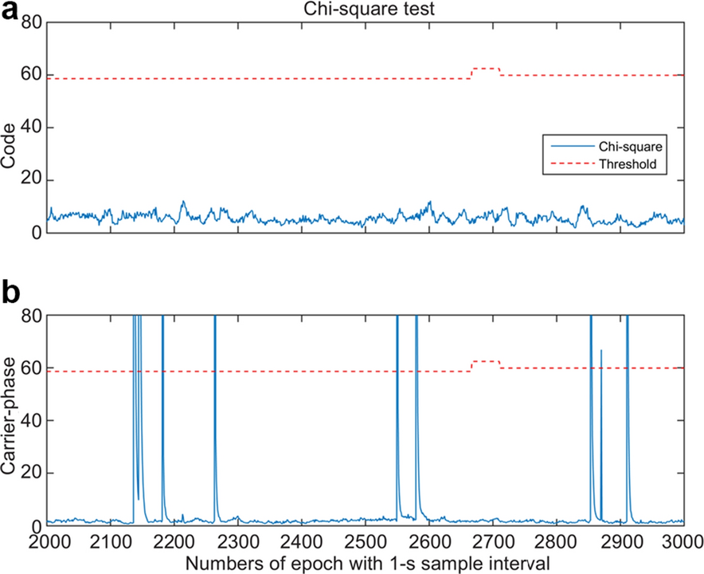
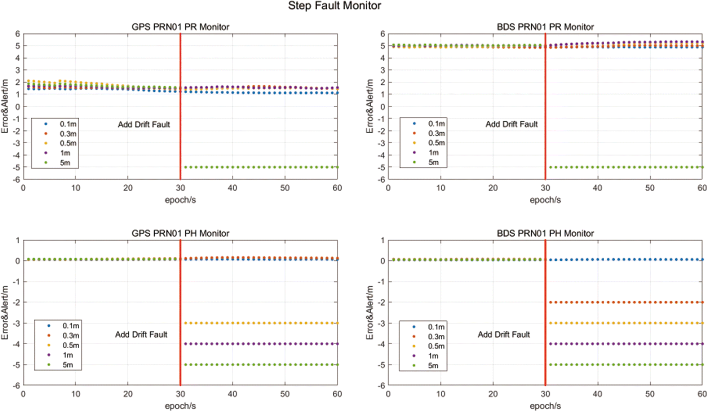
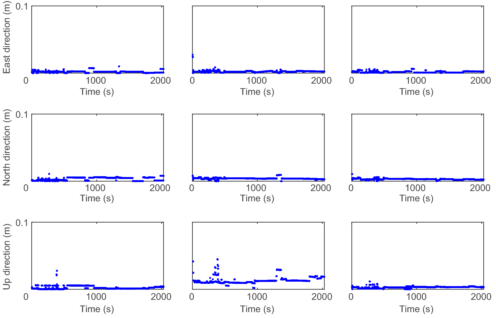

# 2026-10-25 GNSS 每日研究简报

## 今日快报

### 快报 1：Galileo 为 H-ARAIM 补齐长期证据与广播入口：9.5 年监测、在轨异常响应和 ISM 同时闭环

- 主题：`galileo-haraim-performance-ism`
- 来源 ID：`doi:10.33012/2026.20688`
- 来源链接：https://doi.org/10.33012/2026.20688
- 发表日期：2026-10-07
- 来源类型：ION GNSS+ 2026 官方会议论文摘要
- 获取范围：ION 官方摘要；核对 9.5 年 Galileo 性能监测、2025 年 7 月 GSAT0101 异常响应、最终 ISM 消息类型和 E1B I/NAV 承载方式；正文需下载额度，未取得逐项统计

**内容：** ESA、EUSPA、欧盟委员会与产业团队把 Galileo 支持 H-ARAIM 的问题拆成三层：先以扩展到 9.5 年的观测刻画 URA、广播群延迟（BGD）误差包络与卫星/星座故障先验；再复盘 2025 年 7 月 GSAT0101 异常时系统如何在用户看到实际 SIS 故障状态前作出反应；最后说明已进入最新版 OS SIS-ICD 的完整性支持消息（ISM）及测试消息。

**结论：** 摘要称新增监测期继续支持 Galileo SARPs 中目标 $`P_{sat}`$、$`P_{const}`$ 与 URA，并称当次异常响应有效且迅速。E1B I/NAV 每 30 s 子帧广播一个 128 bit 字，可承载 Galileo 及其他星座 ISM。这里没有公开尾概率样本量、实际响应秒数或各参数包络值，因此只能把它视为长期特性与接口设计更新，不能据此独立复算 HPL。

**关注理由：** H-ARAIM 不是只靠用户算法：故障先验、误差包络、系统反应和广播消息必须同时可信。本文把“测得什么、系统如何隔离、用户怎样收到”接到一条服务链上。

### 快报 2：H-ARAIM 从全球仿真走到近 10 h 无人机数据：真正的短板是双频可见性与排除候选策略

- 主题：`haraim-simulation-flight-assessment`
- 来源 ID：`doi:10.33012/2026.20880`
- 来源链接：https://doi.org/10.33012/2026.20880
- 发表日期：2026-10-07
- 来源类型：ION GNSS+ 2026 官方会议论文摘要
- 获取范围：ION 官方摘要；核对 GPS+Galileo 双频敏感性分析、ED-259B 改编测试、单星/星座/双故障注入和近 10 h 无人机数据；正文需下载额度，未取得逐测试通过率

**内容：** ENTICE 项目把 ED-259B H-ARAIM Service Type A 的评估分成全球服务体积、缩减执行负担的标准对齐测试和飞行数据三部分。变量包括 ISD、算法配置、测距误差和星座配置；故障测试分别注入单星故障、Galileo 星座级故障与双故障，并比较 Default 与 Broadcast ISD。

**结论：** 作者称改编测试组中 FDE 行为正确、保护级保持包络且满足目标完整性准则；近 10 h 双频 GPS/Galileo 无人机数据在多数有限 HPL 历元表现正常，但低 GPS L1/L5 可见性限制可用性，退化观测下排除候选选择也会改变结果。摘要没有给 HPL 分位数、不可用历元比例或飞行真值不确定度，不能把“满足”外推为认证结论。

**关注理由：** 服务体积仿真能找参数敏感性，故障注入能查逻辑，飞行数据才暴露真实可见性；三者缺一都不足以说明完整性算法能落地。

### 快报 3：多路径不是平稳白噪声：先自适应分窗，再在局部平稳段做 PSD 包络

- 主题：`nonstationary-code-multipath-window-overbound`
- 来源 ID：`doi:10.33012/2026.20675`
- 来源链接：https://doi.org/10.33012/2026.20675
- 发表日期：2026-10-07
- 来源类型：ION GNSS+ 2026 官方会议论文摘要
- 获取范围：ION 官方摘要；核对航空器地面滑行、码多路径非平稳/时相关问题、自适应分窗与局部功率谱密度包络；正文需下载额度，未取得窗口准则和数值结果

**内容：** 面向自主或无人航空器滑行，论文指出最终位置虽由载波相位驱动，整体完整性却可能由码多路径限制。直接把码误差当白噪声会忽略时间相关；直接对整段非平稳序列做 PSD 又会把不同环境混在一起。作者先用自适应窗口把序列切成局部宽平稳段，再分别估计并包络功率谱密度。

**结论：** 摘要只公开了方法结构，没有窗口长度、平稳性检验门限、包络置信度、机场数据规模或保护级收益。可以确认其解决的是“非平稳序列怎样进入时相关完整性模型”，不能声称已经证明某个 MDB、HPL 或滑行可用率。

**关注理由：** 多路径包络若只覆盖幅值而不覆盖相关性，卡尔曼滤波会把重复误差当成新信息，低估状态协方差；分窗是把环境变化显式送入完整性预算的一条可实现路径。

### 快报 4：一个全局高斯包络不再包打天下：用 C/N0 与高度角预测质量组，再逐组保守包络

- 主题：`ml-quality-index-gaussian-overbound`
- 来源 ID：`doi:10.33012/2026.20849`
- 来源链接：https://doi.org/10.33012/2026.20849
- 发表日期：2026-10-07
- 来源类型：ION GNSS+ 2026 官方会议论文摘要
- 获取范围：ION 官方摘要；核对无真值质量标签学习、KL 散度与空间正则、C/N0/高度角特征、IGS 实测验证；正文需下载额度，未取得网络结构与包络数值

**内容：** 单一高斯包络把开阔与城市误差混合，可能在好环境过度保守、在差环境反而不安全。论文不用多路径真值作在线输入，而用 C/N0、高度角等可观测特征预测质量指标（QI）；QI 标签由 KL 散度损失与空间正则联合迭代生成，再对每个质量组分别做高斯包络。

**结论：** 作者称 IGS 实测中，好质量信号获得更紧包络，退化信号获得更安全包络。摘要没有给站点、训练/测试划分、尾部样本量、超包概率或跨环境泛化结果；“更安全”是作者结论，不等于已达到特定 $`P_{HMI}`$。

**关注理由：** 学习模型在这里不是直接报位置，而是辅助选择误差族；若能把分组、覆盖率和分布漂移同时受控，机器学习才可能进入完整性链而不是成为新的未监测故障源。

### 快报 5：NRTK 改正也要自报健康：把参考站异常与大气建模错误变成质量指标和状态位

- 主题：`nrtk-correction-integrity-monitoring`
- 来源 ID：`doi:10.33012/2026.20705`
- 来源链接：https://doi.org/10.33012/2026.20705
- 发表日期：2026-10-07
- 来源类型：ION GNSS+ 2026 官方会议论文摘要
- 获取范围：ION 官方摘要；核对参考站故障、大气模型误差、广播改正故障检测、质量指标与健康状态；正文需下载额度，未取得网络规模和检测统计

**内容：** 论文把 NRTK 风险前移到服务端：不仅让用户看残差，还为广播改正定义实时质量信息，并设计检测与分析潜在故障的算法。服务端输出包括 Quality Indicator 与健康状态，目标是区分参考站异常和错误大气建模造成的改正异常。

**结论：** 摘要称实验能刻画改正质量并检测异常行为，但未给故障幅值、检测延迟、虚警/漏警率、站间距或用户定位保护级。现有证据支持“框架已实现并评估”，不支持“已经满足某一安全完整性等级”。

**关注理由：** 用户端再强的 FDE 也难以识别所有共因改正错误。把健康信息与改正同时广播，可把服务端故障先验、用户端假设与告警责任明确连接起来。

## 深度研读

### 深读 1｜接收机工程｜先把“可信”写成可检验事件：AL、PL、FDE 与威胁模型怎样闭环

- 类别：`receiver-engineering`
- 学习层级：`foundation`
- 选题定位：`经典基础：用 PPP 完整性综述及其可复现实验，分清允许误差、保护边界、危险误导概率与故障检测之间的责任关系`
- 来源 ID：`doi:10.1186/s43020-020-00034-8`
- 来源链接：https://doi.org/10.1186/s43020-020-00034-8
- 发表日期：2021-02-08
- 来源类型：Satellite Navigation 同行评审开放综述与实验分析
- 获取范围：CC BY 4.0 开放全文；PPP 故障分类、系统端/用户端完整性、RAIM/ARAIM、两个附录注入实验、Tables 1–3 与 Figures 1–8 已核对
- 价值评分：96/100（相关性 20，经典价值 19，证据 19，教学价值 20，工程价值 18）

#### 为什么先学这个

定位误差小不等于可用：一次解可能恰好准确，却没有给出下一次失败时的告警边界。完整性先规定允许误差 AL、允许危险概率 IR 和告警时限 TTA，再让算法计算保护级 PL、检测并排除故障。本文的价值在于把卫星、信号、大气、精密产品、环境与用户端故障放进同一威胁树，并用真实 PPP 数据说明“经验残差门限”为什么不能替代受虚警概率约束的统计检验。

#### 先修知识

需要理解加权最小二乘、卡方分布、观测残差、自由度、虚警概率 $`P_{FA}`$、危险误导信息概率 $`P_{HMI}`$、卡尔曼滤波、PPP 码/相位观测、模糊度、精密轨道钟和故障检测与排除（FDE）。

#### 一句话逻辑

先枚举可能破坏位置的故障并分配风险，再用与观测几何和误差模型一致的检验门限筛故障，最后计算在“检验通过”条件下仍能包住位置误差的 PL；PL 超过 AL 时即使没有检测到故障也必须判不可用。

#### 研究问题与约束

论文主体是综述，不提出统一认证算法；附录用一小时静态数据比较 PPP-Wizard 的 Simple/Advanced FDE 与卡方 FDE。数据来自 IGS STFU 站 2020-01-01 19:00–20:00 GPST，1 s 采样，以运动学浮点、未组合 GPS+Galileo PPP 处理，每历元有 16–17 颗星和 70 条以上观测，使用 CNES GRG 最终产品。作者在历元 2000–3000 对 GPS L1 注入 10 组 0.05–1.05 m 随机异常。场景是离线静态与人工故障，不代表城市长尾、实时产品延迟或整数固定风险。

#### 核心方法论

先以故障模式与影响分析（FMEA）/故障树（FTA）建立威胁集，再按系统端与用户端划分监测责任。用户端用冗余观测形成残差统计量，门限由 $`P_{FA}`$ 和自由度决定；检测到异常后排除观测并重算位置与 PL。对递推 PPP，当前观测检验还必须考虑历史故障已进入预测状态，不能把每个历元假装成独立快照。

#### 关键公式逐步推导

线性化观测写成 $`y=Gx+\varepsilon`$，权阵为 $`W=R^{-1}`$。全体观测的加权最小二乘解为：

```math
\widehat{x}=(G^T W G)^{-1}G^T W y.
```

帽子矩阵 $`H=G(G^TWG)^{-1}G^TW`$ 把观测投影到模型空间，后验残差为：

```math
r=(I-H)y.
```

若名义误差模型成立，归一化平方残差可构成卡方统计量：

```math
T=r^TWr,\qquad T>\chi^2_{\nu}(1-P_{FA})\Rightarrow\text{alarm}.
```

完整性不是“$`T`$ 小就安全”，而是还要求保护级满足条件风险约束：

```math
P\!\left(|PE|>PL\ \land\ \text{test passed}\right)\le P_{HMI}.
```

工程判据是 $`PL\le AL`$ 才可用；若 $`PL>AL`$，即使当前 $`PE`$ 未知或很小，也必须拒绝输出安全声明。

#### 经典价值与创新边界

经典价值是把完整性从单一残差阈值恢复为“威胁模型—风险分配—检测—保护级—告警”的闭环，并指出 PPP 的载波、模糊度、精密产品和递推状态带来额外故障模式。创新边界是综述中的先验概率多来自既有文献或工程假设；附录只比较有限的人工异常，不能给出城市 PPP 所需的真实尾概率。

#### 整体逻辑链

定义 AL/IR/TTA；列出卫星、信号、大气、产品、环境和用户故障；为故障模式分配概率；建立名义随机模型；构造残差统计量和 $`P_{FA}`$ 门限；检测并排除；重算位置与 PL；比较 PL 和 AL；对递推状态继续监测历史故障。下一节把这条链移到精密改正服务端，看轨道钟改正怎样变成可广播的健康边界。

#### 原文图表与结果分析



> 图表源：Du 等《Vulnerabilities and integrity of precise point positioning for intelligent transport systems: overview and analysis》Figure 5，[CC BY 4.0 开放全文](https://doi.org/10.1186/s43020-020-00034-8)。本地资产为 Springer 官方原始 PNG，未裁剪或改动曲线、门限、坐标轴、单位和数值。

横轴是 1 s 采样的历元 2000–3000，纵轴分别为码和载波相位卡方统计量；蓝线是统计量，红虚线是按几何/自由度变化的门限，约在历元 2660 附近随观测数改变。上图码统计量始终远低于约 58–62 的门限，因为人工异常注入的是 GPS L1 相位；下图载波统计量在多个注入历元越限。图能说明检验对所注入异常的响应，也显示门限不是固定常数；它不能证明尾部分布在真实道路环境受控，更不能直接给出 PL。

#### 原文结果论述

作者报告三种 FDE 均漏掉 G09 在历元 2870 的一个异常；Simple FDE 还有漏检与错误剔除，造成位置跳变。Advanced FDE 与卡方方案可识别本实验中所有大于 0.9 m 的异常；卡方检验设置 $`P_{FA}=0.01`$。这只是有限样本的检出表现，不是“0.9 m 为通用 MDB”，也不能把一次未发生 HMI 当作 $`10^{-x}`$ 级风险证据。

#### 常见误区与适用边界

第一，AL 是任务要求，不是算法从数据学出的误差分位数。第二，PL 是概率约束下的误差上界，不是当前真实误差。第三，残差小可能是故障被状态吸收。第四，固定门限忽略卫星数和几何变化。第五，排除观测后必须重算 PL。第六，单故障 RAIM 不能覆盖多星或共因故障。第七，静态人工注入不能代表 NLOS、精密产品错误和错误固定同时出现。

#### 工程实现步骤

1. 从具体任务给出横向/纵向/垂向 AL、$`P_{HMI}`$、TTA 与连续性要求。
2. 建立 FMEA/FTA，区分卫星、星座、大气、改正、环境、接收机和算法故障。
3. 为每个假设定义先验概率、受影响观测和名义偏差/方差。
4. 用几何与协方差实时计算残差统计量和自由度对应门限。
5. 报警后执行可追溯的排除，重算解、协方差、PL 与可用性。
6. 对递推滤波保留故障起始时间或解分离状态，避免历史污染被遗漏。
7. 用正常数据、边界故障、共因故障与分布漂移分别验证虚警、漏警、包络和告警延迟。

#### 复现实验设计

下载 STFU 或另一 IGS 站 1 h、1 Hz GPS+Galileo 数据，以未组合浮点 PPP 跑通无故障基线；在连续 1000 s 内随机注入 10 组 0.05–1.05 m 相位阶跃。比较固定经验门限、按自由度变化的卡方检验和多假设解分离。指标包括 $`P_{FA}`$、检出率、错误剔除数、最小可检偏差、告警延迟、PE/PL 包络率和解可用率。失败用例加入两星同向异常、钟改正共因阶跃、300 s 缓慢漂移、错误周跳修复和观测数突变。

#### 与定位及低成本实现的联系

低成本接收机的码噪声、天线多路径和时钟状态更不稳定，照搬航空高斯模型会产生假精度。实用实现应先按 C/N0、仰角、环境与设备状态分层定模，再把无法可信建模的工况判不可用；宁可牺牲可用率，也不能用未验证的协方差生成看似很小的 PL。

#### 本节小结

完整性不是“误差通常多小”，而是“在明确威胁与概率预算下，算法能否及时拒绝不可信解”。只有威胁模型、统计门限、FDE 和 PL 同时闭环，AL 比较才有意义。

### 深读 2｜接收机工程｜用户之前先守住改正：用监测站残差给轨道钟服务加 UDRE 与告警

- 类别：`receiver-engineering`
- 学习层级：`intermediate`
- 选题定位：`基础进阶：把精密轨道钟改正投影到测距域，以多站码/相位残差估计 UDRE，并分别检测阶跃与缓慢漂移`
- 来源 ID：`doi:10.1186/s43020-020-00018-8`
- 来源链接：https://doi.org/10.1186/s43020-020-00018-8
- 发表日期：2020-10-12
- 来源类型：Satellite Navigation 同行评审开放论文
- 获取范围：CC BY 4.0 开放全文；2018 年 GPS/BDS 改正、20 监测站+3 验证站、残差 QQ 图、UDRE/卡方监测、阶跃与漂移注入、Figures 1–10 已核对
- 价值评分：95/100（相关性 20，经典价值 18，证据 19，教学价值 19，工程价值 19）

#### 为什么先学这个

上一节从用户解看完整性，但 PPP 用户共同依赖同一套轨道钟改正。若服务端把共因错误广播给所有用户，单机残差可能没有足够冗余及时辨认。本文展示一个具体做法：监测站把改正误差投影为码/相位测距残差，实时生成 UDRE 和健康状态；阶跃用逐星阈值抓，慢漂移用跨星卡方统计量抓。

#### 先修知识

需要理解卫星轨道径向/沿轨/法向误差、钟差、距离误差投影、双频无电离层组合、伪距与载波相位、均值与标准差、高斯分位数、卡方检验、模糊度平滑、MEO/GEO 轨道类型和服务端/用户端责任分工。

#### 一句话逻辑

用已知坐标监测站反算每颗星的码/相位改正残差，以 $`|\mu|+K\sigma`$ 构造逐星包络并投票识别阶跃，再用所有卫星残差的卡方一致性检验识别会被上一历元阈值追随的缓慢漂移。

#### 研究问题与约束

作者使用自研 WAPPS 的 GPS/BDS 双频无电离层轨道钟改正；20 个中国境内站参与监测，另 3 站验证。正常状态评估取一天 1 s 数据，目标漏警率为 $`10^{-3}`$。故障只注入钟改正且一次只作用于一颗 GPS 与一颗 BDS 卫星；阶跃幅值为 0.1、0.3、0.5、1、5 m，漂移率为 0.005–0.5 m/s。网络只覆盖中国、阈值模型初步、假定多站残差独立同分布，不能外推到全球或多种共因故障。

#### 核心方法论

第一步用轨道三方向误差和钟差生成测距域 dSISE，核对改正本身。第二步由每颗星所有可见监测站的码与相位残差估计均值/方差，生成 UDRE_PR 与 UDRE_PH；上一历元 UDRE 作为当前阈值，逐站越界标志经投票给出 Alert/No Alert/Not Monitor。载波相位残差以时间平滑吸收模糊度。第三步把多星残差放入加权卡方检验，用于识别慢漂移。

#### 关键公式逐步推导

对 GPS，轨道径向 $`R`$、沿轨 $`A`$、法向 $`C`$ 与钟差等效距离 $`T`$ 投影为：

```math
dSISE_{GPS}=\sqrt{(0.980R-T)^2+0.141(A^2+C^2)}.
```

由实时残差均值 $`\mu`$、标准差 $`\sigma`$ 和目标尾概率对应高斯分位数 $`K`$，作者定义：

```math
UDRE_{PR}=\frac{|\mu_{PR}|+K_{PR}\sigma_{PR}}{K_{PR}},\qquad
UDRE_{PH}=\frac{|\mu_{PH}|+K_{PH}\sigma_{PH}}{K_{PH}}.
```

这使 $`K\cdot UDRE=|\mu|+K\sigma`$，即零均值高斯包络吸收残差的非零均值。慢漂移检验使用：

```math
\chi^2=y^T\!\left[W-WG(G^TWG)^{-1}G^TW\right]y,
```

并与给定 $`P_{FA}`$ 下的卡方分位数比较。若残差相关、重尾或权阵失配，名义概率就不再自动成立。

#### 经典价值与创新边界

经典价值是把精密改正的“准确度”变成可广播、可告警的测距域健康量，并区分阶跃与慢漂移的不同检测机制。创新边界是 UDRE 由样本均值/方差与高斯分位构造，没有严格证明极端尾部包络；载波模糊度固定阈值未纳入漏警/虚警设计，作者也明确列为后续工作。

#### 整体逻辑链

轨道钟改正；投影到 dSISE；监测站形成码/相位残差；QQ 图检查近似分布；逐星估 $`\mu,\sigma`$ 与 UDRE；上一历元阈值抓阶跃；跨星卡方抓漂移；站点投票输出健康状态；用户接收改正与完整性信息。下一节将服务端风险、观测风险、大气改正和错误固定统一送进用户的多假设保护级。

#### 原文图表与结果分析



> 图表源：Wang 与 Shen《Real-time integrity monitoring for a wide area precise positioning system》Figure 9，[CC BY 4.0 开放全文](https://doi.org/10.1186/s43020-020-00018-8)。本地资产为 Springer 官方原始 PNG，未裁剪或改动散点、图例、坐标轴、单位和数值。

四个子图横轴都是故障前后共 60 s，红线在第 30 s 注入；纵轴单位 m，正值是 UDRE，负值表示告警。上排伪距监测中只有 5 m 曲线在故障后翻为约 −5 m；下排载波相位中，GPS MEO 从 0.5 m 起报警，BDS GEO 从 0.3 m 起报警。原图内部文字写成 “Add Drift Fault”，但论文段落和 Figure 9 标题明确是 step fault；应记录这个标签不一致，而不能自行改图。图证明的是人工单星阶跃下的监测响应，不能证明真实轨道钟异常分布。

#### 原文结果论述

作者报告伪距监测 MDB 约 5 m；载波相位对 GPS MEO 约 0.5 m、对 BDS GEO 约 0.3 m，阶跃告警时延小于 3 s。正常状态下漏警率低于 $`10^{-3}`$、载波监测虚警率约 $`10^{-4}`$。漂移实验中，0.5 m/s 码漂移约 9 s 报警；相位可检测高于 0.005 m/s 的漂移，0.1 m/s 约 5 s 报警。这些数值属于该站网、权重和人工注入设置，不是通用服务保证。

#### 常见误区与适用边界

第一，改正均值小不表示尾部已包络。第二，用上一历元阈值会追随慢漂移。第三，多站投票依赖站间误差独立性，区域大气共因会破坏它。第四，相位更敏感但受模糊度初始化限制。第五，QQ 图中部近直线不能验证 $`10^{-7}`$ 尾部。第六，监测到改正故障不等于用户位置一定越界。第七，图中的负值是报警编码，不是负测距误差。

#### 工程实现步骤

1. 统一改正、广播星历、精密参考和监测站的时间/坐标基准。
2. 将轨道钟误差投影为逐星测距域量，按星座与轨道类型分层统计。
3. 从已知站坐标形成码/相位 O-C 残差，执行周跳、粗差与模糊度状态质控。
4. 滚动估计均值、方差、尾部分位和时间相关，输出 UDRE 及样本充分性标志。
5. 阶跃监视器与漂移监视器并行，分别记录 MDB、TTA、$`P_{FA}`$ 与漏警。
6. 站点投票前检查空间相关；共因异常时扩大包络或直接置 Not Monitor。
7. 把健康状态、有效期和告警时间戳与改正同通道发布，并在用户端拒收过期状态。

#### 复现实验设计

搭建 8–20 站区域网与 2–3 个独立验证站，采 GPS/BDS 1 Hz 改正与观测至少 7 d。分别向单星钟改正注入 0.1–5 m 阶跃、0.005–0.5 m/s 漂移、两星同向故障和区域电离层共因偏差。比较固定阈值、上一历元 UDRE、带遗忘因子的 UDRE 与 PSD/序列检验。指标为码/相位 MDB、TTA、虚警/漏警、站点相关系数、UDRE 包络率、用户 PE/PL 和服务不可用率。

#### 与定位及低成本实现的联系

低成本用户无法自行维护全球监测网，服务端 QI/UDRE 尤其重要。但用户不能只信一个健康位：还要验证消息时效、服务区域、接收机噪声和本地多路径，并把服务端包络与本机误差一起传播到位置域。便宜终端可以少算，却不能省略责任边界。

#### 本节小结

精密改正必须同时携带“有多准”和“何时不能信”。逐星 UDRE 适合阶跃，跨星一致性适合漂移；两者都要经过相关性和尾部证据校准。

### 深读 3｜定位｜把固定信息当成也会故障的观测：单历元 PPP-RTK 怎样构造多假设保护级

- 类别：`positioning`
- 学习层级：`advanced`
- 选题定位：`定位深入：在纯 GNSS 单历元 PPP-WAR、PPP-AR 与 PPP-RTK 中，把卫星、星座、大气改正及错误固定风险统一纳入 MHSS ARAIM`
- 来源 ID：`doi:10.1186/s43020-023-00099-1`
- 来源链接：https://doi.org/10.1186/s43020-023-00099-1
- 发表日期：2023-04-03
- 来源类型：Satellite Navigation 同行评审开放论文
- 获取范围：CC BY 4.0 开放全文；MHSS 推导、多频多星座未组合模型、全球仿真、3 组澳大利亚 1 Hz 车载数据、错误固定敏感性、Tables 1–5 与 Figures 1–12 已核对
- 价值评分：98/100（相关性 20，经典价值 19，证据 20，教学价值 19，工程价值 20）

#### 为什么先学这个

前两节分别建立用户端判据和服务端改正健康量，但 PPP-RTK 还把固定模糊度与区域大气改正作为“伪观测”送进单历元解。它们一旦错误，位置可以很精确地错。本文把传统 PPP 滤波产生的固定信息视为外部改正，在并行单历元最小二乘中枚举卫星、星座、电离层、对流层和错误固定假设，从而让多故障风险进入保护级。

#### 先修知识

需要理解未差未组合多频 PPP、PPP-WAR/PPP-AR/PPP-RTK、码与相位硬件偏差、整数模糊度、区域电离层/对流层改正、单差基准、最小二乘协方差、MHSS、解分离、故障先验、$`P_{FA}`$、$`P_{HMI}`$ 和保护级风险分配。

#### 一句话逻辑

让常规多历元 PPP 只负责生成固定模糊度与大气改正，再把这些信息作为可能故障的伪观测交给单历元 MHSS；对每个故障子集求解、比较全视解与子集解，并用剩余未检风险反求东西天和垂向 PL。

#### 研究问题与约束

基准假设包含每星故障 $`10^{-5}`$、每星座故障 $`10^{-8}`$、电离层改正故障 $`10^{-5}`$、对流层改正故障 $`10^{-6}`$，总 $`P_{HMI}=10^{-7}`$，横向分配 $`2\times10^{-9}`$、垂向 $`9.8\times10^{-8}`$。码 URE 标准差设 1 m，相位为其 1/100，电离层/对流层改正分别 0.06/0.03 m，截止高度 15°。全球仿真使用 GPS L1/L2/L5、Galileo E1/E5a/E6、BDS B1/B2/B3；实测是澳大利亚 3 组 1 Hz 车载数据。故障概率与随机模型多为先验设定，实测参考和环境代表性有限。

#### 核心方法论

算法先按故障先验生成需要监测的假设子集，舍去不能定位或总概率低于未监测阈值的组合。全视与每个子集分别做单历元加权最小二乘，解分离标准差由两解协方差差得到。全视—子集坐标差超过按 $`P_{FA}`$ 分配的门限时报警；否则在名义偏差、各假设先验与漏检尾概率共同约束下，用半区间搜索求每个方向的 PL。固定模糊度与大气改正不再被当作绝对真值。

#### 关键公式逐步推导

第 $`k`$ 个故障子集的加权最小二乘解和协方差为：

```math
\widehat{x}^{(k)}=\left(A^TW^{(k)}A\right)^{-1}A^TW^{(k)}l,
\qquad
R_{\widehat{x}}^{(k)}=\left(A^TW^{(k)}A\right)^{-1}.
```

对坐标方向 $`q`$，子集与全视解的分离标准差及门限为：

```math
\left(\sigma_{SS,q}^{(k)}\right)^2=\left(\sigma_q^{(k)}\right)^2-\left(\sigma_q^{(0)}\right)^2,
\qquad
T_{k,q}=K_{FA,q}^{(k)}\sigma_{SS,q}^{(k)}.
```

若：

```math
\left|\widehat{x}_q^{(k)}-\widehat{x}_q^{(0)}\right|>T_{k,q},
```

则该假设不再与全视解一致。通过检验后，PL $`\alpha_{PL}`$ 需让所有假设的尾概率加权和不超过方向风险预算：

```math
\sum_{i=0}^{N}
P\!\left(|x_q-\widehat{x}^{(0)}_q|>\alpha_{PL},\ \text{test passed}\mid H_i\right)P(H_i)
\le P_{HMI,q}.
```

先验概率越大、子集几何越弱、名义偏差越大或风险预算越小，PL 越大；这也是保护级不是单纯“协方差乘常数”的原因。

#### 经典价值与创新边界

经典价值是把 MHSS ARAIM 从码快照扩展到带相位、固定信息与大气伪观测的单历元精密定位，并明确每种新信息对应新的故障假设。创新边界是“常规 PPP 先固定、单历元算法再监测”仍依赖上游固定概率；论文基准先忽略错固定，再只做 $`10^{-8}`$/$`10^{-7}`$ 敏感性，且没有用足够长真实数据验证极低风险尾部。

#### 整体逻辑链

常规 PPP 滤波积累历元；生成固定模糊度与大气改正；单历元构造码/相位/伪观测；定义卫星、星座、电离层、对流层和错固定故障；筛选 MHSS 子集；求全视与子集解；执行解分离检验；分配 $`P_{HMI}`$ 并反求 E/N/U PL；与 AL 比较；输出可用或告警。至此，服务端改正健康和用户端多故障监测闭合。

#### 原文图表与结果分析



> 图表源：Zhang 与 Wang《Integrity monitoring scheme for single-epoch GNSS PPP-RTK positioning》Figure 12，[CC BY 4.0 开放全文](https://doi.org/10.1186/s43020-023-00099-1)。本地资产为 Springer 官方原始 PNG，未裁剪或改动散点、子图、坐标轴、单位和数值。

三列依次是带区域大气改正的 PPP-WAR、PPP-AR 和 PPP-RTK，三行依次是东、北、天方向；横轴约 0–2000 s，纵轴显示相对基准 PL 的变化，量程到 0.1 m。大多数蓝点贴近 0，仅少数时段出现厘米级突增，PPP-AR 的垂向变化更明显。它说明在作者把错固定概率设为 $`10^{-7}`$、并把总 $`P_{HMI}`$ 放宽到 $`10^{-6}`$ 的这个数据集里，新增风险对 PL 的影响较小；不能说明错固定本身后果小，也不能在原 $`10^{-7}`$ 总预算下忽略它。

#### 原文结果论述

全球仿真中，PPP-WAR 加区域改正的 HPL 达米级；PPP-AR 与 PPP-RTK 多数地区可到亚米级。以 HAL=1.5 m 评估，PPP-AR 和 PPP-RTK 达到超过 99.9% 可用率的全球覆盖比例分别为 99.4% 与 99.7%。三组实测中，作者称所有 PE 均被 PL 包住；但这只是有限数据。Table 5 基准中 PPP-RTK 的 E/N/U 中位 PL 为 0.27/0.70/1.47 m；改变卫星、星座和电离层故障先验会影响多方向，改变对流层故障先验主要影响垂向。以上均依赖作者的故障概率与 URE 设置。

#### 常见误区与适用边界

第一，错误固定概率小不等于可从预算删除。第二，固定后厘米级 PE 不意味着 PL 也应是厘米级。第三，全球覆盖仿真使用理想化随机模型，不是道路可用率。第四，三组实测全包络不足以验证 $`10^{-7}`$。第五，单历元算法仍依赖多历元 PPP 生成固定信息。第六，故障子集剪枝必须把被删概率计入未监测预算。第七，横向风险分配沿用航空设置时可能不适合道路任务。

#### 工程实现步骤

1. 明确 PPP-WAR、PPP-AR、PPP-RTK 的观测与伪观测列表及各自故障责任。
2. 从服务端 QI、历史统计和设备试验得到卫星、星座、大气及错固定先验。
3. 构建全视与子集设计矩阵、权阵和单历元解，检查秩与基准变换。
4. 按 $`P_{FA}`$ 分配计算解分离门限，记录每个假设的报警贡献。
5. 将名义偏差、未监测概率和各假设尾部合入方向 PL 搜索。
6. 对错固定、改正过期和相关大气误差设置独立健康标志，不能只增大统一方差。
7. 在线比较 PE 不可得时，至少记录 PL、AL、子集数、主导假设和拒绝原因，供离线审计。

#### 复现实验设计

用 GPS+Galileo+BDS 三频模拟器先复现 15° 截止角和论文 Table 3 参数，再处理 3 条 1 Hz 开阔/郊区/城市车载数据。比较 SPP、PPP-WAR、PPP-WAR+区域大气、PPP-AR、PPP-RTK；分别扫 $`P_{sat}=10^{-6}\ldots10^{-4}`$、错固定 $`10^{-9}\ldots10^{-6}`$ 与大气相关长度。指标为 E/N/U PE、PL 中位/95 分位/最大值、HMI 次数、HAL=1.5 m 可用率、错误排除率、子集数量与单历元运行时。失败用例包括同星码相共因偏差、整星座钟偏差、错误电离层格网、对流层垂向偏差和保持 300 s 的错误整数。

#### 与定位及低成本实现的联系

低成本硬件最需要 PPP-RTK 的快速收敛，也最容易出现码噪声、载波中断和错误固定。可行路线不是复制论文中的固定 URE，而是让服务端改正健康量、接收机 C/N0/锁定状态、固定验证统计量共同决定假设概率；当证据不足时退回 PPP-WAR/SPP 或报不可用，而不是继续输出一个过小 PL。

#### 本节小结

PPP-RTK 完整性的关键不是把固定解当作真值，而是把固定信息也当作可能故障的观测。MHSS 将每类故障的先验、几何和尾部风险投影到 PL；模型假设不可信时，再漂亮的亚米保护级也没有安全含义。
