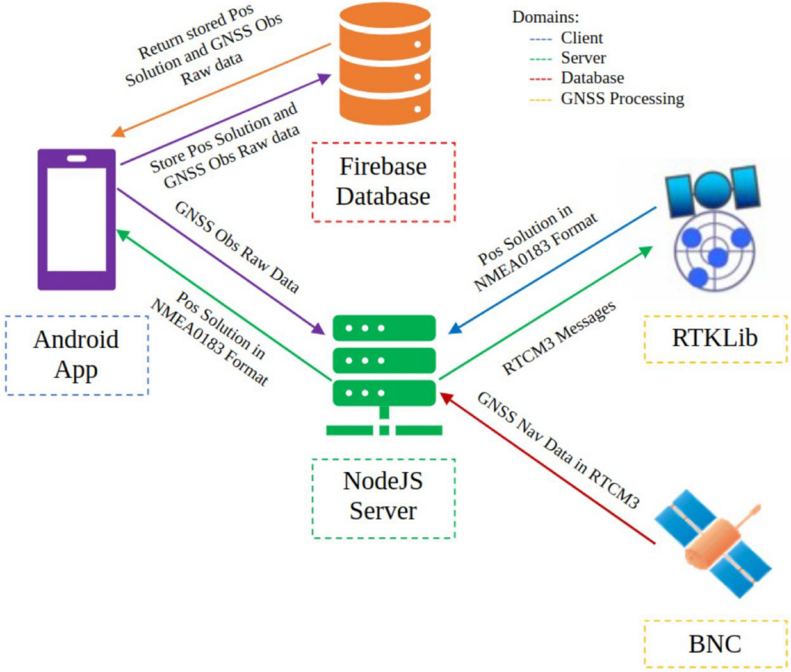
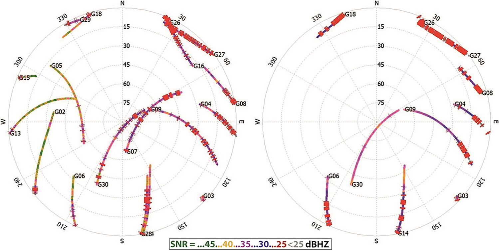
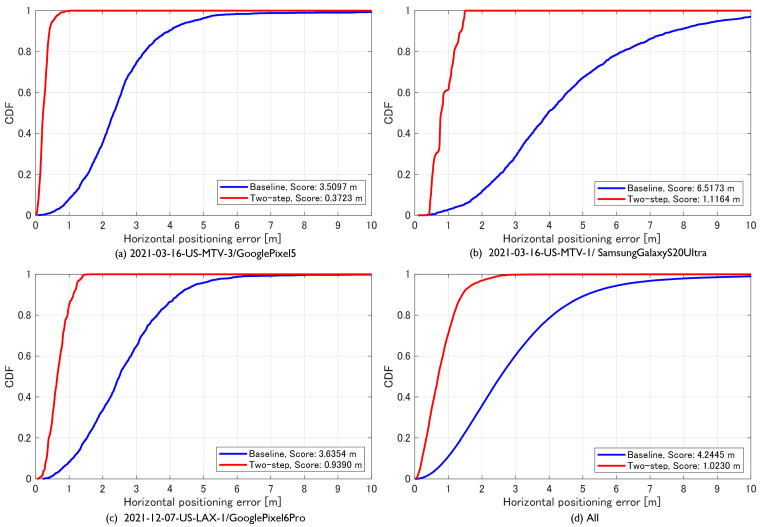

# 2026-10-28 GNSS 每日研究简报

## 今日快报

### 快报 1：4 s 增量因子图压低城市 PPP/RTK 长尾，但收益来自 GNSS、IMU 与里程计的联合约束

- 主题：`incremental-fgo-ppp-rtk-urban-tail`
- 来源 ID：`doi:10.33012/2026.20761`
- 来源链接：https://doi.org/10.33012/2026.20761
- 发表日期：2026-10-07
- 来源类型：ION GNSS+ 2026 同行评审会议论文
- 获取范围：ION 官方摘要与书目信息；核对 4 s iSAM2 固定窗、约 25 h 英国汽车数据、逐路线与全活动统计；正文需下载额度，未取得全部消融、传感器噪声和真值细节

**内容：** 论文把 PPP 与 RTK 的载波、码观测同 IMU、里程计放进统一增量因子图，以 iSAM2 在 4 s 固定窗内重线性化，并用匹配的 EKF 作对照。数据覆盖伦敦及英格兰南部，从开阔到深城市环境，含 Septentrio 与 u-blox 接收机，重点不是只压均值，而是抑制遮挡和恢复阶段的上尾误差。

**结论：** 官方摘要报告，最困难的伦敦 u-blox 路线中，浮点 PPP 东北平面 95% 误差由 7.42 m 降至 3.16 m，浮点 RTK 由 20.90 m 降至 6.08 m；按时长加权的全活动 3D RMS 改善为 Septentrio PPP 32.1%、RTK 24.9%，u-blox PPP 33.6%、RTK 32.1%。这些是融合系统相对同数据 EKF 的结果，不能归因为“因子图单独改善纯 GNSS”，也不能把固定状态或错误固定风险从摘要中推出来。

**关注理由：** 城市定位最难的常是恢复段而非稳态段。固定窗给出计算量与历史约束之间的可实现折衷，但工程比较必须让 EKF/FGO 使用相同观测、同样辅助传感器和同样异常门控。

### 快报 2：完整性监测先从射频链校准：多通道前端要能在线量到天线—ADC 的传递函数

- 主题：`multichannel-multiband-rffe-transfer-calibration`
- 来源 ID：`doi:10.33012/2026.20655`
- 来源链接：https://doi.org/10.33012/2026.20655
- 发表日期：2026-10-07
- 来源类型：ION GNSS+ 2026 同行评审会议论文
- 获取范围：ION 官方摘要与参考文献；核对多频、多通道、阵列波束形成、差分码偏差与天线到 ADC 在线传递函数设计目标；正文需下载额度，未取得噪声系数、通道相位一致性和温漂数值

**内容：** 差分码偏差（DCB）会被接收机射频前端的群时延和幅相传递函数污染；多站监测若直接合并不同前端的 DCB，可能把硬件差异误当成卫星或信号异常。论文设计一套多频、多通道软件定义前端，并把从天线端口到 ADC 的传递函数连续测量能力做进硬件，以支持跨站等化；阵列通道还可用于波束形成，压低多路径并核验信号到达方向。

**结论：** 摘要确认论文完成了设计、开发、测试和评估，但没有公开通道间相位误差、传递函数估计方差、温度范围或 DCB 改善量。因此当前证据支持“可校准架构已实现”，不支持宣称它已达到某个航空完整性门限或能自动区分所有多路径与信号形变。

**关注理由：** 算法端再精细的残差检验也无法补救未建模的前端群时延。把前端状态变成可观测、可追溯的校准量，是高保真监测站和多天线完整性系统的基础设施。

### 快报 3：先识别场景、再给单星分级：两层分类在 Google 动态数据上把水平 RMSE 降约 65%

- 主题：`scene-aware-signal-classification-multipath-nlos`
- 来源 ID：`doi:10.33012/2026.20735`
- 来源链接：https://doi.org/10.33012/2026.20735
- 发表日期：2026-10-07
- 来源类型：ION GNSS+ 2026 同行评审会议论文
- 获取范围：ION 官方摘要；核对场景标签、信号质量排序分类、Google 加州动态数据及两套方案相对基线的 RMSE 改善；正文需下载额度，未取得绝对误差、训练测试划分和跨城市结果

**内容：** 单一 LOS/NLOS 分类器容易把某一城市、某一种街谷形态学成固定规则。论文先给整段观测做场景分类，再按该场景解释单星的 C/N0、几何和测量特征，并提出两种场景标注方法与一套信号质量排序/分类方法，随后通过降权或剔除缓解多路径与 NLOS。

**结论：** 作者在 Google 团队采集的加州动态数据上报告，两套方案相对基线的水平 RMSE 分别改善 65.45% 与 65.39%。摘要没有给基线绝对 RMSE、路线独立性、类别不平衡、误分类代价或留城验证；所以百分比只能描述该数据与该基线，不能外推为任意手机和任意城市的 65% 收益。

**关注理由：** “场景决定误差先验，单星决定当前权重”比一个全局门限更符合城市传播机理；同时它引入了新的分布漂移风险，部署时必须监控未知场景和置信度失配。

### 快报 4：林下连续性可增加最多 27%，但这是 GPS/INS 后处理与特定 IMU 初始化共同给出的结果

- 主题：`dense-canopy-gps-ins-continuity`
- 来源 ID：`doi:10.33012/2026.20706`
- 来源链接：https://doi.org/10.33012/2026.20706
- 发表日期：2026-10-07
- 来源类型：ION GNSS+ 2026 同行评审会议论文
- 获取范围：ION 官方摘要；核对不同冠层密度、多个测量型接收机、NovAtel Inertial Explorer 参考轨迹和连续性增益；正文需下载额度，未取得路线长度、各 IMU 等级与 RMS 表

**内容：** 论文在递增冠层密度下先评估 GPS-only，再以不同 IMU 做后处理松/紧组合，利用惯性传播跨过林下短时失锁。评价同时看 C/N0、RMS 与解连续性，并尝试复用 Trimble R12i 内置 IMU，而不是额外增加一套专用惯导。

**结论：** 摘要称 GPS/INS 相比 GPS-only 的定位连续性最高增加 27%，且结果明显依赖 IMU 品质、初始化与 GPS 观测质量。参考轨迹来自 NovAtel Inertial Explorer，属于高等级组合后处理而非完全独立的几何真值；论文也不是纯 GNSS 算法证据，更不能说明长时间完全遮挡时误差仍受界。

**关注理由：** 林下项目常把“有位置输出”误当“位置可信”。连续性必须同误差增长、初始化时间和参考不确定度一起报告，尤其要区分桥接短失锁与解决长期无卫星两类问题。

### 快报 5：误差感知注意力把手机 PPP RMS 从 2.3 m 降到 1.8 m，跨设备测试仍需跨路线与跨城市验证

- 主题：`error-aware-attention-smartphone-ppp`
- 来源 ID：`doi:10.33012/2026.20738`
- 来源链接：https://doi.org/10.33012/2026.20738
- 发表日期：2026-10-07
- 来源类型：ION GNSS+ 2026 同行评审会议论文
- 获取范围：ION 官方摘要与参考文献；核对卷积、自注意力、显式 GNSS 质量指标、四类手机训练及 Pixel 6 Pro/Mi 8 测试；正文需下载额度，未取得窗口长度、路线泄漏审计和逐设备置信区间

**内容：** EACNN 用卷积与自注意力提取滑动窗口时序特征，再用误差感知权重把学习特征与 C/N0、几何等显式质量指标联合聚合；旁路 MLP 补充上下文，序列预测分支约束误差连续性。训练集来自四类手机，Google Pixel 6 Pro 与 Xiaomi Mi 8 用于作者所称的跨设备评估，基线包括顺序最小二乘 PPP、MLP、CNN 与 LSTM。

**结论：** 摘要报告 PPP RMS 由 2.3 m 降至 1.8 m（21.7%），均值由 2.1 m 降至 1.6 m（24%）。这是学习型位置误差修正，不是载波整数固定；未公开路线是否独立、尾部误差、实时算力和置信校准，因而“未见设备”不等于已证明跨城市、跨芯片或跨季节泛化。

**关注理由：** 显式质量指标让网络不必完全从黑盒特征猜测观测状态，是工程上较好的归纳偏置；下一步关键不是再报一个平均百分比，而是做路线隔离、设备隔离和分布外失效检测。

## 深度研读

### 深读 1｜接收机工程｜Android 不直接给伪距：先把时钟、发射时刻与状态位还原成可处理观测

- 类别：`receiver-engineering`
- 学习层级：`foundation`
- 选题定位：`经典基础：以可复现开源系统串起 Android 时钟、伪距/ADR/多普勒、RTCM3、RTKLIB 与实时回传，明确手机原始字段何时才成为 GNSS 观测`
- 来源 ID：`doi:10.1007/s10291-024-01705-8`
- 来源链接：https://doi.org/10.1007/s10291-024-01705-8
- 发表日期：2024-07-27
- 来源类型：GPS Solutions 同行评审开放论文与开源实现
- 获取范围：CC BY 4.0 开放全文；Android 原始字段到 MSM5、WebSocket/NodeJS/BNC/RTKLIB/Firebase 工作流、实测路线、Figures 1–10、Tables 1–8 和公开代码已核对
- 价值评分：94/100（相关性 20，经典价值 18，证据 18，教学价值 20，工程价值 18）

#### 为什么先学这个

手机 API 暴露 `TimeNanos`、`FullBiasNanos`、`ReceivedSvTimeNanos`、`AccumulatedDeltaRangeMeters` 和伪距率，却不替你保证这些字段已经在同一时间尺度、同一历元、同一质量状态下组成可解观测。若接收时刻跨周、星座时间偏差、硬件时钟不连续或 ADR 状态位处理错误，后面的 PPP、RTK、机器学习都只是在拟合错误。本文用一个端到端开源系统把“字段—观测—标准消息—解算—回传”连起来，适合作为手机 GNSS 工程入口。

#### 先修知识

需要理解信号传播时间、GPS/Galileo 等系统时、接收机钟差、纳秒与秒换算、伪距、载波相位/累积距离增量（ADR）、多普勒与波长、RTCM 3 MSM、RINEX/NMEA、广播星历及单点定位。

#### 一句话逻辑

先从 Android 硬件时钟扣除整纳秒与亚纳秒偏置，重建 GNSS 接收时刻；再用接收—发射时差生成伪距，并以 ADR 状态位和伪距率生成相位、多普勒；最后统一编码为 RTCM3 MSM5，交给同一解算引擎并把解回传手机。

#### 研究问题与约束

作者实现 Flutter Android 前端、NodeJS 服务端、BKG Ntrip Client、RTKLIB 与 Firebase。实测是一条单次户外路线，实时解有 493 个历元，使用相同 RTKLIB 配置的后处理解有 468 个共同质量更严格的历元。论文把后处理结果当相对参考，用于观察网络延迟和数据丢失，而不是用独立测量型 GNSS/全站仪给出绝对真值；因此“最大差小于 30 cm”只能说明两条同源处理链的一致性，不能证明手机绝对精度为 30 cm。

#### 核心方法论

前端从 `GnssMeasurement` 与 `GnssClock` 取字段，按星座修正时间尺度，检查 `AccumulatedDeltaRangeState` 后才接纳 ADR。服务端把手机观测变成 RTCM3 MSM5，并从持续运行的 BNC 获取导航电文；RTKLIB 计算位置后以 NMEA0183 回传。WebSocket 保持双向长连接，Firebase 同时存原始观测与位置，因而每个解可以追溯到对应输入。

#### 关键公式逐步推导

Android 硬件时钟到 GNSS 时间的基础关系为：

```math
t_{GNSS}=TimeNanos-(FullBiasNanos+BiasNanos).
```

若接收机以非 GPS 系统定时，还要减去对应星座与 GPS 的系统时偏差。星端发射时刻由 `ReceivedSvTimeNanos` 给出，历元偏移由 `TimeOffsetNanos` 加回接收时刻，于是：

```math
t_{Rx}=t_{GNSS}+TimeOffsetNanos,\qquad
\rho=c\frac{t_{Rx}-t_{Tx}}{10^9}.
```

伪距率到多普勒频率用载波波长 $`\lambda=c/f_c`$ 转换：

```math
f_D=-\frac{\dot\rho}{\lambda}.
```

负号反映 Android 伪距率正方向与常用多普勒符号约定相反。ADR 以米给出，但只在状态位指示有效、未重置且没有已知周跳时才能当连续相位增量使用。

#### 经典价值与创新边界

经典价值不是某个新的定位公式，而是把时间尺度、状态位、标准消息和服务链写成可运行闭环，并公开实现供复查。创新边界是系统主要验证可用性与实时/后处理一致性；没有独立绝对真值、多设备并发压力、长时间网络抖动或多型号时钟异常统计，也没有证明云端比端侧算法更精确。

#### 整体逻辑链

读取 Android 原始字段；重建系统时与历元时刻；按星座处理发射时间；生成伪距、ADR 与多普勒；以状态位和基本掩码质控；编码 MSM5；从 BNC 补导航电文；RTKLIB 解算；NMEA 回传；数据库记录输入输出。下一节不再假定“手机写出双频”就等于双频可用，而用 Pixel 5 的长时实验审查可见卫星、SNR、周跳和解的可重复性。

#### 原文图表与结果分析



> 图表源：Hernández Olcina 等《Real-time cloud computing of GNSS measurements from smartphones and mobile devices for enhanced positioning and navigation》Figure 3，[CC BY 4.0 开放全文](https://doi.org/10.1007/s10291-024-01705-8)。本地资产为 Springer 官方原始 PNG，未裁剪、重绘或更改文字、箭头、颜色和数据流。

图中虚线框颜色区分 Client、Server、Database 与 GNSS Processing 域。手机把 GNSS 原始观测送到 NodeJS；BNC 以 RTCM3 提供导航数据，RTKLIB 返回 NMEA0183 位置；Firebase 保存观测与解。它清楚说明位置不是在手机 API 内“直接变精确”，而是在服务端补齐导航电文并统一处理。图是系统架构，不含延迟轴、吞吐量或精度统计，不能据此证明可扩展性或厘米级性能。

#### 原文结果论述

实时链得到 493 个位置历元，后处理因筛选更严只有 468 个；共同历元的实时—后处理分量差最坏不超过约 30 cm，Up 分量标准差约 5 cm，水平约 2 cm。作者未观察到传输丢包或显著延迟尖峰。这里比较的是同一手机数据、同一 RTKLIB 版本和近似相同配置，不是实时解对独立真值的误差；西侧树木较密处两种解都更差，说明网络闭环没有消除传播环境误差。

#### 常见误区与适用边界

第一，`ReceivedSvTimeNanos` 不是完整伪距。第二，不同星座发射时标不能直接混算。第三，ADR 数值存在不等于相位连续。第四，伪距率符号与频率单位必须明确。第五，把手机字段封进 RTCM 不会自动提高观测质量。第六，同源后处理不是绝对真值。第七，长连接“本次无丢包”不代表弱网、多用户和后台限电时仍可靠。

#### 工程实现步骤

1. 记录原始字段与所有状态位，不只记录计算后的伪距。
2. 为 GPS、Galileo、BeiDou、GLONASS 分别处理系统时与周期取模。
3. 检查硬件钟不连续、ADR reset/cycle-slip、C/N0、仰角和发射时刻范围。
4. 将伪距、ADR、伪距率及信号标识映射到 MSM5，保留单位测试。
5. 为每个历元保存输入哈希、导航电文版本、RTKLIB 配置和输出状态。
6. 分开监测采集延迟、传输延迟、解算延迟、丢历元率和位置误差。
7. 网络中断时保留本地日志并可重放，避免把通信故障误判成 GNSS 故障。

#### 复现实验设计

用支持 Android 7+ 原始观测的两款双频手机，以 1 Hz 同时记录原始日志和云端流；服务端固定 RTKLIB 版本、15° 仰角掩码并记录 MSM5/NMEA。每款手机完成 20 min 开阔静态、20 min 林荫步行和 20 min 城市车载；测量型双频接收机提供独立真值。对照端侧离线 RTKLIB、云端实时 RTKLIB 和仅系统位置。指标为可用历元率、端到端延迟 P50/P95/P99、丢包率、E/N/U RMSE 与 95% 误差、ADR 连续段长度。失败用例注入 2 s 网络抖动、时钟重置、跨星座时偏置遗漏、ADR reset 和导航电文延迟。

#### 与定位及低成本实现的联系

低成本手机最宝贵的不是“免费位置”，而是可审计的原始观测与设备状态。云端可集中维护星历、改正和算法版本，但也引入网络与隐私依赖；端侧应保留最低限度的时间/状态检查和断网降级。只有输入观测可追溯，后续的双频组合、因子图与学习定权才有可复现基础。

#### 本节小结

Android 原始 API 给的是构造观测所需的零件，不是已经闭合的伪距和相位。时间尺度、状态位、单位、消息映射与回传审计任何一环出错，都会把软件问题伪装成定位问题。

### 深读 2｜低成本与手机｜双频标识不等于双频能力：用可见性、SNR、周跳与重复性给 Pixel 5 体检

- 类别：`low-cost-mobile`
- 学习层级：`intermediate`
- 选题定位：`基础进阶：在能正确构造手机观测之后，用 150 min 长时、短时重复和停走实验审查第二频点是否持续可用，以及 SPP、PPP、DGNSS 的精度数字是否经得住样本量和重复性检查`
- 来源 ID：`doi:10.1007/s12518-022-00467-7`
- 来源链接：https://doi.org/10.1007/s12518-022-00467-7
- 发表日期：2022-10-13
- 来源类型：Applied Geomatics 同行评审开放实验论文
- 获取范围：CC BY 4.0 开放全文与 TU Wien 版本 PDF；Pixel 5/SP80/EPOSA/IGS 配置、150 min 与 20 min 实验、停走轨迹、Figures 1–14 和 Tables 1–11 已核对
- 价值评分：95/100（相关性 20，经典价值 18，证据 19，教学价值 19，工程价值 19）

#### 为什么先学这个

上一节解决“字段怎样成为观测”，但设备规格中的 L1/L5、E1/E5a 只说明芯片可能输出这些信号。高精度定位还要求同一卫星的两个频点同时可见、相位持续、周跳可控，并且短时结果能重复。本文把信号质量与 SPP、PPP、DGNSS 结果并列，特别适合识别“偶然得到 0.2 m”与“系统能稳定提供 0.2 m”之间的差别。

#### 先修知识

需要理解 C/N0 或 SNR、天空图、仰角、周跳、单频/双频可见性、电离层一阶延迟、SPP、PPP、单差/双差 DGNSS、广播与精密星历、基线、收敛时间、标准差与对真值偏差。

#### 一句话逻辑

先按星座和频点统计“有多少、强不强、连续不连续”，再分别运行 SPP、PPP 与差分解，并把 150 min 聚合结果拆成 15 个 10 min 区间检查重复性；只有可见性、连续性、样本数和重复性同时过关，第二频点才真正提高可用定位能力。

#### 研究问题与约束

实验设备是 Google Pixel 5，Geo++ RINEX Logger 记录原始观测；屋顶测量墩上的 Spectra Geospatial SP80 作为参考站，EPOSA CORS 与 IGS 提供基站、星历和钟产品。主实验 150 min，另有多个 20 min 已知点观测与停走直线。RTKLIB 计算解，Matlab 对 E/N/U 各自删除上下 10% 分位再统计。研究只有一个手机型号、有限场地与时段；逐分量裁掉 20% 数据会使长时数字偏乐观，也改变多系统组合间样本可比性。

#### 核心方法论

对 GPS L1/L5 与 Galileo E1/E5a 分开画天空图和 SNR，统计周跳与双频卫星数；随后比较单星座与多星座 SPP、GPS PPP、以自建 SP80/EPOSA 为基站的 DGNSS。长时数据既整体求解，也切成 10 min 窗口看方差和对真值偏差。停走实验把点云拟合为直线，与两已知点定义的真线比较斜率、最大横向偏差和端点外推。

#### 关键公式逐步推导

一阶电离层延迟与频率平方成反比。对同一路径的双频码观测 $`P_1,P_2`$，消除一阶电离层项的组合为：

```math
P_{IF}=\frac{f_1^2P_1-f_2^2P_2}{f_1^2-f_2^2}.
```

若两频码噪声独立，组合方差是：

```math
\sigma_{IF}^2=
\left(\frac{f_1^2}{f_1^2-f_2^2}\right)^2\sigma_1^2+
\left(\frac{f_2^2}{f_1^2-f_2^2}\right)^2\sigma_2^2.
```

因此第二频点能消电离层，却会放大观测噪声；若 L5/E5a 不连续或 SNR 低，双频组合可能比单频模型更差。对估计位置 $`(E,N,U)`$ 与真值差 $`(\Delta E,\Delta N,\Delta U)`$，水平与三维偏差分别为：

```math
d_{2D}=\sqrt{\Delta E^2+\Delta N^2},\qquad
d_{3D}=\sqrt{\Delta E^2+\Delta N^2+\Delta U^2}.
```

#### 经典价值与创新边界

经典价值是把设备宣传层面的“双频”拆成观测层可验证指标，并展示精密星历、更多星座或更多基线并不保证更好结果。创新边界是实验年份较早、GPS L5 星座尚未完全、Pixel 5 单机且场景有限；结果不能代表 2026 年所有手机，也不能把作者的后验裁剪方法当标准测量流程。

#### 整体逻辑链

确认支持频点；统计每星每频可见性；画天空图与 SNR；查周跳和连续段；运行单/多星座 SPP；再跑 PPP 与不同基站 DGNSS；检查精密/广播星历；把长时结果切成短窗审重复性；最后用停走轨迹检查动态几何。下一节将利用这里暴露的“码噪大、相位不连续、Doppler 更可用”特性，设计不依赖整数固定的两阶段纯 GNSS 因子图。

#### 原文图表与结果分析



> 图表源：Retscher 与 Weigert《Assessment of a dual-frequency multi-GNSS smartphone for surveying applications》Figure 4，[CC BY 4.0 开放全文](https://doi.org/10.1007/s12518-022-00467-7)。本地资产为 Springer 官方原始 PNG，未裁剪或更改卫星轨迹、SNR 色标、方位、仰角和标签。

左图为 GPS L1、右图为 L5；圆周是方位角，径向刻度是仰角，中心接近天顶，颜色从绿色约 45 dB-Hz 到红色低于 25 dB-Hz。L1 有明显更多卫星轨迹，L5 只覆盖支持该频点的子集；轨迹上的断点和低 SNR 颜色显示“能收到”仍可能不连续。图还显示方位相关差异，可能来自手机天线方向性、安装和屋顶遮挡共同作用，不能仅凭该图分离芯片、天线与场景因果。

#### 原文结果论述

150 min 内共记录 56 颗卫星：GPS 18、GLONASS 12、Galileo 11、BeiDou 15；只有 21 颗有双频，其中 GPS 10、Galileo 11。Galileo 单系统长时 SPP 水平偏差为 0.76 m；Galileo+BeiDou 组合曾给出 0.21 m，但 RTKPost 中四系统组合的有效样本可低到 39，且结果经过分位裁剪，不能把 0.21 m 当稳定能力。15 个 10 min 窗的标准差相近而准确度变化明显，显示重复性差。停走点云拟合线最大横向差 0.97 m，却在端点方向超出真线 10 m 以上，说明“线形看起来对”不等于端点定位可靠。

#### 常见误区与适用边界

第一，支持 L5 不等于所有 GPS 星都可双频。第二，SNR 高不等于无多路径。第三，多星座组合样本更少时不能只比最小误差。第四，删掉上下各 10% 会隐藏尾部。第五，精密星历无法修复手机本地多路径和相位中断。第六，长时均值好不代表 10 min 可重复。第七，点云拟合可恢复方向却可能丢失端点与时间对应。

#### 工程实现步骤

1. 按设备、星座、频点建立可见历元率和连续段长度台账。
2. 分别画 C/N0—仰角、周跳—仰角和方位天空图，识别方向性。
3. 所有解同时报告原始历元数、筛后历元数与拒绝原因。
4. SPP、PPP、DGNSS 使用同一真值框架，并分开广播/精密产品影响。
5. 长时结果切成固定短窗，报告窗口间偏差而非只报聚合均值。
6. 对多星座组合检查系统间偏差与共同卫星数，避免“更多即更好”。
7. 动态实验同时评估横向轨迹、沿轨尺度、端点和时间同步。

#### 复现实验设计

选 Pixel 5 与一款新一代双频手机，和测量型接收机共址；每台完成 3 次、每次 150 min 的开阔静态，时段相隔至少 4 h。另做 5 m 停走、100 m 直线往返和林荫步行。统一 1 Hz、10°/15° 两组仰角掩码，不裁剪与裁剪结果都报告。基线包括单频 SPP、双频 IF SPP、多系统 SPP、浮点 PPP 和 1 km/20 km DGNSS。指标包括双频共同可见率、相位连续段 P50/P95、周跳率、E/N/U RMSE、95% 误差、10 min 窗间偏差、有效历元率与端点误差。失败用例加入手机旋转 90°、手持遮挡、L5 缺星和系统间偏差未估计。

#### 与定位及低成本实现的联系

手机优化应优先修复可观测性和质量建模，而不是盲目追求复杂解算。若第二频点只在少量卫星上连续，可把它用于电离层约束或质量交叉检查，而不是强制所有历元做 IF 组合。动态定位还应充分利用 Doppler 的高可用性和 TDCP 的高精度，并对缺失段显式降级。

#### 本节小结

双频是能力上限，不是性能保证。只有把频点共同可见性、SNR、周跳、有效样本和短时重复性放在同一张体检表里，亚米数字才有工程含义。

### 深读 3｜定位｜先用 Doppler 补齐速度，再让 TDCP 拉紧位移：纯 GNSS 两阶段因子图怎样避开手机定整难题

- 类别：`positioning`
- 学习层级：`advanced`
- 选题定位：`定位深入：面向手机码噪大、相位易断且整数难固定的现实，先稳健估计 Doppler 速度，再用差分改正伪距、TDCP 与松速度约束优化全轨迹`
- 来源 ID：`doi:10.3390/s23031205`
- 来源链接：https://doi.org/10.3390/s23031205
- 发表日期：2023-01-20
- 来源类型：Sensors 同行评审开放论文与 GSDC 2022 获胜算法
- 获取范围：CC BY 4.0 开放全文；GSDC 2022 数据、预处理、Doppler/伪距/TDCP 因子、GTSAM/RTKLIB 实现、Figures 1–11 与 Tables 1–3 已核对
- 价值评分：98/100（相关性 20，经典价值 19，证据 20，教学价值 19，工程价值 20）

#### 为什么先学这个

上一节说明手机载波相位常断，直接做 RTK 整数固定很难；但放弃载波又会被米级码噪限制。本文选择一条中间道路：不解整周模糊度，只用同一颗卫星相邻历元的载波差分约束位移；在 TDCP 缺失时，用更易获得但更噪的 Doppler 先生成连续速度。它完整展示“按观测可靠性分工”如何比把所有量塞进一个状态更稳。

#### 先修知识

需要理解 ECEF/ENU、伪距与伪距率、载波相位、TDCP、周跳、卫星钟轨与大气改正、鲁棒 M 估计、Huber 损失、因子图最大后验估计、信息矩阵、接收机钟差/钟漂及 CORS 差分改正。

#### 一句话逻辑

第一阶段用高可用 Doppler 因子与平滑运动因子估计全轨迹速度和钟漂，剔除异常并插值；第二阶段以差分改正伪距锚定绝对位置、以 TDCP 拉紧相邻位移、以前阶段速度覆盖 TDCP 缺口，从而避开整数固定而仍利用载波精度。

#### 研究问题与约束

数据来自 GSDC 2022，含 Pixel 4/5/6 Pro、Galaxy S20 Ultra 和 Mi 8，车辆路线覆盖高速、街道、隧道和高架遮挡。作者从训练集筛出 55 条有三维真值、有效载波且未被主办方标记真值问题的路线；仰角、C/N0 与残差门限按每条路线调参。算法是全轨迹后处理，使用最近 NOAA CORS 的伪距误差改正，不是实时单机。挑战评分是水平误差第 50 与 95 分位的平均，最高 5% 误差不进入评分，因此不能把分数当 RMSE 或完整性界。

#### 核心方法论

预处理先修补基线位置与手机钟初值，按状态、仰角、C/N0、多路径标志和残差筛观测。用 Doppler—相位差一致性检查周跳，论文采用 1 m 门限。速度图的节点含三维速度与 GPS L1 钟漂，边包括逐星 Doppler 因子和近零加速度运动因子，Huber 抑制异常。第二个图的节点含三维位置、GPS L1 钟差及各系统/频点偏差；相邻节点由上一阶段速度/钟漂与 TDCP 连接，逐历元再由 CORS 改正伪距提供绝对锚。

#### 关键公式逐步推导

第 $`i`$ 历元、第 $`k`$ 星的伪距率模型可写为：

```math
\dot\rho_i^k=(u_i^k)^T(v_{s,i}^k-v_i)+\dot t_i+\epsilon_{\dot\rho,i}^k,
```

其中 $`u_i^k`$ 是接收机指向卫星的视线单位向量，$`v_s^k`$ 与 $`v_i`$ 是卫星和接收机速度，$`\dot t_i`$ 是以米每秒表示的钟漂。第一阶段求解：

```math
\widehat V=\arg\min_V\sum_i\|V_{i+1}-V_i\|_{\Omega_m}^2+
\sum_{i,k}\|e_{d,i}^k\|_{\Omega_d^k}^2,
```

并对 Doppler 残差用 Huber 权重。第二阶段把速度积分写成松约束：

```math
e_{v,i}=(X_{i+1}-X_i)-\frac{\widetilde V_i+\widetilde V_{i+1}}{2}\Delta t.
```

连续无周跳时，TDCP 消去整数模糊度，并在短时间差内近似抵消缓变大气和钟轨误差：

```math
\lambda\Delta\Phi_i^k\approx\Delta r_i^k+\Delta t_i,
```

对应因子比较状态差投影与观测距离变化。伪距因子再减去基站估得的卫星钟轨、电离层和对流层合成改正，为轨迹提供绝对锚。

#### 经典价值与创新边界

经典价值是把 Doppler 的可用性、TDCP 的精度和伪距的绝对性明确分工，并用同一数据的单阶段消融证明分阶段确有增益。创新边界是大量路线级调参、插值和全局后处理利用了未来信息；最近 CORS 也提供外部差分条件。算法没有估整数模糊度，不是 RTK，也没有给在线延迟或保护级。

#### 整体逻辑链

清洗手机原始观测；用 Doppler—相位差查周跳；建立 Doppler 速度图；Huber 优化并剔除/插值速度；建立位置图；CORS 改正伪距提供绝对约束；TDCP 提供高精度相邻位移；速度因子跨过 TDCP 缺口；全局优化位置与多系统钟偏；按 50/95 分位评分。它把前两节的“正确构造观测”和“量清每类观测的可用性”最终变成定位算法。

#### 原文图表与结果分析



> 图表源：Suzuki《Precise Position Estimation Using Smartphone Raw GNSS Data Based on Two-Step Optimization》Figure 10，[CC BY 4.0 开放全文](https://doi.org/10.3390/s23031205)。本地资产为 Europe PMC/MDPI 原始 JPEG，未裁剪或更改曲线、坐标、图例、路线标签和数值。

四个子图横轴是水平误差（m，显示 0–10 m），纵轴是 CDF；蓝色为主办方伪距最小二乘基线，红色为两阶段方法。(a) 高速 Pixel 5、(b) 街道 Galaxy S20 Ultra、(c) 含长遮挡的 Pixel 6 Pro、(d) 全部数据。红线整体明显左移，图例中的挑战分数分别从 3.5097→0.3723 m、6.5173→1.1164 m、3.6354→0.9390 m、4.2445→1.0230 m。CDF 只画到 10 m，评分又忽略最坏 5%，所以图不能证明极端尾部受界，也不能说明隧道内每一历元都准确。

#### 原文结果论述

55 条训练路线中，全体基线第 50/95 分位为 2.599/5.890 m，两阶段为 0.749/1.297 m，评分由 4.245 m 降到 1.023 m。相同观测和信息矩阵下，单阶段联合位置/速度优化得 1.122 m，两阶段得 1.023 m，支持“先稳速度再定位”的结构增益。正式比赛私榜分数为 1.229 m 并排名第一；这不是平均误差，更不是厘米级结果。论文明确只用 GNSS，未使用数据中可用的 IMU。

#### 常见误区与适用边界

第一，TDCP 高精度不等于载波连续时必然正确。第二，Doppler 插值能跨短缺口，不能约束无限长隧道漂移。第三，CORS 改正意味着不是无基础设施单机。第四，路线级调参可能泄露场景先验。第五，挑战分数忽略最坏 5%。第六，全局后处理会使用未来观测，不能直接宣称实时。第七，排名第一只对该数据和指标成立。第八，未定整方法不能输出 RTK fixed 状态。

#### 工程实现步骤

1. 统一手机历元、星座时间和钟偏状态，生成伪距、伪距率与 ADR。
2. 用跟踪状态、仰角、C/N0、残差与多路径标志筛选观测。
3. 以 Doppler—TDCP 一致性检测漏报周跳，并记录每条连续相位弧。
4. 在 GTSAM 中建立速度/钟漂节点、Doppler 因子和加速度先验，应用 Huber。
5. 剔除明显垂向速度异常，对短缺口插值并标记不确定度增长。
6. 建立位置/钟差节点，加入基站改正伪距、TDCP 与松速度因子。
7. 分别输出在线固定窗与离线全局结果，避免把后处理收益混入实时承诺。
8. 按路线、设备、环境和遮挡长度报告 50/95/99 分位及最大误差。

#### 复现实验设计

使用公开 GSDC 2022 训练数据，固定 55 条论文可比路线，同时另设完全留出的设备与路线。复现 RTKLIB 观测计算和 GTSAM 图，TDCP—Doppler 一致性门限从 0.25、0.5、1、2 m 扫描；仰角/C/N0 掩码只在训练子集确定。对照主办方基线、单阶段 FGO、仅 Doppler、Doppler+TDCP、无 CORS 改正和两阶段完整法。指标为挑战分数、RMSE、50/95/99 分位、最大误差、有效历元率、每公里计算时间和内存。失败用例包括 5/20/60 s 完全遮挡、未检周跳、错误基站改正、手机钟重置、CORS 距离增大和最坏 5% 单独审计。

#### 与定位及低成本实现的联系

该方法给低成本接收机一个重要设计原则：不要要求每类观测完成它不擅长的任务。码负责绝对锚，Doppler 负责高可用速度，TDCP 负责短时高精度位移；缺失时显式降低权重并增长协方差。若要实时部署，可把全局图改为固定滞后窗，但必须重新评估未来信息减少后、长遮挡下的尾部误差。

#### 本节小结

手机载波不够稳定时，不必在“只用米级码”与“强行整数固定”之间二选一。两阶段因子图利用 Doppler 补连续性、TDCP 提精度、伪距守绝对位置，在特定公开数据上把 4.245 m 评分降到 1.023 m；它的代价是后处理、CORS、调参和仍未受界的最坏尾部。
