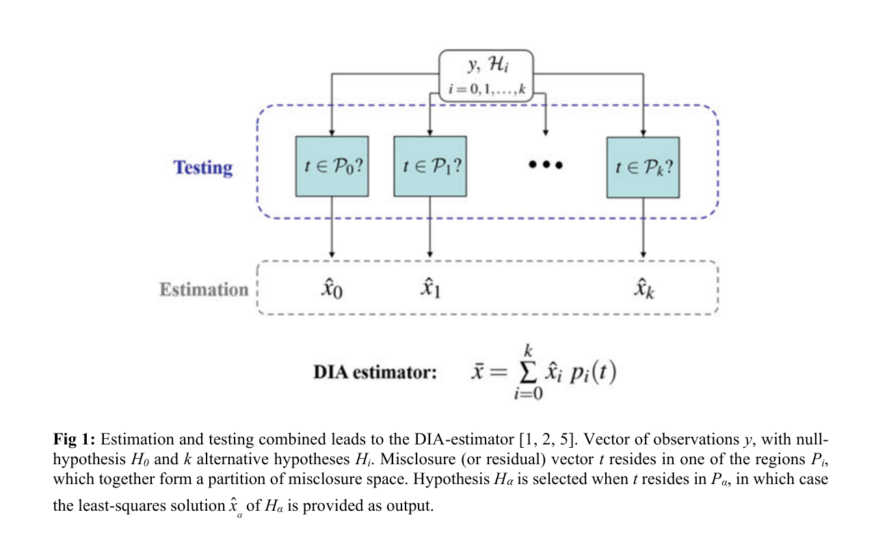
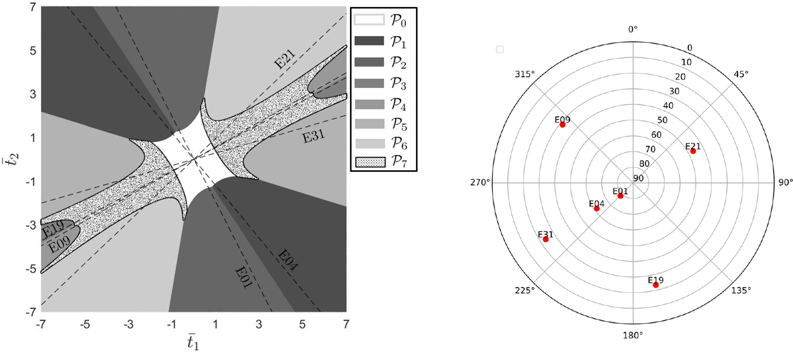
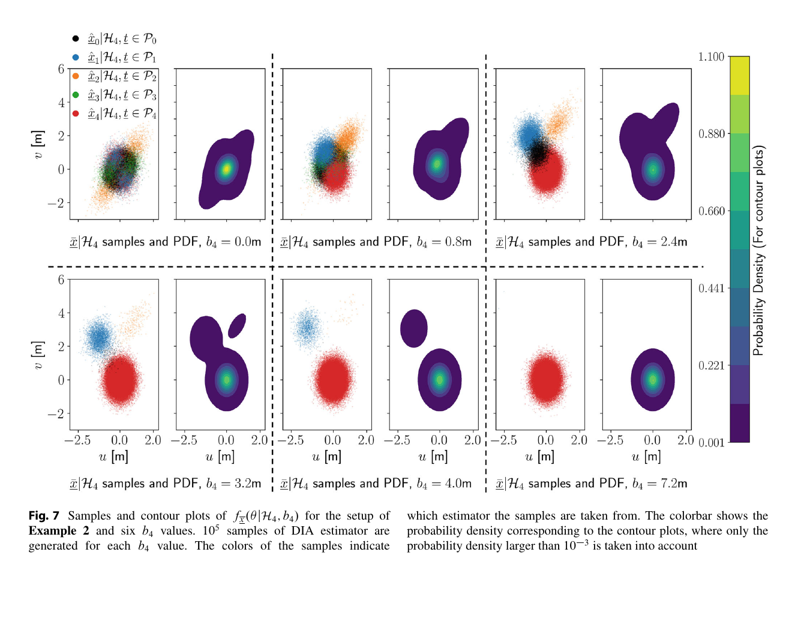

# 2026-10-29 GNSS 每日研究简报

## 今日快报

### 快报 1：泛热带 GNSS-R 相干性可解释约六成，但解释的是代理量而不是相位真值

- 主题：`cygnss-ddm-coherence-explainable-land-controls`
- 来源 ID：`doi:10.1186/s43020-026-00221-z`
- 来源链接：https://doi.org/10.1186/s43020-026-00221-z
- 发表日期：2026-10-21
- 来源类型：Satellite Navigation 同行评审开放论文
- 获取范围：CC BY 4.0 开放全文；CYGNSS L1 SDR v3.2、2020 年泛热带格网、相干代理量、空间交叉验证、区域留出、SHAP/ALE、消融与角度/分辨率敏感性已核对

**内容：** 作者把 CYGNSS 延迟—多普勒图的功率扩展压成相干代理量 PN，再把 2020 年观测汇总到南北纬 37.5° 之间的 $`0.025^\circ\times0.025^\circ`$ 格网；LightGBM 以地形粗糙度、坡度、水体、土壤湿度、植被与生物量等作为输入，并用空间分块交叉验证、区域留出和 SHAP/ALE 区分预测能力与经验响应。

**结论：** 空间交叉验证中树模型的 $`R^2`$ 约 0.61，RMSE 约 15 个 PN 代理单位；主导因素分区显示地形约占 68%，水体与植被各约 14%，土壤湿度约 4%。这些比例是 LightGBM 在给定特征集和主导判据下的归因，不是物理能量份额；PN 也不是直接相位相干系数，2020 单年横截面不能证明因果或跨气候年的稳定性。

**关注理由：** GNSS-R 应用常把 DDM 峰值直接送进反演。先判断相干/非相干散射机制，再做土壤湿度或水体反演，可避免把地形与植被导致的波形扩展误当成目标变量变化。

### 快报 2：Swarm 十二年共检出 87,594 次失锁；欧洲—西亚异常与干扰报告同现，但尚不能反演发射源

- 主题：`swarm-loss-of-lock-space-weather-regional-interference`
- 来源 ID：`doi:10.1007/s10291-026-02159-w`
- 来源链接：https://doi.org/10.1007/s10291-026-02159-w
- 发表日期：2026-10-16
- 来源类型：GPS Solutions 同行评审开放论文
- 获取范围：开放全文；Swarm A/B/C 2014–2025 年 POD sTEC 与 Langmuir Probe、RODI 筛查、年际/纬度/经度/地方时分布、独立干扰事件对照与方法边界已核对

**内容：** 论文把 Swarm 三星 GPS 双频接收机的 sTEC 中断筛成真正失锁，再用原位电子密度变化率指标 RODI 区分电离层不规则体。完整样本含 Swarm A 的 32,020 次、B 的 24,305 次和 C 的 31,269 次事件；2014–2025 年共 87,594 次，并覆盖一个完整太阳活动周期。

**结论：** 低纬赤道异常区与高纬极光区的失锁随太阳活动增强，符合电离层机理；但 2023 年后欧洲—西亚出现的聚集事件对应低且近乎均匀的 RODI，并与独立报道的广域 GNSS 干扰在时空上重合。作者把它解释为非电离层来源的强证据，但这种共现不能区分压制式干扰与欺骗，也不能由 Swarm 斜视链路反演地面发射源位置。Level-2 数据典型延迟约 5 d，方法属于事后分析而非实时告警。

**关注理由：** 科学卫星可成为全球射频环境的机会式传感器。工程系统应同时保留空间天气量和射频异常量，避免把每次失锁都归咎于接收机或电离层。

### 快报 3：飞行代表性硬件在环把 LEO 轨道做到 9.5 cm、时间同步到 1.0 ns，仍不是在轨闭环验收

- 主题：`leo-pnt-hardware-in-loop-odts-csac`
- 来源 ID：`doi:10.1007/s10291-026-02168-9`
- 来源链接：https://doi.org/10.1007/s10291-026-02168-9
- 发表日期：2026-10-16
- 来源类型：GPS Solutions 同行评审开放论文
- 获取范围：CC BY 4.0 开放全文；ATOMIC 载荷、Sentinel-6A 轨道场景、GPS/Galileo 信号模拟、广播星历、实时轨道滤波、CSAC 驯服、相位噪声分析与真实飞行数据回放已核对

**内容：** ATOMIC 由 Septentrio AsteRx-m3 Pro+、STM32H7 和 MicroSemi SA.45s 芯片级原子钟组成。硬件在环平台把精密轨道钟与真实广播导航消息送入 GNSS 信号模拟器，实时滤波同时估计 LEO 轨道、钟差和钟漂，再用 10 MHz 输出闭环驯服 CSAC；同日 Sentinel-6A 实际观测用于回放对照。

**结论：** 24 h 模拟弧段的三维轨道 RMS 为 9.5 cm，真实飞行数据回放为 9.0 cm；载荷时标相对 GNSS 系统时的精度为 1.0 ns，两种独立相位评估之差的标准差约 37 ps（等效 11 mm）。这是代表性硬件和高逼真信号环境的结果，不是载荷在轨辐射、热循环、天线与实时广播服务共同作用下的验收；模拟器还把信号特定群时延设为零，并用随机 TGD/ISC 误差作近似。

**关注理由：** LEO-PNT 不只要知道卫星在哪里，还要知道它的播发时刻。把轨道确定、时间同步与振荡器驯服放进同一硬件环，能提前暴露纯软件仿真看不到的接口、时延和控制环问题。

### 快报 4：全频 PPP-AR 的 98% 首历元厘米级来自产品—接收机闭合，机器学习只能做关联归因

- 主题：`all-frequency-ppp-ar-product-completeness-attribution`
- 来源 ID：`doi:10.1186/s43020-026-00223-x`
- 来源链接：https://doi.org/10.1186/s43020-026-00223-x
- 发表日期：2026-10-14
- 来源类型：Satellite Navigation 同行评审开放论文
- 获取范围：CC BY 4.0 开放全文；440 个 IGS MGEX 站、2025 年 5 月 28 d、每日两段 6 h、WUM/GBM 快速产品、未组合全频 LAMBDA/PAR、RF/XGBoost/SHAP 与五折验证已核对

**内容：** 作者用 GPS、Galileo 与 BDS-3 的未组合多频码相观测，直接联合固定各频点模糊度；15° 截止高度以上取满足 0.995 bootstrap 成功率的最大部分集合。440 站理论上最多可用 13 个可固定频点，WUM 与 GBM 产品的码/相位偏差覆盖差异决定哪些观测能真正进入 PPP-AR；随机森林与 XGBoost 再对几何、卫星数、频点数、SNR、多路径和星空熵作关联归因。

**结论：** 以水平误差 2.5 cm 为收敛阈值，WUM 方案 98% 首历元收敛，GBM 为 90%；95% 分位的收敛后水平/垂向误差分别为 WUM 1.6/4.2 cm、GBM 2.2/4.9 cm。去掉五个产品完整性特征后，分类准确率从 0.92 降至 0.65、AUC 从 0.98 降至 0.73；这支持“产品覆盖与可用观测强相关”，却不能把树模型重要度解释为因果贡献，也不能直接外推到实时链路延迟、动态遮挡或错误固定风险。

**关注理由：** “接收机支持某频点”不等于“该频点可固定”。产品端 OSB/码偏差、接收机跟踪通道和星座可见性必须闭合，才会出现看似瞬时的 PPP-AR。

### 快报 5：三座 12 m VLBI 天线已直接观测 Galileo E1/E6，但皮秒级精度仍被百皮秒系统项压住

- 主题：`galileo-vlbi-auscope-space-tie`
- 来源 ID：`doi:10.1007/s00190-026-02124-y`
- 来源链接：https://doi.org/10.1007/s00190-026-02124-y
- 发表日期：2026-10-08
- 来源类型：Journal of Geodesy 同行评审开放论文
- 获取范围：CC BY 4.0 开放全文；AuScope Hobart/Katherine/Yarragadee、两组短试验、四组 24 h 会话、E1/E6 相关/条纹拟合、2/8 bit、步进跟踪、近场时延模型与站坐标/基线解已核对

**内容：** 研究把 Galileo 卫星作为移动近场射电源，改造常规 VLBI 排程、天线指向、相关器输入和条纹拟合流程。三座 12 m VGOS 天线完成四组 24 h 观测；B1 用 2 bit、约 960 个 30 s 扫描，B2–B4 用 8 bit、每组约 500 个 120 s 扫描，并比较 5–30 s 的步进跟踪间隔和三种近场时延实现。

**结论：** 1 s 相干积分下 E1 时延精度达到数 ps，E6 优于 100 ps；但 8 bit 会话的后验残差 WRMS 仍约 12 cm（约 400 ps），2 bit B1 为 20.5 cm（683 ps）。站坐标只与先验在米级一致、基线在亚米级一致，且形式误差被作者明确判为过于乐观。因此当前结果证明“可观测和可解算”，还没有实现 Genesis 所需的厘米至毫米级空间联结。

**关注理由：** 把 GNSS 与 VLBI 的参考框架通过同一颗卫星直接连接，能减少地面共址测量误差；真正瓶颈已从热噪声转到信号链标定、极化、相关器和近场模型系统项。

## 深度研读

### 深读 1｜接收机工程｜检测不是解算后的补丁：残差落在哪个分区，就决定输出哪一个估计

- 类别：`receiver-engineering`
- 学习层级：`foundation`
- 选题定位：`经典基础：把检测、故障识别与模型适配写成同一个随机估计器，理解为什么“先剔星、再看协方差”会漏掉决策不确定性`
- 来源 ID：`fig:13837`
- 来源链接：https://www.fig.net/resources/proceedings/fig_proceedings/fig2026/papers/ts01g/TS01G_teunissen_13837.pdf
- 发表日期：2026-05-24
- 来源类型：FIG Congress 2026 公开会议论文
- 获取范围：8 页公开全文；DIA 三步、误差空间分区、复合 PDF、DIA 置信域与传统椭圆比较、Figures 1–3 已核对
- 价值评分：96/100（相关性 20，经典价值 20，证据 18，教学价值 20，工程价值 18）

#### 为什么先学这个

普通接收机流程看起来是“先算位置，再检残差，最后删掉坏星重算”。这会让人误以为检验只是估计后的质控附件。DIA 的关键提醒是：残差检验决定采用哪个模型，而模型又决定输出哪个位置估计；因此最终解既受观测噪声影响，也受检测、识别和适配决策影响。要讨论完整性，必须先把这两类随机性放进同一个对象。

#### 先修知识

需要理解线性化伪距模型、加权最小二乘、协方差、零假设与备择假设、卡方总体检验、Baarda $`w`$ 检验、残差/闭合差、虚警、漏检、正确识别和置信域。

#### 一句话逻辑

把闭合差向量 $`t`$ 的空间划成 $`\mathcal P_0,\ldots,\mathcal P_k`$：$`t`$ 落在哪个区就选择哪个假设和对应估计 $`\hat x_i`$，最终的 DIA 估计器是这些条件估计的分段组合，而不是其中任意一个高斯解。

#### 研究问题与约束

论文是面向测量质量控制的综述性会议贡献，重点是统一统计解释，不是新的道路数据或认证试验。示例采用线性高斯模型、预先列出的故障假设和合成 Monte Carlo；它能证明“估计与检验耦合后分布不再由单个协方差描述”，不能证明真实城市伪距满足高斯、单故障或完备威胁集。

#### 核心方法论

在正常模型 $`\mathcal H_0`$ 下估计 $`x`$，在每个 $`\mathcal H_i`$ 下增加故障签名 $`C_i b_i`$。用满足 $`B^TA=0`$ 的矩阵把观测投影成闭合差 $`t=B^Ty`$；总体检验先决定是否留在 $`\mathcal P_0`$，若拒绝，再以局部统计量决定落入哪个 $`\mathcal P_i`$。每个分区绑定一个条件 BLUE，所有分支合起来才是实际算法。

#### 关键公式逐步推导

零假设和第 $`i`$ 个备择假设写为：

```math
\mathcal H_0:\ y\sim\mathcal N(Ax,Q_{yy}),\qquad
\mathcal H_i:\ y\sim\mathcal N(Ax+C_i b_i,Q_{yy}).
```

闭合差向量及其协方差是：

```math
t=B^Ty,\qquad B^TA=0,\qquad Q_{tt}=B^TQ_{yy}B.
```

以 $`p_i(t)`$ 表示 $`t\in\mathcal P_i`$ 时为 1、否则为 0 的指示函数，实际输出为：

```math
\bar{x}=\sum_{i=0}^{k}\widehat{x}_i p_i(t).
```

这一步把“选哪一个模型”的离散随机性写进估计器。即使每个 $`\widehat{x}_i`$ 在自己的假设下是高斯，$`\bar{x}`$ 也会因分区截断与错误分支成为非高斯、多峰甚至不对称分布。

#### 经典价值与创新边界

经典价值是把残差检验、故障识别和重解算还原为一个统计闭环，避免拿某个已选模型的协方差冒充最终输出的完整不确定性。创新边界是本文主要综合既有 DIA 理论并作教学展开；分区、假设先验和误差模型如何针对具体接收机设计，仍需后续工程证据。

#### 整体逻辑链

列出正常与故障模型；把观测分成参数估计部分和闭合差部分；用闭合差执行检测；拒绝后识别最可能故障；按决策切换到相应估计器；对所有可能分支求复合 PDF；从完整 PDF 计算置信域或越界概率。下一节进一步问：既然分区决定最终风险，能否按任务后果主动设计分区，而不只追求“猜中故障标签”。

#### 原文图表与结果分析



> 图表源：Teunissen《How to Control Survey Quality when Estimation and Testing are Combined》Figure 1，[FIG Congress 2026 公开论文](https://www.fig.net/resources/proceedings/fig_proceedings/fig2026/papers/ts01g/TS01G_teunissen_13837.pdf)。原文未声明开放再许可；本地资产仅用于研究评论，以 Poppler 180 dpi 渲染 PDF 第 3 页并裁到原图与原图注，未重绘或更改箭头、分区、公式和标签。

上方 $`y,\mathcal H_i`$ 是同一组观测与候选假设；中间 Testing 区判断闭合差 $`t`$ 属于哪个 $`\mathcal P_i`$；下方 Estimation 区给出相应 $`\hat x_i`$。图直接说明最终 $`\bar x`$ 的函数形式随检验结果改变。它不能说明某个分区是最优的，也没有给出真实 GNSS 故障率；其价值是把常被代码拆成三段的随机过程画成一个估计器。

#### 原文结果论述

论文指出，DIA 的完整 PDF 可多峰、非对称或重尾；传统置信椭圆只在“已选模型正确且固定”条件下有名义覆盖。文中的 GPS 伪距 SPP 示意以 $`\sigma=0.5`$ m 和零假设正确接受率 90% 展示：要求更高覆盖率时，DIA 置信域与传统椭圆在大小和形状上明显分离。这里是合成几何的概率示例，不是实测接收机的完整性认证。

#### 常见误区与适用边界

第一，剔除坏观测后的小协方差不包含误剔与漏检。第二，检出故障不等于识别正确。第三，某个条件 BLUE 无偏不代表分段后的 DIA 估计无偏。第四，虚警率只约束 $`\mathcal H_0`$，不能自动约束位置越界概率。第五，未列入 $`C_i`$ 的共因故障不会被数学自动覆盖。第六，高斯名义模型不代表城市 NLOS 尾部已受控。

#### 工程实现步骤

1. 写清正常伪距模型、状态、权阵与所有需监测的故障签名。
2. 计算 $`B`$ 或等价残差投影，使闭合差与正常参数估计解耦。
3. 设定总体检验虚警率与局部识别规则，明确每个分区边界。
4. 为每个假设实现可复核的适配动作：删星、增广偏差或宣布不可用。
5. 用 Monte Carlo 同时统计正确接受、虚警、漏检、误识别和最终位置误差。
6. 从复合样本而非单一协方差构造位置置信域、保护边界与可用性。
7. 对未建模故障、相关误差和重尾分布单独做压力测试。

#### 复现实验设计

先复现一个最小模型：$`A=[1,1,1]^T`$、$`Q_{yy}=I_3`$，三个备择假设分别给一条观测加偏差；设总体检验 $`\alpha=0.1`$，对偏差/噪声比 0–10 每点生成 $`10^6`$ 组样本。比较“固定采用 $`\hat x_0`$”“检验后采用条件协方差”和“完整 DIA 样本”三种 90%、99.9% 置信区间。指标为覆盖率、区间长度、虚警、漏检、误识别和越界概率；失败用例加入两条同时偏、$`t`$ 相关和 Student-$`t`$ 噪声。

#### 与定位及低成本实现的联系

低成本接收机的伪距噪声、天线方向性和环境偏差变化快，最容易出现“删掉一颗星后形式精度反而变好”的假安全。DIA 视角要求同时记录删星决策的可信度和几何损失；算力不足时可减少假设数量，但不能把决策不确定性从质量输出中抹去。

#### 本节小结

只要算法会根据残差切换模型，最终输出就不再是一个固定高斯估计。检测、识别、适配和位置解必须作为同一个随机对象评价。

### 深读 2｜接收机工程｜把“识别对了”改成“后果可接受”：惩罚化分区怎样主动留出不可用区

- 类别：`receiver-engineering`
- 学习层级：`intermediate`
- 选题定位：`基础进阶：为每种“真实假设—算法决策”组合赋予任务惩罚，按最小平均惩罚设计闭合差空间，并在不可可靠区分时输出不可用`
- 来源 ID：`doi:10.1007/s00190-024-01859-w`
- 来源链接：https://doi.org/10.1007/s00190-024-01859-w
- 发表日期：2024-05-21
- 来源类型：Journal of Geodesy 同行评审开放理论论文
- 获取范围：CC BY 4.0 开放全文；惩罚化闭合差分区、最小平均惩罚定理、DIA/WSS 最优性、影响偏差、未知偏差近似、拒答区与 Galileo 伪距示例已核对
- 价值评分：98/100（相关性 20，经典价值 20，证据 19，教学价值 19，工程价值 20）

#### 为什么先学这个

上一节说明分区决定输出，但传统 OMT+$`w`$ 检验仍以“接受哪个假设”为中心。在安全任务里，错认故障标签的后果并不对称：误删一颗高仰角星可能只损失精度，漏掉一个强影响偏差却可能让位置越界。本文把任务后果写成惩罚，直接优化最终估计落入安全区的概率，并允许在难以区分时明确拒答。

#### 先修知识

需要掌握 DIA 分区、条件 BLUE、先验假设概率、似然/后验、决策理论、指示函数、均值惩罚、影响偏差、GNSS 天空几何和伪距故障可分离性。

#### 一句话逻辑

对每个观测闭合差 $`t`$，计算各种决策在所有可能真实假设下的期望惩罚，选择惩罚最小的决策；若“给出任一位置解”的惩罚都高于拒答，则把该区域划为不可用。

#### 研究问题与约束

论文给出一般理论和合成算例，假设候选故障签名与其发生概率或可用近似已知。偏差真实大小通常未知，作者因此给出用偏差 BLUE、影响偏差和简化惩罚的工程化方案。理论证明的是给定假设集、分布和惩罚后的最优性，不保证这些输入本身正确，也没有替任务方决定 AL、连续性成本或不可用成本。

#### 核心方法论

用 $`r_{i\alpha}(t)`$ 表示真实为 $`\mathcal H_\alpha`$ 时却选择决策 $`i`$ 的惩罚，用 $`\pi_\alpha`$ 表示假设概率。任一分区的平均惩罚等于各决策区内、各真实假设下惩罚与闭合差密度的积分。因为每个 $`t`$ 可逐点选择决策，最优分区就是把 $`t`$ 分给条件平均惩罚最小的决策。把“位置解落出容许区”设为惩罚，就得到最大化安全区内概率的 DIA 估计器。

#### 关键公式逐步推导

给定分区 $`\{\mathcal P_i\}`$，平均惩罚可写为：

```math
\bar r=\sum_i\sum_\alpha \pi_\alpha
\int_{\mathcal P_i} r_{i\alpha}(t)
f_t(t\mid\mathcal H_\alpha)\,dt.
```

因此每个 $`t`$ 的最优决策满足：

```math
i^*(t)=\arg\min_i\sum_\alpha
r_{i\alpha}(t)\,P(\mathcal H_\alpha\mid t).
```

若任务容许区为 $`\Omega_x`$，把惩罚取为条件位置越界概率：

```math
r_{i\alpha}(t)=P\!\left(\widehat{x}_i\notin\Omega_x
\mid t,\mathcal H_\alpha\right),
```

逐点最小化后，整体上就最大化 $`P(\bar x\in\Omega_x)`$。再增加第 $`k+1`$ 个“不可用”决策及惩罚 $`u_\alpha(t)`$，即可生成拒答区，而不是强迫每个 $`t`$ 都输出位置。

#### 经典价值与创新边界

经典价值是把检验设计从“最大正确识别率”推进到“最小任务后果”，并严格说明何时应当输出不可用。创新边界在于完整惩罚依赖未知偏差和高维积分；文中的 BLUE/影响偏差近似降低计算量，却可能因先验、尾部或几何漂移失配而失去名义最优性。

#### 整体逻辑链

建立 DIA 假设和闭合差密度；列出所有决策；为每个真实—决策组合赋惩罚；积分得到平均惩罚；逐点求最小惩罚分区；用容许位置区定义任务型惩罚；对未知偏差作可实现近似；在低可分离区增加不可用分区；用 Monte Carlo 审核位置越界与可用率。下一节把这个设计思想落到位置域：最终必须审计复合位置 PDF，而不只看某个分支的椭圆。

#### 原文图表与结果分析



> 图表源：Teunissen《On the optimality of DIA-estimators: theory and applications》Figure 14，[CC BY 4.0 开放全文](https://doi.org/10.1007/s00190-024-01859-w)。本地资产为 Springer 官方原始 PNG，未裁剪、重绘或更改分区、虚线、星号、天空图角度和标签。

右图是六颗 Galileo 星的天空图；E01/E04/E21/E31 的视线近似共面，E09/E19 约与该平面垂直。左图是二维闭合差空间：灰度 $`\mathcal P_0\ldots\mathcal P_6`$ 对应正常或逐星故障决策，点状 $`\mathcal P_7`$ 是不可用区；E09 与 E19 的故障线几乎重合，说明几何使两颗星的伪距偏差难以区分。图证明拒答区可围住易误识别方向，但不提供真实故障率，也不代表该分区在另一历元仍最优。

#### 原文结果论述

作者证明，若只奖励正确假设，经典数据探测可作为特定惩罚结构的特例；若惩罚最终估计落出用户容许区，则最优 DIA 在其分段估计器类中最大化 $`P(\bar x\in\Omega_x)`$。Galileo 示例显示，近重合故障线会使 E09/E19 伪距异常难分，增加不可用区可以避免强行二选一。这里是理论与合成几何结果，不是航空认证的实测完整性风险。

#### 常见误区与适用边界

第一，最大正确识别率不等于最小位置风险。第二，不可用不是算法失败，而是受控输出。第三，惩罚值来自任务需求，不能用训练数据任意调到最好看。第四，先验概率错误会移动分区边界。第五，故障线近重合时增加样本量不一定恢复几何可分离性。第六，未知偏差近似不能冒充已知真值。第七，高维全局积分可能不满足实时预算。

#### 工程实现步骤

1. 从应用给出安全区、误告警成本、漏检成本、误识别成本和不可用成本。
2. 按当前几何计算每个故障签名在闭合差空间的方向与可分离角。
3. 以历史监测和保守上界设置 $`\pi_\alpha`$，记录其不确定范围。
4. 先实现经典 OMT+$`w`$ 基线，再实现逐点最小平均惩罚规则。
5. 在最大后验或最小惩罚差距不足时输出不可用。
6. 用重要抽样或准 Monte Carlo 估计安全区内概率与罕见越界。
7. 对几何、权阵、先验和偏差幅值漂移做敏感性分析并在线重算分区。

#### 复现实验设计

取 $`A=[1,1,1]^T`$、$`Q_{yy}=I_3`$ 和三条单观测故障线，设 $`\pi_0=0.99`$，三个故障等分余下概率；偏差标准差扫描 0–8，容许区取 $`|\bar x-x|\le1`$。比较 OMT+$`w`$、最大后验、最小位置越界惩罚和含不可用区四种规则，每点 $`10^6`$ 次仿真。指标为正确接受、正确识别、错识别、不可用率、$`P(|PE|>1)`$ 和每历元计算量；失败用例把两条故障线夹角压到 1°，并把真实故障率设为先验的 10 倍。

#### 与定位及低成本实现的联系

低成本终端常在少星、相关多路径和不稳定权阵下运行，故障线更容易靠近。与其在每个历元强制输出坐标，不如设置明确的不可用位和降级模式；手机可以少做高维积分，但必须把“无法可靠区分”传给上层，而不是只返回一个看似连续的轨迹。

#### 本节小结

检验的目标不应停在“猜中哪颗星坏了”。真正要优化的是错误决策对位置任务的后果；当后果无法受控时，拒答是合理的最优决策。

### 深读 3｜定位｜完整性不能只看协方差：把检测错误混进纯 GNSS SPP 的位置分布

- 类别：`positioning`
- 学习层级：`advanced`
- 选题定位：`定位深入：把多星座纯 GNSS SPP 的伪距故障检测、识别与重解算合成位置域复合 PDF，再由越界概率而非单一误差椭圆判断可用性`
- 来源 ID：`doi:10.1007/1345_2024_246`
- 来源链接：https://doi.org/10.1007/1345_2024_246
- 发表日期：2024-07-12
- 来源类型：International Association of Geodesy Symposia 同行评审开放会议论文
- 获取范围：CC BY 4.0 开放全文；DIA 位置 PDF、虚警/漏检/正确与错误识别分解、四测距二维位置算例、Monte Carlo、Figures 1–7 与 SPP 维数讨论已核对
- 价值评分：97/100（相关性 20，经典价值 19，证据 19，教学价值 19，工程价值 20）

#### 为什么先学这个

前两节说明怎样形成和设计分区，但定位系统最终关心的不是闭合差图是否漂亮，而是位置是否越过任务允许边界。纯 GNSS SPP 会随卫星数和几何形成十几到几十维闭合差空间；一次误识别会切换到另一套删星解，使位置 PDF 出现离散分支。只传播当前分支的协方差，会系统性忽略这些尾部。

#### 先修知识

需要理解广播星历 SPP、伪距线性化、接收机钟差、星座间偏差、加权最小二乘、残差投影、DIA 分区、条件概率、混合分布、Monte Carlo、位置告警限与完整性风险。

#### 一句话逻辑

对每个正常、漏检、正确识别和错误识别事件分别传播其位置解与概率，再把所有分支叠成 $`f_{\bar x}`$；纯 GNSS SPP 是否可信，应由该复合分布落出位置安全区的概率决定。

#### 研究问题与约束

原文用两个合成测距例子展示分布机理，其中二维位置例含四个同步距离观测、$`\sigma=0.5`$ m、四个单观测偏差假设和 $`\alpha=0.1`$；它不是广播星历、多星座时钟与城市 NLOS 的完整 SPP 实验。论文明确指出，三系统约 24 星的 SPP 在已校准星座间偏差时可有约 20 维冗余，质量计算会转成高维积分问题。下面向纯 GNSS SPP 的实现与实验属于基于原理论的工程迁移，不能伪称为原文实测结果。

#### 核心方法论

先把 SPP 伪距在当前近似位置线性化，正常假设估计位置增量与钟差；每个故障假设增加逐星偏差或故障组。闭合差决定采用正常解、正确删星解或错误删星解。对每个真实假设，把正确接受、虚警、漏检、正确识别和错误识别对应的条件位置密度乘以事件概率并相加。最后在水平或三维安全区外积分，得到包含检验不确定性的定位失败概率。

#### 关键公式逐步推导

纯 GNSS SPP 的线性化码观测可写成：

```math
\Delta p=G\,\Delta x+c\,\delta t+\varepsilon+C_i b_i,
```

其中 $`\Delta x`$ 为位置增量，$`\delta t`$ 为接收机钟差；多星座时还需加入星座间钟/码偏差列。DIA 输出仍为：

```math
\bar{x}=\sum_{j=0}^{k}\widehat{x}_j p_j(t).
```

在真实故障 $`\mathcal H_i`$ 下，复合位置密度分解为：

```math
f_{\bar x}(x\mid\mathcal H_i,b_i)=
P_{MD_i}f_{\widehat{x}_0\mid MD_i}(x)
+P_{CI_i}f_{\widehat{x}_i\mid CI_i}(x)
+\sum_{j\ne0,i}P_{WI_{i,j}}f_{\widehat{x}_j\mid WI_{i,j}}(x).
```

给定位置选择矩阵 $`F`$ 和告警限 $`AL`$，位置失败概率为：

```math
P_F=P\!\left(\|F(\bar{x}-x)\|>AL\right),
```

积分对象必须是 $`f_{\bar x}`$，而不是任一 $`\widehat{x}_j`$ 的高斯近似。

#### 经典价值与创新边界

经典价值是指出“线性高斯观测+无偏最小二乘”一旦经过模型选择，最终位置分布仍可非高斯、多峰且有偏；这直接解释了为什么剔星后的形式协方差会低估风险。创新边界是高维 PDF 的精确计算昂贵，且结果强依赖故障假设、偏差幅值和权阵；论文提出的是分析框架与挑战，不是可直接认证的实时保护级产品。

#### 整体逻辑链

形成纯 GNSS SPP 功能与随机模型；枚举逐星/共因故障；构造闭合差和分区；执行检测与识别；为每个分支计算条件位置解；按事件概率混合成完整 PDF；在安全区外积分；与单一协方差椭圆比较；若计算或证据不足则宣布不可用。至此，三篇精读完成“统一估计器—按后果设计分区—在位置域计算真实风险”的链条。

#### 原文图表与结果分析



> 图表源：Teunissen 等《The DIA-Estimator for Positional Integrity: Design and Computational Challenges》Figure 7，[CC BY 4.0 开放全文](https://doi.org/10.1007/1345_2024_246)。本地资产以 Poppler 180 dpi 渲染 Springer 开放论文合集印刷页 117，仅裁到 Figure 7 及原图注，未重绘或改变点、颜色、坐标、密度等值线和数值。

每个偏差 $`b_4`$ 都有样本散点与对应密度等值线；横纵轴是二维位置 $`u,v`$，单位 m，颜色表示最终采用哪一个条件估计器，等值线只显示密度大于 $`10^{-3}`$ 的部分。作者对每个 $`b_4=0,0.8,2.4,3.2,4.0,7.2`$ m 生成 $`10^5`$ 个样本。中等偏差时出现分离的副模态，说明误识别能把位置概率质量推到另一个区域；大偏差到 7.2 m 时正确识别接近 1，分布重新收拢。图是同步四测距合成例，不直接给出真实 GNSS 城市风险。

#### 原文结果论述

在 $`b_4=0`$ 时约 90% 样本采用正常解，约 10% 因 $`\alpha=0.1`$ 落入其他分支；$`b_4=3.2`$ 与 4.0 m 时主要由正确的 $`\widehat{x}_4`$ 和相近故障线对应的错误 $`\widehat{x}_1`$ 共同构成，产生多峰；到 7.2 m 时正确识别概率接近 1，位置解近似恢复无偏。结果证明最危险区域往往不是“故障最大”，而是“足以移动位置、又难以可靠识别”的中间偏差。

#### 常见误区与适用边界

第一，最大偏差不一定产生最大完整性风险。第二，协方差只描述选定分支内部扩散。第三，位置 PDF 的副峰可能来自错误决策，不是观测噪声重尾。第四，单星故障枚举不覆盖卫星钟共因或区域电离层。第五，SPP 的星座间偏差未校准会占用冗余并改变分区。第六，Monte Carlo 中未出现越界不能证明极小风险。第七，合成测距几何不能代替道路实测与独立真值。

#### 工程实现步骤

1. 用广播星历、卫星钟、相对论、Sagnac、电离层和对流层模型形成逐星码残差。
2. 在状态中显式加入接收机钟差与星座间偏差，按 C/N0/仰角构造名义权阵。
3. 对每颗星和重要共因故障建立 $`C_i`$，计算检测与可分离性。
4. 运行 OMT、逐星识别和删星/偏差增广，保存每个分支而非只保存胜者。
5. 用分层或重要抽样生成名义、边界偏差、双故障和重尾样本。
6. 从所有分支样本估计水平/垂直复合 PDF、$`P_F`$ 与最小覆盖半径。
7. 对比正常解椭圆、条件删星椭圆和完整 DIA 区域；证据不足时输出不可用。

#### 复现实验设计

选一座 IGS 站 24 h、30 s GPS+Galileo 码观测，仅用广播星历/钟和标准大气模型做纯 GNSS SPP；以站坐标作独立真值。基线为等权 SPP、仰角权 SPP 和 OMT+$`w`$ 删星。向每星分别注入 0–30 m 阶跃，另加两星同向偏差和 300 s 斜坡；每个幅值至少 $`10^5`$ 次几何/噪声重采样，$`\alpha`$ 扫描 $`10^{-1}`$ 至 $`10^{-5}`$。指标为水平/垂直 RMSE、95%/99.9% 分位、虚警、漏检、误识别、不可用率、条件椭圆覆盖率和 $`AL=10`$ m 的位置失败概率；失败用例加入相关 NLOS 与错误权阵。

#### 与定位及低成本实现的联系

低成本 SPP 通常无法承担在线高维积分，但可以离线按卫星数、PDOP、环境和接收机类型预计算风险表，在线用当前几何索引；也可用重要抽样聚焦中等偏差和近重合故障线。关键不是一定实时画出完整 PDF，而是不能把模型选择后的单一协方差当作完整性声明。

#### 本节小结

纯 GNSS SPP 的风险来自观测噪声与检验决策的共同传播。只有把正常、漏检、正确与错误识别分支混合起来，位置告警限和不可用判据才有可信的概率含义。
