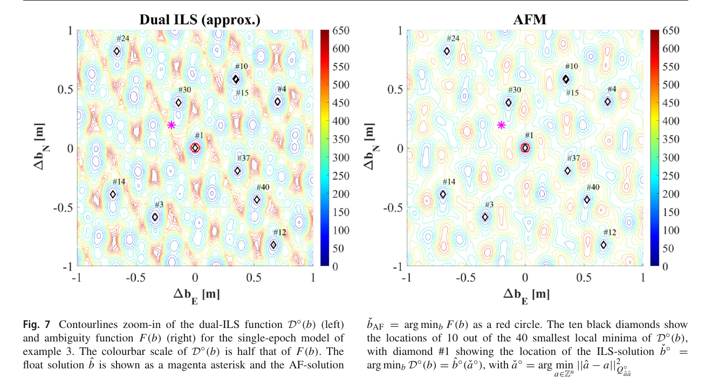
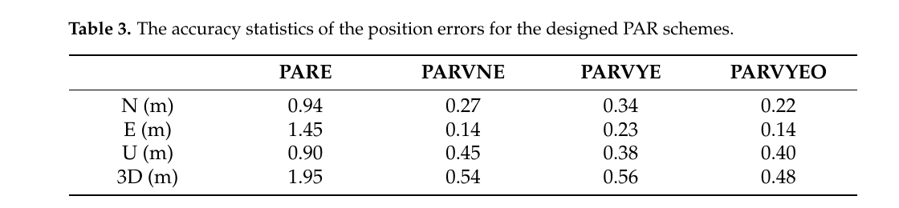
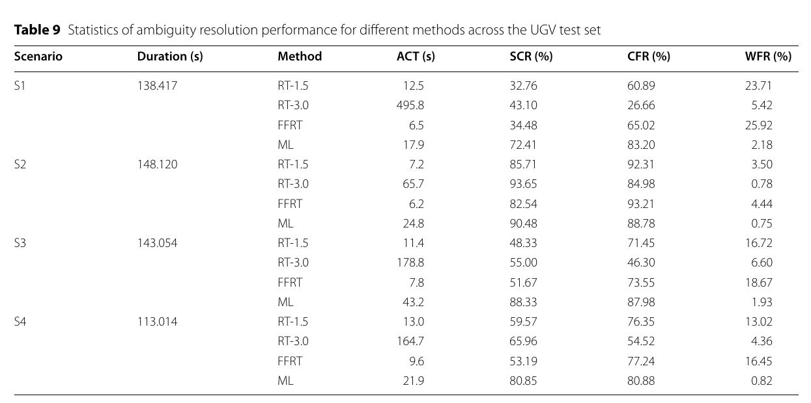

# 2026-10-30 GNSS 每日研究简报

## 今日快报

### 快报 1：把路线与星座时间一起规划，城市测图的连续固定段可由 56 m 增至 744 m

- 主题：`route-time-aware-gnss-mission-planning`
- 来源 ID：`doi:10.1007/s10291-026-02172-z`
- 来源链接：https://doi.org/10.1007/s10291-026-02172-z
- 发表日期：2026-10-28
- 来源类型：GPS Solutions 同行评审开放软件论文
- 获取范围：CC BY 4.0 开放全文；空间—时间射线追踪、GPS/Galileo 星历传播、三条验证路线、Tables 1–3、Figures 1–8 与开源代码入口已核对

**内容：** AetherMMS 不把任务规划简化成一个固定点的天空图，而是把每个轨迹点绑定到实际历元，用地形、建筑、植被、隧道和覆盖道路重建环境，再逐条射线判断 GPS/Galileo 链路为 LOS、遮挡、植被退化或 GNSS-denied。候选时窗以 LOS 数、PDOP 与解连续性加权排序，目标是在采集前识别路线中的几何弱段。

**结论：** 在论文的城市峡谷路线中，加入遮挡后平均可见星数由 17.00 降至 10.99，PDOP 大于 4 的历元占 13%。同一路线、同一处理配置在预测最佳与最差时窗各测一次，固定历元比例从 6.3% 增至 25.7%，连续固定路线从 56 m 增至 744 m。两次实测不是随机化重复试验，城市模型也未显式表示屋顶细节和路侧细长障碍，因此证据支持“规划能改善本案例观测条件”，不等于保证另一城市获得同倍率收益。

**关注理由：** 城市 RTK 的失败常在出发前就由路线—时间几何决定。把规划输出同实测固定率闭环，可在不改接收机算法的前提下减少不可解区段，但必须把模型完整度和跨日可重复性纳入验收。

### 快报 2：近场 GNSS 看到 2011 与 2026 位移图样近乎一致，但只能约束矩与位置，不能拆开长宽滑移

- 主题：`near-field-gnss-repeating-asperity-evidence`
- 来源 ID：`doi:10.1186/s40623-026-02573-x`
- 来源链接：https://doi.org/10.1186/s40623-026-02573-x
- 发表日期：2026-10-26
- 来源类型：Earth, Planets and Space 同行评审开放快报
- 获取范围：CC BY-NC-ND 4.0 开放全文；GEONET PPP-AR 日解、四次地震矩形断层反演、Figures 1–4、Table 1、先验与参数权衡已核对

**内容：** 研究用日本 GEONET 永久站的 PPP-AR 日坐标比较 1994、2011、2025 与 2026 年约 $`M_w7.5`$ 板间地震。2025/2026 位移取震后一天减震前 10 天平均；2011 年使用 30 s 运动学 GNSS 的震前后各 11 历元中值。作者以矩形断层模型反演源区，并把 2026 模型沿板界面平移 0.2° 检查位移图样对位置的敏感性。

**结论：** 日坐标水平与垂向标准差约 1–2 mm 和 4 mm，而三次事件最大水平同震位移约 10 cm。2011 与 2026 的位移差没有出现平移模型预测的约 20 mm 系统图样，作者据此判断两次源区大体重叠。论文同时明确长、宽、滑移存在显著权衡：GNSS 能较好约束地震矩，却不能分别唯一确定这些参数；“复发 asperity”也不是具体下一次地震时间的预测。

**关注理由：** 这是一例把毫米级坐标、厘米级同震位移和断层模型可辨识性分开的好范例。GNSS 给出的不是无限分辨率图像，工程报告应同时写出观测噪声、模型先验和不可分参数。

### 快报 3：R3DI 用多元中位数逐步加站，合成速度恢复差中位数仅 0.04 mm/yr

- 主题：`robust-3d-gnss-strain-imaging-europe`
- 来源 ID：`doi:10.1093/gji/ggag461`
- 来源链接：https://doi.org/10.1093/gji/ggag461
- 发表日期：2026-10-24
- 来源类型：Geophysical Journal International 同行评审接受稿（最终排版前版本）
- 获取范围：CC BY 4.0 接受稿摘要与书目信息；核对 R3DI 多元中位数、2σ 自适应邻域、欧洲合成棋盘与实际速度场结果；最终排版全文尚可能有文字或图号变动

**内容：** Robust 3D Imaging（R3DI）以水平应变率和局部旋转的多元中位数抵抗离群站，并逐步扩大邻域，直到估计在 2σ 水平显著；空间分辨率因而由站网密度和局地形变量共同决定，而不是先固定一个平滑尺度。算法还在同一分辨率下估计垂向地表运动。

**结论：** 作者报告欧洲规则合成形变棋盘的预测速度与输入之差中位数为 0.04 mm/yr，长度相似度 74.9%；实际场中恢复出斯堪的纳维亚约 +12 nstrain/yr 的大尺度伸展和 Groningen 气田上方约 −134 nstrain/yr 的小尺度收缩。与 EuVeM2022 相比，水平速度均差为全欧洲 1.1 mm/yr、稳定欧洲 0.4 mm/yr。当前版本是接受稿，且恢复能力依赖站网覆盖，不能把无站区的平滑结果解释成同等分辨率观测。

**关注理由：** 高密度 GNSS 速度场的瓶颈已从“有没有速度”转向“局地异常能否抵抗离群点并保留尺度”。2σ 自适应邻域比统一窗口更可解释，也要求同时发布局部分辨率与显著性。

### 快报 4：低成本 GNSS+MEMS 可重建 0.5 mm 振动，但 0.1–0.2 mm 是受控振动台误差，不是现场保证

- 主题：`mass-market-gnss-mems-millimeter-vibration`
- 来源 ID：`doi:10.1007/s10291-026-02161-2`
- 来源链接：https://doi.org/10.1007/s10291-026-02161-2
- 发表日期：2026-10-14
- 来源类型：GPS Solutions 同行评审开放实验论文
- 获取范围：CC BY 4.0 开放全文；10 Hz 非组合运动学 PPP、50 Hz MEMS、0.5–20 mm/1 Hz 振动台、三类接收机、Tables 1–3 与 Figures 1–11 已核对

**内容：** 实验让 Trimble Alloy、Septentrio Mosaic-X5 与 u-blox ZED-F9P 以 10 Hz 记录 GNSS，同时用 50 Hz RedShift Labs UM7 MEMS 加速度计，振动台产生频率 1 Hz、幅值 20、10、5、2.5、1 和 0.5 mm 的六组正弦运动。GNSS 先以非组合高率 PPP 求位移，再同加速度记录融合；作者还用双差相位残差解释 PLL 动态应力误差。

**结论：** u-blox 的 GNSS-only 解在幅值大于 5 mm 时未见明显过冲，却因噪声无法可靠识别 1 mm；Trimble 的窄 PLL 带宽造成更明显幅值高估。融合解在 0.5 mm 运动上给出 0.1–0.2 mm 幅值误差，并更清晰恢复 1 Hz 主频。证据来自单频正弦、短基线受控振动台和已知运动，不覆盖桥梁温漂、传感器时标漂移、宽带非平稳振动或长期现场可靠性。

**关注理由：** 相位精度与动态跟踪不是一回事。低成本结构监测除了比较静态相位噪声，还要测试 PLL 带宽、时标同步和融合算法在真实频谱下是否把动态幅值保真。

### 快报 5：闪烁时谁先失锁不只看频率：22 dB-Hz 余量与鉴相器拉入范围共同决定 L1/L2C/L5 排名

- 主题：`gps-multifrequency-scintillation-loss-of-lock`
- 来源 ID：`doi:10.33012/2026.20654`
- 来源链接：https://doi.org/10.33012/2026.20654
- 发表日期：2026-10-07
- 来源类型：ION GNSS+ 2026 同行评审会议论文
- 获取范围：ION 官方摘要与书目信息；核对 2026 年 1 月风暴、Daytona Beach 50 Hz PolaRx5S 数据、22 dB-Hz 门限、相位屏与后相关跟踪仿真；正文需下载额度，未取得逐星事件计数和环路参数表

**内容：** 研究用同一中纬度风暴期间的 GPS L1 C/A、L2C 与 L5 比较失锁声明，并用同一相位屏闪烁 realization 驱动三频后相关仿真。失锁分成两类：报告 C/N0 触及固定门限，或 Doppler 跟踪误差越过鉴相器拉入范围；前者由平均功率余量主导，后者由快速衰落与环路结构主导。

**结论：** 官方摘要称多数声明发生在 C/N0 达到 22 dB-Hz 时，L5 因基线 C/N0 较高而更少触门限；慢衰落下 L2C 余量最小而较易失锁，快速衰落被 C/N0 平均后，数据调制 L1 C/A 的 Costas 鉴相器拉入范围仅为 L2C/L5 导频四象限鉴相器的一半，L1 可在门限以上先失锁。由于未取得全文，本文不补写事件数、环路带宽或统计显著性，也不把一次风暴排序外推到所有接收机。

**关注理由：** “频率越低闪烁越强”不足以预测接收机连续性。多频设计必须把信号功率、C/N0 估计窗口、数据/导频鉴相器和动态拉入范围一起进入失锁预算。

## 深度研读

### 深读 1｜接收机工程｜不显式搜索整数也不等于没有整数风险：歧义函数的周期似然与全局地形

- 类别：`receiver-engineering`
- 学习层级：`foundation`
- 选题定位：`经典基础：从载波相位的周期性出发，给经典歧义函数补上圆形正态概率模型，并看清多峰、非唯一、加权和全局优化为何是同一个问题`
- 来源 ID：`doi:10.1007/s00190-025-01945-7`
- 来源链接：https://doi.org/10.1007/s00190-025-01945-7
- 发表日期：2025-04-04
- 来源类型：Journal of Geodesy 同行评审开放理论论文
- 获取范围：CC BY 4.0 开放全文；Theorems 1–3、Examples 1–3、branch-and-bound/凸松弛/PGD、Figures 1–7 与 Tables 1–2 已核对
- 价值评分：96/100（相关性 20，经典价值 20，证据 19，教学价值 19，工程价值 18）

#### 为什么先学这个

RTK 的厘米级信息来自载波，但载波只告诉相位落在一个周期里的位置。经典 ambiguity function（AF）把整数周通过余弦周期性“消掉”，看似不必解整数；真正的代价是目标函数充满局部极值，某些模型还会出现多个等价基线。先理解这个周期地形，才能判断后续的部分固定与学习型验收是在解决什么风险。

#### 先修知识

需要理解单差/双差载波相位、波长、整周模糊度、基线向量、加权最小二乘、最大似然、整数最小二乘（ILS）、圆形变量、分支定界和凸下界。

#### 一句话逻辑

把相位误差送进余弦得到对整数平移不敏感的周期目标；用独立 von Mises（圆形正态）观测把它解释为似然，再用伪距打破非唯一性，并以凸松弛给分支定界提供可证明的全局下界。

#### 研究问题与约束

论文解决两个长期缺口：AF 何时是最大似然估计，以及怎样在有限 $`\epsilon`$ 容差内找到全局最优。理论要求用于 AF 似然的相位分量独立且服从圆形正态；这使原始未差或接收机间单差更自然。双差相位互相关，直接套用同一似然会依赖参考星定义；论文的数值例以短基线、单/双频和合成模型说明机理，不是城市实测 RTK 产品验收。

#### 核心方法论

载波模型写成 $`\phi=A_\phi a+B_\phi b+\varepsilon_\phi`$。因 $`A_\phi a`$ 为整数，余弦后消失，AF 只关于连续基线 $`b`$。作者证明整数不变性也可能让 $`b`$ 非唯一；加入满秩伪距的高斯项可正则化。对多峰负对数似然，算法把搜索盒递归分裂，用可微凸下界计算每盒下界，以 projected gradient descent 求界并剪去不可能优于当前解的盒。

#### 关键公式逐步推导

以周为单位的相位向量给出：

```math
\phi=A_\phi a+B_\phi b+\varepsilon_\phi,qquad a\in\mathbb Z^n.
```

整数项在周期函数中消失：

```math
AF(b)=\mathbf 1^T\cos\!\left[2\pi(\phi-B_\phi b)\right].
```

若各相位分量独立且 $`2\pi\phi_i`$ 服从 von Mises 分布，集中参数为 $`w_i`$，并加入独立高斯伪距 $`p`$，负对数似然可写为：

```math
F(b)=\frac12\|p-B_pb\|_{Q_{pp}}^2
+\sum_{i=1}^{m}w_i\left[1-\cos\!\left(2\pi c_i^T(\phi-B_\phi b)\right)\right].
```

于是 $`w_i`$ 能显式表达频点、仰角或 C/N0 差异；分支定界在盒 $`[l,u]`$ 上以 $`F_L(b)\le F(b)`$ 计算下界，只有下界仍可能优于当前上界的盒才继续细分。

#### 经典价值与创新边界

经典价值是把“相位周期对齐”从启发式相关峰提升为有明确分布假设的最大似然问题，并首次系统指出 AF 基线可能非唯一。创新边界是独立圆形正态并不自动适用于任意双差或重尾多路径；全局收敛保证是相对于给定模型、盒范围和 $`\epsilon`$，不保证模型本身正确。

#### 整体逻辑链

相位周期性消掉显式整数；检查周期不变性是否造成等价基线；用伪距恢复可辨识性；以 von Mises 建立加权似然；分析梯度和 Hessian 看到严重多峰；构造凸下界；分支定界全局搜索；再同 ILS 比较成功率和基线 RMS。下一节把“不能盲目固定全部整数”转化为工程子集选择。

#### 原文图表与结果分析



> 图表源：Teunissen 与 Massarweh《Theory for the ambiguity function method: probability model and global solution》Figure 7，[CC BY 4.0 开放全文](https://doi.org/10.1007/s00190-025-01945-7)。本地资产以 Poppler 180 dpi 渲染原 PDF 第 14 页，仅裁到原图与图注；未重绘或改变等高线、坐标、色标、标记和数值。

左右横纵轴分别是东、北基线增量 $`\Delta b_E,\Delta b_N`$，单位 m；左侧 Dual ILS 色标是右侧 AFM 的一半。黑菱形是 Dual ILS 的局部极小位置，红圈是 AF 解，洋红星号是浮点解。两幅图的局部盆地位置很接近，但色标与目标函数不同；图直接显示“局部形状可相似”，不能证明 AF 与 ILS 在一般协方差、差分定义或成功率下等价。

#### 原文结果论述

Table 2 把卫星数由 8 降到 6、5，使模型成功率从 99.99% 降到 86.84%、45.06%。相应 ILS/AF 基线 RMS 从 1.0/1.1 cm 变为 113.6/113.9 cm 和 372.5/372.9 cm；低成功率时两者甚至接近 418 cm 的浮点 RMS。结果说明 AF 虽不显式输出整数，质量仍由整数成功率驱动。

#### 常见误区与适用边界

第一，余弦消掉 $`a`$ 不等于整数风险消失。第二，局部梯度收敛不等于全局极值。第三，双差相关相位不能无条件当独立 von Mises。第四，网格更密只降低离散误差，不自动覆盖正确盆地。第五，伪距正则化会引入自身权阵和异常风险。第六，AF 与 ILS 局部相似不代表统计原则相同。

#### 工程实现步骤

1. 以未差或接收机间单差相位建立可追溯模型，明确单位为周。
2. 按频点、仰角和 C/N0 标定 $`w_i`$，检查残差圆形分布与独立性。
3. 加入伪距或基线先验，先做秩与等价解距离检查。
4. 用粗搜索获得有限初始盒和当前上界。
5. 为每个盒计算凸下界，按最低下界优先细分并记录 $`\epsilon`$。
6. 同 LAMBDA/ILS、浮点解和多初值局部优化比较。
7. 输出最优值差、次优盆地距离和模型成功率，而不只输出坐标。

#### 复现实验设计

构造 1 m 水平短基线，GPS L1 单频，8/6/5 星三种几何；相位标准差 2 mm、码标准差 0.5 m，分别生成 $`10^4`$ 次无多路径 Monte Carlo，再加入 0.2 周单星偏差与相关双差噪声。比较浮点 WLS、1 cm/5 cm 网格 AF、多初值 BFGS、论文 BB-AF 与 LAMBDA-ILS。指标为全局命中率、基线 E/N/U RMS、运行时、搜索盒数、次优峰差和对参考星的敏感性；失败用例包括错误权、盒不含真值及伪距粗差。

#### 与定位及低成本实现的联系

低成本接收机的相位中断多、码噪声大，AF 的周跳不敏感性有吸引力，但多路径会破坏独立圆形模型，宽盒全局搜索也可能超出实时预算。可把 AF 用作短窗口重捕获或候选生成器，再由几何、码和时间连续性验收，而非替代所有整数质量控制。

#### 本节小结

歧义函数把整数写进周期似然而不是让整数消失。真正可用的 AF 必须同时处理可辨识性、权重、多峰全局搜索和成功率。

### 深读 2｜接收机工程｜固定失败后别只删低仰角：用稳健残差、机体系方位与 PDOP 选择整数子集

- 类别：`receiver-engineering`
- 学习层级：`intermediate`
- 选题定位：`基础进阶：在单频城市 RTK/INS 中把“全固定失败”拆成残差异常、低仰角和几何退化三类，再逐步选择仍值得固定的模糊度子集`
- 来源 ID：`doi:10.3390/electronics14132712`
- 来源链接：https://doi.org/10.3390/electronics14132712
- 发表日期：2025-07-04
- 来源类型：Electronics 同行评审开放实验论文
- 获取范围：CC BY 4.0 开放全文；单频紧组合模型、IGG-III 稳健残差、五种 FAR/PAR 方案、两组车载数据、Figures 1–15 与 Tables 1–7 已核对
- 价值评分：92/100（相关性 19，经典价值 17，证据 18，教学价值 19，工程价值 19）

#### 为什么先学这个

上一节说明所有整数是否可辨由模型强度决定。城市环境中，一颗高仰角 NLOS 星也可能比低仰角 LOS 星更坏；盲目全固定会误固定，单纯按仰角剔除又可能破坏几何。部分模糊度固定（PAR）的核心不是“少固定一些”，而是用可解释证据选择哪一组仍值得固定。

#### 先修知识

需要理解单频双差 RTK、LAMBDA、ratio test、整数成功率、单位权中误差、后验残差、IGG-III 稳健估计、PDOP、INS 姿态与机体系方位角、紧组合滤波。

#### 一句话逻辑

先用 INS 位置构造单频双差浮点模糊度；全固定验收失败时，优先删除稳健后验残差越界的星，其次删除不高于 35° 的最低仰角星，最后在四个机体系方位象限各选候选，以“删后 PDOP 最小”决定下一颗删除星。

#### 研究问题与约束

论文使用 Bynav A1-3L 消费级 GNSS/INS、1 Hz GNSS 和 100 Hz ADIS-16505 IMU，两组济南城市车载数据；基线一组超过 10 km，参考为 Inertial Explorer 8.90 平滑紧组合。该参考与被测系统共享 GNSS/INS 数据，不是全站仪或独立高等级真值；方法也依赖 INS 能提供足够好的位置和姿态，因而不能把收益归为纯 GNSS。

#### 核心方法论

初次 LAMBDA 固定同时要求 ratio、成功率与单位权中误差通过，阈值分别为 3.0、99% 和 0.006 m。若失败，IGG-III 生成稳健后验残差；最大绝对残差超过半波长就删对应星。否则若最低仰角不高于 35° 就删该星；所有星都较高时，把机体系方位分四象限，每象限取最大方位候选，逐个假设删除并计算余星 PDOP，选择删除后 PDOP 最小者。

#### 关键公式逐步推导

浮点模糊度 $`\hat a`$ 及协方差 $`Q_{\hat a\hat a}`$ 经 LAMBDA 得到最优与次优整数候选 $`\check a_1,\check a_2`$。常见 ratio 为：

```math
R=\frac{\|\hat a-\check a_2\|_{Q_{\hat a\hat a}}^2}
        {\|\hat a-\check a_1\|_{Q_{\hat a\hat a}}^2}.
```

对固定子集 $`S`$，位置几何矩阵为 $`G_S`$，PDOP 写成：

```math
PDOP(S)=\sqrt{\operatorname{tr}\!\left(\left(G_S^TG_S\right)^{-1}_{1:3,1:3}\right)}.
```

算法不直接最小化当前残差，而是迭代更新 $`S`$：残差越界先处理观测异常；仰角规则处理弱信号先验；方位—PDOP规则在高仰角集合中保住三维几何。每次删星后重新估计并再次验收。

#### 经典价值与创新边界

经典价值是把 PAR 的三类信息按优先级组合：观测一致性、传播先验和几何强度。创新边界是 35°、半波长与 ratio=3 属于本文设备/数据下的固定设置；按删后 PDOP 最小选星未直接最小化误固定概率，INS 姿态误差还会改变方位分区。

#### 整体逻辑链

紧组合给位置/姿态；形成双差浮点模糊度；尝试 FAR；三重门限验收；失败后按稳健残差删异常；再按仰角删弱星；高仰角时用机体系方位保持分散；以 PDOP 选删除候选；重新固定直至通过或星数不足。下一节保留这个迭代 PAR 框架，但把固定验收改为从残差一致性学习。

#### 原文图表与结果分析



> 图表源：Chai 等《Partial Ambiguity Resolution Strategy for Single-Frequency GNSS RTK/INS Tightly Coupled Integration in Urban Environments》Table 3，[CC BY 4.0 开放全文](https://doi.org/10.3390/electronics14132712)。本地资产以 Poppler 180 dpi 渲染原 PDF 第 12 页，仅裁到原表题、表头、行列、单位与数值；未重排或改写数据。

表中 PARE 只按仰角，PARVNE 加普通后验残差，PARVYE 改为稳健残差，PARVYEO 再加机体系方位与 PDOP。三维 RMS 依次为 1.95、0.54、0.56、0.48 m；最优方案相对 PARE 降 75.49%。表只统计已经固定的结果，且参考为同源平滑组合，因此不能把 0.48 m 当成所有历元的独立绝对精度，也不能单凭此表判断可用率。

#### 原文结果论述

第一组 7124 历元数据中，论文报告 proposed PARVYEO 固定率 99.40%，平均每历元计算约 0.021 s；第二组固定率 98.74%。在复杂遮挡区，方法总体优于 FAR 与其他 PAR，但文中也记录某些遮挡段增加固定率时仍会出现错误固定。固定率、固定后 RMS 和错误固定必须联合报告。

#### 常见误区与适用边界

第一，高仰角不保证 LOS。第二，最大残差星未必是唯一故障源。第三，删星降低 PDOP 不是数学必然，要逐候选重算。第四，INS 位置或姿态偏差会污染双差和机体系方位。第五，只统计固定解会掩盖大量 gap。第六，同源 IE 平滑参考会高估一致性。第七，阈值不能跨接收机照搬。

#### 工程实现步骤

1. 保留每颗星的原始 C/N0、仰角、方位、残差和周跳状态。
2. 先按原模型运行 FAR，并同时计算 ratio、模型成功率与 $`\sigma_0`$。
3. 对后验残差实施 IGG-III，但限制单次最多删除一颗以便审计。
4. 只有残差未越界时才进入 35° 仰角规则。
5. 高仰角集合用当前 INS 姿态转到机体系，逐候选重算 PDOP。
6. 每次子集变化后完整重估浮点解与协方差，不复用旧 ratio。
7. 输出固定子集、删除原因、门限余量和退化状态。

#### 复现实验设计

使用单频 GPS+BDS+Galileo rover/base，1 Hz GNSS、100 Hz MEMS，在开阔、林荫、立交和城市峡谷各跑 20 min；独立双频测量型 RTK/全站仪作真值。对照 FAR、仅仰角 PAR、残差+仰角、稳健残差+仰角、完整 PARVYEO。阈值扫描 ratio 2–5、仰角 20°–45°、残差 0.25–1 波长。指标为正确/错误固定率、首次正确固定时间、固定后 E/N/U RMS 与 95% 误差、不可用率、每历元耗时；失败用例注入 5–20 cm INS 位置偏差、5° 航向偏差和高仰角 NLOS。

#### 与定位及低成本实现的联系

低成本单频 RTK 的资源有限，规则型 PAR 比高维概率积分容易实时实现。INS 能为子集选择提供机体系几何，但同时引入标定、时延和漂移依赖；工程上应保留 GNSS-only 降级路径，并在姿态不可信时关闭方位规则。

#### 本节小结

PAR 的价值不是提高一个“固定率”，而是把异常、弱信号与几何退化分开处理，在仍可辨的子集中追求正确固定。

### 深读 3｜定位｜让残差而非经验 ratio 决定是否固定：跨平台机器学习验收城市纯 GNSS RTK

- 类别：`positioning`
- 学习层级：`advanced`
- 选题定位：`定位深入：以双差码相残差构造物理可解释特征，在迭代 PAR 中验收纯 GNSS 多频 RTK，并用时空隔离 UGV、车辆与公开数据审查正确固定和误固定`
- 来源 ID：`doi:10.1186/s43020-026-00216-w`
- 来源链接：https://doi.org/10.1186/s43020-026-00216-w
- 发表日期：2026-09-20
- 来源类型：Satellite Navigation 同行评审开放实验论文
- 获取范围：CC BY 4.0 开放全文；ILS/FFRT、UGV 与 CAR 数据划分、PRR/PCR/ADR 特征、MLP-S、KinPOS RTK、SmartPNT-POS、Figures 1–20 与 Tables 1–12 已核对
- 价值评分：95/100（相关性 20，经典价值 17，证据 20，教学价值 18，工程价值 20）

#### 为什么先学这个

前一节的 ratio、成功率和固定阈值来自名义协方差；城市 NLOS 与多路径恰好破坏这些假设。机器学习若只吃 C/N0、PDOP 又可能学习场景标签。本文把码/相位固定后残差、候选间距与模型强度并列，让分类器判断“这个整数解同原观测是否自洽”，再把判断放回纯 GNSS RTK 的迭代 PAR。

#### 先修知识

需要理解多频多星座短基线 RTK、ILS/LAMBDA、ratio 与 FFRT、双差残差、ADOP/PDOP、部分模糊度固定、二分类精确率/召回率、MLP、特征标准化、时空隔离测试和独立真值。

#### 一句话逻辑

从浮点与固定解提取模型强度、候选区分度和固定后码相一致性特征，以轻量 MLP 输出固定正确概率；未通过时按 C/N0 从弱到强缩减子集，直到验收、少于六个模糊度或宣布浮点。

#### 研究问题与约束

UGV 数据约 260 h，STA8100 接收机与 FindCM 改正，训练为 2024 S1–S3、测试为 2025 S1–S4；因无独立真值，参考由重复且内部一致的固定解离散构建，通常偏差低于 0.10 m，以 0.25 m 判“正确”。CAR 数据约 240 km，u-blox ZED-F9P rover、Trimble Alloy 基站和 POMS-GI7683/IE 后处理真值，训练 S1–S4、测试 S5–S7。UGV 标签并非独立外部真值，是最重要证据边界。

#### 核心方法论

特征包括模糊度数量、PDOP、ADOP、ratio、差分/投影/W 检验、候选距离和新设计的 ambiguity difference residual（ADR）、post-fit phase residual RMS（PRR）与 phase consistency RMS（PCR）。MLP-S 只有一个 16 单元隐藏层、dropout 0.2，阈值 0.5。RTK 使用广播星历、10° 仰角截止、UGV 30 dB-Hz/CAR 25 dB-Hz C/N0 截止和 C/N0 定权；所有方法都按 C/N0 递减顺序做 PAR，保证比较的是验收器而非不同子集策略。

#### 关键公式逐步推导

ILS 从浮点模糊度求整数候选：

```math
\check a=\arg\min_{a\in\mathbb Z^n}
\|\hat a-a\|_{Q_{\hat a\hat a}}^2.
```

固定后相位残差 RMS（原文 PRR）可概括为：

```math
f_{PRR}=\operatorname{RMS}\!\left(L-A\check a-B\check b\right),
```

其中 $`L`$ 是以长度表示的载波观测。分类器输出：

```math
h=\sigma(W_1x+b_1),\qquad
\hat y=\frac{1}{1+\exp[-(W_2h+b_2)]}.
```

当 $`\hat y\ge0.5`$ 接受整数；否则删除当前 C/N0 最低模糊度并重算。正确固定率 CFR 与错误固定率 WFR 分母必须与论文定义保持一致，不能用“固定总数”掩盖错误固定。

#### 经典价值与创新边界

价值在于把学习输入锚定到测量方程闭合程度，并用时空隔离和跨接收机数据验证，不只是随机打散历元。边界是标签和特征仍依赖同一处理软件、随机模型与 0.25 m 判据；城市分布外干扰、欺骗、强电离层和另一类天线可能让概率失准，ML 输出也不是可认证失败率。

#### 整体逻辑链

求浮点与整数候选；计算模型强度和候选区分度；回代整数得到 PRR/PCR/ADR；标准化特征；MLP 输出正确概率；未通过则缩小模糊度子集；接受后更新位置；按独立场景统计 ACT/SCR/CFR/WFR；再在公开 SmartPNT-POS 上检查迁移。三篇精读至此形成“周期似然—可解释子集—数据驱动验收”的 RTK 链。

#### 原文图表与结果分析



> 图表源：Liu 等《Towards rapid and reliable GNSS ambiguity resolution using residual-based machine learning in challenging environments》Table 9，[CC BY 4.0 开放全文](https://doi.org/10.1186/s43020-026-00216-w)。本地资产以 Poppler 180 dpi 渲染原 PDF 第 15 页，仅裁到完整 Table 9；未重排或改变场景、时长、方法、单位和数值。

表按 S1–S4 列出平均正确首次收敛时间 ACT、成功收敛率 SCR、正确固定率 CFR 与错误固定率 WFR。ML 的 WFR 为 2.18%、0.75%、1.93%、0.82%，均低于 RT-1.5 和 FFRT；但 S2 的 FFRT CFR 93.21% 高于 ML 88.78%，说明 ML 并非每个场景都最大化固定率。RT-3.0 在 S2 WFR 0.78% 接近 ML 0.75%，却在 S1/S3/S4 以更长 ACT 和更低 CFR 换可靠性。

#### 原文结果论述

四个 UGV 测试场景中，ML 平均 CFR 85.21%，FFRT 为 77.26%；平均 WFR 分别 1.42% 与 16.37%。CAR-S5 中 ML CFR 85.15%、WFR 0.92%，比 FFRT 的 CFR 高约 10.55 个百分点。i7-12700K、无 GPU 下，ML 验收含 PAR 的平均/最大每历元时间为 1.244/13.834 ms；这是桌面实现，不等于嵌入式时延。MLP-S 独立分类测试准确率/精确率为 0.913/0.933。

#### 常见误区与适用边界

第一，分类准确率不等于 RTK 正确固定率。第二，WFR 低不代表具有认证完整性。第三，时空隔离不等于跨国家、跨天线和跨干扰泛化。第四，UGV 参考由重复固定解构造，存在同源标签风险。第五，0.25 m 正确阈值会把小误固定算作正确。第六，PRR/PCR 低也可能来自共同模型偏差。第七，ML 阈值必须重新校准而非默认 0.5。

#### 工程实现步骤

1. 固定数据版本、基站、广播星历和 KinPOS/自研软件配置。
2. 对每个候选同时保存浮点协方差、ratio、ADOP、PDOP、PRR、PCR、ADR 与 C/N0。
3. 按整段路线/日期/设备切分训练验证测试，禁止历元随机泄漏。
4. 用独立真值定义标签，并把阈值附近样本单独审计。
5. 先复现 RT-1.5、RT-3.0 和 FFRT，再训练小 MLP；做概率校准。
6. 在线未通过则按同一规则 PAR，限制迭代次数并保留浮点退化。
7. 持续监测特征分布漂移、WFR 上界和未知场景拒答率。

#### 复现实验设计

采集两城市、两类 rover、三种天线、至少 300 km 双频 GPS+BDS+Galileo 短基线数据；按“城市+日期+设备”留一域测试，独立 INS/全站仪真值。对照 RT 1.5/3.0、FFRT $`P_f=10^{-3}`$、仅传统特征 MLP、加入 PRR/PCR/ADR 的 MLP。指标为 ACT、SCR、CFR、WFR、固定/浮点 E/N/U 95% 误差、ECE/Brier 概率校准、拒答率和 ARM/桌面耗时。失败用例注入高仰角 NLOS、周跳、改正延迟、基站多路径、错误 C/N0 权和训练外接收机。

#### 与定位及低成本实现的联系

2.8 KiB 的单隐藏层模型有机会部署在低成本平台，但真正成本还包括特征回代、PAR 重估和漂移监控。更稳妥的角色是“固定验收器+拒答器”，而不是直接回归坐标；一旦特征超出训练范围，应退到保守 FFRT 或浮点解。

#### 本节小结

残差特征把机器学习重新连接到 GNSS 测量方程。它能在本文城市数据上显著压低误固定，但可信部署仍取决于独立真值、域外拒答和持续校准。
