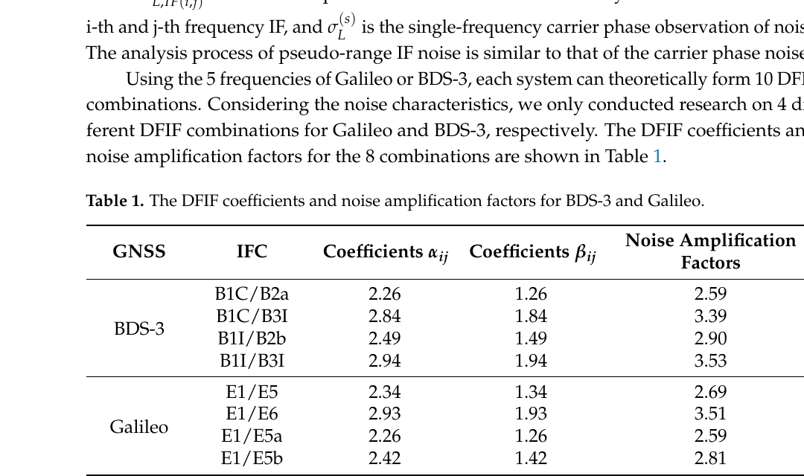
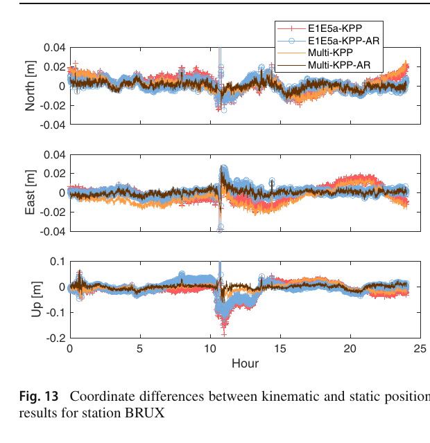
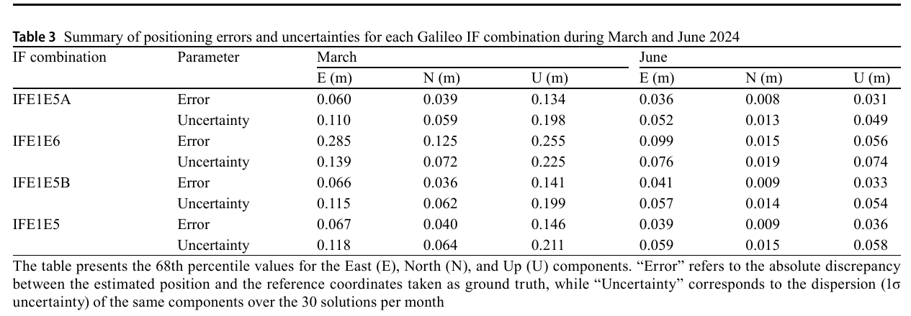

# 2026-10-31 GNSS 每日研究简报

## 今日快报

### 快报 1：25 ms 短时相关让机载 GNSS-R 测离地高，但平地 4 m 与山区 15 m 仍不是无线电高度表替代品

- 主题：`airborne-gnssr-agl-multiterrain-field-test`
- 来源 ID：`doi:10.1186/s43020-026-00228-6`
- 来源链接：https://doi.org/10.1186/s43020-026-00228-6
- 发表日期：2026-10-27
- 来源类型：Satellite Navigation 同行评审开放飞行实验论文
- 获取范围：CC BY 4.0 开放全文；约 288 km、1.7 h 飞行，双天线 IF 采集、STSP 波形处理、四类地形、Tables 1–5 与 Figures 1–31 已核对

**内容：** 试验在 Aurora SA60L 飞机上分别安装向上 RHCP 与向下 LHCP 天线，用软件接收机从 BDS B1C/B2a、GPS/QZSS L1 C/A/L5 和 Galileo E1C/E5a 的直达—反射码延迟求多个镜面点的离地高。Short-Time Shortest-Path（STSP）只做 25 次非相干积累、即 25 ms，并在多峰波形中取最短路径，避免 1 s/1000 次积累把先到边缘抹平。

**结论：** 以 GNSS 高程结合 12.5 m DEM 的 AGL 为参考，作者在推荐的 50° 截止角下报告宽带 B2a/E5a/L5 融合结果的 RMS：平坦农田 4.14 m、城郊 5.67 m、起伏农田 6.14 m、山区 14.46 m；DEM 误差约占平地总 RMS 的 15%–30%、山区约 12%。参考本身不是独立激光真值，且处理为离线、码级，所以结果证明的是补充测高可行性，不是实时着陆或安全认证性能。

**关注理由：** GNSS-R 把既有导航信号变成被动多点测高源，但误差主项已从几何公式转为粗糙面非镜面散射、波形多峰与 DEM。工程评价必须同时给出地形、信号码率、截止角和剩余观测数。

### 快报 2：把伪距与伪距率留在观测域重建，90 s 断链水平 RMS 从 123.358 m 压到 15.506 m

- 主题：`trimsan-observation-domain-gnss-ins-outage-bridging`
- 来源 ID：`doi:10.1049/rsn2.70259`
- 来源链接：https://doi.org/10.1049/rsn2.70259
- 发表日期：2026-10-27
- 来源类型：IET Radar, Sonar & Navigation 同行评审研究论文
- 获取范围：Wiley 全文 HTML；逐星伪距/伪距率模型、三路 Transformer、自注意力融合、四段仿真断链、GREAT 跨轨迹测试、消融和运行时已核对

**内容：** TriMSAN 不直接回归位置增量，而是分别编码 IMU/INS 运动、星历推得的卫星运动和历史 GNSS 观测，再预测每颗星的伪距与伪距率变化。缺星时将变化量递推累加成同原紧组合接口一致的伪观测；仍有真观测时，真实与重建的逐星观测块可共同进入滤波器。

**结论：** 四段 60 s 仿真断链中，三维位置 RMS 为 5.051 m；GREAT 数据集两个注入的 90 s 完全断链中，水平 RMS 为 15.506 m，MHSA 为 23.253 m，纯 INS 推演为 123.358 m。论文也发现轻度缺星、仍保留 10 颗真星时，常规紧组合平均 RMS 略优；当前重建观测沿用真观测名义协方差，会高估其可信度，递推误差也随断链延长传播。

**关注理由：** 观测域补洞比坐标补偿更容易保留卫星几何和紧组合接口，但它不是“虚拟 GNSS 真值”。下一步关键不是继续堆网络，而是预测不确定度、真/伪观测选择与自然断链外部验证。

### 快报 3：原子钟模型稳住时间尺度，但正常时 GPS/BDS/Galileo 的 SISRE 几乎不变

- 主题：`realtime-gnss-clock-model-anomaly-mitigation`
- 来源 ID：`doi:10.1186/s43020-026-00225-9`
- 来源链接：https://doi.org/10.1186/s43020-026-00225-9
- 发表日期：2026-10-21
- 来源类型：Satellite Navigation 同行评审开放实时处理论文
- 获取范围：CC BY 4.0 开放全文；原子钟状态模型、归一化预测残差、相位/频率跳变与复合异常、GPS 周 2387–2395 实时产品、Table 4 与 Figures 5–16 已核对

**内容：** 方法用原子钟动态模型在历元间约束相位、频率和漂移，以归一化一步预测残差先隔离异常观测，再按连续异常形态区分相位跳、频率跳和复合异常；确认后补偿状态并恢复该钟。这样可避免一个钟的跳变经网络钟差基准污染其他卫星和站钟。

**结论：** 处理每个 5 s 历元平均耗时 2.81 s。相对 CODE 最终产品，白噪声/原子钟模型的 SISRE STD 分别为 GPS 0.032/0.033 ns、BDS-3 0.056/0.057 ns、Galileo 0.036/0.035 ns，正常条件下几乎没有精度收益；GLONASS 则从 0.196 降到 0.149 ns。主要收益是异常隔离和 PPP 站钟 Hadamard 偏差所示的时间尺度稳定性，而不是普遍降低瞬时钟差 STD。

**关注理由：** 动态先验只有与异常检测成套才安全。SSR 用户还应在异常期间暂时剔除无有效钟改正的卫星，收到新有效改正后再纳入，而不能让滤波器用“稳定模型”硬跨真实跳变。

### 快报 4：异方差 GPR 把斜电离层插值 RMS 从 0.558 降到 0.425 TECU，但收益只在九天低纬站网内成立

- 主题：`gpr-slant-ionosphere-uncertainty-ppp-rtk`
- 来源 ID：`doi:10.1029/2026SW005093`
- 来源链接：https://doi.org/10.1029/2026SW005093
- 发表日期：2026-10-09
- 来源类型：Space Weather 同行评审开放实验论文
- 获取范围：开放全文 HTML；35 个参考站、4 个用户站、2025 年 DOY 251–259，复合核、异方差噪声、普通克里金对照、概率评分与 PPP-RTK 已核对

**内容：** 研究用复合高斯过程核表示斜电离层延迟在空间、时间和卫星几何上的相关性，并让观测噪声随质量变化；输出不只有插值均值，还有逐点形式方差。它同普通克里金插值（OKI）的形式方差和交叉验证方差一起送入 PPP-RTK 定权。

**结论：** 在中国 21°N–25°N 的 35+4 站、九天案例中，插值 RMS 由 OKI 的 0.558 TECU 降到 0.425 TECU，平均改善 23.8%；相对 OKI 两类不确定度，GPR 形式方差使位置误差降低 8%–17%、收敛时间缩短 6%–15%。DOY 254 含观测异常，DOY 253/259 电离层更扰动；这些天的优势支持不确定度建模，但不能直接外推到稀疏网、另一纬区或磁暴等级。

**关注理由：** PPP-RTK 需要的是“改正值+可信方差”，不是一张更光滑的电离层图。概率校准若失真，均值再准也可能在用户滤波器中被过度定权。

### 快报 5：77 场磁暴中 ROTI 与固定星比例强负相关，但它仍是分箱关联而非逐历元告警器

- 主题：`storm-scintillation-kinematic-ppp-ar-statistics`
- 来源 ID：`doi:10.1029/2026SW005040`
- 来源链接：https://doi.org/10.1029/2026SW005040
- 发表日期：2026-10-01
- 来源类型：Space Weather 同行评审开放全球统计论文
- 获取范围：开放全文 HTML；2019-12 至 2025-04、629 个 GPS 站、77 场中等及以上磁暴、30 s 观测、ROTI/周跳/固定星比例/三维相对残差与多系统复算已核对

**内容：** 论文把 Dst、仰角加权 ROTI、周跳数、固定卫星比例（FSR）和运动 PPP-AR 三维相对残差按事件与强度分箱，分析磁暴—小尺度电离层不规则体—跟踪连续性—定位退化的统计链，并用二次模型拟合 ROTI 分箱到 PPP 指标的关系。

**结论：** 77 场事件中，全球平均 ROTI 与 Dst 最低值相关系数为 −0.76，与周跳数为 0.67；分箱均值 ROTI 与三维相对残差、FSR 的相关系数分别为 0.9492、−0.9810。2024 年 5 月事件中，多系统把 145 站平均三维相对残差从 0.0292 m 降到 0.0163 m，并改善 140 站。相关性来自聚合分箱，不能当作逐链路因果或认证告警阈值；低纬响应相对高纬还在两个事件中分别滞后 2.4 h 与 16.0 h。

**关注理由：** 空间天气告警要落到接收机指标才有工程意义。ROTI 可作风险先验，但仍需结合本机 C/N0、周跳、固定子集和残差，避免把全球统计模型误用成局地实时保证。

## 深度研读

### 深读 1｜接收机工程｜先算频率距离的代价：无电离层组合为何消掉一阶延迟却放大噪声

- 类别：`receiver-engineering`
- 学习层级：`foundation`
- 选题定位：`经典基础：从一阶电离层的频率平方反比出发，推导双频无电离层系数、噪声放大和产品码偏差闭合，再用全球多站浮点 PPP 检查频对差异`
- 来源 ID：`doi:10.3390/atmos16030316`
- 来源链接：https://doi.org/10.3390/atmos16030316
- 发表日期：2025-03-10
- 来源类型：Atmosphere 同行评审开放实验论文
- 获取范围：CC BY 4.0 开放全文；DFIF 观测模型、八组频对、60 个 MGEX 站、10 天静态/运动浮点 PPP、Tables 1–3、Figures 1–10 与正文—摘要数值差异已核对
- 价值评分：93/100（相关性 19，经典价值 19，证据 18，教学价值 19，工程价值 18）

#### 为什么先学这个

PPP 常说“双频组合消掉一阶电离层”，容易让人误以为组合只减误差、不付代价。实际上两个频率越接近，抵消电离层所需的系数越大，码和相位噪声、未建模偏差也一起放大；若所用精密钟产品以另一频对为基准，还要补卫星码偏差。先把这笔账算清，才能理解下一节为何产品必须声明参考组合，及最后一节为何 E1/E6 固定率高仍可能位置更差。

#### 先修知识

需要理解伪距与载波相位、卫星/接收机钟差、频率相关的一阶电离层延迟、码/相位硬件偏差、误差传播、Kalman 滤波、静态与运动 PPP、NEU/三维 RMS。

#### 一句话逻辑

用两个频率平方构造系数让 $`1/f^2`$ 电离层项相消，同时把独立单频噪声按系数平方和传播；频率分离越小，噪声因子通常越大，精密钟参考频对不一致时还必须改正跨频码偏差。

#### 研究问题与约束

研究比较 BDS-3 与 Galileo 各四个双频 IF 组合，在全球 60 个 MGEX 站、2024 DOY 275–284 的 24 h 数据上做静态和运动单系统 PPP。GFZ 轨道钟、CAS DCB、10° 截止角和 Net_Diff V1.17 固定不变；模糊度全部保持浮点。静态只统计每天末历元，运动结果只统计初始化两小时以后，因此不评价首次收敛和错误固定。

#### 核心方法论

从未组合码相观测出发，按 $`f_i^2/(f_i^2-f_j^2)`$ 与 $`f_j^2/(f_i^2-f_j^2)`$ 形成 IF。卫星精密钟已经吸收其生成时参考频对的码偏差；用户若换频对，模型额外加入对应卫星码偏差。坐标静态时为常数、运动时逐历元白噪声；用 IGS SINEX 坐标作外部参考，比较各频对 NEU 和三维 RMS。

#### 关键公式逐步推导

单频码观测中的一阶电离层写成 $`I_i=K/f_i^2`$。令：

```math
P_{IF,ij}=\alpha_{ij}P_i-\beta_{ij}P_j,
\qquad
\alpha_{ij}=\frac{f_i^2}{f_i^2-f_j^2},
\qquad
\beta_{ij}=\frac{f_j^2}{f_i^2-f_j^2}.
```

因为 $`\alpha_{ij}-\beta_{ij}=1`$ 且 $`\alpha_{ij}/f_i^2-\beta_{ij}/f_j^2=0`$，几何距离保留、一阶电离层消失。若两频单频噪声独立且同方差 $`\sigma^2`$：

```math
\sigma_{IF,ij}
=\sqrt{\alpha_{ij}^2+\beta_{ij}^2}\,\sigma.
```

实际两频噪声不同或相关时应改成 $`\alpha^2\sigma_i^2+\beta^2\sigma_j^2-2\alpha\beta\operatorname{Cov}(i,j)`$；原表的放大因子只对应等方差、零相关假设。

#### 经典价值与创新边界

经典价值是把“消电离层”与“放大观测噪声”放在同一条误差传播式中，并提醒精密钟的参考频对也是观测模型一部分。创新边界是用最终坐标 RMS 反推频对好坏会混入接收机、天线、DCB 与产品基准；60 站十天是宽覆盖案例，不是所有设备的信号级噪声标定。

#### 整体逻辑链

写未组合码相模型；按频率平方消掉一阶电离层；传播噪声；补齐非参考频对码偏差；固定产品和处理参数；比较八种 IF；把静态末历元与运动稳态分开；审查摘要、正文和图表是否一致。下一节将这套用户组合账扩展到服务端轨道、钟与相位偏差产品。

#### 原文图表与结果分析



> 图表源：Sun、Shu 与 Yao《Analyzing the Precise Point Positioning Performance of Different Dual-Frequency Ionospheric-Free Combinations with BDS-3 and Galileo》Table 1，[CC BY 4.0 开放全文](https://doi.org/10.3390/atmos16030316)。本地资产以 Poppler 180 dpi 渲染原 PDF 第 5 页，仅裁到表前说明、完整表题、行列与数值；未重排或改写数据。

表中 Galileo E1/E5a 的放大因子 2.59，E1/E5 为 2.69，E1/E5b 为 2.81，E1/E6 为 3.51；BDS-3 四对为 2.59–3.53。它直接说明较小频率间隔会让系数绝对值增大。表不能证明最终坐标一定同此排序，因为码噪声不一定等方差，产品 DCB 和接收机跟踪也不同。

#### 原文结果论述

正文汇总的运动三维 RMS 从好到坏为 E1/E5 3.89 cm、E1/E5a 3.96 cm、E1/E5b 4.00 cm、B1I/B2b 4.11 cm、B1I/B3I 4.16 cm、B1C/B2a 4.27 cm、B1C/B3I 4.33 cm、E1/E6 4.95 cm。论文摘要把“最差 B1C/B2a 1.95 cm”写错，既同排序矛盾，也同正文/结论的 E1/E6 4.95 cm 矛盾；这里以正文重复出现的 4.95 cm 为准并显式保留此勘误边界。

#### 常见误区与适用边界

第一，IF 只消一阶电离层，不消高阶项和闪烁。第二，放大因子不是实测码噪声。第三，换频对必须对齐钟与 DCB 基准。第四，静态末历元精度不能代表收敛速度。第五，运动两小时后的 RMS 会排除最困难的初始化。第六，浮点 PPP 不能直接说明 PPP-AR 固定质量。第七，摘要数字也必须同表和正文交叉核对。

#### 工程实现步骤

1. 从 RINEX 和 ICD 读取真实频率，不手抄近似波长。
2. 计算每对 $`\alpha,\beta,\varepsilon`$，先屏蔽极大噪声组合。
3. 查询轨道钟产品参考组合和可用 OSB/DCB。
4. 对每个频点分别标定码、相位噪声及相关性。
5. 用同一轨道钟、模型、截止角和异常规则并行跑各频对。
6. 分别输出启动、稳态、重收敛和残差，而非只看全段 RMS。
7. 自动检查论文/软件报告中排序与数值是否自洽。

#### 复现实验设计

选 30 个全球 MGEX 站、三类接收机，连续 14 天，以 Galileo E1/E5a、E1/E5b、E1/E5、E1/E6 运行未固定 PPP；对照未组合 PPP。先用零基线或短基线估计各频实际码相协方差，再比较理论 $`\varepsilon`$ 与残差 RMS。指标为 10/30/60/120 min 三维误差、收敛时间、稳态 NEU RMS、码相残差、钟差和 ZWD 相关系数；失败用例包括缺 DCB、错误参考钟、E6 干扰和频点周跳。

#### 与定位及低成本实现的联系

低成本接收机往往在不同频点具有完全不同的码噪声和天线增益，因此“理论放大最小”只是初筛。若算力允许，未组合模型可保留原始随机特性；若必须用 IF，则应按设备实测协方差定权，并把产品基准检查做成配置验证。

#### 本节小结

无电离层组合不是免费滤波器：它用可计算的噪声放大和偏差基准约束，换取一阶电离层的代数消除。

### 深读 2｜接收机工程｜同一颗钟为何随频对改变：产品参考组合、跨频偏差与多频 PPP-AR 闭合

- 类别：`receiver-engineering`
- 学习层级：`intermediate`
- 选题定位：`基础进阶：从 Galileo 同源主钟和四频观测出发，检查 IF 组合间漂移、频率特定 PCO/PCV、站网规模与相位偏差产品，最后用独立站 KPP-AR 验证闭合`
- 来源 ID：`doi:10.1007/s00190-023-01723-3`
- 来源链接：https://doi.org/10.1007/s00190-023-01723-3
- 发表日期：2023-03-29
- 来源类型：Journal of Geodesy 同行评审开放产品评估论文
- 获取范围：CC BY 4.0 开放全文；四种双频与五频处理、15–90 站网络、频间漂移、PCO/PCV、轨道钟/相位偏差、独立站 KPP/KPP-AR、Figures 1–13 与 Tables 1–7 已核对
- 价值评分：96/100（相关性 20，经典价值 19，证据 20，教学价值 18，工程价值 19）

#### 为什么先学这个

上一节把卫星钟当作已知产品；真正的产品也由某一组观测估出来。Galileo E1、E5a、E5b、E5、E6 虽共享星载主钟，但不同频对的 IF 组合包含不同码/相位偏差、天线相位中心和噪声。如果服务端和用户端不在同一基准，所谓“精密钟”会把跨频差异带进坐标或模糊度。

#### 先修知识

需要理解 IF 组合、卫星轨道与钟估计、相位中心 PCO/PCV、宽巷/窄巷与 OSB、PPP-AR、轨道弧重叠差、SLR 外检、站网秩基准和运动 PPP。

#### 一句话逻辑

用几何—电离层双消的三频组合观察频间相位偏差漂移，在不同规模站网中生成各频对与五频轨道钟/偏差产品，再用网外六站的浮点与固定运动 PPP 检查服务端产品是否同用户观测闭合。

#### 研究问题与约束

论文用 2021-01-01 至 01-30 数据，构造 90、50、40、30、20、15 站网络；90 站 E1/E5a 作为参考，其余网络生成 E1/E5a、E1/E5b、E1/E5、E1/E6 及 E1/E5a/E5b/E5/E6 产品。网络采样 150 s、PPP-AR 30 s、截止角 5°，使用修改版 Bernese 5.3；六个独立测试站不进入任何产品网络。产品“相对 E1/E5a 一致”不等同于绝对无误。

#### 核心方法论

先评估各频 C/N0、码多路径和相位噪声，再用三频几何—电离层自由组合检查相位偏差稳定性。服务端对各网络迭代求轨道、钟和相位偏差，分别用相邻三日弧重叠、SLR 和参考钟比较。用户端在独立站运行 E1/E5a 双频 KPP/KPP-AR 与五频 KPP/KPP-AR，以静态 PPP-AR 坐标为参考比较 N/E/U。

#### 关键公式逐步推导

两种 IF 相位组合共享频率 $`a`$ 时，其差为：

```math
\Delta\varphi
=\varphi_{IF,ab}-\varphi_{IF,ac}
=(\alpha_{ab}-\alpha_{ac})\varphi_a
-\alpha_{ab}\varphi_b
+\alpha_{ac}\varphi_c.
```

几何项因每个 IF 系数和为 1 而抵消，一阶电离层项也分别为零；改正天线和 wind-up 后，剩余时间变化主要反映跨频相位偏差与噪声。相邻轨道弧重叠差为：

```math
\mathbf m_{i,i+1}^{s}
=\mathbf r_{i+1}^{s}-\mathbf r_i^{s},
```

其三维 RMS 衡量不同日弧在重叠区的一致性，但不是独立真值，所以论文另用 SLR 残差外检。

#### 经典价值与创新边界

经典价值是把信号、天线、站网、产品和用户解串成可审计闭环，不把“同一物理钟”误当成“所有观测给出同一数值钟”。创新边界是 2021 年 Galileo 跟踪网络、IOV/FOC 卫星和修改版 Bernese 的结果；相位偏差按日常数处理对更快热变或另一星座未必足够。

#### 整体逻辑链

检查单频观测质量；建立各 IF 基准；用三频差分找漂移；核对频率特定 PCO/PCV；缩小站网生成产品；比较固定率、弧重叠和 SLR；用网外 KPP/KPP-AR闭环；判断最低站数和多频收益。最后一节将在固定产品链上加入赤道电离层与实际频对选择。

#### 原文图表与结果分析



> 图表源：Duan 等《Performance of Galileo satellite products determined from multi-frequency measurements》Figure 13，[CC BY 4.0 开放全文](https://doi.org/10.1007/s00190-023-01723-3)。本地资产以 Poppler 180 dpi 渲染原 PDF 第 14 页，仅裁到原图、图例、三轴、单位和图注；未重绘或改变曲线与数值。

横轴为 0–24 h，纵轴是相对静态解的 North/East/Up 差，单位 m；四条曲线分别为 E1/E5a 浮点、E1/E5a 固定、五频浮点和五频固定。约第 10.5 h 所有方案共同跳变，说明共用环境/数据异常仍会穿过产品链；固定与多频总体收紧散布，尤其 Up 的 E1/E5a 浮点在 10–14 h 出现约分米级负偏。单站图不能证明全球平均收益，需结合六站统计。

#### 原文结果论述

E1/E6 轨道弧重叠误差较其他双频解约大 35%，主要归因于 IF 噪声放大；IOV 卫星的 E1/E5a–E1/E6 差可漂移约 25 mm/d。20 站及以上时固定轨道相对浮点约改善一倍；15 站双频窄巷初次固定率低于 40%，经 PPP-AR 迭代可超过 80%。网外用户中，E1/E5a KPP-AR 的 East 相对浮点约改善 35%，五频固定再改善约 7%；除 15 站产品外，六站平均五频固定通常比双频固定再好 5%–10%。

#### 常见误区与适用边界

第一，共享主钟不代表无跨频偏差。第二，参考产品重叠会让同频比较偏乐观。第三，弧重叠不是独立轨道真值。第四，固定率高不等于偏差产品正确。第五，站数阈值依赖全球几何和采样率。第六，日常数偏差会漏掉快漂。第七，单站静态 PPP-AR 参考不是外部测量真值。

#### 工程实现步骤

1. 明确每个轨道、钟、OSB 产品的频率与基准定义。
2. 逐频检查 C/N0、码多路径、相位噪声和 PCO/PCV 覆盖。
3. 形成三频几何—电离层自由组合，监控卫星级漂移。
4. 以不同网络规模重算产品并保存基准约束。
5. 同时用弧重叠、SLR 和独立站 PPP 外检。
6. 用户端保持产品/观测频点和 OSB 定义一致。
7. 报告固定率、坐标误差和异常时段，而非只报平均 STD。

#### 复现实验设计

选 Galileo 30 天数据，构造 15/20/30/50 站生成网与 10 个完全网外测试站；分别生成 E1/E5a、E1/E5b、E1/E5、E1/E6 和五频产品。对照原始 E1/E5a 产品、错误复用 E1/E5a 钟但不补跨频偏差、正确 OSB 闭合三种用户配置。指标包括三频差漂移、轨道弧重叠、SLR RMS、WL/NL 正确固定率、网外 NEU 95% 误差和重收敛；失败用例注入 5–25 mm/d 相位偏差漂移、缺 PCO 与 30% 站点掉线。

#### 与定位及低成本实现的联系

低成本用户通常不能生成产品，只能信任服务端元数据。最有价值的防线是启动时验证信号、钟、OSB、天线模型版本的闭合，并保留双频降级；五频观测只有在产品同频、偏差可用且实时链路完整时才是额外信息。

#### 本节小结

多频 PPP-AR 的核心不是“多几路观测”，而是让每路观测在同一轨道、钟、天线和偏差基准上闭合。

### 深读 3｜定位｜固定率高也可能解得更差：赤道区 Galileo 频对如何用残差与收敛验真 PPP-AR

- 类别：`positioning`
- 学习层级：`advanced`
- 选题定位：`定位深入：在七个巴西站、强弱电离层两个月中，对 E1/E5a、E1/E5b、E1/E5 与 E1/E6 的浮点 PPP、LAMBDA PPP-AR、残差、收敛和最终坐标做纯 Galileo 闭环比较`
- 来源 ID：`doi:10.1007/s10291-026-02156-z`
- 来源链接：https://doi.org/10.1007/s10291-026-02156-z
- 发表日期：2026-10-06
- 来源类型：GPS Solutions 同行评审开放实验论文
- 获取范围：CC BY 4.0 开放全文；七站 60 天、00:00–03:00 UTC、APPPOLO 浮点、PRIDE PPP-AR、四种 IF、March/June 残差/收敛/固定率、Figures 1–12 与 Tables 1–4 已核对
- 价值评分：97/100（相关性 20，经典价值 19，证据 20，教学价值 19，工程价值 19）

#### 为什么先学这个

前两节给出理论放大因子和产品闭合，但用户最终关心坐标是否正确。低纬电离层变化会放大启动期模型错配；同时整数固定能把形式协方差压得很小，即使坐标仍有偏差。本文把浮点时序、残差、收敛、LAMBDA 固定率和最终位置放在一起，正好检验“高固定率=好频对”这一危险捷径。

#### 先修知识

需要理解 Galileo E1/E5a/E5b/E5/E6、双频 IF、PPP 状态估计、模糊度 LAMBDA、形式协方差与真实误差、低纬电离层日变、码/相残差、收敛定义和百分位统计。

#### 一句话逻辑

先用频率间隔筛除噪声放大因子大于 5 的频对，再让同一批低纬站在强弱电离层月份运行四种 Galileo-only IF；只有位置误差、残差、收敛与固定率同时一致，才把某频对判为稳健。

#### 研究问题与约束

七个巴西站位于约 15°S–30°S，选 2024 年 3 月与 6 月各 30 天，只处理每日 00:00–03:00 UTC。APPPOLO 给浮点 PPP 时序，PRIDE PPP-AR 比较 rounding 与 LAMBDA；参考为站坐标。研究覆盖赤道/低纬对比，但只有两个月、七站、单一三小时窗口；“3 月更扰动”是本数据条件，不代表所有赤道季节。

#### 核心方法论

按 $`\varepsilon\le5`$ 保留 E1/E5a、E1/E6、E1/E5b、E1/E5。对每个站日从冷启动运行三小时，统计 E/N/U 时序密度、平均收敛、68% 位置误差与形式不确定度、按仰角的码相残差。另在 PRIDE 中用 rounding 和 LAMBDA 固定，并比较最终历元位置与形式协方差，防止只看一个处理器或一个指标。

#### 关键公式逐步推导

频对 IF 仍写成：

```math
L_{IF}=aL_1-bL_2,
\qquad
a=\frac{f_1^2}{f_1^2-f_2^2},
\qquad
b=\frac{f_2^2}{f_1^2-f_2^2}.
```

等方差、独立噪声的放大因子为：

```math
\varepsilon=\sqrt{a^2+b^2}.
```

LAMBDA 在浮点模糊度 $`\hat n`$ 和协方差 $`Q_{\hat n\hat n}`$ 下求：

```math
\check n=\arg\min_{n\in\mathbb Z^k}
(\hat n-n)^TQ_{\hat n\hat n}^{-1}(\hat n-n).
```

整数搜索只回答“哪个整数离浮点解最近”；若模型、偏差或权阵错，最小二次型仍可能对应错误位置，所以必须回看固定后残差和外部坐标误差。

#### 经典价值与创新边界

经典价值是用同一物理原则解释频率间隔、残差和收敛，再用两个软件检查浮点与固定结果。创新边界是 APPPOLO 浮点与 PRIDE 固定的模型、权阵和最终历元统计不同；软件间差异不能全部归因于 AR，七站也不足以代表全球 Galileo 用户。

#### 整体逻辑链

计算 IF 放大；筛选频对；按月份分层；冷启动浮点 PPP；比较收敛和误差；检查码相残差；运行 rounding/LAMBDA；对照固定率与最终坐标；识别形式协方差过度乐观；形成频对选择规则。三篇至此完成“组合代价—产品闭合—位置验真”的 PPP-AR 链。

#### 原文图表与结果分析



> 图表源：Zaupa 等《Assessing Galileo ionosphere-free combinations: impacts of contrasting equatorial ionospheric conditions》Table 3，[CC BY 4.0 开放全文](https://doi.org/10.1007/s10291-026-02156-z)。本地资产以 Poppler 180 dpi 渲染原 PDF 第 12 页，仅裁到完整表题、行列、单位、数值和原表说明；未重排或改写数据。

表给的是每日误差分布 68% 分位，不是 RMS。3 月 E1/E5a 的 E/N/U 误差为 0.060/0.039/0.134 m，E1/E6 为 0.285/0.125/0.255 m；6 月分别收紧到 0.036/0.008/0.031 m 与 0.099/0.015/0.056 m。E1/E6 在两个季节都较差，且 3 月 East 误差是 E1/E5a 的约 4.75 倍；表不能单独判断误差来自信号噪声、电离层高阶项还是处理器偏差。

#### 原文结果论述

3 月 E1/E6 码残差 RMS 为 2.51 m，E1/E5a 为 0.82 m；相位残差分别 1.42 与 1.31 cm。6 月 E1/E6 码残差仍为 2.21 m，E1/E5a 为 0.79 m。LAMBDA 后 3 月各站平均固定率普遍超过 90%，E1/E6 在多数站甚至最高；但它的浮点时序仍收敛更慢、残差更大、位置更差。论文据此强调固定率与低形式方差不能独立作为正确性证据。

#### 常见误区与适用边界

第一，频率相隔更远通常降低 IF 放大，但实际信号带宽和跟踪也重要。第二，固定率不等于正确固定率。第三，形式协方差缩小不代表偏差消失。第四，最终历元会掩盖启动时序。第五，68% 分位不是 RMS 或 95% 保护界。第六，三月/六月差异不能只归因于电离层。第七，Galileo-only 结果不能直接移植到多系统共钟模型。

#### 工程实现步骤

1. 对可用频对计算 $`\varepsilon`$ 并核对产品 OSB/钟基准。
2. 按频点统计 C/N0、码相残差和周跳，不只看组合残差。
3. 每次冷启动保存全时序而非只保存最终坐标。
4. 固定后回代观测，检查码相残差和独立坐标误差。
5. 同时报告首次正确固定、持续固定、错误固定和重收敛。
6. 按季节、纬度、接收机与天线分层比较。
7. 若固定率高但残差/坐标恶化，立即退回浮点或另一频对。

#### 复现实验设计

在低纬、中纬各选 10 个全频 Galileo 站，取春分、夏至、磁暴与静日各七天，每天从六个不同时刻冷启动 3 h。对照四个 IF 浮点、四个 IF PPP-AR、未组合浮点/固定；统一轨道钟 OSB，另做错配 OSB 负对照。指标为 10/30/60/180 min E/N/U 误差、收敛、正确/错误固定率、码相残差 RMS、NEES/覆盖率和周跳；失败用例包括 E6 干扰、残缺 OSB、强闪烁和错误随机模型。

#### 与定位及低成本实现的联系

低成本全频跟踪并不保证每个频点质量相同。接收机可离线建立“频对—环境”性能表，在线以残差和观测完整性选择频对；但频繁切换会改变模糊度与钟基准，必须显式重初始化或做严格状态转换。

#### 本节小结

PPP-AR 的频对选择必须由完整证据链决定：理论放大因子负责初筛，产品闭合负责可估，残差、收敛和独立位置误差负责验真。
