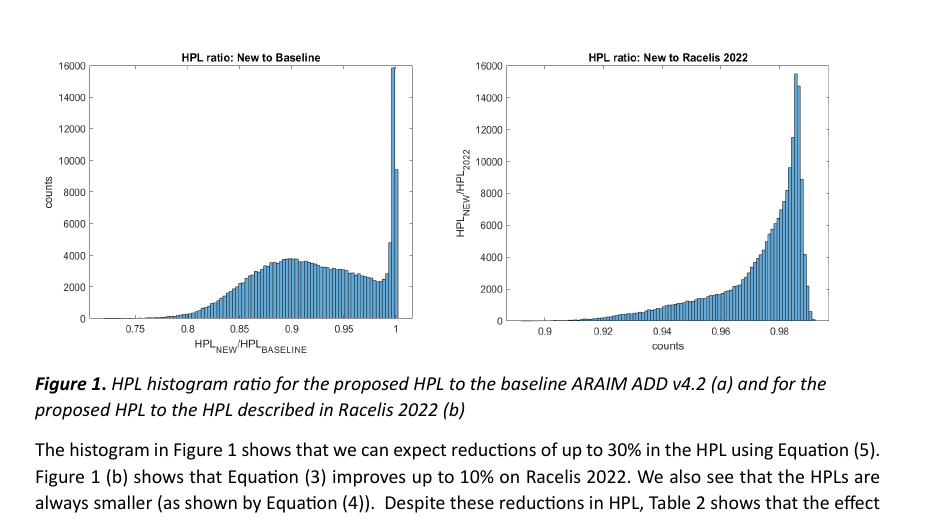
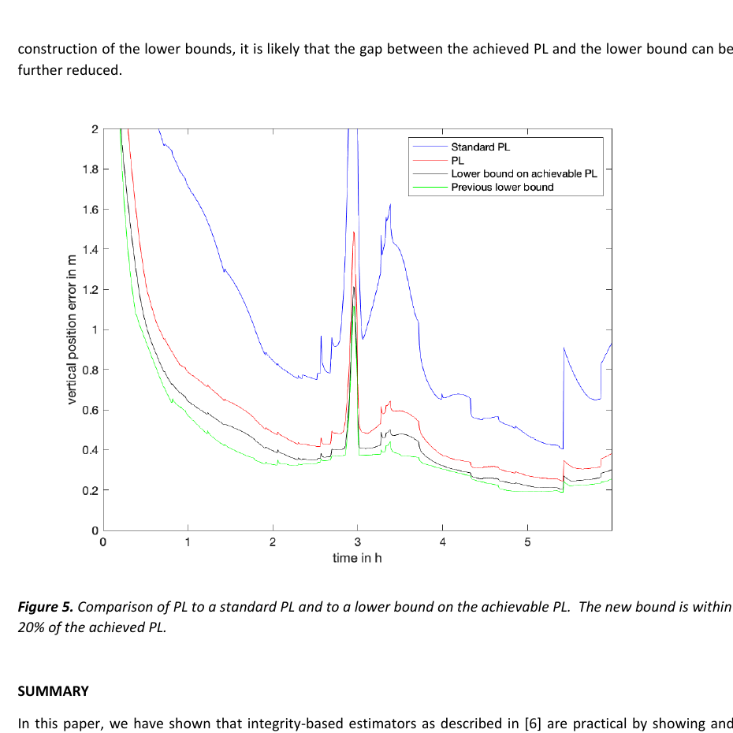
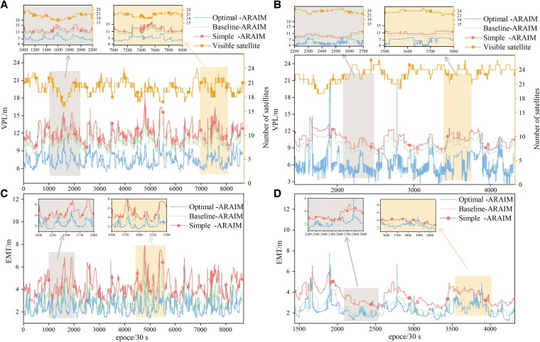

# 2026-11-01 GNSS 每日研究简报

## 今日快报

### 快报 1：小波去噪可在 INS 前端换取更平滑的输入，但新论文只给仿真比较，尚不能证明真实断链定位收益

- 主题：`wavelet-denoising-gnss-ins-simulation`
- 来源 ID：`doi:10.1038/s41598-026-66289-4`
- 来源链接：https://doi.org/10.1038/s41598-026-66289-4
- 发表日期：2026-10-31
- 来源类型：Scientific Reports 同行评审早期在线研究论文
- 获取范围：CC BY-NC-ND 4.0 开放早期版本；摘要、DWT/UDWT/LSM-UDWT 方法比较、仿真定位与许可边界已核对；版本仍可能接受排版修订

**内容：** 论文把惯性加速度先送入三类小波前处理：带下采样的离散小波变换（DWT）、不下采样的 UDWT，以及用最小二乘自适应阈值辅助的 UDWT。比较维度不是单一噪声指标，而是噪声抑制、重构保真、存储、计算量和实时实现约束；仿真同时注入惯性器件误差、GNSS 观测不确定度和代表性运动。

**结论：** 来源报告 DWT 的存储和计算负担较低，但下采样可能带来重构畸变；UDWT 保留时间连续性、重构更好但代价更高；LSM-UDWT 进一步减少伪影并平滑信号。论文没有在摘要中给出真实车辆、自然遮挡、独立真值或端到端位置误差的量化改进，因此现有证据只能支持“前端信号更平滑”的仿真结论，不能改写成“GNSS 断链位置精度已提高”。

**关注理由：** 接收机工程常把滤波前端的波形改善直接等同于最终定位改善。真正部署前应把相位延迟、突变保真、处理时延和 INS 漂移一起带入闭环，尤其要防止去噪把真实高动态当成高频噪声削掉。

### 快报 2：物理先验元学习把“最难牵引样本”变成可搜索对象，四通道检测器的保形上界下降 30.7%

- 主题：`physics-meta-learning-hard-spoofing-samples`
- 来源 ID：`doi:10.3390/s26216849`
- 来源链接：https://doi.org/10.3390/s26216849
- 发表日期：2026-10-29
- 来源类型：Sensors 同行评审开放研究论文
- 获取范围：CC BY 开放摘要与发布元数据；PBMO、四通道移动方差检测器、保形硬度指标、30.7% 对照和 USRP X310 有线回放边界已核对

**内容：** Physics-Based Meta-Learning Optimization（PBMO）不直接训练一个“更准”的欺骗分类器，而是搜索能持续牵引接收机、又尽量不触发现有检测通道的难样本轨迹。它先归档不同牵引目标的历史轨迹，用 Offline-RGPE 和物理先验给新目标热启动，再用物理先验引导的模式搜索细化；硬度由多个移动方差窗口越过通道门限的比例之保形上界衡量。

**结论：** 在四通道移动方差检测器上，作者报告 PBMO 相对未优化频差锁定策略把平均保形上界降低 30.7%，且在相同在线搜索预算下优于冷启动、最近邻和均值轨迹初始化；一个牵引频率上的 USRP X310 有线环回保持了排序。这里的 30.7% 是“让测试样本更难”的指标改善，不是欺骗攻击成功率，也不是道路外场泛化率。

**关注理由：** 抗欺骗算法的薄弱点往往不在平均样本，而在靠近门限的闭环轨迹。把攻击样本生成写成可审计优化问题，有助于主动发现检测器边界；但有线单频验证仍需扩展到多星、多频、天线运动和真实接收机环路。

### 快报 3：PDR 约束补足阴影匹配的沿街弱可观性，但两条单次校园路线仍不足以证明城市泛化

- 主题：`pdr-constrained-smartphone-shadow-matching`
- 来源 ID：`doi:10.3390/app162110729`
- 来源链接：https://doi.org/10.3390/app162110729
- 发表日期：2026-10-29
- 来源类型：Applied Sciences 同行评审开放早期在线研究论文
- 获取范围：CC BY 早期在线摘要；两种融合实现、两条校园路线、方向 RMS、共同模型参考和单手机单行人边界已核对；完整排版全文尚在上线

**内容：** 阴影匹配用三维建筑模型判断卫星可见性，通常更擅长横街约束，却沿街退化。论文给出两种 PDR 约束：EKF-PDR/SM 在航向正交方向搜索候选并给阴影匹配各向异性协方差；PDR-driven SM 则传播候选、计算可见性得分，再用与 GNSS 解的距离加权。

**结论：** Route 1 上，EKF-PDR/SM 的横街/沿街 RMS 为 3.57/8.28 m，PDR-driven SM 为 2.92/7.47 m；Route 2 分别为 2.46/7.83 m 与 1.54/5.89 m。共同 EKF-PDR/GNSS 基线在两条路线为 5.23/8.98 m 与 4.29/12.38 m。所有误差都相对共同的模型生成参考轨迹，而非独立测量真值；每条路线仅一次遍历、一个手机和一个行人，所以不能据此给出通用城市精度承诺。

**关注理由：** 结果把“阴影匹配主要改横街”这个结构性问题显式化。工程上应继续检查建筑模型错层、卫星可见性误判、PDR 航向漂移与参考轨迹相关性，而不能只报告二维总 RMS。

### 快报 4：RANSAC 只负责判断初始“好集”是否仍藏粗差，再动态增加最大疑似数，比固定阶数更少错删

- 主题：`ransac-guided-iterative-data-refining-spp`
- 来源 ID：`doi:10.1088/1361-6501/aeb95e`
- 来源链接：https://doi.org/10.1088/1361-6501/aeb95e
- 发表日期：2026-10-26
- 来源类型：Measurement Science and Technology 同行评审接受稿
- 获取范围：出版商接受稿页面与完整摘要；动态 `qmax`、一天 SPP 仿真、四种对照、定位/可用率/误识别统计已核对；订阅全文与图表处于 12 个月禁运期

**内容：** 传统迭代数据探测（IDS）逐个向前删粗差，多个粗差会造成遮蔽与淹没；迭代数据精炼（IDR）反向从疑似集合中找回内点，却依赖预设最大疑似粗差数 `qmax`。新方法让 `qmax` 分段递增，并用 RANSAC 检查 IDR 得到的内点集是否仍含粗差，以决定是否继续扩大初始疑似集合。

**结论：** 在一天 GNSS SPP 观测、多个粗差注入策略下，摘要报告四个相关方法的平均定位误差为 97.250、81.075、22.500 和 16.224 m；IDS、DIA-AICc 与新方法的平均可用率为 100%、89.29%、93.90%，平均误识别率为 57.78%、20.24%、12.72%。这些是受控注入结果，摘要未把四个定位误差按名称完整展开，本文不擅自配对；它们不能代表自然城市多路径的真实分布。

**关注理由：** 该工作提醒“100% 有解”可能来自大量错删或错认。质量控制应同时报告正确识别、错误识别、可用率、几何恶化和计算时间，不能只看位置均值。

### 快报 5：严格按场景切分后，商用接收机输出仍能识别干扰，但宏 F1 只有 0.549，机骗最难

- 主题：`leakage-safe-navigation-observable-interference-recognition`
- 来源 ID：`doi:10.1515/jag-2026-0078`
- 来源链接：https://doi.org/10.1515/jag-2026-0078
- 发表日期：2026-10-23
- 来源类型：Journal of Applied Geodesy 同行评审开放研究论文
- 获取范围：CC BY 开放摘要与发布元数据；JammerTest 2024、特征来源、严格场景分组、样本规模、分类指标与类别边界已核对

**内容：** 方法只用标准商用设备可导出的 NAV-PVT、RINEX 与 MON-RF 量，不依赖原始 IQ：轨迹、径向漂移、局部不稳定度、水平精度、伪距统计、Doppler 变量和完整性风险指标被聚合为窗口特征，再由 ExtraTrees 分类欺骗、压制和机骗。评估以重复“场景组留出”切分，避免相邻时间窗或同一攻击脚本同时落入训练和测试。

**结论：** 24 个场景、44,639 个定位样本生成 2,939 个完整性窗口；严格切分下平均准确率为 62.86% ± 9.58%，宏 F1 为 0.5490 ± 0.0980。径向漂移、Doppler 与伪距统计最有辨识力，机骗低于欺骗和压制。这个结果比随机窗切分更接近部署难度，也说明仅靠导航层输出不能替代射频监测或信号认证。

**关注理由：** “防数据泄漏”本身就是韧性评估的一部分。若测试集共享同一攻击时序，模型可能只记住场景指纹；按完整场景留出后仍剩下的性能，才更接近换地点、换设备和换攻击器的真实基线。

## 深度研读

### 深读 1｜接收机工程｜先把二维风险装进一个圆：为什么分别算东、北保护级会多付保守代价

- 类别：`receiver-engineering`
- 学习层级：`foundation`
- 选题定位：`经典基础：从水平位置误差圆、单轴尾概率与风险分配出发，推导直接 HPL，并量化它相对基线矩形外接圆的紧致性`
- 来源 ID：`doi:10.33012/2023.19279`
- 来源链接：https://doi.org/10.33012/2023.19279
- 发表日期：2023-09
- 来源类型：ION GNSS+ 2023 同行评审会议论文
- 获取范围：ION 元数据与作者公开全文；直接 HPL、时间暴露修正、默认 ISD、Figures 1–3 与 Tables 1–3 已核对
- 价值评分：94/100（相关性 20，经典价值 19，证据 18，教学价值 19，工程价值 18）

#### 为什么先学这个

完整性不是“误差通常多大”，而是给定极小风险预算时，误差有多大概率越过一个边界。水平误差天然是二维向量；若先在东、北两轴各算一维保护级，再用外接圆包住矩形，就会重复计算角区风险。先理解这层几何保守性，才能看懂下一节为何连“先检测、再剔除”的离散估计器结构也可能继续放大保护级。

#### 先修知识

需要理解加权最小二乘、水平位置误差（HPE）、正态尾函数 $`Q(\cdot)`$、故障假设、解分离统计量、漏检风险、连续性风险、水平告警限（HAL）以及 GPS/Galileo Integrity Support Data（ISD）。

#### 一句话逻辑

不再把水平风险先拆给东、北两个轴，而是在每个故障假设下直接约束二维径向误差，并只做一次跨假设风险分配，可在不显著增加计算量的前提下把 HPL 收紧。

#### 研究问题与约束

论文针对 ARAIM ADD v4.2 的 H-ARAIM 基线，提出直接 HPL 公式和时间暴露修正。数值场景采用 GPS+Galileo 默认 ISD；GPS 双频 URA 取 2.4 m，Galileo 默认 $`\sigma_{URA}=6\ \mathrm{m}`$、$`\sigma_{URE}=4\ \mathrm{m}`$，两系统名义偏差为 0。评价是全球几何/标准参数仿真，不是飞行认证或真实故障统计。

#### 核心方法论

基线法分别求 $`PL_E,PL_N`$，再取 $`HPL=\sqrt{PL_E^2+PL_N^2}`$。新方法在每个故障模式 $`k`$ 下选择同一 HPL 圆内的轴向分量，使两个标准化尾部参数相等；随后把无故障项和所有故障项直接汇入一个 HPL 方程。作者又用 Cauchy–Schwarz 证明其风险上界不弱于既有径向近似，并对时间暴露把“历元风险和”与“故障在暴露时间内实际发生概率”取较小者。

#### 关键公式逐步推导

水平错误向量为 $`\boldsymbol\varepsilon=[\varepsilon_E,\varepsilon_N]^T`$。基线矩形外接圆是：

```math
HPL_{BL}=\sqrt{PL_E^2+PL_N^2}.
```

对故障假设 $`k`$，若检测统计量仍在门限内，则径向危险事件可由两个轴向尾部上界。选择 $`PL_1,PL_2`$ 满足 $`PL_1^2+PL_2^2\le HPL^2`$，并令：

```math
\frac{PL_1-T_1^{(k)}}{\sigma_1^{(k)}}
=
\frac{PL_2-T_2^{(k)}}{\sigma_2^{(k)}},
\qquad
\sigma_H^{(k)}=\sqrt{(\sigma_1^{(k)})^2+(\sigma_2^{(k)})^2}.
```

这样每个模式的二维尾部可写成一个随 HPL 单调下降的 $`Q`$ 项，再把 $`p_{fault,k}`$ 加权的各模式风险求和并数值解根。要点不是某个闭式常数，而是风险分配在“径向量”上只做一次。

#### 经典价值与创新边界

经典价值是把二维几何、尾概率和多假设风险预算放在同一推导中，说明保护级变紧可以来自减少数学重复保守，而不是放松风险目标。创新边界是默认高斯包络、ISD 和故障先验仍决定安全性；公式变紧并不能修复错误的尾部分布、相关性或漏列故障模式。

#### 整体逻辑链

定义水平危险事件；审查基线矩形外接圆；在每个故障模式下直接分配径向风险；证明新上界仍保守；用默认 ISD 扫描几何；比较 HPL 比值和 HAL 覆盖；再审查时间暴露。下一节把同一问题从“保护级怎么算”推进到“位置估计器本身怎样响应故障”。

#### 原文图表与结果分析



> 图表源：Blanch 与 Walter《Approaches to Improve Advanced RAIM Protection Levels》Figure 1，[作者公开全文](https://web.stanford.edu/group/scpnt/gpslab/pubs/papers/blanch_ION_GNSS_2023_Improved_ARAIM_PLs.pdf)，对应 DOI 10.33012/2023.19279。原文未声明开放再许可；本地资产仅以 Poppler 130 dpi 渲染第 5 页并裁取完整两幅直方图、坐标轴、图例说明和原文结论，用于最小研究评论，未改写数据。

左图横轴是新 HPL/基线 HPL，比值低于 1 表示收紧；多数几何集中在约 0.85–1.00，最左端接近 0.70。右图是新 HPL/2022 径向 HPL，主要集中约 0.94–0.99。纵轴为几何样本计数。图直接显示“某些几何最多可收紧约 30%/10%”，但不能证明所有时间地点的可用率按同样比例提高。

#### 原文结果论述

作者报告直接公式相对 ADD v4.2 基线的 HPL 最多降低约 30%，相对 Racelis 2022 最多约 10%。覆盖收益更小：在优化估计器、HAL 185 m 下，覆盖从基线 91.89% 增至 92.77%；HAL 556 m 下均为 99.08%。这说明保护级分布变紧，不等于告警限跨越率等比例增加。

#### 常见误区与适用边界

第一，HPL 不是误差 RMS。第二，HPL 变小不自动表示安全性更高，前提是风险上界和模型仍成立。第三，直方图中的比值不是可用率。第四，默认 ISD 不是每颗星的实时健康事实。第五，二维推导不能直接复制到垂向。第六，未建模相关误差会破坏独立高斯尾部解释。第七，标准化候选公式仍需符合最终适航标准。

#### 工程实现步骤

1. 用同一 WLS/解分离后端生成全解与故障子集协方差。
2. 对每个模式计算轴向门限、偏差界与 $`\sigma_H^{(k)}`$。
3. 实现基线 HPL 和直接 HPL 的单调根求解。
4. 对风险和、未监控模式概率与时间暴露分别记账。
5. 逐历元输出 HPL、HAL 裕量、主导故障模式和迭代次数。
6. 对极端几何、空子集和数值下溢做单元测试。
7. 保留标准基线作影子计算，发现新式大于基线或不收敛时回退。

#### 复现实验设计

用公开 GPS/Galileo almanac 构造全球 10°×10° 网格，24 h 内每 10 min 计算一次；采用论文 Table 1 默认 ISD，分别实现 ADD v4.2、Racelis 2022 和直接 HPL。指标为 HPL 比值分布、185/556 m HAL 的 95/99/99.5/100% 时间可用覆盖、根求解次数和每历元时延。失败用例包括单一星座、低卫星数、强相关东—北协方差、故障先验放大十倍和 URA 错配；基线是相同 WLS 状态与同一故障集合，避免把几何差异误算成公式收益。

#### 与定位及低成本实现的联系

低成本接收机通常算力有限，直接 HPL 的价值在于不增加一个完整子集搜索层，而是重写已有风险方程。更重要的是，低成本观测的多路径尾部更难满足航空高斯包络；部署时先验证误差模型，再追求几何公式的几米收紧。

#### 本节小结

水平风险本来是一个圆的问题；先拆成两个轴再合成，会把一部分风险重复装进保护级。

### 深读 2｜接收机工程｜别等门限跳变才删星：让完整性区间连续决定该信谁

- 类别：`receiver-engineering`
- 学习层级：`intermediate`
- 选题定位：`基础进阶：把故障检测与剔除从两个离散步骤改写为多个故障容错子解的区间并交，用连续估计器直接最小化保护级`
- 来源 ID：`doi:10.33012/2024.19670`
- 来源链接：https://doi.org/10.33012/2024.19670
- 发表日期：2024-04
- 来源类型：ION 2024 Pacific PNT 同行评审会议论文
- 获取范围：ION 元数据与作者公开全文；显式估计器、可达下界、非对称风险扩展、GPS+Galileo PPP 故障试验、Figures 1–5 已核对
- 价值评分：96/100（相关性 20，经典价值 19，证据 19，教学价值 19，工程价值 19）

#### 为什么先学这个

上一节仍把位置估计器当作固定 WLS，只优化外围保护级。标准 FDE 在统计量刚低于门限时全信观测，刚越过门限又突然删星，会造成解跳变和额外检测门限项。要继续收紧保护级，必须让估计器本身以完整性和连续性为目标，随子解一致性平滑改变输出。

#### 先修知识

需要理解 Kalman 滤波、全可见解、单星/双星剔除子解、解分离标准差、集合并交、完整性风险 $`\mu`$、连续性风险 $`\alpha`$、PPP 钟差/对流层/模糊度状态以及斜坡故障。

#### 一句话逻辑

围绕每个双模式容错子解建立半径为 PL 的区间，先对“排除候选”取交、再对“真实故障候选”取并；输出最终可行区间的中心，就会自动压低被故障拖走的子解，无需显式检测—剔除切换。

#### 研究问题与约束

论文给出可直接实现的显式位置公式，改进最佳可达 PL 下界，并处理完整性与连续性要求不对称的场景。试验为一个 IGS 站的运动学 GPS+Galileo PPP，30 s 一个位置解；单故障先验为 $`10^{-5}`$，每个暴露期的完整性与连续性预算均为 $`10^{-8}`$；向 GPS PRN 23 注入 −0.005 m/s 斜坡故障。它是单站、人工故障案例，不代表真实 PPP 服务故障频谱。

#### 核心方法论

对每对被监控故障模式 $`i,j`$，计算同时容错的子解 $`\hat x^{(ij)}`$，建立区间 $`D_{ij}`$。对固定 $`i`$，所有 $`j`$ 区间必须有交集；再对可能的 $`i`$ 取并。最终区域的长度由 PL 控制，区域为空的概率给连续性风险，真值不在区域内的概率给完整性风险。估计值取最终区域上下界中点，故障子解只要与足够多的容错子解不一致，就不会主导边界。

#### 关键公式逐步推导

一维子区间为：

```math
D_{ij}=\{x:\ |x-\hat x^{(ij)}|\le L\},
\qquad
D=\bigcup_i\bigcap_j D_{ij}.
```

在对称风险情况下，若某个交集非空，最终估计器取可行并集的最外上下界中点：

```math
\hat x=\frac{1}{2}
\left[
\min_i\max_j(\hat x^{(ij)}-L)
+
\max_i\min_j(\hat x^{(ij)}+L)
\right],
```

其中只保留满足 $`\min_j(\hat x^{(ij)}+L)>\max_j(\hat x^{(ij)}-L)`$ 的非空交集。完整性上界由 $`2\sum_i\sum_j p_i Q(L/\sigma_{ij})`$ 控制，连续性上界由相同结构中的解分离标准差 $`\sigma_{ss,ij}`$ 控制。

#### 经典价值与创新边界

经典价值是把“估计”和“保护”合并：不先给一个精度最优点估计，再被动包一个很大的 PL，而是直接构造满足风险约束的区域和中心。创新边界是子集数量可达组合爆炸，故障先验和高斯尾界仍需可信；多维区域、相关故障和实时重引入逻辑仍比一维公式复杂。

#### 整体逻辑链

列出故障容错子解；为每个子解构造区间；用交集保证某一故障下至少有共同可信区；用并集覆盖未知真实故障；从区域中心给位置解；以完整性/连续性预算解 PL；在 PPP 注入斜坡故障；同标准 FDE 和理论下界比较。下一节再把这种“估计器参与完整性优化”的思想写成可解的最小最大问题。

#### 原文图表与结果分析



> 图表源：Blanch、Lai 与 Walter《Integrity-Based Estimators for Precise Point Positioning and Other Applications》Figure 5，[作者公开全文](https://web.stanford.edu/group/scpnt/gpslab/pubs/papers/Blanch_ION_PPNT2024_Integrity_Estimators_PPP.pdf)，对应 DOI 10.33012/2024.19670。原文未声明开放再许可；本地资产仅以 Poppler 130 dpi 渲染第 9 页并裁取完整曲线、坐标轴、图例和图注，用于最小研究评论，未改写数据。

横轴为小时，纵轴为垂向位置保护误差（m）。蓝线标准 PL 全程最高；红线新估计器 PL 明显下降；黑线是本文改进的可达下界，绿线是旧下界。约 3 h 附近所有方法因几何变弱同时尖峰，说明估计器不能消除卫星几何信息不足。图直接显示红线接近黑线，但不能证明未列入威胁空间的真实故障仍被包络。

#### 原文结果论述

论文用 25 个单星剔除解和 300 个双星剔除解处理注入故障。显式区间公式在没有检测门限和显式剔除逻辑的情况下消除了该斜坡故障对位置解的影响。作者总结新 PL 约为标准 FDE PL 的一半，并在全弧段内距改进后的可达下界不超过约 20%。这些结论针对指定单故障概率、预算和单站 PPP 案例。

#### 常见误区与适用边界

第一，“无显式检测”不等于无需故障模型。第二，区间中心不是最小方差估计。第三，PL 变小依赖组合子解质量。第四，单故障空间不能覆盖共因或整星座故障。第五，人工线性斜坡不代表钟跳、多路径和数据攻击。第六，300 个双剔除解的计算代价必须计入实时预算。第七，图中的垂向误差曲线不是实际真值误差。

#### 工程实现步骤

1. 在现有 Kalman/PPP 后端暴露全解、单剔除与双剔除子解及协方差。
2. 按故障先验筛选需监控的 $`i`$ 和可排除的 $`j`$。
3. 解满足 $`\mu,\alpha`$ 的公共或分模式区间半径。
4. 计算所有非空交集的上下界，再取并集中心。
5. 同步输出区域是否为空、主导子解和 PL。
6. 以标准 FDE 影子链路验证误差包络与连续性。
7. 对子集计算做秩更新、缓存和最大模式阶数约束。

#### 复现实验设计

选择一个公开 IGS 站 6 h 的 GPS+Galileo 双频数据，以 30 s 间隔跑运动学浮点 PPP；复制论文的 $`p_f=10^{-5}`$、$`\mu=\alpha=10^{-8}`$，在 PRN 23 注入 −0.005 m/s 斜坡，并增加 +2 m 阶跃、两星同步斜坡和 10 min 数据间断。对照全解、标准 FDE、Huber 降权和区间估计器。指标为真实垂向误差、PL、包络率、误告/漏警、解跳变、子集数和每历元耗时；失败判据包括真误差越界、区域空、组合数超时和错误先验导致的欠包络。

#### 与定位及低成本实现的联系

低成本 PPP/RTK 常出现门限附近的反复删星和重纳入，连续区间估计器可减少位置跳变。但组合子解数量对手机算力不友好，更现实的路径是限制故障阶数、复用矩阵分解，并将高风险卫星或信号组优先纳入子集。

#### 本节小结

完整性不一定是点估计外面的护栏；它可以直接决定点估计该站在哪里。

### 深读 3｜纯 GNSS 定位｜把最坏故障写进目标函数：Optimal‑ARAIM 怎样在精度约束内收紧 VPL

- 类别：`positioning`
- 学习层级：`advanced`
- 选题定位：`前沿深化：用最大监控阶数削减故障组合，再联合优化全解投影、漏检/虚警风险分配和最坏模式 VPL，形成纯 GNSS Optimal-ARAIM`
- 来源 ID：`doi:10.1093/pnasnexus/pgaf366`
- 来源链接：https://doi.org/10.1093/pnasnexus/pgaf366
- 发表日期：2025-11-14
- 来源类型：PNAS Nexus 同行评审开放研究论文
- 获取范围：CC BY 开放全文与补充材料；最大监控阶数、最小最大估计器、MUBO、五站观测、亚洲/全球星历仿真、Figures 1–8 与参数表已核对
- 价值评分：95/100（相关性 20，经典价值 18，证据 19，教学价值 18，工程价值 20）

#### 为什么先学这个

上一节说明估计器可以为完整性服务，但靠枚举单/双剔除解会迅速组合爆炸。Advanced ARAIM 的核心难题正是：多星座让几何更好，也让多故障假设更多；若每个模式都分风险、重算子解，实时性和可用性会互相拉扯。高级方法必须同时处理“监控哪些模式”和“如何在最坏模式下选估计器”。

#### 先修知识

需要理解 ARAIM 多假设解分离、全解投影向量、子集协方差、虚警系数 $`K_{fa}`$、漏检系数 $`K_{md}`$、垂向保护级（VPL）、有效监控阈值（EMT）、CAT-I 指标、凸约束、零空间变换和罚函数优化。

#### 一句话逻辑

先用未监控故障总概率决定最大故障阶数，再在无偏和垂向精度约束下，联合选择全解投影与各模式风险分配，使所有被监控模式中最大的 VPL 最小。

#### 研究问题与约束

论文面向纯 GNSS 低空/进近完整性。实测部分使用 2024 DOY 49–51、30 s 间隔、共 8,640 历元的五个观测站；区域预测用 143 个亚洲测试点、一天 5 min 间隔共 288 时点；另做全球可用性仿真。精度约束取垂向 1.86 m，论文用 VPL≤15 m、EMT≤15 m、精度≤1.86 m 与 99.5% 时间覆盖构造可用性。受控环境忽略或简化了部分真实多路径、气象和模型失配，不能直接等同 CAT-I 认证。

#### 核心方法论

最大监控阶数模块先由各卫星故障先验计算 0、1、2…阶故障总概率，找到使未监控风险低于门限的最小阶数，只保留必要模式。基线 ARAIM 用 WLS 全解和子解求解分离、门限与每模式 VPL。Optimal-ARAIM 把全解垂向投影 $`s_3^{(opt)}`$、$`K_{fa,k}`$ 与 $`K_{md,k}`$ 同时作为变量，目标为最坏模式 VPL；再用零空间变换和 MUBO 罚函数/二分框架求全局解。

#### 关键公式逐步推导

基线每个故障模式的垂向保护级写成：

```math
VPL_k=K_{fa,k}\sigma_{ss,k}+K_{md,k}\sigma_k+b_k,
\qquad
VPL=\max_k VPL_k.
```

优化估计器把第一项的解分离标准差改为 $`\sigma_{ss,k}^{(opt)}`$，并联合求：

```math
\min_{s_3^{(opt)},K_{md},K_{fa}}
\max_k
\left(
K_{fa,k}\sigma_{ss,k}^{(opt)}
+K_{md,k}\sigma_k+b_k
\right),
```

约束包括风险预算、$`(\sigma_{opt,V})^2\le(\sigma_{req,V})^2`$ 和无偏性：

```math
s_3^{(opt)}G=e_3^T.
```

因此优化器不能靠牺牲无偏性或无限放大位置方差来换小 VPL；它只能在允许的精度集合内重新分配投影和风险。

#### 经典价值与创新边界

经典价值是把 ARAIM 的“最坏故障模式”显式写成 minimax 目标，并把故障组合削减、估计器设计和风险分配串成一体。创新边界是凸化与罚函数的全局性依赖论文假设；先验故障率、名义偏差和高斯尾界如果失真，数学最优仍可能物理欠包络。

#### 整体逻辑链

从卫星故障先验计算故障阶概率；确定最大监控阶数；生成全解和子解；建立各模式 VPL；加入无偏与精度约束；做零空间变换；用 MUBO 解最小最大问题；以五站数据比较逐历元 VPL/EMT；再用亚洲和全球星历评估可用性。它把前两节的“圆形风险”和“估计器参与”统一到一个优化框架。

#### 原文图表与结果分析



> 图表源：Qiu 等《Enhancing BeiDou/GNSS integrity with minmax optimization》Figure 4，[CC BY 4.0 开放全文](https://pmc.ncbi.nlm.nih.gov/articles/PMC12661408/)。本地资产为 PMC 发布的 760×482 原始 JPEG，未裁剪、重排或改写。

A/B 为 JFNG 与 ULAB 的逐历元 VPL，左轴单位 m，右轴是可见星数；C/D 为同两站 EMT。蓝色 Optimal-ARAIM 多数时间低于红色 Baseline-ARAIM 和绿色 Simple-ARAIM，几何变差/星数下降时仍共同抬升。图的阴影和放大窗显示局部时段差异，但它不能证明未建模故障、相关多路径或真实进近中的危险误导概率已达到认证样本量。

#### 原文结果论述

作者报告五站观测数据中平均 VPL 均保持在 8 m 以下；BeiDou 星历区域预测多数 VPL 低于 10 m；多 GNSS 全球仿真可用覆盖超过 93%。最大监控阶数示例把 8 星 BDS-3 的假设从 130 减到 10（减少 64.61%），BDS-2 8 星+BDS-3 10 星从 1,351 减到 211（84.38%），BDS-2 7 星+BDS-3 10 星+GPS 13 星从 6,018 减到 562（90.66%）。这些是指定先验和仿真条件下的算法结果，不是系统级认证。

#### 常见误区与适用边界

第一，VPL 小于 15 m 不等同完整 CAT-I 合规。第二，最大监控阶数删除的是低总概率模式，不是“物理不可能”模式。第三，优化精度约束不保证模型误差已被包络。第四，五站三天不是尾部概率验证。第五，全球星历可用性不含真实接收机遮挡。第六，Simple/Baseline 对照共享同一输入，不能代表所有实现。第七，MUBO 收敛应逐历元验证而非只看最终地图。

#### 工程实现步骤

1. 从 ISM/先验生成每星与整星座故障概率。
2. 计算各阶总概率并确定 $`O_{fault,max}`$。
3. 用矩阵秩更新生成被监控子集投影和协方差。
4. 建立风险、无偏和 1.86 m 精度约束。
5. 以基线 WLS 解热启动 MUBO。
6. 同时输出 VPL、EMT、主导模式、未监控风险和优化残差。
7. 若不可行、未收敛或先验缺失，回退基线 ARAIM 并标记不可用。

#### 复现实验设计

先复现五个 MGEX 站 2024 DOY 49–51、30 s/8,640 历元的 BDS 场景，再用 143 个亚洲网格点和 288 个 5 min 时点复算区域地图。对照 Simple-ARAIM、Baseline-ARAIM 与 Optimal-ARAIM。指标为 VPL/EMT 的 50/95/99 分位、VPL score、1.86 m 精度、15 m 门限可用率、主导故障阶、假设削减率、MUBO 迭代和时延；失败用例包括故障先验×0.1/×10、名义偏差翻倍、相关伪距、单站多路径、星座共因故障和不利几何。最后用独立真实位置误差做包络回放，不以“VPL 更小”替代安全检查。

#### 与定位及低成本实现的联系

最大阶数削减和秩更新让多星座完整性更接近实时接收机预算，但消费级设备的误差尾部、遮挡和干扰远比航空名义模型复杂。低成本实现应优先把环境分组包络、在线健康监测和回退逻辑接入，再使用 minimax 收紧余量。

#### 本节小结

Optimal-ARAIM 的关键不是“把 VPL 调小”，而是在无偏、精度和总风险三道约束内，让最坏被监控故障不再独占保护级。
