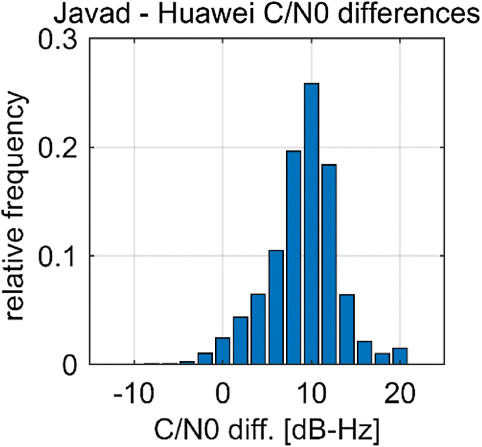
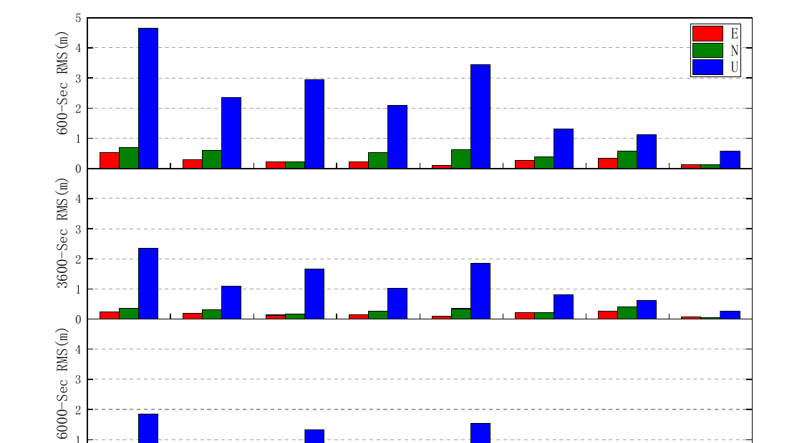
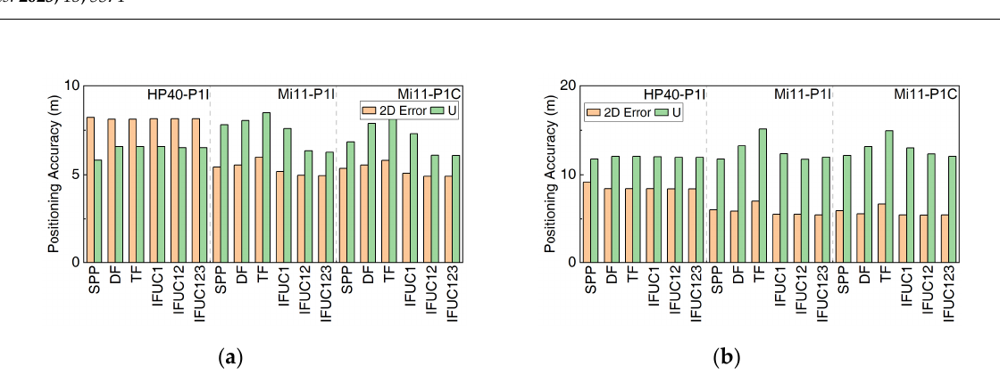

# 2026-11-02 GNSS 每日研究简报

## 今日快报

### 快报 1：码片边沿异常会把相关峰拉歪；B1C/B2a 必须联动监测鉴相器与相关器间隔

- 主题：`bds-b1c-b2a-code-chip-anomaly-ranging`
- 来源 ID：`doi:10.33012/2026.20884`
- 来源链接：https://doi.org/10.33012/2026.20884
- 发表日期：2026-10-07
- 来源类型：ION GNSS+ 2026 同行评审会议论文
- 获取范围：ION 官方公开摘要、方法概述与参考文献；全文需下载额度，本文不引用摘要之外的定量结果

**内容：** 论文把 BDS-3 B1C 近似为 BOC(1,1)、B2a 建模为 BPSK(10)，用畸变信号与理想本地副本的互相关构造 Early-Late 鉴相器，再从零交叉偏移换算测距偏差。仿真区分码片边沿延迟、模拟带宽/振铃、二者叠加和码间干扰。

**结论：** 公开摘要表明，数字边沿延迟会形成平坦死区、相关峰位移与不对称，模拟畸变则表现为振铃、过冲和拖尾；相关器间隔决定鉴相器采样是否落入死区。由于公开范围不含参数扫描表，本文只保留“失真类型—相关函数—锁定点”的因果链，不复述摘要中的最大误差数字。

**关注理由：** 信号质量监测不能只看相关峰高度。接收机若改变相关器间隔、前端带宽或本地 BOC 近似，监测器与用户测距偏差都会一起变化，测试报告应固定这三项配置。

### 快报 2：手机 GNSS Booster 把 Android 观测转换、云端 RTK 与可附着重辐射硬件串成开源链

- 主题：`open-smartphone-gnss-booster-cloud-rtk`
- 来源 ID：`doi:10.33012/2026.20853`
- 来源链接：https://doi.org/10.33012/2026.20853
- 发表日期：2026-10-07
- 来源类型：ION GNSS+ 2026 同行评审会议论文
- 获取范围：ION 官方公开摘要、系统组成与参考文献；全文需下载额度，本文不引用摘要之外的定量结果

**内容：** 系统先在 Android 端把 Raw GNSS Measurement API 的发送/接收时刻转换成通用观测并输出 RTCM，再把流送入云端 RTK 服务器；硬件侧用可附着的 GNSS 信号重辐射装置改善内置天线接收，而不是替换手机芯片。

**结论：** 公开摘要报告，开放天空步行实验中，重辐射硬件改善了整数模糊度估计和厘米级解可用性。由于全文实验时长、基线、设备与错误固定统计不在公开摘要内，这里不把“接近全固定”外推为城市峡谷或任意手机保证。

**关注理由：** 这项工作把三个常被混在一起的问题拆开：Android 原始字段如何变成标准观测、RTK 计算放在哪里、天线噪声怎样从射频侧改善。复现时必须逐层对照，而不能只比较最终坐标。

### 快报 3：把接收机相位偏差当圆变量，PPP-AR 不必先用任意基准星抹掉连续性

- 主题：`circular-receiver-phase-bias-ppp-ar`
- 来源 ID：`doi:10.33012/2026.20782`
- 来源链接：https://doi.org/10.33012/2026.20782
- 发表日期：2026-10-07
- 来源类型：ION GNSS+ 2026 同行评审会议论文
- 获取范围：ION 官方公开摘要、方法概述与参考文献；全文需下载额度，本文不引用摘要之外的定量结果

**内容：** 常规 PPP-AR 常对任意基准星做星间单差，消掉接收机相位偏差，但同时丢掉该偏差的连续性。论文改用圆统计直接估计模一周的接收机偏差，并在 Melbourne-Wübbena 组合上做整数固定。

**结论：** 公开摘要称圆变量模型可内生吸收相位不连续，并提高固定成功概率；但摘要没有给出站点、时段、不同周跳密度与错误固定率的完整分层。因此本文把它视为“保留接收机偏差结构”的候选模型，而不是无需周跳质量控制的普遍结论。

**关注理由：** 相位偏差本来就定义在圆周上，先线性化再用基准星消元可能掩盖结构。工程实现仍应同时输出圆集中度、固定残差和错误固定检验，避免把模型便利误当作可靠性证明。

### 快报 4：快速 PPP 的关键不是混搭更多产品，而是保持轨道、钟、偏差和电离层的共同基准

- 主题：`fast-ppp-cross-provider-product-coherence`
- 来源 ID：`doi:10.33012/2026.20798`
- 来源链接：https://doi.org/10.33012/2026.20798
- 发表日期：2026-10-07
- 来源类型：ION GNSS+ 2026 同行评审会议论文
- 获取范围：ION 官方公开摘要、试验配置与参考文献；全文需下载额度，本文不引用摘要之外的定量结果

**内容：** IONO4HAS 中央处理设施固定由外部提供轨道，但内部联合生成钟、码/相位偏差和电离层格网。研究更换多家轨道输入，并测试再把内部钟或偏差换成第三方产品时，PPP、PPP-IAR、Fast-PPP 与 PPP-RTK 的差异。

**结论：** 公开摘要指出，跨中心混搭钟或偏差常破坏内部一致性，快速收敛的主因是匹配的电离层模型与产品基准，而不只是整数固定。摘要只给总体趋势；在未读全文前，不能把它外推到所有分析中心组合或所有纬区。

**关注理由：** 产品标签相同不代表参数基准相同。用户端应把轨道、钟、OSB/DCB、电离层和参考网络作为一个版本化产品族校验，而不是逐项挑“看起来最优”的提供方。

### 快报 5：低纬电离层权重还要看地方时与基线方位，单靠长度和仰角会错配不确定度

- 主题：`low-latitude-ionosphere-weight-spatiotemporal-rtk`
- 来源 ID：`doi:10.33012/2026.20859`
- 来源链接：https://doi.org/10.33012/2026.20859
- 发表日期：2026-10-07
- 来源类型：ION GNSS+ 2026 同行评审会议论文
- 获取范围：ION 官方公开摘要、香港—澳门 CORS 场景与参考文献；全文需下载额度，本文不引用摘要之外的定量结果

**内容：** 电离层加权 RTK 把单差斜电离层延迟作为参数，并用伪观测给它加随机约束。论文在传统的仰角、基线长度之外，引入地方时和基线方位角，使约束方差随低纬电离层的日变化与方向梯度变化。

**结论：** 公开摘要报告三天代表性试验中，时空权重改善了首次固定、固定率和固定解稳定性。由于完整天气、电离层活动、站网几何和逐日结果不在公开摘要范围内，本文不复述百分比，也不把三天结果视为磁暴或其他低纬站网的通用模型。

**关注理由：** 同样长度的南北与东西基线可能跨越不同电离层梯度。服务端若只广播“基线长度函数”，用户滤波器可能在最活跃时段过度相信电离层约束。

## 深度研读

### 深读 1｜低成本与手机｜先给手机观测体检：为什么仰角不是低功耗接收机的好权重

- 类别：`low-cost-mobile`
- 学习层级：`foundation`
- 选题定位：`经典基础：从 C/N0、仰角、码相差与差分残差辨认天线、时钟和 duty cycling 对手机观测的作用，再决定随机模型应信什么`
- 来源 ID：`doi:10.1007/s10291-019-0892-5`
- 来源链接：https://doi.org/10.1007/s10291-019-0892-5
- 发表日期：2019-07-15
- 来源类型：GPS Solutions 同行评审开放实验论文
- 获取范围：CC BY 4.0 开放全文；Huawei P20、两台 Javad、约 13 h、1 s 观测、超短基线、码/相位差分、Figure 1–14 与 Tables 1–2 已核对
- 价值评分：95/100（相关性 20，经典价值 19，证据 19，教学价值 19，工程价值 18）

#### 为什么先学这个

手机定位算法常从“按仰角定权”起步，但这一步已经隐含高仰角信号通常更强、天线方向图近似稳定。手机的线极化内置天线、机身遮挡和功耗策略会打破这种关系。先辨认观测为什么坏，下一节把质控送进 PPP 时才知道哪些异常应降权、哪些必须重置状态，最后一节也才能理解为什么多频组合在动态城市中仍会失败。

#### 先修知识

需要理解伪距、载波相位、C/N0（dB-Hz）、卫星仰角、码/相位硬件偏差、单差/双差/历元差、整周模糊度、观测方差与最小二乘定权。

#### 一句话逻辑

用同址高等级接收机作对照，把几何、钟和大气逐层差掉；若手机 C/N0 与仰角关系变平、相位在 duty cycling 后漂移且差分残差显著增大，就应按实测信号质量定权，并先排除相位连续性不成立的观测。

#### 研究问题与约束

论文在 2018-05-11 开放天空下，让 Huawei P20 与 Javad Alpha、Javad Triumph 同址记录约 13 h、1 s 数据。手机在开始数分钟后启用 duty cycling。试验只有一款早期单频手机、一个场地和一天；高等级设备虽同址但天线与接收链不同，差值不能只归因于芯片。

#### 核心方法论

先比较 C/N0 时间序列、仰角关系与天空图；再用相位减码观察码相钟不一致，用手机—Javad 单差定位接收机公共项，用星间双差削弱钟和大气，用历元差压低慢变多路径。最后只用码观测做不同基线的相对定位，对比仰角定权和 C/N0 定权。

#### 关键公式逐步推导

相位减码在米单位可写为：

```math
\lambda\Phi-P=\lambda N+c(B_{r,\Phi}-B_{\Phi}^{s}-B_{r,P}+B_P^s)-2I+M_\Phi-M_P+\varepsilon_\Phi-\varepsilon_P.
```

消去初值后，静态几何与常偏差不再主导，剩余漂移可暴露码相钟不一致。常用仰角定权为 $`\sigma_P=\sigma_0/\sin e`$；C/N0 定权则利用线性载噪比 $`c/n_0=10^{(C/N_0)/10}`$：

```math
\sigma_P=\lambda_c\sqrt{\frac{\alpha B_L}{c/n_0}}.
```

它不是“C/N0 越大一定无多路径”，而是把接收机实际看到的信号质量直接送入方差。

#### 经典价值与创新边界

经典价值在于把手机问题拆成天线/信号功率、时钟、相位连续性和随机噪声，而不是用一个定位 RMS 兜底。创新边界是 2018 年设备的 duty cycling 行为不能代表今天所有 Android 芯片；论文的 C/N0 公式还使用通用 DLL 常数，并非逐设备标定。

#### 整体逻辑链

同址采集；比较信号功率；观察 duty cycling 前后码相差；用单差定位公共接收机项；用双差检查相位弧；用历元差估计快噪声；建立 C/N0 方差；在同一代码相对定位中同仰角权重对照。

#### 原文图表与结果分析



> 图表源：Paziewski、Sieradzki 与 Baryla《Signal characterization and assessment of code GNSS positioning with low-power consumption smartphones》Figure 3，[CC BY 4.0 开放全文](https://doi.org/10.1007/s10291-019-0892-5)。本地资产下载 Springer 原始 Figure 3 PNG，未裁剪、重绘或改写坐标轴与柱值。

横轴是同一信号的 Javad−Huawei C/N0 差值（dB-Hz），纵轴是相对频率；分布峰位约在正 10 dB-Hz 附近，正文报告均值差约 9.4 dB-Hz。图能直接说明这组同址观测中手机信号功率系统性更低，不能单独分离天线极化、前端增益、线缆或接收机 C/N0 标定差异。

#### 原文结果论述

正文报告手机—高等级基线在 duty cycling 未启用时，历元差码残差 STD 为 4.4 m，高等级—高等级基线为 0.5 m；手机相位历元差在启用后 STD 增至 92 mm。短基线 10 min 解中，C/N0 定权把 N/E/U STD 从 1.47/0.84/2.80 m 降至 1.09/0.69/2.11 m。它证明该数据集上仰角不是充分质量指标，不证明所有手机都应使用同一 C/N0 函数。

#### 常见误区与适用边界

第一，低 C/N0 不等于一定 NLOS。第二，双差会放大噪声。第三，历元差降低慢变多路径，也会隐藏低频误差。第四，duty cycling 造成的相位漂移不能靠加权修复。第五，同址接收机并非同天线链。第六，静态开放天空结论不能直接代表手持和城市动态。第七，C/N0 数值跨厂商可能有标定偏差。

#### 工程实现步骤

1. 原样保存 Android clock、ADR state、C/N0、频点和周跳标志。
2. 用同址参考机建立逐频点 C/N0 与残差对照。
3. 画 C/N0—仰角—机体系方位三维关系，不只画仰角曲线。
4. 计算码相差、单差、双差和历元差，区分公共钟项与单星项。
5. duty cycling 或 ADR reset 后重置相位弧。
6. 分设备、分频点拟合方差，而非复用通用常数。
7. 同时报告定位误差、残差白化和权重校准。

#### 复现实验设计

选择三款 Android 手机与一台测量级接收机，同址开放天空、树荫和手持步行各 2 h，采样 1 Hz；分别启用/禁用 full GNSS measurements。对照仰角权重、C/N0 权重和机体系方位+C/N0 权重。指标为逐频 C/N0 差、码/相位历元差 STD、相位弧长、周跳率、白化残差和 SPP 50/95 分位误差；失败用例包括温升、屏幕锁定、人体遮挡和厂商 C/N0 偏置。

#### 与定位及低成本实现的联系

低成本接收机的主要约束常不是卫星几何，而是天线、功耗策略和观测接口。算法若先把坏相位当连续，再靠鲁棒估计补救，会把硬件状态错误传到模糊度。最便宜的改进往往是完整记录状态位、重置弧段和按设备校准权重。

#### 本节小结

手机观测不能沿用“高仰角就可信”的默认直觉；先把功率、时钟与相位连续性分开，定权才有物理依据。

### 深读 2｜低成本与手机｜坏观测不能只靠删：多系统手机 PPP 怎样联合定权、稳健滤波与相位体检

- 类别：`low-cost-mobile`
- 学习层级：`intermediate`
- 选题定位：`基础进阶：从 Mate30 的周跳、码相漂移和逐系统残差出发，在未差未组合 PPP 中联合 C/N0 分段定权、系统间钟差与稳健 Kalman 滤波`
- 来源 ID：`doi:10.3390/s20226447`
- 来源链接：https://doi.org/10.3390/s20226447
- 发表日期：2020-11-11
- 来源类型：Sensors 同行评审开放实验论文
- 获取范围：CC BY 4.0 开放全文；Huawei Mate30、测量级对照、100 min 静态与同数据运动学 PPP、GPS/BDS/GLONASS、Figures 1–8 与 Tables 1–3 已核对
- 价值评分：94/100（相关性 20，经典价值 18，证据 19，教学价值 19，工程价值 18）

#### 为什么先学这个

上一节说明手机观测的坏法不止一种：码噪、相位漂移、钟跳和周跳不能用同一个权重解决。进入 PPP 后，轨道钟虽更精密，但一个错误相位弧会在滤波器中持续传播。中阶任务因此不是“换一个 C/N0 函数”，而是把观测体检、逐系统随机模型和稳健状态更新组合起来。

#### 先修知识

需要理解未差未组合 PPP、精密轨道钟、系统间钟差、斜电离层、对流层湿延迟、载波模糊度、Kalman 滤波、创新残差、M 估计等价权，以及第一节的码相差和 C/N0 定权。

#### 一句话逻辑

先用 Android 状态位与多项式拟合补检周跳，再按逐系统码残差和 C/N0 分段设置先验方差；滤波创新异常时，用稳健等价权限制该观测对状态的影响，而不是让一个统一门限同时承担检测、定权和删除。

#### 研究问题与约束

研究以 Huawei Mate30 在无遮挡、弱多路径屋顶采集 100 min 数据，并用测量级接收机作对照；同一数据分别按静态和运动学 PPP 处理。Mate30 的 Galileo 双频可用性不足，最终以 GPS/BDS/GLONASS 为主。单设备、单天、良好环境限制了外推；运动学解也不是实际车辆轨迹。

#### 核心方法论

论文先检查 C/N0、Android 自报周跳、多项式拟合补检周跳、码相差漂移和逐系统伪距残差。PPP 采用未差未组合模型，显式估多系统钟差、电离层、对流层和模糊度；随机模型按 C/N0 分段，并由残差统计校准系统权阵；状态更新使用 IGG-III 稳健等价权。对照链只按仰角定权并用标准 Kalman 滤波。

#### 关键公式逐步推导

星座 $`q`$、频点 $`j`$ 的未组合码/相位可写为：

```math
\begin{aligned}
P_{r,j}^{s,q}&=\rho+c(\delta t_r+\delta t_r^{q-G}-\delta t^s)+T+\kappa_j I+b_{P,j}+\varepsilon_P,\\
\lambda_j\Phi_{r,j}^{s,q}&=\rho+c(\delta t_r+\delta t_r^{q-G}-\delta t^s)+T-\kappa_j I+\lambda_j N_j+b_{\Phi,j}+\varepsilon_\Phi.
\end{aligned}
```

先验方差按 C/N0 区间分段形成 $`\mathbf R`$。创新 $`v_i`$ 超出稳健门限时，IGG-III 用缩小因子 $`w_i^*`$ 修改等价权：

```math
R_{ii}^*=R_{ii}/w_i^*,
\qquad
\mathbf K=\mathbf P^-\mathbf H^T(\mathbf H\mathbf P^-\mathbf H^T+\mathbf R^*)^{-1}.
```

权重降低只限制本历元影响；若相位发生真实周跳，仍必须重置对应模糊度，不能让稳健滤波替代弧段管理。

#### 经典价值与创新边界

经典价值是把数据质控放在 PPP 功能模型之前，并明确区分“观测方差不匹配”和“相位弧已断”。创新边界是分段 C/N0 权重与 IGG-III 参数从这组数据调出；较快静态收敛不能证明跨手机、跨场景保持同样收益。

#### 整体逻辑链

比较手机与测量机 C/N0；用 Android 标志和多项式拟合找周跳；从码相差找系统性漂移；按星座统计码残差；建立未差未组合 PPP；用 C/N0 分段权阵；创新异常时稳健降权；在相同 100 min 数据上比较静态和运动学、单系统和多系统。

#### 原文图表与结果分析



> 图表源：Zhu、Xia、Wu、Xia 与 Li《Study on Multi-GNSS Precise Point Positioning Performance with Adverse Effects of Satellite Signals on Android Smartphone》Figure 7，[CC BY 4.0 开放全文](https://doi.org/10.3390/s20226447)。本地资产以 Poppler 180 dpi 渲染原 PDF 第 15 页，仅裁到 Figure 7 三幅完整柱图；未重排、重绘或改写坐标轴、图例与柱值。

三幅图依次给出前 10、60、100 min 的 E/N/U RMS；横轴 G/GB/GBR 是 GPS、GPS+BDS、GPS+BDS+GLONASS，EK/CR 是常规与 C/N0+稳健链，GEO 是测量级单/双频。手机 CR 的蓝色 U 柱普遍低于 EK，但前 10 min 多系统排序并不单调，说明加星座不等于立即改善垂向。图不能独立证明改进来自定权还是稳健滤波，因为二者成套变化。

#### 原文结果论述

全文报告 GPS CR 首次达到 0.5 m 水平误差用 156 历元，常规 EK 用 516 历元；100 min 后，G/GB/GBR 的三维 RMS 相对常规链分别降至 0.928/0.852/0.801 m。运动学解中水平改善并不一致，主要收益集中在垂向，且误差序列没有静态解的清晰收敛形态。这些数值只对应无遮挡静态数据的运动学重算。

#### 常见误区与适用边界

第一，Android 自报周跳会漏检。第二，稳健降权不能修复整周跳。第三，BDS 码相漂移不能归因于所有手机。第四，GLONASS 高周跳/高码噪可能抵消几何收益。第五，C/N0 分段函数不具跨设备可移植性。第六，静态数据按运动学处理不等于真实动态。第七，达到某一误差门限不等于之后持续保持。第八，CR 同时改权重和滤波，贡献不可完全分离。

#### 工程实现步骤

1. 保存 ADR state、clock discontinuity、C/N0 和逐星残差。
2. 以多项式拟合或几何自由组合补检周跳。
3. 对每个星座/频点分别估计码相方差与漂移。
4. 建立含系统间钟差、斜电离层和模糊度的未组合 PPP。
5. 按 C/N0 区间生成先验 $`\mathbf R`$，保留设备版本。
6. 对标准化创新施加 IGG-III 等价权。
7. 真实周跳时重置模糊度，连续异常时隔离卫星。
8. 单独输出收敛时间、稳态误差与错误删星率。

#### 复现实验设计

选择 Mate30、Pixel 与 Xiaomi 各一款，开放天空静态 2 h、树旁静态 2 h、城市车辆 10 km；同一未组合 PPP 下做四个消融：仰角+标准 KF、C/N0+标准 KF、仰角+稳健 KF、C/N0+稳健 KF。指标为周跳检出率/误报率、白化创新、10/30/60/120 min 水平与垂向误差、收敛后越界率和重收敛时间；失败用例包括系统间钟跳、BDS 相位漂移、GLONASS 码粗差与连续遮挡。

#### 与定位及低成本实现的联系

低成本设备的 PPP 后端必须知道前端相位是否仍有整数与时间连续性。算力有限时，可先用状态位+轻量多项式检验管理弧段，再用分段 C/N0 权重和逐观测稳健系数；这比每历元重跑复杂学习模型更容易解释，也为下一节“放弃不可靠载波、转用码与 Doppler”建立判据。

#### 本节小结

手机 PPP 的稳定性来自三件事同时成立：相位弧管理正确、系统随机模型贴近残差、异常创新不会污染状态。

### 深读 3｜纯 GNSS 定位｜没有载波也能更稳：多频码观测怎样做 Doppler 平滑、单差与电离层处理

- 类别：`positioning`
- 学习层级：`advanced`
- 选题定位：`前沿深化：针对不能稳定输出载波的手机，只用 BDS-3/GPS/Galileo 码与 Doppler，联合平滑、星间单差、精密电离层改正和多频无电离层模型完成纯 GNSS 精密码定位`
- 来源 ID：`doi:10.3390/rs15225371`
- 来源链接：https://doi.org/10.3390/rs15225371
- 发表日期：2023-11-15
- 来源类型：Remote Sensing 同行评审开放实验论文
- 获取范围：CC BY 4.0 开放全文；Huawei P40、Xiaomi 11 Lite，静态开放/复杂与动态典型/复杂城市，BDS-3/GPS/Galileo 多频码和 Doppler，Figures 1–10 与 Tables 1–9 已核对
- 价值评分：96/100（相关性 20，经典价值 18，证据 20，教学价值 19，工程价值 19）

#### 为什么先学这个

前两节说明手机相位可能不连续、不同频点码质量差异很大。若设备根本不能稳定给出可固定载波，继续把目标写成 RTK 会掩盖真正可用的信息。精密码定位的高级问题是：怎样用 Doppler 降低码噪，怎样消掉手机钟跳，怎样在“组合消电离层但放大噪声”和“外部电离层改正保留原码”之间选择。

#### 先修知识

需要理解伪距、Doppler/伪距率、滑动平均、星间单差、卫星钟与 DCB、精密电离层产品、双频无电离层系数、误差传播、C/N0 定权、SPP 与动态轨迹误差。

#### 一句话逻辑

先用 Doppler 递推平滑每条码，再按星座选高 C/N0 参考星做星间单差消接收机钟；对电离层既比较双频 IF 组合，也比较逐频精密电离层改正，最后让静态与动态场景共同决定哪个模型真正有用。

#### 研究问题与约束

论文使用 Huawei P40 与 Xiaomi 11 Lite 的 BDS-3/GPS/Galileo 多频码和 Doppler，覆盖静态开放天空、静态复杂、动态典型城市和动态复杂城市。真值由低成本接收机提供，但动态参考并非连续；手机数据率高于参考解率会触发重新收敛。研究不使用载波、IMU、地图或网络位置，因此是纯 GNSS 定位，但也不具备厘米级载波解的上限。

#### 核心方法论

原始码先过粗差筛查和 Doppler 平滑；每个星座按多频加权 C/N0 选择参考星，形成星间单差以消接收机钟。IF-P 模型把双频 IF 码与经精密电离层产品改正的单频码联合；IFUC 模型不做噪声放大的 IF 组合，而把一个、两个或三个经电离层改正的原始频点直接联合。两类都用精密轨道钟、DCB、对流层模型和 C/N0 权重。

#### 关键公式逐步推导

Doppler 平滑码递推为：

```math
\bar P_k=\frac{1}{n}P_k+\frac{n-1}{n}\left[\bar P_{k-1}+\frac{\lambda\Delta t}{2}(D_k+D_{k-1})\right],
\quad n=\min(k,M).
```

检测到粗差时必须重置窗口。双频无电离层码为：

```math
P_{IF,ij}=\alpha_{ij}P_i+\beta_{ij}P_j,
\quad
\alpha_{ij}=\frac{f_i^2}{f_i^2-f_j^2},
\quad
\beta_{ij}=-\frac{f_j^2}{f_i^2-f_j^2}.
```

其方差随 $`\alpha^2\sigma_i^2+\beta^2\sigma_j^2`$ 放大；IFUC 则以精密电离层产品先改正各 $`P_i`$，再把频点作为独立方程联合，避免组合系数直接放大码噪，但引入外部电离层产品误差。

#### 经典价值与创新边界

经典价值是把 Hatch 类平滑、星间单差和 IF 误差传播组合成“无可靠载波时仍可实现”的纯码链路。创新边界是所谓 PCP 仍依赖精密轨道钟、DCB 和电离层产品；它不是自治 SPP，也不是 PPP-AR。静态大幅提升与动态小幅提升的反差，说明模型增益受跟踪连续性和参考真值可用性限制。

#### 整体逻辑链

检查手机多频可用率；标定逐频码噪；粗差剔除；Doppler 平滑；按 C/N0 选参考星；星间单差消手机钟；构造 IF-P/IFUC；固定产品和权重跑 SPP 对照；分别评价静态与动态；用动态退化反查跟踪和重收敛。

#### 原文图表与结果分析



> 图表源：Wang、Hu、Wang、Yuan 与 Wang《Performance of Smartphone BDS-3/GPS/Galileo Multi-Frequency Ionosphere-Free Precise Code Positioning》Figure 10，[CC BY 4.0 开放全文](https://doi.org/10.3390/rs15225371)。本地资产以 Poppler 180 dpi 渲染原 PDF 第 18 页，仅裁到 Figure 10 的两幅柱图；未重排、重绘或改写坐标轴、图例与柱值。

左图是典型城市、右图是复杂城市；横轴按设备/第一频点和 SPP、DF、TF、IFUC1/12/123 分组，橙色为二维误差、绿色为 U 误差，纵轴单位米。大多数组合只比 SPP 略低，部分 TF 柱反而更高；图直接否定“频点越多动态一定越准”。它不能区分参考轨迹间断、跟踪失锁与模型权重各自贡献。

#### 原文结果论述

静态开放与复杂场景中，多种 PCP 解可到 E/N 亚米、U 米级；但动态场景水平通常仍在 5–8 m，U 常超过 10 m，相对 SPP 的改善多在约 10% 量级，且部分 TF-P 更差。全文把原因指向较松的质量控制、复杂环境、频繁失锁和参考位置不连续。IFUC123 通常最好，但设备与第一频点选择仍改变排序。

#### 常见误区与适用边界

第一，Doppler 平滑会传播未检出的粗差。第二，星间单差消钟也引入参考星噪声相关。第三，IF 消一阶电离层却放大码噪。第四，外部电离层改正不是无误差真值。第五，三频只在第三频点质量可控时有益。第六，静态亚米不能代表动态亚米。第七，低成本参考轨迹间断会污染动态评估。第八，PCP 不是载波相位精密定位。

#### 工程实现步骤

1. 按频点检查码、Doppler、FullBiasNanos 和连续弧。
2. 先做粗差/钟跳检测，再启动平滑窗口。
3. 由动态残差为每台设备确定 $`M`$，不要照搬 50–100 历元。
4. 每星座按多频质量选参考星，切换时重构协方差。
5. 校验精密钟参考组合与 DCB 产品。
6. 并行实现 SPP、IF-P、IFUC1/12/123。
7. 输出窗口重置、参考星切换、可用频点和重收敛次数。
8. 静态/动态、水平/垂向分别验收。

#### 复现实验设计

选择 Huawei、Xiaomi、Pixel 各一款多频手机，在开放天空、树荫、典型城市和深城市各跑 30 min 静态与 5 km 动态；用独立双天线测量级 GNSS/INS 仅作真值，不参与被测解。对照原始 SPP、Doppler 平滑 SPP、IF-P、IFUC1/12/123。指标为 2D/U 50/95 分位、RMS、可用率、连续解段、窗口重置、参考星切换和重收敛时间；失败用例包括 Doppler 粗差、第三频点掉锁、DCB 缺失和电离层产品延迟。

#### 与定位及低成本实现的联系

当载波接口不稳定或业务无法承受错误固定时，PCP 是比“硬上 RTK”更诚实的中间层。它复用码和 Doppler，不需 IMU 或地图；但动态城市仍要把 5–10 m 量级当现实基线。工程目标应先是连续、可解释地优于 SPP，再谈亚米承诺。

#### 本节小结

多频精密码定位能显著改善静态手机解，却不会自动治好动态跟踪；真正的高级能力是让组合、改正和质量控制随观测连续性一起工作。
