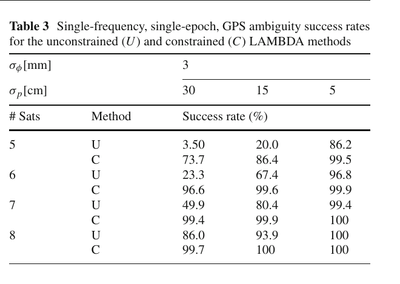
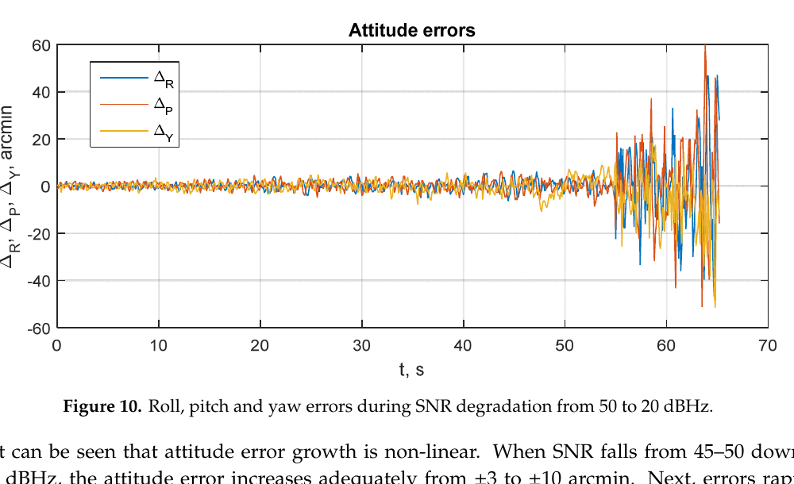
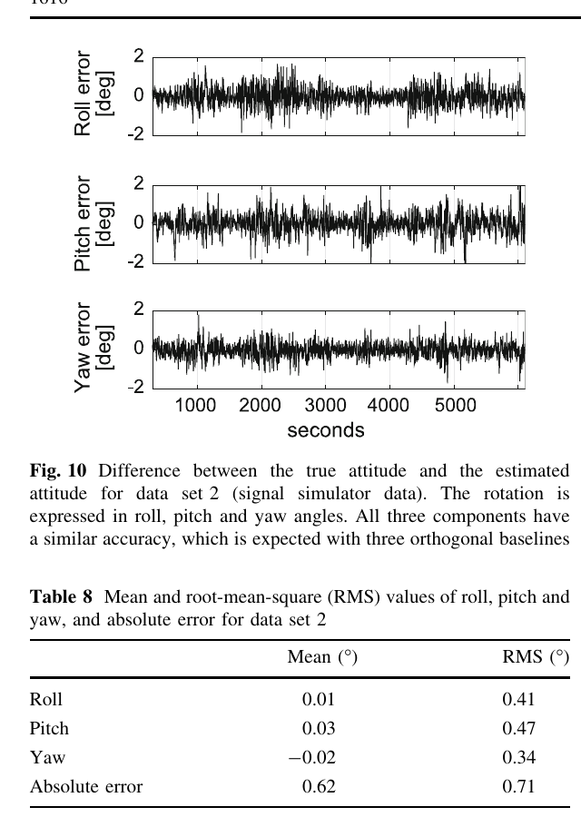

# 2026-11-03 GNSS 每日研究简报

## 今日快报

### 快报 1：7.5 年反演揭出 Block IIF 日凌转向错误，逐星 β 偏差把反向事件从 88 个压到 6 个

- 主题：`gps-block-iif-eclipse-yaw-rkppp-refinement`
- 来源 ID：`doi:10.1186/s43020-026-00226-8`
- 来源链接：https://doi.org/10.1186/s43020-026-00226-8
- 发表日期：2026-10-16
- 来源类型：Satellite Navigation 同行评审开放实验论文
- 获取范围：CC BY 4.0 开放全文；2017-11-01 至 2025-04-20 的约 7.5 年 GPS Block IIF 数据、RKPPP 姿态反演、日凌/午夜转向事件统计与公开模型代码已核对

**内容：** 研究用反向运动学 PPP（RKPPP）从载波相位反演 Block IIF 偏航角，把 12 颗卫星的 3,935 个日凌转向和 4,115 个午夜转向逐事件同旧模型比较。修正分两步：先以逐星 β 偏差替代统一偏差，纠正旋转方向；再调整入影前名义偏航律，同时保留入影后的 0.11°/s 常速模型。

**结论：** 原文在 3,935 个日凌事件中发现 88 个旧模型旋转方向相反事件；逐星 β 偏差后剩 6 个。进一步改进入影前模型后，全部日凌事件的最大偏航差低于 40°，但仍有 95 个超过 20°。这是基于 RKPPP 反演参考的模型一致性证据，不等于直接姿态传感器真值或所有 GPS 代际的通用参数。

**关注理由：** 卫星姿态误差会进入天线相位中心、相位缠绕和钟产品。精密定位软件若只更新轨道钟而沿用旧姿态模型，可能把系统性偏航误差吸收到钟差或站坐标中。

### 快报 2：9 家设施校准不是选一条“标准曲线”，而是把低仰角与方位差异传播到 PPP 坐标

- 主题：`igs-multifacility-antenna-calibration-ring-campaign`
- 来源 ID：`doi:10.1007/s00190-026-02111-3`
- 来源链接：https://doi.org/10.1007/s00190-026-02111-3
- 发表日期：2026-09-26
- 来源类型：Journal of Geodesy 同行评审开放实验论文
- 获取范围：CC BY 4.0 开放全文；IGS 2022–2025 天线环比对、ANTEX 校准、仿真与实测 PPP 验证已核对

**内容：** 研究让 6 副被测天线在 9 家设施之间流转，其中 7 家使用室外机器人、2 家使用微波暗室；比较相位中心偏移（PCO）与相位变化（PV/PCC），再把不同校准曲线前向传播到坐标域，并用多日静态 PPP 验证。

**结论：** 原文报告中高仰角 PCO/PV 通常可达毫米级一致；低仰角与方位相关差异更大。仿真和 PPP 都显示坐标影响主要落在 Up 分量，为数毫米量级，日均值的日间变化通常低于 1 mm。该结果针对本次设施、被测天线和处理组合，不能把“数毫米”当作任意天线、天线罩或现场近场环境的保证。

**关注理由：** 双天线航向与短基线姿态对天线相位中心尤为敏感。ANTEX 文件名相同不代表现场安装等价；校准设施、低仰角截止角、天线罩和安装面应成为可追溯配置。

### 快报 3：缺测不该让一阶差分再丢一次信息，跨空洞自由差分保住噪声与速度不确定度

- 主题：`information-preserving-gnss-timeseries-missing-data-mle`
- 来源 ID：`doi:10.1186/s43020-026-00220-0`
- 来源链接：https://doi.org/10.1186/s43020-026-00220-0
- 发表日期：2026-10-05
- 来源类型：Satellite Navigation 同行评审开放方法与实验论文
- 获取范围：CC BY 4.0 开放全文；10,800 条蒙特卡洛序列、60 个站的 180 条真实坐标序列、两种改进 MLE 与缺测机制补充实验已核对

**内容：** 标准一阶差分会丢弃所有含缺测历元的相邻差；论文改为让空洞两侧可用观测构成“自由差分”，分别用线性变换矩阵和边缘似然实现同一统计目标，同时保留幂律噪声、白噪声、趋势和季节项。

**结论：** 两种改进算法对四个参数的仿真估计相关系数均为 0.9999，差别主要是计算量：本实验中缺测低于约 60%–65% 时边缘似然更快，缺测更高时线性变换更快。这个交叉点取决于序列长度、空洞分布与实现，原文明确不把它视为理论常数。

**关注理由：** GNSS 站坐标、钟差与形变序列常同时含彩色噪声和停机空洞。先插值或机械删差分会改变速度不确定度；应把缺测机制写进似然，而不是只在图上补线。

### 快报 4：CYGNSS 与 Sentinel-1 双流融合把水位 RMSE 做到 0.2388 m，但它是时间外推而非跨流域证明

- 主题：`physics-guided-cygnss-sentinel-water-level-dual-stream`
- 来源 ID：`doi:10.1186/s43020-026-00219-7`
- 来源链接：https://doi.org/10.1186/s43020-026-00219-7
- 发表日期：2026-10-12
- 来源类型：Satellite Navigation 同行评审开放实验论文
- 获取范围：CC BY 4.0 开放全文；CYGNSS、Sentinel-1、测站水位与气象水文输入、严格时间切分、消融和 T+6 预测结果已核对

**内容：** PGNAF-DSNet 用双流网络分别学习 CYGNSS 反射与 Sentinel-1 SAR 信息，引入物理引导噪声增强和自适应融合，并按时间顺序切分训练/测试，避免随机打乱把未来水文状态泄漏给训练集。

**结论：** 测试集 RMSE 为 0.2388 m、MAE 为 0.1624 m、相关系数为 0.9889；作者还报告 T+6 预测相关系数持续高于 0.95。约 50% 的人为活动区误差下降是数据集内结果，不能证明未见流域、异常洪水或不同 CYGNSS 采样几何下仍保持同等收益。

**关注理由：** GNSS-R 的价值不只在单时刻反演，还在与 SAR、测站和动力先验组成时序估计器。工程验收必须坚持时间外测试，并单独报告洪峰、枯水和人为调度时段。

### 快报 5：零样本航片—卫星图匹配把无人机绝对误差压到 5.02 m，前提是起点已知且仍有可匹配地表

- 主题：`gnss-denied-zero-shot-aerial-satellite-particle-localization`
- 来源 ID：`doi:10.1186/s43020-026-00232-w`
- 来源链接：https://doi.org/10.1186/s43020-026-00232-w
- 发表日期：2026-11-02
- 来源类型：Satellite Navigation 同行评审开放实验论文
- 获取范围：CC BY 4.0 开放全文；12 条轨迹、视觉里程计、零样本 GIM 匹配、粒子滤波与逐轨迹误差附录已核对

**内容：** 前端视觉里程计提供局部轨迹和搜索中心，后端从卫星影像裁候选块，用零样本通用图像匹配器给出绝对位置证据，再由自适应粒子滤波融合二者，目标是在 GNSS 拒止时阻止视觉漂移累积。

**结论：** 在每条轨迹起点已知的条件下，9 条真实和 3 条合成轨迹共 104,566 m，平均误差 5.02 m，RMSE 6.90 m，最大误差 50.87 m；真实轨迹均值 5.46 m。它证明的是所测平原、峡谷和城市外业数据上的互补性，不证明无先验起点、夜间、积雪、强季节变化或纹理贫乏场景的可用性。

**关注理由：** 这是 GNSS 故障后的绝对约束候选，而不是 GNSS 精密定位替代品。系统设计应把它作为独立模态，并用 GNSS 恢复后的创新残差验证地图匹配是否发生地点混淆。

## 深度研读

### 深读 1｜接收机工程｜基线长度不是事后验算：把几何约束直接写进整周目标函数

- 类别：`receiver-engineering`
- 学习层级：`foundation`
- 选题定位：`经典基础：从双差载波、整数最小二乘和已知基线长度出发，理解为什么单频单历元 GNSS 罗经必须在搜索阶段使用几何约束`
- 来源 ID：`doi:10.1007/s00190-010-0380-8`
- 来源链接：https://doi.org/10.1007/s00190-010-0380-8
- 发表日期：2010-04-02
- 来源类型：Journal of Geodesy 同行评审开放理论与数值论文
- 获取范围：CC BY-NC 2.0 开放全文；完整推导、全局/局部椭球搜索、非椭球 search-and-shrink 与 Table 1–3 已核对
- 价值评分：96/100（相关性 20，经典价值 20，证据 19，教学价值 19，工程价值 18）

#### 为什么先学这个

两天线给出的不是直接航向，而是一条带未知整周的短基线。多频、多历元或外部传感器会增强模型；最困难的单频、单历元、无辅助场景只能依靠载波精度与已知基线长度。若把长度只放到固定后的验算，搜索中心仍由噪声很大的码观测主导，最有价值的几何信息没有真正参与决策。

#### 先修知识

需要理解星间/站间双差、载波波长、整周模糊度、浮点解与固定解、协方差加权范数、LAMBDA 去相关、ENU 基线与航向/仰角换算，以及“成功率”是正确整数向量被选中的概率而非定位可用率。

#### 一句话逻辑

把 $`\|b\|=l`$ 作为硬约束或带方差的软约束并入混合整数最小二乘目标，使每个整数候选同时为载波残差和基线长度偏差付代价，再用上下界逐步收缩非椭球搜索空间。

#### 研究问题与约束

论文研究一般 GNSS 模型，但数值示例聚焦两副近邻天线、单频、单历元 GPS。近距离使差分大气可忽略，基线长度先验被视为已知或带给定方差。成功率表是模型驱动数值结果，不包含多路径、周跳误报、天线相位中心变化或错误长度标定。

#### 核心方法论

标准模型写成 $`E(y)=Aa+Bb`$，其中 $`a\in\mathbb Z^n`$、$`b\in\mathbb R^3`$。标准 ILS 只最小化浮点整周与整数候选的距离；GNSS compass 模型再约束 $`\|b\|=l`$。由于固定某个 $`a`$ 后的最佳受约束基线使目标函数出现非二次项，作者构造易计算的下界 $`F_1`$ 与上界 $`F_2`$，保持 $`\Omega_2\subset\Omega_F\subset\Omega_1`$，找到候选即缩小门限，直到全局整数极小值确定。

#### 关键公式逐步推导

标准线性化观测模型为：

```math
E(y)=Aa+Bb,\qquad D(y)=Q_{yy},\qquad a\in\mathbb Z^n.
```

加入长度先验 $`l`$ 及其方差 $`\sigma_l^2`$ 后，整数目标可写为：

```math
F(a)=\|\hat a-a\|_{Q_{\hat a\hat a}}^2+
\min_{b\in\mathbb R^3}\left[
\|\hat b(a)-b\|_{Q_{\hat b(a)\hat b(a)}}^2+
\sigma_l^{-2}(l-\|b\|)^2
\right].
```

$`\sigma_l^2\to\infty`$ 退化为无长度约束，$`\sigma_l^2\to0`$ 成为硬约束。固定 $`\check a`$ 后，再由括号内极小化求固定基线 $`\check b`$，最后从 ENU 分量计算航向与仰角。

#### 经典价值与创新边界

经典价值是把“已知基线长度”从经验筛选提升为统计目标的一部分，并给出保证全局解的搜索策略。边界在于论文并未解决固定验收、异常观测、天线校准或动态连续性；约束越强，错误的长度先验也越可能把搜索推向错误整数。

#### 整体逻辑链

建立双差相位/码模型；求浮点整周与基线；加入长度硬/软约束；得到非椭球整数目标；构造上下界；以 search-and-shrink 枚举；求固定基线；换算航向/仰角；用成功率而非单次误差评估。

#### 原文图表与结果分析



> 图表源：Teunissen《Integer least-squares theory for the GNSS compass》Table 3，[CC BY-NC 2.0 开放全文](https://doi.org/10.1007/s00190-010-0380-8)。本地资产由 PDF 第 13 页裁出原表，未重绘或改写任何数值、标签与单位。

表固定相位标准差为 3 mm，列是码标准差 30/15/5 cm，行比较 5–8 星下无约束 U 与受约束 C 的正确整周成功率。最弱的 5 星、30 cm 码噪声下，成功率由 3.50% 升到 73.7%；6 星同列由 23.3% 升到 96.6%。图表直接证明长度约束可显著增强这一理想化模型，不能证明 73.7% 已足够安全，也不能覆盖非高斯多路径和错误基线标定。

#### 原文结果论述

作者指出最终收缩集合通常很小，运行时间可与标准 LAMBDA 相比。表中 7 星、30 cm 列由 49.9% 升到 99.4%，8 星由 86.0% 升到 99.7%。改善随模型本身增强而趋于饱和；它说明约束价值最大出现在码噪声大、可见星少的弱模型，而不是“任何场景都固定成功”。

#### 常见误区与适用边界

第一，长度约束不等于姿态约束，一条基线只给两自由度。第二，成功率不是 ratio 通过率。第三，双差不能消除天线 PCV 与多路径。第四，硬约束会放大安装尺寸错误。第五，单历元避免周跳延续，却牺牲时间平滑。第六，极短基线让搜索空间曲率更明显，不能直接套标准椭球搜索。

#### 工程实现步骤

1. 标定天线相位中心间而非外壳间的基线长度及温度系数。
2. 构造同频双差相位与码、完整协方差和参考星切换逻辑。
3. 求无约束浮点解，检查秩、条件数与残差。
4. 按长度不确定度选择软约束；只有可溯源标定才使用近硬约束。
5. 用上下界搜索并保留多个候选及其目标差。
6. 独立做固定失败率/残差/姿态连续性验收。
7. 输出固定状态、候选间隔、长度残差和航向协方差。

#### 复现实验设计

搭建 0.2/0.5/1.0 m 三种双天线基线，GPS L1 单频 1 Hz；在开放天空和反射墙旁各采 2 h。基线长度先验分别注入 0、1、5、10 mm 偏差。对照无约束 LAMBDA、硬约束 QC-ILS、按标定方差的软约束。指标为正确固定率、错误固定率、拒绝率、航向 50/95 分位、运行时间和长度残差；失败用例包括参考星切换、半周异常、天线互换和温漂。

#### 与定位及低成本实现的联系

低成本接收机的码噪声大，表中恰是约束收益最大的区域。实现时不能因此省掉可靠性监测：几何约束应补强随机模型，而不是掩盖多路径。若平台只有一条基线，可稳定给航向/俯仰但不能独立给滚转；三维姿态至少需要两条不共线基线。

#### 本节小结

已知基线长度只有在进入整数目标函数时才真正增强整周搜索；它能把弱模型变强，也会把错误标定变成强错误先验。

### 深读 2｜接收机工程｜弱信号时不要各自锁载波：陀螺怎样闭合多天线相位差矢量环

- 类别：`receiver-engineering`
- 学习层级：`intermediate`
- 选题定位：`基础进阶：把上一节的历元级整周问题放进连续接收机环路，理解相位差直跟踪、陀螺动态辅助与 EKF 如何换取弱信号连续性`
- 来源 ID：`doi:10.3390/s20082203`
- 来源链接：https://doi.org/10.3390/s20082203
- 发表日期：2020-04-13
- 来源类型：Sensors 同行评审开放理论与仿真论文
- 获取范围：CC BY 4.0 开放全文；三天线 GLONASS 仿真、相位差矢量环、MEMS 陀螺误差、SNR 递减与 GNSS 中断实验、Figures 1–16 已核对
- 价值评分：92/100（相关性 19，经典价值 17，证据 17，教学价值 20，工程价值 19）

#### 为什么先学这个

上一节解决“这一历元选哪组整数”，却没有回答车辆转动、遮挡和低 C/N0 下怎样维持相位。独立 PLL 必须跟踪每根天线的完整载波动态；姿态真正需要的是天线间相位差，其动态主要来自平台转动。把陀螺角速度直接送入相位差预测，可让环路只校正较慢的残差。

#### 先修知识

需要理解多天线相位干涉、PLL/FLL/DLL、C/N0（文中称 SNR，单位 dB-Hz）、四元数运动学、MEMS 陀螺零偏/尺度因子、EKF 状态传播与创新、相位差模一周以及初始化整周。

#### 一句话逻辑

不用每通道 PLL 分别锁定绝对载波，而让所有可见星的天线间相位差共同观测一个姿态四元数；陀螺提供高频转动预测，矢量 EKF 用 GNSS 相位差慢慢校正姿态和陀螺误差。

#### 研究问题与约束

论文目标是把典型 PLL 的约 27 dB-Hz 跟踪边界向更弱信号推移。验证为仿真：GLONASS 星座、三天线、旋转平台、设定 MEMS 陀螺误差与线性下降的 SNR；没有真实城市多路径、射频前端非线性、天线互耦或硬件通道时延。因此所有灵敏度数字都只能标为作者仿真结果。

#### 核心方法论

接收机用非相干环跟踪码延迟和 Doppler，用天线间复相关直接形成相位差。状态含姿态四元数、陀螺偏置/尺度/失准以及相位前端偏差。陀螺测量进入四元数传播；各卫星相位差对姿态构成共同观测，EKF 输出再闭合到相位差矢量跟踪环。整周只在初始化或长中断后重解，连续运行时依靠状态传播保持相位差。

#### 关键公式逐步推导

对天线基线 $`b_k`$ 和卫星视线 $`e_i`$，天线间几何相位差近似为：

```math
\Delta\phi_{ik}=\frac{2\pi}{\lambda_i}e_i^{T}R(q)b_k+\delta_{ik}+\nu_{ik}\pmod{2\pi}.
```

四元数由去除估计偏置后的角速度传播：

```math
\dot q=\frac{1}{2}\Omega(\omega_m-\hat b_g)q.
```

EKF 预测 $`R(q)b_k`$ 对每颗星的投影；创新由包裹相位差与预测的最小圆周差构成。多星、多基线共同约束同一个 $`q`$，而陀螺把历元间快速动态移出相位环路。

#### 经典价值与创新边界

价值在于把“GNSS/陀螺融合”从姿态解层下沉到接收机跟踪层，让惯性信息直接改善相位差可跟踪性。边界是仿真没有证明真实射频链、NLOS 和相关多路径下的鲁棒性；而且它已不是纯 GNSS，陀螺标定和时间同步成为新故障源。

#### 整体逻辑链

非相干码/Doppler 跟踪；形成同星跨天线相位差；陀螺传播四元数；预测几何相位差；EKF 联合估姿态与陀螺误差；矢量反馈修正所有相位差通道；弱信号或短中断时保持；长中断后重新初始化整周。

#### 原文图表与结果分析



> 图表源：Perov 与 Shatilov《Deeply Integrated GNSS/Gyro Attitude Determination System》Figure 10，[CC BY 4.0 开放全文](https://doi.org/10.3390/s20082203)。本地资产由 PDF 第 15 页裁出原图和图题，未重绘、平滑或改写坐标轴；纵轴为 arcmin，横轴为 s。

仿真让 SNR 以 0.5 dB-Hz/s 从约 45–50 下降到约 20 dB-Hz。0–50 s 三轴误差大致维持在数角分范围，55 s 后随信号跟踪丢失迅速放大到几十角分。图能直接显示“弱化到某区间后非线性失稳”，不能分离相位差环、非相干 FLL/DLL、星数下降和陀螺误差各自的贡献。

#### 原文结果论述

正文称 SNR 从 45–50 降到 18–23 dB-Hz 时误差由约 ±3 增至 ±10 arcmin，15–18 dB-Hz 附近跟踪完全丢失，因此给出约 18 dB-Hz 仿真灵敏度；摘要更保守地概括为降到 20 dB-Hz。另一个 35–40 dB-Hz 仿真给出约 ±7–8 arcmin。两者都不是外场验收值。

#### 常见误区与适用边界

第一，dB-Hz 不是功率 dB。第二，弱信号连续不等于整周正确。第三，陀螺辅助不能消除相位多路径。第四，闭环可能把错误 GNSS 相位反馈到陀螺偏置。第五，短中断与长中断的重初始化策略不同。第六，包裹创新必须按圆统计处理。第七，仿真 SNR 阈值依赖环路带宽、积分时间、动态和星数。

#### 工程实现步骤

1. 对多天线 RF 通道做固定相位偏差与群时延标定。
2. 共享码/Doppler状态，生成逐星跨天线复相关与相位差。
3. 时间对齐陀螺与相关器积分区间，测量时延并进入状态。
4. 用四元数传播并在线估计陀螺零偏、尺度和失准。
5. 以包裹相位创新做门控，按星/基线维护健康度。
6. C/N0 下降时自适应相干/非相干积分，但限制动态滞后。
7. 长中断或创新多峰时退出连续模式，重新执行整周初始化。

#### 复现实验设计

三天线直角布置，基线 0.5 m；使用 GNSS 射频模拟器与可编程转台，三轴角速率 0–100°/s，C/N0 由 45 以 0.5 dB-Hz/s 降到 15 dB-Hz。对照独立 PLL、相位差环、相位差+MEMS 陀螺深组合。指标为跟踪保持概率、周跳/重捕获率、姿态 RMS/95 分位、创新白化、恢复时间和计算负载；另加相关多路径、5/20 s 遮挡、陀螺温漂与 5 ms 时延失败用例。

#### 与定位及低成本实现的联系

低成本平台往往既受短基线限制，又受遮挡和快速转动影响。深组合可把廉价 MEMS 的短时稳定性换成 GNSS 相位差的弱信号可用性，但其收益依赖精确时间对齐。若只需要开放天空航向，历元级受约束 ILS 更简单；只有连续动态和弱信号需求足够强时，才值得进入接收机环路。

#### 本节小结

把陀螺送进相位差矢量环能降低环路承担的动态、延伸仿真弱信号边界；代价是系统从“解算器”升级为需要严密时标与故障隔离的闭环接收机。

### 深读 3｜定位｜接收机不同步也能定姿：先把米级时标错位外推到共同历元

- 类别：`positioning`
- 学习层级：`advanced`
- 选题定位：`纯 GNSS 定位专题：用非同步低成本接收机的 PVT 速度把相位观测外推到共同历元，再以多基线载波和航天器动力学递推三维姿态`
- 来源 ID：`doi:10.1007/s10291-017-0639-0`
- 来源链接：https://doi.org/10.1007/s10291-017-0639-0
- 发表日期：2017-05-18
- 来源类型：GPS Solutions 同行评审实验论文
- 获取范围：ETH Research Collection 开放存档全文（非商业使用边界）；合成轨道数据、Spirent 信号模拟器、u-blox NEO-M8、非同步改正、Figures 1–11 与 Tables 1–9 已核对
- 价值评分：94/100（相关性 20，经典价值 18，证据 18，教学价值 19，工程价值 19）

#### 为什么先学这个

第二节用共享状态闭合相位差，但现实中多颗低成本接收机不一定由同一采样时钟触发。1 ms 的历元错位乘上约 8 km/s 的低轨速度就是米级几何差，远大于 10 cm 基线。若先把不同历元的观测当同时数据，再精细求整周或四元数，算法只是在高精度地拟合错误时间。

#### 先修知识

需要理解载波相位差、视线向量、旋转矩阵/四元数、Wahba 问题、Kalman 滤波、接收机 PVT、观测时标、速度外推、天线 PCV、低轨速度与基线几何，以及上一节的多基线相位差观测。

#### 一句话逻辑

对每个接收机的真实测量时刻，用其 PVT 速度和卫星速度把几何观测外推到统一历元；消除不同步造成的米级项后，再联合三条基线、整数相位与动力学滤波求姿态。

#### 研究问题与约束

目标平台是 10 cm 立方星 CubETH 的低成本 GNSS 接收机。内部振荡器使名义 GPS 历元附近存在约 1 ms 触发窗，作者报告外推改正常为 −6 至 +6 m。验证一组为 Bernese 生成的合成数据，一组为 Spirent + u-blox 的三次独立基线模拟；没有在轨真值，也未模拟第二组的电离层路径延迟。

#### 核心方法论

先用每台接收机 PVT 给出的坐标/速度和卫星轨道，把天线—卫星距离差从各自采样时刻外推到共同历元。每条短基线做瞬时整周初始化，随后滤波状态用四元数及角速度描述姿态动力学。多条基线的投影视线观测共同更新姿态；已知基线长度作为伪观测帮助整周。算法不需要接收机硬件同步，也不使用地面外部姿态数据运行。

#### 关键公式逐步推导

共同历元下，基线 $`b_k`$ 的差分几何观测为：

```math
r_{ik}=e_i^T R(q)b_k+v_{ik}.
```

若接收机 A、B 的实际历元相对参考历元为 $`\Delta t_A,\Delta t_B`$，一阶外推必须加入接收机与卫星相对速度：

```math
\delta\rho_{AB}^{i}\approx
(v_A-v_i)^T e_A^i\Delta t_A-(v_B-v_i)^T e_B^i\Delta t_B.
```

经时标改正后的多星、多基线残差进入：

```math
\min_{R\in SO(3)}\sum_{k,i}\frac{1}{\sigma_{ik}^{2}}
\left(r_{ik}-e_i^TRb_k\right)^2,
```

并在 Kalman 滤波中以四元数与角速度连续传播。

#### 经典价值与创新边界

价值是把低成本接收机“不同步”从硬件否决条件改成可观测、可改正的时标问题，并明确改正量可达米级。边界是信号模拟器的三条基线由三次独立运行组成，不是六台接收机同时在轨；研究也承认短基线 PCV 校准仍限制真实精度。

#### 整体逻辑链

识别实际采样时刻；读取接收机 PVT 与卫星状态；外推每条观测到共同历元；瞬时解整周；以基线投影构造姿态观测；四元数/角速度滤波；多基线联合；用模拟器真值检查三轴误差和绝对姿态误差。

#### 原文图表与结果分析



> 图表源：Willi 与 Rothacher《GNSS attitude determination with non-synchronized receivers and short baselines onboard a spacecraft》Figure 10 与 Table 8，[ETH 开放存档全文](https://doi.org/10.3929/ethz-b-000239649)，原出版 DOI 为 10.1007/s10291-017-0639-0；权利标注为 In Copyright - Non-Commercial Use Permitted。本地资产由 PDF 第 13 页作最小研究评述裁剪，未重绘或改写曲线、表值、坐标轴与标签。

图上三轴误差横轴约 0–5,800 s，纵轴为度；表给出 roll/pitch/yaw RMS 0.41°/0.47°/0.34°，绝对姿态 RMS 0.71°，均值接近零。三条曲线同量级与三条正交 10 cm 基线几何一致。它直接证明模拟器配置下无明显系统偏差，不能证明在轨热变形、真实 PCV、NLOS 或共时多接收机干扰下仍保持 0.71°。

#### 原文结果论述

滤波器一历元初始化、约 5 s 收敛；信号模拟器数据的平均绝对误差 0.62°、最大约 2.5°。合成数据噪声扫描中，相位噪声 15 mm 以内的逐基线整周成功率高于 95%；但 1°以内姿态需要约 1 mm 测量噪声。作者还指出短基线天线 PCV 对精度影响显著，实际应用需良好校准。

#### 常见误区与适用边界

第一，名义 1 Hz 同历元不代表硬件采样同步。第二，用接收机钟差代替真实观测时刻不充分。第三，PVT 速度误差会直接进入外推。第四，三次模拟运行组合不等于真实并行通道相关性。第五，短基线对 PCV 和结构热变形极敏感。第六，低于 1°不等于可替代星敏感器的角分精度。第七，纯 GNSS 仍依赖开放视野与可用卫星。

#### 工程实现步骤

1. 保存每台接收机原始 measurement time、时钟状态与 PVT 时间戳。
2. 标定各通道固定延迟、天线 PCO/PCV 和机体系基线。
3. 由卫星位置/速度与接收机 PVT 计算逐观测外推项。
4. 将全部载波/伪距统一到滤波参考历元后再做差分。
5. 按基线独立初始化整周并以长度残差验收。
6. 用多基线四元数滤波，监测正交性、创新和基线一致性。
7. 时标不确定度或速度误差过大时拒绝更新，而非强行定姿。

#### 复现实验设计

四台无共钟低成本双频接收机组成三条 0.1/0.3/1.0 m 正交基线，安装在六自由度转台；共享射频模拟器真值但各自独立采样。人为注入 ±0.1/0.5/1/2 ms 时标错位。对照不改正、仅接收机速度改正、接收机+卫星速度完整改正和硬件同步。指标为外推残差、整周正确率、三轴/绝对姿态 RMS、5 s 收敛率和计算负载；失败用例加入 5 mm PCV、温漂、PVT 速度偏置和星座切换。

#### 与定位及低成本实现的联系

这是纯 GNSS 双/多天线定向：不依赖 IMU 或视觉，适合开放天空下的备份姿态和低功耗航天器。但低成本的真正瓶颈从“能否测相位”转移到时标、通道延迟与天线校准。基线加长可改善角度精度，却增加结构安装空间与整周模型复杂度。

#### 本节小结

非同步接收机并非不能做姿态；必须先把时间错位造成的米级几何项外推掉，再谈毫米级载波与十厘米基线。模拟器证据支持亚度级可行性，真实在轨精度仍受 PCV 和时标质量约束。
