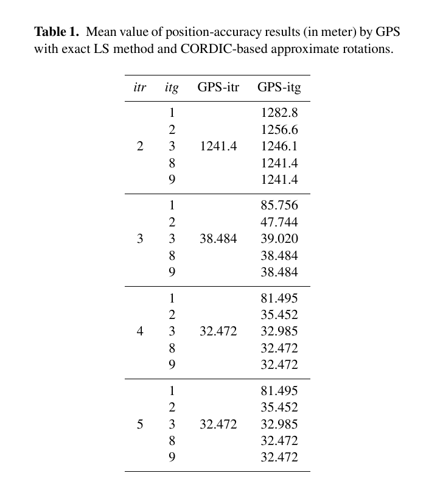
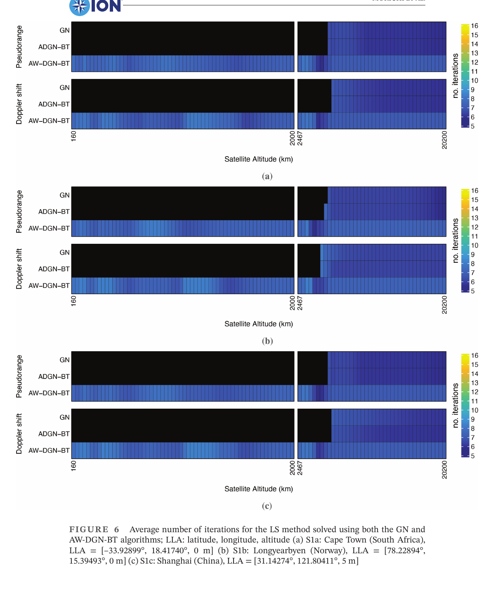
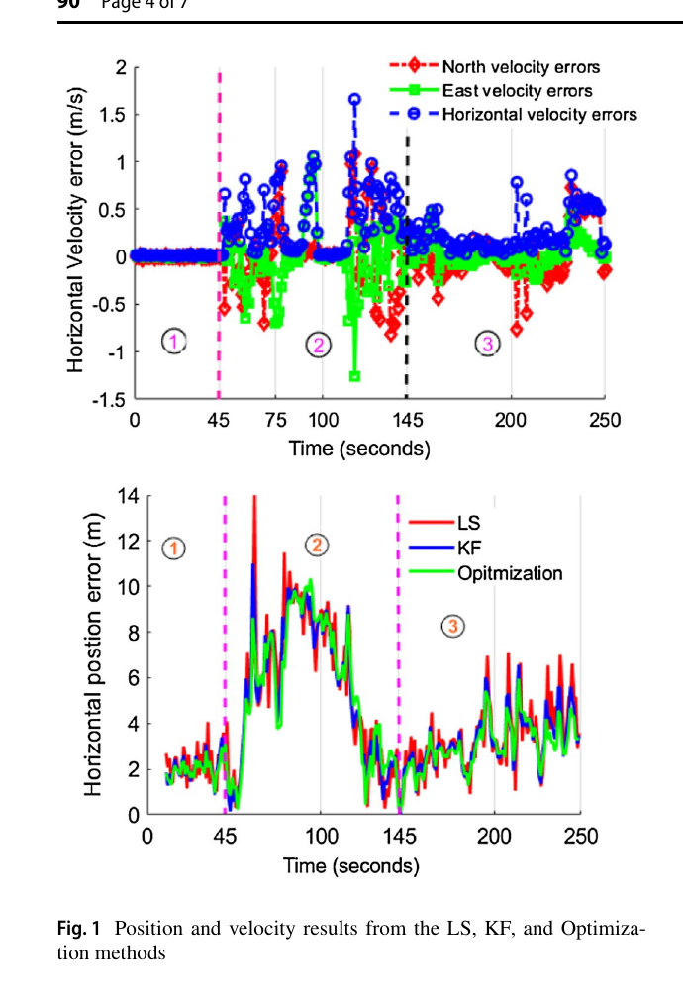

# 2026-11-09 GNSS 每日研究简报

## 今日快报

### 快报 1：Doppler 定位不能只数可见星，卫星运动方向分布同样决定可观测性

- 主题：`doppler-geometry-latitude-pseudorange-integration`
- 来源 ID：`doi:10.33012/2026.20839`
- 来源链接：https://doi.org/10.33012/2026.20839
- 发表日期：2026-10-06
- 来源类型：ION GNSS+ 2026 同行评审会议论文
- 获取范围：ION 官方摘要、实验设计与摘要结论；全文需订阅或下载额度，本文不引用摘要之外的定量结果

**内容：** 研究用低、中、高纬参考站的真实 GPS/Galileo/BDS 数据比较 Doppler 单独定位的几何差异，再在城市车辆实验中把 Doppler 速度与方位约束送入伪距滤波。核心问题不是“能看到多少颗星”，而是卫星视线速度在三维空间是否提供互补方向。

**结论：** 官方摘要直接支持：多系统可降低 Doppler 定位误差，高纬站即使与低纬站的平均可见星数接近，也因运动几何更有利而表现更好；车辆实验中伪距—Doppler 融合优于伪距单独定位。由于未取得全文，本文不外推具体误差、权重、遮挡比例或统计显著性。

**关注理由：** 传统 DOP 只看位置视线矩阵；Doppler 定位还需要审查视线变化率矩阵。面向 LEO-PNT 或城市测速辅助时，应把“运动几何”作为独立质控量。

### 快报 2：Starlink DTC 首次被做成采集—跟踪—差分 Doppler 闭环，但仍是机会信号实验

- 主题：`starlink-direct-to-cell-differential-doppler-pnt`
- 来源 ID：`doi:10.33012/2026.20899`
- 来源链接：https://doi.org/10.33012/2026.20899
- 发表日期：2026-10-06
- 来源类型：ION GNSS+ 2026 同行评审会议论文
- 获取范围：ION 官方摘要、信号模型、基准站/流动站实验与摘要结论；全文需订阅或下载额度，本文不引用摘要之外的定量结果

**内容：** 作者建立 Starlink Direct-to-Cell 下行的时延与 Doppler 补偿模型，用软件接收机同时跟踪宽带和 DTC 波束，再把基准站与流动站的同步 Doppler 差分送入批量非线性最小二乘。

**结论：** 官方摘要证明了在特定外场、给定波束与接收链上，DTC 信号可以被捕获、跟踪并形成差分定位结果；它没有证明信号长期稳定、星历公开、全球覆盖或服务方承诺 PNT 完整性。这里应称“首次实验性利用”，不应称“现成导航服务”。

**关注理由：** 机会信号最难的是把物理层可跟踪性闭合到定位观测。该工作把波束切换与发射端补偿显式纳入模型，提示工程系统不能把通信载波 Doppler 直接当作 GNSS 广播模型。

### 快报 3：图神经网络在已见攻击上很强，跨类型留出后却暴露明显分布外退化

- 主题：`spoofing-stgnn-cross-scenario-generalization`
- 来源 ID：`doi:10.33012/2026.20700`
- 来源链接：https://doi.org/10.33012/2026.20700
- 发表日期：2026-10-06
- 来源类型：ION GNSS+ 2026 同行评审会议论文
- 获取范围：ION 官方摘要、TEXBAT 切分协议、对照方法与摘要结论；全文未开放，本文不引用摘要之外的定量结果

**内容：** 方法把卫星视为图节点、把星间相关性与时间演化共同送入时空图神经网络；评估同时设置随机混合切分和逐步排除攻击类型的跨场景切分，专门检查模型是否只记住已见欺骗轨迹。

**结论：** 官方摘要显示：混合切分下检测表现最佳，但排除动态等功率攻击或整类安全码估计重放样本后，检测能力显著下降。证据支持“星间建模有助于相关攻击”，不支持“对未知欺骗普遍泛化”。

**关注理由：** 欺骗检测最容易被随机切分高估。部署前应按攻击发生器、功率接管方式和轨迹整段留出，并把分布外退化作为验收指标而不是附录现象。

### 快报 4：城市 SNR 地图把横街判别变成场所指纹，但地图老化与手机差异仍未闭合

- 主题：`urban-smartphone-nmea-snr-map-matching`
- 来源 ID：`doi:10.33012/2026.20882`
- 来源链接：https://doi.org/10.33012/2026.20882
- 发表日期：2026-10-06
- 来源类型：ION GNSS+ 2026 同行评审会议论文
- 获取范围：ION 官方摘要、Samsung Galaxy S25 Edge 静态采集设计与摘要结果；全文需订阅或下载额度，本文不引用摘要之外的定量结果

**内容：** 研究把手机 NMEA 输出中的逐星 SNR 组成位置相关指纹，在城市网格中与预建地图匹配，用楼宇遮挡和反射方向性补充普通 DGNSS 难以区分的横街位置。

**结论：** 官方摘要支持：在所测城市区域，SNR 地图匹配提高了网格识别和窄街横向判别。它仍是单一区域、单型手机、静态采样证据，不能证明换季、施工、天线握持变化或不同芯片间可直接迁移。

**关注理由：** NMEA 虽然信息贫乏，却可能保留环境指纹。若要工程化，应同时维护地图时间戳、终端域适配和无匹配拒答机制，避免强行吸附到错误街谷。

### 快报 5：等功率欺骗重叠时先分离再成组，TEXBAT 证明“跟住两套解”可行但不负责判真

- 主题：`matched-power-spoofing-separate-group-track`
- 来源 ID：`doi:10.33012/2026.20668`
- 来源链接：https://doi.org/10.33012/2026.20668
- 发表日期：2026-10-06
- 来源类型：ION GNSS+ 2026 同行评审会议论文
- 获取范围：ION 官方摘要、TEXBAT ds4、单历元分解、iRAIM/刚性推移分组与跟踪结论；全文需下载额度，本文不引用摘要之外的定量结果

**内容：** 在已知发生欺骗的前提下，算法把重叠相关峰分解为两套信号，用 iRAIM 与刚性位置推移一致性成组，再以信号参数 EKF 连续跟踪真实集和欺骗集的拉离过程。

**结论：** 官方摘要支持：该流程能在 TEXBAT ds4 静态等功率位置推移攻击中恢复两套自洽解，并与数据集记录的推移方向一致；算法本身不判定哪一套真实，真实性仍依赖独立惯性或其他证据。

**关注理由：** “检测到异常”之后还有信号管理问题。把两套假设都保留，比立即删除疑似通道更适合完整性系统，但必须把认证决策与信号分离能力分开报告。

## 深度研读

### 深读 1｜接收机工程｜每个历元都从球面重来：伪距 SPP 为什么必须反复线性化

- 类别：`receiver-engineering`
- 学习层级：`foundation`
- 选题定位：`经典基础：从伪距球面、接收机钟差和一阶泰勒展开出发，理解迭代最小二乘在接收机中的计算闭环`
- 来源 ID：`doi:10.5194/ars-9-203-2011`
- 来源链接：https://doi.org/10.5194/ars-9-203-2011
- 发表日期：2011-08-01
- 来源类型：Advances in Radio Science 同行评审开放方法与实测论文
- 获取范围：CC BY 3.0 开放全文；伪距模型、迭代 LS、CORDIC 近似 Givens QR、78 组真实 GPS 记录和 Table 1/Figures 3–4 已核对
- 价值评分：91/100（相关性 19，经典价值 18，证据 17，教学价值 19，工程价值 18）

#### 为什么先学这个

后两节都在修改非线性优化器，但如果不先理解 SPP 的非线性来自哪里，就容易把“求解器不收敛”误判成“观测噪声太大”。每颗卫星给出一个以卫星为球心的伪距球面，接收机位置和钟差必须共同估计；一阶线性化只在当前近似点附近有效，因此更新、重算几何距离和再次线性化缺一不可。

#### 先修知识

需要理解 ECEF 坐标、广播星历、卫星钟/接收机钟、对流层与电离层改正、伪距、最小二乘、设计矩阵、QR 分解，以及误差均方根与单次位置误差的区别。

#### 一句话逻辑

在当前坐标处把非线性几何距离做一阶泰勒展开，解出位置与钟差增量，把增量加回状态后重建视线矩阵，直到增量小于停止门限。

#### 研究问题与约束

论文关注低复杂度硬件实现：用 CORDIC 近似旋转迭代逼近精确 Givens QR。实测数据来自 7 颗卫星、78 个记录点，真值取自德国 Bochum 测绘坐标。它不是现代多系统 SPP 精度基准，也未系统建模城市多路径、相关误差或稳健权重。

#### 核心方法论

先用星历与钟改正得到卫星坐标和校正伪距；以当前接收机近似点计算几何距离与视线单位向量；把各星残差堆成线性系统，解 $`[\Delta X,\Delta Y,\Delta Z,c\Delta t]^T`$；更新坐标并重复。线性子问题用 QR 而非显式正规方程，论文再以只需移位与加法的 CORDIC 近似 Givens 旋转降低硬件代价。

#### 关键公式逐步推导

第 $`k`$ 颗卫星的伪距写成：

```math
P^k=\rho^k+c(\delta t-\delta t^k)+T^k+I^k+e^k,
\qquad
\rho^k=\sqrt{(X^k-X)^2+(Y^k-Y)^2+(Z^k-Z)^2}.
```

在第 $`i`$ 次近似点 $`(X_i,Y_i,Z_i)`$ 线性化，堆叠成：

```math
b_i=A_i\Delta x_i+e_i,
\qquad
\Delta x_i=[\Delta X_i,\Delta Y_i,\Delta Z_i,c\Delta t_i]^T.
```

求解后更新：

```math
[X,Y,Z]_{i+1}=[X,Y,Z]_i+[\Delta X_i,\Delta Y_i,\Delta Z_i].
```

QR 令 $`A_i=Q_iR_i`$，再由 $`R_i\Delta x_i=Q_i^Tb_i`$ 回代，避免直接形成 $`A_i^TA_i`$ 放大条件数。

#### 经典价值与创新边界

经典价值是把 SPP 的“非线性外迭代—线性内求解”拆开，并说明 QR 可映射到资源受限硬件。创新主要在近似旋转的实现，不是新的误差模型。表中绝对位置误差为几十米，不能拿来代表现代接收机；真正可迁移的是计算结构与停止条件。

#### 整体逻辑链

解码星历与钟差；改正伪距；选初值；计算几何距离与 LOS；形成残差和设计矩阵；QR 解增量；更新位置/钟差；检查增量；必要时重迭代；最后输出残差、DOP 和状态质量。

#### 原文图表与结果分析



> 图表源：He 与 Bilgic《Iterative least squares method for global positioning system》Table 1，[CC BY 3.0 开放全文](https://doi.org/10.5194/ars-9-203-2011)。本地资产由 PDF 第 4 页以 Poppler 180 dpi 渲染后裁出原表；未重绘、改写或重排任何标签、单位与数值。

表的 $`itr`$ 是 SPP 外迭代次数，$`itg`$ 是近似 QR 内迭代次数，误差单位为 m。外迭代从 2 增至 4 时，精确 LS 平均误差由 1241.4 m 降到 32.472 m；近似 QR 在 $`itg=3`$ 时已接近精确解，$`itg\ge8`$ 与精确列一致。它直接显示初值远时外迭代不足会主导误差，也显示线性求解器可用较粗近似；它不能证明 32 m 来自算法极限，因为观测误差模型与数据规模有限。

#### 原文结果论述

作者用 78 组真实记录比较已知测绘坐标，指出至少需要两次外迭代；CORDIC 内迭代越多，结果越接近精确 QR。$`itr=3,itg=1`$ 的 85.756 m 到 $`itg=3`$ 的 39.020 m 说明过粗线性求解仍会留下明显误差，而 $`itg=8`$ 后继续迭代没有表内可见收益。

#### 常见误区与适用边界

第一，四星只表示方程数够，不表示几何良好。第二，地心初值可用于演示，不保证任意模型都稳健收敛。第三，增量变小可能是病态矩阵导致停滞。第四，显式求逆不是 QR 的等价数值实现。第五，残差小不排除共同偏差。第六，迭代次数和观测质量必须分别监测。

#### 工程实现步骤

1. 对广播星历、卫星钟、地球自转和大气改正做单元测试。
2. 用上历元位置或粗定位作初值，并设最大初值半径检查。
3. 按仰角/C/N0 构造权阵，保留未加权残差便于诊断。
4. 用 QR/Cholesky 求解，禁止直接矩阵求逆。
5. 同时检查位置增量、钟差增量、残差下降和条件数。
6. 达到最大迭代或秩亏时拒绝输出“已收敛”。
7. 输出 DOP、使用星数、迭代数与后验残差。

#### 复现实验设计

取一段 1 Hz、30 min 开阔天空 RINEX，单系统 GPS L1；初值分别设真值附近 10 m、10 km、地心，最大外迭代 10 次。对照正规方程、Householder QR、精确 Givens QR 与 1/3/8 次近似 Givens。指标为收敛率、迭代数、位置 50/95 分位、残差 RMS、条件数和每历元运行时间；失败用例加入一颗 100 m 伪距粗差、低仰角集中几何和错误卫星钟。

#### 与定位及低成本实现的联系

SPP 是 RTK、PPP 与手机滤波器的启动点；初值错误会继续污染周跳判断和模糊度模型。低成本芯片可以近似线性代数，但必须保留外迭代和失败检测，不能用“省一次迭代”交换不可见的千米级错误。

#### 本节小结

伪距 SPP 不是一次矩阵乘法：外层重建几何、内层稳定求解、终止时验证下降，三者共同定义“收敛”。

### 深读 2｜接收机工程｜一步走太远就回退：阻尼与 Wolfe 启发式怎样救回低轨定位收敛

- 类别：`receiver-engineering`
- 学习层级：`intermediate`
- 选题定位：`基础进阶：在上一节 Gauss–Newton 外迭代上加入自适应步长、下降判据与回溯，理解几何尺度改变为何会击穿默认全步长`
- 来源 ID：`doi:10.33012/navi.734`
- 来源链接：https://doi.org/10.33012/navi.734
- 发表日期：2026-01-05
- 来源类型：NAVIGATION 同行评审开放理论与仿真论文
- 获取范围：CC BY 4.0 开放全文；伪距/Doppler 模型、100 个轨道高度、ADGN/AW-DGN-BT、三地 10 h/600 历元仿真和 Figures 1–6/Tables 1–3 已核对
- 价值评分：94/100（相关性 19，经典价值 17，证据 18，教学价值 20，工程价值 20）

#### 为什么先学这个

上一节默认每次接受完整 Gauss–Newton 步长。MEO 几何通常容忍这种做法，但卫星轨道尺度缩小到 LEO 后，目标函数曲率和可收敛初值域都会改变；从地心初值全步长前进可能越过下降区。阻尼不是为了“把结果变平滑”，而是控制一次状态更新走多远。

#### 先修知识

需要掌握非线性最小二乘、Jacobian、残差平方和、Gauss–Newton、伪距与 Doppler 观测、接收机钟差/钟漂、线搜索、Armijo/Wolfe 条件和 LEO/MEO 轨道尺度。

#### 一句话逻辑

先算 Gauss–Newton 方向，再从 $`\mu=1`$ 回溯缩短步长，只有残差平方和满足充分下降且步长不小到失去进展时才接受更新。

#### 研究问题与约束

论文问的是“从无先验的地心初值能否收敛”，不是定位精度。卫星位置/速度由真实或 Walker-Delta 几何沿视线缩轨，观测加入独立零均值高斯噪声，未建模轨道误差、NLOS、相关钟噪声和信号捕获。100% 指算法在这些合成场景收敛，不等于真实 LEO-PNT 可用率。

#### 核心方法论

基线 GN 用 $`J^TJ`$ 近似 Hessian。ADGN 在目标不下降时反复把 $`\mu`$ 减半，下降时增大；AW-DGN 再借用 Wolfe 思路，防止接受“下降但走得不够合理”的步长。最佳实现 AW-DGN-BT 每次外迭代从 $`\mu=1`$ 重新回溯，避免把上一迭代过小的步长记忆到新几何。

#### 关键公式逐步推导

目标函数为：

```math
\Phi(x)=\frac{1}{2}\|R(x)\|_2^2.
```

GN 方向满足：

```math
\delta x_k=-(J_k^TJ_k)^{-1}J_k^TR(x_k).
```

阻尼更新把全步长替换为：

```math
x_{k+1}=x_k+\mu_k\delta x_k,
\qquad 0<\mu_k\le1.
```

最基本下降检查是：

```math
\Phi(x_k+\mu_k\delta x_k)<\Phi(x_k)+\tau,
```

论文取 $`\tau=10^{-8}`$，步长范数停止阈值 $`10^{-5}`$、最小阻尼 $`10^{-6}`$、最大迭代 500；工程实现应重新标定这些量纲相关参数。

#### 经典价值与创新边界

价值在于把通用优化中的线搜索具体落到卫星定位，并用轨道缩放系统扫描失效边界。创新不是证明新的全局收敛定理，而是 GNSS 场景化启发式；其“Wolfe”修改没有完整照搬标准二条件，因此应称工程启发式而非无条件保证。

#### 整体逻辑链

建立伪距或 Doppler 残差；从地心零状态起步；算 GN 方向；试 $`\mu=1`$；若目标不满足下降则减半；接受后更新；检查步长与退出阈值；在 100 个轨道高度、三种接收机几何上统计是否收敛和耗时。

#### 原文图表与结果分析



> 图表源：Morichi 等《Pseudorange and Doppler-Based Positioning: Enabling Convergence of Least-Squares Estimation from MEO to LEO》Figure 6，[CC BY 4.0 开放全文](https://doi.org/10.33012/navi.734)。本地资产由 PDF 第 18 页以 Poppler 180 dpi 渲染后裁出原图与图题；未改变黑色失收敛区域、颜色条、坐标轴、标签或数值。

横轴把卫星高度从 160–2000 km 的 LEO 扫到 2467–20200 km 的 MEO，颜色表示平均迭代数，黑色表示不收敛；三组面板对应 Cape Town、Longyearbyen 与 Shanghai。GN 和仅用下降判据的 ADGN-BT 在低轨段大面积为黑，AW-DGN-BT 在伪距和 Doppler 两类观测、三地全部高度都有颜色。图直接证明算法收敛性改善，不能证明位置更准，也不能证明真实 LEO 信号、星历和钟误差下仍为 100%。

#### 原文结果论述

三地平均可见星分别为 6.74、8.31、7.03，最少 5/7/5 颗。Table 2 中 GN/ADGN-BT 的成功比例大多低于 40%，AW-DGN-BT 为 100%；Table 3 报告 AW-DGN-BT 平均约 7 次迭代，示例实现耗时约 1 ms。耗时依赖硬件和代码，且 GN 的均值只统计成功高度，不能与全高度均值作无条件速度比较。

#### 常见误区与适用边界

第一，阻尼只改善迭代路径，不修复错误观测模型。第二，目标下降不等于到达全局最小。第三，100% 是仿真收敛率，不是完整性。第四，Doppler 模型还要估钟漂与速度。第五，固定绝对阈值跨量纲不可直接复用。第六，回溯次数过多应触发拒绝而非静默输出。

#### 工程实现步骤

1. 统一位置、速度、钟差和钟漂的尺度，避免步长由单位主导。
2. 用 QR/SVD 求 GN 方向并监测秩。
3. 保存当前目标值，从 $`\mu=1`$ 做回溯线搜索。
4. 同时限制最小阻尼、最大回溯和最大外迭代。
5. 记录每次目标值、步长、阻尼与使用星数。
6. 收敛后重新计算未线性化残差，而非只看增量。
7. 对未收敛历元输出显式状态，不沿用陈旧位置冒充新解。

#### 复现实验设计

用公开 GPS/Galileo 星历构造 24 星 Walker-Delta 基准，在上海、开普敦和朗伊尔城各模拟 10 h、10 s 间隔；把同一视线几何缩放到 160、500、1000、2000、20200 km。伪距噪声设 1/3/10 m，Doppler 设 0.05/0.2/1 Hz；比较 GN、固定 $`\mu=0.1`$、ADGN-BT、AW-DGN-BT。指标为收敛率、迭代数、回溯数、最终位置/速度误差和运行时间；失败用例加入错误初值、秩亏几何与单星粗差。

#### 与定位及低成本实现的联系

低成本接收机常从网络或上历元获得粗初值，但冷启动、时钟复位和机会信号 PNT 仍可能没有可靠先验。回溯只需重复评价残差，计算代价可控；真正的工程收益是把“发散”变成可记录、可拒绝、可恢复的状态机。

#### 本节小结

Gauss–Newton 的方向可以正确而步长错误；用目标下降和回溯约束一步走多远，才能把低轨尺度变化从发散源变成可管理的迭代代价。

### 深读 3｜定位｜单历元解完还不够：把手机伪距与伪距率串成可优化的 SPP 轨迹

- 类别：`positioning`
- 学习层级：`advanced`
- 选题定位：`定位深入：把前两节的单历元迭代扩展为纯 GNSS 多历元批优化，用伪距率传播位置—速度约束并审查平滑何时失效`
- 来源 ID：`doi:10.1007/s10291-022-01272-w`
- 来源链接：https://doi.org/10.1007/s10291-022-01272-w
- 发表日期：2022-06-18
- 来源类型：GPS Solutions 同行评审开放算法、代码与实测论文
- 获取范围：CC BY 4.0 开放全文；Xiaomi 8 Google 数据集、LS/KF/LM 批优化、位置—速度三分段分析、Figure 1/Table 1 与开源实现说明已核对
- 价值评分：93/100（相关性 20，经典价值 16，证据 18，教学价值 19，工程价值 20）

#### 为什么先学这个

单历元 SPP 每秒都丢掉过去，只能靠当前伪距几何。KF 保存一个递推状态，却在滤波后压缩历史信息；批优化把窗口内所有位置和速度都保留为变量，使每条伪距、伪距率和运动约束共同修正整段轨迹。它是从“解一个点”迈向“解一条纯 GNSS 轨迹”的自然下一步。

#### 先修知识

需要理解伪距 SPP、伪距率测速、ECEF 位置/速度、LS、KF、状态转移矩阵、过程噪声与测量噪声、因子图/批最小二乘、Levenberg–Marquardt 和 RMSE。

#### 一句话逻辑

把窗口内每个历元的位置与速度都当作未知量，用伪距/伪距率生成的观测状态约束和恒速传播约束组成总成本，再以 LM 联合迭代，借准确速度把孤立位置点平滑成轨迹。

#### 研究问题与约束

论文用 Google 提供的 Xiaomi 8 数据和高精度商业参考，只分析一条分成三段的轨迹；过程/测量协方差固定且假设高斯。优化输入是 LS 生成的位置与速度，而非直接原始伪距因子，因此不是完全紧耦合。代码可获取，但论文没有证明跨手机、跨城市或实时端侧负载。

#### 核心方法论

先由逐历元伪距与伪距率 LS 得到位置/速度观测 $`z_k`$。状态 $`X_k=[p_k^T,v_k^T]^T`$ 用 1 s 恒速模型连接；窗口内所有状态构成 $`Y`$，总成本同时惩罚 $`X_{k+1}-F X_k`$ 和 $`z_k-HX_k`$。LM 在近似 Hessian 上加入阻尼 $`\beta I`$，迭代求整条窗口轨迹的增量。

#### 关键公式逐步推导

窗口成本写成：

```math
\hat Y=\arg\min_Y\sum_k\|X_{k+1}-F_kX_k\|_{Q_k^{-1}}^2
+\sum_k\|z_k-H_kX_k\|_{R_k^{-1}}^2.
```

在当前轨迹 $`\tilde Y`$ 附近二次化得到：

```math
\Phi\Delta Y=-\Omega.
```

为避免近似 Hessian 奇异并控制步长，LM 解：

```math
(\Phi+\beta I)\Delta Y=-\Omega,
\qquad
\tilde Y\leftarrow\tilde Y+\Delta Y.
```

重复到增量或迭代次数达到门限。$`Q`$ 决定信任运动模型多少，$`R`$ 决定信任逐历元 GNSS 解多少。

#### 经典价值与创新边界

价值是用短小、开放实现展示 LS、KF 与批优化的结构差异，并把“速度不好会拖坏平滑”直接放进实测。创新不是新的 GNSS 观测模型；固定协方差与两阶段输入会限制上限，适合作为工程基线而不是最终城市定位方案。

#### 整体逻辑链

由原始伪距解逐历元位置；由伪距率解速度；建立位置—速度状态；用 1 s 恒速模型连历元；加入逐历元观测约束；LM 联合优化；按速度质量把轨迹分段；比较 LS、KF 和优化的水平误差；检查计算量与失败区间。

#### 原文图表与结果分析



> 图表源：Jiang 等《Open-source optimization method for android smartphone single point positioning》Figure 1，[CC BY 4.0 开放全文](https://doi.org/10.1007/s10291-022-01272-w)。本地资产由 PDF 第 4 页以 Poppler 180 dpi 渲染后裁出原图与图题；曲线、虚线分段、坐标轴、图例、单位和数值均未改动。

上图是北/东/水平速度误差，下图比较逐历元 LS、KF 和批优化的水平位置误差，三段边界约在 45 s 与 145 s。第一、三段速度较稳时，绿色优化曲线通常低于红色 LS；第二段速度误差明显放大，三条位置曲线接近，说明错误速度会通过传播因子把平滑收益吃掉。图不能证明优化对所有动态都更好，也没有显示置信区间。

#### 原文结果论述

Table 1 报告第一段 LS/KF/优化 RMSE 为 2.13/1.92/1.45 m，第三段为 1.44/1.19/1.04 m；第二段为 3.12/3.07/2.96 m，改善很小。作者明确把失败归因于更大的速度误差和固定协方差不匹配，并指出批优化计算量显著高于 KF。

#### 常见误区与适用边界

第一，平滑会降低噪声，也会传播偏差。第二，固定 $`Q/R`$ 不适合运动状态突变。第三，批优化不是天然实时。第四，高精度参考只用于评估，不能混入算法。第五，位置均值与 RMSE含义不同。第六，两阶段位置/速度输入会丢失原始观测相关性。

#### 工程实现步骤

1. 独立质控伪距与伪距率，记录每星残差和跟踪状态。
2. 生成逐历元位置/速度及其协方差，而非只输出点解。
3. 以滑动窗口构建状态传播和观测因子。
4. 按加速度、速度残差与 C/N0 自适应调 $`Q/R`$。
5. 用稀疏 QR/Cholesky 与边缘化控制实时负载。
6. 比较创新和后验残差，检测坏速度向整窗传播。
7. 输出未平滑基线、平滑解和拒绝状态，便于回归。

#### 复现实验设计

用 Android GNSS Logger 采集 Pixel 与 Xiaomi 各 3 条 20 min 步行/车载路线，1 Hz 原始伪距与伪距率；RTK 仅作真值。比较逐历元 WLS、恒速 KF、固定 $`Q/R`$ 批 LM、自适应 $`Q/R`$ 滑窗 LM，窗口 10/30/60 s。指标为水平/垂直 50/95 分位、RMSE、速度 RMSE、延迟和 CPU；失败用例包括急转弯、停车起步、连续 NLOS、伪距率跳变和手机方向改变。

#### 与定位及低成本实现的联系

该方案只用手机 GNSS 位置与速度，不依赖 IMU，符合纯 GNSS SPP 链。它把低成本终端已有的 Doppler/伪距率变成时间约束；但城市中 Doppler 也会受 NLOS 和本振影响，最重要的升级不是无限加长窗口，而是让随机模型听懂运动与信号质量变化。

#### 本节小结

多历元优化能把可靠速度换成更平滑的位置；当速度质量恶化而协方差不变时，同一条时间约束也会把错误扩散到整段轨迹。
