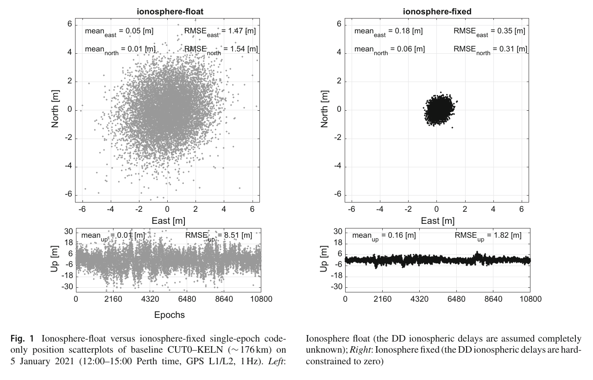
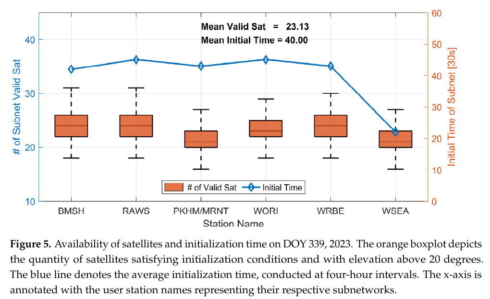
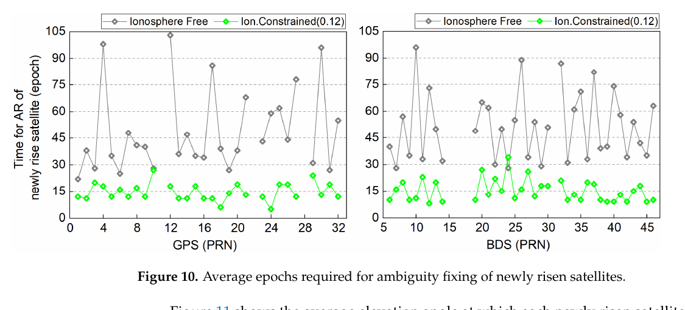

# 2026-11-10 GNSS 每日研究简报

## 今日快报

### 快报 1：只学“正常站”也能报警，但 5.83% 与 30.36% 是不同设备阈值下的站点结果

- 主题：`cors-dense-autoencoder-measurement-quality-anomaly`
- 来源 ID：`doi:10.33012/2026.20825`
- 来源链接：https://doi.org/10.33012/2026.20825
- 发表日期：2026-10-06
- 来源类型：ION GNSS+ 2026 同行评审会议论文
- 获取范围：ION 官方摘要、实验配置与摘要结果；全文需订阅或下载额度，本文不引用摘要之外的定量结果

**内容：** 研究只用无故障数据训练稠密自编码器，让模型学习 CORS 的名义观测分布。输入同时包含固定站坐标下的 PPP 无电离层伪距残差、L1/L2 SNR、码减载波多路径组合、卫星高度角与方位角；重构误差超过站点阈值时标为异常。

**结论：** UNAM 新建 CORS 的 7 天数据用于训练，独立 1 Hz 数据用于测试；该站异常观测占 5.83%。Emlid Reach RS2+ 先以楼顶开放天空数据定自己的阈值，再在半城市多路径环境得到 30.36%。两者阈值与硬件不同，不能把百分比直接解释成设备优劣、故障概率或跨站通用门限。

**关注理由：** 固定站质量控制若只给 SNR、周跳和残差各设一条阈值，会漏掉变量间组合异常。自编码器可作补充，但部署时必须保留逐站基线、季节漂移监测与可解释的原始指标。

### 快报 2：4 年 BDS-3 新信号 URE 从 0.690 m 降到 0.571 m，故障先验仍受样本分类约束

- 主题：`bds3-b1c-b2a-sis-performance-araim-priors`
- 来源 ID：`doi:10.33012/2026.20660`
- 来源链接：https://doi.org/10.33012/2026.20660
- 发表日期：2026-10-06
- 来源类型：ION GNSS+ 2026 同行评审会议论文
- 获取范围：ION 官方摘要、4 年数据范围与摘要统计；全文需订阅或购买，本文不外推摘要未给出的过界方法细节

**内容：** 论文把 BDS-3 B1C/B2a 双频无电离层广播轨道钟与精密产品比较，形成最坏用户视线信号空间测距误差（SISRE），再把样本分成名义与故障集合，为 ARAIM 所需的用户测距精度与单星/星座故障概率提供经验输入。

**结论：** 2022–2025 年、24 颗 MEO 与 3 颗 IGSO 的全星座 URE 依次为 0.690、0.623、0.595 和 0.571 m；多数卫星 2025 年过界用户测距精度低于 1.0 m。摘要给出的单星故障概率范围为 $`4.753\times10^{-6}`$ 至 $`6.322\times10^{-4}`$，但四年有限样本、精密产品参考和故障分类规则不等于面向航空认证的最终先验。

**关注理由：** ARAIM 不是把星座加入几何矩阵就结束；SIS 误差分布、过界方法和故障率先验决定保护级是否可信。系统集成应把参数版本、样本窗口和故障定义一并配置管理。

### 快报 3：DFMC 把低仰角天空覆盖扩大约 1.8 倍，5° 附近的闪烁误报仍很严重

- 主题：`dfmc-gbas-low-elevation-scintillation-false-alarm`
- 来源 ID：`doi:10.33012/2026.20717`
- 来源链接：https://doi.org/10.33012/2026.20717
- 发表日期：2026-10-06
- 来源类型：ION GNSS+ 2026 同行评审会议论文
- 获取范围：ION 官方摘要、采集条件与摘要结果；全文需订阅或购买，数字仅按摘要口径复述

**内容：** 研究在巴西赤道区 PRU2/PRU4 两站，用 Septentrio PolaRx5S ISMR 的 50 Hz I/Q 相关器输出，对 GPS、BDS、Galileo 的 L1 频段与 L5 频段信号做 90 天低仰角闪烁监测，并比较频间 S4 与天空空间一致性。

**结论：** 代表性场景下，DFMC 相对 GPS L1 C/A 单系统给出约 1.8 倍天空覆盖和 4.1 倍观测密度；安静电离层时 L5 的 S4 误报低于 L1，但接近 5° 截止角仍出现严重误报。频间对比可提供特征，却不足以单独区分真实闪烁与局部多路径、遮挡和天线近场效应。

**关注理由：** 增加星座会提升监测可见性，也会把更多低仰角环境误差带进完整性通道。GBAS 监测器需要联合频间、方位、站点和时间一致性，而不是只降低高度角门限。

### 快报 4：BDS 机载多路径不能照搬 GPS 包络，100 s 与 600 s 平滑也改变误差形态

- 主题：`bds-b1c-b2b-airborne-multipath-dfmc-gbas`
- 来源 ID：`doi:10.33012/2026.20847`
- 来源链接：https://doi.org/10.33012/2026.20847
- 发表日期：2026-10-06
- 来源类型：ION GNSS+ 2026 同行评审会议论文
- 获取范围：ION 官方摘要、C909 飞行试验方法与定性结果；全文需下载额度，本文不补写摘要没有给出的包络参数

**内容：** 研究由 C909 飞行试验的 BDS B1C、B2b 伪距与载波构造码减载波残差，经周跳检测、连续弧段分割、弧段去偏和时变平滑，再把卫星视线转到机体系，分别建立未平滑、100 s 与 600 s 平滑的高度角相关包络。

**结论：** 摘要报告 B1C 残差最低且存在方向性，B2b 残差更高、方向性较弱；无电离层组合因伪距噪声与多路径放大而最大。平滑时间常数增加会降低残差幅度并减弱高度角依赖，但这是单型飞机和本次航线的初步测量证据，不能直接替代跨机型认证模型。

**关注理由：** DFMC GBAS 的保护级依赖真实机载天线、机身与接收机平滑链。信号、组合和时间常数变化后必须重做包络验证，不能只把旧模型的系数复制过去。

### 快报 5：同场地干扰分类接近 99%，跨场地下降才是 Jammertest 数据真正揭出的风险

- 主题：`jammertest-2025-multisource-domain-shift-ssc`
- 来源 ID：`doi:10.33012/2026.20736`
- 来源链接：https://doi.org/10.33012/2026.20736
- 发表日期：2026-10-06
- 来源类型：ION GNSS+ 2026 同行评审会议论文与公开数据集
- 获取范围：ION 官方摘要、17 个模型比较设计、公开 Zenodo/GitLab 数据说明与摘要结果；全文需订阅或购买

**内容：** 团队在挪威 Jammertest 2025 两个外场同步采集单天线 E1/E5 模块与 $`2\times2`$ CRPA 阵列数据，覆盖 CW、PRN、扫频/线性调频和多发射源。17 种机器学习架构识别调制并回归占用带宽/强度，目标检测器再从频谱图分离多源；接收机感知的频谱分离系数把频谱映射到有效 C/N0 损失。

**结论：** 场地内分类准确率接近 99%，但跨场地性能明显下降。摘要没有给出单一跨场地数字，因此不能宣称已解决域迁移；它证明的是传感器、环境和卫星几何一变，实验室高准确率会失去可移植性。

**关注理由：** 干扰监测不应只输出“检测到 jammer”，还要给波形、带宽、多源位置和接收机影响。训练/验收必须按设备与地点留出测试，并把数据版本和元数据纳入回归测试。

## 深度研读

### 深读 1｜接收机工程｜权重不是越紧越好：用 MSE 条件决定电离层应固定、浮动还是加权

- 类别：`receiver-engineering`
- 学习层级：`foundation`
- 选题定位：`经典基础：把电离层伪观测看成带偏差的正则项，用方差—偏差共同决定约束强度，而不是按基线长度机械选模型`
- 来源 ID：`doi:10.1007/s00190-021-01569-7`
- 来源链接：https://doi.org/10.1007/s00190-021-01569-7
- 发表日期：2021-10-10
- 来源类型：Journal of Geodesy 同行评审开放理论与实测论文
- 获取范围：CC BY 4.0 开放全文；定理、附录、GPS L1/L2 数值例与公开数据说明已核对
- 价值评分：96/100（相关性 20，经典价值 20，证据 19，教学价值 20，工程价值 17）

#### 为什么先学这个

短基线常把双差电离层硬置零，长基线常把它完全放开，中间状态则加伪观测。真正困难的不是记住三个名字，而是回答“约束多紧才比完全浮动更好”。若只看协方差，约束越紧越漂亮；若约束中心与真实电离层不同，偏差会同步增大。本文用均方误差把两者放进同一个判据。

#### 先修知识

需要理解单差/双差、双频色散、加权最小二乘、协方差、偏差、BLUE、均方误差 $`\mathrm{MSE}=\mathrm{variance}+\mathrm{bias}^2`$、Kronecker 积，以及基线与模糊度只是完整状态向量的不同线性函数。

#### 一句话逻辑

把电离层先验当作对浮点解的一次带权更新，计算约束带来的方差下降与错中心带来的偏差平方；只有总 MSE 不大于电离层浮动解时，固定或加权才有统计收益。

#### 研究问题与约束

论文研究线性化多频 GNSS 基线模型，给出一般参数与特定基线/模糊度函数的条件。实测示例使用西澳站网；图 1 是 176 km 基线、GPS L1/L2、单历元码定位，不是载波固定结果。判据依赖真实或可估的电离层空间/时间离散度，工程上若该量估错，理论保证也会失效。

#### 核心方法论

先由原始观测得到电离层浮动解 $`\hat x`$ 及协方差，再用中心 $`i_0`$、设计阵 $`A_i`$ 和协方差 $`\bar Q_{ii}`$ 加入电离层伪观测。更新后方差下降，但若 $`d=i_0-A_i x`$ 非零就产生偏差。作者对目标参数 $`\theta=F^T x`$ 推导 MSE 优于浮动解的充要条件，并对 $`\bar Q_{ii}=\lambda Q_{\hat i\hat i}`$ 给出最优尺度与安全区间。

#### 关键公式逐步推导

电离层加权模型写为：

```math
E\!\left[\begin{array}{c}y\\i_0\end{array}\right]
=\left[\begin{array}{c}A\\A_i\end{array}\right]x,
\qquad
D\!\left[\begin{array}{c}y\\i_0\end{array}\right]
=\left[\begin{array}{cc}Q_{yy}&0\\0&\bar Q_{ii}\end{array}\right].
```

把它写成对浮动解的更新：

```math
\hat x_w=\hat x+Q_{\hat x\hat x}A_i^T
(\bar Q_{ii}+A_iQ_{\hat x\hat x}A_i^T)^{-1}(i_0-A_i\hat x).
```

对任一估计量 $`\hat z`$，

```math
\mathrm{MSE}(\hat z)=\mathrm{trace}(Q_{\hat z\hat z})+\lVert b_{\hat z}\rVert^2.
```

若 $`\bar Q_{ii}=\lambda Q_{\hat i\hat i}`$，论文给出 $`\lambda_{\min}=\arg\min_\lambda\mathrm{MSE}(\lambda)`$，并证明相对浮动解不劣的区间满足：

```math
\lambda\ge \frac{1}{2}(\lambda_{\min}-1).
```

#### 经典价值与创新边界

经典价值是把“加权后形式精度更高”改成“加权后含偏差的 MSE 真正更低”，并分别给基线与模糊度目标条件。边界是 MSE 只描述二阶平均损失，不直接控制错误固定尾险；论文也不替代整数验收、异常检测或电离层暴变告警。

#### 整体逻辑链

建立电离层浮动模型；加入伪观测；分离协方差收益与约束错中心偏差；选择目标参数；推导 MSE 条件；用空间/时间电离层离散度表达可操作尺度；再由站网或 geometry-free 观测估计离散度并在线选固定、加权或浮动模式。

#### 原文图表与结果分析



> 图表源：Teunissen 与 Khodabandeh《A mean-squared-error condition for weighting ionospheric delays in GNSS baselines》Figure 1，[CC BY 4.0 开放全文](https://doi.org/10.1007/s00190-021-01569-7)。本地资产由 PDF 第 2 页按原图与原图题最小裁剪，未重绘、平滑或改写坐标轴、点、标签与数值。

图中是 CUT0–KELN 约 176 km 基线在 2021-01-05 12:00–15:00（Perth 时间）的 GPS L1/L2、1 Hz、单历元码解。电离层浮动的 E/N/U RMSE 为 1.47/1.54/8.51 m；硬固定为 0.35/0.31/1.82 m，但均值也从 0.05/0.01/0.01 m 变成 0.18/0.06/0.16 m。它直接展示“允许小偏差换显著方差下降”可降低 MSE，不能证明任意 176 km 基线都应把电离层置零。

#### 原文结果论述

论文进一步表明，最优权重随目标参数、历元数、观测噪声和电离层空间/时间离散度改变；同一先验对基线可能合适，对模糊度未必合适。图 1 的反直觉结果只是动机，真正贡献是给出何时固定、浮动或加权的条件，而不是提出一个永久有效的距离阈值。

#### 常见误区与适用边界

第一，形式协方差变小不等于 MSE 变小。第二，零均值伪观测不是说真实每颗星电离层为零。第三，基线长度只是电离层离散度的代理。第四，最优 MSE 不保证整数错误率最小。第五，活跃电离层、低仰角和跨区域网络会让历史权重失配。第六，约束中心、权重和适用时间窗必须一同版本化。

#### 工程实现步骤

1. 保留电离层浮动解、完整协方差和 geometry-free 残差。
2. 按站网、时间窗与卫星高度角估计电离层空间/时间离散度。
3. 对基线与模糊度分别计算候选权重的偏差—方差代价。
4. 若条件不满足则回退浮动模型，不以“收敛更快”为由强约束。
5. 将选定权重送入浮点滤波，再独立做 LAMBDA 与固定失败率验收。
6. 监测创新、约束边界命中率和空间天气，触发重估或降级。

#### 复现实验设计

下载论文给出的 Curtin/Geoscience Australia 站数据，选 10/50/176/500 km 四档基线；GPS L1/L2 1 Hz，按 1、4、10、60 历元滑窗处理。对比电离层固定、浮动、按距离经验加权、按论文 MSE 条件自适应加权。指标为 E/N/U 偏差、标准差、RMSE、浮点模糊度方差、正确/错误固定率与权重切换次数；失败用例加入 Kp 升高、低仰角、多路径和先验中心偏移。

#### 与定位及低成本实现的联系

低成本码噪声大时，强约束可能带来更明显方差收益，也更容易把错误先验隐藏在“漂亮协方差”里。NRTK 服务端可用密集站网估计离散度，移动端则应接收权重质量标志，而不是只拿一个无条件电离层改正数。

#### 本节小结

电离层权重的本质是可控的偏差—方差交换；先证明 MSE 收益，再谈收敛速度，才能避免把强约束误当成强证据。

### 深读 2｜接收机工程｜先在服务端把差分层级理顺：单差 VRS 怎样少加一次噪声

- 类别：`receiver-engineering`
- 学习层级：`intermediate`
- 选题定位：`基础进阶：把上一节的电离层权重放进多站 VRS 服务端，理解单差可估参数、闭合检验与虚拟观测生成如何共同保证实时可实现性`
- 来源 ID：`doi:10.3390/rs16132269`
- 来源链接：https://doi.org/10.3390/rs16132269
- 发表日期：2024-06-21
- 来源类型：Remote Sensing 同行评审开放方法与实测论文
- 获取范围：CC BY 4.0 开放全文；函数/随机模型、AUSCORS 单日试验、Figures 1–9、Tables 1–6 与公开数据入口已核对
- 价值评分：94/100（相关性 20，经典价值 17，证据 19，教学价值 19，工程价值 19）

#### 为什么先学这个

上一节说明电离层伪观测怎样定权，但真实 NRTK 服务端还要同时处理多个接收机、多个星座、接收机间偏差、三角网闭合和 VRS 生成。若先做双差再还原单差改正，噪声与参考星切换会进入服务链。本文把可估参数直接组织在单差域，并保留整数性。

#### 先修知识

需要理解非组合码/相位、站间单差与星间双差、秩亏与 S-system、GPS/Galileo/BDS 接收机间码相偏差、LAMBDA、bootstrapped success rate、ratio test、ADOP、VRS/Delaunay 三角网和对流层湿延迟。

#### 一句话逻辑

在服务器端用单差非组合观测直接估计站间电离层和相对湿延迟，同时把模糊度变换为可估整数；通过三站双差闭合筛掉错误固定，再把单差大气改正直接插值进虚拟码相观测。

#### 研究问题与约束

论文使用 2023 年 DOY 339 的澳大利亚 CORS 数据：7 个参考站形成 12 条 50–120 km 基线，另 7 个站作用户，用户到主站约 20–50 km。仅一天、开放 CORS、同一地区插值；“真值”电离层由用户站与主站 RTK 反演，并非独立大气仪器。结果不能直接覆盖风暴、城市移动端或不同接收机网络。

#### 核心方法论

服务器先构造 GPS/GAL/BDS 单差全秩模型，估计接收机间钟差、系统相关码相偏差、单差电离层、相对 ZWD 与整数可估模糊度。电离层伪观测的标准差由基线长度与高度角加权，文中采用 0.96 mm/km 的经验尺度。固定后不仅做成功率和 ratio，还要求三站网络任一闭环的双差整数和为零。通过闭合的单差大气改正再用 LIM 插值给 VRS。

#### 关键公式逐步推导

对频率 $`j`$ 的站间单差码与相位，可概括为：

```math
E(\Delta p_j^s)=\Delta dt+\Delta g^s\tau+\mu_j\Delta I^s+\Delta d_j,
```

```math
E(\Delta \phi_j^s)=\Delta dt+\Delta g^s\tau-\mu_j\Delta I^s
+\lambda_j\Delta N_j^s+\Delta\delta_j.
```

电离层伪观测的高度角—距离尺度按文中写为：

```math
\sigma_{I,s}=0.96\ \mathrm{mm/km}\cdot L\cdot(\sin E_s)^{-1}.
```

三站 $`A,B,C`$ 固定后必须满足：

```math
\Delta\nabla z_{AB,j}^{1s}+\Delta\nabla z_{BC,j}^{1s}
+\Delta\nabla z_{CA,j}^{1s}=0.
```

VRS 码观测由主站原始码、几何改正和插值得到的单差空间相关误差直接生成，避免再次选择参考星：

```math
p_{V,j}^{s}=p_{A,j}^{s}+\Delta\rho_{VA}^{s}
+\Delta d_{ion,VA,j}^{s}+\Delta d_{trop,VA}^{s}+\Delta O_{VA,j}^{s}+\epsilon.
```

#### 经典价值与创新边界

价值在于把单差可估性、整数闭合和 VRS 输出连成一条服务端工程链，减少双差噪声和参考星管理。边界是本文没有比较多种插值器，使用固定经验电离层尺度，且一天数据不足以证明跨季节稳定性；闭合为零也只能排除不一致整数，不能保证所有边同时错到一个一致循环。

#### 整体逻辑链

收集多站多系统原始观测；确定单差数据基准；恢复整数可估模糊度；加入电离层权重；Kalman 滤波；BSSR/ratio/PAR；三角网闭合；插值单差电离层与对流层；生成 VRS；用户按短基线 RTK 连续或单历元定位。

#### 原文图表与结果分析



> 图表源：Ma 等《Ionosphere-Weighted Network Real-Time Kinematic Server-Side Approach Combined with Single-Differenced Observations of GPS, GAL, and BDS》Figure 5，[CC BY 4.0 开放全文](https://doi.org/10.3390/rs16132269)。本地资产由 PDF 第 12 页按原图与原图题最小裁剪，未重绘或改写箱线图、折线、图例、轴、站名与数值。

橙色箱线图统计高度角大于 20° 且满足初始化条件的卫星数，蓝线是各子网每 4 h 重启的平均初始化历元；采样间隔 30 s。图内总体均值为 23.13 颗有效星、40.00 历元，即约 20 min。它显示多系统几何让各子网都有足够星数，也显示初始化随子网而异；不能从一日箱线图推出全年 SLA。

#### 原文结果论述

用户端 CONT 模式 E/N/U 平均误差为 0.67/0.82/1.98 cm，成功固定率 98.76%；INST 为 1.29/1.29/2.13 cm、89.56%。论文把成功固定定义为通过 ratio 与 BSSR 且三方向误差均小于 10 cm，因此该百分比同时含验收与位置真值条件，不能与只统计 ratio 通过率的系统直接对比。

#### 常见误区与适用边界

第一，单差不天然保持所有原模糊度整数，必须明确数据基准与可估变换。第二，多星座增加卫星也增加系统间偏差。第三，三角闭合不是绝对真值。第四，VRS 兼容现有 rover 不代表服务器模型简单。第五，电离层插值精度随用户—主站距离下降。第六，40 历元是本文条件下的服务端初始化，不是 rover 首次固定承诺。

#### 工程实现步骤

1. 统一站端天线、固件、时间标记和观测码映射。
2. 对每系统建立单差全秩参数化并显式处理接收机间偏差。
3. 用站距、高度角和在线残差标定电离层伪观测协方差。
4. 执行 LAMBDA、BSSR、ratio 与足够固定子集检查。
5. 在每个 Delaunay 三角单元做整数闭合，失败边不参与插值。
6. 直接以单差大气改正生成 VRS 码相，输出质量标志与龄期。
7. 由独立用户站持续监测插值误差、固定正确率和位置误差。

#### 复现实验设计

从 Geoscience Australia 下载同日 RINEX 与广播星历，复现 7 参考站/7 用户站；30 s 采样，10° 服务器截止角，20° 统计截止角。对比传统双差 VRS、本文单差 VRS、关闭电离层权重三组；每 4 h 重启。指标为服务器初始化历元、ADOP、闭合失败边数、插值 RMS、用户 CONT/INST 正确固定率和 E/N/U 95 分位；再加入参考星切换、单站钟跳和一条错误固定边。

#### 与定位及低成本实现的联系

VRS 把复杂网络模型留在服务器，让低成本 rover 继续跑熟悉的短基线 RTK；但服务器必须把改正龄期、插值方差、星座偏差和闭合状态传出来。否则移动端得到“可用 RTCM”却不知道约束是否已经失配。

#### 本节小结

单差 VRS 的收益不只是少做一次差分，而是把整数可估性、网络闭合和虚拟观测生成放在同一参数账本里。

### 深读 3｜定位算法｜别把电离层只删掉：让经验方差约束新升星的模糊度

- 类别：`positioning`
- 学习层级：`advanced`
- 选题定位：`定位深入：在纯 GNSS 中长基线网络 RTK 中，把实测电离层离散度变成可解释约束，比较无电离层组合、完全浮动与不同强度约束的定整速度和正确率`
- 来源 ID：`doi:10.3390/geomatics6050104`
- 来源链接：https://doi.org/10.3390/geomatics6050104
- 发表日期：2026-09-21
- 来源类型：Geomatics 同行评审开放方法与实测论文
- 获取范围：CC BY 4.0 开放全文；低纬/中纬两组站网、六方案、72 次重启、Figures 1–16 与 Tables 1–6 已核对
- 价值评分：95/100（相关性 20，经典价值 17，证据 19，教学价值 19，工程价值 20）

#### 为什么先学这个

上一节把 0.96 mm/km 经验尺度放入 VRS，但没有回答权重来自哪里、设紧或设松会发生什么。本文从多条实测基线拟合双差电离层标准差，再用 3 倍尺度构造保守约束，并与无电离层组合、完全浮动及更松/更紧约束逐一比较。

#### 先修知识

需要理解双频非组合 RTK、Melbourne–Wübbena 宽巷、窄巷模糊度、Kalman 初始化、LAMBDA、ratio test、低仰角映射函数、双差电离层、正确固定率，以及“固定更快”和“固定正确”必须分别统计。

#### 一句话逻辑

先从历史固定解量出双差电离层标准差随基线长度的斜率，再以 $`3\sigma`$ 和 $`1/\sin E`$ 形成零均值伪观测；它不删除电离层，而是在信息不足时把每星电离层限制在实测可行范围内。

#### 研究问题与约束

低纬试验使用海南 41–210 km 的 9 条 GPS+BDS 基线，2025-09-14 至 16、30 s 采样、10° 截止角，每 60 min 重启，共 72 个初始化时段；中纬另用湖北 9 条基线验证。研究对象是参考站间基线初始化，不含差分产品生成或 rover 定位精度；数据需向作者申请。

#### 核心方法论

作者先从固定解提取 L1 双差电离层，在不同长度基线拟合 $`\sigma_{I-STD}\approx0.04L`$ cm。为避免过紧，推荐三倍尺度并按仰角放大。六方案包括无电离层组合、完全浮动，以及约束因子 0.24、0.12、0.04、0.02；推荐方案 4 为 0.12。所有方案用同一 Kalman、LAMBDA 和 ratio 3.0，比初始化、浮点模糊度、正确固定与新升星固定速度。

#### 关键公式逐步推导

双差非组合观测保留电离层参数 $`I^s`$，码与相位符号相反：

```math
E(\Delta\nabla P_j^s)=\Delta\nabla\rho^s+\mu_j\Delta\nabla I^s+\epsilon_P,
```

```math
E(\Delta\nabla \Phi_j^s)=\Delta\nabla\rho^s-\mu_j\Delta\nabla I^s
+\lambda_j\Delta\nabla N_j^s+\epsilon_\Phi.
```

低纬实测拟合得到：

```math
\sigma_{I-STD}(\mathrm{cm})\approx0.04\,L(\mathrm{km}).
```

推荐零均值伪观测标准差取三倍经验尺度并考虑高度角：

```math
\sigma_{I,0}^{s}(\mathrm{cm})
=\frac{3\times0.04\times L(\mathrm{km})}{\sin E_s}
=\frac{0.12L}{\sin E_s}.
```

于是滤波代价增加一项：

```math
J_I=\sum_s\frac{(\Delta\nabla I^s-0)^2}{(\sigma_{I,0}^{s})^2},
```

它在短/高仰角时约束更强，在长/低仰角时自动变软。

#### 经典价值与创新边界

价值在于把经验约束写成透明、可复核的长度—仰角公式，并用多档强度显示偏差—方差折衷。创新边界是 0.04 与三倍因子仍是所测区域和时段经验量；“3σ=99.7%”依赖近高斯解释，电离层风暴的厚尾和空间结构可能破坏它。

#### 整体逻辑链

用高精度固定解提取双差电离层；按基线长度求标准差；拟合经验斜率；三倍放宽并按高度角映射；在非组合滤波中加入伪观测；重启比较六方案；用 PANDA 后处理整数作参考检查正确固定；再到中纬站网验证初始化收益。

#### 原文图表与结果分析



> 图表源：Wang 等《Empirical Ionosphere-Constrained Uncombined Model for GNSS Rapid Ambiguity Resolution in Medium-to-Long Baseline Networks》Figure 10，[CC BY 4.0 开放全文](https://doi.org/10.3390/geomatics6050104)。本地资产由 PDF 第 15 页按原图与原图题最小裁剪，未重绘、平滑或改写 PRN、曲线、图例、轴和数值。

横轴分别是 GPS/BDS PRN，纵轴为新升星从出现到定整所需的 30 s 历元。灰色无电离层方案大量落在 30–90 历元，个别超过 90；绿色 0.12 约束多数约 15 历元。原文汇总均值由 50.1 降到 14.8 历元，即约 25.1 min 降到 7.4 min；图直接支持所测新升星的加速，不证明任意空间天气或接收机都保持 70.5% 提升。

#### 原文结果论述

低纬九基线平均初始化由 51.2 降到 21.7 历元，L1 浮点模糊度偏差 RMS 由 1.15 降到 0.45 周；平均正确固定率由 98.0% 小幅升至 98.8%。新升星平均固定高度角由 23.4° 降到 15.7°。中纬验证中推荐方案平均初始化由 47.6 降到 20.5 历元，说明收益方向可复现，但不构成全球统一系数。

#### 常见误区与适用边界

第一，约束标准差不是电离层改正值。第二，3σ 不是故障概率保证。第三，完全浮动最保守却可能模型过弱。第四，无电离层组合消除一阶电离层也会放大噪声。第五，论文排除 120 历元内未固定时段的速度统计，SLA 还应报告失败率。第六，作者没有验证 rover 端位置，因此不能直接宣称用户精度提高。

#### 工程实现步骤

1. 按区域、季节和 Kp 分层积累已正确固定的双差电离层样本。
2. 用稳健尺度而非单纯标准差拟合长度关系，并保留置信区间。
3. 按高度角生成逐星伪观测方差，设置最小/最大限幅。
4. 同时运行无约束创新监测，边界频繁命中时放松或关闭约束。
5. LAMBDA 后用 ratio、固定子集比例、残差与独立后处理真值验整。
6. 把未在时限内固定的时段计入可用率，不能只统计成功样本速度。
7. 对区域系数做滚动再训练和空间天气回归测试。

#### 复现实验设计

复现 41–210 km 九档基线、GPS+BDS 双频、30 s、10° 截止角；每 120 历元重启，至少覆盖安静/扰动各 3 天。比较 IF、float、0.24/0.12/0.04/0.02 六方案及在线稳健尺度方案。指标为含失败样本的 TTFF 生存曲线、正确/错误固定率、浮点偏差 RMS、约束标准化创新、固定高度角和位置误差；失败用例加入电离层梯度突变、参考星切换、码多路径与错误历史系数。

#### 与定位及低成本实现的联系

中长基线 NRTK 的新升星往往先在低仰角出现，正是码噪声、多路径和电离层映射同时恶化的区域。经验约束可帮助低成本接收机更快形成浮点整数，但必须由网络端持续校准并携带质量信息；否则“更快固定”可能只是更快过拟合旧天气。

#### 本节小结

经验电离层约束的工程意义是保留参数、限制可行范围并明确失配出口；它能显著加速所测 NRTK 定整，但系数必须随区域与空间天气重新验证。
