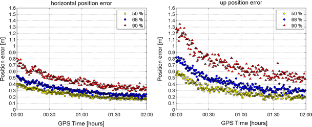
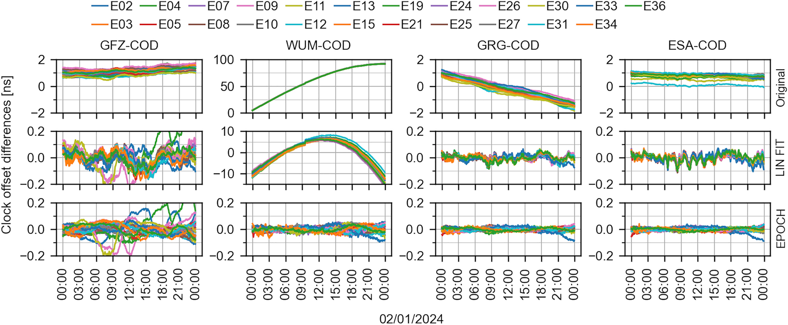
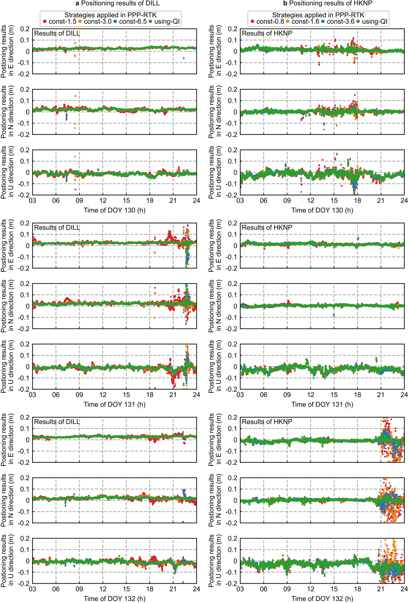

# 2026-11-11 GNSS 每日研究简报

## 今日快报

### 快报 1：把 GPS 的相位中心改正借给 Galileo，PPP 高程偏差可到 −14 mm

- 主题：`receiver-antenna-individual-type-mean-pcc-ppp`
- 来源 ID：`doi:10.1007/s10291-026-02174-x`
- 来源链接：https://doi.org/10.1007/s10291-026-02174-x
- 发表日期：2026-11-05
- 来源类型：GPS Solutions 同行评审开放论文
- 获取范围：CC BY 4.0 开放全文；ANTEX 差异、一个月 PPP 处理和坐标域结果已核对

**内容：** 研究把波兰 ASG-EUPOS 网络中 36 副 LEIAR20 LEIM 与 31 副 TRM59900.00 SCIS 天线的个体机器人标定，与 IGS20 类型平均模型逐方位、逐高度角、逐信号比较；随后用同一月观测分别做 GPS、GLONASS、Galileo 和多系统 PPP，把标定域的差异投影到 N/E/U 坐标域。

**结论：** LEIAR20 组的 GPS/GLONASS 水平差通常在 ±2 mm 内，垂向常超过 ±5 mm；多数天线缺少 Galileo PCC 时以 GPS G02 改正替代 E5a，Galileo-only PPP 的高程偏移最差达到 −14 mm，而具有 Galileo PCC 的 4 副天线不超过 4 mm。该结果是两种天线型号和一个区域网络的相对一致性试验，不是对个体标定绝对真值的认证。

**关注理由：** 多系统 PPP 增加卫星并不会自动消除天线模型错误；跨信号借用 PCC 会把方向性误差投影到高程和对流层。台站应保留天线序列号、天线罩、朝向和逐信号 ANTEX 完整性，而不是只记录型号。

### 快报 2：BDS-3 星载天线改正跨 −50 至 +30 cm，新模型把尺度一致性收紧到 0.1 ppb

- 主题：`igs-bds3-satellite-antenna-calibration-igs20-scale`
- 来源 ID：`doi:10.1007/s00190-026-02126-w`
- 来源链接：https://doi.org/10.1007/s00190-026-02126-w
- 发表日期：2026-11-05
- 来源类型：Journal of Geodesy 同行评审开放论文与 IGS 校准成果
- 获取范围：CC BY 4.0 开放全文；多分析中心估计、93 站 PPP-AR 验证与 IGS20 上线说明已核对

**内容：** IGS 组织最多 10 个分析中心，先由 B1C/B2a 无电离层组合估计各卫星类型的离轴相位图，再估计 BDS-3 MEO/IGSO 的星载天线 z-PCO，并用 B1 厂测值把结果拆到 B1/B2/B3 频点。独立 PRIDE PPP-AR 用 93 个全球站检验新旧天线模型与 IGS20 的尺度和坐标一致性。

**结论：** 相对 CSNO/TARC 发射前标定，单颗 MEO 的 PCO 修正约为 −50 至 +30 cm，对应约 ±3 ppb 的卫星特定尺度不一致；现代 B1C/B2a 产品最终达到 0.1 ppb 尺度一致性，并优于传统 B1I/B3I。新模型已自 GPS 周 2405（2026-02-08）进入 igs20.atx；SECM 卫星仍有时间变化，论文明确建议持续监测。

**关注理由：** 精密轨道、钟差、OSB 与天线 PCO/PCV 共用同一尺度账本。产品端若换天线模型而用户端未同步，厘米级 PPP 的系统误差可能来自模型版本而不是滤波器。

### 快报 3：同一台航天 GNSS 接收机难同时覆盖发射、GEO 与再入，架构必须拆分资源配置

- 主题：`spaceborne-gnss-receiver-launch-geo-reentry-architecture`
- 来源 ID：`doi:10.33012/2026.20754`
- 来源链接：https://doi.org/10.33012/2026.20754
- 发表日期：2026-10-06
- 来源类型：ION GNSS+ 2026 同行评审会议论文
- 获取范围：ION 官方摘要、架构约束与仿真结论；全文需下载额度，本文不补写摘要未给出的精度数字

**内容：** NAVIGA EVO 面向发射、GTO/HEO/GEO 与再入的统一任务链：L1/E1 与 L5/E5a 双频用于再入阶段电离层抑制，可切换/合并的多天线覆盖高动态与空间服务体积中的弱信号和差几何。受 AGGA-4 ASIC 资源约束，双频处理与多天线工作被实现成不同配置，而不是假设全部能力可同时开启。

**结论：** 官方摘要报告专用仿真支持从发射到 GEO 和再入的可行性及预期改进，但没有公开各阶段的误差分位数、失锁时长或等效 C/N0；因此证据只支持架构可行，不能据此声称已完成飞行验收。

**关注理由：** 接收机工程的关键不是功能清单，而是资源、天线视场、动态范围和失锁恢复之间的模式管理。对高空或再入任务，应把配置切换条件与不可同时满足的能力写入验证矩阵。

### 快报 4：把 L5 多个移位码塞进 ±1 chip 相关器，深城定位提升“最高 94%”仍是数据集内结果

- 主题：`l5-shifted-combined-code-efficient-multipath-detection`
- 来源 ID：`doi:10.33012/2026.20670`
- 来源链接：https://doi.org/10.33012/2026.20670
- 发表日期：2026-10-06
- 来源类型：ION GNSS+ 2026 同行评审会议论文
- 获取范围：ION 官方摘要、算法链和香港实测摘要结果；全文需订阅或购买

**内容：** 论文把多个时移、频移 PRN 合成 Shifted Combined Code，让有限在 ±1 chip 的相关器仍能覆盖更长多路径延迟；EPMD 从频移分量重建交叉模糊函数，机器学习再按其形状分类并估计多路径误差，最后接入 3D 建筑辅助的 OPE 定位。

**结论：** 香港深城真实 GPS 数据上，摘要报告相对传统导航解的定位精度改善最高可达 94%。这是最佳场景的相对改善，摘要没有给出绝对误差、跨路线分位数、计算量或独立城市测试，不能把 94% 当成通用承诺。

**关注理由：** 长码和高码率只有在接收机能以可承受成本展开延迟域时才有价值。工程评测应同时报告相关器数、采样率、CAF 重建误差、模型跨域性和最终绝对误差。

### 快报 5：低成本基准站能从自身观测反演遮挡，但环境地图更适合“启用门控”而非直接定权

- 主题：`crowdsourced-reference-station-blind-environment-qc`
- 来源 ID：`doi:10.33012/2026.20658`
- 来源链接：https://doi.org/10.33012/2026.20658
- 发表日期：2026-10-06
- 来源类型：ION GNSS+ 2026 同行评审会议论文
- 获取范围：ION 官方摘要、激光验证设计、21 站定位边界与摘要结果；全文需下载额度

**内容：** 方法只用双频 SNR 与码减载波观测，通过 GNSS 反射测量反演固定站的遮挡半球、近场墙面/热水器距离及天线离地高度；再比较方向方差膨胀、剔星/部分定整和经验相位改正，并用独立激光测量验证环境几何。

**结论：** 几何恢复达到数厘米量级；但 21 站 SPP 中环境先验带来的变化均小于 1 cm，严重遮挡的唯一 RTK 基站上也没有胜过逐历元残差门控。有效用法是自禁用的双观测门先识别受影响站，再启用物理尺度残差门，把该故障站从米级误固定恢复到厘米级。单个严重站样本不足以证明广泛 RTK 收益。

**关注理由：** 众包 CORS 的自动质控应先回答“这个站需不需要干预”，再选择改正强度。静态环境图不能替代对非重复 NLOS 的实时残差检测，也不应无条件进入测量权重。

## 深度研读

### 深读 1｜接收机工程｜先认清 PPP 的外部产品账：单频实时解为何仍要等约 1.5 小时

- 类别：`receiver-engineering`
- 学习层级：`foundation`
- 选题定位：`经典基础：用单频实时 PPP 的长时间实测，把单站非差观测、外部轨道钟/电离层产品、收敛与接收机噪声放进同一条误差链`
- 来源 ID：`doi:10.1007/s10291-011-0228-6`
- 来源链接：https://doi.org/10.1007/s10291-011-0228-6
- 发表日期：2011-06-05
- 来源类型：GPS Solutions 同行评审开放实测论文
- 获取范围：CC BY-NC 2.0 开放全文；83 天 30 s 数据、六个 IGS 站、低价接收机案例、Figure 2 与 Tables 1–6 已核对
- 价值评分：93/100（相关性 19，经典价值 19，证据 19，教学价值 19，工程价值 17）

#### 为什么先学这个

PPP 的“点”不是不需要基础设施，而是不需要与用户同步的邻近基站差分。卫星轨道、钟差、电离层、码偏差和参考框架仍由全球服务端提供。先看一个只用 L1 C1/L1 的长时间实时重放试验，能把产品延迟、码噪声、模糊度收敛和最终精度分开，避免把 PPP 误解成单机立即得到厘米解。

#### 先修知识

需要理解伪距、载波相位、接收机与卫星钟差、对流层与电离层一阶色散、整数/浮点模糊度、差分与非差观测、标准差、95% 分位数，以及“实时重放”只使用观测时刻可用产品的含义。

#### 一句话逻辑

固定精密轨道和实时卫星钟，用预测 GIM/DCB 抑制单频电离层，再让连续载波约束高噪声码；解能逐步稳定，但单频外部电离层误差和浮点模糊度仍使收敛明显慢于差分定位。

#### 研究问题与约束

核心数据是 Delft 的 Trimble 4700 高端接收机 83 个连续日、L1、原始 1 Hz 后抽稀为 30 s，并以每日批次按实时可用产品重放；另有 6 个全球 IGS 站和 9 天 AsteRx1/小贴片天线案例。天线静止而滤波按逐历元运动学解算；2010 年 GPS-only 产品、RETICLE 服务和 GIM 质量不代表今天多频多系统 PPP 的上限。

#### 核心方法论

对每颗卫星同时使用单频码与相位。轨道、10 s 间隔且约 5 s 延迟的 RETICLE 钟差、预测 CODE GIM/DCB 作为外部产品；站坐标、接收机钟、对流层与每弧段相位模糊度在用户端估计。码给绝对尺度，相位给短期连续性；电离层模型偏差和多路径会进入坐标，尤其是高程。

#### 关键公式逐步推导

用统一符号重写论文采用的单频非差误差链：

```math
P^s=
ho^s+c(\delta t_r-\delta t^s)+T^s+I^s+b_P^s+\varepsilon_P^s,
```

```math
L^s=
ho^s+c(\delta t_r-\delta t^s)+T^s-I^s+\lambda N^s+b_L^s+\varepsilon_L^s.
```

外部产品给出卫星位置、$`\delta t^s`$、GIM 近似 $`\hat I^s`$ 与 DCB；用户把残余 $`I^s-\hat I^s`$ 留在噪声/偏差中。论文还明确用样本均值与方差评估长时间结果：

```math
\mathrm{Var}(\hat\mu)=\frac{\sigma^2}{N},\qquad
\mathrm{Var}(\hat\sigma^2)=\frac{2\sigma^4}{N-1}.
```

所以“83 天”主要收紧的是统计量置信度，并不会消除系统性的 GIM 或多路径偏差。

#### 经典价值与创新边界

价值在于用当时真正实时可用的轨道钟与预测电离层产品，对 80 多天单频逐历元 PPP 给出可复查的分位数，而不是只展示一段好看的静态序列。边界是它没有现代多频无组合模型、PPP-AR、SSR 完整性或城市动态试验；“终极单频性能”是 2010 年产品生态下的工程结论。

#### 整体逻辑链

单站码相观测无法消去卫星钟；接入实时钟轨；单频无法自消一阶电离层，接入预测 GIM/DCB；载波模糊度和码噪声需要时间平均；统计 83 天误差与收敛；再换中档接收机与全球站，观察硬件、纬度和环境如何改变边界。

#### 原文图表与结果分析



> 图表源：van Bree 与 Tiberius《Real-time single-frequency precise point positioning: accuracy assessment》Figure 2，[CC BY-NC 2.0 开放全文](https://doi.org/10.1007/s10291-011-0228-6)。本地资产为 Springer 原始全尺寸图像的原样保存；未裁剪、重绘、平滑或改写坐标轴、分位线、标签与数值。

横轴是从日解起点累计的 30 s 历元，左图为水平误差、右图为垂向误差，纵轴单位为米，多条曲线表示不同百分位。论文据图指出约 180 个历元、即约 1.5 h 后达到全数据集精度水平；垂向分布更宽。图直接描述 Delft 高端接收机的经验收敛，不证明每次初始化 1.5 h 必然成功，也不能把长时分位数当完整性保护级。

#### 原文结果论述

83 天主试验的水平标准差约 0.15 m、垂向约 0.30 m；95% 误差约为水平 0.30 m、垂向 0.65 m。中档接收机与 5 cm 贴片天线的各方向 95% 误差仍约不超过 1 m。靠近磁赤道时，论文观察到标准差可增加超过 50% 且偏差达到数分米，并把原因限定为 GIM 覆盖/偏差、闪烁与环境的组合假设，而非单一已证实因果。

#### 常见误区与适用边界

第一，PPP 不等于不依赖外部服务。第二，精密钟差不能弥补错误电离层。第三，载波很精密但初始模糊度未知。第四，静止天线按运动学解算不等于车辆实测。第五，95% 经验误差不是安全上界。第六，历元数与分钟数随采样率变化。第七，今天的多频结果不应拿来反推该单频试验。

#### 工程实现步骤

1. 明确轨道、钟、GIM、DCB 的发布间隔、延迟、坐标框架和缺测策略。
2. 统一卫星/接收机天线、相位缠绕、潮汐、相对论和对流层模型。
3. 以码定绝对尺度、载波维持连续性，并逐弧段管理模糊度。
4. 对产品中断、周跳、钟跳和 GIM 超界输出显式状态。
5. 分离初始化、稳态和重收敛统计，不只报整日 RMS。
6. 按纬度、接收机、天线与环境分层验证。

#### 复现实验设计

选 7 个 IGS 站，覆盖中纬与赤道；下载连续 30 天 RINEX，30 s 采样。模式 A 用广播轨道钟，B 用实时可用 SSR 重放，C 用最终产品作为事后参考；每种再分单频 GIM、双频无电离层和双频非组合。每日从冷启动开始，指标为 0.3/1.0 m 阈值首次进入并保持时间、N/E/U 偏差/标准差/95% 分位、产品丢包恢复时间。失败用例包括 60 s 钟改正中断、GIM 偏 5 TECU、单星周跳和低仰角多路径。

#### 与定位及低成本实现的联系

低成本接收机的码噪声和天线多路径更大，单频 PPP 会更依赖时间平均和外部模型。双频、更多星座与 PPP-AR 可以加快，但前提是钟轨、OSB、天线和大气产品在同一约定下闭合；这正引出下一节的多分析中心钟组合。

#### 本节小结

PPP 把邻近基站依赖换成全球产品依赖。先把产品延迟、残余大气和收敛分开，才知道“实时”描述的是数据到达，而不等于位置立即稳定。

### 深读 2｜接收机工程｜先消掉分析中心自己的钟：逐历元对齐怎样让多 GNSS 产品可组合

- 类别：`receiver-engineering`
- 学习层级：`intermediate`
- 选题定位：`基础进阶：承接上一节的外部卫星钟依赖，进入服务端多分析中心产品的基准对齐、异常剔除、方差分量定权与 PPP 闭环验证`
- 来源 ID：`doi:10.1007/s10291-026-02148-z`
- 来源链接：https://doi.org/10.1007/s10291-026-02148-z
- 发表日期：2026-09-28
- 来源类型：GPS Solutions 同行评审开放方法与实测论文
- 获取范围：CC BY 4.0 开放全文；SPOCC 方法、2024 年 1 月七中心产品、23 站 PPP、Figures 1–18 与 Tables 1–11 已核对
- 价值评分：95/100（相关性 20，经典价值 17，证据 20，教学价值 19，工程价值 19）

#### 为什么先学这个

上一节把卫星钟当已知输入，但不同分析中心采用不同参考钟、动力学模型和处理约定。同一颗卫星的“钟差”会叠加分析中心自己的公共时标行为。若每天只拟合一条直线，非线性公共项会被错误送进组合产品，再投影到用户坐标。

#### 先修知识

需要理解卫星钟差基准、星座时标、公共模误差、RMS、modified Z-score、最小二乘方差分量估计、权重、MDEV、非组合双频 PPP、Helmert 七参数，以及“内部一致性”不等于外部真值。

#### 一句话逻辑

每个历元、每个星座用共同卫星估计分析中心相对参考中心的公共偏差，先去公共项和逐星日偏差，再剔除异常并按卫星块做 VCE 组合；最后用钟差残差、频稳和 PPP 坐标三层验收。

#### 研究问题与约束

数据为 COD、ESA、GFZ、GRG、JAX、JPL、WUM 七个 IGS 分析中心在 2024 年 1 月的轨道钟产品；BeiDou 仅四中心提供且 WUM 只覆盖 23/31 天。用户验证用 23 个 IGS 站、GNSS-WARP 非差非组合双频逐历元 PPP，并通过前后向平滑减弱初始化。该设计验证最终产品组合，不等于实时流延迟或故障完整性试验。

#### 核心方法论

SPOCC 先做轨道径向改正和第一轮质控。钟差对齐分两步：逐历元按星座移除分析中心公共偏差，再移除每天每颗卫星相对参考中心的常偏。随后以 modified Z-score 3.5 检测 RMS 异常：某中心超过 25% 卫星异常即排除；AC–卫星对若超过 30% 历元异常则剔除。剩余贡献按卫星块做 VCE 定权并组合。

#### 关键公式逐步推导

对分析中心 $`i`$、星座 $`sys`$、历元 $`t`$ 的 $`N_s`$ 颗共同卫星：

```math
\Delta D_i^{sys}(t)=\frac{1}{N_s}\sum_{s=1}^{N_s}
\left[clk_i^s(t)-clk_{ref}^s(t)\right].
```

逐历元对齐为：

```math
clk_{i,\mathrm{align}}^s(t)=clk_i^s(t)-\Delta D_i^{sys}(t).
```

再对一天 $`N_{epo}`$ 个历元计算逐星常偏：

```math
\Delta b_i^s=\frac{1}{N_{epo}}\sum_t
\left[clk_{i,\mathrm{align}}^s(t)-clk_{ref}^s(t)\right],
\qquad
\widehat{clk}_i^s(t)=clk_{i,\mathrm{align}}^s(t)-\Delta b_i^s.
```

第一式消分析中心/星座公共非线性，第三式消卫星特定日偏；VCE 才在可比残差上估权。共同卫星太少时，逐历元均值本身会变噪，这是方法的显式偏差—方差边界。

#### 经典价值与创新边界

逐历元对齐和 VCE 各自并非新方法；论文贡献是把对齐、轨道径向一致化、两级异常检测、块级 VCE、钟频稳与 PPP 验证整合进开源 SPOCC。它展示了可运行的组合链，而不是提出新的原子钟物理模型；对 BDS/GLONASS 的改进也不如 GPS/Galileo 一致。

#### 整体逻辑链

收集多中心轨道钟；选参考中心；按星座逐历元估公共项；去逐星日常偏；两级异常剔除；按卫星块估 VCE 权；生成组合；检查中心间残差与 MDEV；用 23 站 PPP 和参考框架重复性审查用户域影响。

#### 原文图表与结果分析



> 图表源：Białas 等《Multi-GNSS clock combination for PPP with an epoch-wise clock alignment and variance component estimation》Figure 2，[CC BY 4.0 开放全文](https://doi.org/10.1007/s10291-026-02148-z)。本地资产为 Springer 原始全尺寸图像原样保存；未裁剪、重绘、平滑或改写横轴历元、纵轴 ns、卫星曲线与图例。

图比较 WUM–COD Galileo 钟差：原始序列含共同非线性，日线性拟合仍留周期/弯曲结构，逐历元对齐把多星共同项压到约 0.05 ns 幅度。直接读图能说明公共项被抑制，不能证明剩余量全是真实卫星钟噪声；参考中心误差和共同建模误差仍可能被隐藏。

#### 原文结果论述

GPS/Galileo 各中心与组合的 90% RMS 通常为 10–20 ps，BDS/GLONASS 为 40–100 ps；相对线性拟合，GPS/Galileo 一致性改善约 30–70%，但部分 GLONASS 块反而恶化。23 站 PPP 中，历元对齐组合相对个别中心的坐标重复性改善约 10–30%。论文的 GPS-only IGS 与 GPS+GLONASS SPOCC 对比还混入星座差异，作者明确不把其全部收益归因于钟组合。

#### 常见误区与适用边界

第一，对齐是在选钟差基准，不是校准卫星绝对时间。第二，公共项接近零不代表外部准确。第三，VCE 高权表示与组合内部一致，不必然对 PPP 最好。第四，小星座集合会让逐历元均值变噪。第五，前后向 PPP 平滑不是实时性能。第六，不同星座/产品集合的坐标改善不能只归因于一种算法。

#### 工程实现步骤

1. 固定产品格式、时标、参考框架、采样间隔和 OSB/天线约定。
2. 每星座建立共同卫星掩码，记录每历元样本数。
3. 计算逐历元公共偏差并保留校正前后序列。
4. 去逐星日偏，运行 AC 级与 AC–卫星级异常检测。
5. 分卫星块迭代 VCE，保存权重收敛和被剔除贡献。
6. 同时验 RMS、MDEV、PPP 坐标与 Helmert 参数。
7. 对实时系统另做延迟、断流和回退验证。

#### 复现实验设计

用 IGS 长名产品下载同一月 5–7 个中心的 GPS/Galileo/GLONASS/BDS 轨道钟。比较日线性拟合、逐历元均值、逐历元加权均值和稳健中位数四种对齐；统一做相同异常剔除与块级 VCE。以 20 个全球站做因果可读的同星座 PPP 对比。指标为公共模比例、90% 时钟 RMS、300/1000/10000 s MDEV、权重日变、N/E/U IQR。失败用例删去一半共同星、注入 0.2 ns 弯曲公共项、制造 30% 缺测并替换参考中心。

#### 与定位及低成本实现的联系

用户端再好的滤波也无法识别已写进卫星钟产品的公共基准错误。低成本设备通常靠更多星座改善几何，更需要跨星座产品约定一致；服务端应随钟产品广播质量、贡献集合和异常状态，而不只发一个看似精密的数值。

#### 本节小结

多中心组合的第一步不是平均，而是先把“谁的钟在漂”分开。对齐、定权与用户域 PPP 必须闭环，内部残差漂亮不能替代定位验证。

### 深读 3｜定位｜让 PPP-RTK 大气改正携带可信度：留一站交叉验证怎样在风暴中降权

- 类别：`positioning`
- 学习层级：`advanced`
- 选题定位：`定位深入：在前两节的精密产品链之上，把区域电离层/对流层格网及其实时质量信息共同送入纯 GNSS PPP-RTK 随机模型`
- 来源 ID：`doi:10.1186/s43020-025-00178-5`
- 来源链接：https://doi.org/10.1186/s43020-025-00178-5
- 发表日期：2025-09-22
- 来源类型：Satellite Navigation 同行评审开放方法与实测论文
- 获取范围：CC BY 4.0 开放全文；EUR/HK 两网、2023/2024 数据、公式、Figures 1–10、Tables 1–5 与公开数据入口已核对
- 价值评分：96/100（相关性 20，经典价值 17，证据 20，教学价值 19，工程价值 20）

#### 为什么先学这个

精密钟轨只解决公共产品的一部分。PPP-RTK 还把参考网估计的斜电离层和对流层改正发送给用户，以便快速定整。若用户把每个格网改正都当同样可靠，空间失相关或电离层风暴会把错误先验强塞进模糊度和坐标。本节的关键是给每条改正同时配一个可观测的质量量。

#### 先修知识

需要理解非差非组合 PPP-AR、UPD/OSB、接收机 DCB、斜电离层、ZTD、格网插值、逆距离加权、随机模型、模糊度固定率、ROTI/Kp、留一交叉验证，以及相关验证样本与真正独立监测站的差别。

#### 一句话逻辑

每次从参考网拿掉一站，用其余站建大气格网并预测被拿掉站；把所有留一残差合成为格点质量信息，再按用户到四邻格点的距离插值为逐星不确定度，进入 PPP-RTK 权阵而不是硬套固定方差。

#### 研究问题与约束

EUR 网含 21 站、约 $`7.5^\circ\times4.5^\circ`$、格距 $`1.5^\circ\times1.5^\circ`$；香港网含 19 站、约 $`0.50^\circ\times0.44^\circ`$、格距 $`0.10^\circ\times0.11^\circ`$。数据覆盖 2023 DOY 150–180 与含磁暴的 2024 DOY 130–132。评估某站时将它同时排除出建模和交叉验证，但各参考站仍来自同一网络；这不是完全独立的外部大气传感器。

#### 核心方法论

服务端用精密钟轨和 UPD 做参考站 PPP-AR，提取 ZTD 与逐星电离层；用短于 100 km 的站对估接收机 DCB，并加和为零约束统一硬件基准。区域趋势用低阶多项式拟合，站残差逆距离插到格点。留一站重复建模，得到每格点、每卫星的交叉验证误差；用户端把四邻格点误差插成质量信息 QI，与改正值一起进入 PPP-RTK。

#### 关键公式逐步推导

用户的大气改正由趋势和四邻格点残差组成：

```math
D_{AUG,u}^{(s)}=D_{AUG,u,fit}^{(s)}+
\frac{\sum_{k=1}^{4}v_{g_k,fit}^{(s)}/d_{u,g_k}}
{\sum_{k=1}^{4}1/d_{u,g_k}}.
```

留一站得到的格点交叉验证精度 $`v_{g_k,CV}^{(s)}`$ 以同样几何传到用户：

```math
Q_u^{(s)}=
\frac{\sum_{k=1}^{4}v_{g_k,CV}^{(s)}/d_{u,g_k}}
{\sum_{k=1}^{4}1/d_{u,g_k}}.
```

工程上把 $`Q_u^{(s)}`$ 映射为大气伪观测标准差；$`Q`$ 大则约束松、$`Q`$ 小则约束紧。它估计的是当前网络与插值模型的预测误差，不是保护级，也不自动包络罕见故障尾部。

#### 经典价值与创新边界

经典价值是把交叉验证从离线模型选择变成可广播的实时产品质量，让改正值与随机模型成对。创新边界是留一站仍依赖网络空间代表性，无法发现所有共模产品错误；固定方差对比也不覆盖所有已有经验模型或独立监测方案。

#### 整体逻辑链

参考站 PPP-AR；统一 DCB；估 ZTD/电离层；生成趋势加残差格网；逐站留一；把留一误差合成格点 QI；单向广播改正和 QI；用户插值；用 QI 调权；比较固定精度与 QI 模式的定位、固定率和收敛。

#### 原文图表与结果分析



> 图表源：Huang 等《Quality monitoring of grid-based atmospheric corrections in GNSS PPP-RTK service using leave-one-out cross-validation》Figure 10，[CC BY 4.0 开放全文](https://doi.org/10.1186/s43020-025-00178-5)。本地资产为 Springer 原始全尺寸图像原样保存；未裁剪、重绘、平滑或改写日期、坐标误差、模式、固定状态与图例。

图按 2024 DOY 130–132 展示欧洲 DILL 与香港 HKPN 的坐标误差时序，不同模式为 QI 自适应与固定大气精度；DOY 131 约 12:00 起磁暴并在约 18:00 达峰。扰动期固定约束出现更大波动，QI 模式整体更稳。图能支持“当前数据中自适应降权有益”，不能证明 QI 在所有未见风暴、网外用户或共模故障下都保守。

#### 原文结果论述

留一质量信息相对事后真实误差的 RMSE：EUR 网对流层 1.3 cm、电离层 5 cm；HK 网分别 1.6 cm、2.4 cm。2023 年全网统计中，QI 模式 3D RMS 为 EUR 6.4 cm、HK 7.1 cm，相对固定精度分别改善 6–29% 与 9–20%。2024 扰动三天，DILL 的 QI 3D RMS 为 4.8/5.3/4.7 cm，较固定模式改善 8–40%；HKPN 为 6.0/6.8/6.5 cm，改善 20–36%。这些是特定网格、产品和处理策略下的相对结果。

#### 常见误区与适用边界

第一，改正值小不代表不确定度小。第二，QI 是标准差型质量信息，不是完整性保护级。第三，留一站不能检测全网共模钟轨/UPD 错误。第四，站密度和格距改变后必须重算。第五，低 QI 不保证模糊度一定正确。第六，用户在网外时四邻格点插值会变外推。第七，固定率升高要同时检查错误固定率。

#### 工程实现步骤

1. 参考站先完成观测质控、PPP-AR 和 DCB 基准统一。
2. 分别生成 ZTD 与逐星斜电离层趋势/残差格网。
3. 每个更新周期执行逐站留一，保留被拿掉站的预测残差。
4. 将交叉验证误差按格点和卫星合成，限制最小/最大 QI。
5. 与改正值同版本、同时间戳、同有效期广播。
6. 用户把 QI 映射到协方差，并在缺测/超龄/网外时回退。
7. 监控创新、固定失败、空间天气和跨站共模告警。

#### 复现实验设计

从 EPN 选 20–25 站形成稀疏网，再构造半密度子网；从香港/CORS 类数据构造密网。每次留一站，比较固定 1/5/10/20 cm、按距离经验方差、留一 QI、独立监测站方差四种模式。每小时冷启动，处理 GPS/Galileo/BDS 双频非组合 PPP-RTK。指标为 QI 对真实误差的校准曲线、3D RMS/95%、到 10 cm 收敛时间、正确/错误固定率。失败用例包括全网钟偏、UPD 跳变、单站坐标错 5 cm、网外 50 km、Kp≥5 和 30% 站断流。

#### 与定位及低成本实现的联系

低成本用户最需要快速收敛，也最容易被错误强约束拖入误固定。服务端发送 QI 可让终端用统一的小矩阵完成自适应定权；但终端仍应保留码相残差、ratio/失败率验收和降级模式，不能把服务端 QI 当成替代本地质量控制的许可证。

#### 本节小结

PPP-RTK 的大气产品必须同时回答“改多少”和“信多少”。留一交叉验证把网络自身变成在线质检器，但它仍需共模故障监测、网外判定和整数验收共同封边。

## 今日串联

三篇资料构成一条从用户端到服务端再回用户端的闭环：单频 PPP 先说明单站高精度依赖轨道钟和大气产品；多中心钟组合保证公共产品在进入用户滤波前先消除分析中心基准；PPP-RTK 再给区域大气改正附上逐星质量。工程上应把“值、基准、方差、有效期、异常状态”视作同一个产品，而不是五个可选字段。
