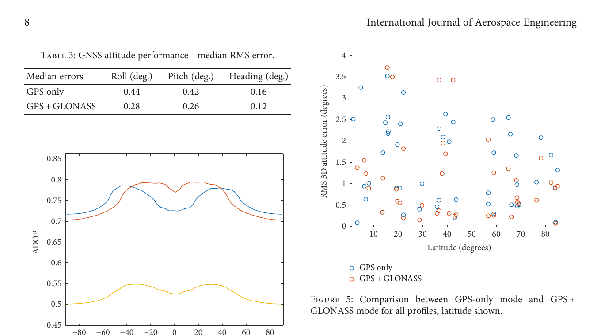
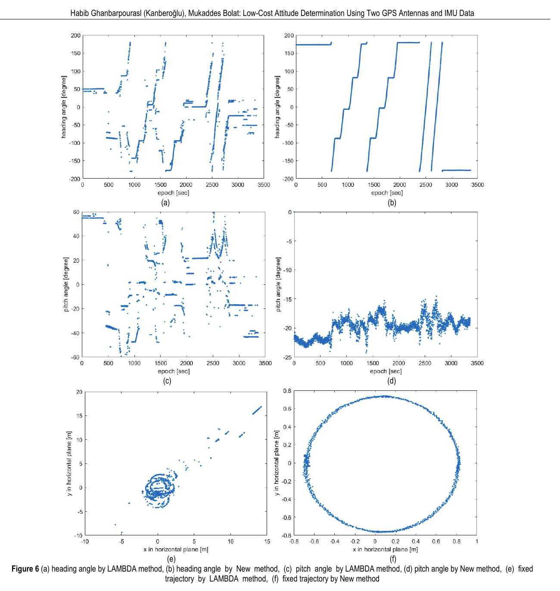
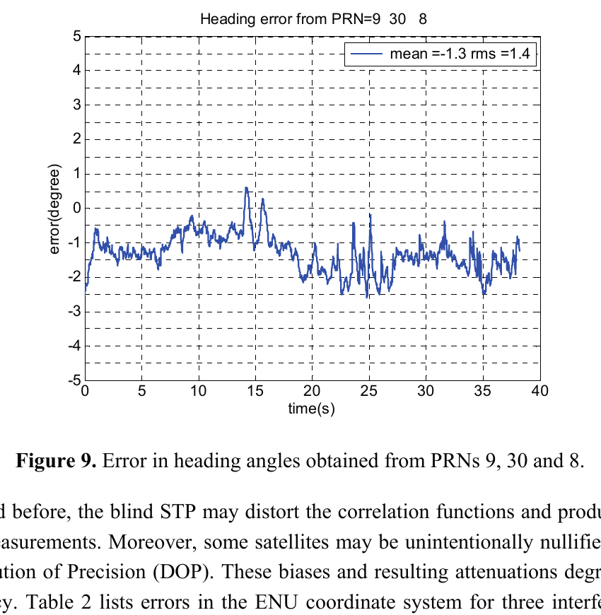

# 2026-11-12 GNSS 每日研究简报

## 今日快报

### 快报 1：占空比降到 10% 只省下 31% 功耗，接收机底座功耗不能忽略

- 主题：`hardware-gnss-duty-cycling-power-floor`
- 来源 ID：`doi:10.33012/2026.20742`
- 来源链接：https://doi.org/10.33012/2026.20742
- 发表日期：2026-10-06
- 来源类型：ION GNSS+ 2026 同行评审会议论文
- 获取范围：ION 官方完整摘要、硬件架构、占空比边界与摘要结果；全文需下载额度，本文不补写摘要未公开的分项功耗

**内容：** 研究把捕获引擎与跟踪相关器放在 FPGA 上，以 RISC-V 软核承担跟踪控制、导航电文和定位；在实星与射频星座模拟器信号上，把连续运行与最低 10% 占空比比较，而不是只估算算法运算量。

**结论：** 摘要报告在 10% 占空比时最大功耗下降 31%，代价是定位 RMSE 增加 6%。这不是“关机 90% 就省电 90%”：未随占空比同比下降的 FPGA、处理器、时钟和射频链底座功耗仍存在；摘要也没有给出各模块的绝对瓦数，不能据此外推到 ASIC 或商用手机芯片。

**关注理由：** 低功耗 GNSS 设计应同时记录唤醒成本、重捕获概率、首定位时间与稳态误差。只报占空比会隐藏常开模块和重同步开销，尤其不适合直接比较架构不同的接收机。

### 快报 2：机器学习把测地站宽巷验整正确率从约 75% 提到约 97%，但众包站仍更难

- 主题：`ppp-rtk-network-ml-ambiguity-validation`
- 来源 ID：`doi:10.33012/2026.20841`
- 来源链接：https://doi.org/10.33012/2026.20841
- 发表日期：2026-10-06
- 来源类型：ION GNSS+ 2026 同行评审会议论文
- 获取范围：ION 官方完整摘要、39 站设计、站点专属/通用 XGBoost 对比与摘要结果；全文需下载额度

**内容：** 研究用 13 个众包站和 26 个测地站训练 XGBoost 验证 PPP-RTK 网络端宽巷、窄巷模糊度，比较逐站模型、全站通用模型与传统经验规则，目标是让硬件和站址质量不一致的低成本站也能进入改正数生产链。

**结论：** 对测地站，站点专属模型的宽巷 ambiguity-validation correctness rate 由约 75% 升至约 97%，错误固定率约 0.04%，68% 首次固定时间由 18.5 min 降至 1.5 min；众包站正确率由 67.5% 升至 81.9%，错误固定率由 4.5% 降至 1% 以下，但 TTF68 仍为 11.5 min。窄巷改善较温和，摘要报告中位首次固定时间最多改善约 45%。这些都是所选 39 站和训练划分下的结果，不是跨网络保证。

**关注理由：** 学习模型可以替代脆弱的固定阈值，但不能取消错误固定风险预算。部署时应把站点漂移、固件更换、季节和天线环境变化纳入外推监测，并保留传统残差与网络闭合的独立防线。

### 快报 3：3D 打印 Luneburg 透镜提高 C/N0 与抗多路径潜力，摘要尚不足以给出增益数字

- 主题：`3d-printed-luneburg-lens-gnss-antenna`
- 来源 ID：`doi:10.33012/2026.20887`
- 来源链接：https://doi.org/10.33012/2026.20887
- 发表日期：2026-10-06
- 来源类型：ION GNSS+ 2026 同行评审会议论文
- 获取范围：ION 官方摘要、数小时实星对比设计与定性结果；全文需下载额度，本文不从“considerably”反推数值

**内容：** 研究把 3D 打印 Luneburg 透镜与多个贴片天线集成，以普通参考贴片为基线，用数小时实星数据比较 C/N0、码多路径、测量噪声和载波相位稳定性，试图在低—中高度角同时获得更高增益与更强方向选择性。

**结论：** 官方摘要只报告 C/N0 明显提高、抗多路径能力增强和卫星过境期间相位变化很小，没有公开本文可核对的 dB-Hz 增益、码误差分位或相位标准差。因此当前证据支持“原理与样机有潜力”，不支持给出统一增益或宣称全面优于测地天线。

**关注理由：** 天线前端改善能降低后端权重模型压力，但透镜阵列还需同时审查尺寸、馈电一致性、相位中心随方向变化、天线罩与温度稳定性；高 C/N0 也不自动等于低系统偏差。

### 快报 4：Celeste 两颗 510 km LEO 导航试验星已给出初始测距链，但每次过境只有约 10–15 min

- 主题：`esa-celeste-leo-pnt-in-orbit-ranging`
- 来源 ID：`doi:10.33012/2026.20860`
- 来源链接：https://doi.org/10.33012/2026.20860
- 发表日期：2026-10-06
- 来源类型：ION GNSS+ 2026 同行评审会议论文
- 获取范围：ION 官方摘要、ESA 两星在轨试验架构、L/S 频段与初始链路指标范围；全文需下载额度

**内容：** 2026 年 3 月发射的两颗 Celeste Pathfinder A 在约 510 km 高度广播 L、S 频段导航信号；研究用改装 Septentrio LeoRx，把发射前软件仿真与在轨 C/N0、跟踪噪声和 Doppler 动态逐项对照。

**结论：** 摘要给出的单次可见窗通常只有 10–15 min，并强调高 Doppler、高 Doppler 率与快速几何变化；成果定位为初始在轨能力验证，没有公开完整定位误差、连续性或完整性预算。S 频段一阶电离层影响较小是物理趋势，不等于已证明抗全频段干扰。

**关注理由：** LEO-PNT 的强信号和快几何必须与短可见窗、星历钟差、跨层切换和接收机捕获带宽一起评估。现阶段更适合做混合 MEO/LEO 接收机的链路与状态机验证，而非把两颗试验星当完整星座。

### 快报 5：仿真 LEO 信号在强干扰下优于 MEO Galileo，结论仍受同频同模型场景约束

- 主题：`simulated-leo-pnt-jamming-resilience-sdr`
- 来源 ID：`doi:10.33012/2026.20892`
- 来源链接：https://doi.org/10.33012/2026.20892
- 发表日期：2026-10-06
- 来源类型：ION GNSS+ 2026 同行评审会议论文
- 获取范围：ION 官方摘要、Skydel MEO/LEO Galileo E1 仿真和 FGI-GSRx 处理链；全文需下载额度

**内容：** 研究用 Skydel 同时生成 MEO 与 LEO 的 Galileo E1 类信号，再由 FGI-GSRx 软件接收机在正常和干扰条件下处理，以相同信号族隔离近地轨道更低路径损耗与快几何的收益。

**结论：** 摘要报告在所设严重干扰中，LEO 信号的跟踪、信号质量与定位可用性优于传统 MEO 信号；但试验信号是模拟生成，且摘要没有公开干扰波形、J/S 扫描曲线和定位误差数字。它证明的是受控场景下的比较方向，不是对真实 Pulsar 或 Celeste 在轨抗干扰性能的验收。

**关注理由：** 抗干扰比较必须区分接收功率、频段、波形、几何和接收机环路。下一步应以真实在轨信号、可重复的功率扫描和相同告警判据闭环，而不是只比较“是否还能出位置”。

## 深度研读

### 深读 1｜接收机工程｜先把阵列定姿误差拆开：几何、测量噪声与周跳各伤哪一环

- 类别：`receiver-engineering`
- 学习层级：`foundation`
- 选题定位：`经典基础：从码相双差、基线滤波与姿态几何出发，用蒙特卡洛分离星座几何、热噪声、多路径和载波中断对多天线定姿的影响`
- 来源 ID：`doi:10.1155/2018/4871239`
- 来源链接：https://doi.org/10.1155/2018/4871239
- 发表日期：2018-01-16
- 来源类型：International Journal of Aerospace Engineering 同行评审开放论文
- 获取范围：CC BY 开放全文；四天线 1 m 阵列、50 次一小时蒙特卡洛、Tables 1–4 与 Figures 1–11 已核对
- 价值评分：93/100（相关性 19，经典价值 18，证据 18，教学价值 20，工程价值 18）

#### 为什么先学这个

双天线或多天线“能给航向”并不意味着误差只由基线长度决定。码与相位先生成基线，基线再变成姿态；卫星几何、差分噪声、周跳和阵列布局会在不同环节放大。本文把这些环节拆成基线 Kalman 滤波、GNSS-only 姿态和可选多传感器融合，适合建立误差账本。

#### 先修知识

需要理解伪距、载波相位、单差/双差、整周模糊度、Kalman 滤波、旋转矩阵或 SVD 姿态配准、RMS、ADOP，以及蒙特卡洛结果描述分布而不是单次保证。

#### 一句话逻辑

先用码相双差估计每条天线基线，再把机体系已知阵列与导航系估计基线做旋转配准；同时扫描卫星几何和误差源，才能判断增加星座、加长基线或加入惯性传感器分别解决什么问题。

#### 研究问题与约束

论文以 ANITA III 平流层气球的两小时真实姿态/位置轨迹为真值背景，模拟四个 GNSS 接收机组成的 1 m 正方形阵列、10 Hz 码相观测和 50 个一小时飞行剖面；起始位置、卫星几何、热噪声、多路径与相位中断随机变化。GNSS-only 结果是仿真而非独立飞行复测，且文中的传感器融合结论依赖所设误差分布。

#### 核心方法论

未差观测先在天线间单差，短基线近似消掉卫星钟、轨道和共同大气；再在卫星间双差消接收机钟。每条基线的坐标与双差模糊度进入线性 Kalman 滤波；固定/连续基线向量与机体系已知阵列通过 SVD 配准得到 GNSS 姿态。论文分别运行 GPS-only 和 GPS+GLONASS，并可把 GNSS 姿态作为 UKF 观测与陀螺、磁力计、太阳敏感器融合。

#### 关键公式逐步推导

对天线 $`A,B`$ 与卫星 $`j`$，单差码和相位可写为：

```math
\Delta P_{AB}^{j}=\Delta r_{AB}^{j}+c\Delta t_{AB}+\varepsilon_{P,AB}^{j},
```

```math
\Delta \Phi_{AB}^{j}=\lambda^{-1}\Delta r_{AB}^{j}
+\lambda^{-1}c\Delta t_{AB}+\Delta N_{AB}^{j}+\varepsilon_{\Phi,AB}^{j}.
```

再减参考星 $`k`$：

```math
\nabla\Delta \Phi_{AB}^{jk}
=-\lambda^{-1}(\mathbf e_j-\mathbf e_k)^T\mathbf b_{AB}
+\nabla\Delta N_{AB}^{jk}+\varepsilon^{jk}.
```

已知机体系基线矩阵 $`B_b`$、估得导航系基线矩阵 $`B_n`$，姿态是受约束最小二乘：

```math
\widehat R=\arg\min_{R^TR=I,\det R=1}\|B_n-RB_b\|_F^2.
```

这解释了误差链：观测噪声先进入 $`\mathbf b`$，不良卫星几何再通过设计矩阵放大，最后才投影成角度。

#### 经典价值与创新边界

论文的价值不是提出新的整数搜索器，而是把阵列几何、GNSS-only 与多传感器配置放进同一蒙特卡洛比较，并显式扫描热噪声、多路径和相位中断。边界是两次基线滤波未收敛也被纳入统计，仿真误差模型不能代替某型天线、机体和射频链的实测标定。

#### 整体逻辑链

构造四天线阵列；模拟码相与误差；双差估基线和模糊度；SVD 求姿态；改变纬度/星座得到 ADOP；运行 50 组一小时剖面；比较 GPS、GPS+GLONASS及可选传感器；再按相位中断、热噪声和多路径分层解释失效。

#### 原文图表与结果分析



> 图表源：Tehrani 与 Gross《Performance Trades for Multiantenna GNSS Multisensor Attitude Determination Systems》Table 3、Figures 4–5，[CC BY 开放全文](https://doi.org/10.1155/2018/4871239)。本地资产由 PDF 第 8 页按原表、原图与原题最小裁剪；未重绘、平滑或改写轴、图例、点、表格和数值。

左下横轴为纬度、纵轴为 ADOP；GPS+GLONASS 曲线在全纬度低于任一单星座，表示姿态几何更强。右图横轴为试验纬度、纵轴为三维姿态 RMS（degree），多数橙色点低于对应蓝色点，但仍存在少数数度误差。Table 3 给出的中位 roll/pitch/heading RMS 从 GPS-only 的 0.44°/0.42°/0.16°降至 0.28°/0.26°/0.12°。图表是 50 组模拟的经验结果，不是完整性上界，也不能证明 GLONASS 本身总比 GPS 准。

#### 原文结果论述

论文汇总 GPS+GLONASS 相比 GPS-only 的中位姿态误差约低 40%；同时说明 50 个剖面中有两次基线滤波未收敛，推测与载波相位中断有关。这个失败样本提醒：星座增加能改善几何，却不能取消周跳后的模糊度重初始化。

#### 常见误区与适用边界

第一，短基线消共同大气不等于消多路径。第二，双差会放大测量噪声。第三，ADOP 小只是几何更强，不保证无错误固定。第四，增加星座会增加系统间偏差管理。第五，GNSS-only 仿真精度不是实际气球姿态验收。第六，多传感器融合的收益与所设 IMU、磁场和太阳敏感器误差直接相关。

#### 工程实现步骤

1. 测量天线相位中心在机体系的三维坐标和热变形。
2. 对每条基线建立码相双差与完整协方差，显式管理参考星切换。
3. 以 LAMBDA/验整器固定模糊度，错误或周跳时重置相应状态。
4. 用 SVD/Procrustes 求旋转并检查 $`\det R=1`$。
5. 在线计算 ADOP、残差、固定状态与基线闭合。
6. 按纬度、星座组合、干扰和机体遮挡做分层验收。

#### 复现实验设计

建立 4 天线 1 m 方阵仿真，10 Hz、GPS L1/L2，并加入 GLONASS 作为第二组；生成 50 个一小时剖面。基线 A 为 GPS-only，B 为 GPS+GLONASS；各自扫描相位噪声 0.5–2 倍、多路径相关时间 5/15/60 s、每 24–240 min 一次周跳。指标为 roll/pitch/heading RMS、ADOP、错误固定率、未收敛率和重收敛时间；失败用例包括单天线断链、参考星切换和共视星降到 4 颗。

#### 与定位及低成本实现的联系

低成本接收机的相位噪声、天线相位中心变化和周跳更多，几何改善不能替代验整。下一节将把已知基线和 IMU 俯仰直接用于候选筛选，观察它在只有少量可用星、强多路径时能救回多少，以及证据还缺什么。

#### 本节小结

定姿精度来自“观测—模糊度—基线—旋转”整条链。星座改善几何只是其中一环，滤波未收敛和错误固定仍必须单独统计。

### 深读 2｜低成本接收机｜再用基线与俯仰筛整周：一个 0.75 m 双天线原型的收益与硬边界

- 类别：`low-cost-mobile`
- 学习层级：`intermediate`
- 选题定位：`基础进阶：在低成本双天线、少星和多路径条件下，用已知基线长度与 IMU 俯仰约束筛选整周候选，并严格区分演示性改善与可泛化证据`
- 来源 ID：`doi:10.31803/tg-20240708150316`
- 来源链接：https://doi.org/10.31803/tg-20240708150316
- 发表日期：2026-09-15
- 来源类型：Technical Journal 同行评审开放实验论文
- 获取范围：开放全文；U-blox ZED-F9P、MPU-9255、0.75 m 基线、Figures 1–6 与 Table 1 已核对；页面未声明可再分发许可证，本地仅保留研究评论所需最小图表截取
- 价值评分：86/100（相关性 19，经典价值 13，证据 14，教学价值 20，工程价值 20）

#### 为什么先学这个

上一节说明几何和周跳会使基线滤波失败。低成本系统还面对码噪声大、相位中断和可用星少；若只扩大整数搜索，计算量与错误候选一起增长。本文给出最直接的工程做法：只搜索双差相位的小数部分所允许的周期，再用尺量基线和 IMU 俯仰把不可能的基线删掉。

#### 先修知识

需要理解双差载波、浮点/整数模糊度、LAMBDA、加权最小二乘、基线向量到 heading/pitch 的变换、加速度计静态重力俯仰，以及约束用于筛选不等于约束本身无误差。

#### 一句话逻辑

为每组整数候选回代一个基线；先要求长度落在尺量容差内，再要求基线俯仰与加速度计俯仰相符，最后才接受航向，从而用低成本外部几何信息压缩错误候选。

#### 研究问题与约束

原型用 U-blox ZED-F9P、MPU-9255 和 STM32F407；0.75 m 基线、约 20°固定俯仰，在建筑、树木和车辆附近完成两圈旋转。高度角门限 10°，最多可见 6 星，但每频只选 4 星。论文只给一个场景、均值误差和轨迹图，没有独立真值系统、置信区间、错误固定率或计算时延分布，因此应视为方法演示而非产品级验证。

#### 核心方法论

算法先对码相双差建立 $`\mathbf y=A\mathbf a+B\mathbf b+\eta`$。与 LAMBDA 的协方差椭球搜索不同，作者从双差相位小数部分构造有限整数候选；对每个候选用加权最小二乘求基线，再依次施加长度窗口和俯仰窗口。俯仰由 IMU 加速度计重力方向给出，因此方案不是纯 GNSS。

#### 关键公式逐步推导

对第 $`j`$ 个整数候选 $`\mathbf a_j`$，基线解为：

```math
\widehat{\mathbf b}_j=(B^TR^{-1}B)^{-1}B^TR^{-1}
(\mathbf y-A\mathbf a_j).
```

已知基线长度 $`\ell`$ 及容差 $`\delta\ell`$ 给出第一道门：

```math
\ell-\delta\ell<\|\widehat{\mathbf b}_j\|<\ell+\delta\ell.
```

基线与加速度计分别给出俯仰：

```math
\theta_b=\tan^{-1}\frac{b_z}{\sqrt{b_x^2+b_y^2}},
\qquad
\theta_a=\tan^{-1}\frac{f_x}{\sqrt{f_y^2+f_z^2}},
```

第二道门是 $`|\theta_b-\theta_a|<\Delta\theta`$。门限过紧会拒真，过松会留错，论文没有给出系统化门限标定，这正是复现必须补齐的部分。

#### 经典价值与创新边界

已知基线约束和姿态辅助验整并非新理论；价值在于给出一套极简、可嵌入低成本硬件的候选筛选链。创新边界是“小数部分搜索+两道门”没有与 C-LAMBDA、MC-LAMBDA、ratio test 或固定失败率法做充分统计比较，且 IMU 俯仰在动态加速度下会偏离重力方向。

#### 整体逻辑链

双天线采集 L1/L2；双差码相；由相位小数部分生成整数候选；逐候选解基线；长度门；IMU 俯仰门；输出 heading/pitch 与水平基线轨迹；和普通 LAMBDA 在同一路线作图比较。

#### 原文图表与结果分析



> 图表源：Kanberoğlu 与 Bolat《Low-Cost Attitude Determination Using Two GPS Antennas and IMU Data》Figure 6，[开放全文](https://doi.org/10.31803/tg-20240708150316)。本地资产由 PDF 第 8 页按原图与原图题最小裁剪，用于研究评论；未重绘、平滑或改写横轴 epoch/s、角度/degree、轨迹/m、子图和数值，未主张额外再分发权。

左列 (a)(c)(e) 是 LAMBDA，右列 (b)(d)(f) 是约束方法。右下基线轨迹围绕约 0.75 m 半径形成圆，而左下出现十余米离群；右上航向能恢复分段旋转，右中俯仰围绕约 −20°波动。图直接显示同一数据上约束方法更连续，不能证明每个右侧整周都正确，也不能从圆形轨迹推出绝对航向真值。

#### 原文结果论述

Table 1 报告 LAMBDA 的平均航向/俯仰误差为 30°/40°，新方法为 3°/5°。这些值与图的改善方向一致，但论文未充分说明真值构造、样本独立性和误差角度包裹规则，不能把“10 倍/8 倍改善”外推到其他车辆、动态或卫星几何。

#### 常见误区与适用边界

第一，加速度计在加速、转弯和振动时不只测重力。第二，已知基线长度的尺量误差与天线相位中心不是一回事。第三，少星时漂亮轨迹可能由强约束塑形。第四，平均角误差会隐藏错误固定尖峰。第五，论文只选每频 4 星，没有证明更多星时计算量和正确率。第六，方案依赖 IMU，不应称为纯 GNSS 定姿。

#### 工程实现步骤

1. 用全站仪或标定架测量相位中心间基线与温度系数。
2. 标定 IMU—基线安装角、加速度计零偏与尺度因子。
3. 生成整数候选前做周跳、C/N0 和码相一致性检查。
4. 逐候选求基线并记录加权残差，而不只看是否过门。
5. 长度门与俯仰门按误差协方差自适应，不用固定角阈值。
6. 用 ratio/残差/时间连续性做独立验整，失败时输出 float 或无解。

#### 复现实验设计

使用两台 ZED-F9P 与 0.75 m 标定基线，10 Hz，GPS L1/L2；设置静态、匀速直行、恒角速度转弯和含 0.2 g 横向加速度四组。比较 LAMBDA、长度门、长度+IMU 俯仰门、C-LAMBDA 四方案。独立光学/高端 INS 提供姿态真值；指标为正确/错误固定率、无解率、TTFF、heading/pitch 95% 分位、每历元候选数和计算时延。失败用例包括俯仰零偏 2°、基线误差 2 cm、低仰角多路径与单星周跳。

#### 与定位及低成本实现的联系

低成本系统可以把廉价先验转成候选门控，但必须给先验自己的不确定度。若接下来进入强干扰，载波可能根本无法形成稳定双差；下一节改用校准阵列的空间相位与盲空间—时间滤波，在干扰子空间投影后重建卫星方向和航向。

#### 本节小结

基线与俯仰约束能显著压缩候选，但本文证据仍是单场景演示。真正可靠的系统必须统计错误固定、门限失配和动态加速度下的退化。

### 深读 3｜定位算法｜最后让阵列在干扰后自己找回航向：盲投影、导向矢量与无畸变 STP 闭环

- 类别：`positioning`
- 学习层级：`advanced`
- 选题定位：`定位深入：在纯 GNSS 六阵元接收机中，从干扰子空间盲投影恢复卫星导向矢量，再用阵列自身估计航向并约束无畸变空间—时间滤波`
- 来源 ID：`doi:10.3390/s150612180`
- 来源链接：https://doi.org/10.3390/s150612180
- 发表日期：2015-05-26
- 来源类型：Sensors 同行评审开放实测论文
- 获取范围：CC BY 4.0 开放全文；六阵元实星数据、软件注入干扰、Figures 1–12 与 Tables 1–2 已核对
- 价值评分：95/100（相关性 20，经典价值 18，证据 19，教学价值 18，工程价值 20）

#### 为什么先学这个

前两节都默认观测能进入码相或基线滤波。强干扰时，先做空间—时间投影会同时扭曲相关函数、压低某些卫星，甚至使双差不可用。本文把“抗干扰”和“定姿”闭成环：盲滤波先挖掉干扰，再用残余卫星估计阵列航向，航向反过来生成逐星无畸变滤波权。

#### 先修知识

需要理解阵列导向矢量、协方差矩阵特征分解、干扰/噪声子空间、tapped delay line、相关函数、C/N0、最小功率无失真响应、ENU/机体系旋转、最小二乘姿态，以及“外部参考只用于验真”与“算法依赖外部传感器”的区别。

#### 一句话逻辑

先投影到干扰正交子空间，再从解扩后的多通道信号估计卫星导向矢量；用多颗卫星的机体系/ENU 方向求航向，最后为每颗星设计线性相位、无畸变 STP，使抗干扰不再靠牺牲测距与定姿。

#### 研究问题与约束

实测 GPS L1 C/A 由车顶六阵元相干前端采集，阵列先通过圆形行驶两小时校准；干扰在数字域软件注入，因为户外发射受法规限制。航向试验为静态 40 s，选择 PRN 9/30/8；NovAtel SPAN LCI 仅作独立参考。干扰方位、功率和阵列校准均是特定设置，论文未覆盖真实近远场、多路径与动态平台全组合。

#### 核心方法论

接收向量由 GNSS 导向矢量、多个干扰导向矢量和噪声组成。盲 STP 对时空协方差做特征分解，以最小特征值对应子空间构造干扰正交投影；解扩后，针对每颗卫星估计其投影导向矢量。多颗卫星在机体系和 ENU 中的单位方向通过旋转矩阵关联，最小二乘得到航向。随后逐星设计无畸变 STP，使相位响应线性且各伪距增加相同群延迟。

#### 关键公式逐步推导

阵列快拍模型为：

```math
\mathbf r=\mathbf a s+B\mathbf v+\boldsymbol\eta,
```

其中 $`\mathbf a`$ 是 GNSS 导向矢量，$`B\mathbf v`$ 是干扰。协方差分解得到干扰子空间 $`U_{int}`$ 与无干扰子空间 $`U_{null}`$，盲投影为：

```math
\widetilde{\mathbf r}=U_{null}^{H}\mathbf r.
```

对估得的逐星机体系方向集合 $`E^B`$ 与星历给出的 ENU 方向 $`E^{ENU}`$：

```math
E^{ENU}=R_B^{ENU}E^B,
\qquad
\widehat R=\arg\min_{R^TR=I}\|E^{ENU}-RE^B\|_F^2.
```

获得 $`R`$ 后可重建每颗星的完整导向矢量，并在最小输出功率约束下设计逐星滤波器：

```math
\min_{\mathbf w}\ \mathbf w^H R_{rr}\mathbf w,
\qquad \mathbf c^H\mathbf w=1,
```

同时限制时域响应为对称/线性相位，使相关峰不发生逐星不同的偏移。

#### 经典价值与创新边界

子空间投影、MPDR 和阵列定姿分别是经典方法；论文贡献是把盲 STP、投影导向矢量估计、GNSS 自定姿与逐星无畸变 STP 连成可运行接收机。边界是导向矢量恢复只观测到投影平行分量，阵列校准误差与多路径会直接污染航向；真实干扰并未空口发射。

#### 整体逻辑链

六通道同步采样；阵列方向标定；软件叠加干扰；时空协方差分解；盲投影；捕获/跟踪幸存卫星；估计投影导向矢量；按结构指标选择卫星；求阵列航向；重建逐星导向矢量；设计无畸变 STP；比较 C/N0、可跟踪星数、航向误差与 ENU 位置误差。

#### 原文图表与结果分析



> 图表源：Daneshmand 等《GNSS Space-Time Interference Mitigation and Attitude Determination in the Presence of Interference Signals》Figure 9，[CC BY 4.0 开放全文](https://doi.org/10.3390/s150612180)。本地资产由 PDF 第 18 页按原图与原图题最小裁剪；未重绘、平滑或改写 time/s、error/degree、均值、RMS、PRN 或曲线。

横轴为 40 s 静态窗口，纵轴为相对 SPAN 参考的航向误差（degree）。曲线主要位于约 −2.5°至 0.5°，图例直接给出均值 −1.3°、RMS 1.4°；原文文字概括为约 1.5°一致。它证明所选三颗卫星、已校准阵列和软件注入干扰条件下可恢复航向，不证明动态急转、未建模多路径或阵列热漂移仍保持该精度。

#### 原文结果论述

在一个连续波干扰场景中，盲 STP 会无意压低部分卫星；无畸变 STP 后所有 PRN 的平均 C/N0 相对盲滤波约提高 5 dB-Hz，个别 PRN 最高约 12 dB-Hz，且被盲滤波压掉的 PRN 26 可重新捕获。Table 2 的三个场景均把每个窄带或宽带干扰设为 $`I/N_0=90\ \mathrm{dB\!-!Hz}`$；这些结果依赖软件注入和给定方位，不是接收机抗干扰认证门限。

#### 常见误区与适用边界

第一，挖掉干扰子空间可能同时挖掉与其方向相近的卫星。第二，高 C/N0 不保证相关函数无偏。第三，线性相位的共同群延迟仍要在接收机钟模型中一致处理。第四，接近天顶的卫星对水平航向可观性弱，低仰角又更易多路径。第五，SPAN 只作真值，不代表算法融合 INS。第六，软件注入不能覆盖天线、前端非线性和真实近场耦合。

#### 工程实现步骤

1. 对阵元增益、相位、互耦和方向图做全方位标定并监测温漂。
2. 由时空协方差估干扰秩，设置过估/欠估保护。
3. 盲投影后只用已解扩且结构指标 $`Cr`$ 合格的卫星定姿。
4. 用中等高度角、方向分散的卫星集合求旋转并输出条件数。
5. 根据姿态重建逐星导向矢量，求线性相位无畸变权。
6. 同时监控相关峰对称性、C/N0、伪距共同延迟、航向残差和 DOP。
7. 阵列校准或可观性失效时降级为无位置/无航向，而不是继续报固定解。

#### 复现实验设计

建立 6 通道相干 GPS L1 阵列，采样中频并保留原始数据；用转台或高端 GNSS/INS 标定 360°方向图。场景 A 无干扰，B 单 CW，C 6 个不相关窄带，D 扫频宽带；$`I/N_0`$ 从 50 到 90 dB-Hz、方位间隔 15°扫描。比较单天线、盲 STP、STP-MPDR、本文无畸变 STP。指标为捕获/跟踪星数、相关峰偏移、C/N0、航向 bias/RMS/95% 分位、ENU 误差和每星计算时延；失败用例加入 5°阵列相位标定误差、近场干扰、车体反射和天顶主导几何。

#### 与定位及低成本实现的联系

这是一条纯 GNSS 定姿链：阵列只用卫星信号估计姿态，外部 SPAN 仅验真。它也展示了定姿与定位的双向耦合——姿态帮助构造无畸变滤波，滤波又保护伪距和可用星数。低成本实现的主要瓶颈不再是整数搜索，而是多通道相干前端、阵列校准存储和逐星时空滤波计算。

#### 本节小结

强干扰下，先盲投影再定姿、再用姿态恢复逐星无畸变滤波，可以把“抗干扰”和“航向/测距保持”闭成环；但约 1.4° RMS 只属于本次静态、校准阵列和软件注入场景。
