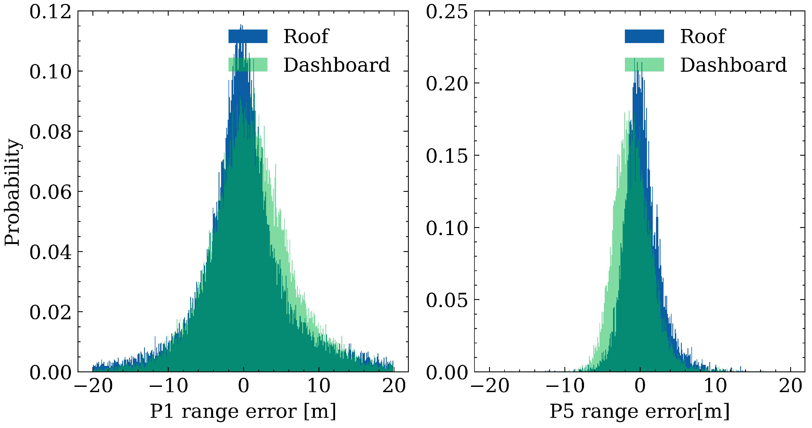
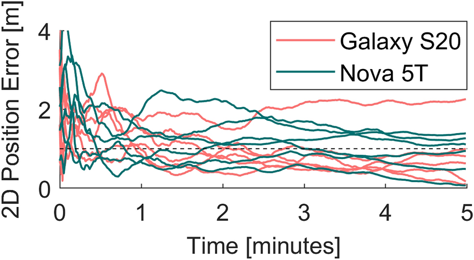
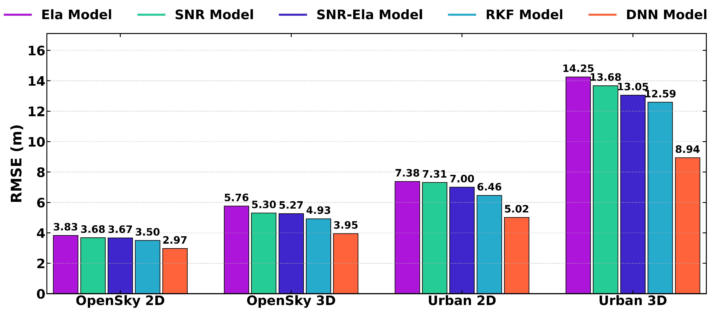

# 2026-11-13 GNSS 每日研究简报

## 今日快报

### 快报 1：17 次同步欺骗试验把城市多路径写进公开基准，但数据集仍不是检测器认证

- 主题：`urban-gnss-spoofing-open-dataset`
- 来源 ID：`doi:10.33012/2026.20861`
- 来源链接：https://doi.org/10.33012/2026.20861
- 发表日期：2026-10-06
- 来源类型：ION GNSS+ 2026 同行评审会议论文与开放数据集
- 获取范围：ION 官方完整摘要、四类场景、17 次同步欺骗试验、数据产品与标注方法；全文需下载额度，本文不补写摘要未公开的检测率

**内容：** HK-UrbanSpoof 面向“城市正常误差会伪装成攻击特征”这一缺口，在开阔、滨海郊区到密集城区的四类环境中实施 17 次同步欺骗，改变接收机运动、欺骗功率优势和目标位移；数据同时给出原始中频、真值轨迹，以及由三维建筑模型射线追踪得到的多路径、遮挡和 NLOS 时间标签。

**结论：** 官方摘要证明的是一个更接近真实城市传播的可复现实验基准已经发布，而不是某种反欺骗算法已达标。小位移攻击可能埋在城市位置误差底噪中；射线追踪标签也依赖建筑模型、材料和同步精度，不能当作无误差真值。

**关注理由：** 反欺骗算法应把“跨场景、跨接收机、未见攻击”作为独立切分，而不是随机打散同一路段。公开 IF 与真值允许从相关器、观测量到 PVT 逐层比较，能减少只在干净仿真上调阈值的乐观偏差。

### 快报 2：阵列先用特征值找相关源，再用相关后空间签名区分压制与欺骗

- 主题：`array-blind-jamming-mitigation-spoofing-detection`
- 来源 ID：`doi:10.33012/2026.20879`
- 来源链接：https://doi.org/10.33012/2026.20879
- 发表日期：2026-10-06
- 来源类型：ION GNSS+ 2026 同行评审会议论文
- 获取范围：ION 官方完整摘要、两级空间处理逻辑、仿真与 Jammertest 2025 验证范围；全文需下载额度

**内容：** 方法在相关前对多阵元原始信号协方差做特征分解，以主特征向量描述强相关干扰源并构造抑制滤波；相关后再按已跟踪卫星形成波束权。若相关前的恶意空间签名没有出现在卫星通道，说明压制有效且更像干扰；若至少一个通道与其匹配，则提示欺骗并可剔除受影响卫星或加深零陷。

**结论：** 摘要报告仿真与 2025 年挪威 Jammertest 的干扰、欺骗和转发欺骗数据支持该逻辑，但未给出本文可核对的虚警、漏检、零陷深度或阵列标定容差数字。因此当前证据支持“空间签名闭环可工作”，不支持宣称对所有近场、多径或多源攻击稳健。

**关注理由：** 阵列抗干扰不能只看输出 C/N0；它还需证明相关峰没有被空间滤波扭曲，并明确“被抑制的源是否仍进入某颗卫星通道”。前后相关域对照提供了一条可解释的故障链。

### 快报 3：车联网 BSM 可变成同步欺骗侧信道，亚米级状态预测足以帮助接管

- 主题：`connected-vehicle-bsm-assisted-synchronous-spoofing`
- 来源 ID：`doi:10.33012/2026.20651`
- 来源链接：https://doi.org/10.33012/2026.20651
- 发表日期：2026-10-06
- 来源类型：ION GNSS+ 2026 同行评审会议论文
- 获取范围：ION 官方完整摘要、C-V2X/NovAtel/PocketSDR 实测链、两场试验与摘要结论；全文需下载额度

**内容：** 攻击模型从联网车辆广播的 Basic Safety Message 取得位置与动力学，用跟踪滤波预测受害接收机状态，再补偿测量、通信、硬件、传播延迟和接收机钟差，使伪 GPS 信号在码延迟和 Doppler 上贴近真信号。试验使用 C-V2X 车载单元、NovAtel CPT7700 与 PocketSDR 记录实星信号。

**结论：** 两个实测场景中，摘要报告状态预测达到亚米级水平并完成预定拖拽，多数伪信号没有触发所用信号质量监测量。它证明 BSM 可降低同步接管的先验门槛，但不等于给出了可远距离实施的完整攻击预算；无线覆盖、消息认证、时延抖动和发射法规仍是边界。

**关注理由：** PNT 安全不能把 V2X 数据默认视为无害辅助量。防御侧应把 BSM 与 GNSS 创新、钟漂和运动学做双向一致性检查，并避免用同一未认证信息既帮助定位又作为真实性判据。

### 快报 4：LEO-PNT 靠近航天器时功率更高，兼容性结论必须放回 ITU 假设中解释

- 主题：`leo-pnt-spaceborne-rnss-compatibility`
- 来源 ID：`doi:10.33012/2026.20652`
- 来源链接：https://doi.org/10.33012/2026.20652
- 发表日期：2026-10-06
- 来源类型：ION GNSS+ 2026 同行评审会议论文
- 获取范围：ION 官方完整摘要、扩展 ITU-R 方法、空间接收机 C/N0 退化问题与定性结果；全文需下载额度

**内容：** 研究把原本面向地面 RNSS 接收机的 ITU-R 兼容性评估扩展到在轨用户，分析近距离 LEO-PNT 发射源如何改变传统 GPS/Galileo 等信号的 C/N0。对象是 Xona Pulsar 与既有 RNSS 在 L 波段共存，而不是用地面自由空间距离直接外推到轨道。

**结论：** 官方摘要称，即便空间接收机可能收到更强的邻近 LEO-PNT 信号，按论文所用方法仍可与传统 RNSS 兼容运行；摘要未公开功率谱密度、天线方向图、最坏几何或允许退化数值，因而不能把“可兼容”解释成任意波形、任意星座密度均无害。

**关注理由：** 多层 PNT 的收益与频谱代价必须共用一套链路预算。接收机前端线性度、带外抑制、空间天线姿态和近距离过境几何，可能比地面用户更决定兼容边界。

### 快报 5：FT-Transformer 提高 PPP-AR 正确固定成功率，但更高 fix rate 仍可能更危险

- 主题：`ppp-ar-ft-transformer-ambiguity-validation`
- 来源 ID：`doi:10.33012/2026.20780`
- 来源链接：https://doi.org/10.33012/2026.20780
- 发表日期：2026-10-06
- 来源类型：ION GNSS+ 2026 同行评审会议论文
- 获取范围：ION 官方完整摘要、动态试验、阈值与四组传统基线数字；全文需下载额度

**内容：** 方法把传统判别统计之外的模糊度域特征输入 FT-Transformer，并输出带概率解释的验整结果。动态试验采用 0.7 决策阈值，并与失败率目标 0.01/0.001 的 FFRT、ratio 阈值 1.5/2.0 的部分模糊度固定比较。

**结论：** 摘要报告模型的正确固定成功率为 24.77%，高于两组 FFRT 的 7.61%/6.72% 和两组 ratio test 的 21.33%/15.55%；其 fix rate 为 56.42%，而对照依次为 19.73%、12.14%、72.07%、62.04%。成功率提高不意味着固定率最大；较高 ratio 固定率可能包含更多错误固定风险，且摘要未给出跨接收机、跨日与分布外校准。

**关注理由：** 机器学习验整器应同时报正确固定、错误固定、拒答和概率校准，不能只优化“出了多少 fixed”。模型阈值必须与应用的可容忍失败率绑定，并保留几何与残差的独立安全门。

## 深度研读

### 深读 1｜低成本接收机｜先把手机测距误差量出来：频点、环境与安装位置分别改变什么

- 类别：`low-cost-mobile`
- 学习层级：`foundation`
- 选题定位：`经典基础：用短基线双差与已知杆臂从真实道路数据中分离手机码测距误差，建立后续随机模型的可量化误差账本`
- 来源 ID：`doi:10.3390/s23031631`
- 来源链接：https://doi.org/10.3390/s23031631
- 发表日期：2023-02-02
- 来源类型：Sensors 同行评审开放实测论文
- 获取范围：CC BY 4.0 开放全文；Xiaomi Mi 8、NovAtel OEM7、三段 28–31 min 道路数据、公式、Figures 1–11 与 Tables 1–2 已核对
- 价值评分：94/100（相关性 20，经典价值 18，证据 19，教学价值 19，工程价值 18）

#### 为什么先学这个

手机定位算法常从“按 C/N0 或仰角定权”开始，却没有先回答观测误差到底有多大、是否近零均值、不同频点能否共用方差。本文用同车测地接收机和已量杆臂构造可观测的相对码误差，把手机硬件、环境与安装位置从最终坐标误差中拆出来。

#### 先修知识

需要理解伪距、接收机/卫星钟、对流层和电离层、站间与星间差分、视线向量、杆臂、标准差与 95% 分位，以及双差误差是多个观测误差叠加而非单颗卫星绝对真值。

#### 一句话逻辑

把手机与同车测地接收机对同一对卫星的码观测做双差，用已知杆臂改正两天线的几何差，剩余量主要暴露手机相对参考星的码测距误差，再按频点、环境和安装位置分层统计。

#### 研究问题与约束

试验在多伦多 York University 周边进行，包含停车场、郊区建筑、植被和短下穿；Xiaomi Mi 8 放在车顶或仪表台，NovAtel OEM7 与测地天线提供同车参考，基站距离小于 5 km。三段道路数据时长 31、28、29 min。方法假设测地接收机码误差相对手机可忽略，且最高仰角参考星误差较小；因此得到的是相对、双差后的 range error，不是手机每颗星的绝对码偏差。

#### 核心方法论

对接收机 $`A,B`$ 与卫星 $`m,n`$ 做站间和星间双差，短杆臂使共同大气残差可忽略；再用同车参考接收机位置与机体系杆臂换算两天线到卫星的几何差。论文还以 PPP 状态差方法交叉分析，避免只依赖一种误差构造。

#### 关键公式逐步推导

码观测双差为：

```math
\nabla\Delta P=
(\rho_A^m-\rho_A^n)-(\rho_B^m-\rho_B^n)
+\delta I+\delta T
+(\varepsilon_A^m-\varepsilon_A^n)
-(\varepsilon_B^m-\varepsilon_B^n).
```

对米级杆臂，$`B`$ 相对 $`A`$ 的几何差可用视线向量一阶线性化：

```math
\rho_B^m-\rho_A^m\approx \mathbf u_A^{mT}\mathbf l,
```

于是相对测距误差近似为：

```math
e^{mn}\approx \nabla\Delta P-
(\mathbf u_A^m-\mathbf u_A^n)^T\mathbf l.
```

该量仍含手机星 $`m`$ 与参考星 $`n`$ 的误差差；若参考星也有多路径，误差会传播到全部双差，不能把 $`e^{mn}`$ 直接称为单星绝对误差。

#### 经典价值与创新边界

短基线双差和杆臂线性化是经典方法；论文价值在于把它用于真实车内/车顶手机数据，并按频点、环境、SNR、仰角与预拟合残差系统分层。边界是单一 Xiaomi Mi 8、两天道路采集和特定车辆；参考星“更干净”只是工程假设，数据也未公开下载。

#### 整体逻辑链

同车同步采集手机与测地码观测；基站生成参考轨迹；测量杆臂；构造双差；扣除视线投影的杆臂几何；验证测地零基线精度；比较 P1/P5；再按环境、SNR/仰角、预拟合残差和车顶/仪表台拆分分布。

#### 原文图表与结果分析



> 图表源：Hu、Yi 与 Bisnath《A Comprehensive Analysis of Smartphone GNSS Range Errors in Realistic Environments》Figure 11，[CC BY 4.0 开放全文](https://doi.org/10.3390/s23031631)。本地资产为 MDPI 出版方原始 PNG 原样保存；未裁剪、重绘、平滑或改写横轴 P1/P5 range error（m）、纵轴 probability、颜色、图例与数值。

左图是第一频点 P1，右图是第三频点 P5；蓝色为车顶、绿色为仪表台。两图横轴均为米，P1 分布明显更宽、更重尾；仪表台曲线相对车顶略分散。论文给出的 STD 为 P1 车顶/仪表台 5.1/5.3 m，P5 为 2.2/2.4 m。图能支持“安装位置和频点需要不同码方差”，不能证明仪表台所有历元都更差，也不能隔离不同日期交通和卫星几何的影响。

#### 原文结果论述

主数据中手机 P1/P5 测距误差 STD 为 7.3/2.1 m，测地参考为 0.5/0.2 m；手机均值分别约 0.8/0.6 m。郊区建筑段绝对误差 95% 分位为 P1 18.2 m、P5 5.9 m，高于开阔场的 14.5/5.1 m。论文还观察到手机误差与 SNR 的关系通常强于与仰角的关系，但低 SNR 不必然对应最大误差，不能用单一硬门代替随机模型。

#### 常见误区与适用边界

第一，双差会放大噪声并把参考星误差带给所有卫星。第二，P5 更窄不代表其可用率一定更高。第三，车顶与仪表台数据不完全同历元同交通，不能作严格因果实验。第四，预拟合残差含模型和状态误差，不等于真实测距误差。第五，一个手机型号不能代表全部天线与芯片。第六，STD 和 95% 经验分位不是完整性包络。

#### 工程实现步骤

1. 在车体坐标系精测手机天线与参考天线杆臂并记录安装方向。
2. 同步记录原始码、载波、Doppler、C/N0、状态位和参考 RTK/INS。
3. 统一星历、钟差、相对论、Sagnac、大气与天线改正。
4. 以高仰角参考星构造双差，同时轮换参考星检查敏感性。
5. 按频点、星座、环境、安装位置和 C/N0 分箱估计偏差与分位。
6. 把误差模型送入定位前，先做留出路线与留出设备校准。

#### 复现实验设计

选择 Mi 8、Pixel 8 和 Galaxy S21+ 三型手机，与测地接收机同车 10 Hz 采集；每型分别在车顶、挡风玻璃后和手持位置跑同一路线 5 次，每次 30 min。基线 A 使用统一仰角权，B 使用统一 C/N0 权，C 使用频点+设备+位置分层方差。指标为每频偏差/STD/95%/99.9% 分位、预拟合残差相关、SPP 2D/3D RMSE 与 P95；失败用例包括参考星 NLOS、杆臂误差 10 cm、手机温升和 P5 间歇缺测。

#### 与定位及低成本实现的联系

定位滤波器必须先知道每条码观测“信多少”。本节给出可追溯的方差来源；下一节把这些观测送入开放 PPP 软件，观察外部产品、无组合模型、离子层伪观测与设备特定信号选择怎样共同决定收敛。

#### 本节小结

手机码误差不是一个固定数字：频点、环境与安装位置都会改变分布。先量误差再定权，才能避免把测地接收机的仰角模型机械移植到手机。

### 深读 2｜接收机工程｜再用开放 PPP 链闭合模型：为什么一部手机能多系统，另一部只能保留 GPS

- 类别：`receiver-engineering`
- 学习层级：`intermediate`
- 选题定位：`基础进阶：把手机观测误差接入开源 raPPPid，沿预处理、外部产品、无组合 PPP、离子层约束、SNR 定权和收敛诊断形成可复现实作链`
- 来源 ID：`doi:10.1007/s10291-023-01488-4`
- 来源链接：https://doi.org/10.1007/s10291-023-01488-4
- 发表日期：2023-07-19
- 来源类型：GPS Solutions 同行评审开放软件论文与开源代码
- 获取范围：开放全文与 GitHub 代码；raPPPid 模型、流程、Huawei Nova 5T/Samsung Galaxy S20 各 30 min 静态数据、Figures 1–10 与 Tables 1–4 已核对
- 价值评分：94/100（相关性 19，经典价值 18，证据 18，教学价值 20，工程价值 19）

#### 为什么先学这个

上一节只量出了观测误差，尚未说明误差如何进入一个完整定位器。PPP 还依赖轨道钟、码/相偏差、大气、天线、时标和随机模型。raPPPid 把这些模块公开，让“某手机能到一米”不再是黑箱结果，也展示同一算法不能无条件接受每个手机输出的全部星座。

#### 先修知识

需要理解码与载波观测方程、无电离层组合、未组合 PPP、接收机钟与系统间钟偏、湿对流层、斜电离层、浮点模糊度、Kalman 滤波、离子层伪观测、RINEX 和 SNR 定权。

#### 一句话逻辑

把每个手机实际可用的频点和观测类型接入同一套可配置 PPP 模型，以外部精密产品闭合卫星端误差、以离子层伪观测稳定单频解，再用收敛曲线暴露设备特定的未建模偏差，而不是强迫所有星座进入滤波。

#### 研究问题与约束

raPPPid 是 MATLAB 开源软件，支持四大 GNSS、最多三频、传统无电离层组合与未组合模型，并可做 PPP-AR。手机示例仅有 Nova 5T 与 Galaxy S20FE 各 30 min、静态、测地参考点和良好开阔环境；Galaxy 文件没有载波，Nova 相位三阶差仍有规律跳变，因此示例主要使用码观测，不能代表动态城市 PPP 或产品级实时性。

#### 核心方法论

程序先读 RINEX 并自动下载精密产品，完成周跳、天线、大气与产品约定预处理，再逐历元用迭代 EKF 估坐标、接收机钟、系统间钟偏、湿对流层、斜电离层和浮点模糊度。手机配置采用 SNR 定权、预测 GIOMO 离子层伪观测、GPT3 完整对流层改正与 CNES 实时改正归档；可按设备只选能闭合模型的星座与信号。

#### 关键公式逐步推导

频点 $`i`$ 的未组合码相观测为：

```math
P_i=\rho+c(\delta t_R-\delta t^S)+T+\gamma_i I_1
+B_{R,i}-B_i^S+\varepsilon_{P,i},
```

```math
L_i=\rho+c(\delta t_R-\delta t^S)+T-\gamma_i I_1
+\widetilde N_i\lambda_i+\varepsilon_{L,i},
```

其中 $`\gamma_i=f_1^2/f_i^2`$。外部离子层模型不被当作真值，而是带方差的伪观测：

```math
I_{1,\mathrm{model}}=I_1+\varepsilon_I.
```

在滤波中逐渐增大 $`\varepsilon_I`$ 方差，可让初始化借助模型、稳态再由观测接管。手机相位若不连续，$`\widetilde N_i`$ 无法保持弧段常数，此时强行加入反而污染坐标。

#### 经典价值与创新边界

PPP 方程、EKF 与离子层约束都是经典模块；价值在于把多系统多频、产品下载、模型选项、重置和收敛图整合为开放工具，并诚实展示手机数据需要设备特定配置。边界是软件依赖 MATLAB，手机样本很小，论文未做跨路线、跨日、错误产品或城市动态鲁棒性试验。

#### 整体逻辑链

选择 RINEX 和配置；下载钟轨/偏差/大气产品；预处理并做质量控制；按 IF 或未组合模型建观测；逐历元迭代 EKF；可选离子层约束与定整；输出坐标与大气；插入重置统计收敛；最后按设备回看未建模偏差和观测缺口。

#### 原文图表与结果分析



> 图表源：Glaner 与 Weber《An open-source software package for Precise Point Positioning: raPPPid》Figure 9，[开放全文](https://doi.org/10.1007/s10291-023-01488-4)。本地资产为 Springer 出版方原始全尺寸 PNG 原样保存；未裁剪、重绘、平滑或改写 time/minutes、2D position error/m、设备颜色、曲线、1 m 虚线与图例。

横轴为每次解重置后的 0–5 min，纵轴为二维位置误差（m）；多条红/绿曲线对应不同起始历元的收敛段，黑虚线是 1 m。多数曲线在约 2–3 min 内触及或低于 1 m，但仍有曲线在 5 min 处约 1–2 m，说明“2–3 min”是该开阔静态样本的典型表现，不是每次保证。

#### 原文结果论述

Nova 5T 使用 GPS/GLONASS/Galileo/BeiDou 单频码加 GPS L5；Galaxy S20 只保留 GPS C1C，因为加入其他星座会产生数米坐标偏差，暴露当前模型未覆盖的设备/日志效应。Galaxy 30 min 长时序在排除各方向收敛段后，高/北/东 RMS 为 0.25/0.30/0.24 m；论文明确把结果限定为静态开阔条件。

#### 常见误区与适用边界

第一，支持多星座不等于所有设备都应同时启用。第二，精密产品无法修复手机端未建模码偏差。第三，离子层伪观测越紧不一定越好。第四，码解一米不等于载波模糊度已固定。第五，多次重置曲线共享同一 30 min 数据，样本不独立。第六，准实时归档流不等于已验证的在线延迟与丢包。

#### 工程实现步骤

1. 对每个设备列出实际输出的星座、频点、码型、载波与状态位。
2. 先单系统单频跑通，再逐项加入星座以定位偏差来源。
3. 统一精密钟轨、OSB/DSB、天线、时标和参考框架。
4. 用 SNR/残差构造设备特定权重，并保留未加权诊断输出。
5. 对相位做弧段连续性与三阶差检查，不连续时退回码解。
6. 对解重置、产品中断和星座加入做自动回归测试。

#### 复现实验设计

用 raPPPid 处理三型手机各 24 h 静态数据和两条 45 min 动态路线。方案 A 为 GPS-only 码 PPP，B 逐星座加入，C 未组合+离子层伪观测，D 加入可用载波；每 30 min 重置。基线为 RTKLIB 同产品解。指标为 1/2/5 m 首次进入并保持时间、N/E/U bias/RMS/P95、可用率、产品龄期与每星座残差；失败用例包括错误 DCB、VTEC 偏 5 TECU、SSR 断流 60 s、日志钟跳和载波弧段断裂。

#### 与定位及低成本实现的联系

开放软件把手机误差、产品约定和滤波状态放在同一条可复查链上，但其 SNR 权重仍是人工模型。下一节将 SNR、仰角和后验残差联合送入 DNN，让每颗码观测的协方差逐历元自适应，同时检查这种学习权重是否真正降低城市长尾。

#### 本节小结

手机 PPP 的关键不是“打开更多星座”，而是逐项闭合观测、产品和硬件偏差。开源链让收敛可复现，也让未建模设备效应无法藏在最终坐标里。

### 深读 3｜定位算法｜最后让权重随城市观测自适应：DNN 怎样进入纯 GNSS 手机 Kalman 滤波

- 类别：`positioning`
- 学习层级：`advanced`
- 选题定位：`定位深入：在不引入地图、IMU 或视觉到用户解的纯 GNSS 码 SPP 中，用 SNR、仰角与后验残差学习逐观测方差并压低城市长尾`
- 来源 ID：`doi:10.3390/s26092694`
- 来源链接：https://doi.org/10.3390/s26092694
- 发表日期：2026-04-27
- 来源类型：Sensors 同行评审开放方法与实车论文
- 获取范围：CC BY 4.0 开放全文；Samsung Galaxy S21+、u-blox ZED-F9P、北京两条路线、五种定权、Figures 1–15 与 Tables 1–5 已核对
- 价值评分：95/100（相关性 20，经典价值 17，证据 19，教学价值 19，工程价值 20）

#### 为什么先学这个

前两节说明手机码误差随频点、环境和设备变化，固定仰角或 C/N0 曲线很难覆盖城市 NLOS。本文不让网络直接输出坐标，而是只学习 Kalman 滤波中每条伪距的噪声方差；物理状态转移和几何观测方程仍保留，因此比端到端轨迹回归更容易诊断。

#### 先修知识

需要理解码 SPP、线性化观测矩阵、Kalman 预测/更新、观测噪声协方差 $`R`$、后验残差、Huber 权、全连接网络、softplus、训练/测试切分、RMSE、P95，以及同路线留出不等于跨城市泛化。

#### 一句话逻辑

对每颗卫星把 SNR、仰角和后验伪距残差输入三层 DNN，输出严格为正的 $`R_{ii}`$；滤波器据此逐历元给坏观测更小权，再以真实 ENU 位置误差反向训练整个定权映射。

#### 研究问题与约束

实车在北京两条路线采集，一条较开阔、一条含城市峡谷；Galaxy S21+ 固定在仪表台，ZED-F9P 位于车内。真值来自 NovAtel ISA-100C 与 RTK/INS 前后向平滑，附近参考站基线小于 16 km。红色路段训练、蓝色路段测试，但仍位于同一批路线；论文没有留出城市、季节或另一型号手机，数据和模型也仅按请求提供。

#### 核心方法论

对照包括仰角、SNR、仰角+SNR、基于协方差传播和 Huber 的稳健 KF，以及 DNN 权重。DNN 输入三维特征，隐藏层 64–128–64，ReLU 与 batch normalization，输出经 softplus 和 9 m² 下限形成对角 $`R`$。定位状态仍由纯 GNSS 伪距 Kalman 滤波更新；IMU 只用于离线真值，不进入用户解。

#### 关键公式逐步推导

输入特征为：

```math
\mathbf x_i=[\mathrm{SNR}_i,\ el_i,\ v_i]^T,
```

其中 $`v_i`$ 是后验伪距残差。网络原始输出 $`z_i`$ 被映射为：

```math
R_{ii}=9+\ln(1+e^{z_i}),
```

保证 $`R_{ii}>9\ \mathrm{m}^2`$。Kalman 增益随之变为：

```math
K_k=P_k^-H_k^T(H_kP_k^-H_k^T+R_k)^{-1}.
```

训练损失是各历元三维 ENU 误差的平均欧氏范数：

```math
L=\frac{1}{N}\sum_{k=1}^{N}
\sqrt{e_{E,k}^2+e_{N,k}^2+e_{U,k}^2}.
```

网络没有显式预测偏差，只通过增大方差降权；若多颗 NLOS 同向且残差被状态吸收，学习权重仍可能低估共同偏差。

#### 经典价值与创新边界

SNR/仰角定权、Huber 稳健估计和 Kalman 滤波均是经典组件；论文贡献是用定位域损失学习逐观测协方差，并与多种传统权重在同设备同路线比较。边界是标签来自平滑 RTK/INS、输入包含滤波后残差形成闭环依赖、只测一款手机，且没有概率校准或保护级证明。

#### 整体逻辑链

原始多 GNSS 码预处理；传统模型生成初始权；Kalman 预测与残差；提取 SNR/仰角/残差；DNN 输出逐星方差；更新状态；以 ENU 真值损失训练；在留出路段比较五种权重；做网络深度消融、PCA 与单历元逐星权重解释。

#### 原文图表与结果分析



> 图表源：Zhang 等《Deep Learning-Driven Adaptive-Weight Kalman Filtering for Low-Cost GNSS in Challenging Environments》Figure 11，[CC BY 4.0 开放全文](https://doi.org/10.3390/s26092694)。本地资产为 MDPI 出版方原始 PNG 原样保存；未裁剪、重绘、平滑或改写 RMSE/m、场景、方法颜色、柱高与标注数值。

横轴依次为 OpenSky 2D/3D、Urban 2D/3D，纵轴为 RMSE（m）。DNN 橙柱在四组中最低：2.97、3.95、5.02、8.94 m；城市 3D 的传统仰角/SNR/组合模型为 14.25/13.68/13.05 m，稳健 KF 为 12.59 m。图直接支持本数据上的相对改善，但开阔场仍约 3–4 m、城市 3D 仍近 9 m，不能据此宣称车道级持续可用。

#### 原文结果论述

城市路线中，DNN 相对三种传统模型平均值的 E/N/U RMSE 降幅为 20.2%/33.8%/36.0%；3D RMSE 相对平均传统模型降低 4.72 m（34.6%）。城市 P95 从传统模型约 29.03–32.71 m、稳健 KF 28.00 m 降到 18.12 m。论文的跨数据集 TDL-W 数字不是同场对照，作者也明确指出不能作严格头对头比较。

#### 常见误区与适用边界

第一，低 RMSE 不等于方差已校准。第二，后验残差会受当前位置误差和权重反向影响。第三，$`R`$ 只保留对角，忽略同一街谷的相关 NLOS。第四，同路线留出不能证明跨城市泛化。第五，真值 IMU 不进入算法，但训练仍依赖昂贵真值。第六，DNN 只降权不改偏差，成组错误仍可能拖动解。第七，纯 GNSS 指用户解输入，不等于训练无需外部参考。

#### 工程实现步骤

1. 固定码观测、星历、大气和接收机钟模型，先复现传统权重基线。
2. 对 SNR、仰角与残差做训练集统计归一化并冻结参数。
3. 网络输出用 softplus/上下限约束，防止方差塌缩或无限放大。
4. 按时间和路线切分，避免相邻历元泄漏到训练与测试。
5. 同时报 RMSE、P95、创新白化、NIS 与方差覆盖率。
6. 遇到分布外设备/城市时回退到稳健 KF，并记录触发原因。
7. 把网络版本、训练数据哈希和权重边界纳入产品配置管理。

#### 复现实验设计

采集 S21+、Pixel 8、Mi 8 三设备在北京、上海和一座未见城市的开阔/树荫/普通/密集街谷路线；每城两天、各 40 min。比较仰角、SNR、组合、Huber RKF、论文 DNN、含设备 ID 的 DNN。按“留一路线、留一设备、留一城市”三级评估。指标为 2D/3D RMSE、P95/P99、创新均值/NIS 覆盖、连续超过 10 m 时长与单历元耗时；失败用例包括参考真值短失锁、整组卫星 NLOS、固件升级和 C/N0 整体偏移 3 dB-Hz。

#### 与定位及低成本实现的联系

这是一条纯 GNSS 手机 SPP 定位链：外部 RTK/INS 只负责训练和验真，在线状态更新只用 GNSS 码、星历与派生质量特征。它展示了低成本终端可把复杂性集中在小型定权网络，而保留可审计的几何和滤波器；部署成败取决于跨设备泛化与方差校准，而不只是平均 RMSE。

#### 本节小结

学习型权重能在本次城市路线显著压低手机码定位长尾，但它仍是经验随机模型，不是完整性保证。真正可部署的版本必须证明跨城市、跨设备和分布外时会安全退化。
