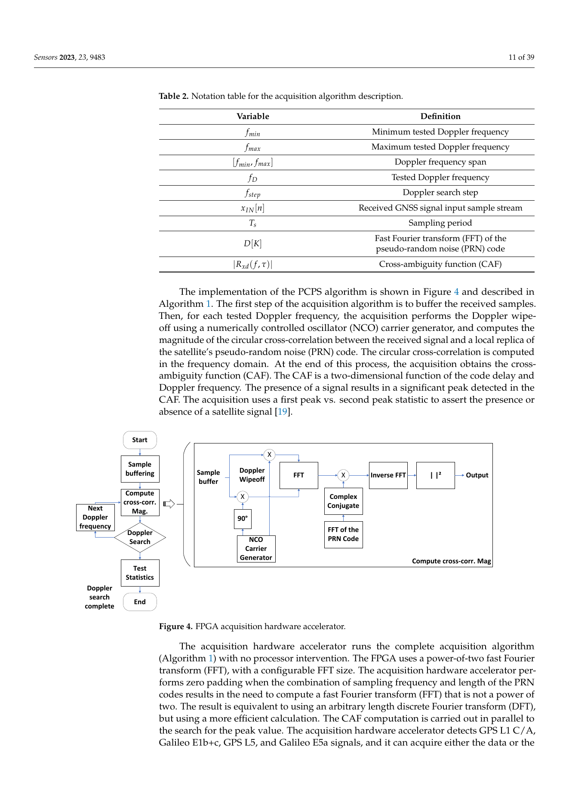
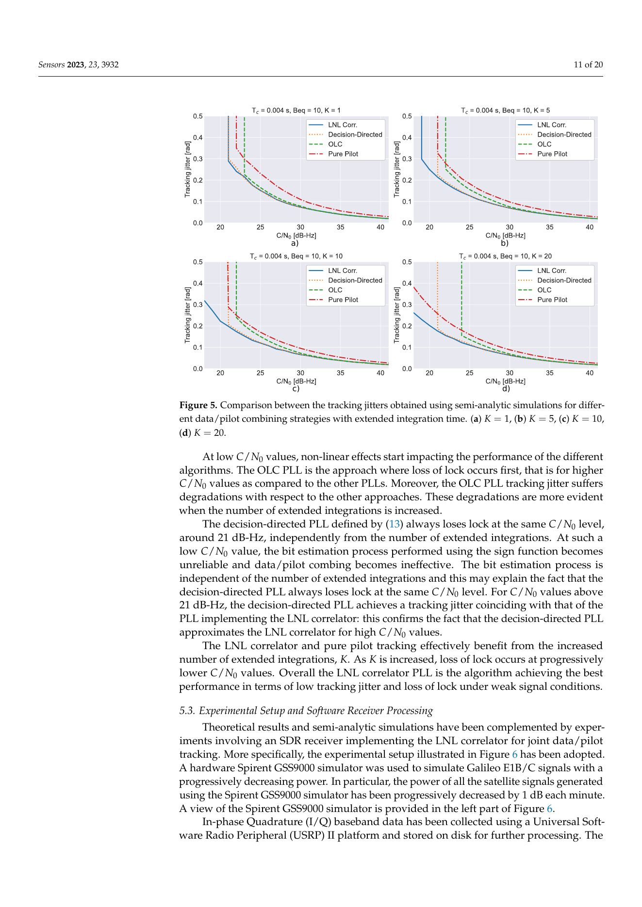
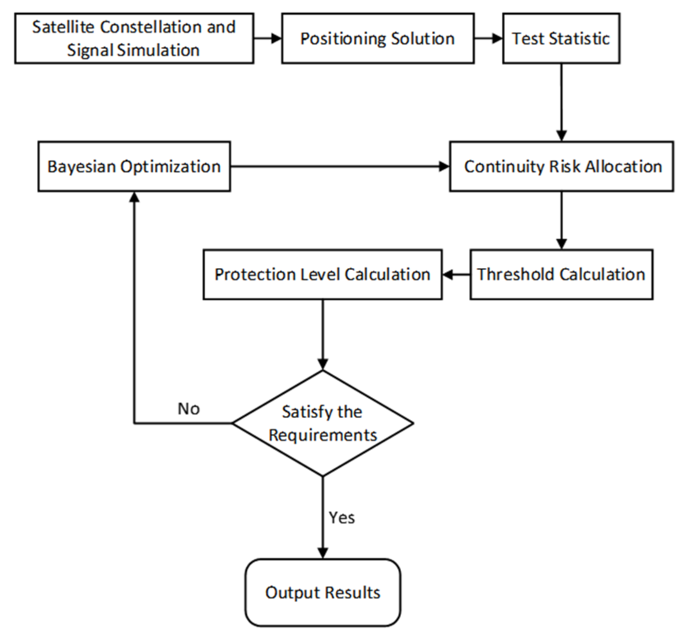

# 2026-11-14 GNSS 每日研究简报

## 今日快报

### 快报 1：小型多阵元天线的“缩小代价”必须在相同射频链上比较，不能只看阵元数

- 主题：`miniaturized-multielement-gnss-antenna-aoa-attitude`
- 来源 ID：`ion:gnssplus2026-17060`
- 来源链接：https://www.ion.org/gnss/abstracts.cfm?paperID=17060
- 发表日期：2026-10-06
- 来源类型：ION GNSS+ 2026 同行评审会议论文摘要
- 获取范围：官方完整摘要；全文、具体告警时间与风险数值需会议资料权限

**内容：** 研究比较缩小后的多阵元 GNSS 阵列，以相同滤波、主动电子和接收机后端评估 AoA 与姿态；核心问题是阵元间距缩短到何处会令相位差几何和角度分辨能力跨过可接受边界。

**结论：** 摘要明确指出目前缺少在相同接收链条件下的实测对比，并把研究定位为量化 miniaturization penalty；未公开阵列尺寸、角度误差或统计结果，故不能据此声称某种小阵列已可替代常规阵列。

**关注理由：** 多天线抗干扰、定向和姿态都受阵元几何约束。比较硬件时必须锁定天线、前端、时钟和后端；否则“算法提升”可能只是不同射频链带来的假象。

### 快报 2：NRTK 改正数也要发“可信度消息”，用户端才能把网络故障写进保护级

- 主题：`nrtk-correction-station-fault-integrity-message`
- 来源 ID：`ion:gnssplus2026-17151`
- 来源链接：https://www.ion.org/gnss/abstracts.cfm?paperID=17151
- 发表日期：2026-10-06
- 来源类型：ION GNSS+ 2026 同行评审会议论文摘要
- 获取范围：官方完整摘要；站网规模、检测门限和实测统计未在摘要公开

**内容：** 该框架把参考站异常与大气建模误差视为网络 RTK 改正数据的故障源，先定义刻画实时质量的 integrity message，再在服务端检测、分析广播数据失败，并定义用户端利用该消息计算严格保护级的机制。

**结论：** 这是“把改正质量从服务商内部诊断转成用户可计算风险输入”的体系设计，不是对任何既有 NRTK 服务可用率的实测背书。摘要未给出失效注入、区域相关性和通信延迟处理细节。

**关注理由：** 厘米级 RTK 的坐标精度不能替代完整性；用户滤波器必须知道改正本身的误差界和时效，而非把 RTCM 字段当作无误差真值。

### 快报 3：PPP 收敛后的大气状态与服务器改正并非总能互换，先验可信度要随条件切换

- 主题：`ppp-converged-atmosphere-versus-server-correction`
- 来源 ID：`ion:gnssplus2026-16600`
- 来源链接：https://www.ion.org/gnss/abstracts.cfm?paperID=16600
- 发表日期：2026-10-06
- 来源类型：ION GNSS+ 2026 同行评审会议论文摘要
- 获取范围：官方摘要、地面/机载实采与 code-minus-carrier 隔离流程；完整 PSD、窗口长度和包络参数未公开

**内容：** 工作比较 PPP 滤波已经收敛的对流层/电离层状态与 PPP-RTK 服务端下发改正，针对双频 PPP 常见的十分钟以上初始收敛瓶颈，讨论用户何时应信任自身状态、何时应受网络改正约束。

**结论：** 官方摘要支持“收敛状态与外部改正需要按条件评估”，但未在当前可得内容中公布完整实验结果和切换阈值。它不能支持把本地收敛状态或服务器流任一方视为普适真值。

**关注理由：** PPP-RTK 的可用性取决于改正时效、网络误差、用户动态和本地滤波历史。工程系统应输出改正年龄、协方差与切换原因，而非只暴露一个位置结果。

### 快报 4：三维地图可在解算前预报完整性，但城市遮挡的先验不等于现场真值

- 主题：`3d-map-aided-urban-integrity-prediction`
- 来源 ID：`ion:gnssplus2026-16895`
- 来源链接：https://www.ion.org/gnss/abstracts.cfm?paperID=16895
- 发表日期：2026-10-06
- 来源类型：ION GNSS+ 2026 同行评审会议论文摘要
- 获取范围：官方完整摘要、GRACE-FO 2020–2021 数据与 99.9% PL 约 1 m 的作者报告；全文参数未获取

**内容：** 方法先用独立 GNSS 解把车辆位置投到三维城市模型，预测卫星可见性、DOP 和预期保护级，并将 LOS 先验用于紧耦合系统剔除故障量测。东京实测以 POSLVX 620 后处理轨迹为参考，目标水平完整性风险为 $`2\times10^{-5}`$、HAL 为 1 m。

**结论：** 摘要称高精度三维模型下预测 PL 与无故障 PL 接近，并通过紧耦合提高鲁棒性；这不是地图或融合系统在所有 NLOS、多路径、地图过期情形下的完整性证明，参考轨迹也不是无误差真值。

**关注理由：** 地图应是可检验的先验而非“真值传感器”。部署时需对地图版本、定位初值偏差、遮挡误判和地图外环境单独报告保护级覆盖。

### 快报 5：5G 多无线电匹配图可优化高分位误差，但它是协同定位而非 GNSS 性能替代

- 主题：`5g-integrated-multiradio-matching-map-positioning`
- 来源 ID：`ion:gnssplus2026-16955`
- 来源链接：https://www.ion.org/gnss/abstracts.cfm?paperID=16955
- 发表日期：2026-10-06
- 来源类型：ION GNSS+ 2026 同行评审会议论文摘要
- 获取范围：官方完整摘要、韩国西岸 2024-12-31 事件描述与分级逻辑；无独立因果归因数据

**内容：** 该系统将多无线电观测变换为匹配地图图像，再以 ConvNeXt-Tiny 分类，并与调优的信号强度指纹基线比较；评价强调误差分布上尾，呼应紧急定位规则关注“多少呼叫落在距离阈值内”而非只看均方误差。

**结论：** 摘要给出了设计与性能分析的目标，但当前范围未公开完整场景、训练/测试切分和高分位数值。因此它支持“上尾应作为指标”，不支持其已在跨城市、跨设备或 GNSS 失效条件下可靠运行。

**关注理由：** 协同 PNT 能补足 GNSS 城市遮挡，却也引入无线电基础设施和训练分布依赖。比较系统时应把 GNSS-only、5G-only、融合及失效退化分别报告。

## 深度研读

### 深读 1｜信号捕获｜先让 FPGA 在码相位—Doppler 平面找到峰：PCPS 为什么是接收机的第一道算力账

- 类别：`acquisition`
- 学习层级：`foundation`
- 选题定位：`经典基础：从相关模糊函数、FFT 并行码相搜索到硬件加速器，建立“何时捕获成功、代价由什么决定”的共同语言`
- 来源 ID：`doi:10.3390/s23239483`
- 来源链接：https://doi.org/10.3390/s23239483
- 发表日期：2023-11-28
- 来源类型：Sensors 同行评审开放论文，CC BY 4.0
- 获取范围：开放全文、PCPS 硬件流程、Figure 4 与表中符号已核对；本文不将平台资源数据外推至任意 FPGA
- 价值评分：92/100（相关性 20，经典价值 18，证据 18，教学价值 19，工程价值 17）

#### 为什么先学这个

没有初始码延迟和载波 Doppler，跟踪环连本地副本都无法对齐。本文把软件接收机常见的二维搜索落实到 SoC-FPGA：码相位利用 FFT 同时并行，Doppler 仍按候选栅格扫描，适合作为后续跟踪与 PVT 的计算入口。

#### 先修知识

需要知道扩频 PRN、自相关峰、复基带、采样率、相干积分时间 $`T`$、Doppler、DFT/FFT、循环相关与峰值—次峰值检测。捕获输出只是粗估计，不是最终伪距或载波相位观测。

#### 一句话逻辑

对每个候选频移先去载波，再把接收采样 FFT 与本地 PRN FFT 的共轭相乘并 IFFT；其模平方在正确的 $`(\tau,f_D)`$ 附近出现峰，硬件把这条相关链和峰值搜索并行化。

#### 研究问题与约束

论文实现多频多星座实验接收机的 SoC-FPGA 架构，捕获 GPS L1 C/A、Galileo E1b/c、GPS L5 与 Galileo E5a，并允许 2 或 4 bit 样本。FFT 点数、频率步长、积分长度和门限共同决定漏检、虚警、延迟与 BRAM/DSP 代价；论文的平台结果不等于低功耗手机芯片指标。

#### 核心方法论

PCPS 将每个频移下的所有码延迟相关改写成频域乘积。先缓存一段采样、NCO 去除 $`f_{IF}+f_D`$、压缩样本、FFT、乘以 PRN 频谱共轭、IFFT、取平方并找最大值；最大峰与次峰统计超过门限后才宣告捕获。

#### 关键公式逐步推导

令去载波后的离散数据为 $`x_f[n]=x[n]e^{-j2\pi(f_{IF}+f)nT_s}`$，本地码为 $`d[n-\tau]`$。候选相关为：

```math
R_{xd}(f,\tau)=\sum_{n=0}^{N-1}x_f[n]d^*[n-\tau].
```

循环相关的卷积定理给出：

```math
R_{xd}(f,\tau)=\operatorname{IFFT}\{X_f[k]D^*[k]\}[\tau].
```

所以判决面是 $`A(f,\tau)=|R_{xd}(f,\tau)|^2`$。频率残差会在积分内积累相位 $`2\pi\Delta fT`$ 并压低峰，故 $`\Delta f`$、$`T`$ 和搜索格点不能独立任意增大。

#### 经典价值与创新边界

FFT 并行码相搜索是成熟基线；该工作的价值是把信号、数据/导频和硬件资源接口放进可配置 SoC-FPGA。它并未发明 PCPS，也不证明零填充或低位量化总能无损；不同信号的二级码、数据位翻转和前端失真须另测。

#### 整体逻辑链

IF 采样进入双通道射频前端；FPGA 进行样本缓存和调理；每颗 PRN、每个 Doppler bin 形成 CAF；峰值检测输出粗码相位和频偏；通道初始化 DLL/FLL/PLL；最后由跟踪观测进入导航解。

#### 原文图表与结果分析



> 图表源：M. M. M. et al.《A Flexible System-on-Chip Field-Programmable Gate Array Architecture for Prototyping Experimental GNSS Receivers》Figure 4，CC BY 4.0，[开放全文](https://doi.org/10.3390/s23239483)。本地资产是出版 PDF 第 11 页原页渲染，含原始 Figure 4、标注和相邻正文；未裁剪、重绘、平滑或改写数据。

图中从样本缓冲、载波 NCO、FFT、PRN 频谱共轭、IFFT 到峰值判决构成一条数据流。它说明“码相位并行”发生在 IFFT 输出的全部延迟格，而 Doppler 搜索仍由外层候选控制；图没有给出各栅格的检测概率或资源利用率，不能单凭结构图推导灵敏度。

#### 原文结果论述

论文明确将捕获定义为估计可见卫星的码相位与载波频率，并把 PCPS 作为减少搜索时间的实现。其支持的信号集合、位宽配置和可编程 FFT 说明架构可扩展；具体首次定位时间、虚警率和弱信号门限仍应以同一前端、同一数据集的独立测试为准。

#### 常见误区与适用边界

第一，最高峰不自动等于真卫星，旁瓣、欺骗或匹配码干扰可产生峰。第二，频率步长过粗会损失相干增益。第三，码相位循环相关需处理数据位和二级码边界。第四，冷启动搜索范围远大于有辅助信息时。第五，捕获成功不保证 PLL 后续不失锁。

#### 工程实现步骤

1. 固定采样率、量化位数、信号体制与可接受的首定位时间。
2. 按最大钟差和动力学设定 Doppler 范围及步长。
3. 生成与采样长度一致的本地 PRN，明确定义零填充。
4. 计算 CAF、主峰/次峰和噪声统计，记录每颗星的门限。
5. 将粗 $`\hat\tau,\hat f_D`$ 交给跟踪环，并保留重捕获日志。
6. 用无信号、弱信号、频偏、位翻转和近远效应录波测虚警/漏检。

#### 复现实验设计

用 5 MHz 复采样 GPS L1 C/A 录波，设 $`T=1,2,4`$ ms，Doppler 覆盖 $`\pm10`$ kHz、步长 250/500 Hz；基线 A 为时域串行相关，B 为 PCPS，C 为 PCPS 加辅助 Doppler。报告每颗星捕获时间、正确码相/频偏误差、虚警率、漏检率、FFT 次数、FPGA DSP/BRAM 和功耗。失败用例包括导航数据翻转、$`C/N_0`$ 降低、500 Hz 栅格失配与伪相关峰。

#### 与定位及低成本实现的联系

PCPS 节省的是首次搜索和重捕获的计算预算，不能直接提高定位精度；但更可靠的初始状态可减少低成本接收机失锁后的空窗。下一节将把已捕获的现代数据/导频信号送入载波环，讨论如何在弱信号下延长有效积分。

#### 本节小结

捕获是在二维不确定性中找相关峰。FFT 把码延迟维并行化，但门限、Doppler 格点、数据位和前端量化仍决定它是否真的能为跟踪提供可靠起点。

### 深读 2｜信号跟踪｜再把数据与导频合进载波环：延长积分为何既降噪也会引入位翻转风险

- 类别：`tracking`
- 学习层级：`intermediate`
- 选题定位：`基础进阶：从数据/导频相关器、最大似然权重到 PLL 抖动，用可验证的权衡把捕获粗状态变成连续载波观测`
- 来源 ID：`doi:10.3390/s23083932`
- 来源链接：https://doi.org/10.3390/s23083932
- 发表日期：2023-04-13
- 来源类型：Sensors 同行评审开放论文，CC BY 4.0
- 获取范围：开放全文、半解析仿真、硬件模拟器生成 Galileo E1 I/Q 与 Figures 1–10 已核对；结论限于其信号与设置
- 价值评分：93/100（相关性 20，经典价值 17，证据 19，教学价值 19，工程价值 18）

#### 为什么先学这个

捕获得到的只是粗频率和码相位。载波环必须在热噪声、动态和数据位翻转下持续输出相位与 Doppler；现代 GNSS 的导频不带导航数据，提供延长相干积分的机会，但丢掉数据支路又浪费信噪比。

#### 先修知识

需要掌握 Prompt I/Q 相关器、PLL 鉴相器、NCO、环路带宽、相干/非相干积分、$`C/N_0`$、载波相位模糊度和 bit synchronization。数据和导频分量的幅度、噪声与相位关系都需要估计。

#### 一句话逻辑

将导频相关器与经数据位补偿的数据相关器按其幅度和噪声方差加权，形成最大似然广义相关器；弱信号下数据支路权重自然趋小，强信号且位估计可靠时则回收其能量。

#### 研究问题与约束

论文处理有数据和导频分量的 GNSS 信号，以半解析仿真和硬件模拟器的 Galileo E1 I/Q 数据比较组合策略。关键限制是数据位估计错误会翻转数据支路，而低 $`C/N_0`$ 时理论方差也会偏离实际；因此权重不可只按名义功率写死。

#### 核心方法论

作者构造数据与导频的线性组合，数据支路乘以非线性项以补偿未知比特；在弱信号极限它呈现类似 squaring 的行为。组合权重依赖估计的信号幅度和相关器噪声方差，再由 PLL 把相位误差驱向零。

#### 关键公式逐步推导

写导频和已补偿数据相关器为 $`z_p,z_d`$，其估计方差为 $`\sigma_p^2,\sigma_d^2`$。归一化的逆方差合成可写成：

```math
z= w_p z_p+w_d z_d,\qquad
w_i=\frac{\sigma_i^{-2}}{\sigma_p^{-2}+\sigma_d^{-2}}.
```

PLL 的相位鉴别量可由：

```math
e_\phi=\operatorname{atan2}(\Im\{z\},\Re\{z\})
```

得到。若数据位估计错，$`z_d`$ 的符号错误，故应使其有效权重随 bit 置信度下降：$`w_d\leftarrow q w_d`$，其中 $`q`$ 是经独立验证的概率量，而不是硬编码常数。

#### 经典价值与创新边界

组合数据/导频和延长积分不是新概念；本文价值在于用 ML 视角统一线性组合、位补偿和弱信号行为，并比较理论、仿真和 I/Q 处理。结果不能自动迁移到不同调制、晶振、强加速度或真实城市多路径。

#### 整体逻辑链

捕获提供初值；双支路相关器输出 I/Q；估计幅度、噪声、bit 与置信度；形成组合相关器；鉴相器—滤波器—NCO 更新本地载波；输出相位、频率、锁定指标并向导航滤波器报告观测质量。

#### 原文图表与结果分析



> 图表源：Borio 等《GNSS Data/Pilot Combining with Extended Integrations for Carrier Tracking》Figure 5，CC BY 4.0，[开放全文](https://doi.org/10.3390/s23083932)。本地资产为出版 PDF 第 11 页原页渲染，保留原始曲线、坐标、图例及文字；未裁剪、重绘、平滑或改写数值。

该页比较不同积分时间的跟踪抖动，横轴为 $`C/N_0`$（dB-Hz），纵轴为抖动，曲线对应不同组合策略。直接读图可见策略优劣随信号强度与积分设定变化，而不是固定排序；图不能证明位估计在实地突发干扰、时钟跃变或未见导航电文下同样可靠。

#### 原文结果论述

论文报告 ML 组合可在理论、半解析仿真及模拟器处理间呈现其优势与代价；作者特别指出低 $`C/N_0`$ 下非线性效应会令简单方差公式偏离。可采信的是“应按实际质量自适应”，不可把任一曲线当作所有接收机的灵敏度认证。

#### 常见误区与适用边界

第一，延长相干积分并非免费增益，数据位翻转会抵消相关。第二，导频存在不代表所有信号都可无限积分。第三，较窄环路带宽会增灵敏度却更怕未建模动态。第四，锁定指标高不保证多路径偏差小。第五，模拟器结果与真实射频前端互调不同。

#### 工程实现步骤

1. 对每个信号分量配置独立 Prompt I/Q 与积分窗口。
2. 实现导航数据位同步和 bit 置信度，不可靠时降低数据权重。
3. 在线估计幅度、噪声与 $`C/N_0`$，限制权重突变。
4. 以 $`e_\phi`$ 更新三阶或经验证阶次的 PLL，并输出 lock 指标。
5. 发生周跳、相关峰畸变或残差异常时冻结/重置观测而非继续传播错误相位。
6. 用录波、模拟器和动态台架分别验证。

#### 复现实验设计

处理 Galileo E1 复录波，比较 A：仅导频 PLL，B：固定等权数据/导频，C：ML 自适应组合；$`C/N_0`$ 扫描 20–45 dB-Hz，积分 4/20/100 ms，并注入 0–10% bit 判决错误和 0–5 g 动态。报告相位抖动、失锁率、重捕获时间、周跳率、CPU 负载与最终伪距/相位残差。基线必须共享相同前端和初始状态。

#### 与定位及低成本实现的联系

更稳定的相位可帮助 RTK/PPP，但错误的长积分会把偏差送入模糊度状态；低成本晶振和手机天线还会增加模型外误差。因此下一节从“相位更准”前进到“即便解看似准确，保护级是否仍保守”。

#### 本节小结

数据/导频合成的核心不是把两个通道盲目相加，而是让每个支路按噪声、幅度与比特可信度贡献证据。连续载波观测需要对失锁和错误符号保持可审计的退出机制。

### 深读 3｜定位完整性｜最后用贝叶斯搜索收紧 ARAIM 保护级：优化门限之前，先守住风险分配

- 类别：`positioning`
- 学习层级：`advanced`
- 选题定位：`定位深入：将连续性风险分配、故障检测门限和多星座垂直保护级放在同一优化问题中，同时划清仿真可用性与安全证明的边界`
- 来源 ID：`doi:10.3390/engproc2026126017`
- 来源链接：https://doi.org/10.3390/engproc2026126017
- 发表日期：2026-02-20
- 来源类型：Engineering Proceedings 同行评审会议论文，CC BY 4.0
- 获取范围：开放全文、GPS+Galileo 全球 VPL/可用性图、贝叶斯优化流程已核对；10 页会议论文的情景与风险模型边界明确保留
- 价值评分：89/100（相关性 20，经典价值 16，证据 16，教学价值 19，工程价值 18）

#### 为什么先学这个

前两节保证信号能被捕获和跟踪，却不保证定位解在故障下可以被信任。ARAIM 的保护级要同时覆盖测量噪声、卫星故障假设、监测漏检和连续性；调低一个阈值看似能降低 VPL，实则可能把未告警风险移到别处。

#### 先修知识

需要理解加权最小二乘、残差检验、告警限、完整性风险、连续性风险、垂直保护级 VPL、故障假设、Gaussian overbound 与可用性。还应区分“保护级小于告警限”与“真实安全已被认证”。

#### 一句话逻辑

论文把连续性风险如何分配给检测门限视为黑箱代价函数的输入，以贝叶斯优化在候选分配中寻找较小 VPL/较高可用性的点，但每次评估都必须保留给定完整性风险约束。

#### 研究问题与约束

研究对象为 GPS+Galileo ARAIM；传统均分连续性风险可能保守，而过高检测阈值会增加 HMI 风险并抬升 PL。论文的图表来自所设全球网格、星座与故障统计假设，未构成航空或道路应用的运行批准。

#### 核心方法论

先给每个检测分支配置连续性风险/阈值，再计算故障模式下的 PL 与可用性；贝叶斯优化用已评估样本拟合代理模型，在探索不确定区域与利用低代价区域之间选择下一组风险分配，避免穷举高维参数网格。

#### 关键公式逐步推导

对故障模式 $`k`$，将位置误差投影的均值偏差和标准差合成为保护项：

```math
VPL_k=|b_{v,k}|+K_{md,k}\sigma_{v,k},\qquad VPL=\max_k VPL_k.
```

可用性指标可写为：

```math
\mathcal A(\boldsymbol r)=\Pr\{VPL(\boldsymbol r)<VAL\},
```

其中 $`\boldsymbol r`$ 是连续性风险分配，且须满足 $`\sum_i r_i\le r_{cont}`$。贝叶斯优化不是改变这一安全预算，而是在可行域内以采集函数 $`a(\boldsymbol r)`$ 选择下一次昂贵的 PL 评估。

#### 经典价值与创新边界

PL 的故障模式最大化和风险预算是 ARAIM 基础；创新点是以贝叶斯优化搜索风险分配。它可减少计算采样，却不自动保证代理模型遗漏的尖峰风险被覆盖；安全论证仍需独立验证、保守边界和明确的故障先验。

#### 整体逻辑链

星历和用户几何给出观测矩阵；故障先验与误差 overbound 产生各模式偏差/方差；连续性风险决定检测阈值；各模式生成 VPL；全球/时间网格比较 VPL 与 VAL；贝叶斯优化更新分配并复算可用性。

#### 原文图表与结果分析



> 图表源：Liu 等《ARAIM Protection Level Calculation Method Based on Bayesian Optimization》Figure 3，CC BY 4.0，[开放全文](https://doi.org/10.3390/engproc2026126017)。本地资产为出版方原始 PNG，未裁剪、重绘、平滑或改写图中的流程、箭头、变量和标签。

流程从多星座信号、误差模型与风险参数开始，经 VPL 计算、代理模型与采集函数迭代输出最优风险分配。它说明优化环的输入与输出关系，却不显示图 4–5 的具体 VPL 或可用性数值；因此不能从流程图本身推断改进幅度。

#### 原文结果论述

论文在 GPS+Galileo 全球评估中比较优化前后的 VPL 与 ARAIM 可用性，并主张在维持风险约束时收紧 PL。该结论应理解为作者设定下的模型结果；观测误差非高斯性、服务故障相关性、接收机实现误差或优化未覆盖区域，都可能使实装安全界不同。

#### 常见误区与适用边界

第一，较小 VPL 不必然更安全，关键是 overbound 覆盖。第二，优化目标不能只追可用性。第三，连续性风险与完整性风险不是可随意互换的预算。第四，网格仿真不等于飞行或道路真值。第五，贝叶斯优化的收敛并不证明全局最优。第六，低成本接收机的多路径和时钟误差必须进入独立误差模型。

#### 工程实现步骤

1. 固化应用告警限、完整性/连续性指标和故障假设版本。
2. 对每颗星、每个星座建立可审计的偏差和方差 overbound。
3. 枚举单星、星座和相关服务故障，并计算对应灵敏度。
4. 在显式风险预算内生成候选检测门限。
5. 用训练网格优化，用独立时间、地点、故障注入网格验收。
6. 在线记录保护级、告警、风险分配版本与不可用原因。

#### 复现实验设计

以 GPS+Galileo 广播星历生成 30 天、5° 网格、5° 高度截止角的静态用户几何；基线 A 为均匀连续性风险分配，B 为网格搜索，C 为贝叶斯优化。固定同一完整性风险与 VAL，报告 VPL 的 P50/P95/P99.9、可用性、评估次数和最坏留出网格差值。失败用例包括重尾码误差、单星故障概率翻倍、星座级相关故障和卫星数骤减。

#### 与定位及低成本实现的联系

完整性是纯 GNSS 定位的“知道何时不能信”。低成本端可先从保守 SPP/RTK 保护级或不可用标志做起，但不得把云端/优化结果直接当作安全认证；捕获和跟踪输出的 $`C/N_0`$、锁定与残差质量应作为误差模型输入而不是证明本身。

#### 本节小结

贝叶斯优化可让 ARAIM 的风险分配搜索更高效，但它只能在已声明的故障与误差边界内工作。保护级优化的成功标准是独立覆盖仍成立，而不是图上的 VPL 最小。
