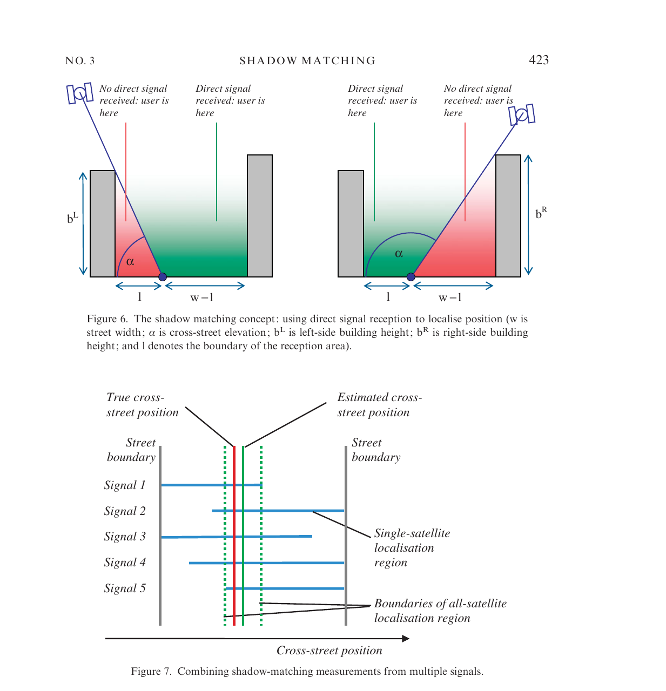
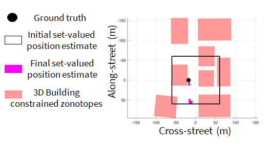
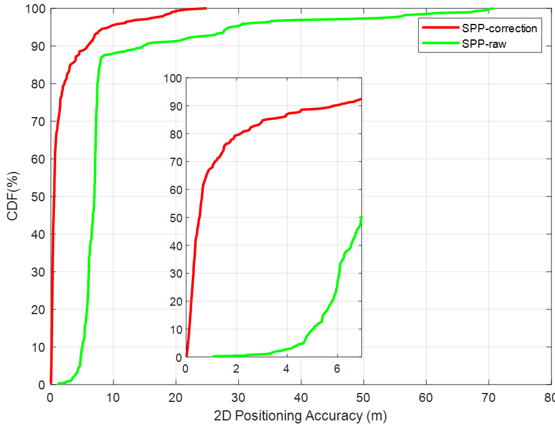

# 2026-11-15 GNSS 每日研究简报

## 今日快报

### 快报 1：鱼眼图不只分天空与建筑，还能把 GNSS 残差变成逐方向故障概率

- 主题：`point-supervised-visual-gnss-quality`
- 来源 ID：`arxiv:2610.14822`
- 来源链接：https://arxiv.org/abs/2610.14822
- 发表日期：2026-10-10
- 来源类型：arXiv 原始研究预印本
- 获取范围：开放全文、训练/测试划分、四种视觉模型与定位表格；尚非同行评审定稿

**内容：** 论文用多参考星差分伪距残差，在鱼眼图的卫星投影点自动生成稀疏标签与重要度权重；U-Net、DeepLabv3+、DINOv3 和 SAM3 学出密集故障概率图，再把逐星概率变成 WLS 权重。训练使用数据集 1 与 3，测试使用另一天采集的数据集 2。

**结论：** 原文 Table III 报告，相对二值天空分割的 1.22 m 水平 RMSE，四种点监督模型在有效历元上为 0.78–0.86 m；但真值来自同车 GNSS/INS 后处理，数据只覆盖济南三条路线，且不同方法的解算可用历元并不完全相同，不能据此宣称跨城市完整性已获证明。

**关注理由：** 环境图像最有价值的输出不是硬判 LOS/NLOS，而是可送入随机模型的连续质量量。工程复现应按路线和日期隔离训练测试，并同时报告误差、可用率与概率校准。

### 快报 2：星间链路路由可用一次反向扫描替代逐时刻全图寻路，但结论仍来自仿真星座

- 主题：`autonomous-gnss-isl-routing-topology`
- 来源 ID：`arxiv:2609.07056`
- 来源链接：https://arxiv.org/abs/2609.07056
- 发表日期：2026-10-22（v2）
- 来源类型：arXiv 原始研究预印本
- 获取范围：开放全文、算法、30 星北斗仿真、计算平台与基线；无在轨链路试验

**内容：** DS-SMFP 利用“每颗卫星每时隙至多连接一个对端”的 GNSS 星间链路结构，从目的星向前反向传播最早到达时隙，直接生成 STORE/FORWARD 决策；MTRCC 再把未来送达收益嵌入链路匹配，使拓扑构造与路由不再分离。

**结论：** 在论文的 24 h、30 星北斗场景和 Python 工作站实现中，最终算法与 CGR/SPT 得到相同的可达时延，同时显著降低路由计算与工作内存；MTRCC 以略增 PDOP 换取较低端到端延迟。所有比例都受时隙、链路容量充分、确定轨道和仿真实现约束，不能外推为星上处理器实测吞吐。

**关注理由：** 自主定轨不只需要测距几何，还需要把观测、钟差和导航电文及时送到主星与全网。链路计划必须同时报告通信时延与测距几何，而非只优化其中一个指标。

### 快报 3：GNSS 轨迹整体偏移时，多采样不会自动消除无线电地图的空间错配

- 主题：`radio-map-posthoc-gnss-location-calibration`
- 来源 ID：`arxiv:2609.11142`
- 来源链接：https://arxiv.org/abs/2609.11142
- 发表日期：2026-09-10
- 来源类型：arXiv 原始研究预印本
- 获取范围：开放全文、Bayes 风险界、仿真与手机 GNSS 误差模型；RSS 与真实轨迹仍为仿真

**内容：** 方法把每条采集轨迹的主要 GNSS 误差写成传感器特有的准静态平移，与路径损耗和阴影衰落参数一起在高斯过程回归中估计；无线电观测本身因此既用于建图，也用于校正错误地理标签。

**结论：** 原文证明在平移不变轨迹模型下，仅凭轨迹不能辨识共同偏移，并用条件 Bayes 风险上下界解释可约误差。手机实测只用于拟合 1 Hz 误差再近似成 20 s AR(2) 过程；地图 RSS、真轨迹和大部分评估仍是模拟，故不能把结果当作真实城市部署精度。

**关注理由：** GNSS 误差具有时间相关性时，“更多点”可能只是把整条轨迹更密地画在错误位置。众包地图应同时估计坐标偏差，且把不可辨识条件写进数据质量门控。

### 快报 4：5G NTN 初始接入依赖 GNSS 预补偿，单星 AoA/FoA/ToA 只能先把搜索区缩到可接入尺度

- 主题：`gnss-denied-5g-ntn-single-satellite-initial-access`
- 来源 ID：`doi:10.3390/s26206414`
- 来源链接：https://doi.org/10.3390/s26206414
- 发表日期：2026-10-10
- 来源类型：Sensors 同行评审开放论文，CC BY 4.0
- 获取范围：开放全文与静态网格/动态城市轨迹仿真；不是在轨 VSAT 外场验收

**内容：** 论文面向 GNSS 受扰时 5G NTN VSAT 无法在 RACH 前正确补偿时延和 Doppler 的问题，先用相控阵 AoA 得粗位置，再从 LEO 下行参考信号提取 FoA 与 ToA，最后在 Levenberg–Marquardt/Kalman 框架中逐步融合。

**结论：** 作者报告该链条可把初始位置不确定度从数十千米压到数千米量级，目标是恢复随机接入而非替代 GNSS 精密定位。误差预算、波束/时频估计与轨道先验来自设定和仿真，尚不能证明真实 Ku/Ka 波段终端在遮挡、时钟漂移和星历误差下具备同等表现。

**关注理由：** “GNSS denied”并不意味着终端必须直接求出米级位置；通信接入只需把时延与频偏搜索压进协议容差。应把接入成功率与导航精度分开验收。

### 快报 5：只仿冒少数 PRN 也可能造成拒止，认证导航电文不能保护捕获与跟踪前端

- 主题：`gnss-spamming-spoofing-denial-of-service`
- 来源 ID：`arxiv:2602.05517`
- 来源链接：https://arxiv.org/abs/2602.05517
- 发表日期：2026-02-05
- 来源类型：arXiv 原始研究预印本，CC BY-NC-ND 4.0
- 获取范围：开放全文、经电缆合路的 SDR 概念验证与冷/温/热启动场景；无辐射外场和跨接收机统计

**内容：** “SpAmming”不广播宽带噪声，而是在 CDMA 层仿冒目标卫星的 PRN、Doppler 和码偏移，使接收机无法稳定捕获或跟踪合法信号，从而以欺骗手段得到类似干扰的拒止效果。

**结论：** 原文用 USRP B210、u-blox ZED-F9P 和电缆合路验证攻击可影响不同启动状态，冷启动尤其脆弱；但这是单接收机、受控功率和有线注入的概念验证。OSNMA 认证的是导航数据，不会自动鉴别前端相关峰或保证服务可用性。

**关注理由：** 抗欺骗与抗干扰不能分成两套互不相干的告警。接收机应联合监测相关峰结构、逐星 $`C/N_0`$、空间一致性、认证状态和卫星集合突变。

## 深度研读

### 深读 1｜接收机工程｜先把楼宇阴影变成横街约束：影子匹配为什么补的是几何缺口

- 类别：`receiver-engineering`
- 学习层级：`foundation`
- 选题定位：`经典基础：从城市峡谷的方向性几何退化出发，理解卫星“可见/不可见”如何成为位置观测`
- 来源 ID：`doi:10.1017/S0373463311000087`
- 来源链接：https://doi.org/10.1017/S0373463311000087
- 发表日期：2011-06-07
- 来源类型：The Journal of Navigation 同行评审论文；UCL 开放作者版本，版权归原出版方
- 获取范围：作者版本全文、Figures 1–11 与仿真假设已核对；本文不把理想模型外推为真实城市精度
- 价值评分：94/100（相关性 20，经典价值 20，证据 17，教学价值 19，工程价值 18）

#### 为什么先学这个

城市峡谷并非只是“卫星变少”：横穿街道方向的 LOS 更容易被楼宇挡住，剩余 LOS 往往沿街分布，所以传统伪距解在横街方向的几何最弱。影子匹配不先修正每条伪距，而把楼宇遮挡边界当成新观测，正好补这个方向性缺口。

#### 先修知识

需要理解卫星方位/高度角、LOS/NLOS、$`C/N_0`$、DOP、3D 建筑模型和候选位置。还要区分“收到信号”与“收到直达信号”：高灵敏度接收机可能跟踪反射信号，不能仅凭跟踪状态判 LOS。

#### 一句话逻辑

对每颗部分遮挡卫星，用建筑高度和横街仰角算出直达信号的街面边界；实测 LOS 状态选择边界一侧，多星约束取交集后，以剩余区间中心作为横街位置。

#### 研究问题与约束

论文先用 27、65、100 星理想星座与规则街谷证明多星座能提高“至少四条 LOS”的可用率，却不自动修复横街几何；随后在 20 m 宽、统一建筑高度、无街口端效应的仿真中展示影子匹配。它是概念与下界分析，不含真实多路径、地图陈旧或分类误差。

#### 核心方法论

设街宽为 $`w`$、左/右楼高为 $`b^L,b^R`$、卫星在横街平面的仰角为 $`\alpha`$。建筑投下的边界将街道分成直达可见与不可见区域；每颗卫星只更新当前下界 $`y^-`$ 或上界 $`y^+`$。始终全街可见或全街遮挡的卫星不提供横街信息。

#### 关键公式逐步推导

以左侧楼宇遮挡为例，直达边界距左街界：

```math
l=\frac{b^L}{\tan\alpha},\qquad 0<l<w.
```

若该星被判为 LOS，则用户在边界右侧，更新 $`y^-\leftarrow\max(y^-,l)`$；若未见直达信号，则更新 $`y^+\leftarrow\min(y^+,l)`$。多星处理后：

```math
\hat y=\frac{y^-+y^+}{2},\qquad B_y=y^+-y^-.
```

$`B_y`$ 是几何可行区宽度，不是经过频率校准的置信区间；分类与地图一旦错误，真值可能根本不在区间内。

#### 经典价值与创新边界

该文首次系统命名并阐明 GNSS shadow matching，把可见性从质控特征提升为定位观测。创新不在射线求交本身，而在“预测可见性—实测可见性—位置匹配”的反演。论文只展示二维规则街谷和理想判别，未解决网格、集合多模态与错误分类。

#### 整体逻辑链

常规 GNSS 给出粗街区；3D 地图与星历生成各候选位置的遮挡；接收机估计逐星直达可见性；每颗部分遮挡卫星切掉一部分横街候选；多星交集给出区间；常规沿街解与影子匹配横街解组合成二维位置。

#### 原文图表与结果分析



> 图表源：Paul D. Groves《Shadow Matching: A New GNSS Positioning Technique for Urban Canyons》Figures 6–7，[UCL 作者版本](https://discovery.ucl.ac.uk/id/eprint/1308009/)。本地资产由原 PDF 第 7 页以 180 dpi 渲染后裁取包含两图及原始图注的上部；未重绘、平滑或改写标注。版权归原出版方，仅保留研究评论所需最小页段，不暗示再授权。

Figure 6 直接显示同一颗卫星把街面分成可见与遮挡两侧，Figure 7 显示五条单星区间如何收缩为共同区间。图中横轴是横街位置，没有概率刻度；它说明几何逻辑，却不能证明 $`C/N_0`$ 门限在真实反射环境中能无误分类。

#### 原文结果论述

在 20 m 街宽、100 星理想星座、24 h/60 s 步进的模型中，作者报告横街 RMS 约 1 m；街宽翻倍时误差与包含区也相应放大。论文同时明确这只是理想下界，并预测地图、粗位置和可见性判断误差会使实际结果变差，因此“米级潜力”不是外场保证。

#### 常见误区与适用边界

第一，更多星不一定改善横街几何。第二，跟踪到 NLOS 不代表 LOS 可见。第三，可行区宽不等于统计保护级。第四，错误地图可同时污染多星，独立故障假设失效。第五，街口、非平地、树木和临时车辆会让规则楼宇边界失真。

#### 工程实现步骤

1. 将粗 GNSS 解及协方差转换为有限 AOI。
2. 用星历和 3D 地图计算每颗星在 AOI 内的遮挡边界。
3. 用 $`C/N_0`$、相关器或相机估计逐星 LOS 置信度。
4. 只选对候选集有切分能力且状态可信的卫星。
5. 顺序更新候选区并保留被哪颗星切除的日志。
6. 对地图版本、分类冲突和空集设置拒答机制。

#### 复现实验设计

建立 20 m 宽规则街谷，楼高/街宽比取 0.5、1、2、4；用真实广播星历而非理想均匀星座，1 Hz 运行 24 h。基线 A 为伪距 WLS，B 为 1/5/10 m 网格影子匹配，C 为连续区间交。分别注入 0–20% LOS 标签翻转、1–5 m 楼高误差和 10–50 m 粗位置偏差；报告横街/沿街误差、真值包含率、空集率、候选宽度和计算时间。

#### 与定位及低成本实现的联系

低成本接收机最缺的往往不是卫星数量，而是城市中的可辨几何。影子匹配可只使用星历、粗位置和轻量 3D 地图，但对分类质量极敏感。下一节将把点网格换成集合运算，让输出显式保留位置不确定区。

#### 本节小结

影子匹配把遮挡当成观测，补的是横街几何而非伪距精度。它的价值来自多星可见区交集，风险也来自任何错误约束都可能切掉真值。

### 深读 2｜接收机工程｜再用 zonotope 保留位置集合：不铺网格也能逐星切分城市候选区

- 类别：`receiver-engineering`
- 学习层级：`intermediate`
- 选题定位：`基础进阶：把离散可见性评分改写为集合值估计，显式输出多模态候选区与几何边界`
- 来源 ID：`doi:10.33012/navi.547`
- 来源链接：https://doi.org/10.33012/navi.547
- 发表日期：2022-12
- 来源类型：NAVIGATION 同行评审论文；开放 arXiv 作者稿
- 获取范围：全文、算法、简单地图与旧金山 3D 地图仿真已核对；实验采用理想 LOS 分类器，不含真实道路数据
- 价值评分：95/100（相关性 20，经典价值 19，证据 17，教学价值 19，工程价值 20）

#### 为什么先学这个

经典影子匹配把 AOI 离散成网格：网格细则计算和存储上升，网格粗则边界量化误差上升。集合值 ZSM 用多边形/约束 zonotope 直接表示整片可能位置，输出不仅是一个点，还保留不连通的歧义模式和边界。

#### 先修知识

需要掌握集合交、差、Minkowski 和、凸包、生成矩阵、3D 建筑平面与 $`C/N_0`$ 分类。约束 zonotope 适合凸集合；楼群和最终位置可由多个分量的并表示，不能强行压成单椭圆。

#### 一句话逻辑

把建筑、阴影方向和地面写成约束 zonotope，计算三维影体与地面的交；NLOS 星令位置集与阴影相交，LOS 星令位置集减去阴影，逐星处理后留下全部可行位置。

#### 研究问题与约束

论文问：能否摆脱候选网格，同时得到可送入安全规划的集合值位置？验证使用简单 3D 地图和旧金山密集 3D 地图仿真，并假设理想 LOS 分类。作者明确指出误分类脆弱性和多模态仍需额外信息消解；计算时间来自未并行的软件实现。

#### 核心方法论

约束 zonotope 以中心 $`c`$、生成矩阵 $`G`$ 和线性约束 $`A\beta=b`$ 表示建筑或中间集合。卫星方向与建筑做 Minkowski 和形成影体，再与地面 AOI 相交成二维阴影。每颗星根据 $`C/N_0`$ 阈值执行交或差，最终保留多边形并集。

#### 关键公式逐步推导

约束 zonotope 定义为：

```math
Z=\{c+G\beta\in\mathbb R^n\mid \beta\in[-1,1]^m,\ A\beta=b\}.
```

设第 $`j`$ 颗星在所有建筑上形成的二维阴影并集为 $`S_j`$，当前候选集为 $`P_{j-1}`$。理想二分类更新为：

```math
P_j=
\begin{cases}
P_{j-1}\cap S_j, & \text{NLOS},\\
P_{j-1}\setminus S_j, & \text{LOS}.
\end{cases}
```

多颗星顺序应用后得到 $`P_N`$；其质心可作为点解，但完整集合才保留歧义与边界信息。

#### 经典价值与创新边界

核心贡献是将影子匹配从“网格评分”改成“集合传播”，并利用 zonotope 运算降低离线影体构造负担。它没有解决感知错误：硬 LOS/NLOS 一旦错，集合交/差仍会不可逆地删除真值；也没有把集合边界校准为规定风险下的保护级。

#### 整体逻辑链

粗位置定义 AOI；CityGML 类地图预处理为约束 zonotope；星历给出方向；建筑与方向生成影体；影体切到地面形成阴影多边形；逐星按 LOS 状态做集合交/差；输出多分量位置集、质心、横街/沿街边界。

#### 原文图表与结果分析



> 图表源：Bhamidipati、Kousik、Gao《Set-Valued Shadow Matching Using Zonotopes for 3D-Map-Aided GNSS Localization》Figure 11(a)，[arXiv 作者稿](https://arxiv.org/abs/2209.14238)。本地资产为 arXiv HTML 提供的原始 PNG 面板，未裁剪、重绘、缩放或改写数据；按 arXiv 非独占存档边界作研究评论，不暗示额外再授权。

横轴为 cross-street（m），纵轴为 along-street（m）；红色是 3D 建筑 footprint，黑框是初始 AOI，品红色是 14 星处理后的最终集合，黑点是真值。图直接显示集合被压缩为多个小分量，而不是单一椭圆；它没有展示误分类下的真值包含率，也不能证明真实旧金山外场精度。

#### 原文结果论述

旧金山仿真中，14 颗可用 GPS 星的示例给出约 1.2 m 横街和 8.1 m 沿街质心误差，并保留数米到十余米的方向性边界。作者同时报告减少卫星会扩大边界并增加多模态，且全部结果依赖理想分类和仿真地图；这些数值是单组配置结果，不是总体城市统计。

#### 常见误区与适用边界

第一，集合小不等于真值在集合内。第二，质心可能落在不可行区域或错误分量。第三，硬阈值忽略 $`C/N_0`$ 的场景依赖。第四，建筑集合的细节等级影响影体与计算量。第五，未并行软件时间不能直接代表嵌入式实时性。

#### 工程实现步骤

1. 将地图建筑面转换为约束 zonotope 或多边形并集。
2. 用粗解和地面模型建立有限 AOI。
3. 对每颗星离线/缓存计算建筑影体与地面交。
4. 在线读取逐星分类和置信度，先处理最有切分力的星。
5. 执行交/差并维护不连通分量，检测空集与爆炸式分裂。
6. 输出质心、方向边界、分量数与真值包含风险的代理指标。

#### 复现实验设计

使用同一 CityGML 街区与真实星历，AOI 取 200 m × 200 m；实现 1/3/5/10 m 网格 SM 和 ZSM。星数取 6、10、14，楼宇数取 8、14、20；基线为 WLS 和网格 SM。报告质心横街/沿街误差、候选边界、分量数、离线/在线时间、内存。再注入 1%、5%、10% 标签翻转，记录空集率与真值包含率，暴露理想分类假设。

#### 与定位及低成本实现的联系

集合输出适合向规划器传递“我可能在哪里”，也可作为伪距 WLS 的位置先验。低成本实现可缓存影体并按信息量提前停止，但硬集合更新对错标签仍过于脆弱。下一节将故意拿走地图，检验只靠 GNSS 观测学习伪距误差的另一条路线。

#### 本节小结

ZSM 用集合运算消除了网格分辨率—计算量耦合，并保留多模态位置边界；它提高了表示能力，却仍把分类结果当成无误差硬约束。

### 深读 3｜纯 GNSS 定位｜最后让扩散模型只靠 GNSS 修正伪距：从误差分布到城市 SPP

- 类别：`positioning`
- 学习层级：`advanced`
- 选题定位：`前沿进阶：不依赖地图或外部传感器，用 GNSS 时空特征预测逐星伪距误差，再审计对纯 GNSS SPP 的真实增益`
- 来源 ID：`arxiv:2509.17397`
- 来源链接：https://arxiv.org/abs/2509.17397
- 发表日期：2025-09-22
- 来源类型：arXiv 原始研究预印本 v1
- 获取范围：开放全文、公开/自采数据、消融、运行时与 SPP 结果；尚非同行评审定稿，数据划分仍有路线相关性
- 价值评分：95/100（相关性 20，经典价值 16，证据 19，教学价值 20，工程价值 20）

#### 为什么先学这个

前两节用地图显式描述“哪里被楼挡住”；这一节故意拿走地图和相机，只保留 GNSS 观测，问能否从逐星高度角、方位角、$`C/N_0`$ 与残差的时空关系中学出伪距误差。它把学习链从可解释的几何集合推进到分布式误差回归，也暴露了模型泛化与标签依赖。

#### 先修知识

需要掌握伪距 SPP、观测残差、GPS/BDS、多路径/NLOS、MAE/RMSE、Mamba 状态空间模型、扩散模型的前向加噪与反向去噪，以及训练标签与在线输入的区别。模型推理只用 GNSS 特征，训练真值仍来自高精度参考轨迹。

#### 一句话逻辑

先用时序 Mamba 与跨星 Bi-Mamba 给每颗星一个粗伪距误差，再以时空特征和粗估计为条件，让扩散去噪器生成细残差及不确定度；校正伪距后送入相同 SPP 后端。

#### 研究问题与约束

论文使用 1534 s 的香港公开数据和 2127 s 自采数据，按场景分段后以 7:1:2 划分训练、验证、测试，输入时间窗长度为 3。自采场景含开阔、林荫、高楼与悬索桥；同一采集体系和相邻时间段仍可能共享环境与设备特征，因此不是跨城市独立验证。

#### 核心方法论

每颗星输入五维特征：最小二乘伪距残差、全星残差 RSS、$`C/N_0`$、高度角、方位角。单向 Mamba 抽取逐星时间动态，Bi-Mamba 汇总跨星环境上下文并给出粗误差；条件扩散模型再预测粗误差与真值之差，同时输出逐星不确定度。

#### 关键公式逐步推导

先由 SPP 粗位置 $`\hat{\mathbf p}_r`$ 构造第 $`k`$ 颗星的残差特征：

```math
\Delta\rho_{\mathrm{LS},k}=\hat\rho_{s_k,r}-\left\|\mathbf p_{s_k}-\hat{\mathbf p}_r\right\|.
```

粗网络输出 $`\Delta\rho_{\mathrm{init},k}`$，扩散反演生成残差 $`\hat\varepsilon_{0,k}`$，最终误差估计与校正伪距为：

```math
\Delta\rho_{\mathrm{fine},k}=\Delta\rho_{\mathrm{init},k}+\hat\varepsilon_{0,k},\qquad
\rho^{\mathrm{corr}}_k=\rho_k-\Delta\rho_{\mathrm{fine},k}.
```

这一步只改善观测，卫星钟、大气模型、星历和几何矩阵仍由常规 SPP 负责。

#### 经典价值与创新边界

价值在于把扩散模型用于确定性的逐星误差回归，并用强条件和粗到细结构抑制生成多样性；同时给出误差估计消融与定位后端结果。它尚未形成端到端 SPP，也未证明不确定度经过频率校准，更不能从平均误差改善推出完整性风险受控。

#### 整体逻辑链

原始伪距与广播改正形成 SPP 粗解；逐星残差、RSS、$`C/N_0`$ 和卫星角度组成窗口特征；Mamba 预测粗误差；条件扩散生成细残差与不确定度；校正逐星伪距；相同 GPS+BDS 因子图/SPP 后端计算位置；与未校正伪距和两种学习基线比较。

#### 原文图表与结果分析



> 图表源：Zhu 等《Diff-GNSS: Diffusion-based Pseudorange Error Estimation》Figure 11，[arXiv:2509.17397v1](https://arxiv.org/abs/2509.17397)。本地资产下载自 arXiv HTML 原始 PNG，仅将透明背景合成白色以保证 GitHub 可读；曲线、坐标、图例和数值均未改动。按 arXiv 非独占存档边界作研究评论，不暗示额外再授权。

横轴为二维定位误差（m），纵轴为 CDF（%）；红色校正曲线明显左移，绿色原始 SPP 在约 7 m 附近陡升且有长尾。插图放大 0–7 m 区间。图直接显示该测试集上的经验分布差异，但没有置信区间、跨路线独立重复或按场景分层，不能证明任意城市都保持同样增益。

#### 原文结果论述

Table II 中 Diff-GNSS 在香港/自采集的伪距误差 RMSE 为 4.03/1.89 m，低于 RWTH 的 6.33/4.62 m。定位 Table V 报告 mean horizontal error 从原始 SPP 的 9.62 m 降至 1.96 m，E/N/U RMSE 也下降；这些是作者在同一自采数据与后端设置下的报告，不是独立复核或完整性认证。

#### 常见误区与适用边界

第一，扩散“生成”不等于随机误差样本已校准。第二，逐星误差标签依赖参考轨迹。第三，场景内 7:1:2 划分可能高估跨城市泛化。第四，7.3 ms 来自 RTX 4090，不代表手机功耗与延迟。第五，均值/RMSE 降低不保证长尾、告警遗漏率或故障安全性同步改善。

#### 工程实现步骤

1. 用统一星历、大气与钟差模型生成 SPP 粗解和逐星残差。
2. 固定星序与缺星掩码，构造三历元五维特征窗口。
3. 训练 Mamba 粗预测器并单独保存其误差基线。
4. 训练条件扩散残差与不确定度头，做无扩散/无条件/无不确定度消融。
5. 将预测误差只作为伪距改正，保持后端和基线完全相同。
6. 对城市、设备、日期和天气做外部分层，并设置不确定度拒答。

#### 复现实验设计

复现 HK 1534 s 与自采 2127 s 配置：窗长 3，Adam 初始学习率 $`2\times10^{-5}`$，200 epochs、batch 8、DDIM sampling step 2。基线为原始 SPP、PolyU、RWTH、仅 Mamba 粗估计和完整 Diff-GNSS。除 MAE/RMSE 外，报告逐星 95/99 分位误差、水平 50/95 分位、跨城市留一、概率校准、RTX/CPU/手机时延与功耗；失败用例包括未见街区、星座缺失和突发 40 m 以上误差。

#### 与定位及低成本实现的联系

推理阶段只需 GNSS 原始观测与广播信息，符合纯 GNSS SPP；不需要 3D 地图、相机、LiDAR 或 IMU。低成本部署的关键不是把大模型直接塞进手机，而是量化压缩、缺星鲁棒性、设备域迁移和以不确定度触发回退到传统 SPP。

#### 本节小结

Diff-GNSS 把复杂伪距误差拆成粗趋势和扩散细残差，并在作者数据上显著左移 SPP 误差分布。真正的下一关是跨城市、跨设备和长尾风险，而不是继续追求同路线 RMSE。
