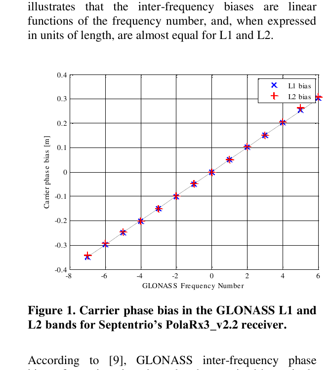
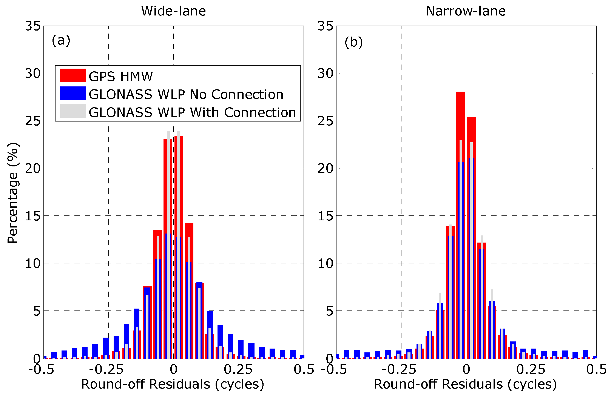
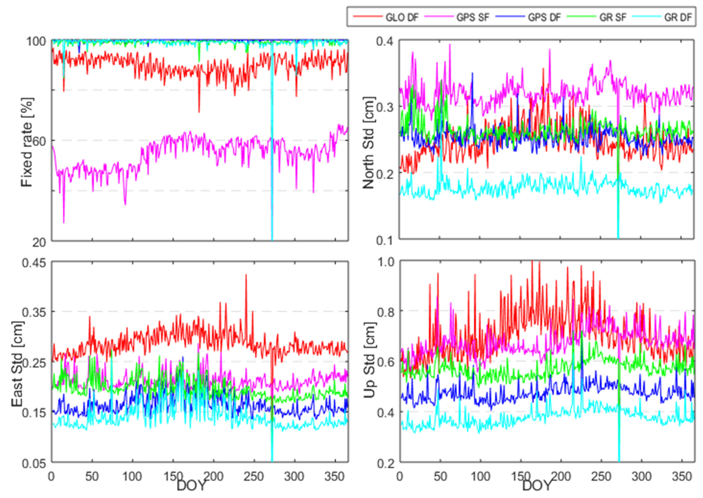

# 2026-11-16 GNSS 每日研究简报

## 今日快报

### 快报 1：精密轨道插值进入毫秒级接收机链后，仍要把“轨道更平滑”与“位置更准”分开验证

- 主题：`ann-igs-orbit-interpolation-millisecond-positioning`
- 来源 ID：`doi:10.3390/geomatics6060143`
- 来源链接：https://www.mdpi.com/2673-7418/6/6/143
- 发表日期：2026-11-14
- 来源类型：Geomatics 同行评审开放论文，CC BY 4.0
- 获取范围：官方摘要、方法范围和元数据；DOI 尚在注册，当前网页未公开可逐项复核的完整数值表

**内容：** 研究用人工神经网络在相邻 IGS 精密轨道历元之间重建卫星坐标，并与 Lagrange、滑动 Lagrange 和三次样条比较；验证链包含受控 TLE/SGP4 插值、合成定位和三组独立 GPS L1 实采，问题是如何把低频率轨道产品送进毫秒级观测链。

**结论：** 官方摘要称 ANN 在其测试中给出最好的总体插值表现，并在保持相近短时稳定性的同时降低平均定位误差；当前可得范围没有公开各数据集的误差分布、训练外推距离和统计不确定度，因此不能把“ANN 最优”外推为所有轨道、弧段或接收机的普遍结论。

**关注理由：** 高率定位不能只比较卫星坐标插值残差。工程评估还应锁定轨道产品、钟差、地球自转、发射时刻迭代和接收机观测模型，防止把广播星历与精密轨道的产品差异误记为插值器收益。

### 快报 2：超短基线的长度约束也会有二阶余项，城市定姿不能把线性化误差当作白噪声

- 主题：`ultrashort-baseline-attitude-geometric-stochastic-model`
- 来源 ID：`doi:10.1016/j.measurement.2026.122859`
- 来源链接：https://doi.org/10.1016/j.measurement.2026.122859
- 发表日期：2026-11-15
- 来源类型：Measurement 同行评审研究论文
- 获取范围：出版方摘要与 highlights；全文需订阅，本文不引用未核对的实验表格

**内容：** 论文把超短基线定姿的两个薄弱点放进同一框架：ELLCA 用被线性化忽略的基线长度方程二阶余项尺度重定约束权重，DASM 再把逐星退化概率映射为有界方差膨胀，以改善密集城市环境中的整数模糊度解算。

**结论：** 出版方摘要支持“几何余项与非高斯观测应联合建模”，并报告城市车载实验中的定整、可用率和亚度级姿态改善；由于当前未取得全文，不能核定训练/测试独立性、退化概率校准或所有具体百分比，故不复述其数字主张。

**关注理由：** 双天线航向常把基线长度当作绝对硬约束，但当基线只有十厘米量级时，线性化和天线相位中心误差会与载波噪声同阶。稳健系统应同时审计几何模型和随机模型，而不是只调 ratio 门限。

### 快报 3：SSR 短时断流时，不要继续把外推轨道钟当作同方差观测

- 主题：`ssr-outage-age-dependent-ppp-variance-inflation`
- 来源 ID：`doi:10.3390/s26217061`
- 来源链接：https://doi.org/10.3390/s26217061
- 发表日期：2026-11-08
- 来源类型：Sensors 同行评审开放论文，CC BY 4.0
- 获取范围：官方摘要、30 天数据划分、DVI 方法和作者结论；当前网页未展开全部实验图表

**内容：** 方法把轨道与钟外推造成的附加 SISRE 按改正年龄离线统计，分别构造系统级和逐星模型；在线仅把模型输出变成额外方差并做 direct variance inflation，而不假装外推产品仍与实时产品等价。

**结论：** 作者用不重叠的训练/测试日期报告跨日误差尺度与随年龄增长的趋势可重复，且逐星 DVI 相对系统级模型只带来较温和、依站点和断流窗口而变的附加收益。证据来自模拟运动 PPP 与既定 SSR 数据源，不等于任意服务商、真实通信中断或完整性风险已被覆盖。

**关注理由：** 改正年龄不仅决定坐标偏差，也决定权重是否可信。实现上应把 orbit age、clock age、逐星外推方差和回退状态记录到观测日志，而不是只在断流后继续传播最后一包改正。

### 快报 4：冗余时钟如果相差同一个 10 ms，正确切换也可能把变电站带入共同错误

- 主题：`gnss-ptp-substation-common-cause-time-failure`
- 来源 ID：`doi:10.1186/s43067-026-00412-3`
- 来源链接：https://doi.org/10.1186/s43067-026-00412-3
- 发表日期：2026-11-09
- 来源类型：Journal of Electrical Systems and Information Technology 同行评审开放研究论文
- 获取范围：开放全文、两类主时钟/合并单元实验与时间传播链已核对

**内容：** 研究沿 GNSS 主时钟、PTP、合并单元、采样值和保护 IED 追踪时间错误，区分绝对误差与两端相对误差，并把欺骗、守时和 best-master-clock 切换放进同一共因失效模型。

**结论：** 原文实验中，10 ms 异步阶跃令一组 step 型合并单元在约 42 s 内接近 180°，slew 型单元偏离基线约 105 s；切换到同样相差 10 ms 的冗余主时钟又产生分钟级共同偏差。这是特定设备与设置的实测，不是所有 PTP 配置的通用持续时间。

**关注理由：** “有两个 GNSS 时钟”不等于独立冗余。系统必须比较天线、射频环境、授时源、保持振荡器、PTP 属性和端到端相角，而不是只检查主时钟是否在线。

### 快报 5：环境感知数据集把完整卫星可见周期与遮挡类型一起记录，但数据集不是现成的泛化证明

- 主题：`environment-aware-gnss-visibility-propagation-dataset`
- 来源 ID：`doi:10.1038/s41597-026-08460-0`
- 来源链接：https://doi.org/10.1038/s41597-026-08460-0
- 发表日期：2026-11-03
- 来源类型：Scientific Data 同行评审 Data Descriptor，CC BY-NC-ND 4.0，early version
- 获取范围：官方摘要、许可和元数据；出版方当前将全文重定向到身份页，未据此引用未核对的表内统计

**内容：** 数据集跨多个固定与同步站点记录开放天空、建筑遮挡、植被遮挡和混合遮挡下的完整卫星可见周期，面向本地传播环境感知与 TEC 相关电离层分析；其价值在于把环境标签、时间演化和 GNSS 观测放在同一可复用样本中。

**结论：** 官方摘要支持该数据集覆盖多类传播环境，但 early version 仍可能被最终版本替换，且站点、天线、接收机与区域分布限定了外部有效性。它不能直接证明用该数据训练的 LOS/NLOS 分类器可跨城市、跨设备工作。

**关注理由：** 环境学习模型最容易被同一路线、相邻时段和同设备泄漏抬高成绩。使用该数据时应按站点、日期、设备和遮挡类型做整组留出，并保留原始许可的“不演绎”边界。

## 深度研读

### 深读 1｜接收机工程｜先追到 GLONASS 频间相位偏差的 DSP 根源：为什么 L1/L2 都沿频道号画出同一条斜线

- 类别：`receiver-engineering`
- 学习层级：`foundation`
- 选题定位：`经典基础：从 FDMA 频道、码—相位时标与接收机钟差出发，解释异构接收机为何破坏 GLONASS 整数性`
- 来源 ID：`ion:gnss2012-10478`
- 来源链接：https://www.ion.org/publications/abstract.cfm?articleID=10478
- 发表日期：2012-09-17
- 来源类型：ION GNSS 2012 会议论文；无开放再利用许可
- 获取范围：官方书目信息、作者公开全文和 Figures 1–3 已核对；论文由接收机厂商作者撰写，实测集中于 PolaRx3 固件案例
- 价值评分：95/100（相关性 20，经典价值 20，证据 18，教学价值 19，工程价值 18）

#### 为什么先学这个

GPS/BDS/Galileo 的同一频点 CDMA 双差通常能消去公共接收机硬件项；传统 GLONASS FDMA 却让不同卫星占不同频道，接收机内部的频率相关延迟在星间差分后仍保留。若不先知道偏差从哪里来，后面的 RTK 只能靠厂商表或现场试错。

#### 先修知识

需要理解码伪距、载波相位、整周模糊度、接收机钟差、单差/双差、L1/L2、FDMA 频道号 $`k\in[-7,6]`$、相关器的码发生器与载波发生器，以及“米”和“周”两种相位单位。

#### 一句话逻辑

DSP 对码观测做固定平移，或码与载波本地发生器具有不同数字延迟，会让码钟与相位钟不再相等；该固定码—相偏差乘上随频道号线性变化的载频，就变成 L1/L2 近乎相同的线性频间相位偏差。

#### 研究问题与约束

论文问：厘米至分米级 GLONASS 频间相位偏差究竟主要来自模拟射频链还是数字测量生成？作者推导 DSP 机制并用 PolaRx3 v2.2 的偏差、模拟滤波器相位响应与已知固件参数核对。它没有建立跨厂商独立样本的总体分布，也刻意不讨论非线性的码频间偏差。

#### 核心方法论

先把理想载波相位写成码测量除以波长加整数；再加入码观测固件修正 $`\delta PR_{L_i}`$、码发生器延迟 $`\delta t_C`$ 和载波发生器延迟 $`\delta t_\phi`$。三者合并为 code-phase bias（CPB），即可推导频间偏差斜率并与模拟滤波器响应量级比较。

#### 关键公式逐步推导

GLONASS 两个频段的频道频率为：

```math
f_{L1}^{k}=1602\times10^6+k\,562500,\qquad
f_{L2}^{k}=1246\times10^6+k\,437500.
```

DSP 生成的码—相偏差定义为：

```math
CPB_{L_i}=c\left(\delta t_C-\delta t_\phi-\delta PR_{L_i}\right).
```

以频道 0 为基准，长度单位的频间相位偏差近似为：

```math
\Delta\Phi^{k,0}_{L1,\mathrm{DSP}}=\frac{CPB_{L1}}{2848}k,\qquad
\Delta\Phi^{k,0}_{L2,\mathrm{DSP}}=\frac{CPB_{L2}}{2848}k.
```

因此只要两频 CPB 相近，L1/L2 的斜率就近乎重合；异构基准站与流动站的斜率差会直接进入相位双差。

#### 经典价值与创新边界

经典价值是把“厂商相关经验偏差”还原为可审计的数字时标机制，并解释线性、温度稳定、同型号相近和 L1/L2 近等四个现象。创新不等于模拟链没有任何偏差，也不等于码 IFCB 可用同一线性模型解决。

#### 整体逻辑链

FDMA 频道改变载频；DSP 给码和相位分配不同有效时标；固定时间/距离偏差经 $`f/c`$ 映射成周数；频道频率随 $`k`$ 线性变化；异构接收机做星间差分后留下斜率差；若已知 CPB，则可先校正相位再进入整数搜索。

#### 原文图表与结果分析



> 图表源：Sleewaegen 等《Origin and Compensation of GLONASS Inter-frequency Carrier Phase Biases in GNSS Receivers》Figure 1，[ION 官方书目页](https://www.ion.org/publications/abstract.cfm?articleID=10478)。本地资产由作者公开 PDF 第 3 页以 180 dpi 渲染并裁取 Figure 1、原图注及一行解释文字；曲线、坐标、图例和数值未改动。原文无开放许可，仅保留研究评论所需最小片段，不暗示再授权。

横轴是 GLONASS 频道号，纵轴是载波相位偏差（m）；L1 蓝叉和 L2 红加号从约 −0.35 m 到 +0.30 m 近乎重合并线性变化。图直接支持该固件案例的约 4.9 cm/频道斜率；它不证明所有品牌、固件或温度条件都有相同斜率。

#### 原文结果论述

作者给出该 PolaRx3 固件的 $`CPB_{L1}=CPB_{L2}=142.4`$ m，并由公式得到约 0.05 m/频道，与实测 4.9 cm/频道相符；同页模拟 L2 滤波器响应仅为亚毫米量级。该证据支持“DSP 是该线性主项”的机理判断，但厂商作者与单一架构证据不能替代跨品牌盲测。

#### 常见误区与适用边界

第一，IFB 不是卫星钟差。第二，相同品牌也可能因固件或个体异常而不同。第三，码 IFCB 通常非线性，不能套用相位斜率。第四，默认改正可能破坏依赖旧厂商表的兼容性。第五，相位校正正确也不消除多路径、周跳和大气失相关。

#### 工程实现步骤

1. 记录基准站/流动站的接收机型号、固件、信号与码类型。
2. 用零基线或公共天线数据估计每频段的相位偏差—频道号斜率。
3. 分开检查 L1/L2 以及 C/A、P 码所对应的有效码钟。
4. 将 CPB/IFB 作为接收机对参数写入元数据，并带版本号。
5. 校正相位后检查各频道双差残差是否仍随 $`k`$ 漂移。
6. 在温度、重启、固件升级和换机后重新验证，而不是永久缓存。

#### 复现实验设计

用功分器把同一天线信号送入两台同型号与一组异型号双频接收机，采样 1 Hz、连续 24 h，并在 0/25/50 °C 三个平台温度下重复。基线 A 不校正，B 用经验线性斜率，C 用厂商 CPB 推导值；报告 L1/L2 每频道残差斜率、温度系数、重启前后差、双差整数成功率和错误固定率。失败用例包括固件升级、不同码类型与个体异常机。

#### 与定位及低成本实现的联系

偏差若不处理，会把本应为整数的 GLONASS 模糊度推成随频道变化的分数。低成本接收机更需要把型号/固件元数据暴露给 RTK，而不是简单删掉 GLONASS。下一节进一步处理更棘手、不能用单一斜率概括的码 IFCB。

#### 本节小结

GLONASS 相位 IFB 的主线不是“射频滤波器随机漂”，而是数字码—相时标不一致经 FDMA 频率映射形成的稳定斜率。知道根源后，校正才能从厂商经验表走向可验证参数。

### 深读 2｜接收机工程｜再绕开不可移植的码偏差表：用纯载波宽巷把跨弧段连成一个整数

- 类别：`receiver-engineering`
- 学习层级：`intermediate`
- 选题定位：`基础进阶：从 SDBR、宽巷/窄巷与跨弧段约束理解异构接收机长基线 GLONASS 定整`
- 来源 ID：`doi:10.3390/rs10081223`
- 来源链接：https://doi.org/10.3390/rs10081223
- 发表日期：2018-08-03
- 来源类型：Remote Sensing 同行评审开放论文，CC BY 4.0
- 获取范围：开放全文、44 条 EPN 基线、Figures 1–9 与处理参数已核对；结果是日静态/多日事后处理，不是实时流动 RTK
- 价值评分：96/100（相关性 20，经典价值 19，证据 20，教学价值 18，工程价值 19）

#### 为什么先学这个

上一节的相位 IFB 可以线性校正，但 GLONASS 码 IFCB 随接收机个体和频道呈非线性，异构接收机下会污染依赖码观测的 HMW 宽巷。本文的关键转向是：不为每台接收机建立码偏差表，而用载波宽巷和跨弧段整数差恢复可固定结构。

#### 先修知识

需要掌握接收机间单差（SDBR）、宽巷/窄巷组合、Hatch–Melbourne–Wübbena 组合、GIM 电离层产品、周跳分弧、浮点模糊度、round-off residual、法方程硬约束和日静态基线解。

#### 一句话逻辑

外部电离层产品先削弱宽巷相位中的电离层项，再用同一卫星各弧段的 HMW 整数差把碎弧连接，只估一个宽巷整数；这样非线性码 IFCB 不再直接决定 GLONASS 宽巷是否可固定。

#### 研究问题与约束

论文处理 20 个 EPN 站、44 条 81–1090 km 异构硬件基线、2013 年 DOY 001–021、30 s 采样。使用 ESA/ESOC 最终轨道钟、绝对天线改正、IERS 2010 与事后 GIM；因此证据面向长基线科学处理，而非低延迟 RTK 改正链。

#### 核心方法论

SDBR 同时估计几何、接收机钟与模糊度。传统 HMW 在 GLONASS 中保留逐星码 IFCB，异构机残差散开；改进法用宽巷纯载波组合估计模糊度，借 GIM 修正电离层，再用 HMW 只确定同星不同弧段之间的整数差，把所有弧段并入一个法方程未知量。

#### 关键公式逐步推导

第 $`g`$ 频点的 SDBR 码/相位模型为：

```math
\Delta P_g^s=\Delta\rho^s+\Delta b_g^s+\Delta I_g^s+c\Delta dt,
```

```math
\Delta L_g^s=\Delta\rho^s+\Delta B_g^s-\Delta I_g^s+\lambda_g^s\Delta N_g^s+c\Delta dt.
```

若同一卫星有 $`K`$ 个连续弧段，用 HMW 得到弧间整数差并连接后，第一个弧段的宽巷估计可写为：

```math
\Delta\widehat N_{w,1}^s
=\Delta N_{w,1}^s+\frac{1}{K}\sum_{i=1}^{K}\Delta\widetilde I_i^s.
```

跨时段平均只压低随弧变化的残余电离层，不会自动消除共同系统偏差；整数差错误会作为硬约束传播。

#### 经典价值与创新边界

经典价值在于把“不可标定的码 IFCB”从宽巷决策路径中移开，并利用同星跨弧段整数差增强长基线模型。它没有摆脱外部精密轨道钟和 GIM，也不适合在短实时窗口内无条件复制。

#### 整体逻辑链

异构接收机令 HMW 宽巷残差失去集中性；纯载波宽巷避开码 IFCB；GIM 提供粗电离层修正；HMW 只连接同星碎弧的整数差；多弧共同估计压低残差；宽巷固定后再固定窄巷；GPS+GLONASS 固定解改善静态基线坐标。

#### 原文图表与结果分析



> 图表源：Zhu 等《Improved Method for GLONASS Long Baseline Ambiguity Resolution without Inter-Frequency Code Bias Calibration》Figure 5，CC BY 4.0，[开放全文](https://doi.org/10.3390/rs10081223)。本地资产是 MDPI 提供的原始 PNG；未裁剪、重绘、缩放或改写数据。

两面板横轴是 round-off residual（cycles），纵轴是百分比；蓝色“GLONASS WLP No Connection”长尾明显，灰色“WLP With Connection”在零附近收紧并接近红色 GPS HMW。图直接显示跨弧连接改变了残差分布，却不显示错误硬连接的条件概率或实时延迟。

#### 原文结果论述

原文报告 GLONASS WLP 在无连接时宽巷残差落在 ±0.2 周内的比例为 77.2%，连接后为 95.5%；44 条基线的最终 GLONASS 无电离层模糊度固定率均超过 90%，平均 97.5%。最长日解基线仍降至 90.2%，多日处理才把约 1100 km 基线提升到至少 96%，说明收益依赖时间积累。

#### 常见误区与适用边界

第一，跨弧平均不是实时滤波。第二，GIM 的 2–8 TECU 标称范围不能当逐弧真值。第三，round-off residual 小不等于错误固定率已校准。第四，日静态周解作参考并非独立真值。第五，碎弧差若受未检周跳污染，硬约束会放大错误。

#### 工程实现步骤

1. 以接收机间单差保留 GLONASS 不同波长与硬件项。
2. 用最终/实时轨道钟和天线模型先闭合非色散项。
3. 读取带质量标记的电离层产品并传播其不确定度。
4. 按卫星和接收机重启切分连续弧段。
5. 用 HMW 估计同星弧间整数差，门控后才加入硬约束。
6. 先固定宽巷、再固定窄巷，并对固定后残差和基线长度做复核。

#### 复现实验设计

选 10 个异构 EPN 站形成 100/300/600/1000 km 基线，采样 30 s、连续 21 天。基线 A 为传统 HMW，B 为纯载波 WLP 不连弧，C 为 WLP 连弧；再比较实时 GIM 与最终 GIM。报告 ±0.1/0.2 周残差比例、宽/窄巷正确固定率、固定到首次成功的时间、坐标 NEU RMS 和错误硬连接率。注入漏检周跳、GIM 偏差与接收机重启作为失败用例。

#### 与定位及低成本实现的联系

该方法证明 GLONASS 不必因码 IFCB 被永久排除，但代价是精密产品、多弧和长窗口。低成本实时系统更需要在线估计一个稳定的相位 IFB 率并用其他星座补观测强度；这正是下一节的单历元 RTK 问题。

#### 本节小结

当码 IFCB 无法用通用表校准时，可以把它绕开：纯载波宽巷负责估计，同星 HMW 只负责弧间整数差。方法增强了长基线模型，但收益来自多日信息，不应误写成瞬时 RTK 能力。

### 深读 3｜纯 GNSS 定位｜最后让 GPS/BDS 帮 GLONASS 标定偏差：单历元 RTK 怎样重新用上 FDMA 观测

- 类别：`positioning`
- 学习层级：`advanced`
- 选题定位：`定位深入：将 IFB 粒子估计、异常门控、LAMBDA 与多星座单历元 RTK 串成纯 GNSS 闭环`
- 来源 ID：`doi:10.3390/geomatics6050107`
- 来源链接：https://doi.org/10.3390/geomatics6050107
- 发表日期：2026-09-29
- 来源类型：Geomatics 同行评审开放论文，CC BY 4.0
- 获取范围：开放全文、六组异构接收机数据、单/双频与 GPS/BDS 辅助实验、Figures 1–11 和 Tables 1–10 已核对；正文与 Figure 11 年份标注存在 2015/2025 不一致
- 价值评分：96/100（相关性 20，经典价值 17，证据 19，教学价值 20，工程价值 20）

#### 为什么先学这个

第一节说明 IFB 率为何稳定，第二节用长窗口绕开码 IFCB；本节把目标收紧到“每个历元都要给 RTK 解”。难点是 GLONASS 星少或只有单频时，IFB 率、坐标和整数模糊度高度相关，原始 GLONASS-only 粒子滤波会出现多个似然峰。

#### 先修知识

需要掌握短基线双差、GLONASS 频道号、IFB rate（m/FN）、粒子滤波、LAMBDA、ratio 似然、单历元固定率、单/双频单/双系统组合、NEU 误差以及成功固定率与错误固定率的区别。

#### 一句话逻辑

GPS 或 BDS 的 CDMA 观测不含 GLONASS 相位 IFB，它们先稳住坐标与整数解；粒子滤波因此能从候选斜率中收敛到正确 IFB 率，再把校正后的 GLONASS 相位送入同一单历元 RTK。

#### 研究问题与约束

论文使用六组不同厂商接收机对，覆盖美洲、欧洲、武汉静/动态数据和澳大利亚 GPS+BDS+GLONASS 数据。IFB 候选范围为 $`[-0.10,0.10]`$ m/FN，收敛阈值 1 mm/FN；长期实验正文写 2015 DOY 1–365，而 Figure 11 图注写 2025，本文将其视为来源内部年份不一致，不自行更正。

#### 核心方法论

为每个 IFB 候选粒子校正 GLONASS 双差相位，联合估计坐标与模糊度，用 LAMBDA ratio 更新粒子权重并重采样；粒子加权标准差小于阈值时输出 IFB 率。连续三次估计还要通过基于均值和三倍阈值的异常检查，随后才用于单历元定整。

#### 关键公式逐步推导

异构接收机 $`r,m`$、卫星 $`i,j`$ 的 GLONASS 相位 IFB 建模为：

```math
\gamma_{rm}^{ij}=(k^i-k^j)\,\Delta\gamma_{rm}.
```

于是双差载波模型包含：

```math
\Phi_{rm}^{GLO,ij}=\rho_{rm}^{ij}+\lambda^iN_{rm}^{ij}
+(\lambda^i-\lambda^j)N_{rm}^{j}
+(k^i-k^j)\Delta\gamma_{rm}+\epsilon_\Phi.
```

粒子 $`q`$ 的权重按该候选下的整数解质量更新并归一化：

```math
w_q^{+}=\frac{w_q^{-}\,L_q}{\sum_r w_r^{-}\,L_r},
```

其中 $`L_q`$ 由 ratio 构造。ratio 不是校准概率，故论文另外用连续估计门控异常 IFB。

#### 经典价值与创新边界

价值在于把其他 GNSS 星座当作“无 GLONASS IFB 的独立方程”来解除参数相关，并覆盖单频、少星和 BDS 替代 GPS。它没有证明 IFB 率可跨接收机对迁移，也没有在强多路径、周跳或电离层长基线中建立完整性界。

#### 整体逻辑链

读取广播星历和多星座码/相位；形成单差/双差；生成 IFB 率粒子；逐粒子校正 GLONASS 相位并运行 LAMBDA；以 ratio 更新权重；收敛后做连续三次异常门控；固定 IFB 率进入后续历元；输出 GPS/BDS/GLONASS 单历元固定坐标与状态。

#### 原文图表与结果分析



> 图表源：Hu 等《GLONASS RTK Positioning Enhanced by Combining GPS/BDS Signals》Figure 11，CC BY 4.0，[开放全文](https://doi.org/10.3390/geomatics6050107)。本地资产是 MDPI 提供的原始 PNG；未裁剪、重绘、缩放或改写数据。正文称长期数据来自 2015，而图注称 2025，本简报原样保留并明确记录该矛盾。

横轴是 DOY；左上为固定率（%），其余三图为 N/E/U 标准差（cm）。青色 GPS+GLONASS 双频（GR DF）大多接近 100% 且三向标准差最低；红色 GLONASS 双频（GLO DF）固定率明显更低。图是逐日统计曲线，不给错误固定置信区间，也不能分离新增卫星几何与 IFB 估计的各自贡献。

#### 原文结果论述

作者报告长期数据中 GLONASS 双频固定率由 89.87% 提升到 99.00%；相对 GLONASS 双频，GPS+GLONASS 双频的 N/E/U 精度分别改善 28.00%、51.72% 和 45.71%。另一组 WUHN–ROER 单频 GPS+GLONASS 固定解 NEU RMS 为 0.23/0.15/0.58 cm。以上均是作者在特定异构接收机对与数据集上的结果，且长期年份标注不一致。

#### 常见误区与适用边界

第一，更多星座带来的几何改善不能全归因于 IFB 算法。第二，ratio 不是错误固定概率。第三，IFB 稳定是“接收机对”属性，不是卫星常数。第四，短基线忽略大气项的结论不能外推长基线。第五，图中的固定率高不等于城市多路径下完整性成立。

#### 工程实现步骤

1. 为每个基准站—流动站接收机对维护 IFB 率与固件版本。
2. 在 $`[-0.10,0.10]`$ m/FN 生成粒子并设置可重复的随机种子。
3. 用 GPS/BDS CDMA 观测共同约束坐标，但分开估计系统间偏差。
4. 每粒子执行相同 LAMBDA 搜索并记录 ratio、残差与卫星数。
5. 收敛后连续三次门控 IFB，异常时拒用而非强制平均。
6. 对固定解执行独立残差、基线长度和时间连续性验证。

#### 复现实验设计

选三组异厂接收机短基线，分别采集开阔、稀疏遮挡和城市边缘数据各 7 天，1 Hz；组合为 GLO 单频、GLO 双频、GPS+GLO 单频/双频、BDS+GLO 单频/双频。基线 A 用厂商 IFB 表，B 用 GLONASS-only 粒子滤波，C 用多星座增强法。报告 IFB 偏差/标准差、收敛历元、正确/错误固定率、NEU 50/95/99 分位、CPU 时延；故意降到 4–5 颗 GLONASS 星、重启接收机并注入周跳。

#### 与定位及低成本实现的联系

算法只使用 GNSS 广播星历、码与载波，不依赖 IMU、地图或视觉，属于纯 GNSS RTK。对单频或低成本设备，其他星座提供的是可观测性而非免费真值；实际部署仍要处理天线、多路径、系统间偏差、基准站质量和实时算力。

#### 本节小结

GPS/BDS 通过无 GLONASS IFB 的方程先稳住坐标与整数结构，使 IFB 粒子从多峰走向单峰，再让 GLONASS 重新贡献几何。高固定率是方法可用性的证据，但年份矛盾、接收机对依赖和未覆盖的城市误差必须继续保留在结论里。
