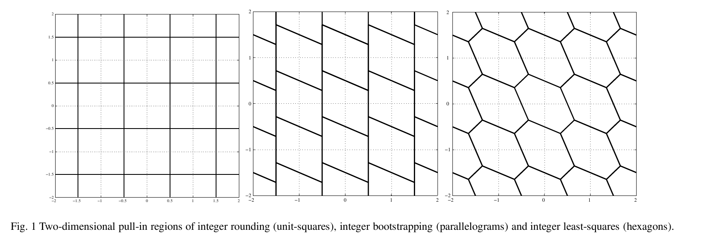
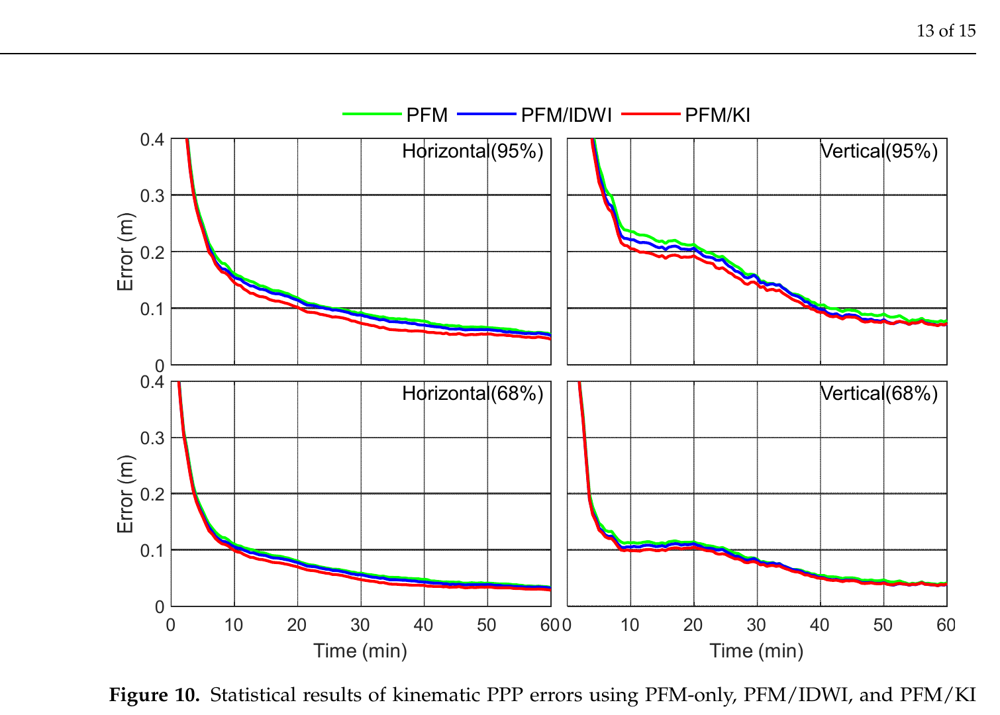
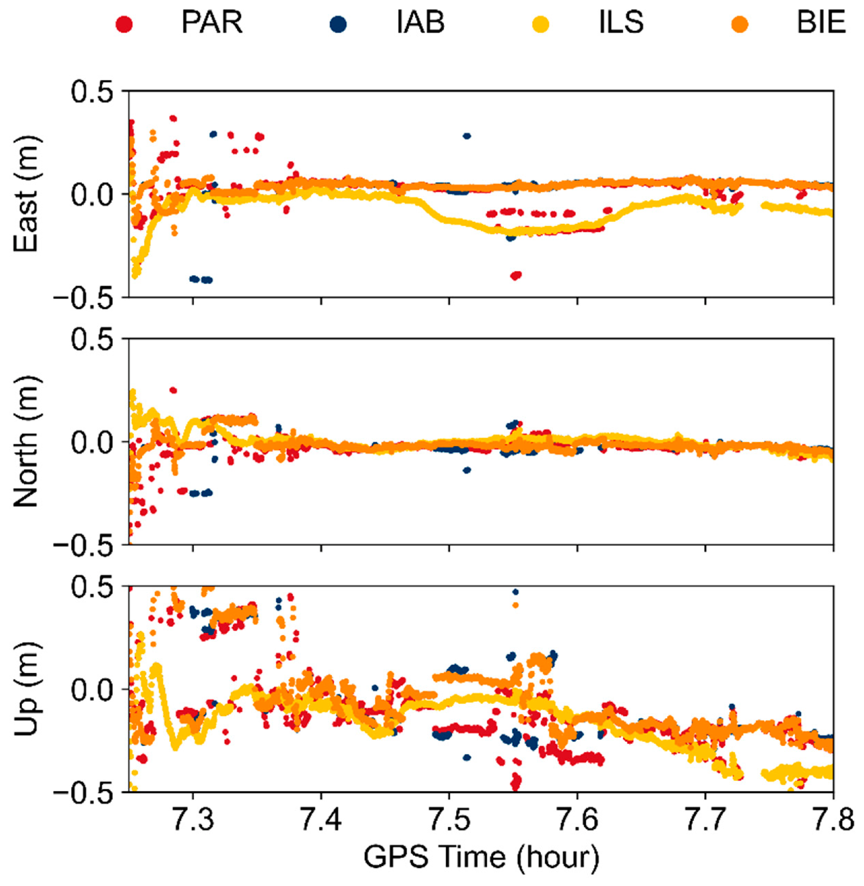

# 2026-11-17 GNSS 每日研究简报

## 今日快报

### 快报 1：NPU 不只跑神经网络，也能把长码直接捕获从数秒压到亚秒级

- 主题：`npu-accelerated-gnss-sdr-acquisition`
- 来源 ID：`arxiv:2611.18186`
- 来源链接：https://arxiv.org/abs/2611.18186
- 发表日期：2026-11-13
- 来源类型：arXiv 原始研究预印本；实现以 BSD 2-Clause 许可并入 PocketSDR-NPU
- 获取范围：开放全文、两种 ARM 单板机/NPU、合成灵敏度、长码直接搜索与整机实时实验；尚非同行评审定稿

**内容：** 论文把并行码搜索中的 DFT 拆成适合 NPU 的 $`1\times1`$ 卷积、逐元素乘法与转置，并针对独立显存 PCIe NPU 和 CPU/NPU 共享内存两种架构重新分配 DFT、非相干积累与峰值检测。实现覆盖短码、GPS L1CP 10 ms 与 L2CM 20 ms 长码，并接入开源 Pocket SDR。

**结论：** 在 Raspberry Pi 5 + AX8850 的特定实现中，短码搜索相对优化 CPU FFT 快 3.0–3.8 倍；L1CP/L2CM 全 ±5 kHz 直接搜索分别为 206/581 ms。整机测试把 90% 通道首次锁定时间从 66 s 降至 26 s，并把可实时跟踪通道数从约 175 提高到约 230。合成 IF 的 100 次/点试验未观察到超过 0.1 dB 的可辨灵敏度损失，但样本量不足以给出低虚警尾部保证，论文也未报告整板功耗。

**关注理由：** 捕获算力会挤占跟踪通道预算。将固定矩阵运算迁到已有 NPU，可能比增加 CPU 核更适合低成本多频 SDR；工程复现仍要同时测功耗、PCIe/内存传输、弱信号虚警和热降频。

### 快报 2：500 美元级 GNSS 驯服钟能服务射电天文，但共视差分稳定度不等于绝对 UTC

- 主题：`low-cost-gnss-disciplined-oscillator-astronomy`
- 来源 ID：`arxiv:2611.16023`
- 来源链接：https://arxiv.org/abs/2611.16023
- 发表日期：2026-11-11
- 来源类型：arXiv 原始研究预印本与开放硬件项目
- 获取范围：开放全文、五组 200000 s 共视记录、受限天空试验、硬件/固件与相干度分析；原始大体量记录需向作者索取

**内容：** SimpleClock 用 Septentrio mosaic-G5 T、10 MHz MEMS OCXO、热控铝块与外部控制器构成 10 MHz/PPS 参考；作者比较 standalone、SBAS、PPP/HAS、静态/rover 模式与卫星掩码，并用三钟帽和两两时差分析 ADEV/TDEV。

**结论：** 五段 200000 s 记录中，等效单机差分 ADEV 在 $`\tau=1000`$ s 时为 $`3.5\times10^{-13}`$ 至 $`1.0\times10^{-12}`$，TDEV 为 115–447 ps；开放天空 PPP/HAS 在 500 MHz 下保持 99% 平均钟相干度至 41 s。结果是同地共视、相对稳定度，公共电离层、卫星钟轨与改正产品误差可能相消，不能据此声称绝对 UTC 或跨洲基线达到同等指标。

**关注理由：** GNSS 授时器的关键不是只看 PPS 抖动，而是把回路常数、卫星几何、保持振荡器与应用积分时间放在一起。低成本原型可复现，但远程阵列还要加入独立可溯源参考和仪器延迟标定。

### 快报 3：每个积分周期直接校相能减 PLL 惯性，但短积分时会把未滤波噪声带回环路

- 主题：`dds-phase-correction-gnss-tracking-loop`
- 来源 ID：`arxiv:2611.14007`
- 来源链接：https://arxiv.org/abs/2611.14007
- 发表日期：2026-11-10
- 来源类型：arXiv 原始研究预印本
- 获取范围：开放全文、Vivado 仿真与自研 GPS L1 C/A 接收机对照试验；单星/单实现，未给出多次独立统计

**内容：** 方法在每个相干积分末端把载波相位鉴别量直接写回 DDS 相位累加器，使慢速二阶环路只需跟踪频率变化；作者还把它与 FLL 辅助 PLL 合并，讨论从 1 ms 启动切到 20 ms 长积分时的带宽收窄。

**结论：** 在论文的 GPS L1 C/A 实验中，校相通道用 1/20 ms 积分时对应 5/1 Hz PLL 带宽，传统通道用 25/5 Hz；约 37–40 dB-Hz 条件下，0.1–1 Hz 校相 PLL 的 DLL 鉴别量差异很小。作者同时显示 1 ms、25 Hz 时校相增加噪声；这些波形证明特定实现可稳定工作，不等于高动态、弱信号或不同鉴别器下的失锁概率已被统计验证。

**关注理由：** 长积分降热噪声，却扩大频差和相位累积风险。直接校相提供一种用结构换带宽的办法，但上线前必须做加速度、钟漂、数据位翻转、周跳与低 $`C/N_0`$ 的系统门限试验。

### 快报 4：Starlink 伪距做到米级依赖“运营商式”轨道钟，不是被动监听即可复制

- 主题：`mock-fused-starlink-pseudorange-pnt`
- 来源 ID：`arxiv:2611.13655`
- 来源链接：https://arxiv.org/abs/2611.13655
- 发表日期：2026-11-10
- 来源类型：arXiv 原始研究预印本，真实 Ku 波段信号外场实验
- 获取范围：开放全文、控制段/用户端接收链、超分辨 TOA、加权非线性解与形式协方差；仅 13 min、6 星、静态 OCXO 用户端

**内容：** 研究用高增益控制段接收机估计逐波束帧钟、导频和高精度轨道，再把这些信息转给窄带消费级用户端；用户端从 12.075 GHz Starlink 下行提取超分辨 TOA，并按“融合通信与导航服务”而非完全机会式监听求伪距 PNT。

**结论：** 13 min、6 颗卫星的静态试验给出形式 95% 水平误差椭圆半长轴 2.33 m、垂向 3.37 m、授时 11.19 ns，实际误差落在形式界内。该结果依赖控制段、SpaceX 高精度星历、OCXO 和离线处理；作者估计运营方仍需把星历监控到数米、钟到约 10 ns，不能把它写成任意手机已能无协助获得米级 Starlink 定位。

**关注理由：** 宽带 LEO 的 TOA 潜力来自大带宽，但可用定位服务还需要可追踪的轨道钟数据面。评估“机会信号”方案时必须把网络辅助、运营商合作和本地参考站成本单列。

### 快报 5：双蒸气室量子接收机的 10 dB 增益仍是协方差模型与蒙特卡洛证据

- 主题：`differential-rydberg-quantum-gnss-receiver`
- 来源 ID：`arxiv:2611.09653`
- 来源链接：https://arxiv.org/abs/2611.09653
- 发表日期：2026-11-06
- 来源类型：arXiv 原始理论研究预印本
- 获取范围：开放全文、解析噪声模型与每点超过 150000 次蒙特卡洛；无双蒸气室 GNSS 实物测量

**内容：** DRAQR 用本振相位把两只 Rydberg 蒸气室的期望信号送入差模，同时以共享压缩库建立量子投影噪声与光子散粒噪声的跨室相关；模型联合计算 SNR、Rician 衰落下的最小可检测功率和方形 M-QAM BER。

**结论：** 在作者设定中，光子散粒噪声相关趋近 1 时 SNR 增益接近 10 dB；$`\gamma_{th}=0`$ dB、最大中断概率 0.1 时，Rician $`K`$ 从 1.155 增至 2.4 对应最小功率由 −146.95 dBm 降至 −159.98 dBm。解析与蒙特卡洛在评估点吻合，但最关键的跨室协方差、相位平衡和压缩态保持尚未用该硬件实测，因此这是可行性边界，不是接收机灵敏度验收。

**关注理由：** 量子前端若只报告原子场灵敏度，容易遗漏光学读出与相关噪声。本文值得跟踪的是系统级噪声账，但下一步必须测真实 GPS L1 波形、带宽、动态范围、锁定时间与环境稳定性。

## 深度研读

### 深读 1｜接收机工程｜先看整数估计如何切分模糊度空间：ILS、BIE 与整数孔径不是同一目标

- 类别：`receiver-engineering`
- 学习层级：`foundation`
- 选题定位：`经典基础：从浮点模糊度、pull-in region 与三类估计器理解“固定、拒答、平滑”各自优化什么`
- 来源 ID：`doi:10.5081/jgps.2.1.1`
- 来源链接：https://gnss.curtin.edu.au/wp-content/uploads/sites/21/2016/04/Teunissen2003Towards.pdf
- 发表日期：2003
- 来源类型：Journal of Global Positioning Systems 同行评审综述性理论论文；作者公开 PDF，原刊未标示开放再利用许可
- 获取范围：全文、Definitions 1–3、Theorems 1–3 与 Figures 1–3 已核对；理论假设不等于具体 PPP-AR 数据已验证
- 价值评分：97/100（相关性 20，经典价值 20，证据 19，教学价值 20，工程价值 18）

#### 为什么先学这个

“定整成功”常被当成一个统一动作，但 ILS 必须输出整数，整数孔径允许拒绝固定，BIE 则输出多个整数候选的实数加权和。若不先分清目标函数，后面比较 PAR、IAB 与 BIE 的收敛时间和固定率会把不同任务混为一谈。

#### 先修知识

需要理解载波相位整周模糊度、线性化最小二乘、协方差矩阵、正态分布、整数格点、LAMBDA 去相关、均方误差（MSE）、正确固定率与错误固定率。二维图中的坐标是模糊度分量，单位为周。

#### 一句话逻辑

浮点模糊度空间被不同估计规则切成不同 pull-in regions：ILS 在高斯条件下最大化正确整数概率，整数孔径用留白控制错误固定，BIE 用所有整数候选的概率权重最小化 MSE。

#### 研究问题与约束

论文建立非贝叶斯统一框架，讨论整数估计（I）、整数等变估计（IE）与整数孔径估计（IA）的集合关系和各自最优性。结论可用于任何线性化含整数参数模型；但它不替用户选择噪声模型、失败率目标，也不覆盖模型失配、多路径或周跳造成的非高斯尾。

#### 核心方法论

先忽略整数约束得到浮点解 $`(\hat a,\hat b)`$；再用映射把 $`\hat a`$ 变成整数、实数等变或可拒绝的模糊度估计；最后利用 $`a`$ 与实参数 $`b`$ 的协方差，把模糊度更新反馈到位置等实参数。估计器由其 pull-in region 完全定义。

#### 关键公式逐步推导

线性化混合整数模型可写成：

```math
E(y)=Aa+Bb,\qquad a\in\mathbb Z^n,\ b\in\mathbb R^p.
```

获得浮点解后，任一模糊度估计 $`\check a`$ 对实参数的反馈为：

```math
\check b=\hat b-Q_{\hat b\hat a}Q_{\hat a\hat a}^{-1}(\hat a-\check a).
```

高斯浮点解下，ILS 选择协方差度量最近的整数：

```math
\check a_{\mathrm{ILS}}=\arg\min_{z\in\mathbb Z^n}
(\hat a-z)^TQ_{\hat a\hat a}^{-1}(\hat a-z).
```

BIE 则以各整数格点的似然归一化加权，通常给出实数而非硬固定值；IA 只在候选落入规定孔径时返回整数，否则保留非整数解。

#### 经典价值与创新边界

经典价值是用同一几何语言解释 rounding、bootstrapping、ILS、BIE、ratio test 与 difference test，并把“成功率最大”“MSE 最小”“给定失败率下成功率最大”明确分开。它不是某个实时接收机算法的速度比较，也没有证明经验 ratio 门限就是校准失败率。

#### 整体逻辑链

观测形成浮点模糊度与协方差；去相关改变搜索坐标但保持整数性；估计规则切分浮点空间；落入某区决定整数、拒答或加权结果；模糊度误差经交叉协方差传播到位置；因此估计器选择同时改变正确率、可用率、连续性与 MSE。

#### 原文图表与结果分析



> 图表源：Teunissen《Towards a Unified Theory of GNSS Ambiguity Resolution》Figure 1，[作者公开 PDF](https://gnss.curtin.edu.au/wp-content/uploads/sites/21/2016/04/Teunissen2003Towards.pdf)。本地资产由该 PDF 第 5 页以 240 dpi 渲染后裁取 Figure 1 与原图注；网格、边界和坐标未改动。原刊未标示开放再利用许可，仅保留研究评论所需最小片段，不暗示再授权。

三面板横纵轴均为两个浮点模糊度分量（周，范围 −2 至 2）：rounding 是单位方格，bootstrapping 因相关性形成平行四边形，ILS 按协方差度量形成六边形 Voronoi 区。图直接说明“最近整数”取决于度量与相关性；它没有画出概率密度，因此不能单凭面积或形状读出成功率。

#### 原文结果论述

论文证明：任意浮点分布下，最大似然整数估计在整数估计类中最大化正确整数概率；正态条件下它等同 ILS。BIE 在整数等变类中最小化 MSE，而最优 IA 在给定错误整数概率下最大化正确固定概率。三种“最优”针对不同损失函数，不能互换。

#### 常见误区与适用边界

第一，BIE 输出实数，不应计算“固定率”。第二，ILS 最优依赖模型和协方差正确，不保证抗异常。第三，ratio test 是 IA 的近似实例，不等于已知错误固定概率。第四，去相关不增加原始信息。第五，正确固定概率高仍不等于位置完整性风险已闭合。

#### 工程实现步骤

1. 保存浮点模糊度、完整协方差和观测质量标记。
2. 用整数可逆变换去相关，再执行一致的候选搜索。
3. 明确任务是最大正确率、限制错误率还是最小位置 MSE。
4. 对 ILS/PAR 记录候选距离与拒答原因；对 BIE 记录候选截断误差。
5. 将模糊度决策通过交叉协方差反馈到位置，而不是只替换一个整数。
6. 用注入异常和独立真值校准错误固定、可用率与长尾位置误差。

#### 复现实验设计

构造二维整数真值 $`a=[0,0]^T`$，相关系数取 0、0.5、0.9，标准差取 0.05–0.5 周；每组 Monte Carlo 运行 $`10^6`$ 次。比较 rounding、bootstrapping、ILS、BIE 与目标失败率 $`10^{-3}`$ 的 IA；报告正确/错误/拒答率、模糊度 MSE、位置 MSE 和运行时。再加入 1% 的 5 倍重尾噪声，检验高斯最优性失配。

#### 与定位及低成本实现的联系

低成本接收机的协方差更易受多路径和天线变化污染，硬 ILS 的错误代价可能高于短时浮点误差。BIE 可优先保连续性，IA/PAR 可优先控错误固定；下一节把同一思想放进 PPP-RTK，先提高区域电离层改正质量，让浮点模糊度本身更可分。

#### 本节小结

模糊度估计不是“找最近整数”这么简单。ILS、BIE 与整数孔径分别优化正确率、MSE 和给定失败率下的成功率；只有把目标写清，后续的固定率、收敛与稳定性比较才有意义。

### 深读 2｜接收机工程｜再用 Kriging 补区域电离层残差：先拟合大尺度趋势，再只传有信息的局部改正

- 类别：`receiver-engineering`
- 学习层级：`intermediate`
- 选题定位：`基础进阶：从 UDUC PPP-AR 提取斜电离层，理解 PFM 趋势项、Kriging 残差与用户端随机约束`
- 来源 ID：`doi:10.3390/s24072307`
- 来源链接：https://doi.org/10.3390/s24072307
- 发表日期：2024-04-05
- 来源类型：Sensors 同行评审开放论文，CC BY 4.0
- 获取范围：开放全文、湖南 103 个参考站/12 个用户站、单日 GPS 30 s 数据、Figures 1–10 与 Tables 1–2 已核对
- 价值评分：95/100（相关性 20，经典价值 17，证据 19，教学价值 19，工程价值 20）

#### 为什么先学这个

上一节的估计器只有在浮点模糊度和协方差可信时才有意义。PPP-RTK 中，区域电离层残差会同时拉宽模糊度分布并降低 ratio；因此先把大尺度趋势与局部相关残差分开，能直接改善定整前的统计模型。

#### 先修知识

需要掌握未差未组合（UDUC）PPP、码/相位硬件偏差、星间单差、UPD/OSB、LAMBDA、斜电离层延迟、薄层假设、半变异函数、Kriging 与 PFM/IDWI 基线。文中延迟以长度单位表示。

#### 一句话逻辑

逐星二次 PFM 先以 6 个系数描述区域斜电离层趋势，再用参考站残差的半变异函数计算 Kriging 权重；只有局部残差超过阈值时才下发插值补偿，从而兼顾带宽与精度。

#### 研究问题与约束

论文问：只发多项式系数的 PPP-RTK 电离层模型是否遗漏局部空间结构，以及 Kriging 是否优于只按距离加权。证据来自 2018-12-31 湖南 CORS 单日 GPS、20–70 km 站间距；没有多星座、强磁暴、多日独立测试或站网外推验证。

#### 核心方法论

服务端先用固定模糊度的 UDUC PPP-AR 逐站逐星提取斜电离层，再做星间单差消接收机硬件延迟。第一步用经纬度差的二次 PFM 估趋势；第二步对剩余残差拟合指数半变异函数，并在自适应搜索半径内做普通 Kriging。用户端把趋势与残差相加，并按模型精度约束自身电离层参数。

#### 关键公式逐步推导

对卫星 $`s`$、参考站 $`r`$，趋势项为：

```math
I_r^s=a_0+a_1\Delta\phi_r+a_2\Delta\lambda_r
+a_3\Delta\phi_r^2+a_4\Delta\lambda_r^2
+a_5\Delta\phi_r\Delta\lambda_r.
```

令 PFM 后残差为 $`Z(r_i)`$，用户位置 $`r_0`$ 的 Kriging 补偿为：

```math
\widehat Z(r_0)=\sum_{i=1}^{N}\omega_i Z(r_i),\qquad
\sum_{i=1}^{N}\omega_i=1.
```

权重由半变异函数 $`\gamma(h)=\tfrac12E[(Z(r)-Z(r+h))^2]`$ 与拉格朗日约束联立求出；最终改正等于 PFM 趋势加 Kriging 残差，而不是对原始 STEC 再做一遍无结构平均。

#### 经典价值与创新边界

价值在于把低带宽趋势模型和局部相关插值串成两步，并允许残差很小时跳过第二步。创新不等于 Kriging 自动给出完整性界；半变异函数、薄层高度、UPD 和固定模糊度错误仍会共同污染改正。

#### 整体逻辑链

参考站 UDUC PPP-AR 固定；提取逐星斜电离层；星间单差消硬件项；PFM 拟合区域趋势；检查局部残差；按半变异函数选择邻站并求 Kriging 权重；服务端广播系数/必要残差；用户恢复电离层约束；PPP-RTK 加速模糊度与坐标收敛。

#### 原文图表与结果分析



> 图表源：Xu 等《A Two-Step Regional Ionospheric Modeling Approach for PPP-RTK》Figure 10，CC BY 4.0，[开放全文](https://doi.org/10.3390/s24072307)。本地资产由出版方 PDF 第 13 页以 240 dpi 渲染后裁取 Figure 10 与原图注；曲线、坐标、图例和数值未改动。

横轴是初始化后时间（min），纵轴是水平/垂向误差（m）；上排为 95% 分位、下排为 68% 分位，绿/蓝/红分别是 PFM、PFM/IDWI、PFM/KI。红线在多数时段略低，但三条线后期接近；图直接显示单日区域数据上的统计收敛差异，不能证明强磁暴、多日或 70 km 以上稀疏站网仍有相同收益。

#### 原文结果论述

103 站内部残差小于 5 cm 的比例，PFM、PFM/IDWI、PFM/KI 分别为 92%、94%、97%；12 个用户站上 PFM/KI 电离层误差平均 RMS 为 1.8 cm，较两基线低约 48% 和 23%。21 个 1 h 会话的平均水平/垂向收敛为 1.8/4.0 min，收敛后 RMS 为 1.3/2.5 cm；这里“收敛”定义为误差低于 20 cm 并在后续历元保持。

#### 常见误区与适用边界

第一，1.8 cm 是模型误差 RMS，不是位置误差。第二，Kriging 权重依赖半变异函数，不是固定距离权。第三，固定模糊度错会污染所有下游改正。第四，单日 GPS 不能代表多系统与磁暴。第五，站内/同区域验证不等于站网外推能力。

#### 工程实现步骤

1. 在参考站端记录固定状态、UPD 版本和斜电离层协方差。
2. 逐星做硬件一致的星间单差，异常站不参与建模。
3. 每历元稳健估计 PFM 六系数并保存条件数。
4. 对 PFM 残差拟合半变异函数，限制搜索半径与最少邻站数。
5. 仅在残差超过阈值时下发 Kriging 补偿和质量标记。
6. 用户端把改正不确定度传播到模糊度协方差，失效时退回 ionosphere-weighted/floating。

#### 复现实验设计

使用同一区域至少 30 天、30 s 数据，按日期留一；站间距分 20–40、40–70、70–120 km，另选磁静/磁扰日。基线 A 为 PFM，B 为 PFM/IDWI，C 为 PFM/KI，D 为原始 Kriging；报告 STEC RMS/95 分位、广播字节率、正确/错误固定率、20 cm 收敛时间和位置 95 分位。故意注入错误固定、缺站与半变异函数失配。

#### 与定位及低成本实现的联系

区域电离层改正把 PPP-AR 推向 PPP-RTK：用户仍是单接收机，但网络提供可恢复整数性的相位偏差与大气约束。低成本终端可只接收小型系数和必要残差，前提是服务端同时提供质量；下一节比较四种定整策略在三频 PPP-AR 中如何消费这份统计信息。

#### 本节小结

PFM/KI 的关键不是“再插值一次”，而是先分离趋势与残差，再按空间相关性只补有信息的局部项。它在湖南单日 GPS 中改善了模型与收敛，但外部有效性仍需多日、多星座和磁暴验证。

### 深读 3｜纯 GNSS 定位｜最后让三频 PPP-AR 在快定整与稳解间取舍：PAR、BIE、ILS 与 IAB 谁负责什么

- 类别：`positioning`
- 学习层级：`advanced`
- 选题定位：`定位深入：用全球 275 站和纯 GNSS 车载数据比较四类模糊度策略，并分开收敛、固定、MSE 与算力`
- 来源 ID：`doi:10.3390/s26206553`
- 来源链接：https://doi.org/10.3390/s26206553
- 发表日期：2026-10-15
- 来源类型：Sensors 同行评审开放论文，CC BY 4.0
- 获取范围：开放全文、275 个 MGEX 站 7 天三频数据、双频对照与一条 1 Hz 车载轨迹、Figures 1–14/Tables 1–6 已核对
- 价值评分：97/100（相关性 20，经典价值 18，证据 20，教学价值 19，工程价值 20）

#### 为什么先学这个

第一节给出三类估计器，第二节说明如何收紧浮点协方差；本节把两者落到 PPP-AR。核心不是宣布一个“总冠军”，而是看 PAR 的快固定、BIE 的低 MSE、IAB 的拒错和 ILS 的全量整数承诺在同一数据链中如何交换算力、可用率与稳定性。

#### 先修知识

需要掌握 PPP-AR、UPD/OSB、未差未组合观测、EWL/WL/NL 级联、EKF、LAMBDA ratio、TTFF、固定率、收敛分位、BIE 候选截断、IAB aperture 和双/三频观测。BIE 不输出整数，因此无固定率。

#### 一句话逻辑

第三频率先缩短宽巷组合、改善浮点精度；随后 PAR 只固定能通过检验的子集，BIE 平滑多个整数候选，ILS 全量固定，IAB 用孔径拒绝高风险承诺，于是四者在速度、连续性、错误风险和算力上出现可解释差异。

#### 研究问题与约束

研究处理 275 个三频 MGEX 站、2025 DOY 147–153、30 s，采用 CODE 事后轨道/整数钟和武汉大学 OSB，并以模拟运动模式统计。车载数据来自 2020 DOY 351、Septentrio AsteRx4、1 Hz、武汉开阔至中等动态路线，RTK 解作参考；不是实时 SSR、城市峡谷或独立高等级真值。

#### 核心方法论

三频模糊度先变换为 EWL/WL/N1：EWL 因长波长直接取整，再约束 WL 与 N1。ILS/PAR ratio 均设 1.8，PAR 逐次剔除使候选比最差的模糊度；IAB aperture 为 0.5；BIE 保留 200 个整数候选做似然加权。双频对照保持其余设置一致。

#### 关键公式逐步推导

以三频浮点模糊度为 $`[\hat N_1,\hat N_2,\hat N_3]^T`$，论文的级联变换为：

```math
\begin{bmatrix}
\hat N_{\mathrm{EWL}}\\
\hat N_{\mathrm{WL}}\\
\hat N_1
\end{bmatrix}
=
\begin{bmatrix}
0&1&-1\\
1&-1&0\\
1&0&0
\end{bmatrix}
\begin{bmatrix}
\hat N_1\\\hat N_2\\\hat N_3
\end{bmatrix}.
```

ILS 仍求协方差加权最近整数；BIE 用：

```math
\check a_{\mathrm{BIE}}=
\frac{\sum_{z\in\mathbb Z^n}z\exp[-\tfrac12\|\hat a-z\|_Q^2]}
{\sum_{u\in\mathbb Z^n}\exp[-\tfrac12\|\hat a-u\|_Q^2]}.
```

PAR 重复 ILS 并剔除使 ratio 改善最大的模糊度；IAB 将 bootstrapping pull-in region 按 $`\beta_{IAB}`$ 收缩，以降低错误整数承诺。

#### 经典价值与创新边界

价值在于把 ILS、PAR、BIE、IAB 放在相同三频 PPP-AR 数据和参数下，既测全球站网也测车载，并给双频对照。边界是 ratio 1.8、aperture 0.5、200 候选等超参数未做完整敏感性分析；固定率也不等于正确固定率或完整性风险。

#### 整体逻辑链

读取三频码相位、轨道钟与 OSB；EKF 估计浮点状态；EWL/WL/N1 级联；按四种策略处理整数候选；模糊度结果反馈坐标；统计 TTFF、收敛分位、固定率、位置 RMS 和计算成本；再用双频与车载数据检验频率增益和动态稳定性。

#### 原文图表与结果分析



> 图表源：Yang 等《Analysis of Triple-Frequency PPP Ambiguity Resolution with Different Ambiguity Fixing Methods》Figure 14，CC BY 4.0，[开放全文](https://doi.org/10.3390/s26206553)。本地资产从出版方 PDF 第 16 页无损提取嵌入原图；未裁剪、重绘、缩放或改写曲线、坐标、图例和数值。

横轴是 GPS 时间 7.25–7.8 h，纵轴为 East/North/Up 误差（m，范围约 ±0.5 m）；红、蓝、黄、橙分别为 PAR、IAB、ILS、BIE。BIE 的水平轨迹最连续，ILS 在东向出现约 −0.2 m 平台，垂向四者都慢且偏负。图只覆盖一条偏开阔路线，不能证明城市遮挡、实时产品或所有接收机上 BIE/ PAR 都保持排序。

#### 原文结果论述

全球数据中 PAR 的 68% 水平/垂向收敛均为 1.0 min，84% 为 3.0 min；代价是平均算时约为 ILS 的 38 倍。三频相对双频将站均 86% 水平收敛时间对 ILS/IAB/PAR/BIE 分别缩短约 43%/42%/25%/11%。车载中 BIE 东/北 RMS 为 0.043/0.059 m，但无固定率；PAR 固定率 97.531%，ILS 5.137%，IAB 77.424%。这些是作者设置下的报告，不是校准错误固定概率。

#### 常见误区与适用边界

第一，BIE 没有整数固定率。第二，PAR 97.5% 是接受/固定比例，不是正确率。第三，第三频率的主要收益是去掉慢收敛尾，位置 RMS 改善只有 1–28%。第四，事后产品优于实时 SSR。第五，RTK 参考与同一路线不构成城市独立泛化。

#### 工程实现步骤

1. 对每个频点维护 OSB、天线 PCV、周跳与观测方差的一致版本。
2. 先固定 EWL，再把其不确定度正确传播到 WL/N1。
3. 并行计算 ILS 候选距离、PAR 子集、BIE 权重和 IAB 拒答状态。
4. 用场景策略选择输出：开阔快速 PAR、连续性优先 BIE、低错误承诺 IAB。
5. 记录候选数、ratio、aperture、被剔卫星与 CPU 时延。
6. 固定后仍用残差、时间连续性和保护级/错误固定监测做独立门控。

#### 复现实验设计

先复现 275 站、7 天、30 s 和车载 1 Hz；基线为双频/三频 float、ILS、PAR、BIE、IAB。ratio 扫 1.5–3.0，aperture 扫 0.2–0.8，BIE 候选取 50/200/1000；报告正确/错误/拒答率、TTFF 50/68/84/95 分位、NEU 95/99 分位、CPU/内存和实时截止违约。再用实时 SSR、城市峡谷与不同接收机做外部测试。

#### 与定位及低成本实现的联系

该高级项只使用 GNSS 码、载波、卫星产品和偏差改正，车载部分也未融合 IMU/地图/视觉，属于纯 GNSS PPP-AR。低成本终端未必能承担 PAR/BIE 的峰值算力，可采用候选维数上限、按场景切换和服务器辅助偏差产品；但不能牺牲错误固定审计。

#### 本节小结

三频并未产生一个对所有目标都最优的定整器：PAR 快且高可用，BIE 稳且低 MSE，IAB 可拒绝风险，ILS 简洁但动态全量固定脆弱。工程选择应由损失函数与截止时间驱动，而不是只看固定率。
